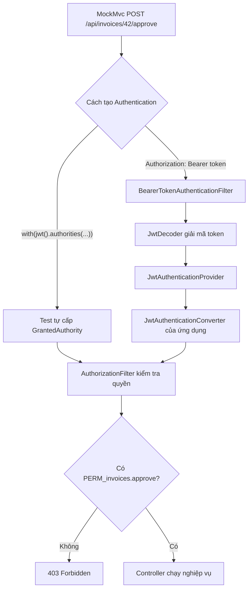

# Khi gán quyền trực tiếp làm bỏ qua bộ chuyển đổi quyền của ứng dụng

Khi kiểm thử JWT bằng `MockMvc` và `spring-security-test`, cách viết `.with(jwt().authorities(...))` rất tiện: bài test đặt thẳng danh sách `GrantedAuthority` vào đối tượng xác thực. Nhưng cũng chính vì thế, bài test có thể **bỏ qua bộ chuyển đổi quyền JWT mà ứng dụng thực sự cấu hình**. Một test xanh chưa chắc chứng minh claim trong JWT được ánh xạ thành quyền đúng khi request thật đi qua OAuth2 Resource Server.

Bài này thuộc phần **JWT với MockMvc** của module `SPRING_SECURITY_TESTING`, tập trung vào việc phát hiện và tránh lỗi kiểm thử đó trên ứng dụng Servlet. Ta sẽ so sánh ba tầng: xác thực giả lập trực tiếp, kiểm thử riêng converter và kiểm thử qua `Authorization: Bearer ...` với `JwtDecoder` được mock. Các nguyên tắc phân biệt này cũng hữu ích khi thiết kế kiểm thử JWT/OAuth2 và phân quyền trên các hệ thống lớn; `WebTestClient` dùng các công cụ tương ứng khi ứng dụng là Reactive.

## 1. Tình huống: quyền nằm ở claim riêng của ứng dụng

Giả sử API phê duyệt hóa đơn yêu cầu authority chính xác là `PERM_invoices.approve`. Identity provider cấp JWT có claim `permissions`:

```json
{
  "sub": "lan",
  "permissions": ["invoices.read", "invoices.approve"],
  "scope": "profile"
}
```

Ứng dụng muốn chuyển mỗi phần tử trong `permissions` thành một `GrantedAuthority` có tiền tố `PERM_`, chẳng hạn `invoices.approve` → `PERM_invoices.approve`. Đây là **quy tắc của ứng dụng**, khác với quy tắc mặc định của Spring Security: `JwtGrantedAuthoritiesConverter` thường đọc `scope`/`scp` và tạo authority có tiền tố `SCOPE_`.

Ta cần kiểm chứng hai điều riêng biệt:

1. **Ánh xạ:** JWT mang `permissions = ["invoices.approve"]` thực sự sinh ra `PERM_invoices.approve`; JWT không mang quyền ấy thì không sinh ra quyền tương đương.
2. **Tích hợp:** Cấu hình Resource Server thực sự dùng converter nói trên khi request đi qua `BearerTokenAuthenticationFilter`, rồi áp dụng quyền ở endpoint.

Nếu test tự điền `PERM_invoices.approve` vào SecurityContext, nó đã **giả định điều số 1 là đúng** và không kiểm chứng điều số 2.

## 2. Hai đường đi xác thực rất khác nhau



**Đường ngắn – `jwt()` từ `spring-security-test`:** `SecurityMockMvcRequestPostProcessors.jwt()` gắn một `JwtAuthenticationToken` giả lập cho request. Khi gọi `.authorities(...)`, test quyết định trước quyền nào được cấp. Nó **không yêu cầu** `JwtDecoder` giải mã token và **không tự động gọi** `JwtAuthenticationConverter` đang nối vào Resource Server.

**Đường thật của tầng HTTP – Bearer header:** Khi request chứa `Authorization: Bearer ...` và đi qua SecurityFilterChain Resource Server, `BearerTokenAuthenticationFilter` lấy token, `JwtAuthenticationProvider` gọi `JwtDecoder`, rồi dùng `JwtAuthenticationConverter` để tạo `Authentication` cho bước phân quyền.

Một điểm tinh tế: ngay cả `jwt().jwt(jwt -> jwt.claim("permissions", ...))`, **khi không tự chỉ định authorities**, cũng không chứng minh converter riêng của ứng dụng được dùng. Test post-processor có cách dựng authorities mặc định của nó; thông thường claim `permissions` riêng sẽ không được hiểu như cấu hình production. Chỉ truyền claim đúng chưa đủ để kiểm tra wiring của converter.

## 3. Cấu hình Resource Server dùng converter quyền tùy chỉnh

Để thấy sự khác biệt, ta tạo một ví dụ Spring Boot Servlet với `spring-boot-starter-security`, `spring-boot-starter-oauth2-resource-server`, `spring-boot-starter-web`, `spring-boot-starter-test` và `spring-security-test`.

```java
import org.springframework.context.annotation.Bean;
import org.springframework.context.annotation.Configuration;
import org.springframework.http.HttpMethod;
import org.springframework.security.config.annotation.web.builders.HttpSecurity;
import org.springframework.security.oauth2.server.resource.authentication.JwtAuthenticationConverter;
import org.springframework.security.oauth2.server.resource.authentication.JwtGrantedAuthoritiesConverter;
import org.springframework.security.web.SecurityFilterChain;

@Configuration
class ApiSecurityConfig {

    @Bean
    JwtAuthenticationConverter invoiceJwtConverter() {
        JwtGrantedAuthoritiesConverter authorities =
                new JwtGrantedAuthoritiesConverter();
        authorities.setAuthoritiesClaimName("permissions");
        authorities.setAuthorityPrefix("PERM_");

        JwtAuthenticationConverter converter =
                new JwtAuthenticationConverter();
        converter.setJwtGrantedAuthoritiesConverter(authorities);
        return converter;
    }

    @Bean
    SecurityFilterChain apiSecurity(
            HttpSecurity http,
            JwtAuthenticationConverter invoiceJwtConverter
    ) throws Exception {
        return http
                .authorizeHttpRequests(auth -> auth
                        .requestMatchers(
                                HttpMethod.POST,
                                "/api/invoices/*/approve")
                        .hasAuthority("PERM_invoices.approve")
                        .anyRequest().authenticated())
                .oauth2ResourceServer(oauth2 -> oauth2
                        .jwt(jwt -> jwt
                                .jwtAuthenticationConverter(
                                        invoiceJwtConverter)))
                .build();
    }
}
```

Ở đây ta chủ động giữ cấu hình CSRF mặc định để trong test có thể kiểm tra riêng điều kiện phân quyền. Mọi `POST` trong ví dụ kiểm thử sẽ đính `.with(csrf())`. Với API chỉ chấp nhận bearer token và không sử dụng cookie xác thực, dự án có thể có cấu hình CSRF khác; khi đó phải kiểm thử đúng cấu hình thực tế, không để lỗi CSRF vô tình đóng vai trò của lỗi quyền.

Controller minh họa:

```java
import org.springframework.http.ResponseEntity;
import org.springframework.stereotype.Service;
import org.springframework.web.bind.annotation.PathVariable;
import org.springframework.web.bind.annotation.PostMapping;
import org.springframework.web.bind.annotation.RequestMapping;
import org.springframework.web.bind.annotation.RestController;

@Service
class InvoiceApprovalService {
    public void approve(String invoiceId) {
        // Trong ứng dụng thật: xác nhận hóa đơn, ghi DB, phát sự kiện...
    }
}

@RestController
@RequestMapping("/api/invoices")
class InvoiceController {
    private final InvoiceApprovalService approvalService;

    InvoiceController(InvoiceApprovalService approvalService) {
        this.approvalService = approvalService;
    }

    @PostMapping("/{id}/approve")
    ResponseEntity<Void> approve(@PathVariable String id) {
        approvalService.approve(id);
        return ResponseEntity.noContent().build();
    }
}
```

Trong tình huống này, quyền được kiểm tra **ở cấu hình HTTP** bằng `authorizeHttpRequests`. Vì bài kiểm thử đang tập trung vào converter và HTTP authorization, mock `InvoiceApprovalService` để xác nhận controller được gọi là phù hợp. Nếu thay bằng kiểm tra `@PreAuthorize` nằm trên chính service, cần giữ service là Spring bean thật và chỉ mock các dependency phía sau; mock service được bảo vệ sẽ che khuất method-security interceptor.

## 4. Vì sao test gán authorities trực tiếp có thể xanh sai?

Xét JWT chỉ có quyền đọc, nhưng test lại cấp quyền phê duyệt bằng `.authorities(...)`:

```java
import java.util.List;
import org.springframework.security.core.authority.SimpleGrantedAuthority;
import org.springframework.security.oauth2.jwt.Jwt;

import static org.springframework.security.test.web.servlet.request
        .SecurityMockMvcRequestPostProcessors.csrf;
import static org.springframework.security.test.web.servlet.request
        .SecurityMockMvcRequestPostProcessors.jwt;
import static org.springframework.test.web.servlet.request.MockMvcRequestBuilders.post;
import static org.springframework.test.web.servlet.result.MockMvcResultMatchers.status;

Jwt readOnlyJwt = Jwt.withTokenValue("read-only")
        .header("alg", "RS256")
        .subject("lan")
        .claim("permissions", List.of("invoices.read"))
        .build();

mockMvc.perform(post("/api/invoices/42/approve")
                .with(jwt()
                        .jwt(readOnlyJwt)
                        .authorities(new SimpleGrantedAuthority(
                                "PERM_invoices.approve")))
                .with(csrf()))
        .andExpect(status().isNoContent());
```

Kết quả **204** trong test này có thể hoàn toàn đúng với `Authentication` mà test dựng ra, nhưng **sai với ý nghĩa JWT đang được mô phỏng**: token chỉ có `invoices.read`. Test đã đưa thẳng `PERM_invoices.approve` vào `SecurityContext`, nên bộ phân quyền thấy quyền hợp lệ và cho qua. `JwtDecoder` và converter được cấu hình trong `apiSecurity` không bị gọi bởi cơ chế `jwt()` này.

Nếu sau này một lập trình viên vô tình đổi `authorities.setAuthoritiesClaimName("permissions")` thành `"roles"`, test trên vẫn xanh vì nó chưa từng phụ thuộc vào ánh xạ claim. Đây là **false positive về độ bao phủ cấu hình**, không phải lỗi của Mockito, MockMvc hay Spring Security.

Tình huống ngược lại cũng có thể xuất hiện: test dùng `jwt().jwt(jwt -> jwt.claim("permissions", ...))` nhưng không cấp authorities rõ ràng. Vì bộ dựng JWT giả lập mặc định không phản ánh converter ứng dụng, test có thể nhận **403 dù request bearer thật đáng lẽ được phép**. Bài test khi ấy đo sai tầng cần kiểm tra.

## 5. Test đi qua converter ứng dụng: Bearer header + mock JwtDecoder

Cách phù hợp để xác minh **wiring của converter trong SecurityFilterChain** là gửi bearer token ở request và thay thế `JwtDecoder` bằng Mockito mock. Ta làm cho decoder trả về một `Jwt` đã giải mã với claims cần kiểm tra, trong khi mọi thành phần phía sau decoder vẫn là cấu hình Spring Security thật.

Đoạn kiểm thử sau dùng `@MockitoBean` của Spring Framework 6.2+ (thường là Spring Boot 3.4+). Với dự án phiên bản cũ, có thể dùng cơ chế mock bean tương ứng nhưng giữ nguyên nguyên tắc: mock **decoder**, không mock `JwtAuthenticationConverter` hoặc tự tiêm quyền vào request.

```java
import java.util.List;

import org.junit.jupiter.api.Test;
import org.springframework.beans.factory.annotation.Autowired;
import org.springframework.boot.test.autoconfigure.web.servlet.AutoConfigureMockMvc;
import org.springframework.boot.test.context.SpringBootTest;
import org.springframework.http.HttpHeaders;
import org.springframework.security.oauth2.jwt.Jwt;
import org.springframework.security.oauth2.jwt.JwtDecoder;
import org.springframework.test.context.bean.override.mockito.MockitoBean;
import org.springframework.test.web.servlet.MockMvc;

import static org.mockito.Mockito.verify;
import static org.mockito.Mockito.verifyNoInteractions;
import static org.mockito.Mockito.when;
import static org.springframework.security.test.web.servlet.request
        .SecurityMockMvcRequestPostProcessors.csrf;
import static org.springframework.test.web.servlet.request.MockMvcRequestBuilders.post;
import static org.springframework.test.web.servlet.result.MockMvcResultMatchers.status;

@SpringBootTest
@AutoConfigureMockMvc
class JwtConverterHttpTest {

    @Autowired
    MockMvc mockMvc;

    @MockitoBean
    JwtDecoder jwtDecoder;

    @MockitoBean
    InvoiceApprovalService approvalService;

    private static Jwt jwt(String tokenValue, String... permissions) {
        return Jwt.withTokenValue(tokenValue)
                .header("alg", "RS256")
                .subject("lan")
                .claim("permissions", List.of(permissions))
                .build();
    }

    @Test
    void permissionsApprove_isConvertedAndAccepted() throws Exception {
        when(jwtDecoder.decode("approve-token"))
                .thenReturn(jwt("approve-token", "invoices.approve"));

        mockMvc.perform(post("/api/invoices/{id}/approve", "42")
                        .header(HttpHeaders.AUTHORIZATION, "Bearer approve-token")
                        .with(csrf()))
                .andExpect(status().isNoContent());

        verify(jwtDecoder).decode("approve-token");
        verify(approvalService).approve("42");
    }

    @Test
    void readOnlyPermission_isConvertedButRejected() throws Exception {
        when(jwtDecoder.decode("read-token"))
                .thenReturn(jwt("read-token", "invoices.read"));

        mockMvc.perform(post("/api/invoices/{id}/approve", "42")
                        .header(HttpHeaders.AUTHORIZATION, "Bearer read-token")
                        .with(csrf()))
                .andExpect(status().isForbidden());

        verify(jwtDecoder).decode("read-token");
        verifyNoInteractions(approvalService);
    }

    @Test
    void onlyScopeClaim_cannotReplaceCustomPermissions() throws Exception {
        Jwt tokenWithoutPermissions = Jwt.withTokenValue("scope-only")
                .header("alg", "RS256")
                .subject("lan")
                .claim("scope", "invoices.approve")
                .build();

        when(jwtDecoder.decode("scope-only"))
                .thenReturn(tokenWithoutPermissions);

        mockMvc.perform(post("/api/invoices/{id}/approve", "42")
                        .header(HttpHeaders.AUTHORIZATION, "Bearer scope-only")
                        .with(csrf()))
                .andExpect(status().isForbidden());

        verify(jwtDecoder).decode("scope-only");
        verifyNoInteractions(approvalService);
    }
}
```

Ba ca có vai trò bổ trợ nhau:

| JWT do decoder trả về | Kết quả kỳ vọng | Điều được kiểm chứng |
|---|---|---|
| `permissions: ["invoices.approve"]` | 204; service được gọi | Converter tạo `PERM_invoices.approve`; HTTP rule chấp nhận. |
| `permissions: ["invoices.read"]` | 403; service không được gọi | Claim thiếu quyền phê duyệt không bị cấp dư authority. |
| Chỉ có `scope: "invoices.approve"` | 403; service không được gọi | Ứng dụng đang đọc `permissions`, không tự động lấy `scope` thay cho claim riêng. |

Để các bài test nói trên thực sự có ý nghĩa, `@SpringBootTest` phải nạp cấu hình `ApiSecurityConfig` tương tự production và request phải khớp đúng SecurityFilterChain. Nếu project dùng nhiều chain hoặc profile kiểm thử, cần chắc chắn chain chứa `jwtAuthenticationConverter(invoiceJwtConverter)` là chain áp dụng cho URL đang test.

### Điểm giới hạn của bài test dùng mock decoder

Test này chứng minh luồng **Bearer header → converter thật → phân quyền HTTP**. Do `JwtDecoder` bị mock, nó **không chứng minh** chữ ký JWT, thuật toán, thời hạn token, `issuer` hay `audience` được xác thực chính xác. Để kiểm thử mật mã và chính sách token, phải dùng `JwtDecoder` thật cùng token khóa thử phù hợp hoặc môi trường tích hợp riêng.

## 6. Test converter riêng để khoanh vùng lỗi ánh xạ

Một unit test/bean test tập trung vào converter có thể xác định chính xác quyền nào được sinh ra:

```java
@Autowired
JwtAuthenticationConverter invoiceJwtConverter;

@Test
void customConverter_mapsPermissionsToConfiguredPrefix() {
    Jwt token = Jwt.withTokenValue("test")
            .header("alg", "RS256")
            .subject("lan")
            .claim("permissions", List.of("invoices.approve"))
            .build();

    var authentication = invoiceJwtConverter.convert(token);

    assertThat(authentication).isNotNull();
    assertThat(authentication.getAuthorities())
            .extracting(GrantedAuthority::getAuthority)
            .containsExactly("PERM_invoices.approve");
}
```

Đoạn này dùng AssertJ `assertThat` và `GrantedAuthority` từ Spring Security, có thể đặt như một test bổ sung trong lớp được Spring cấp bean converter. Nó kiểm chứng **logic ánh xạ**; bài test `MockMvc` dùng bearer token ở mục 5 mới kiểm chứng **wiring thực tế**.

Nếu chỉ cần thử logic chuyển claim theo nhiều giá trị, có thể unit test `JwtGrantedAuthoritiesConverter` trực tiếp. Một số test post-processor cũng cho phép truyền converter tường minh:

```java
JwtGrantedAuthoritiesConverter authorities =
        new JwtGrantedAuthoritiesConverter();
authorities.setAuthoritiesClaimName("permissions");
authorities.setAuthorityPrefix("PERM_");

mockMvc.perform(post("/api/invoices/42/approve")
                .with(jwt().jwt(jwtWithPermissions)
                        .authorities(authorities))
                .with(csrf()))
        .andExpect(status().isNoContent());
```

Ở ví dụ cuối, `jwtWithPermissions` là một `Jwt` đã dựng trước có claim `permissions` thích hợp. Converter **được truyền thủ công vào test post-processor** sẽ chạy, nhưng cách này vẫn **không chứng minh** application SecurityFilterChain dùng cùng converter đó. Hơn nữa, nó chỉ áp dụng converter authorities, chưa chắc kiểm chứng các tùy chỉnh khác của `JwtAuthenticationConverter` như principal claim hoặc cách dựng authentication.

## 7. Chọn cách giả lập phù hợp với điều muốn chứng minh

| Cách viết trong kiểm thử | Có dùng JwtDecoder thật? | Có tự động dùng converter ứng dụng? | Phù hợp để kiểm tra |
|---|---|---|---|
| `@WithMockUser(authorities = "...")` | Không | Không | Điều kiện phân quyền với authority đã biết. |
| `.with(jwt().authorities(...))` | Không | Không | Hành vi endpoint khi đã có authority cụ thể. |
| `.with(jwt().jwt(...))` | Không | Không | Test nhanh với JWT giả lập và quy tắc authorities mặc định của post-processor. |
| `.with(jwt().authorities(customConverter))` | Không | Không tự động; chỉ converter được truyền vào test | Logic chuyển claim được chọn thủ công. |
| `Authorization: Bearer ...` + mock `JwtDecoder` | Không | **Có**, khi chain production được nạp | Tích hợp decoder output, converter, HTTP authorization và controller. |
| `Authorization: Bearer ...` + decoder thật | **Có** | **Có** | Luồng JWT tích hợp sâu hơn, gồm các điều kiện xác thực token được cấu hình. |

Lưu ý với `@WithMockUser(roles = "ADMIN")`: Spring Security thường tạo authority `ROLE_ADMIN`. Nó không chứng minh cách JWT `roles` hay `permissions` được ánh xạ ở production. Tương tự, `oauth2Login()` và `oidcLogin()` mô phỏng luồng đăng nhập OAuth2/OIDC, không mặc nhiên là kiểm thử một API Resource Server nhận bearer JWT.

Khi ứng dụng dùng **method security** bên cạnh HTTP authorization, nguyên tắc chọn tầng kiểm thử không đổi: test nhanh có thể cấp sẵn authority để kiểm tra `@PreAuthorize`, nhưng test ánh xạ JWT thật phải đi qua chain xác thực có converter cấu hình. Không nên dùng cùng một test để tuyên bố đã chứng minh cả hai mục đích nếu một phần của luồng bị thay thế bằng dữ liệu gán tay.

## 8. Phát hiện bài kiểm thử xanh giả bằng phép thay đổi có kiểm soát

Một cách đánh giá độ mạnh của bộ test là giả sử cấu hình converter bị sai: chẳng hạn thay tên claim `permissions` thành `roles` hoặc tiền tố `PERM_` thành `ROLE_`.

- Với test `.with(jwt().authorities(new SimpleGrantedAuthority("PERM_invoices.approve")))`, phản hồi vẫn có thể là 204 vì test đã tự cấp authority, nên không phát hiện cấu hình bị đổi.
- Với test bearer token + mock `JwtDecoder`, claim `permissions` không còn được ánh xạ đúng; ca cho phép sẽ chuyển từ 204 thành 403. Đây là tín hiệu bài test đang thực sự phụ thuộc vào cấu hình cần bảo vệ.
- Với unit test converter, assertion `containsExactly("PERM_invoices.approve")` cũng sẽ thất bại nếu tên claim hoặc tiền tố thay đổi.

Đây là một **thí nghiệm tư duy** để chọn test phù hợp, không phải yêu cầu sửa cấu hình production. Kết quả quan sát phụ thuộc vào chain đang nạp và cách application xác định quyền.

## 9. Các lỗi cần tránh

1. **Coi `jwt().authorities(...)` là kiểm thử converter:** Nó đặt kết quả chuyển đổi vào `Authentication` trước, khiến bộ chuyển đổi thật không được kiểm tra.
2. **Coi `jwt().jwt(...claim...)` là kiểm thử wiring production:** Claim mô phỏng không bảo đảm post-processor dùng converter đang cấu hình trong ứng dụng.
3. **Mock cả `JwtAuthenticationConverter` khi muốn test converter:** Cách này xóa đúng logic cần xác minh. Với kiểm thử tích hợp, mock `JwtDecoder` để kiểm soát claims.
4. **Quên CSRF khi dùng POST:** 403 có thể phát sinh trước bearer authorization. Ví dụ Servlet ở đây dùng `.with(csrf())` để tránh nhầm nguyên nhân.
5. **Dùng `@WebMvcTest` mà thiếu SecurityConfig:** Slice test có thể chạy với chain khác production. Cần import đúng cấu hình hoặc dùng `@SpringBootTest` cho mục tiêu tích hợp.
6. **Chỉ thử nhánh 403:** Một cấu hình từ chối mọi token cũng cho kết quả 403. Luôn có ca quyền hợp lệ được phép và xác minh service nhận lời gọi.
7. **Kết luận token đã được xác minh chữ ký khi decoder bị mock:** Test bearer với mock decoder chỉ bắt đầu từ JWT đã giải mã; nó chưa kiểm tra tính hợp lệ mật mã của token.
8. **Mock sai đối tượng ở tầng method security:** Nếu đang kiểm tra `@PreAuthorize` trên service, mock service sẽ bỏ qua interceptor. Chỉ mock service khi mục tiêu test là URL authorization/converter như ví dụ.

## 10. Checklist trước khi kết luận test JWT đã đủ mạnh

- [ ] Biểu thức phân quyền kiểm tra đúng authority mà ứng dụng thật yêu cầu (`hasAuthority` khác với `hasRole`).
- [ ] Có test claim `permissions` hợp lệ tạo được authority có tiền tố `PERM_` qua converter ứng dụng.
- [ ] Có test claim thiếu quyền hoặc sai claim bị từ chối, không phát sinh tác vụ nghiệp vụ.
- [ ] Khi mục tiêu là kiểm tra wiring Resource Server, request dùng `Authorization: Bearer ...` và chỉ decoder được mock.
- [ ] Test chạy qua đúng `SecurityFilterChain`; CSRF, authentication entry point và URL matcher không che khuất kết quả.
- [ ] Có test cho nhánh được phép; nếu cần kiểm thử token hợp lệ về mật mã, thêm luồng decoder thật.
- [ ] Không dùng kết quả test gán thẳng authorities để khẳng định bộ chuyển đổi JWT đã hoạt động.

**Kết luận kỹ thuật:** `jwt().authorities(...)` là công cụ tốt khi chủ đích là **kiểm tra hành vi phân quyền với authority đã được xác định**. Khi mục tiêu là **chứng minh ứng dụng chuyển claims JWT thành authorities đúng cách**, cần thêm kiểm thử converter riêng và đặc biệt là kiểm thử HTTP bearer đi qua converter thật của `SecurityFilterChain`.
