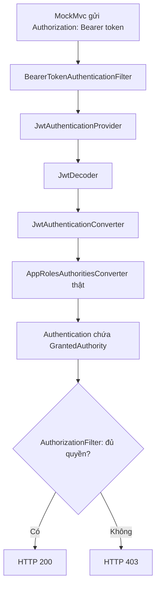

# Gọi bộ chuyển đổi quyền thật để kiểm tra quy tắc ánh xạ riêng

Khi kiểm thử một API bảo vệ bằng JWT, điều kiện quan trọng không chỉ là “có token thì được truy cập”, mà là **các claim trong JWT được biến thành những quyền nào**. Ứng dụng có thể nhận `scope`, `scp`, `roles`, `app_roles` hoặc các claim lồng nhau, rồi áp dụng quy tắc đổi tên, thêm tiền tố, chuẩn hóa vai trò và kết hợp nhiều nguồn quyền. Nếu bài kiểm thử tự gán sẵn `ROLE_REVIEWER` vào `SecurityContext`, một lỗi trong bộ chuyển đổi claim thành `GrantedAuthority` vẫn có thể bị bỏ sót.

Trong module **SPRING_SECURITY_TESTING**, chúng ta dùng `spring-security-test` để kiểm chứng xác thực, phân quyền và bảo vệ HTTP trên Servlet và Reactive. Bài này thuộc chương **JWT với MockMvc**, tập trung vào ba mức kiểm tra: gọi trực tiếp **converter thật** để chứng minh quy tắc ánh xạ; đưa chính converter đó vào `jwt()` của MockMvc; và gửi `Authorization: Bearer ...` qua filter chain để xác nhận **cấu hình ứng dụng thực sự sử dụng converter**. Cả các ca được phép và bị từ chối đều cần được kiểm tra.

## 1. Vấn đề: quyền trong token khác với quyền Spring Security kiểm tra

Giả sử hệ thống phát hành JWT với payload minh họa:

```json
{
  "sub": "user-42",
  "scope": "documents.read",
  "app_roles": ["reviewer"]
}
```

Ứng dụng đặt ra quy tắc:

| Nguồn trong JWT | Quy tắc ánh xạ | Authority cần có |
| --- | --- | --- |
| `scope: "documents.read"` | Giữ cách ánh xạ scope mặc định của Spring Security | `SCOPE_documents.read` |
| `app_roles: ["reviewer"]` | Viết hoa role đã nằm trong danh sách cho phép, thêm `ROLE_` | `ROLE_REVIEWER` |
| `app_roles: ["viewer"]` | Cùng quy tắc, nhưng không có quyền reviewer | `ROLE_VIEWER` |
| `app_roles: ["super_admin"]` | Role không nằm trong danh sách cho phép | Không sinh authority từ role này |
| Claim bị thiếu hoặc có kiểu dữ liệu sai | Bỏ qua phần không hợp lệ, không suy đoán quyền | Không có quyền tương ứng |

Hai endpoint demo:

- `GET /api/documents` yêu cầu `hasAuthority("SCOPE_documents.read")`.
- `GET /api/reviews` yêu cầu `hasRole("REVIEWER")`; Spring Security tìm authority `ROLE_REVIEWER`.

`JwtGrantedAuthoritiesConverter` mặc định thường đọc `scope` hoặc `scp`, chuyển mỗi scope thành `SCOPE_...`. Nó **không tự biết** quy tắc nghiệp vụ dành cho `app_roles`. Do đó, dù JWT chứa `"app_roles": ["reviewer"]`, một kiểm thử dùng sẵn `ROLE_REVIEWER` không chứng minh được cơ chế ánh xạ đó đã chạy.

Trên Servlet resource server, luồng kiểm chứng đầy đủ về mặt cấu hình có thể mô tả như sau:



Nếu request không có credential phù hợp, hoặc JWT bị bộ giải mã từ chối, luồng xác thực thường kết thúc bằng **401 Unauthorized**. Nếu đã xác thực bằng JWT hợp lệ nhưng không có authority mà endpoint đòi hỏi, kết quả thường là **403 Forbidden**. Một bộ lọc, entry point hoặc access-denied handler tùy chỉnh có thể thay đổi đáp ứng; ví dụ sau dùng cơ chế resource server thông thường.

## 2. Hiện thực một converter duy nhất dùng chung cho ứng dụng và kiểm thử

Tạo một `Converter<Jwt, Collection<GrantedAuthority>>` có trách nhiệm ghép quyền scope mặc định với danh sách role riêng. Trong ví dụ này, `app_roles` phải là danh sách string; các giá trị chỉ được công nhận nếu thuộc tập `REVIEWER` hoặc `VIEWER`.

```java
import java.util.Collection;
import java.util.LinkedHashSet;
import java.util.Locale;
import java.util.Set;

import org.springframework.core.convert.converter.Converter;
import org.springframework.security.core.GrantedAuthority;
import org.springframework.security.core.authority.SimpleGrantedAuthority;
import org.springframework.security.oauth2.jwt.Jwt;
import org.springframework.security.oauth2.server.resource.authentication.JwtGrantedAuthoritiesConverter;

public final class AppRolesAuthoritiesConverter
        implements Converter<Jwt, Collection<GrantedAuthority>> {

    private static final Set<String> ALLOWED_ROLES =
            Set.of("REVIEWER", "VIEWER");

    private final JwtGrantedAuthoritiesConverter scopes =
            new JwtGrantedAuthoritiesConverter();

    @Override
    public Collection<GrantedAuthority> convert(Jwt jwt) {
        Set<GrantedAuthority> result =
                new LinkedHashSet<>(scopes.convert(jwt));

        Object claim = jwt.getClaim("app_roles");
        if (!(claim instanceof Collection<?> roles)) {
            return result;
        }

        for (Object value : roles) {
            if (!(value instanceof String rawRole)) {
                continue;
            }
            String role = rawRole.trim().toUpperCase(Locale.ROOT);
            if (ALLOWED_ROLES.contains(role)) {
                result.add(new SimpleGrantedAuthority("ROLE_" + role));
            }
        }
        return result;
    }
}
```

Điều đáng kiểm tra trong lớp này:

1. `scopes.convert(jwt)` giữ khả năng ánh xạ `scope`/`scp` chuẩn của Spring Security.
2. `jwt.getClaim("app_roles")` đọc trực tiếp dữ liệu JWT sau khi giải mã, không lấy role từ tài khoản giả lập.
3. `instanceof Collection<?>` ngăn việc coi một chuỗi bất kỳ như danh sách role.
4. `Locale.ROOT` cho kết quả viết hoa độc lập ngôn ngữ máy chủ; `ALLOWED_ROLES` giới hạn tập role được ánh xạ theo chính sách demo.
5. `LinkedHashSet` loại quyền bị lặp khi nhiều claim cho ra cùng một authority.

**Giới hạn tin cậy:** converter chỉ có nhiệm vụ ánh xạ. Việc kiểm tra chữ ký, issuer, hạn dùng, audience hoặc các ràng buộc JWT khác thuộc `JwtDecoder` và cấu hình validation. Chỉ ánh xạ role từ JWT đã được ứng dụng tin cậy. Danh sách role trên là chính sách minh họa; hệ thống thật phải định nghĩa rõ issuer/claim nào được quyền cấp vai trò nào.

## 3. Gắn converter vào đúng luồng Spring Security

Tạo bean converter và cấu hình `JwtAuthenticationConverter` dùng bean đó. Ví dụ Java DSL bên dưới dành cho Spring Security Servlet (Spring Security 6+), với các endpoint `GET` để cô lập chủ đề JWT/authority khỏi CSRF của những phương thức ghi dữ liệu.

```java
import org.springframework.context.annotation.Bean;
import org.springframework.context.annotation.Configuration;
import org.springframework.http.HttpMethod;
import org.springframework.security.config.annotation.web.builders.HttpSecurity;
import org.springframework.security.config.http.SessionCreationPolicy;
import org.springframework.security.oauth2.server.resource.authentication.JwtAuthenticationConverter;
import org.springframework.security.web.SecurityFilterChain;

@Configuration
public class JwtApiSecurityConfig {

    @Bean
    AppRolesAuthoritiesConverter appRolesAuthoritiesConverter() {
        return new AppRolesAuthoritiesConverter();
    }

    @Bean
    JwtAuthenticationConverter jwtAuthenticationConverter(
            AppRolesAuthoritiesConverter authorityConverter) {

        JwtAuthenticationConverter converter =
                new JwtAuthenticationConverter();
        converter.setJwtGrantedAuthoritiesConverter(authorityConverter);
        // Giữ tên principal mặc định: claim "sub".
        return converter;
    }

    @Bean
    SecurityFilterChain apiSecurity(
            HttpSecurity http, JwtAuthenticationConverter jwtConverter)
            throws Exception {

        return http
            .authorizeHttpRequests(auth -> auth
                .requestMatchers(HttpMethod.GET, "/api/documents")
                    .hasAuthority("SCOPE_documents.read")
                .requestMatchers(HttpMethod.GET, "/api/reviews")
                    .hasRole("REVIEWER")
                .anyRequest().denyAll()
            )
            .oauth2ResourceServer(oauth2 -> oauth2
                .jwt(jwt -> jwt.jwtAuthenticationConverter(jwtConverter))
            )
            .sessionManagement(session -> session
                .sessionCreationPolicy(SessionCreationPolicy.STATELESS)
            )
            .build();
    }
}
```

`JwtAuthenticationConverter` chuyển JWT thành `AbstractAuthenticationToken`, còn `AppRolesAuthoritiesConverter` chỉ chuyển JWT thành danh sách `GrantedAuthority`. Hai converter thực hiện hai tầng công việc khác nhau. Việc tạo bean riêng rồi truyền vào `jwt.jwtAuthenticationConverter(jwtConverter)` bảo đảm resource server sử dụng đúng quy tắc đã viết. Chỉ tạo bean `AppRolesAuthoritiesConverter` mà không nối nó vào resource server thì không đủ.

Controller giả lập để quan sát authorization:

```java
import org.springframework.web.bind.annotation.GetMapping;
import org.springframework.web.bind.annotation.RestController;

@RestController
public class JwtDemoController {

    @GetMapping("/api/documents")
    String documents() {
        return "documents";
    }

    @GetMapping("/api/reviews")
    String reviews() {
        return "reviews";
    }
}
```

Ví dụ dùng `spring-boot-starter-web`, `spring-boot-starter-oauth2-resource-server`, `spring-boot-starter-test` và `spring-security-test`. Các đoạn mã giả định cấu hình và controller nằm trong package được ứng dụng Spring Boot quét. Trong production, cần cấu hình bộ `JwtDecoder` thực và validation phù hợp với nhà phát hành token.

## 4. Mức 1: Gọi trực tiếp converter thật để kiểm tra dữ liệu đầu ra

Đây là kiểm thử nhanh nhất để xác nhận chính xác quy tắc ánh xạ. Tạo JWT có claim thực tế muốn hỗ trợ và gọi phương thức `convert` của cùng lớp converter dùng trong ứng dụng:

```java
import java.util.List;
import java.util.Set;
import java.util.stream.Collectors;

import org.junit.jupiter.api.Test;
import org.springframework.security.core.GrantedAuthority;
import org.springframework.security.oauth2.jwt.Jwt;

import static org.junit.jupiter.api.Assertions.assertEquals;

class AppRolesAuthoritiesConverterTest {

    private final AppRolesAuthoritiesConverter converter =
            new AppRolesAuthoritiesConverter();

    @Test
    void mapsScopeAndCustomRole() {
        Jwt token = Jwt.withTokenValue("unit-test-token")
            .header("alg", "RS256")
            .subject("user-42")
            .claim("scope", "documents.read")
            .claim("app_roles", List.of("reviewer"))
            .build();

        Set<String> mapped = converter.convert(token)
            .stream()
            .map(GrantedAuthority::getAuthority)
            .collect(Collectors.toSet());

        assertEquals(
            Set.of("SCOPE_documents.read", "ROLE_REVIEWER"),
            mapped
        );
    }

    @Test
    void ignoresUnrecognizedRoleAndWrongClaimType() {
        Jwt token = Jwt.withTokenValue("wrong-type-token")
            .header("alg", "RS256")
            .subject("user-42")
            .claim("app_roles", "reviewer") // Sai kiểu: phải là list.
            .build();

        assertEquals(Set.of(), converter.convert(token)
            .stream()
            .map(GrantedAuthority::getAuthority)
            .collect(Collectors.toSet()));
    }
}
```

Kiểm thử này bắt được lỗi viết sai tên claim, sai tiền tố, làm mất scope, đổi hoa/thường không như mong muốn hoặc cấp role ngoài danh sách cho phép. Nó **chưa** chứng minh `SecurityFilterChain` đang sử dụng converter này và cũng chưa kiểm thử HTTP status. Vì thế cần các bước tiếp theo.

## 5. Mức 2: Đưa converter thật vào `jwt()` của MockMvc

Request postprocessor `jwt()` trong `spring-security-test` có overload `authorities(Converter<Jwt, Collection<GrantedAuthority>>)`. Dùng chính bean converter của ứng dụng, thay vì viết lại thuật toán ánh xạ bên trong bài kiểm thử.

```java
import java.util.List;

import org.junit.jupiter.api.Test;
import org.springframework.beans.factory.annotation.Autowired;
import org.springframework.boot.test.autoconfigure.web.servlet.AutoConfigureMockMvc;
import org.springframework.boot.test.context.SpringBootTest;
import org.springframework.security.oauth2.jwt.Jwt;
import org.springframework.test.web.servlet.MockMvc;

import static org.springframework.security.test.web.servlet.request.SecurityMockMvcRequestPostProcessors.jwt;
import static org.springframework.test.web.servlet.request.MockMvcRequestBuilders.get;
import static org.springframework.test.web.servlet.result.MockMvcResultMatchers.status;

@SpringBootTest
@AutoConfigureMockMvc
class JwtWithRealConverterMockMvcTest {

    @Autowired MockMvc mvc;
    @Autowired AppRolesAuthoritiesConverter realConverter;

    @Test
    void jwtPostProcessorUsesActualAuthorityMapping() throws Exception {
        Jwt token = Jwt.withTokenValue("test-token")
            .header("alg", "RS256")
            .subject("user-42")
            .claim("app_roles", List.of("reviewer"))
            .build();

        mvc.perform(get("/api/reviews")
                .with(jwt().jwt(token).authorities(realConverter)))
            .andExpect(status().isOk());
    }
}
```

Ở đây `jwt().jwt(token)` đưa JWT mô phỏng vào request; `authorities(realConverter)` **gọi phương thức ánh xạ của converter thật** với JWT đó. MockMvc vẫn đi qua cơ chế kiểm tra quyền HTTP, nên một lỗi ánh xạ role có thể làm bài kiểm thử không còn trả `200`.

Nhưng cần phân biệt rõ khả năng bao phủ:

- `jwt().authorities(new SimpleGrantedAuthority("ROLE_REVIEWER"))` **bỏ qua thuật toán ánh xạ** vì bài test đã quyết định kết quả thay converter.
- `jwt().jwt(token)` không được truyền custom converter sẽ dùng cách dựng authorities của test postprocessor; đừng giả định nó tự tìm và gọi bean converter riêng của ứng dụng.
- `jwt().jwt(token).authorities(realConverter)` có gọi converter, nhưng `jwt()` **chèn `JwtAuthenticationToken` mô phỏng vào context**, không chứng minh `BearerTokenAuthenticationFilter`, `JwtDecoder` và dây nối `JwtAuthenticationConverter` trong cấu hình production đều được sử dụng đúng.

Để kiểm tra phần cuối cùng đó, cần gửi request mang bearer header thật tới MockMvc.

## 6. Mức 3: Gửi Bearer request qua filter chain, chỉ giả lập JwtDecoder

Trong kiểm thử tích hợp Spring Boot, thay bean `JwtDecoder` bằng Mockito để quy định token nào giải mã thành JWT nào. **Giữ nguyên các bean converter thật và cấu hình SecurityFilterChain**. Request vẫn mang header `Authorization: Bearer ...`, nên Spring Security phải đi qua bearer filter, authentication provider và converter của ứng dụng.

Ví dụ sau dùng `@MockitoBean` và `@MockitoSpyBean` (Spring Framework 6.2+/Spring Boot 3.4+). Với phiên bản Spring Boot cũ hơn, sử dụng cơ chế khai báo mock tương ứng của phiên bản đó; không sửa logic kiểm thử. `@MockitoSpyBean` giúp xác minh converter thật đã được gọi, thay vì chỉ dựa vào HTTP status.

```java
import java.util.List;

import org.junit.jupiter.api.Test;
import org.springframework.beans.factory.annotation.Autowired;
import org.springframework.boot.test.autoconfigure.web.servlet.AutoConfigureMockMvc;
import org.springframework.boot.test.context.SpringBootTest;
import org.springframework.http.HttpHeaders;
import org.springframework.security.oauth2.jwt.BadJwtException;
import org.springframework.security.oauth2.jwt.Jwt;
import org.springframework.security.oauth2.jwt.JwtDecoder;
import org.springframework.test.context.bean.override.mockito.MockitoBean;
import org.springframework.test.context.bean.override.mockito.MockitoSpyBean;
import org.springframework.test.web.servlet.MockMvc;

import static org.mockito.ArgumentMatchers.same;
import static org.mockito.Mockito.verify;
import static org.mockito.Mockito.when;
import static org.springframework.security.test.web.servlet.response.SecurityMockMvcResultMatchers.authenticated;
import static org.springframework.test.web.servlet.request.MockMvcRequestBuilders.get;
import static org.springframework.test.web.servlet.result.MockMvcResultMatchers.status;

@SpringBootTest
@AutoConfigureMockMvc
class JwtAuthorityMappingIntegrationTest {

    @Autowired MockMvc mvc;

    @MockitoBean JwtDecoder jwtDecoder;

    @MockitoSpyBean AppRolesAuthoritiesConverter realConverter;

    private Jwt token(String tokenValue, String scope, List<String> roles) {
        return Jwt.withTokenValue(tokenValue)
            .header("alg", "RS256")
            .subject("user-42")
            .claim("scope", scope)
            .claim("app_roles", roles)
            .build();
    }

    @Test
    void bearerTokenWithReviewerClaimIsAllowed() throws Exception {
        Jwt decoded = token("valid-reviewer", "documents.read",
                            List.of("reviewer"));
        when(jwtDecoder.decode("valid-reviewer")).thenReturn(decoded);

        mvc.perform(get("/api/reviews")
                .header(HttpHeaders.AUTHORIZATION, "Bearer valid-reviewer"))
            .andExpect(status().isOk())
            .andExpect(authenticated().withUsername("user-42"));

        verify(jwtDecoder).decode("valid-reviewer");
        verify(realConverter).convert(same(decoded));
    }

    @Test
    void authenticatedUserWithoutReviewerRoleGets403() throws Exception {
        when(jwtDecoder.decode("viewer-only"))
            .thenReturn(token("viewer-only", "documents.read",
                              List.of("viewer")));

        mvc.perform(get("/api/reviews")
                .header(HttpHeaders.AUTHORIZATION, "Bearer viewer-only"))
            .andExpect(status().isForbidden());
    }

    @Test
    void scopeFromJwtGrantsDocumentAccess() throws Exception {
        when(jwtDecoder.decode("scope-only"))
            .thenReturn(token("scope-only", "documents.read", List.of()));

        mvc.perform(get("/api/documents")
                .header(HttpHeaders.AUTHORIZATION, "Bearer scope-only"))
            .andExpect(status().isOk());
    }

    @Test
    void reviewerRoleAloneDoesNotGrantDocumentScope() throws Exception {
        when(jwtDecoder.decode("role-only"))
            .thenReturn(token("role-only", "", List.of("reviewer")));

        mvc.perform(get("/api/documents")
                .header(HttpHeaders.AUTHORIZATION, "Bearer role-only"))
            .andExpect(status().isForbidden());
    }

    @Test
    void missingBearerTokenGets401() throws Exception {
        mvc.perform(get("/api/reviews"))
            .andExpect(status().isUnauthorized());
    }

    @Test
    void rejectedJwtGets401BeforeAuthorityMapping() throws Exception {
        when(jwtDecoder.decode("invalid-token"))
            .thenThrow(new BadJwtException("invalid JWT"));

        mvc.perform(get("/api/reviews")
                .header(HttpHeaders.AUTHORIZATION, "Bearer invalid-token"))
            .andExpect(status().isUnauthorized());
    }
}
```

Ở bài kiểm tra đầu tiên, **hai lệnh `verify`** là bằng chứng trực tiếp: MockMvc đã đi đến `JwtDecoder.decode("valid-reviewer")`, sau đó gọi **chính bean `AppRolesAuthoritiesConverter` được ứng dụng sử dụng**. Đồng thời, `200` chứng minh authority sau chuyển đổi thỏa `hasRole("REVIEWER")`. Khi chỉ có `ROLE_VIEWER`, request đã xác thực nhưng bị từ chối `403`; khi thiếu bearer hoặc decoder từ chối JWT, request không được xác thực và bị từ chối `401`.

**Phạm vi của mock:** `@MockitoBean JwtDecoder` không thực sự kiểm tra chữ ký, `iss`, `aud`, `exp` hoặc `nbf`. Test này xác nhận integration của HTTP filter, decoder **interface**, converter và authorization. Muốn thử thuật toán giải mã/chữ ký/validation thật thì cần bộ `JwtDecoder` thật với test key/JWK và token ký hợp lệ hoặc không hợp lệ. Không gọi test dùng mocked decoder là “kiểm thử xác thực chữ ký JWT”.

## 7. Ma trận ca được phép và bị từ chối

Đặt các trường hợp cạnh nhau sẽ làm lộ sự khác biệt giữa lỗi **authentication** và lỗi **authorization**:

| Bearer token | `scope` | `app_roles` | Endpoint | Kỳ vọng |
| --- | --- | --- | --- | --- |
| Hợp lệ | `documents.read` | `["reviewer"]` | `GET /api/reviews` | **200** vì có `ROLE_REVIEWER` |
| Hợp lệ | `documents.read` | `["viewer"]` | `GET /api/reviews` | **403** vì thiếu `ROLE_REVIEWER` |
| Hợp lệ | `documents.read` | `[]` | `GET /api/documents` | **200** vì có `SCOPE_documents.read` |
| Hợp lệ | Rỗng | `["reviewer"]` | `GET /api/documents` | **403** vì role không thay thế scope |
| Hợp lệ | Rỗng | `["super_admin"]` | `GET /api/reviews` | **403** vì role ngoài danh sách không được cấp quyền |
| Không có header | — | — | `GET /api/reviews` | **401** |
| `JwtDecoder` từ chối | — | — | `GET /api/reviews` | **401** |

Một ca kiểm tra bổ sung nên gửi `app_roles` dưới dạng chuỗi `"reviewer"` thay vì mảng. Với quy tắc đang viết, không được tạo `ROLE_REVIEWER`. Ca này giúp phát hiện các thay đổi âm thầm trong định dạng claim từ identity provider.

Nếu muốn assert danh sách authority **chính xác**, hãy làm ở lớp converter như mục 4. Trong MockMvc, tập authority của `Authentication` có thể bổ sung thành phần kỹ thuật tùy phiên bản Spring Security; các HTTP assertions nên tập trung vào quyền cần bảo đảm và kết quả được phép/từ chối.

## 8. Chọn đúng chiến lược kiểm thử

| Cách thử | Có gọi quy tắc ánh xạ riêng? | Có kiểm tra wiring của JWT resource server? | Mục tiêu phù hợp |
| --- | --- | --- | --- |
| Unit test `converter.convert(jwt)` | **Có** | Không | Test đầy đủ claim, kiểu dữ liệu, tiền tố, chuẩn hóa, allowlist |
| MockMvc `.with(jwt().authorities(...))` với authorities gán sẵn | **Không** | Không | Test một endpoint với quyền đã biết |
| MockMvc `.with(jwt().jwt(jwt).authorities(realConverter))` | **Có** | Không | Kết hợp phép ánh xạ thật với policy HTTP nhanh |
| MockMvc + `Authorization: Bearer` + mock `JwtDecoder` | **Có**, nếu wiring đúng | **Có** | Xác minh filter, authentication provider, converter và 401/403 |
| Bearer + `JwtDecoder` thật + token ký | **Có** | **Có** | Thêm kiểm tra chữ ký, issuer, thời hạn và JWT validation |

Lựa chọn thực dụng cho một dự án là giữ unit test cho nhiều biến thể claim, dùng `jwt().authorities(realConverter)` cho các policy cần kiểm tra nhanh, rồi có ít nhất một test bearer đi qua filter để xác nhận converter đang được nối đúng. Cách chia này tránh việc hàng chục test đều tạo hạ tầng ký JWT, đồng thời không để việc cấu hình nhầm converter lọt qua.

## 9. Các bẫy phổ biến và hướng mở rộng

### Viết lại quy tắc chuyển đổi ngay trong test

Sai lầm điển hình:

```java
mvc.perform(get("/api/reviews")
        .with(jwt().authorities(
            new SimpleGrantedAuthority("ROLE_REVIEWER"))))
    .andExpect(status().isOk());
```

Request này chỉ chứng minh endpoint cho phép một authority được đặt sẵn. Nếu code production đổi nhầm từ `app_roles` sang `roles`, bài test vẫn xanh. Dùng converter thật như mục 4–6 để kiểm chứng quy tắc biến đổi.

### Nhầm `hasRole` và `hasAuthority`

`hasRole("REVIEWER")` mặc định kiểm tra `ROLE_REVIEWER`; `hasAuthority("SCOPE_documents.read")` kiểm tra chính chuỗi `SCOPE_documents.read`. Việc role có trong JWT dưới tên `reviewer` không đồng nghĩa với việc Spring Security tự tìm thấy `ROLE_REVIEWER`. Hãy đối chiếu ba nơi: tên claim, chuỗi authority đầu ra và biểu thức phân quyền.

### Chỉ có một claim nhưng chọn converter phức tạp

Nếu quyền chỉ nằm ở một claim phẳng `"permissions": ["read", "write"]`, có thể dùng ngay:

```java
JwtGrantedAuthoritiesConverter permissions =
        new JwtGrantedAuthoritiesConverter();
permissions.setAuthoritiesClaimName("permissions");
permissions.setAuthorityPrefix("PERM_");
```

Khi cần giữ cả `scope` mặc định và quyền ở claim riêng, có thể ghép các converter bằng `DelegatingJwtGrantedAuthoritiesConverter` hoặc viết converter tổng hợp như ví dụ. Các trường hợp claim lồng nhau như `realm_access.roles` yêu cầu đọc đúng cấu trúc `Map`/danh sách (hoặc chiến lược chuyển đổi hỗ trợ nested expression) thay vì gọi `getClaim("realm_access.roles")` rồi giả định framework tự hiểu đường dẫn có dấu chấm.

### Dùng `@WithMockUser` để kết luận mapping JWT hoạt động

`@WithMockUser(roles = "REVIEWER")` tạo danh tính kiểm thử và authority tương ứng; nó thích hợp để thử một policy không phụ thuộc loại authentication. Nhưng nó không tạo JWT, không chạy `JwtDecoder` và không gọi `JwtAuthenticationConverter`. Đây là hai mục tiêu kiểm thử khác nhau.

### Kiểm thử sai lớp hoặc sai security chain

Với `@WebMvcTest`, phải nhập đúng security configuration và bean liên quan vào slice nếu muốn test converter/wiring. Với `@SpringBootTest` + `@AutoConfigureMockMvc`, bảo đảm Spring Security filters thực sự được áp dụng. Nếu ứng dụng có nhiều `SecurityFilterChain`, cần gửi request khớp đúng `securityMatcher` của chain có cấu hình resource server. Truyền `jwt()` vào request không phải bằng chứng cho thấy chain production đã được gọi.

### Phân biệt Servlet và Reactive

Bài này dùng `MockMvc` và `JwtDecoder` của Servlet. Với WebFlux, tương ứng là `WebTestClient`, `SecurityWebFilterChain`, `ReactiveJwtDecoder` và converter được cấu hình trong `ServerHttpSecurity.oauth2ResourceServer().jwt()`. Công cụ `mockJwt()` của reactive test cũng có thể mô phỏng `Authentication` và dễ bỏ qua luồng giải mã thực; nên giữ sự phân biệt giữa **giả lập danh tính** và **gửi bearer request qua security chain** khi viết test Reactive.

## 10. Bài thực hành

Hãy sửa quy tắc ánh xạ để JWT có `app_roles: ["reviewer", "viewer"]` tạo đúng hai authority `ROLE_REVIEWER` và `ROLE_VIEWER`, không trùng lặp. Sau đó bổ sung các ca:

1. `app_roles: ["REVIEWER", "reviewer"]` vẫn chỉ tạo một authority `ROLE_REVIEWER`.
2. `app_roles: ["super_admin"]` không cho phép gọi `GET /api/reviews`.
3. Token chỉ có `scope: "documents.read"` đọc được tài liệu nhưng không gọi được endpoint reviews.
4. `app_roles: "reviewer"` (sai kiểu dữ liệu) không phát sinh quyền.
5. Tạm thời bỏ dòng `jwt.jwtAuthenticationConverter(jwtConverter)` khỏi cấu hình test thử nghiệm: test đơn vị converter và test dùng `jwt().authorities(realConverter)` có thể vẫn qua, nhưng test gửi bearer qua filter phải phát hiện cấu hình sai bằng `403`.

**Tiêu chí đạt:** người học chỉ ra được vị trí thật của `JwtGrantedAuthoritiesConverter` và `JwtAuthenticationConverter`, gọi đúng converter trong MockMvc, phân biệt `401` với `403`, và dùng ít nhất một request `Authorization: Bearer` để chứng minh quy tắc ánh xạ riêng được sử dụng bởi `SecurityFilterChain` thực tế.

### Tài liệu tham khảo

- [Spring Security — OAuth 2.0 Resource Server JWT](https://docs.spring.io/spring-security/reference/servlet/oauth2/resource-server/jwt.html): cơ chế `JwtDecoder`, `JwtAuthenticationProvider`, `JwtAuthenticationConverter` và chuyển đổi authorities.
- [Spring Security — Testing OAuth 2.0 với MockMvc](https://docs.spring.io/spring-security/reference/servlet/test/mockmvc/oauth2.html): `jwt()` postprocessor và giới hạn giả lập authentication.
- [JwtRequestPostProcessor Javadoc](https://docs.spring.io/spring-security/reference/api/java/org/springframework/security/test/web/servlet/request/SecurityMockMvcRequestPostProcessors.JwtRequestPostProcessor.html): overload `authorities(Converter<Jwt, Collection<GrantedAuthority>>)`.
