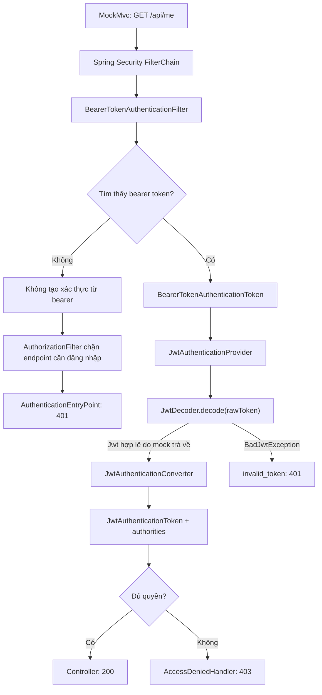

# Mock `JwtDecoder` để kiểm thử bearer token với MockMvc

Trong ứng dụng Servlet dùng Spring Security OAuth2 Resource Server, một request có header `Authorization: Bearer ...` phải đi qua bước đọc bearer token, giải mã/xác thực JWT, chuyển claims thành `Authentication` rồi mới được phân quyền. Khi viết test, đôi lúc ta muốn **giữ nguyên đường xử lý HTTP và security filter thật**, nhưng quyết định trước việc giải mã token sẽ thành công hay thất bại. Kỹ thuật phù hợp là **mock bean `JwtDecoder`**.

Đây là một tình huống thực tế của module **`SPRING_SECURITY_TESTING`**: kiểm chứng xác thực, phân quyền và bảo vệ HTTP bằng `spring-security-test` trên Servlet và Reactive, sử dụng MockMvc, WebTestClient, SecurityContext và các dạng JWT/OAuth2/OIDC giả lập. Bài này tập trung vào **Servlet + MockMvc + JWT Resource Server**; phần Reactive chỉ được so sánh ở cuối để tránh nhầm hai API.

Sau bài học, bạn có thể:

- Gửi một bearer token qua header HTTP trong `MockMvc`, để `BearerTokenAuthenticationFilter` trích xuất token như request thực tế.
- Cho `JwtDecoder.decode(rawToken)` trả về `Jwt` có claims định trước, hoặc ném lỗi giải mã.
- Kiểm tra `200 OK`, `401 Unauthorized`, `403 Forbidden` theo kết quả xác thực và quyền.
- Chứng minh bằng Mockito rằng request đã gọi decoder với **đúng chuỗi bearer token**, đồng thời phân biệt rõ kiểm thử này với `.with(jwt())` hoặc `@WithMockUser`.
- Xác định ranh giới: mock decoder **không** chứng minh chữ ký số, hạn dùng, issuer hoặc audience đã được kiểm tra bằng bộ giải mã thật.

## 1. Đặt mock ở đúng vị trí trong chuỗi bảo mật

Một request đến endpoint `GET /api/me` với header bearer được Spring Security xử lý về cơ bản theo chuỗi:



Trong test đang xét, **chỉ `JwtDecoder` là mock**. `MockMvc` vẫn thực hiện request qua filter chain mà Spring Boot tích hợp; `BearerTokenAuthenticationFilter` vẫn đọc header; `JwtAuthenticationProvider` vẫn gọi decoder; `JwtAuthenticationConverter` vẫn sinh `JwtAuthenticationToken`; còn authorization vẫn kiểm tra authorities theo cấu hình của ứng dụng.

Lời gọi có ý nghĩa trung tâm:

```java
when(jwtDecoder.decode("token-read"))
        .thenReturn(decodedJwt);

mockMvc.perform(get("/api/me")
                .header(HttpHeaders.AUTHORIZATION, "Bearer token-read"))
        .andExpect(status().isOk());

verify(jwtDecoder).decode("token-read");
```

Giá trị `token-read` ở đây là chuỗi thử nghiệm đại diện cho bearer token; vì decoder đã bị mock, nó **không phải JWT ba phần có chữ ký hợp lệ**. Nó vẫn được bearer resolver đọc từ header và chuyển tới decoder. Nếu dùng decoder thật, chuỗi này sẽ không vượt qua kiểm tra cú pháp và chữ ký JWT.

### Phân biệt với `.with(jwt())`

`spring-security-test` cũng cung cấp `SecurityMockMvcRequestPostProcessors.jwt()`:

```java
mockMvc.perform(get("/api/me").with(jwt()
                .jwt(jwt -> jwt.subject("alice")
                        .claim("scope", "profile"))))
        .andExpect(status().isOk());
```

Với `.with(jwt())`, test post-processor chuẩn bị sẵn `JwtAuthenticationToken` trong security context của request. Đây là cách nhanh để kiểm tra **ủy quyền khi đã có danh tính JWT**. Nó không cần gửi header `Authorization: Bearer ...`, không gọi `JwtDecoder.decode()` và không chứng minh bearer resolver hoạt động. Ngược lại, mock `JwtDecoder` rồi gửi header bearer sẽ đi qua phần trích xuất token và authentication provider trong filter chain.

| Cách tạo request test | Có header bearer? | `JwtDecoder.decode()` có được gọi? | Kiểm chứng được gì? |
| --- | --- | --- | --- |
| `.with(jwt())` | Không cần | Không | Principal/claims/authorities giả lập và phân quyền endpoint |
| `.with(user("alice"))` hoặc `@WithMockUser` | Không cần | Không | Phân quyền với `UsernamePasswordAuthenticationToken` giả lập |
| `Authorization: Bearer token-read` + mock `JwtDecoder` | Có | Có, nếu filter chain Resource Server phù hợp chạy | Bearer extraction, provider, chuyển claims thành authority, kết quả HTTP |
| `Authorization: Bearer <JWT thật>` + decoder thật | Có | Có | Đường tích hợp thực hơn, bao gồm validation được cấu hình trong decoder |

Phân biệt này đặc biệt quan trọng nếu mục tiêu test là **“request có thực sự lấy được bearer token và chuyển raw token sang `JwtDecoder` không?”**. Dùng `jwt()` để chứng minh điều đó sẽ tạo ra kết quả dương tính giả về phạm vi đã kiểm tra.

## 2. Cấu hình ứng dụng Servlet cần kiểm tra

Ví dụ sau giả định Java 17+, Spring Boot 3.x, Spring Security 6.x và các dependency `spring-boot-starter-web`, `spring-boot-starter-security`, `spring-boot-starter-oauth2-resource-server`, `spring-boot-starter-test` và `spring-security-test`. Với Spring Boot/Spring Security phiên bản khác, điều chỉnh package import và cấu hình theo phiên bản dự án.

Ứng dụng có hai endpoint:

1. `GET /api/me`: mọi bearer token đã xác thực đều được truy cập.
2. `GET /api/reports/monthly`: phải có authority `SCOPE_reports.read`.

Trong các đoạn mã sau, đặt lớp ứng dụng, cấu hình bảo mật và controller cùng package được Spring Boot quét, mỗi `public class` ở file Java phù hợp.

```java
import org.springframework.boot.SpringApplication;
import org.springframework.boot.autoconfigure.SpringBootApplication;

@SpringBootApplication
public class JwtMvcDemoApplication {
    public static void main(String[] args) {
        SpringApplication.run(JwtMvcDemoApplication.class, args);
    }
}
```

```java
import org.springframework.context.annotation.Bean;
import org.springframework.context.annotation.Configuration;
import org.springframework.security.config.Customizer;
import org.springframework.security.config.annotation.web.builders.HttpSecurity;
import org.springframework.security.config.http.SessionCreationPolicy;
import org.springframework.security.web.SecurityFilterChain;

@Configuration
class JwtApiSecurityConfig {
    @Bean
    SecurityFilterChain apiSecurity(HttpSecurity http) throws Exception {
        return http
                .securityMatcher("/api/**")
                .authorizeHttpRequests(auth -> auth
                        .requestMatchers("/api/reports/**")
                        .hasAuthority("SCOPE_reports.read")
                        .anyRequest().authenticated())
                .sessionManagement(session -> session
                        .sessionCreationPolicy(SessionCreationPolicy.STATELESS))
                .oauth2ResourceServer(resourceServer ->
                        resourceServer.jwt(Customizer.withDefaults()))
                .build();
    }
}
```

`securityMatcher("/api/**")` giới hạn filter chain trong ví dụ cho các URL `/api/**`. Nếu ứng dụng còn các URL khác cần bảo vệ, phải có filter chain phù hợp cho chúng; ví dụ này chỉ trình bày phần API JWT đang được kiểm thử.

`JwtApiSecurityConfig` không tạo `JwtDecoder` để tránh gắn test vào một JWK Set URL hoặc Identity Provider bên ngoài. **Trong production**, ứng dụng phải cấu hình decoder thật (chẳng hạn thông qua `issuer-uri`/`jwk-set-uri` hoặc bean `JwtDecoder` đáng tin cậy). **Trong bài test**, ta cung cấp bean decoder giả bằng một `@TestConfiguration`.

```java
import java.util.Map;
import org.springframework.security.core.Authentication;
import org.springframework.security.core.GrantedAuthority;
import org.springframework.security.oauth2.server.resource.authentication.JwtAuthenticationToken;
import org.springframework.web.bind.annotation.GetMapping;
import org.springframework.web.bind.annotation.RestController;

@RestController
class JwtApiController {
    @GetMapping("/api/me")
    Map<String, Object> me(Authentication authentication) {
        JwtAuthenticationToken token =
                (JwtAuthenticationToken) authentication;
        return Map.of(
                "name", token.getName(),
                "subject", token.getToken().getSubject(),
                "authorities", token.getAuthorities().stream()
                        .map(GrantedAuthority::getAuthority)
                        .toList());
    }

    @GetMapping("/api/reports/monthly")
    String monthlyReport(Authentication authentication) {
        return "monthly report for " + authentication.getName();
    }
}
```

Controller cố ý nhận `Authentication` rồi truy cập thông tin từ `JwtAuthenticationToken` để test xác nhận rằng request đã thực sự được resource server chuyển thành danh tính JWT. Với default converter, `Authentication#getName()` thường lấy từ claim `sub`, còn `scope: "reports.read"` sẽ trở thành authority `SCOPE_reports.read`.

## 3. Chuẩn bị `@SpringBootTest` và mock bean `JwtDecoder`

Lựa chọn dưới đây dùng `@TestConfiguration` kết hợp Mockito để tránh phụ thuộc vào cơ chế đăng ký mock bean của từng phiên bản Spring Boot. `@SpringBootTest` nạp application context, còn `@AutoConfigureMockMvc` cho phép request qua security filter chain:

```java
import java.time.Instant;

import org.junit.jupiter.api.BeforeEach;
import org.junit.jupiter.api.Test;
import org.springframework.beans.factory.annotation.Autowired;
import org.springframework.boot.test.autoconfigure.web.servlet.AutoConfigureMockMvc;
import org.springframework.boot.test.context.SpringBootTest;
import org.springframework.boot.test.context.TestConfiguration;
import org.springframework.context.annotation.Bean;
import org.springframework.context.annotation.Primary;
import org.springframework.http.HttpHeaders;
import org.springframework.security.oauth2.jwt.BadJwtException;
import org.springframework.security.oauth2.jwt.Jwt;
import org.springframework.security.oauth2.jwt.JwtDecoder;
import org.springframework.test.web.servlet.MockMvc;

import static org.hamcrest.Matchers.containsString;
import static org.hamcrest.Matchers.hasItem;
import static org.hamcrest.Matchers.startsWith;
import static org.mockito.Mockito.mock;
import static org.mockito.Mockito.reset;
import static org.mockito.Mockito.verify;
import static org.mockito.Mockito.verifyNoInteractions;
import static org.mockito.Mockito.when;
import static org.springframework.test.web.servlet.request.MockMvcRequestBuilders.get;
import static org.springframework.test.web.servlet.result.MockMvcResultMatchers.content;
import static org.springframework.test.web.servlet.result.MockMvcResultMatchers.header;
import static org.springframework.test.web.servlet.result.MockMvcResultMatchers.jsonPath;
import static org.springframework.test.web.servlet.result.MockMvcResultMatchers.status;

@SpringBootTest(classes = {
        JwtMvcDemoApplication.class,
        JwtDecoderMvcTest.MockDecoderConfiguration.class
})
@AutoConfigureMockMvc
class JwtDecoderMvcTest {
    @Autowired
    MockMvc mockMvc;

    @Autowired
    JwtDecoder jwtDecoder;

    @TestConfiguration(proxyBeanMethods = false)
    static class MockDecoderConfiguration {
        @Bean
        @Primary
        JwtDecoder testJwtDecoder() {
            return mock(JwtDecoder.class);
        }
    }

    @BeforeEach
    void resetDecoderBeforeEachTest() {
        reset(jwtDecoder);
    }

    private static Jwt decodedJwt(
            String tokenValue, String subject, String scope) {
        Instant now = Instant.now();
        return Jwt.withTokenValue(tokenValue)
                .header("alg", "RS256")
                .subject(subject)
                .claim("scope", scope)
                .issuedAt(now.minusSeconds(60))
                .expiresAt(now.plusSeconds(300))
                .build();
    }

    @Test
    void validBearerToken_isDecoded_andProvidesPrincipal() throws Exception {
        when(jwtDecoder.decode("token-profile"))
                .thenReturn(decodedJwt(
                        "token-profile", "alice", "profile"));

        mockMvc.perform(get("/api/me")
                        .header(HttpHeaders.AUTHORIZATION,
                                "Bearer token-profile"))
                .andExpect(status().isOk())
                .andExpect(jsonPath("$.name").value("alice"))
                .andExpect(jsonPath("$.subject").value("alice"))
                .andExpect(jsonPath("$.authorities",
                        hasItem("SCOPE_profile")));

        verify(jwtDecoder).decode("token-profile");
    }

    @Test
    void tokenWithRequiredScope_canReadProtectedReport()
            throws Exception {
        when(jwtDecoder.decode("token-reports"))
                .thenReturn(decodedJwt(
                        "token-reports", "bob", "reports.read"));

        mockMvc.perform(get("/api/reports/monthly")
                        .header(HttpHeaders.AUTHORIZATION,
                                "Bearer token-reports"))
                .andExpect(status().isOk())
                .andExpect(content().string("monthly report for bob"));

        verify(jwtDecoder).decode("token-reports");
    }

    @Test
    void decodedTokenWithoutRequiredScope_gets403() throws Exception {
        when(jwtDecoder.decode("token-no-scope"))
                .thenReturn(decodedJwt(
                        "token-no-scope", "alice", "profile"));

        mockMvc.perform(get("/api/reports/monthly")
                        .header(HttpHeaders.AUTHORIZATION,
                                "Bearer token-no-scope"))
                .andExpect(status().isForbidden());

        verify(jwtDecoder).decode("token-no-scope");
    }

    @Test
    void decoderRejectsBearerToken_gets401() throws Exception {
        when(jwtDecoder.decode("token-invalid"))
                .thenThrow(new BadJwtException(
                        "Invalid JWT signature"));

        mockMvc.perform(get("/api/me")
                        .header(HttpHeaders.AUTHORIZATION,
                                "Bearer token-invalid"))
                .andExpect(status().isUnauthorized())
                .andExpect(header().string(
                        HttpHeaders.WWW_AUTHENTICATE,
                        containsString("invalid_token")));

        verify(jwtDecoder).decode("token-invalid");
    }

    @Test
    void missingBearerHeader_gets401_withoutCallingDecoder()
            throws Exception {
        mockMvc.perform(get("/api/me"))
                .andExpect(status().isUnauthorized())
                .andExpect(header().string(
                        HttpHeaders.WWW_AUTHENTICATE,
                        startsWith("Bearer")));

        verifyNoInteractions(jwtDecoder);
    }
}
```

Lưu ý về cách tổ chức test:

- `MockDecoderConfiguration` tạo duy nhất một bean `JwtDecoder` là Mockito mock; `@Primary` bảo đảm ưu tiên bean này nếu trong cấu hình mẫu xuất hiện thêm bean cùng loại. Nếu production config có nhiều bean riêng biệt, qualifier hoặc wiring có thể cần điều chỉnh.
- `reset(jwtDecoder)` ở `@BeforeEach` xóa stub và lịch sử lời gọi giữa các ca test dùng chung Spring application context. Không nên reset bean đang được dùng đồng thời bởi các test chạy song song.
- Hàm `decodedJwt(...)` tạo **giá trị đầu ra giả lập của decoder**, không tạo token đã ký. Header `alg: RS256` chỉ là metadata trong đối tượng `Jwt`; không có thao tác ký hoặc kiểm chứng mật mã nào được thực hiện.
- `@AutoConfigureMockMvc` mặc định đăng ký các filter của ứng dụng. Nếu cấu hình test chủ động tắt filter (`addFilters = false`), kết quả không còn chứng minh BearerTokenAuthenticationFilter/authorization đang chạy.
- Ví dụ không cần network, không gọi OAuth2 Authorization Server, OIDC Provider hoặc JWK Set endpoint. Mọi nhánh thành công/thất bại đều do stub của `JwtDecoder` điều khiển.

### Bản dùng `@MockitoBean` khi framework hỗ trợ

Trong Spring Framework 6.2 và Spring Boot tương thích, có thể thay `@TestConfiguration` tạo mock bằng annotation `@MockitoBean` của Spring Test:

```java
import org.springframework.test.context.bean.override.mockito.MockitoBean;

@MockitoBean
JwtDecoder jwtDecoder;
```

Chỉ chọn **một cách đăng ký mock bean** trong cùng một test. Không dùng đồng thời `@MockitoBean` và bean Mockito từ `@TestConfiguration` nếu không có lý do rõ ràng, vì dễ tạo nhiều bean hoặc làm khó xác định bean mà filter chain thực sự sử dụng. Với Spring Boot 3.x đời cũ, `@MockBean` tồn tại trong `org.springframework.boot.test.mock.mockito`, nhưng API và chính sách deprecation thay đổi theo phiên bản.

## 4. Đọc kỹ từng kết quả HTTP

Các tình huống ở ví dụ trên giúp phân biệt **không có token**, **token bị decoder từ chối**, **token hợp lệ nhưng thiếu quyền**, và **token được chấp nhận có đủ quyền**.

| Request tới `/api/...` | Hành vi của `JwtDecoder` | HTTP mong đợi | Bản chất kết quả |
| --- | --- | --- | --- |
| Không có `Authorization` | Không được gọi | `401 Unauthorized` | Không có danh tính cho URL yêu cầu xác thực |
| `Bearer token-invalid` | Ném `BadJwtException` | `401 Unauthorized` | Bearer token bị từ chối khi authentication |
| `Bearer token-no-scope` | Trả `Jwt` với `scope=profile` | `403 Forbidden` | Đã xác thực nhưng thiếu `SCOPE_reports.read` |
| `Bearer token-reports` | Trả `Jwt` với `scope=reports.read` | `200 OK` | Đã xác thực và đủ quyền |
| `Bearer token-profile` tới `/api/me` | Trả `Jwt` với `scope=profile` | `200 OK` | Endpoint chỉ yêu cầu authenticated |

**401** và **403** là hai nhánh khác nhau trong pipeline. Khi decoder ném `BadJwtException`, `JwtAuthenticationProvider` coi token không hợp lệ và resource server dùng bearer entry point để phản hồi 401. Nếu decoder trả về Jwt có danh tính hợp lệ nhưng không có authority cần thiết, authorization sẽ chặn bằng 403.

`WWW-Authenticate` là header quan trọng của bearer authentication. Thiếu token thường có challenge `Bearer`; token không hợp lệ có thể có thêm `error="invalid_token"`. Nội dung cụ thể của header có thể thay đổi theo realm, exception message hoặc handler đã cấu hình. Test nên chỉ assert phần thực sự thuộc hợp đồng HTTP đang được kiểm thử; không cố định toàn bộ message nội bộ nếu ứng dụng không cam kết.

Không phải mọi `JwtException` đều mang ý nghĩa bearer token sai. Trong các phiên bản Spring Security thông dụng, `BadJwtException`/`JwtValidationException` được dịch sang lỗi token không hợp lệ; một số lỗi decoder khác có thể biểu thị lỗi dịch vụ xác thực hoặc cấu hình hạ tầng. Vì vậy không nên ném một `JwtException` bất kỳ rồi mặc định kỳ vọng 401. Muốn mô phỏng **JWT bị từ chối do validation**, dùng exception chuyên biệt thích hợp.

## 5. Cách Spring Security chuyển claims thành authorities

Sau khi mock decoder trả `Jwt`, converter của resource server vẫn chạy. Với converter mặc định, các claim scope thường được đọc từ `scope` hoặc `scp`:

```json
{
  "sub": "alice",
  "scope": "profile reports.read",
  "iss": "https://id.example.test",
  "aud": ["reporting-api"]
}
```

Kết quả mặc định có thể tương đương:

```text
Authentication: JwtAuthenticationToken
Authentication.name: alice
Authorities:
  - SCOPE_profile
  - SCOPE_reports.read
```

Mặc định, converter tách chuỗi `scope` theo khoảng trắng và gắn tiền tố `SCOPE_` vào authority. Vì vậy cấu hình:

```java
.requestMatchers("/api/reports/**")
.hasAuthority("SCOPE_reports.read")
```

phù hợp với `.claim("scope", "reports.read")` trong mock decoder. Ngược lại, `.hasRole("reports.read")` thường không tương đương vì `hasRole` tra cứu authority có tiền tố `ROLE_`.

Nếu production dùng converter tùy chỉnh, ví dụ lấy quyền từ claim `permissions` hoặc `roles`, test mock decoder cần trả đúng cấu trúc claims theo hợp đồng của converter đó. Không nên thay test bằng `jwt().authorities(...)` nếu mục tiêu là chứng minh **converter thật** sinh ra quyền đúng từ token.

Ví dụ khi ứng dụng tự quy định claim `permissions` chứa danh sách chuỗi:

```java
JwtGrantedAuthoritiesConverter permissions =
        new JwtGrantedAuthoritiesConverter();
permissions.setAuthoritiesClaimName("permissions");
permissions.setAuthorityPrefix("");

JwtAuthenticationConverter converter =
        new JwtAuthenticationConverter();
converter.setJwtGrantedAuthoritiesConverter(permissions);

http.oauth2ResourceServer(oauth2 -> oauth2.jwt(jwt ->
        jwt.jwtAuthenticationConverter(converter)));
```

Khi đó rule `hasAuthority("reports:read")` có thể đi cùng:

```java
Jwt custom = Jwt.withTokenValue("token-custom")
        .header("alg", "RS256")
        .subject("alice")
        .claim("permissions", java.util.List.of("reports:read"))
        .build();

when(jwtDecoder.decode("token-custom")).thenReturn(custom);
```

Ở ví dụ tùy biến, hãy đặt cấu hình converter trong đúng security chain thực tế. **Không tạo converter chỉ trong test** để làm ra một kết quả khác production. Có thể dùng test cho cả trường hợp scope đúng, scope trống, claim sai kiểu và tập nhiều authorities.

## 6. Mock decoder giúp kiểm tra được điều gì, bỏ qua điều gì?

Khi một stub trả về `Jwt`, `JwtAuthenticationProvider` tin rằng kết quả này đã qua bước decode. Các validation vốn do decoder thực hiện sẽ không tự chạy lần nữa chỉ vì thuộc tính đó tồn tại trong `Jwt`.

| Phần hành vi | Test mock `JwtDecoder` có bao phủ? | Nên bổ sung test thế nào? |
| --- | --- | --- |
| Nhận header `Authorization: Bearer` | Có, khi dùng MockMvc + filter chain thật | Test token có/không có header; xác minh `decode(rawToken)` |
| Gọi đúng bean `JwtDecoder` | Có | Mockito `verify(jwtDecoder).decode(...)` |
| Mapping claims thành authorities | Có, nếu dùng converter thật | Trả `Jwt` với `scope`/`scp`/custom claims rồi assert 200/403 |
| Authorization theo URL/method | Có | Test quyền được cấp và thiếu quyền |
| Xác thực chữ ký số JWT | **Không** | Test decoder thật với khóa test/JWK test |
| Validation `exp`/`nbf`, issuer, audience | **Không tự động** | Test `JwtDecoder` cùng validators thật |
| JWK rotation, HTTP tới IdP/JWKS | **Không** | Test tích hợp riêng bằng JWKS server giả lập |
| Session/OIDC login/browser redirect | Không thuộc test bearer resource server này | Test cơ chế `oauth2Login()`/OIDC riêng |

Ví dụ, nếu bạn đặt `expiresAt(Instant.now().minusSeconds(60))` vào đối tượng `Jwt` rồi buộc mock decoder **trả về** đối tượng đó, test không chứng minh hệ thống sẽ từ chối JWT hết hạn trong production. Để mô phỏng nhánh bị từ chối, cần khiến mock **ném exception tương ứng**; để kiểm chứng validator thật, cần dùng decoder thật.

### Kiểm thử expired token theo hai tầng

**Tầng filter/authorization bằng mock:** mong muốn kiểm tra ứng dụng phản ứng thế nào khi decoder kết luận token hết hạn:

```java
when(jwtDecoder.decode("expired-token"))
        .thenThrow(new BadJwtException("JWT expired"));

mockMvc.perform(get("/api/me")
                .header(HttpHeaders.AUTHORIZATION,
                        "Bearer expired-token"))
        .andExpect(status().isUnauthorized());

verify(jwtDecoder).decode("expired-token");
```

Test này chỉ mô phỏng **quyết định từ chối**. Muốn kiểm thử riêng validator hết hạn, hãy khởi tạo decoder thật với khóa test và `JwtTimestampValidator`, tạo JWT test có `exp` trong quá khứ rồi xác nhận `decode()` ném `JwtValidationException` hoặc exception tương ứng. Tương tự, kiểm tra issuer/audience bằng validators được cấu hình thật; việc gắn claim `iss` hoặc `aud` lên đối tượng `Jwt` mà Mockito trả về không thể thay thế kiểm chứng này.

## 7. Các lỗi thiết kế test thường gặp

### 7.1. Mock cả `SecurityFilterChain` hoặc bỏ filter

Nếu test tắt Spring Security filters, header bearer không đi qua `BearerTokenAuthenticationFilter`. Khi đó một response 200 có thể chỉ là controller đang được gọi trực tiếp. Giữ `@AutoConfigureMockMvc` với filter chain thật và xác minh `JwtDecoder.decode()` được gọi.

### 7.2. Dùng `.with(jwt())` rồi `verify(decoder).decode(...)`

`jwt()` cung cấp sẵn authentication test. Không có bước lấy token từ header và decode tương ứng, nên assertion verify có thể thất bại dù endpoint trả 200. Nếu muốn kiểm chứng decoder, gửi header bearer thông thường.

### 7.3. Dùng `@WithMockUser` cho endpoint chỉ chấp nhận JWT

`@WithMockUser` tạo user dạng username/password test principal, không tạo `JwtAuthenticationToken`. Nếu endpoint chỉ kiểm tra `authenticated()`, test đôi khi vẫn thành công, nhưng điều đó không phản ánh cơ chế JWT của API. Trường hợp controller cần `JwtAuthenticationToken`, kiểu principal còn có thể không phù hợp. Dùng request bearer + decoder mock để kiểm chứng flow thật.

### 7.4. Đặt authority sai tiền tố

`.claim("scope", "reports.read")` thường sinh `SCOPE_reports.read`. Test cấu hình `hasRole("reports.read")` sẽ tra cứu `ROLE_reports.read` và bị từ chối. Kiểm tra claim converter và rule authority trước khi kết luận decoder hoạt động sai.

### 7.5. Chỉ assert HTTP status, không assert lời gọi decoder

Một test `401` khi thiếu header có thể PASS dù resource server không gọi decoder, vì client chưa có danh tính. Luôn thêm `verify(jwtDecoder).decode(expectedRawToken)` ở ca có bearer và `verifyNoInteractions(jwtDecoder)` ở ca không có bearer để bảo đảm ranh giới đang được kiểm tra.

### 7.6. Nhầm lỗi authentication với lỗi kết nối IdP

Mockito có thể ném lỗi validator hoặc lỗi runtime tùy ý, nhưng production phân biệt token không hợp lệ với sự cố JWK/decoder. Khi đang mô phỏng chữ ký sai, dùng `BadJwtException` là phù hợp. Khi mô phỏng lỗi hạ tầng, cần nghiên cứu handler/error contract riêng; không mặc định mọi exception đều trả 401.

### 7.7. Bỏ qua CSRF khi mở rộng test sang POST

Ví dụ hiện tại chỉ dùng GET. Một POST/PUT/DELETE có thể bị CSRF filter chặn nếu ứng dụng còn bật CSRF, kể cả khi bearer token được decode thành công. Cần phân biệt test token/authorization với test CSRF và cấu hình CSRF phù hợp mô hình xác thực (đặc biệt nếu ứng dụng cũng dùng cookie/session của browser). Không suy diễn rằng cứ dùng JWT là mặc nhiên không cần bảo vệ CSRF trong mọi kiến trúc.

### 7.8. Trộn nhiều cấu hình security chain

Ứng dụng có thể có nhiều `SecurityFilterChain` với `securityMatcher` và thứ tự riêng. Nếu URL test không được chain Resource Server xử lý, decoder có thể không được gọi. Xác nhận request dùng đúng route đang được bảo vệ, và không vô tình nạp cấu hình test thay thế chain production.

## 8. Khi nào nên dùng MockMvc và khi nào chuyển sang WebTestClient?

Phạm vi bài này là **Servlet + MockMvc**; pipeline dùng `BearerTokenAuthenticationFilter`, `JwtDecoder` và `JwtAuthenticationToken`. Với Spring WebFlux, các thành phần tương ứng là `AuthenticationWebFilter`/reactive security chain và `ReactiveJwtDecoder`; `WebTestClient` được dùng để gọi request. Không thể tiêm một bean `JwtDecoder` đồng bộ vào pipeline reactive rồi mặc định mong filter Reactive sử dụng nó.

| Servlet / MockMvc | Reactive / WebTestClient |
| --- | --- |
| `JwtDecoder.decode(String)` trả về `Jwt` | `ReactiveJwtDecoder.decode(String)` trả về `Mono<Jwt>` |
| Mockito `when(decoder.decode("x")).thenReturn(jwt)` | Mockito `when(decoder.decode("x")).thenReturn(Mono.just(jwt))` |
| MockMvc gửi `Authorization: Bearer x` | WebTestClient gửi `Authorization: Bearer x` |
| Test shortcut `.with(jwt())` | Test shortcut `mutateWith(mockJwt())` |
| Servlet security filters | Reactive security web filters |

Ví dụ reactive mức ý tưởng, giả định đã có WebFlux application context, `SecurityWebFilterChain` và một bean `ReactiveJwtDecoder` được mock:

```java
when(reactiveJwtDecoder.decode("token-reactive"))
        .thenReturn(Mono.just(decodedJwt));

webTestClient.get()
        .uri("/api/me")
        .header(HttpHeaders.AUTHORIZATION, "Bearer token-reactive")
        .exchange()
        .expectStatus().isOk();

verify(reactiveJwtDecoder).decode("token-reactive");
```

Đây chỉ là phần đối chiếu API; muốn chạy ví dụ Reactive phải dựng bean `ReactiveJwtDecoder`, WebFlux security chain và `WebTestClient` tương thích riêng. `mockJwt()`, tương tự `jwt()` của Servlet, chủ yếu phục vụ test với authentication giả lập; không thay thế việc kiểm tra decoder có được gọi từ header bearer hay không.

## 9. Chiến lược kết hợp các loại kiểm thử

Để bảo đảm cả HTTP behavior lẫn validation mật mã, có thể tổ chức ba nhóm test bổ trợ:

1. **Authorization nhanh:** dùng `jwt()` của `spring-security-test` để thử nhiều tổ hợp principal, scope và quyền mà không cần dựng raw token.
2. **Bearer pipeline với MockMvc:** mock `JwtDecoder` và gửi header `Authorization` để xác nhận filter đọc token, decoder được gọi, converter hoạt động, HTTP trả 200/401/403.
3. **Decoder/validation hoặc tích hợp thực tế:** sử dụng khóa test, JWT ký thật và validators/JWK test để chứng minh kiểm tra signature, `exp`, `nbf`, issuer/audience và cách báo lỗi tương ứng.

Ví dụ tổ hợp test nên có ít nhất:

| Ca kiểm thử | Đầu vào | Assertion tối thiểu |
| --- | --- | --- |
| Không có bearer | Không gửi `Authorization` | `401`; decoder không được gọi |
| Bearer hợp lệ cho endpoint chỉ cần đăng nhập | Decoder trả Jwt có `sub` | `200`; principal đúng; gọi `decode(rawToken)` |
| Bearer có scope yêu cầu | Decoder trả Jwt có `scope` phù hợp | `200`; quyền được converter sinh đúng |
| Bearer thiếu scope | Decoder trả Jwt thiếu authority yêu cầu | `403`; decoder vẫn được gọi |
| Bearer bị decoder từ chối | Decoder ném `BadJwtException` | `401`; challenge mang lỗi token phù hợp |
| Token hết hạn hoặc issuer sai | Decoder thật + validator thật ở test riêng | Decoder từ chối đúng theo rule validation |

Trong thực tế, một nhóm test chỉ dùng `jwt()` rất hiệu quả để bảo vệ rule phân quyền, nhưng **không phát hiện lỗi cấu hình bearer resolver hoặc decoder wiring**. Ngược lại, nhóm mock decoder xác minh được pipeline Resource Server mà vẫn tránh độ phức tạp của JWK/IdP. Hai nhóm nên tồn tại cùng các test decoder thật khi hệ thống cần bảo đảm cả an toàn token.

## 10. Câu hỏi tự kiểm tra

**1. Vì sao test `.with(jwt())` trả 200 nhưng `verify(jwtDecoder).decode(...)` lại không thấy lời gọi?** Vì `jwt()` tạo authentication trực tiếp cho request; không cần đọc bearer từ header và không cần gọi decoder.

**2. Gửi `Bearer abc` và mock decoder trả `Jwt` có `scope=profile`, trong khi endpoint yêu cầu `SCOPE_reports.read`. Status nào?** Với resource server và handler mặc định, request được xác thực nhưng không có authority yêu cầu nên trả `403 Forbidden`.

**3. Ném `BadJwtException` từ decoder khác gì trả Jwt không có scope?** Ném exception làm authentication không thành công, thường trả `401`; trả Jwt khiến authentication thành công rồi authorization quyết định 200 hoặc 403.

**4. Test mock decoder trả Jwt có `exp` đã quá hạn nhưng vẫn được controller xử lý. Điều đó có chứng minh Spring Security bỏ qua hạn dùng trong production?** Không. Mock đã thay thế chính bước decoder/validator vốn chịu trách nhiệm từ chối JWT hết hạn.

**5. Làm thế nào xác minh BearerTokenAuthenticationFilter thực sự đã đưa token cho decoder?** Gửi header `Authorization: Bearer token-x` tới endpoint nằm trong chain Resource Server, rồi `verify(jwtDecoder).decode("token-x")`. Kết hợp assertion status/body và bảo đảm security filters không bị tắt.

Khi dùng MockMvc để kiểm thử JWT, **đặt mock ở `JwtDecoder`** giúp kiểm soát kết quả xác thực trong khi vẫn giữ luồng trích xuất bearer token, chuyển đổi claims và phân quyền HTTP. Hãy ghép assertion trạng thái với `verify(decoder)` và tách việc kiểm chứng chữ ký/validators sang test decoder thật; như vậy mỗi phép thử trả lời đúng một câu hỏi bảo mật có thể quan sát và kiểm chứng.
