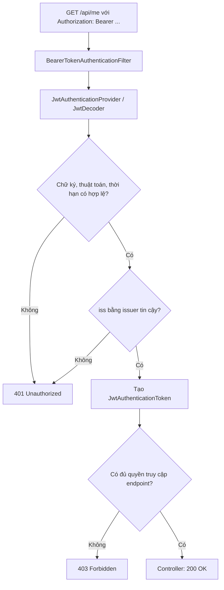

# Issuer hợp lệ hoặc không khớp

Trong ứng dụng Spring Security dùng JWT làm bearer token, máy chủ tài nguyên (Resource Server) cần biết **ai được phép phát hành token**. Trường `iss` (*issuer*) trong JWT mô tả bên phát hành; token có chữ ký đúng nhưng khai báo issuer khác với nguồn được tin cậy vẫn phải bị từ chối. Đây là phép kiểm tra độc lập với việc đọc được JWT hay xác minh được chữ ký.

Bài học thuộc chương **JWT và token thực** của **SPRING_SECURITY_TESTING**. Mục tiêu là kiểm chứng xác thực, phân quyền và bảo vệ HTTP bằng **spring-security-test**, đặc biệt phân biệt bài test gắn sẵn một `JwtAuthenticationToken` giả lập với bài test gửi **JWT đã được ký** qua luồng xử lý HTTP thật. Ví dụ chính sử dụng Spring Security Resource Server trên **Servlet** với **MockMvc**; cuối bài liên hệ tới **WebTestClient** cho Reactive và các nhà cung cấp OAuth2/OIDC.

## 1. Issuer là gì và kiểm tra ở đâu?

Một JWT điển hình có ba phần:

```text
BASE64URL(header).BASE64URL(payload).BASE64URL(signature)
```

Payload ví dụ (đã giải mã để dễ đọc):

```json
{
  "iss": "https://identity.example.test/realms/training",
  "sub": "alice",
  "aud": ["spring-security-testing-api"],
  "iat": 1764028800,
  "exp": 1764032400
}
```

- **`iss`**: danh tính bên phát hành. Với OIDC, thường trùng chính xác giá trị `issuer` trong tài liệu discovery của nhà cung cấp. Đây là một định danh dạng URL, **không phải địa chỉ tùy ý mà API chấp nhận**.
- **`sub`**: chủ thể của token, ví dụ người dùng `alice`. `sub` không dùng thay cho `iss`.
- **`aud`**: đối tượng sử dụng token. Token từ issuer tin cậy vẫn có thể không dành cho API hiện tại nếu audience sai.
- **`iat`, `exp`, `nbf`**: thông tin thời gian. Token hết hạn hoặc chưa đến thời điểm sử dụng phải bị xử lý theo chính sách xác thực.
- **Chữ ký**: giúp kiểm tra token có bị thay đổi và có được ký bằng khóa mà bộ giải mã tin cậy hay không.

Đọc payload bằng Base64URL chỉ là **giải mã dữ liệu**, không xác minh chữ ký, issuer, thời hạn hay audience. Một kẻ tấn công cũng có thể tự viết chuỗi `"iss": "https://identity.example.test/realms/training"`. API chỉ được tin giá trị đó **sau khi** token đã qua xác minh mật mã và bộ kiểm tra claim.

Giả sử API tin cậy một issuer duy nhất:

```text
EXPECTED_ISSUER = https://identity.example.test/realms/training
```

| Token | Chữ ký hợp lệ? | `iss` | Kết quả dự kiến |
| --- | --- | --- | --- |
| A | Có | `https://identity.example.test/realms/training` | Qua bước issuer; còn phải qua các kiểm tra khác |
| B | Có | `https://identity.example.test/realms/other` | **401 Unauthorized** do issuer không khớp |
| C | Có | Thiếu `iss` | **401 Unauthorized** khi bật validator yêu cầu issuer |
| D | Không | Đúng issuer | **401 Unauthorized** do chữ ký sai; issuer đúng không cứu được token |
| E | Có | Đúng issuer nhưng hết hạn | **401 Unauthorized** do thời hạn không hợp lệ |

Trong các thử nghiệm bên dưới, JWT A và B được ký bằng **cùng khóa thử nghiệm**, có cùng `sub` và đều còn hạn. Ta chỉ thay đổi `iss` để cô lập nguyên nhân từ chối: **issuer không khớp**.

## 2. Luồng kiểm tra của Spring Security Resource Server

Với Servlet và cấu hình `oauth2ResourceServer().jwt()`, request điển hình được xử lý như sau:



Sơ đồ là mô hình khái niệm. Trong triển khai thực tế, `JwtDecoder` kiểm tra chữ ký, còn `OAuth2TokenValidator<Jwt>` áp dụng các ràng buộc claim; các khâu có thể được thực thi theo thứ tự nội bộ khác. Phân biệt hai kết quả quan trọng:

- **401**: request chưa có một token được chấp nhận để xác thực, ví dụ chữ ký hoặc `iss` sai.
- **403**: request đã xác thực nhưng không đủ quyền theo quy tắc authorization của endpoint, chẳng hạn thiếu role hoặc scope.

Không nên dùng một bài test trả 403 vì thiếu scope để kết luận rằng issuer đã bị từ chối; yêu cầu kiểm tra issuer cần đi vào phần **authentication**.

### Cấu hình ứng dụng thường gặp

Spring Boot Resource Server có thể nhận issuer qua cấu hình:

```yaml
spring:
  security:
    oauth2:
      resourceserver:
        jwt:
          issuer-uri: https://identity.example.test/realms/training
```

Khi Boot tự cấu hình `JwtDecoder` dựa trên `issuer-uri`, Spring Security dùng thông tin của nhà phát hành để tìm khóa xác minh và kiểm tra issuer tương ứng. Tùy cách cấu hình, việc lấy metadata hoặc JWKS có thể cần kết nối tới Identity Provider. **Không** phụ thuộc vào Identity Provider thật để tạo một bài kiểm thử logic issuer: ở phần sau ta cung cấp một `JwtDecoder` thử nghiệm với khóa RSA nội bộ và `JwtValidators.createDefaultWithIssuer(...)`.

Nếu ứng dụng chỉ khai báo `jwk-set-uri` hoặc tự cấp một `JwtDecoder`, phải kiểm tra rõ **issuer validator có được thiết lập hay chưa**. Biết khóa công khai để kiểm chữ ký không tự động chứng minh được mọi claim issuer được chấp nhận theo chính sách sản phẩm.

## 3. Thiết lập endpoint cần bearer token (Servlet)

Ví dụ sử dụng dự án Spring Boot Servlet đã có ứng dụng khởi động và các dependency:

```gradle
dependencies {
    implementation("org.springframework.boot:spring-boot-starter-web")
    implementation("org.springframework.boot:spring-boot-starter-security")
    implementation("org.springframework.boot:spring-boot-starter-oauth2-resource-server")

    testImplementation("org.springframework.boot:spring-boot-starter-test")
    testImplementation("org.springframework.security:spring-security-test")
}
```

Tạo một `SecurityFilterChain` yêu cầu xác thực bằng JWT đối với `/api/me` và controller trả về subject của token đã được chấp nhận:

```java
import org.springframework.context.annotation.Bean;
import org.springframework.context.annotation.Configuration;
import org.springframework.security.config.Customizer;
import org.springframework.security.config.annotation.web.builders.HttpSecurity;
import org.springframework.security.oauth2.jwt.Jwt;
import org.springframework.security.core.annotation.AuthenticationPrincipal;
import org.springframework.security.web.SecurityFilterChain;
import org.springframework.web.bind.annotation.GetMapping;
import org.springframework.web.bind.annotation.RestController;

@Configuration
class ApiSecurityConfig {

    @Bean
    SecurityFilterChain apiSecurity(HttpSecurity http) throws Exception {
        return http
            .authorizeHttpRequests(auth -> auth
                .requestMatchers("/api/me").authenticated()
                .anyRequest().denyAll())
            .oauth2ResourceServer(resourceServer ->
                resourceServer.jwt(Customizer.withDefaults()))
            .build();
    }
}

@RestController
class MeController {

    @GetMapping("/api/me")
    String me(@AuthenticationPrincipal Jwt jwt) {
        return jwt.getSubject();
    }
}
```

Điểm cần nhớ: controller chỉ chạy sau khi token đã được bộ lọc và `JwtDecoder` chấp nhận. Trong test tích hợp, ta gửi HTTP header `Authorization: Bearer <token>` để sử dụng **đường đi thực tế này**.

## 4. Tạo JWT có chữ ký thật nhưng không gọi Identity Provider

Trong test, ta tự sinh cặp RSA 2048 bit. Khóa **private** ký JWT, khóa **public** cho `NimbusJwtDecoder` kiểm chữ ký. Cả hai đều tồn tại trong bộ kiểm thử; đây là khóa dùng một lần, **không** dùng cho môi trường thật.

Một `JwtDecoder` mặc định tạo từ public key cần được gắn validator issuer để bảo đảm mục tiêu của bài. Đoạn cấu hình sau sử dụng:

- `NimbusJwtEncoder` ký token bằng RSA `RS256`;
- `NimbusJwtDecoder.withPublicKey(...)` xác minh chữ ký;
- `JwtValidators.createDefaultWithIssuer(TRUSTED_ISSUER)` kiểm tra issuer và các ràng buộc mặc định như thời gian;
- `@TestConfiguration` tạo bean thử nghiệm để chạy offline, không phụ thuộc mạng.

```java
// Đặt cùng package test với ứng dụng; lớp cấu hình được @Import ở mục 5.
import com.nimbusds.jose.JWSAlgorithm;
import com.nimbusds.jose.jwk.JWKSet;
import com.nimbusds.jose.jwk.KeyUse;
import com.nimbusds.jose.jwk.RSAKey;
import com.nimbusds.jose.jwk.source.JWKSource;
import com.nimbusds.jose.proc.SecurityContext;

import java.security.KeyPair;
import java.security.KeyPairGenerator;
import java.security.interfaces.RSAPrivateKey;
import java.security.interfaces.RSAPublicKey;

import org.springframework.boot.test.context.TestConfiguration;
import org.springframework.context.annotation.Bean;
import org.springframework.security.oauth2.jwt.JwtDecoder;
import org.springframework.security.oauth2.jwt.JwtEncoder;
import org.springframework.security.oauth2.jwt.JwtValidators;
import org.springframework.security.oauth2.jwt.NimbusJwtDecoder;
import org.springframework.security.oauth2.jwt.NimbusJwtEncoder;

@TestConfiguration(proxyBeanMethods = false)
class LocalJwtTestConfig {

    static final String TRUSTED_ISSUER =
        "https://identity.example.test/realms/training";

    @Bean
    RSAKey localRsaKey() throws Exception {
        KeyPairGenerator generator = KeyPairGenerator.getInstance("RSA");
        generator.initialize(2048);
        KeyPair pair = generator.generateKeyPair();

        return new RSAKey.Builder((RSAPublicKey) pair.getPublic())
            .privateKey((RSAPrivateKey) pair.getPrivate())
            .algorithm(JWSAlgorithm.RS256)
            .keyUse(KeyUse.SIGNATURE)
            .keyID("local-test-key")
            .build();
    }

    @Bean
    JwtEncoder jwtEncoder(RSAKey key) {
        JWKSource<SecurityContext> source =
            (selector, context) -> selector.select(new JWKSet(key));
        return new NimbusJwtEncoder(source);
    }

    @Bean
    JwtDecoder jwtDecoder(RSAKey key) throws Exception {
        NimbusJwtDecoder decoder = NimbusJwtDecoder
            .withPublicKey(key.toRSAPublicKey())
            .build();

        // Dòng này chính là quy tắc issuer mà các test sẽ kiểm chứng.
        decoder.setJwtValidator(
            JwtValidators.createDefaultWithIssuer(TRUSTED_ISSUER));

        return decoder;
    }
}
```

Vì cấu hình test tự cung cấp bean `JwtDecoder`, nó kiểm soát rõ việc xác minh issuer và không cần gọi endpoint discovery hay JWKS từ mạng. Nó được dùng **thay** decoder tự cấu hình từ `issuer-uri` trong ngữ cảnh test; nếu sản phẩm có decoder riêng phức tạp, nên kiểm thử đúng decoder đó bằng cấu hình thử nghiệm tương ứng.

## 5. Kiểm thử issuer hợp lệ và không khớp bằng MockMvc

Các ca kiểm thử dùng cùng RSA key. Hàm `signedToken(...)` cho phép kiểm soát độc lập `iss`, `iat`, `exp`. Chỉ cần thay issuer, cùng một bộ lọc sẽ chấp nhận token A và từ chối token B.

```java
import java.time.Instant;

import org.junit.jupiter.api.Test;
import org.springframework.beans.factory.annotation.Autowired;
import org.springframework.boot.test.autoconfigure.web.servlet.AutoConfigureMockMvc;
import org.springframework.boot.test.context.SpringBootTest;
import org.springframework.context.annotation.Import;
import org.springframework.http.HttpHeaders;
import org.springframework.security.oauth2.jose.jws.SignatureAlgorithm;
import org.springframework.security.oauth2.jwt.JwtClaimsSet;
import org.springframework.security.oauth2.jwt.JwtEncoder;
import org.springframework.security.oauth2.jwt.JwtEncoderParameters;
import org.springframework.security.oauth2.jwt.JwsHeader;
import org.springframework.test.web.servlet.MockMvc;

import static org.springframework.security.test.web.servlet.request.SecurityMockMvcRequestPostProcessors.jwt;
import static org.springframework.test.web.servlet.request.MockMvcRequestBuilders.get;
import static org.springframework.test.web.servlet.result.MockMvcResultMatchers.content;
import static org.springframework.test.web.servlet.result.MockMvcResultMatchers.status;

@SpringBootTest
@AutoConfigureMockMvc
@Import(LocalJwtTestConfig.class)
class JwtIssuerIntegrationTests {

    private static final String TRUSTED_ISSUER =
        LocalJwtTestConfig.TRUSTED_ISSUER;

    private static final String OTHER_ISSUER =
        "https://identity.example.test/realms/other";

    @Autowired
    MockMvc mvc;

    @Autowired
    JwtEncoder encoder;

    @Test
    void validIssuerAndSignatureAreAccepted() throws Exception {
        Instant now = Instant.now();

        String token = signedToken(
            TRUSTED_ISSUER, now, now.plusSeconds(600));

        mvc.perform(get("/api/me")
                .header(HttpHeaders.AUTHORIZATION, "Bearer " + token))
            .andExpect(status().isOk())
            .andExpect(content().string("alice"));
    }

    @Test
    void mismatchedIssuerIsRejectedEvenWithValidSignature()
            throws Exception {
        Instant now = Instant.now();

        String token = signedToken(
            OTHER_ISSUER, now, now.plusSeconds(600));

        mvc.perform(get("/api/me")
                .header(HttpHeaders.AUTHORIZATION, "Bearer " + token))
            .andExpect(status().isUnauthorized());
    }

    @Test
    void missingIssuerIsRejectedWhenIssuerValidationIsRequired()
            throws Exception {
        Instant now = Instant.now();

        String token = signedToken(
            null, now, now.plusSeconds(600));

        mvc.perform(get("/api/me")
                .header(HttpHeaders.AUTHORIZATION, "Bearer " + token))
            .andExpect(status().isUnauthorized());
    }

    @Test
    void expiredTokenIsRejectedEvenWithTrustedIssuer()
            throws Exception {
        Instant now = Instant.now();

        String token = signedToken(
            TRUSTED_ISSUER,
            now.minusSeconds(3600),
            now.minusSeconds(120));

        mvc.perform(get("/api/me")
                .header(HttpHeaders.AUTHORIZATION, "Bearer " + token))
            .andExpect(status().isUnauthorized());
    }

    @Test
    void mockJwtDoesNotProveRealIssuerValidation() throws Exception {
        mvc.perform(get("/api/me")
                .with(jwt().jwt(builder -> builder
                    .subject("alice")
                    .claim("iss", OTHER_ISSUER))))
            .andExpect(status().isOk())
            .andExpect(content().string("alice"));
    }

    private String signedToken(String issuer, Instant issuedAt,
                               Instant expiresAt) {
        JwtClaimsSet.Builder claims = JwtClaimsSet.builder()
            .subject("alice")
            .issuedAt(issuedAt)
            .expiresAt(expiresAt);

        if (issuer != null) {
            claims.issuer(issuer);
        }

        JwsHeader header = JwsHeader.with(SignatureAlgorithm.RS256)
            .keyId("local-test-key")
            .build();

        return encoder.encode(
            JwtEncoderParameters.from(header, claims.build()))
            .getTokenValue();
    }
}
```

### Đọc kết quả mà không nhầm lẫn

| Test | Đặc điểm request | Kết quả | Phát biểu đúng |
| --- | --- | --- | --- |
| `validIssuerAndSignatureAreAccepted` | Bearer JWT được ký, issuer đúng, chưa hết hạn | **200** | Đã qua các bước xác thực cho token này |
| `mismatchedIssuerIsRejectedEvenWithValidSignature` | Bearer JWT cùng khóa, issuer khác | **401** | Issuer sai bị từ chối trong luồng xác thực thật |
| `missingIssuerIsRejectedWhenIssuerValidationIsRequired` | JWT ký hợp lệ nhưng không có `iss` | **401** | Validator yêu cầu issuer tin cậy |
| `expiredTokenIsRejectedEvenWithTrustedIssuer` | Issuer đúng nhưng `exp` quá khứ | **401** | Issuer đúng chưa đủ để token được chấp nhận |
| `mockJwtDoesNotProveRealIssuerValidation` | Không gửi JWT ký thật; gắn Jwt giả lập với issuer sai | **200** | Đã giả lập authentication; decoder không được kiểm chứng |

Test cuối **cố tình chấp nhận issuer sai** trong luồng giả lập. Nó minh họa giới hạn của `SecurityMockMvcRequestPostProcessors.jwt()`: helper đặt `JwtAuthenticationToken` vào ngữ cảnh kiểm thử mà không đi qua bước xác minh JWT thật của `JwtDecoder`. Vì vậy kết quả 200 của test này **không phải lỗ hổng issuer trong decoder**.

Trong một bộ test thực tế, nên giữ hai loại kiểm thử có nhiệm vụ riêng:

1. **Kiểm thử authorization giả lập:** dùng `jwt()`, `@WithMockUser` hoặc `@WithSecurityContext` để nhanh chóng kiểm tra quyền truy cập theo role/scope; chủ động không kiểm chứng việc giải mã chữ ký/issuer.
2. **Kiểm thử token thật:** gửi chuỗi Bearer JWT qua header, chạy SecurityFilterChain và decoder cùng các validator thực tế; bắt buộc có ca issuer đúng, issuer sai và các điều kiện token cần thiết.

Khi test 401, có thể kiểm tra thêm `WWW-Authenticate: Bearer` và mã lỗi `invalid_token` tùy cơ chế xử lý lỗi và hợp đồng HTTP của ứng dụng. Tuy nhiên đừng phụ thuộc vào toàn bộ chuỗi thông báo lỗi nội bộ khi điều cần xác minh chỉ là việc request bị từ chối.

## 6. Các lỗi cấu hình thường làm test đánh lừa

### Chỉ tạo JWT bằng mock postprocessor

```java
mvc.perform(get("/api/me")
        .with(jwt().jwt(builder ->
            builder.claim("iss", "https://identity.example.test/realms/other"))))
    .andExpect(status().isOk());
```

Câu lệnh này phù hợp để mô phỏng một người dùng đã xác thực. Nó **không truyền Bearer JWT đã ký đến JwtDecoder**. Nếu toàn bộ bài test về issuer chỉ dùng `jwt()` hoặc `@WithMockUser`, chưa có bằng chứng rằng ứng dụng thật từ chối token sai `iss`.

### Chỉ thiết lập khóa xác minh mà quên issuer validator

```java
NimbusJwtDecoder decoder =
    NimbusJwtDecoder.withPublicKey(publicKey).build();
```

Decoder có thể kiểm tra chữ ký và thời hạn; nhưng nếu ứng dụng đòi hỏi chỉ một nhà phát hành được tin cậy, cần cấu hình validator issuer rõ ràng, ví dụ:

```java
decoder.setJwtValidator(
    JwtValidators.createDefaultWithIssuer(TRUSTED_ISSUER));
```

Trong bài test kiểm chứng issuer, **việc thiếu dòng này có thể khiến token khác issuer vẫn được chấp nhận**, tùy cấu hình decoder và các validator đã được gắn.

### Kiểm thử issuer bằng token có quá nhiều lỗi cùng lúc

Nếu JWT sai chữ ký **và** sai issuer, HTTP 401 không cho biết điều kiện nào gây lỗi. Muốn chứng minh việc so sánh issuer, hãy giữ nguyên khóa ký, thuật toán, thời hạn, endpoint, subject và scope; chỉ đổi `iss`. Tương tự, dùng token hết hạn sẽ kiểm tra thêm expiry và làm kết luận về issuer kém rõ ràng.

### So sánh issuer theo kiểu “gần giống”

```text
https://identity.example.test/realms/training
https://identity.example.test/realms/training/
https://identity.example.test/realms/other
```

Ba giá trị trên là ba chuỗi issuer khác nhau. `JwtIssuerValidator` so sánh giá trị `iss` với issuer cấu hình; không tự suy luận dấu `/` cuối, tenant khác hay domain gần giống là tương đương. Hãy lấy issuer chuẩn từ nhà cung cấp danh tính và bảo đảm cấu hình khớp với token phát hành thực tế.

### Nhầm issuer với audience hoặc quyền

Issuer trả lời “token được phát hành bởi ai?”, audience trả lời “token dành cho API nào?”, còn scopes/authorities ảnh hưởng tới “token được làm gì?”. Một token issuer đúng vẫn cần **audience validator** khi API phải giới hạn audience, cùng bộ kiểm tra thời hạn, chữ ký và quy tắc phân quyền. Không mặc định mọi decoder sẽ kiểm tra audience theo nhu cầu ứng dụng; hãy cấu hình rõ nếu đó là yêu cầu bảo mật.

## 7. OIDC, nhiều issuer và Reactive

### OAuth2/OIDC

Nếu hệ thống dùng OpenID Connect, giá trị `issuer` trong metadata của Provider là căn cứ cấu hình Resource Server. Trong kiến trúc nhiều tenant, có thể tồn tại nhiều issuer hợp lệ, nhưng danh sách đó phải **được tin cậy và quản lý trước**. Không tạo decoder theo bất kỳ chuỗi `iss` nào mà client đưa lên, rồi mặc định xem token là đáng tin. Với từng issuer, cần bộ khóa và các chính sách claim tương ứng.

Tài khoản có `sub: alice` tại issuer A chưa chắc là cùng danh tính với `sub: alice` tại issuer B. Trong hệ thống nhiều issuer, kết hợp `iss` và `sub` thường cần thiết khi định danh principal trên toàn hệ thống.

### Reactive và WebTestClient

Với Spring WebFlux, Resource Server dùng chuỗi `SecurityWebFilterChain` và `ReactiveJwtDecoder`; kiểm thử HTTP bằng `WebTestClient`. Tư duy kiểm thử tương tự:

```java
// Minh họa khi client đã được cấu hình cho ứng dụng WebFlux.
webTestClient.get()
    .uri("/api/me")
    .headers(headers ->
        headers.setBearerAuth(realSignedJwtWithWrongIssuer))
    .exchange()
    .expectStatus().isUnauthorized();
```

`SecurityMockServerConfigurers.mockJwt()` trong spring-security-test hữu ích để kiểm tra authorization WebFlux, nhưng cũng giả lập xác thực. Muốn chứng minh issuer validation, hãy đi qua `ReactiveJwtDecoder` bằng bearer token thật và có validator issuer tương ứng.

## 8. Bài tập thực hành

1. Chạy hai ca `validIssuerAndSignatureAreAccepted` và `mismatchedIssuerIsRejectedEvenWithValidSignature`. Giải thích vì sao kết quả lần lượt là 200 và 401 khi chữ ký của cả hai JWT đều hợp lệ.
2. Bỏ `decoder.setJwtValidator(JwtValidators.createDefaultWithIssuer(...))` trong cấu hình test, chạy lại ca issuer sai và ghi lại sự thay đổi. Khôi phục validator sau khi quan sát.
3. Giữ issuer đúng nhưng đặt `exp` ở quá khứ. Giải thích vì sao test vẫn phải trả 401 và không thể dùng kết quả đó làm bằng chứng issuer bị sai.
4. Dùng `jwt()` gắn `iss` sai và so sánh với bearer token thật có cùng claim. Xác định điểm khác nhau trong đường đi của request.
5. Thêm yêu cầu audience `spring-security-testing-api`: tạo validator audience riêng và ca thử `aud` sai. Kiểm tra rằng issuer đúng không có nghĩa audience tự động hợp lệ.
6. Thêm endpoint yêu cầu authority `SCOPE_profile:read`. So sánh một token được xác thực nhưng thiếu scope (thường 403) với token issuer sai (401).

## 9. Những điều cần nhớ

- **`iss` đúng là điều kiện cần, chưa phải điều kiện đủ.** API còn phải kiểm tra chữ ký, thuật toán, thời gian, audience và quyền theo chính sách.
- **Issuer sai cần được kiểm tra ở luồng bearer token thật.** Tạo JWT ký bằng cùng khóa nhưng thay đổi riêng `iss` giúp test có ý nghĩa rõ ràng.
- **`jwt()` và `@WithMockUser` phục vụ giả lập Authentication.** Chúng kiểm tra authorization rất tốt, nhưng không chứng minh decoder xác minh chữ ký và issuer.
- **Cấu hình validator phải tường minh khi tự tạo decoder.** `JwtValidators.createDefaultWithIssuer(...)` là công cụ trực tiếp để ràng buộc issuer được tin cậy.
- **Kết quả HTTP cần được hiểu đúng ngữ cảnh.** `401` cho token không được chấp nhận; `403` dành cho một principal đã xác thực nhưng thiếu quyền trong cấu hình thông thường.

Khi viết kiểm thử cho **SPRING_SECURITY_TESTING**, câu hỏi quan trọng là: **“JWT được chấp nhận vì đã đi qua mọi bước kiểm tra token thật, hay chỉ vì test đã gắn sẵn một principal?”** Phân biệt hai tình huống đó mới giúp phát hiện cấu hình chấp nhận sai issuer trước khi ứng dụng được triển khai.

