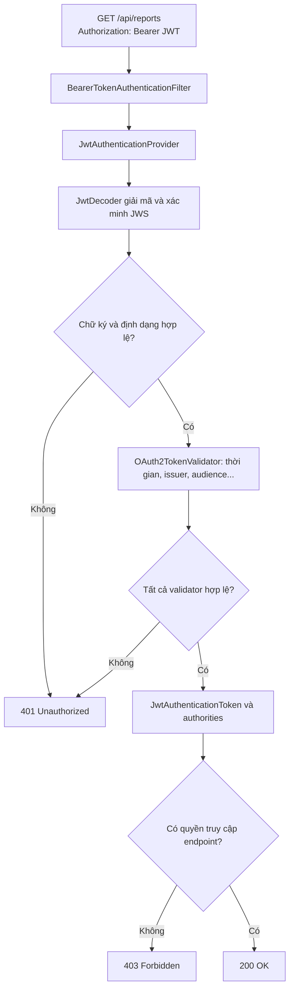

# Audience theo validator mà ứng dụng thực sự cấu hình

## 1. Tình huống: chữ ký đúng vẫn có thể là token dành cho API khác

Giả sử một hệ thống có hai resource server:

- **Orders API** chỉ nhận access token dành cho audience `api://orders`.
- **Reports API** chỉ nhận access token dành cho audience `api://reports`.

Hai API tin cậy cùng một authorization server, ví dụ `https://issuer.example.test`. Token của Orders API có chữ ký hợp lệ, `iss` đúng và chưa hết hạn, nhưng không vì thế mà nó được phép gọi Reports API. Claim `aud` (audience) cho biết token hướng tới resource nào. Để bảo vệ Reports API, ứng dụng **phải thực sự cấu hình một validator kiểm tra audience được yêu cầu** và kiểm thử bằng token đi qua bộ giải mã đó.

Trong module **SPRING_SECURITY_TESTING**, người học kiểm chứng xác thực, phân quyền và bảo vệ HTTP bằng `spring-security-test` trên Servlet và Reactive. Bài này tập trung vào ranh giới giữa kiểm thử JWT giả lập và kiểm thử access token thật: **`mockJwt()` hoặc `jwt()` có thể đặt claim `aud`, nhưng bản thân chúng không chứng minh `JwtDecoder` của ứng dụng đã kiểm tra `aud`.**

Sau bài học, người học cần:

1. Giải thích ý nghĩa `aud` và phân biệt nó với `iss`, `sub`, `scope`, `azp` và chữ ký JWT.
2. Nhận diện validator thực sự chạy trong luồng `Authorization: Bearer ...` của Spring Security Resource Server.
3. Cấu hình `JwtDecoder`/`ReactiveJwtDecoder` để yêu cầu một audience cụ thể mà vẫn giữ kiểm tra issuer và thời gian.
4. Dùng **JWT ký thật trong test** qua MockMvc hoặc WebTestClient để chứng minh token đúng audience được chấp nhận, token sai hoặc thiếu audience bị từ chối.
5. Diễn giải đúng HTTP 401 và 403, tránh kết luận sai từ `@WithMockUser`, `jwt()` hoặc `mockJwt()`.

## 2. Đọc `aud` theo hợp đồng của Resource Server

Ví dụ một JWT access token sau khi đã giải mã phần payload (chỉ là minh họa cấu trúc; chưa phải token có chữ ký):

```json
{
  "iss": "https://issuer.example.test",
  "sub": "alice",
  "aud": ["api://reports"],
  "iat": 1735689000,
  "nbf": 1735689000,
  "exp": 1735692600,
  "scope": "reports.read"
}
```

| Claim hoặc đặc tính | Ý nghĩa | Vì sao riêng nó chưa đủ? |
| --- | --- | --- |
| Chữ ký JWS hợp lệ | Token được ký bằng khóa mà decoder tin cậy | Một issuer có thể cấp token cho nhiều tài nguyên |
| `iss` | Định danh issuer | Cùng issuer có thể phát hành token cho Orders và Reports |
| `aud` | Một hoặc nhiều đối tượng nhận token | Phải so khớp với audience mà API hiện tại chấp nhận |
| `sub` | Định danh chủ thể | Danh tính đúng không cho biết token dành cho API nào |
| `exp`/`nbf` | Hạn sử dụng và thời điểm bắt đầu có hiệu lực | Token còn hạn vẫn có thể dành cho dịch vụ khác |
| `scope` hoặc `scp` | Quyền được cấp theo quy ước của authorization server | Có scope mong muốn nhưng sai audience vẫn không nên được nhận |
| `azp` hoặc `client_id` | Bên được ủy quyền/client, tùy loại token và provider | Không được tự động dùng thay `aud` |

Theo định dạng JWT, `aud` có thể là một chuỗi hoặc mảng chuỗi; ứng dụng nên sử dụng API đã chuẩn hóa của Spring Security như `Jwt#getAudience()`, thay vì tự ép kiểu bằng `getClaimAsString("aud")`. Một token có `aud` chứa nhiều mục tiêu chỉ nên được chấp nhận nếu **chính sách ứng dụng cho phép** và một trong các giá trị khớp chính xác với audience yêu cầu.

Ví dụ, khi Reports API yêu cầu `api://reports`:

| `aud` trong token | Quyết định của validator kiểm tra phần tử bằng `contains` |
| --- | --- |
| `["api://reports"]` | Hợp lệ |
| `["api://orders", "api://reports"]` | Hợp lệ, nếu ứng dụng cho phép token đa audience |
| `["api://orders"]` | Không hợp lệ |
| `[]` hoặc không có `aud` | Không hợp lệ |
| `["api://reports-admin"]` | Không hợp lệ |
| `["API://REPORTS"]` | Không hợp lệ với phép so khớp chính xác có phân biệt hoa/thường |

**Cảnh báo:** Audience không phải một cơ chế cấp quyền thay thế scope/authority. Reports API vẫn phải kiểm tra `SCOPE_reports.read` (hoặc chính sách tương đương) **sau khi** token vượt qua xác thực chữ ký, issuer, thời gian và audience.

### Luồng kiểm chứng khi dùng bearer token thật



Luồng trên mô tả cấu hình Servlet phổ biến. Ở Reactive, các lớp filter/provider tương ứng khác nhau nhưng nguyên tắc quan trọng vẫn giữ nguyên: **đầu vào là bearer token thật đi qua decoder thực tế và sau đó mới tới authorization**.

## 3. Không tự giả định Spring Security đã bật audience validation

Spring Security Resource Server có các cơ chế xác minh JWT chuẩn như chữ ký, thời hạn và issuer tùy cách khởi tạo decoder. **Không nên mặc định rằng chỉ khai báo `issuer-uri` hoặc xây `NimbusJwtDecoder` là đã bật kiểm tra audience theo yêu cầu của API.** Audience có thể được kiểm tra nhờ cấu hình framework/Boot ở một phiên bản cụ thể, một custom validator, một decoder tùy chỉnh hoặc chính sách ở tầng khác; cần xác định **cấu hình có hiệu lực tại runtime**.

Đặc biệt:

- `JwtValidators.createDefaultWithIssuer(issuer)` cung cấp các kiểm tra JWT mặc định và kiểm tra issuer, **không phải lời đảm bảo rằng audience ứng dụng yêu cầu đã được thêm vào**.
- Khi khai báo `@Bean JwtDecoder` riêng, auto-configuration có thể lùi lại; cần tự phối hợp các validator quan trọng.
- `JwtDecoder#setJwtValidator(...)` thay danh sách validator của decoder bằng validator được truyền vào. Nếu chỉ truyền `AudienceValidator`, ta có nguy cơ bỏ các kiểm tra mặc định về thời gian và issuer.
- `@WithMockUser`, `SecurityMockMvcRequestPostProcessors.jwt()` và `SecurityMockServerConfigurers.mockJwt()` thiết lập Authentication cho test; chúng không có nhiệm vụ xác minh một JWS bằng decoder cấu hình của ứng dụng.
- Các property cấu hình JWT/audience thay đổi theo phiên bản Spring Boot. Nếu dùng property thay cho bean, phải xác nhận rằng property ấy thực sự được binder và decoder của phiên bản đang chạy áp dụng.

Để đưa ra cam kết “Reports API luôn từ chối JWT sai audience”, cần **một integration test gửi bearer token đã ký đúng nhưng có `aud` sai** và yêu cầu phản hồi 401. Đây là test bảo vệ cấu hình trước những lần refactor decoder.

## 4. Cấu hình Servlet: kiểm tra audience cùng issuer và thời hạn

Ví dụ dùng Spring Security 6.x, Spring Boot 3.x, resource server JWT trên Servlet stack. Cấu hình dưới đây minh họa decoder đọc JWK Set của issuer, xác minh chữ ký và áp dụng các validator.

Dependency thông thường:

```groovy
dependencies {
    implementation 'org.springframework.boot:spring-boot-starter-web'
    implementation 'org.springframework.boot:spring-boot-starter-security'
    implementation 'org.springframework.boot:spring-boot-starter-oauth2-resource-server'
    testImplementation 'org.springframework.boot:spring-boot-starter-test'
    testImplementation 'org.springframework.security:spring-security-test'
}
```

Tạo validator riêng cho audience, xử lý cả claim không có `aud`:

```java
import java.util.List;
import org.springframework.security.oauth2.core.OAuth2Error;
import org.springframework.security.oauth2.core.OAuth2TokenValidator;
import org.springframework.security.oauth2.core.OAuth2TokenValidatorResult;
import org.springframework.security.oauth2.jwt.Jwt;

public final class RequiredAudienceValidator
        implements OAuth2TokenValidator<Jwt> {

    private final String requiredAudience;

    public RequiredAudienceValidator(String requiredAudience) {
        this.requiredAudience = requiredAudience;
    }

    @Override
    public OAuth2TokenValidatorResult validate(Jwt jwt) {
        List<String> audiences = jwt.getAudience();
        if (audiences != null && audiences.contains(requiredAudience)) {
            return OAuth2TokenValidatorResult.success();
        }
        OAuth2Error error = new OAuth2Error(
            "invalid_token", "JWT audience is not accepted", null);
        return OAuth2TokenValidatorResult.failure(error);
    }
}
```

Kiểm tra `audiences != null` giúp token thiếu claim bị từ chối bằng `OAuth2TokenValidatorResult.failure(...)` thay vì phát sinh `NullPointerException` và có thể thành HTTP 500. So sánh nên theo đúng chuỗi audience đã đăng ký trong hệ thống, tránh `contains` trên **một String**, `startsWith` hoặc phép so khớp đại khái.

Đưa validator vào decoder đang được HTTP security sử dụng:

```java
import org.springframework.context.annotation.Bean;
import org.springframework.context.annotation.Configuration;
import org.springframework.security.config.Customizer;
import org.springframework.security.config.annotation.web.builders.HttpSecurity;
import org.springframework.security.oauth2.core.OAuth2TokenValidator;
import org.springframework.security.oauth2.core.DelegatingOAuth2TokenValidator;
import org.springframework.security.oauth2.jwt.Jwt;
import org.springframework.security.oauth2.jwt.JwtDecoder;
import org.springframework.security.oauth2.jwt.JwtValidators;
import org.springframework.security.oauth2.jwt.NimbusJwtDecoder;
import org.springframework.security.web.SecurityFilterChain;

@Configuration
class ReportsApiSecurity {
    static final String ISSUER = "https://issuer.example.test";
    static final String JWKS_URI =
        "https://issuer.example.test/.well-known/jwks.json";
    static final String REQUIRED_AUDIENCE = "api://reports";

    @Bean
    JwtDecoder jwtDecoder() {
        NimbusJwtDecoder decoder =
            NimbusJwtDecoder.withJwkSetUri(JWKS_URI).build();

        OAuth2TokenValidator<Jwt> defaultsAndIssuer =
            JwtValidators.createDefaultWithIssuer(ISSUER);
        OAuth2TokenValidator<Jwt> audience =
            new RequiredAudienceValidator(REQUIRED_AUDIENCE);

        decoder.setJwtValidator(
            new DelegatingOAuth2TokenValidator<>(
                defaultsAndIssuer, audience));
        return decoder;
    }

    @Bean
    SecurityFilterChain filterChain(HttpSecurity http) throws Exception {
        http
            .authorizeHttpRequests(auth -> auth
                .requestMatchers("/api/reports/**")
                    .hasAuthority("SCOPE_reports.read")
                .anyRequest().authenticated())
            .oauth2ResourceServer(oauth2 ->
                oauth2.jwt(Customizer.withDefaults()));
        return http.build();
    }
}
```

Với `JwtDecoder` này, `NimbusJwtDecoder` xác minh JWS dựa trên khóa từ JWK Set. `DelegatingOAuth2TokenValidator` yêu cầu **tất cả validator** thành công: kiểm tra mặc định/issuer và kiểm tra audience. Scope được chuyển thành authority theo cấu hình mặc định của JWT Resource Server. Nếu provider dùng claim khác hoặc quy ước scope riêng, cấu hình `JwtAuthenticationConverter` tương ứng; đừng đánh đồng lỗi authority với lỗi audience.

Ví dụ sử dụng URL `https://issuer.example.test` để minh họa, không phải endpoint phát token thực. Trong sản phẩm, issuer/JWK URI phải khớp với nhà phát hành đang được tin cậy; việc fetch JWKS có thể phụ thuộc mạng và cache. Khi một API chấp nhận nhiều issuer hoặc nhiều nhóm audience, cần một chính sách tin cậy rõ ràng cho từng issuer/decoder; không tự nới audience thành chấp nhận mọi giá trị.

## 5. Mẫu kiểm thử có ý nghĩa: JWT được ký thật và HTTP header thật

Để kiểm tra audience validation, test cần tạo **JWT có chữ ký thật**, đi vào ứng dụng qua `Authorization: Bearer <token>` và được `JwtDecoder` xác minh. Có thể dùng một issuer/JWKS mock chạy nội bộ hoặc cấu hình decoder test bằng cặp khóa RSA test. Ví dụ bên dưới dùng RSA keypair trong context test, không phụ thuộc issuer ngoài mạng.

Đây là **test fixture tối giản** để thấy rõ cơ chế. Trong ứng dụng thật, phải chạy cùng `SecurityFilterChain` và decoder bean của ứng dụng (hoặc inject test key vào cấu hình thật) để kết quả chứng minh đúng cấu hình production. Nếu tự thay toàn bộ cấu hình security bằng fixture, test chỉ xác minh fixture.

### 5.1 Test integration sử dụng MockMvc

Test sử dụng Spring Boot 3.x và Spring Security 6.x, giả định `RequiredAudienceValidator` ở mục 4 có thể import trong test package. Các import sau đây cho thấy rõ thành phần cần thiết; IDE có thể tự tổ chức lại.

```java
import java.security.KeyPair;
import java.security.KeyPairGenerator;
import java.security.interfaces.RSAPrivateKey;
import java.security.interfaces.RSAPublicKey;
import java.time.Instant;
import java.util.List;

import com.nimbusds.jose.jwk.JWKSet;
import com.nimbusds.jose.jwk.RSAKey;
import com.nimbusds.jose.jwk.source.ImmutableJWKSet;

import org.junit.jupiter.api.Test;
import org.springframework.beans.factory.annotation.Autowired;
import org.springframework.boot.SpringBootConfiguration;
import org.springframework.boot.autoconfigure.EnableAutoConfiguration;
import org.springframework.boot.test.autoconfigure.web.servlet.AutoConfigureMockMvc;
import org.springframework.boot.test.context.SpringBootTest;
import org.springframework.context.annotation.Bean;
import org.springframework.context.annotation.Import;
import org.springframework.http.HttpHeaders;
import org.springframework.security.config.Customizer;
import org.springframework.security.config.annotation.web.builders.HttpSecurity;
import org.springframework.security.oauth2.core.DelegatingOAuth2TokenValidator;
import org.springframework.security.oauth2.jose.jws.SignatureAlgorithm;
import org.springframework.security.oauth2.jwt.*;
import org.springframework.security.web.SecurityFilterChain;
import org.springframework.test.web.servlet.MockMvc;
import org.springframework.web.bind.annotation.GetMapping;
import org.springframework.web.bind.annotation.RestController;

import static org.springframework.test.web.servlet.request.MockMvcRequestBuilders.get;
import static org.springframework.test.web.servlet.result.MockMvcResultMatchers.*;

@SpringBootTest(classes = AudienceJwtIntegrationTest.TestApp.class)
@AutoConfigureMockMvc
class AudienceJwtIntegrationTest {
    private static final String ISSUER =
        "https://issuer.example.test";
    private static final String AUD = "api://reports";

    @Autowired MockMvc mvc;
    @Autowired JwtEncoder jwtEncoder;

    private String signedToken(
            String issuer, List<String> audiences,
            String scope, Instant expiresAt) {

        JwtClaimsSet.Builder claims = JwtClaimsSet.builder()
            .issuer(issuer)
            .subject("alice")
            .issuedAt(Instant.now().minusSeconds(30))
            .expiresAt(expiresAt)
            .claim("scope", scope);

        if (audiences != null) {
            claims.audience(audiences);
        }

        JwsHeader header = JwsHeader.with(SignatureAlgorithm.RS256)
            .keyId("test-rsa")
            .build();
        return jwtEncoder.encode(
            JwtEncoderParameters.from(header, claims.build()))
            .getTokenValue();
    }

    private String bearer(List<String> audience, String issuer,
                          String scope) {
        return "Bearer " + signedToken(
            issuer, audience, scope, Instant.now().plusSeconds(300));
    }

    @Test
    void matchingAudienceAndScopePass() throws Exception {
        mvc.perform(get("/api/reports").header(
                HttpHeaders.AUTHORIZATION,
                bearer(List.of(AUD), ISSUER, "reports.read")))
            .andExpect(status().isOk())
            .andExpect(content().string("reports ok"));
    }

    @Test
    void wrongAudienceIsRejectedEvenWithValidSignature() throws Exception {
        mvc.perform(get("/api/reports").header(
                HttpHeaders.AUTHORIZATION,
                bearer(List.of("api://orders"), ISSUER, "reports.read")))
            .andExpect(status().isUnauthorized());
    }

    @Test
    void missingAudienceIsRejected() throws Exception {
        mvc.perform(get("/api/reports").header(
                HttpHeaders.AUTHORIZATION,
                bearer(null, ISSUER, "reports.read")))
            .andExpect(status().isUnauthorized());
    }

    @Test
    void multipleAudiencesIncludingRequiredAudiencePass()
            throws Exception {
        mvc.perform(get("/api/reports").header(
                HttpHeaders.AUTHORIZATION,
                bearer(List.of("api://orders", AUD),
                       ISSUER, "reports.read")))
            .andExpect(status().isOk());
    }

    @Test
    void matchingAudienceWithoutRequiredScopeIsForbidden()
            throws Exception {
        mvc.perform(get("/api/reports").header(
                HttpHeaders.AUTHORIZATION,
                bearer(List.of(AUD), ISSUER, "orders.read")))
            .andExpect(status().isForbidden());
    }

    @Test
    void differentIssuerIsRejected() throws Exception {
        mvc.perform(get("/api/reports").header(
                HttpHeaders.AUTHORIZATION,
                bearer(List.of(AUD), "https://wrong-issuer.example.test",
                       "reports.read")))
            .andExpect(status().isUnauthorized());
    }

    @Test
    void expiredTokenIsRejected() throws Exception {
        String token = signedToken(
            ISSUER, List.of(AUD), "reports.read",
            Instant.now().minusSeconds(300));
        mvc.perform(get("/api/reports").header(
                HttpHeaders.AUTHORIZATION, "Bearer " + token))
            .andExpect(status().isUnauthorized());
    }

    @Test
    void noBearerTokenIsRejected() throws Exception {
        mvc.perform(get("/api/reports"))
            .andExpect(status().isUnauthorized());
    }

    // Fixture chỉ minh họa cơ chế. Dùng security config thực
    // trong các integration test bảo vệ ứng dụng production.
    @SpringBootConfiguration
    @EnableAutoConfiguration
    @Import(ReportProbe.class)
    static class TestApp {
        @Bean
        KeyPair testKeyPair() throws Exception {
            KeyPairGenerator generator =
                KeyPairGenerator.getInstance("RSA");
            generator.initialize(2048);
            return generator.generateKeyPair();
        }

        @Bean
        JwtEncoder testJwtEncoder(KeyPair keys) {
            RSAKey jwk = new RSAKey.Builder(
                    (RSAPublicKey) keys.getPublic())
                .privateKey((RSAPrivateKey) keys.getPrivate())
                .keyID("test-rsa")
                .build();
            return new NimbusJwtEncoder(
                new ImmutableJWKSet<>(new JWKSet(jwk)));
        }

        @Bean
        JwtDecoder jwtDecoder(KeyPair keys) {
            NimbusJwtDecoder decoder = NimbusJwtDecoder
                .withPublicKey((RSAPublicKey) keys.getPublic())
                .build();
            decoder.setJwtValidator(
                new DelegatingOAuth2TokenValidator<>(
                    JwtValidators.createDefaultWithIssuer(ISSUER),
                    new RequiredAudienceValidator(AUD)));
            return decoder;
        }

        @Bean
        SecurityFilterChain security(HttpSecurity http)
                throws Exception {
            http.authorizeHttpRequests(auth -> auth
                    .requestMatchers("/api/reports")
                        .hasAuthority("SCOPE_reports.read")
                    .anyRequest().authenticated())
                .oauth2ResourceServer(oauth2 ->
                    oauth2.jwt(Customizer.withDefaults()));
            return http.build();
        }
    }

    @RestController
    static class ReportProbe {
        @GetMapping("/api/reports")
        String reports() {
            return "reports ok";
        }
    }
}
```

Các kiểm thử trên khác với mock JWT ở chỗ **token được ký bằng private key test, xác thực bằng public key trong `NimbusJwtDecoder` và gửi qua bearer header**. Chuỗi xác thực chạy qua security filter của MockMvc. Decoder kiểm tra chữ ký; validator kiểm tra issuer, thời gian và audience. Cuối cùng, authorization kiểm tra `SCOPE_reports.read`.

Giải thích các kết quả:

- **200**: token được xác thực hợp lệ **và** có đủ authority cho endpoint.
- **401**: không có bearer token, token không thể xác minh hoặc bị một validator JWT từ chối. Sai/mất `aud` thuộc nhóm này.
- **403**: token đã vượt qua bước xác thực nhưng thiếu quyền truy cập (ví dụ `scope=orders.read` thay vì `reports.read`).

Không hardcode private key hoặc bỏ qua kiểm tra chữ ký để tiết kiệm công tạo fixture. Cặp khóa sinh trong test ở đây được giữ trong context của test, không nên ghi ra log hoặc đưa vào môi trường production. Với hệ thống dùng asymmetric JWK Set, cũng có thể cung cấp JWKS từ local mock HTTP server rồi giữ nguyên `NimbusJwtDecoder.withJwkSetUri(...)` của ứng dụng.

### 5.2 Chuyển từ fixture sang kiểm thử cấu hình thật của ứng dụng

Một test chỉ có ý nghĩa bảo vệ production nếu hệ thống **thật sự dùng** decoder/validator mà test gọi. Với dự án thực tế:

1. Dùng `@SpringBootTest` tải cấu hình security thực của ứng dụng; nếu có nhiều `SecurityFilterChain`, gửi request tới đúng route đang được bảo vệ.
2. Đặt issuer/JWK Set của môi trường test ở đầu mối kiểm soát được, hoặc inject key pair test qua cấu hình đã được ứng dụng hỗ trợ.
3. Phát hành JWT có chữ ký đúng, issuer đúng và scope đủ nhưng **audience sai**, rồi gọi API thật qua `MockMvc` với header `Authorization: Bearer`.
4. Assert **401**. Sau đó gửi token chỉ đổi `aud` thành audience hợp lệ và assert kết quả phù hợp (thường là **200**).
5. Loại bỏ bất kỳ `@MockBean JwtDecoder` (hoặc cơ chế thay bean tương tự), `@WithMockUser`, `with(jwt())` và `mockJwt()` khỏi test xác minh validator; các kỹ thuật đó phục vụ mục tiêu khác.

Khi test chạy qua mạng, có thể dùng `@SpringBootTest(webEnvironment = RANDOM_PORT)` với HTTP client thực. MockMvc đủ để xác minh Spring Security filter và decoder trong Servlet context, còn HTTP test giúp kiểm tra cả cách server/proxy truyền bearer header.

## 6. Vì sao `jwt()` có thể làm test sai audience vẫn xanh?

`spring-security-test` cung cấp helper rất hữu ích:

```java
import static org.springframework.security.test.web.servlet.request
    .SecurityMockMvcRequestPostProcessors.jwt;

import org.springframework.security.core.authority.SimpleGrantedAuthority;

mockMvc.perform(get("/api/reports")
        .with(jwt()
            .jwt(builder -> builder.audience(
                List.of("api://orders")))
            .authorities(
                new SimpleGrantedAuthority("SCOPE_reports.read"))))
    .andExpect(status().isOk());
```

Đây có thể là test hợp lệ cho **quyết định authorization sau khi có Authentication**, nhưng nếu gọi nó là test audience validation thì kết luận sai. `jwt()` đã đặt `JwtAuthenticationToken` vào security context của request; decoder không nhận token được ký để xác minh. Kết quả 200 không chứng minh rằng bearer token cho `api://orders` sẽ qua được validator của Reports API.

Tương tự:

| Helper hoặc cách gọi | Kiểm thử được gì? | Có kiểm chứng audience validator của decoder? |
| --- | --- | --- |
| `@WithMockUser` | Quyền theo username/roles ở test | **Không**: không có JWT |
| `MockMvc.with(jwt())` | Quy tắc dựa trên `JwtAuthenticationToken`/authorities | **Không**: bỏ qua giải mã JWS |
| `WebTestClient.mutateWith(mockJwt())` | Authorization trên WebFlux với Authentication giả lập | **Không**: bypass reactive decoder |
| `@MockBean JwtDecoder` trả `Jwt` có sẵn | Chuyển token/authority từ một decoder giả | **Không**: validator thật không chạy |
| Header `Authorization: Bearer <JWS ký thật>` với decoder thật | Chữ ký, issuer, thời gian, audience, ánh xạ quyền và bảo vệ HTTP | **Có**, nếu decoder thật được nối vào đúng filter chain |

Vì vậy có thể sử dụng **cả hai lớp test** mà không lẫn mục tiêu: unit/authorization test với `jwt()` rất nhanh để kiểm tra rule; integration test bằng bearer token ký thật để kiểm tra ranh giới tin cậy và cấu hình decoder.

## 7. Reactive/WebFlux: cùng chính sách, đường kiểm thử khác

Nếu ứng dụng chạy trên WebFlux thì dùng `SecurityWebFilterChain` và `ReactiveJwtDecoder`. Ví dụ:

```java
import org.springframework.context.annotation.Bean;
import org.springframework.context.annotation.Configuration;
import org.springframework.security.config.Customizer;
import org.springframework.security.config.web.server.ServerHttpSecurity;
import org.springframework.security.oauth2.core.DelegatingOAuth2TokenValidator;
import org.springframework.security.oauth2.jwt.JwtValidators;
import org.springframework.security.oauth2.jwt.NimbusReactiveJwtDecoder;
import org.springframework.security.oauth2.jwt.ReactiveJwtDecoder;
import org.springframework.security.web.server.SecurityWebFilterChain;

@Configuration
class ReactiveReportsSecurity {
    private static final String ISSUER =
        "https://issuer.example.test";
    private static final String AUD = "api://reports";

    @Bean
    ReactiveJwtDecoder reactiveJwtDecoder() {
        NimbusReactiveJwtDecoder decoder =
            NimbusReactiveJwtDecoder.withJwkSetUri(
                "https://issuer.example.test/.well-known/jwks.json")
            .build();
        decoder.setJwtValidator(
            new DelegatingOAuth2TokenValidator<>(
                JwtValidators.createDefaultWithIssuer(ISSUER),
                new RequiredAudienceValidator(AUD)));
        return decoder;
    }

    @Bean
    SecurityWebFilterChain security(ServerHttpSecurity http) {
        return http
            .authorizeExchange(exchanges -> exchanges
                .pathMatchers("/api/reports/**")
                    .hasAuthority("SCOPE_reports.read")
                .anyExchange().authenticated())
            .oauth2ResourceServer(oauth2 ->
                oauth2.jwt(Customizer.withDefaults()))
            .build();
    }
}
```

`WebTestClient` có thể kiểm tra endpoint WebFlux qua application context hoặc kết nối server:

```java
String tokenForOtherApi = "..."; // JWT đã ký bằng test issuer

webTestClient.get()
    .uri("/api/reports")
    .headers(headers ->
        headers.setBearerAuth(tokenForOtherApi))
    .exchange()
    .expectStatus().isUnauthorized();
```

Để test trên thực sự chứng minh audience validator, WebTestClient phải kết nối tới handler và filter chain **có ReactiveJwtDecoder thật**; token phải là JWS hợp lệ theo public key/JWK Set test. Token “...” trong snippet chỉ biểu thị đầu ra từ helper phát hành JWT ký thật ở fixture, không phải giá trị có thể gửi nguyên văn. Có thể dùng `@SpringBootTest(webEnvironment = RANDOM_PORT)` và `WebTestClient` kết nối server để xác minh toàn đường HTTP.

Ngược lại, đoạn sau chỉ dùng cho unit test authorization:

```java
import static org.springframework.security.test.web.reactive.server
    .SecurityMockServerConfigurers.mockJwt;

webTestClient
    .mutateWith(mockJwt().jwt(jwt ->
        jwt.audience(List.of("api://orders"))))
    .get().uri("/api/reports")
    .exchange();
```

`mockJwt()` tự chuẩn bị SecurityContext cho bài test; nó **không** kiểm chứng `ReactiveJwtDecoder#setJwtValidator(...)`. Hơn nữa, test thiếu quyền có thể bị 403 dù audience hoàn toàn chưa được kiểm tra; phải xem nội dung Authentication và cấu hình authorities khi diễn giải kết quả.

## 8. Bảng test cần có để chống lỗi cấu hình

| Kịch bản | Chữ ký / issuer / hạn | `aud` | Scope | Kỳ vọng với Reports API |
| --- | --- | --- | --- | --- |
| Hợp lệ cơ bản | Đúng | `api://reports` | `reports.read` | 200 |
| Audience của API khác | Đúng | `api://orders` | `reports.read` | 401 |
| Thiếu `aud` | Đúng | Không có | `reports.read` | 401 |
| Audience rỗng | Đúng | `[]` | `reports.read` | 401 |
| Audience chứa giá trị gần giống | Đúng | `api://reports-admin` | `reports.read` | 401 |
| Token đa audience | Đúng | `[api://reports, api://orders]` | `reports.read` | 200 nếu chính sách chấp nhận token đa audience |
| Audience đúng, sai issuer | Chữ ký đúng, issuer sai | `api://reports` | `reports.read` | 401 |
| Audience đúng, chữ ký hỏng | Chữ ký sai | `api://reports` | `reports.read` | 401 |
| Audience đúng, hết hạn | `exp` đã qua quá mức lệch giờ cho phép | `api://reports` | `reports.read` | 401 |
| Audience đúng, scope thiếu | Đúng | `api://reports` | `orders.read` | 403 |
| Không có bearer header | Không có token | Không có | Không có | 401 |

Cần gắn expected status với **hợp đồng endpoint thực tế**: bảng giả định Reports API là resource server chỉ nhận Bearer và trả HTTP 401 cho lỗi xác thực, 403 cho thiếu quyền. Nếu ứng dụng có entry point/access denied handler tùy biến, test cần phản ánh chính sách đó và vẫn phân biệt lỗi xác thực với lỗi phân quyền.

Các ca **sai audience nhưng mọi điều kiện khác đều đúng** là quan trọng nhất. Nếu tạo token sai audience đồng thời sai chữ ký, test 401 có thể vẫn xanh sau khi ai đó xóa audience validator: chữ ký sai đã đủ làm token bị từ chối. Hãy giữ các biến còn lại hợp lệ để mỗi test chứng minh đúng điều kiện cần kiểm tra.

## 9. Làm thế nào xác định validator nào thực sự chạy?

Trong một ứng dụng có nhiều cấu hình security, hãy lần theo request thay vì chỉ nhìn tên property:

1. Xác định endpoint và `SecurityFilterChain`/`SecurityWebFilterChain` thực sự match endpoint.
2. Xác định decoder bean hoặc decoder được cấu hình trực tiếp trong Resource Server DSL. Đối với Servlet, kiểm tra `JwtDecoder`; đối với Reactive là `ReactiveJwtDecoder`.
3. Xác định code thiết lập `OAuth2TokenValidator<Jwt>`, nhất là `setJwtValidator(...)`. Kiểm tra validator này có giữ mặc định về issuer/thời gian và thêm audience hay không.
4. Xác nhận giá trị audience yêu cầu lấy từ cấu hình nào, đúng cho môi trường nào và đúng với access token được issuer cấp.
5. Gửi một JWS hợp lệ, audience sai vào endpoint. Đảm bảo test không dùng helper giả Authentication hoặc mock decoder.
6. Tách kiểm tra authentication (401) với authorization (403), tránh sửa sai bằng cách cấp thêm scope cho token sai audience.

Nếu ứng dụng chỉ khởi tạo `NimbusJwtDecoder.withJwkSetUri(...)` rồi kết nối Resource Server mà **không có bất kỳ validator audience nào**, điều có thể xảy ra là token khác audience vẫn được xác thực nếu chữ ký/claims khác hợp lệ; nó chỉ có thể bị chặn bởi một rule phụ khác. Khi thiết kế yêu cầu audience cụ thể, đây là chỗ cần bổ sung validator, sau đó khóa hành vi bằng integration test.

### Tham số kiểm thử quan trọng

- **Token issuer đúng** nhưng audience sai: chỉ kiểm tra audience.
- **Chữ ký đúng** bằng private key test tương ứng public key decoder tin cậy: tránh 401 do signature.
- **Chưa hết hạn** và `nbf` hợp lệ: tránh 401 do timestamp.
- **Scope đủ**: tránh 403 che lỗi xác thực hoặc làm sai kỳ vọng.
- **Không mock decoder/SecurityContext**: bảo đảm filter và validator thật chạy.
- **Đúng route/chain**: hệ thống có nhiều filter chain rất dễ kiểm thử nhầm endpoint.
- **Không phụ thuộc JWKS Internet** trong test lặp lại: dùng test key hoặc local JWKS mock để tránh flaky test.

## 10. Lỗi thường gặp và hướng khắc phục

### “Tôi thêm `aud` vào `jwt()` nhưng token sai audience vẫn được chấp nhận”

`jwt()` chủ yếu giả Authentication; nó không gọi `JwtDecoder`. Hãy tạo bearer token ký thật, gửi header cho endpoint đi qua Resource Server và kiểm tra validator. Dùng `jwt()` riêng để kiểm tra quy tắc scope/role.

### “Tôi có `issuer-uri`, vậy audience chắc chắn được kiểm tra”

Issuer và audience là hai ràng buộc khác nhau. Kiểm tra validator hiệu lực, property đúng phiên bản và bean decoder được dùng. Không suy ra audience validation từ việc token có chữ ký đúng hay issuer đúng.

### “Sau khi thêm audience validator, token hết hạn vẫn được nhận”

Có thể đã gọi `setJwtValidator(new RequiredAudienceValidator(...))` và thay thế bộ validator mặc định. Kết hợp `JwtValidators.createDefaultWithIssuer(...)` hoặc bộ validator tương đương cùng audience bằng `DelegatingOAuth2TokenValidator`.

### “Token thiếu `aud` gây HTTP 500”

Không viết `jwt.getAudience().contains(expected)` khi có thể nhận `null`. Validator phải trả `OAuth2TokenValidatorResult.failure(...)` cho claim thiếu hoặc không hợp lệ; test thiếu `aud` là một hồi quy quan trọng.

### “Audience gần đúng cũng qua được”

Tránh `audience.startsWith("api://reports")` hoặc `audience.contains("reports")` trên chuỗi; chúng có thể chấp nhận token cho `api://reports-admin`. So khớp **phần tử đầy đủ** của tập audience theo chuỗi cấu hình.

### “Token đúng audience trả 403”

Audience hợp lệ chỉ đưa token qua tầng authentication. Kiểm tra `scope`/`scp`, `JwtAuthenticationConverter`, mapping `SCOPE_...` và rule authorization. Thiếu scope là lỗi quyền truy cập, không chứng minh audience validator sai.

### “Token của OIDC client có `aud` trùng client ID”

Đây thường là **ID token**, nhằm thông báo kết quả xác thực cho client, không tự động là access token được phép gọi API. Resource Server cần xác minh đúng loại token, issuer, audience của **API**, và các ràng buộc đặc thù của provider. Không lấy `aud=client_id` làm tiêu chuẩn chấp nhận API nếu hợp đồng resource server không quy định vậy.

### “Một validator chung chấp nhận nhiều API”

Chỉ làm vậy nếu có chính sách rõ ràng: ví dụ một gateway được thiết kế phục vụ nhiều resource và từng endpoint vẫn kiểm soát scope/role đúng. Tránh cấu hình global kiểu “một trong tất cả audience của tổ chức” rồi vô tình mở quyền gọi chéo API. Nhiều `SecurityFilterChain` có thể cần decoder/validator riêng cho từng vùng URL.

### “JWT giả lập có cùng claims, vì sao kết quả khác token thật?”

Claims không nói lên toàn bộ kết quả xác thực: chữ ký, key ID, thuật toán JWS, issuer, clock skew, decoder wiring và ánh xạ authority đều tác động đến kết quả. Test phải ghi rõ đang kiểm tra lớp nào. Không suy ra hành vi decoder từ kết quả mock.

## 11. Bài thực hành

**Bài 1 — Chứng minh thiếu audience validator.** Dựng resource server thử nghiệm chỉ có validator mặc định/issuer. Phát hành hai token ký cùng key và cùng issuer: token A có `aud=api://reports`, token B có `aud=api://orders`; cả hai có scope `reports.read`. Gửi bearer token trực tiếp, quan sát hiện tượng trước khi thêm audience validator. Chỉ dùng trong môi trường test.

**Bài 2 — Khóa cấu hình bằng integration test.** Thêm `RequiredAudienceValidator("api://reports")` cùng validator mặc định, yêu cầu token A được phép và token B trả 401. Thêm test thiếu `aud` và token có `aud=["api://orders", "api://reports"]` để xác định chính sách đa audience.

**Bài 3 — Phân biệt 401 và 403.** Tạo token audience đúng, scope sai; chứng minh xác thực thành công nhưng endpoint trả 403. Viết một test `MockMvc.with(jwt())` cho rule authority và giải thích vì sao nó không thay thế test của Bài 2.

**Bài 4 — Kiểm tra cấu hình thật.** Chuyển integration test từ fixture `TestApp` sang security configuration thực của ứng dụng và test issuer/JWKS cục bộ. Nếu hệ thống dùng Servlet, dùng `MockMvc`; nếu WebFlux, dùng `WebTestClient` với bearer token thật.

**Bài 5 — Chống cấu hình lùi.** Cố ý bỏ `RequiredAudienceValidator` khỏi decoder của môi trường thử nghiệm và chạy lại test token sai audience. Test phải thất bại theo cách chỉ ra audience không được kiểm tra. Khôi phục validator và xác nhận suite xanh.

Tiêu chí đạt: người học chỉ ra được **điểm cấu hình và validator thực sự áp dụng**, tạo được ít nhất một JWS ký thật có audience sai nhưng các điều kiện khác hợp lệ, nhận 401 từ resource server, đồng thời có ca 200 với audience đúng và ca 403 do thiếu quyền. Điều này bảo vệ đúng ranh giới giữa “token được xác thực cho API nào” và “token được quyền làm gì”.

## 12. Tài liệu tham khảo

- [RFC 7519 — JSON Web Token (JWT), `4.1.3 Audience Claim](https://www.rfc-editor.org/rfc/rfc7519#section-4.1.3): ngữ nghĩa `aud` và dạng chuỗi/mảng.
- [Spring Security — OAuth 2.0 Resource Server JWT (Servlet)](https://docs.spring.io/spring-security/reference/servlet/oauth2/resource-server/jwt.html): decoder, xác minh JWT, custom validator.
- [Spring Security — OAuth 2.0 Resource Server JWT (Reactive)](https://docs.spring.io/spring-security/reference/reactive/oauth2/resource-server/jwt.html): `ReactiveJwtDecoder` và cấu hình WebFlux.
- [Spring Security — MockMvc OAuth 2.0 Resource Server Tests](https://docs.spring.io/spring-security/reference/servlet/test/mockmvc/oauth2.html): phạm vi của `jwt()` trong test.
- [Spring Security — WebTestClient OAuth 2.0 Tests](https://docs.spring.io/spring-security/reference/reactive/test/web/oauth2.html): phạm vi của `mockJwt()` trong reactive test.
- [RFC 9068 — JWT Profile for OAuth 2.0 Access Tokens](https://www.rfc-editor.org/rfc/rfc9068): hồ sơ JWT access token và validation ở resource server.
