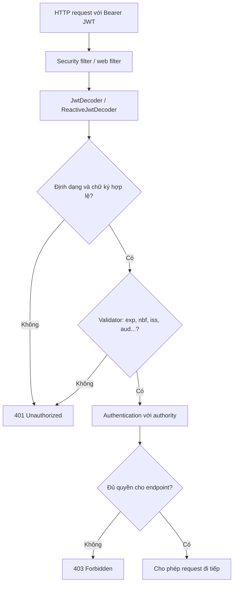

# `exp`, `nbf` và khoảng lệch thời gian cho phép khi kiểm thử JWT

Trong chương **JWT và token thực** của module **SPRING_SECURITY_TESTING**, người học không chỉ cần kiểm tra một request có được phép truy cập hay không, mà còn phải chứng minh ứng dụng **thực sự từ chối JWT chưa đến thời điểm sử dụng hoặc đã quá hạn**. Bài này tập trung vào ba yếu tố liên quan trực tiếp đến kiểm tra thời gian của token: claim `exp`, claim `nbf` và **clock skew/leeway** (khoảng sai lệch thời gian được chấp nhận).

Module sử dụng `spring-security-test` trên cả **Servlet** và **Reactive**, với `MockMvc`, `WebTestClient`, `SecurityContext`, `@WithMockUser` và JWT/OAuth2/OIDC giả lập. Tuy nhiên, mục tiêu kiểm chứng `exp`/`nbf` đòi hỏi phân biệt rõ **test phân quyền với danh tính giả lập** và **test đường đi xác thực một bearer token đã ký**. Chỉ cách thứ hai, hoặc kiểm thử trực tiếp validator thật, mới chứng minh được chính sách thời gian của JWT.

## 1. `exp`, `nbf`, `iat` mang ý nghĩa gì?

Theo mô hình JWT (RFC 7519), các claim thời gian thường được biểu diễn dưới dạng **NumericDate**: số giây kể từ `1970-01-01T00:00:00Z` (UTC), không phải chuỗi giờ địa phương. Một số thư viện hỗ trợ phần giây thập phân; trong test Java, dùng `Instant` và chỉ định rõ múi giờ UTC để tránh phụ thuộc máy chạy.

| Claim | Ý nghĩa | Chính sách điển hình |
| --- | --- | --- |
| `exp` (*expiration time*) | Thời điểm sau đó JWT không còn được chấp nhận | Chỉ chấp nhận trước mốc hết hạn, có thể dung sai một khoảng leeway có chủ đích |
| `nbf` (*not before*) | Thời điểm sớm nhất JWT được chấp nhận | Không chấp nhận JWT trước mốc này, có thể dung sai leeway có chủ đích |
| `iat` (*issued at*) | Thời điểm phát hành JWT | Phục vụ kiểm toán, tính tuổi token và các chính sách bổ sung; **không đồng nghĩa `nbf`** |

Ví dụ payload minh họa (không phải một token đã ký):

```json
{
  "sub": "fixture-user-17",
  "iss": "https://issuer.test.invalid",
  "aud": ["reports-api"],
  "iat": 1767272400,
  "nbf": 1767272400,
  "exp": 1767272700,
  "scope": "reports.read"
}
```

Ở đây, `exp - nbf = 300` giây, tức khoảng năm phút theo đồng hồ UTC. Tên `sub`, `iss`, `aud` và `scope` là dữ liệu kiểm thử, không định danh người dùng thực. Khi soạn test, nên tạo giá trị thời gian bằng `Instant`, rồi để thư viện JWT chuyển thành NumericDate; tránh tự gõ epoch seconds mà không đối chiếu.

**Phân biệt quan trọng:** `exp` và `nbf` không xác nhận token được ký bởi ai. JWT có thời gian hợp lệ nhưng chữ ký sai, `iss` không đáng tin hoặc `aud` sai vẫn phải bị từ chối theo chính sách của ứng dụng. Ngược lại, JWT có chữ ký hợp lệ nhưng `exp` đã quá hạn cũng không được cho phép chỉ vì signer được tin cậy.

## 2. Clock skew/leeway là gì và nó thay đổi khoảng hợp lệ như thế nào?

Giả sử issuer và resource server sử dụng hai đồng hồ lệch nhau vài giây. Nếu issuer phát hành token với `nbf` là thời điểm hiện tại của nó, server có đồng hồ chậm hơn có thể xem token là “chưa có hiệu lực”. Nếu server chạy nhanh hơn, nó có thể xem token là “hết hạn” sớm hơn issuer dự kiến.

**Leeway** là độ dung sai được cấu hình để giảm lỗi do lệch đồng hồ. Với thời điểm kiểm tra là `now` và khoảng dung sai `L`, có thể hiểu ý nghĩa chính sách theo cách sau:

```text
Kiểm tra nbf:  now + L >= nbf       (có thể chấp nhận sớm tối đa L)
Kiểm tra exp:  now - L <  exp       (có thể chấp nhận muộn tối đa L)

          quá sớm                     trong thời gian            quá hạn
  --------|----------------------------|--------------------------|--------> UTC
       nbf - L                       nbf                        exp + L
```

Sơ đồ giả định `nbf` xảy ra trước `exp` và bỏ qua các điều kiện xác thực khác. Việc dùng dấu nghiêm ngặt tại thời điểm bằng đúng ranh giới có thể khác theo validator; bài test cần xác minh hành vi của **phiên bản và cấu hình thư viện đang chạy**, không suy luận chỉ từ sơ đồ. Một token vẫn phải thỏa **cả hai điều kiện** thời gian cùng lúc.

Leeway **không phải thời gian sống mới của token**. Nếu cấu hình dung sai 30 giây, ứng dụng có thể tiếp tục chấp nhận một token đã qua `exp` vài giây; điều này là đánh đổi bảo mật thực sự, không chỉ tối ưu hiệu năng. Không nên chọn dung sai tùy tiện rất lớn để làm test xanh.

### Ma trận ví dụ với đồng hồ cố định

Đặt `now = 2026-01-01T12:00:00Z` và `L = 30 giây`. Bảng dưới chỉ nói tới `exp`/`nbf`, giả định chữ ký, issuer, audience và mọi rule khác đều đúng. Các trường hợp cố tình cách ranh giới 1 giây để tránh phụ thuộc so sánh bằng đúng mốc:

| `nbf` | `exp` | Dự kiến | Giải thích |
| --- | --- | --- | --- |
| `now - 5 phút` | `now + 5 phút` | Hợp lệ | Token nằm trong cửa sổ thời gian |
| `now - 5 phút` | `now - 29 giây` | Có thể chấp nhận | Vừa quá `exp` nhưng còn trong leeway 30 giây |
| `now - 5 phút` | `now - 31 giây` | Bị từ chối | Quá `exp` xa hơn leeway |
| `now + 29 giây` | `now + 5 phút` | Có thể chấp nhận | Chưa tới `nbf` nhưng còn trong leeway |
| `now + 31 giây` | `now + 5 phút` | Bị từ chối | Còn quá sớm so với `nbf` |
| `now + 31 giây` | `now - 31 giây` | Bị từ chối | Vi phạm cả hai điều kiện |

Trong các hệ thống có yêu cầu bảo mật cao, có thể chọn `L = 0` nếu đồng hồ được đồng bộ và hợp đồng chấp nhận token cho phép. Với hệ thống phân tán, dung sai thường nhỏ, được định nghĩa bằng cấu hình và kiểm thử như một phần của chính sách bảo mật. Giá trị mặc định phụ thuộc thư viện, phiên bản và cách tạo validator; **đừng giả định tất cả ứng dụng Spring Security đều dùng chung một giá trị**.

## 3. Spring Security kiểm tra thời gian JWT ở đâu?

Với ứng dụng resource server nhận `Authorization: Bearer <JWT>`, đường đi kiểm tra tổng quát là:



Trên Servlet, ứng dụng thường cấu hình `SecurityFilterChain` với `oauth2ResourceServer(...jwt...)` và một `JwtDecoder`. Trên Reactive, cơ chế tương đương dùng `SecurityWebFilterChain` và `ReactiveJwtDecoder`. Phần thời gian có thể được xử lý bởi `JwtTimestampValidator`, thường kết hợp với validator issuer/audience và các quy tắc riêng.

**401** là kết quả mong đợi điển hình khi bearer token bị decoder/validator từ chối, chẳng hạn quá `exp` hoặc chưa đến `nbf`. **403** xuất hiện khi token đã được xác thực nhưng principal thiếu authority phù hợp. Hành vi thực tế còn phụ thuộc exception handling và entry point của ứng dụng; trong test phải gắn khẳng định status với cấu hình HTTP security thật.

Các công cụ `@WithMockUser`, `user(...)`, `jwt()`, `mockJwt()`, `oauth2Login()` và `oidcLogin()` rất hữu ích để kiểm thử phân quyền/logic sau xác thực. Tuy nhiên, khi sử dụng các cách này, bạn đang **cung cấp một danh tính đã được giả lập là xác thực thành công**. Việc đặt claim `exp` đã quá hạn vào `jwt()` không đồng nghĩa request sẽ đi qua `JwtDecoder` và bị từ chối.

## 4. Kiểm thử trực tiếp `JwtTimestampValidator` với đồng hồ cố định

Để kiểm chứng chính xác giới hạn leeway mà không phụ thuộc thời gian chạy test, hãy dùng `Clock.fixed(...)`. Đây là bài kiểm thử **validator**: nó xác nhận hành vi của `JwtTimestampValidator`, không xác minh chữ ký JWS hoặc chứng minh HTTP filter chain đã được kích hoạt.

```java
import static org.junit.jupiter.api.Assertions.assertFalse;
import static org.junit.jupiter.api.Assertions.assertTrue;

import java.time.Clock;
import java.time.Duration;
import java.time.Instant;
import java.time.ZoneOffset;

import org.junit.jupiter.api.BeforeEach;
import org.junit.jupiter.api.Test;
import org.springframework.security.oauth2.jwt.Jwt;
import org.springframework.security.oauth2.jwt.JwtTimestampValidator;

class JwtTimeWindowTest {

    private static final Instant NOW =
        Instant.parse("2026-01-01T12:00:00Z");

    private JwtTimestampValidator validator;

    @BeforeEach
    void setUp() {
        validator = new JwtTimestampValidator(Duration.ofSeconds(30));
        validator.setClock(Clock.fixed(NOW, ZoneOffset.UTC));
    }

    private Jwt fixture(Instant nbf, Instant exp) {
        return Jwt.withTokenValue("synthetic-unsigned-fixture")
            .header("alg", "RS256")
            .claim("sub", "fixture-user")
            .notBefore(nbf)
            .expiresAt(exp)
            .build();
    }

    @Test
    void ordinaryValidTimeWindowIsAccepted() {
        Jwt jwt = fixture(NOW.minusSeconds(300), NOW.plusSeconds(300));
        assertFalse(validator.validate(jwt).hasErrors());
    }

    @Test
    void expirationWithinLeewayIsAccepted() {
        Jwt jwt = fixture(NOW.minusSeconds(300), NOW.minusSeconds(29));
        assertFalse(validator.validate(jwt).hasErrors());
    }

    @Test
    void expirationBeyondLeewayIsRejected() {
        Jwt jwt = fixture(NOW.minusSeconds(300), NOW.minusSeconds(31));
        assertTrue(validator.validate(jwt).hasErrors());
    }

    @Test
    void notBeforeWithinLeewayIsAccepted() {
        Jwt jwt = fixture(NOW.plusSeconds(29), NOW.plusSeconds(300));
        assertFalse(validator.validate(jwt).hasErrors());
    }

    @Test
    void notBeforeBeyondLeewayIsRejected() {
        Jwt jwt = fixture(NOW.plusSeconds(31), NOW.plusSeconds(300));
        assertTrue(validator.validate(jwt).hasErrors());
    }

    @Test
    void bothChecksMustPass() {
        Jwt jwt = fixture(NOW.plusSeconds(31), NOW.minusSeconds(31));
        assertTrue(validator.validate(jwt).hasErrors());
    }
}
```

Ở đây giá trị `synthetic-unsigned-fixture` chỉ là dữ liệu để xây một đối tượng `Jwt` trong bộ nhớ. Nó **không phải bearer token có thể gửi qua mạng**. Trường header `alg` chỉ hoàn thiện dữ liệu của đối tượng test; test này không thực hiện kiểm tra thuật toán hay chữ ký. Phải dùng decoder thực nếu muốn xác minh phần đó.

### Vì sao không dùng `Thread.sleep()`?

Nếu tạo token hết hạn sau hai giây rồi cho test ngủ ba giây, kết quả phụ thuộc lập lịch CPU, độ trễ CI và đồng hồ hệ thống. Test dễ chập chờn và chạy chậm. Với `Clock.fixed`, thời điểm kiểm tra không đổi qua các lần chạy; chỉ cần thay `nbf`, `exp` theo các offset cần thử.

Để kiểm tra **đúng ranh giới** `exp = now ± L` hay `nbf = now ± L`, bổ sung test riêng sau khi xác nhận toán tử so sánh của phiên bản `JwtTimestampValidator` đang sử dụng. Không trộn kiểm tra ranh giới thư viện với kiểm tra business rule để tránh khó chẩn đoán lỗi.

## 5. Cấu hình leeway có chủ đích trên `NimbusJwtDecoder`

Trong Servlet resource server, một cách kiểm soát chính sách thời gian là tạo `JwtTimestampValidator` với `Duration` tường minh rồi gắn vào `NimbusJwtDecoder` cùng các validator khác. Ví dụ sau sử dụng **RSA public key chỉ dành cho test** và issuer giả định; nó minh họa cách nối các validator, không phải cấu hình production hoàn chỉnh:

```java
@Bean
JwtDecoder testJwtDecoder(RSAPublicKey fixturePublicKey) {
    NimbusJwtDecoder decoder =
        NimbusJwtDecoder.withPublicKey(fixturePublicKey).build();

    JwtTimestampValidator timestamp =
        new JwtTimestampValidator(Duration.ofSeconds(30));
    timestamp.setClock(Clock.fixed(
        Instant.parse("2026-01-01T12:00:00Z"), ZoneOffset.UTC));

    OAuth2TokenValidator<Jwt> issuer =
        new JwtIssuerValidator("https://issuer.test.invalid");

    OAuth2TokenValidator<Jwt> audience =
        new JwtClaimValidator<List<String>>(
            "aud", values -> values != null && values.contains("reports-api"));

    decoder.setJwtValidator(new DelegatingOAuth2TokenValidator<>(
        timestamp, issuer, audience));

    return decoder;
}
```

Cần cung cấp bean/fixture `RSAPublicKey` tương ứng với private key test dùng để ký token, import các kiểu Spring Security OAuth2 và `java.time`, `java.security.interfaces`, `java.util`. Khi gọi `setJwtValidator(...)`, bạn **đặt lại chuỗi validator** cho decoder; hãy đưa vào đầy đủ kiểm tra mà ứng dụng yêu cầu (`exp`, `nbf`, `iss`, `aud`, claim đặc thù). Đừng vô tình bỏ một validator mặc định quan trọng chỉ để thay đổi skew. Cấu hình mẫu sử dụng thời gian cố định **chỉ trong test**; hệ thống chạy thực tế cần đồng hồ thời gian thực có đồng bộ và cấu hình leeway phù hợp chính sách.

Với Reactive, cùng ý tưởng áp dụng ở `ReactiveJwtDecoder`/`NimbusReactiveJwtDecoder` và tập validator tương ứng, sau đó đưa decoder vào cấu hình `SecurityWebFilterChain`. API tạo decoder và cấu hình issuer/JWK có thể khác theo cách sử dụng và phiên bản Spring Security; điều quan trọng là **kiểm tra validator thật được gắn vào decoder thực sự phục vụ request HTTP**.

## 6. HTTP integration test phải gửi JWT đã ký, không dùng JWT mock

Test `JwtTimestampValidator` ở mục 4 nhanh và chính xác, nhưng chưa chứng minh endpoint HTTP thật sự áp dụng decoder đó. Để kiểm tra trọn đường đi HTTP, hãy tạo **khóa RSA test** và **JWT ký thật bằng khóa test**, sau đó gửi chuỗi compact JWT trong header `Authorization`.

Một fixture ký JWT bằng Nimbus JOSE + JWT có thể xây dựng như sau (ví dụ tập trung vào phần tạo token):

```java
static String signFixture(
    RSAPrivateKey fixturePrivateKey,
    Instant notBefore,
    Instant expiresAt
) throws JOSEException {
    JWTClaimsSet claims = new JWTClaimsSet.Builder()
        .subject("fixture-user")
        .issuer("https://issuer.test.invalid")
        .audience("reports-api")
        .issueTime(Date.from(Instant.parse("2026-01-01T11:55:00Z")))
        .notBeforeTime(Date.from(notBefore))
        .expirationTime(Date.from(expiresAt))
        .claim("scope", "reports.read")
        .build();

    SignedJWT signed = new SignedJWT(
        new JWSHeader.Builder(JWSAlgorithm.RS256)
            .type(JOSEObjectType.JWT)
            .build(),
        claims);
    signed.sign(new RSASSASigner(fixturePrivateKey));
    return signed.serialize();
}
```

Sinh khóa với `KeyPairGenerator.getInstance("RSA")`, khởi tạo `2048` bit (hoặc mức phù hợp với cấu hình test) và lấy `RSAPrivateKey`/`RSAPublicKey` từ cặp khóa đó. Có thể tạo khóa riêng cho mỗi lớp hoặc lần chạy test. Không dùng private key, certificate, JWK hay token copy từ môi trường triển khai. API sử dụng ở ví dụ là `com.nimbusds.jose.*` và `com.nimbusds.jwt.*`; Nimbus thường đi cùng Spring Security OAuth2 JOSE, nhưng dependency cụ thể cần được cấu hình cho dự án.

Trong một Spring MVC test có `MockMvc`, `SecurityFilterChain` bật `oauth2ResourceServer(oauth -> oauth.jwt(...))`, `JwtDecoder` cấu hình như mục 5 và endpoint cần xác thực, các khẳng định tiêu biểu là:

```java
Instant now = Instant.parse("2026-01-01T12:00:00Z");

String expired = signFixture(
    fixturePrivateKey, now.minusSeconds(300), now.minusSeconds(31));

mockMvc.perform(get("/api/reports")
        .header(HttpHeaders.AUTHORIZATION, "Bearer " + expired))
    .andExpect(status().isUnauthorized());

String tooEarly = signFixture(
    fixturePrivateKey, now.plusSeconds(31), now.plusSeconds(300));

mockMvc.perform(get("/api/reports")
        .header(HttpHeaders.AUTHORIZATION, "Bearer " + tooEarly))
    .andExpect(status().isUnauthorized());

String valid = signFixture(
    fixturePrivateKey, now.minusSeconds(300), now.plusSeconds(300));

mockMvc.perform(get("/api/reports")
        .header(HttpHeaders.AUTHORIZATION, "Bearer " + valid))
    .andExpect(status().isOk());
```

Đây là **đoạn mã của một test fixture có sẵn** các biến `mockMvc`, `fixturePrivateKey`, decoder với public key tương ứng, và endpoint `GET /api/reports`; không phải một lớp test đầy đủ để dán trực tiếp. Ngoài thời gian, test chỉ có thể đạt `200` nếu cấu hình `SecurityFilterChain`, issuer, audience, scope và quyền truy cập endpoint đều tương thích. Hãy thêm các import của JUnit, Spring MVC Test, `java.time`, Nimbus và các lớp Java dùng trong fixture tương ứng.

Thêm hai ca gần ranh giới với `exp = now - 29 giây` và `nbf = now + 29 giây`; cả hai cần được chấp nhận về mặt thời gian nếu policy là 30 giây. Để chứng minh 401 đến từ **hết hạn** chứ không phải lỗi khác, phải có ít nhất một token ký cùng khóa, cùng issuer/audience và scope nhưng thời gian hợp lệ được chấp nhận trong **cùng cấu hình test**. Sau đó mới thay đổi độc lập từng claim cần kiểm tra.

### Phân biệt `jwt()`/`mockJwt()` với bearer token thật

Ví dụ sau tạo authentication giả trong MockMvc:

```java
mockMvc.perform(get("/api/reports")
        .with(jwt().jwt(claims -> claims
            .expiresAt(Instant.parse("2000-01-01T00:00:00Z")))))
    .andExpect(status().isOk()); // Có thể vẫn 200 nếu rule phân quyền cho phép
```

`SecurityMockMvcRequestPostProcessors.jwt()` không khiến JWT đi qua bộ xác minh chữ ký và timestamp của bearer decoder. Tương tự, `SecurityMockServerConfigurers.mockJwt()` trên `WebTestClient` mô phỏng một danh tính JWT đã xác thực. Chúng rất phù hợp để kiểm tra **sau xác thực**, chẳng hạn `SCOPE_reports.read`, mapping claim, `@PreAuthorize`, kiểm tra tenant, nhưng không phù hợp để khẳng định `exp`/`nbf` được bảo vệ ở đầu vào HTTP.

## 7. Reactive: kiểm chứng cùng chính sách qua `WebTestClient`

Với ứng dụng WebFlux, điều kiện cốt lõi là `WebTestClient` gửi **header Bearer thật** vào một ứng dụng có `SecurityWebFilterChain` và `ReactiveJwtDecoder` thật. Không dùng `.mutateWith(mockJwt())` ở test xác minh `exp`/`nbf`:

```java
String tooEarly = signFixture(
    fixturePrivateKey, now.plusSeconds(31), now.plusSeconds(300));

webTestClient.get()
    .uri("/api/reports")
    .headers(headers -> headers.setBearerAuth(tooEarly))
    .exchange()
    .expectStatus().isUnauthorized();

String valid = signFixture(
    fixturePrivateKey, now.minusSeconds(300), now.plusSeconds(300));

webTestClient.get()
    .uri("/api/reports")
    .headers(headers -> headers.setBearerAuth(valid))
    .exchange()
    .expectStatus().isOk();
```

Các biến và fixture áp dụng như mục 6. Với `WebTestClient` tự bind vào application context, phải bật Spring Security test configurer tương ứng (`springSecurity()`), để tránh test chạy thiếu filter. Đối với kiểm thử thời gian ổn định, decoder cần dùng chính sách/skew xác định, còn dữ liệu test phải tạo theo cùng đồng hồ tham chiếu. Trên Reactive, có thể kiểm thử riêng `ReactiveJwtDecoder.decode(...)` và kiểm tra tín hiệu lỗi với `StepVerifier`, rồi bổ sung integration test HTTP để xác minh 401.

## 8. Trường hợp biên và lỗi cấu hình cần phát hiện

| Trường hợp | Điều cần kiểm tra |
| --- | --- |
| Không có `exp` | RFC coi `exp` là claim tùy chọn; nếu hệ thống **bắt buộc token có hạn**, thêm validator yêu cầu hiện diện `exp`, không mặc định thư viện luôn từ chối |
| Không có `nbf` | Có thể chấp nhận theo chính sách mặc định; nếu contract issuer yêu cầu `nbf`, thêm rule hiện diện claim |
| `exp <= nbf` | Token có thể không có cửa sổ sử dụng bình thường; nếu chính sách yêu cầu, kiểm tra tính hợp lý của hai mốc, không chỉ từng claim độc lập |
| `iat` ở tương lai | `iat` không phải `nbf`; nếu cần giới hạn thời gian phát hành tương lai hoặc tuổi tối đa, thêm validator riêng |
| Issuer ở UTC, application ở UTC+7 | So sánh bằng `Instant`/epoch giây, không chuyển epoch sang giờ địa phương rồi so kiểu chuỗi |
| Token đúng thời gian, sai chữ ký | Decoder phải từ chối; test leeway không được bỏ qua bước ký/xác minh |
| Token đúng thời gian, sai `iss`/`aud` | Validator issuer/audience phải từ chối; không mặc định thời gian hợp lệ đồng nghĩa được tin cậy |
| `L` được đặt quá rộng | Token có thể được nhận nhiều giây/phút sau hạn hoặc trước `nbf`; đánh giá như một thay đổi chính sách bảo mật |
| Thời gian chạy test lấy từ `Instant.now()` | Kết quả sát ngưỡng có thể dao động theo độ trễ; dùng `Clock.fixed` trong unit test validator, offset đủ xa ngưỡng trong integration test |
| Overwrite validator mặc định | Khi cấu hình `decoder.setJwtValidator(...)`, kiểm tra rằng mọi validator bắt buộc vẫn hiện diện |

Khi chính sách bắt buộc có `exp`, có thể thêm một validator như sau:

```java
OAuth2TokenValidator<Jwt> requireExp = jwt -> {
    if (jwt.getExpiresAt() == null) {
        return OAuth2TokenValidatorResult.failure(
            new OAuth2Error(
                "invalid_token", "Missing required exp claim", null));
    }
    return OAuth2TokenValidatorResult.success();
};
```

Validator `requireExp` cần được **kết hợp** với timestamp, issuer và audience validator, không dùng một mình. Tương tự, muốn bắt buộc `nbf` thì kiểm tra `jwt.getNotBefore() != null`. Việc bắt buộc claim nào phải đến từ hợp đồng xác thực của API/IdP, không phải từ suy đoán dựa trên ví dụ.

## 9. Bài thực hành: xác minh cửa sổ thời gian cho REST API

Giả sử API `GET /api/reports` chỉ chấp nhận JWT ký bằng RSA test, có `iss = https://issuer.test.invalid`, `aud = reports-api` và authority `SCOPE_reports.read`. Cấu hình policy `leeway = 30 giây` trong một profile test riêng.

1. Tạo `JwtTimestampValidator` với `Clock.fixed` và viết các test unit cho `exp` quá hạn 29/31 giây, `nbf` sớm 29/31 giây, và token hợp lệ trong cửa sổ.
2. Tạo cặp khóa RSA test và ký một bearer JWT hợp lệ. Dùng `MockMvc` gửi request, xác minh API trả `200` khi thời gian, chữ ký, issuer, audience và quyền đều đúng.
3. Chỉ đổi `exp` thành quá hạn 31 giây, giữ nguyên các điều kiện còn lại. Xác minh `401`. Lặp lại với `nbf` ở tương lai 31 giây.
4. Với WebFlux, làm tương tự bằng `WebTestClient`, `SecurityWebFilterChain` và `ReactiveJwtDecoder`. Dùng signed bearer token, không dùng `mockJwt()` trong các test timestamp.
5. Thử một request dùng `jwt()`/`mockJwt()` có `exp` quá hạn, giải thích vì sao kết quả không chứng minh tính đúng đắn của decoder và giữ test này riêng cho hành vi phân quyền.
6. Bổ sung các ca thiếu `exp`, thiếu `nbf`, sai issuer, sai audience, sai chữ ký theo chính sách ứng dụng. Không dùng khóa hoặc token lấy từ môi trường triển khai.

Đầu ra mong đợi là một bộ test tái lập được trên máy cá nhân và CI, phân biệt rõ **401 do xác thực token thất bại**, **403 do thiếu quyền** và **200 khi token hợp lệ, đủ quyền**. Với mọi ca âm tính, ghi rõ thành phần nào đã từ chối request: parser/chữ ký, validator thời gian, validator issuer/audience hay authorization. Đây là bằng chứng thực tế cho chính sách bảo vệ HTTP, thay vì chỉ kiểm tra sự tồn tại của claim trong JSON.

## Ghi nhớ

- `exp` quy định mốc hết hạn; `nbf` quy định mốc bắt đầu được chấp nhận; `iat` là thời điểm phát hành và cần chính sách riêng nếu muốn kiểm soát.
- Clock skew/leeway cho phép một sai lệch thời gian nhỏ ở **cả đầu `nbf` và đầu `exp`**; phải được chọn theo chính sách và kiểm thử rõ ràng.
- `JwtTimestampValidator` với `Clock.fixed` giúp xác minh chính xác cửa sổ thời gian mà không phụ thuộc tốc độ CI.
- `jwt()` và `mockJwt()` hữu ích cho test phân quyền, nhưng **không kiểm chứng chữ ký và quá trình decoder bác bỏ JWT hết hạn/chưa có hiệu lực**.
- Muốn kiểm chứng xác thực HTTP thực sự, hãy gửi JWT **đã ký bằng khóa test** qua `Authorization: Bearer ...` và bảo đảm decoder/validator thực sự được dùng trong Servlet hoặc Reactive filter chain.
