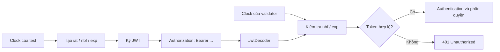

# Thay thế nguồn thời gian hoặc dữ liệu thời gian để kiểm thử ổn định

Trong chương **JWT và token thực** của module **SPRING_SECURITY_TESTING**, người học kiểm chứng bảo vệ HTTP bằng `spring-security-test` trên ứng dụng Servlet và Reactive: từ `MockMvc`, `WebTestClient`, `SecurityContext` đến JWT/OAuth2/OIDC và các yêu cầu được phép hoặc bị từ chối. Khi kiểm thử **JWT đã ký thật**, thời gian là một đầu vào bảo mật quan trọng. Một bài test tạo token bằng `Instant.now()` rồi chờ hệ thống giải mã có thể chạy tốt trên máy cá nhân nhưng thất bại trên CI do chạy chậm, chênh lệch đồng hồ hoặc token hết hạn trước khi assertion được thực thi.

Để kiểm thử ổn định, phải **kiểm soát cả dữ liệu thời gian trong JWT và nguồn thời gian mà ứng dụng sử dụng để xác minh JWT**. Bài này chỉ ra hai kỹ thuật chính: tiêm `java.time.Clock` cố định/điều chỉnh được và tạo claim `iat`, `nbf`, `exp` từ những mốc `Instant` được xác định trước. Các ví dụ phân biệt rõ đường kiểm thử JWT thực qua Bearer header với `jwt()` của Spring Security Test.

## 1. Vì sao JWT phụ thuộc thời gian?

Ba claim liên quan trực tiếp đến thời gian thường gặp:

| Claim | Tên đầy đủ | Ý nghĩa | Điều cần kiểm chứng |
| --- | --- | --- | --- |
| `iat` | Issued At | Thời điểm token được phát hành | Ứng dụng có chính sách giới hạn tuổi token hoặc từ chối `iat` trong tương lai không? |
| `nbf` | Not Before | Không chấp nhận token trước mốc này | Token chưa tới thời điểm có hiệu lực phải bị từ chối |
| `exp` | Expiration Time | Token không còn hiệu lực sau mốc này | Token hết hạn phải bị từ chối |

Ví dụ một token có dữ liệu thời gian cố định:

```json
{
  "sub": "user-42",
  "iss": "https://issuer.example.test",
  "iat": 1894701540,
  "nbf": 1894701540,
  "exp": 1894701840,
  "scope": "reports.read"
}
```

Các giá trị `iat`, `nbf` và `exp` trong JWT thường biểu diễn **NumericDate**: số giây tính từ epoch UTC, không phải chuỗi giờ địa phương. Trong Java, ta nên làm việc với `Instant` và để thư viện JWT chuyển sang dạng biểu diễn đúng. Thời điểm token có hiệu lực hay hết hạn phải được so với một nguồn thời gian nhất quán.

Hãy xét một test viết như sau:

```java
Instant now = Instant.now();
String token = issueSignedToken(now, now.plusSeconds(2));
// Một loạt thao tác khởi tạo ứng dụng, gửi HTTP, truy vấn dữ liệu...
// Sau đó mới assert request thành công.
```

Test này phụ thuộc vào tốc độ máy, tải của CI và thời gian thực. Nếu mốc `exp` chỉ cách lúc phát hành hai giây, lỗi có thể xuất hiện ngẫu nhiên. Với token mẫu lưu cố định trong repository, vấn đề ngược lại cũng xảy ra: tới một ngày nhất định token hết hạn, khiến toàn bộ test bắt đầu thất bại.

## 2. Hai nơi cần kiểm soát thời gian



**Nguồn thứ nhất: thời gian phát hành.** Token factory hoặc lớp phát hành JWT phải lấy thời gian qua `Clock` (hoặc nhận trực tiếp `Instant`), từ đó tính các claim. Ví dụ:

```java
import java.time.Clock;
import java.time.Duration;
import java.time.Instant;

class TokenTimes {
    private final Clock clock;

    TokenTimes(Clock clock) {
        this.clock = clock;
    }

    Instant issuedAt() {
        return clock.instant();
    }

    Instant expiresAt(Duration ttl) {
        return clock.instant().plus(ttl);
    }
}
```

Trong một lần phát hành thật, tốt nhất chỉ đọc thời gian **một lần** rồi dùng chung:

```java
Instant now = clock.instant();
Instant issuedAt = now;
Instant notBefore = now;
Instant expiresAt = now.plus(Duration.ofMinutes(5));
```

Điều này tránh sai lệch vài mili giây giữa các claim và làm điều kiện test rõ ràng. Trong hệ thống cấp token riêng, `Clock` có thể được inject qua constructor; trong bài test đơn lẻ, có thể truyền trực tiếp `Instant` vào hàm tạo token.

**Nguồn thứ hai: thời gian xác minh.** Dù token được tạo từ một `Clock` cố định, decoder hoặc validator vẫn có thể so `exp`/`nbf` với đồng hồ hệ thống. Nếu muốn test ở các mốc thời gian giả định, phải điều khiển **clock của validator** nữa. Với Spring Security, `JwtTimestampValidator` có thể nhận một `Clock` thay thế và một khoảng cho phép lệch đồng hồ (`clock skew`).

```java
import java.time.Clock;
import java.time.Duration;
import java.time.Instant;
import java.time.ZoneOffset;
import org.springframework.security.oauth2.jwt.JwtTimestampValidator;

Instant base = Instant.parse("2030-01-15T10:00:00Z");
Clock fixedClock = Clock.fixed(base, ZoneOffset.UTC);

JwtTimestampValidator timestamps = new JwtTimestampValidator(Duration.ZERO);
timestamps.setClock(fixedClock);
```

Ở đây `Duration.ZERO` loại bỏ khoảng dung sai để kiểm thử chính xác các tình huống hết hạn/chưa có hiệu lực. Trong production, nên lựa chọn `clock skew` theo chính sách thực tế vì đồng hồ các hệ thống phân tán có thể lệch nhau; không mặc định dùng `Duration.ZERO` ngoài môi trường test.

## 3. Phân biệt JWT giả lập và JWT đã ký thật

Hai đoạn kiểm thử sau phục vụ các mục tiêu khác nhau:

```java
// Giả lập JwtAuthenticationToken trong MockMvc:
mockMvc.perform(get("/api/reports")
        .with(jwt().jwt(jwt -> jwt
                .subject("user-42")
                .expiresAt(Instant.parse("2000-01-01T00:00:00Z")))))
    .andExpect(status().isOk()); // Chỉ đúng nếu endpoint cho phép request này
```

Với `SecurityMockMvcRequestPostProcessors.jwt()`, test trực tiếp cung cấp `JwtAuthenticationToken` cho ngữ cảnh bảo mật. Nó hữu ích để kiểm tra phân quyền đọc claim/authority, nhưng **không chứng minh token hết hạn bị `JwtDecoder` từ chối**. Ngay cả khi claim `exp` nằm trong quá khứ, xác thực giả vẫn có thể được chấp nhận vì decoder và validator không chạy theo đường Bearer token.

Ngược lại, kiểm thử JWT thật cần gửi chuỗi JWT compact đã ký vào HTTP:

```java
mockMvc.perform(get("/api/reports")
        .header("Authorization", "Bearer " + signedJwt))
    .andExpect(status().isUnauthorized()); // Nếu decoder từ chối token
```

Khi request đi qua `oauth2ResourceServer().jwt()`, Spring Security đọc Bearer header, gọi `JwtDecoder`, đánh giá các validator và chỉ tạo authentication nếu giải mã/thẩm định thành công. Cần cấu hình test context sao cho bộ lọc Spring Security thực sự được áp dụng. Với HTTP Servlet, dùng `MockMvc`; với WebFlux, dùng `WebTestClient` gắn với cấu hình security của ứng dụng. Cơ chế tạo JWT giả lập của mỗi loại test không thay thế phép thẩm định JWT đã ký thật.

## 4. Ví dụ đầy đủ: ký JWT thật và xác minh bằng thời gian cố định

Ví dụ sau sử dụng JUnit 5, Spring Security OAuth2 JOSE, Nimbus JWT và thư viện Assertions của JUnit. Một khóa HMAC test 256 bit chỉ dùng trong bộ kiểm thử, không tái sử dụng bí mật của production. `NimbusJwtEncoder` tạo chuỗi JWT có chữ ký `HS256`; `NimbusJwtDecoder` kiểm tra chữ ký rồi thực hiện validator thời gian do test cấu hình.

```java
import static org.junit.jupiter.api.Assertions.assertDoesNotThrow;
import static org.junit.jupiter.api.Assertions.assertThrows;

import com.nimbusds.jose.jwk.source.ImmutableSecret;
import java.nio.charset.StandardCharsets;
import java.time.Clock;
import java.time.Duration;
import java.time.Instant;
import java.time.ZoneOffset;
import javax.crypto.SecretKey;
import javax.crypto.spec.SecretKeySpec;
import org.junit.jupiter.api.Test;
import org.springframework.security.oauth2.jose.jws.MacAlgorithm;
import org.springframework.security.oauth2.jwt.JwsHeader;
import org.springframework.security.oauth2.jwt.JwtClaimsSet;
import org.springframework.security.oauth2.jwt.JwtEncoderParameters;
import org.springframework.security.oauth2.jwt.JwtTimestampValidator;
import org.springframework.security.oauth2.jwt.JwtValidationException;
import org.springframework.security.oauth2.jwt.NimbusJwtDecoder;
import org.springframework.security.oauth2.jwt.NimbusJwtEncoder;

class SignedJwtClockTest {

    private static final Instant T0 =
            Instant.parse("2030-01-15T10:00:00Z");

    private static final SecretKey TEST_KEY = new SecretKeySpec(
            "0123456789abcdef0123456789abcdef"
                    .getBytes(StandardCharsets.UTF_8),
            "HmacSHA256");

    private static String signedToken(
            Instant issuedAt, Instant notBefore, Instant expiresAt) {

        JwtClaimsSet claims = JwtClaimsSet.builder()
                .issuer("https://issuer.example.test")
                .subject("user-42")
                .issuedAt(issuedAt)
                .notBefore(notBefore)
                .expiresAt(expiresAt)
                .claim("scope", "reports.read")
                .build();

        NimbusJwtEncoder encoder =
                new NimbusJwtEncoder(new ImmutableSecret<>(TEST_KEY));
        JwsHeader header = JwsHeader.with(MacAlgorithm.HS256).build();
        return encoder.encode(
                JwtEncoderParameters.from(header, claims))
                .getTokenValue();
    }

    private static NimbusJwtDecoder decoderAt(Instant currentTime) {
        NimbusJwtDecoder decoder = NimbusJwtDecoder
                .withSecretKey(TEST_KEY)
                .macAlgorithm(MacAlgorithm.HS256)
                .build();

        JwtTimestampValidator timestamps =
                new JwtTimestampValidator(Duration.ZERO);
        timestamps.setClock(
                Clock.fixed(currentTime, ZoneOffset.UTC));

        // Bộ validator ở đây chỉ kiểm tra thời gian.
        // Production phải kết hợp thêm issuer/audience và các rule khác.
        decoder.setJwtValidator(timestamps);
        return decoder;
    }

    @Test
    void tokenTrongHan_duocChapNhan() {
        String token = signedToken(
                T0.minusSeconds(60),
                T0.minusSeconds(30),
                T0.plusSeconds(120));

        assertDoesNotThrow(() -> decoderAt(T0).decode(token));
    }

    @Test
    void tokenDaHetHan_biTuChoi() {
        String token = signedToken(
                T0.minusSeconds(300),
                T0.minusSeconds(300),
                T0.minusSeconds(10));

        assertThrows(JwtValidationException.class,
                () -> decoderAt(T0).decode(token));
    }

    @Test
    void tokenChuaCoHieuLuc_biTuChoi() {
        String token = signedToken(
                T0,
                T0.plusSeconds(60),
                T0.plusSeconds(300));

        assertThrows(JwtValidationException.class,
                () -> decoderAt(T0).decode(token));
    }

    @Test
    void cungMotToken_thayClockLamThayDoiKetQua() {
        String token = signedToken(
                T0.minusSeconds(60),
                T0.minusSeconds(30),
                T0.plusSeconds(120));

        assertDoesNotThrow(() -> decoderAt(T0).decode(token));
        assertThrows(JwtValidationException.class,
                () -> decoderAt(T0.plusSeconds(121)).decode(token));
    }
}
```

Test cuối chứng minh **chính một token đã ký** có thể hợp lệ tại mốc `T0` và hết hạn tại `T0 + 121 giây`, hoàn toàn không cần `Thread.sleep(...)`. Cả hai lần decoder đều kiểm tra chữ ký HMAC. Chỉ thời gian xác minh thay đổi; chữ ký và nội dung token giữ nguyên.

Ví dụ intentionally thay thế toàn bộ validator mặc định bằng một `JwtTimestampValidator` để tập trung vào yếu tố thời gian. **Không bê nguyên cấu hình này vào production**: `setJwtValidator(...)` thay thế chain validator đang có, nên có thể làm mất kiểm tra `iss`/`aud` hoặc các ràng buộc khác của hệ thống.

## 5. Khi ứng dụng còn kiểm tra issuer, audience và claim nghiệp vụ

Trong một resource server thật, token cần đúng chữ ký, đúng mốc thời gian, đúng nhà phát hành, đúng đối tượng nhận và quyền nghiệp vụ. Khi thay validator thời gian, phải ghép lại các validator bổ sung:

```java
import java.time.Clock;
import java.time.Duration;
import org.springframework.security.oauth2.core.DelegatingOAuth2TokenValidator;
import org.springframework.security.oauth2.core.OAuth2Error;
import org.springframework.security.oauth2.core.OAuth2TokenValidator;
import org.springframework.security.oauth2.core.OAuth2TokenValidatorResult;
import org.springframework.security.oauth2.jwt.Jwt;
import org.springframework.security.oauth2.jwt.JwtIssuerValidator;
import org.springframework.security.oauth2.jwt.JwtTimestampValidator;
import org.springframework.security.oauth2.jwt.NimbusJwtDecoder;

// decoder đã được khởi tạo với thuật toán/key tin cậy.
JwtTimestampValidator timeValidator =
        new JwtTimestampValidator(Duration.ofSeconds(30));
timeValidator.setClock(testClock);

OAuth2TokenValidator<Jwt> audienceValidator = jwt -> {
    if (jwt.getAudience().contains("reports-api")) {
        return OAuth2TokenValidatorResult.success();
    }
    return OAuth2TokenValidatorResult.failure(
            new OAuth2Error("invalid_token", "Unexpected audience", null));
};

decoder.setJwtValidator(new DelegatingOAuth2TokenValidator<>(
        timeValidator,
        new JwtIssuerValidator("https://issuer.example.test"),
        audienceValidator));
```

Đoạn này là phần cấu hình bổ sung, giả định `decoder` và `testClock` đã được khai báo ở ngữ cảnh ứng dụng/test. Nếu dùng `JwtValidators.createDefaultWithIssuer(...)` hay bộ validator mặc định khác, cần kiểm tra xem trong đó có validator thời gian dùng **đồng hồ hệ thống** hay không. Nếu vừa gắn timestamp validator cố định vừa giữ một timestamp validator chạy theo thời gian thực, test có thể tiếp tục không ổn định. Hãy dựng chain kiểm tra đầy đủ với một nguồn thời gian thống nhất và không bỏ sót các rule cần thiết.

`JwtTimestampValidator` mặc định kiểm tra các mốc `exp` và `nbf` khi claim tương ứng có mặt; đừng giả định nó tự thực hiện mọi chính sách về `iat`. Nếu hệ thống quy định `iat` không được nằm trong tương lai quá một ngưỡng hoặc token không được quá một tuổi nhất định, cần thêm validator chuyên biệt và dùng **cùng Clock** trong validator đó.

## 6. Dùng thời gian cố định trong test HTTP với MockMvc

Để kiểm tra cả đường HTTP, cấu hình một `JwtDecoder` của test có clock điều khiển được, rồi gửi JWT đã ký vào Bearer header. Với Spring Boot, có thể cung cấp cấu hình trong `@TestConfiguration` và nhập nó bằng `@Import`:

```java
import java.time.Clock;
import java.time.Duration;
import java.time.Instant;
import java.time.ZoneOffset;
import javax.crypto.SecretKey;
import org.springframework.boot.test.context.TestConfiguration;
import org.springframework.context.annotation.Bean;
import org.springframework.context.annotation.Primary;
import org.springframework.security.oauth2.jose.jws.MacAlgorithm;
import org.springframework.security.oauth2.jwt.JwtDecoder;
import org.springframework.security.oauth2.jwt.JwtTimestampValidator;
import org.springframework.security.oauth2.jwt.NimbusJwtDecoder;

@TestConfiguration
class FixedJwtClockConfig {

    @Bean
    Clock jwtTestClock() {
        return Clock.fixed(
                Instant.parse("2030-01-15T10:00:00Z"),
                ZoneOffset.UTC);
    }

    @Bean
    @Primary
    JwtDecoder fixedTimeDecoder(SecretKey testSigningKey, Clock jwtTestClock) {
        NimbusJwtDecoder decoder = NimbusJwtDecoder
                .withSecretKey(testSigningKey)
                .macAlgorithm(MacAlgorithm.HS256)
                .build();

        JwtTimestampValidator timestamps =
                new JwtTimestampValidator(Duration.ZERO);
        timestamps.setClock(jwtTestClock);
        decoder.setJwtValidator(timestamps);
        return decoder;
    }
}
```

Ví dụ trên **yêu cầu test context cung cấp bean `SecretKey testSigningKey`** phù hợp với encoder tạo JWT; phần này có thể lấy từ cấu hình khóa test riêng. Nếu ứng dụng dùng RSA/EC và JWK Set trong production, test nên cấu hình cặp khóa và decoder tương ứng thay vì mặc định đổi thuật toán sang HMAC. Các validator issuer/audience cũng phải được bổ sung theo mục trước.

Giả sử endpoint `GET /api/reports` yêu cầu xác thực và được bảo vệ bởi filter chain resource server JWT. Đoạn kiểm thử HTTP có thể như sau:

```java
import static org.springframework.test.web.servlet.request.MockMvcRequestBuilders.get;
import static org.springframework.test.web.servlet.result.MockMvcResultMatchers.status;

import org.junit.jupiter.api.Test;
import org.springframework.beans.factory.annotation.Autowired;
import org.springframework.boot.test.autoconfigure.web.servlet.AutoConfigureMockMvc;
import org.springframework.boot.test.context.SpringBootTest;
import org.springframework.context.annotation.Import;
import org.springframework.http.HttpHeaders;
import org.springframework.test.web.servlet.MockMvc;

@SpringBootTest
@AutoConfigureMockMvc
@Import(FixedJwtClockConfig.class)
class JwtExpiryHttpTest {

    @Autowired MockMvc mockMvc;

    @Test
    void expiredBearerToken_returns401() throws Exception {
        // signToken(...) phải ký token bằng cùng khóa/thuật toán
        // với JwtDecoder, với exp trước mốc cố định của test.
        String expired = signToken(
                Instant.parse("2030-01-15T09:50:00Z"),
                Instant.parse("2030-01-15T09:55:00Z"));

        mockMvc.perform(get("/api/reports")
                .header(HttpHeaders.AUTHORIZATION, "Bearer " + expired))
            .andExpect(status().isUnauthorized());
    }
}
```

`signToken(issuedAt, expiresAt)` ở đây là hàm factory của bộ test, tương tự `signedToken(...)` trong mục 4; ví dụ HTTP giả định đã có endpoint và bean security phù hợp. Mục đích chính là minh họa **đường đi của Bearer header**. Nếu dùng `.with(jwt())` thay cho header này, bộ kiểm thử sẽ không chứng minh decoder từ chối JWT hết hạn.

Khi test cả request thành công và thất bại, nên tạo token bằng cùng factory, thay duy nhất claim thời gian cần kiểm tra. Với API cần scope/role, luôn điền authority hợp lệ trước khi thử token hết hạn để tránh nhầm `403` phân quyền với `401` xác thực.

## 7. Điều khiển thời gian mà không phải ngủ chờ

Từ một clock cơ sở:

```java
Instant t0 = Instant.parse("2030-01-15T10:00:00Z");
Clock base = Clock.fixed(t0, ZoneOffset.UTC);

Clock beforeExpiry = Clock.offset(base, Duration.ofSeconds(59));
Clock afterExpiry = Clock.offset(base, Duration.ofSeconds(61));
```

Nếu token được tạo với `exp = t0 + 60 giây` và kiểm tra với độ lệch đồng hồ bằng 0, `beforeExpiry` cho kết quả hợp lệ, còn `afterExpiry` cho kết quả hết hạn. Cách này kiểm tra biên gần mốc hết hạn **mà không chờ 60 giây thực**.

`Clock.offset(...)` vẫn là một `Clock` mới. Đối với test có nhiều lần gửi HTTP trong **cùng context** và muốn chủ động đổi thời gian giữa các request, có thể tạo `Clock` tùy chỉnh dựa trên `AtomicReference<Instant>` để thay giá trị khi test chạy. Tuy nhiên, state dùng chung giữa các test chạy song song có thể gây rò rỉ và flakiness. Ưu tiên dùng clock bất biến, decoder riêng từng test, hoặc context test được cô lập; nếu dùng clock thay đổi được thì phải khôi phục trạng thái và tránh chia sẻ song song.

Không cần dùng `Thread.sleep`, đổi giờ của hệ điều hành hoặc phụ thuộc vào lịch chạy CI. Những cách đó làm test chậm, khó lặp lại và có thể tác động các test khác.

## 8. Kiểm thử clock skew và các trường hợp biên

**Clock skew** là khoảng dung sai cho chênh lệch đồng hồ giữa issuer và resource server. Nếu validator dùng `Duration.ofSeconds(30)`, token vừa hết hạn trong khoảng dung sai có thể vẫn được chấp nhận, và token có `nbf` hơi ở tương lai cũng có thể được chấp nhận. Vì thế, chỉ kiểm tra "`exp` cách hiện tại một giây" có thể cho kết quả khác mong đợi nếu quên cấu hình skew.

Một bộ kịch bản tối thiểu:

| Thời gian validator | Claim thời gian | Skew | Kỳ vọng |
| --- | --- | --- | --- |
| `T0` | `nbf=T0−1 phút`, `exp=T0+5 phút` | 0 giây | Hợp lệ |
| `T0` | `exp=T0−5 phút` | 0 giây | Hết hạn |
| `T0` | `nbf=T0+5 phút` | 0 giây | Chưa có hiệu lực |
| `T0+61 giây` | `exp=T0+60 giây` | 0 giây | Hết hạn |
| `T0` | `exp=T0−10 giây` | 30 giây | Trong dung sai, có thể chấp nhận theo chính sách |
| `T0` | `exp=T0−60 giây` | 30 giây | Hết hạn ngoài dung sai |
| `T0` | `nbf=T0+10 giây` | 30 giây | Trong dung sai, có thể chấp nhận theo chính sách |
| `T0` | `nbf=T0+60 giây` | 30 giây | Chưa có hiệu lực ngoài dung sai |

Tránh chốt kết luận ở **đúng thời điểm bằng nhau** giữa `now` và `exp` nếu chưa xác định rõ ngữ nghĩa, độ chính xác timestamp và cách validator xử lý so sánh biên. Với bài test nghiệp vụ, chọn mốc nằm **rõ ràng** ở hai phía ranh giới; với test riêng cho validator, mới chủ động kiểm tra các mốc bằng nhau theo contract của phiên bản thư viện.

Ngoài các ca thời gian, vẫn phải kiểm tra token có chữ ký sai, `iss`/`aud` sai, claim không đúng dạng, scope thiếu và token không gửi kèm. Việc cố định clock chỉ giải quyết một đầu vào gây bất ổn, không thay thế toàn bộ kiểm thử bảo mật.

## 9. Lưu ý riêng cho Reactive, OAuth2 và OIDC

Với Spring WebFlux, request sẽ chạy qua `SecurityWebFilterChain` và `ReactiveJwtDecoder`. Không dùng giả định rằng bean `JwtDecoder` Servlet tự động áp dụng cho Reactive. `WebTestClient` có thể gửi Bearer header như HTTP thực; cần cấu hình `ReactiveJwtDecoder` tương ứng (chẳng hạn một decoder phản ứng bọc logic decoder kiểm thử, tùy thiết kế ứng dụng) và bảo đảm validator thời gian dùng clock xác định trước.

```java
webTestClient.get()
    .uri("/api/reports")
    .headers(headers -> headers.setBearerAuth(expiredSignedJwt))
    .exchange()
    .expectStatus().isUnauthorized();
```

Đoạn này giả định WebFlux resource server được cấu hình và token test đã ký bằng khóa mà decoder nhận biết. `SecurityMockServerConfigurers.mockJwt()` phù hợp cho kiểm tra phân quyền với authentication giả lập, còn Bearer header với decoder thực mới phù hợp để kiểm tra từ chối theo `exp`/`nbf`.

Với OAuth2/OIDC, token có thể còn chịu chính sách về issuer, audience, nonce, max age, thời gian phiên đăng nhập và refresh token. Đừng cho rằng thay clock ở một `JwtTimestampValidator` đã kiểm soát mọi phép so sánh thời gian trong hệ thống. Nếu thư viện OIDC/client hoặc lớp ứng dụng có nguồn thời gian riêng, phải xác định và thay thế đúng thành phần được test.

## 10. Những lỗi thường gặp và cách tránh

**Gọi `Instant.now()` ở cả production code lẫn test.** Mỗi chỗ lấy một thời điểm khác nhau khiến test rơi vào các khoảng thời gian không dự đoán được. Dùng `Clock` qua constructor hoặc truyền `Instant` vào token factory, đọc clock một lần cho mỗi sự kiện phát hành.

**Thay claim `exp` nhưng quên ký lại token.** JWT có chữ ký bảo vệ cả payload; sửa thủ công phần payload của token compact khiến chữ ký không còn hợp lệ. Dùng `JwtEncoder` hoặc token factory để tạo và ký token mới cho mỗi tình huống.

**Kiểm thử token hết hạn bằng `.with(jwt())`.** API này phù hợp với assertion phân quyền theo `SecurityContext`, nhưng không chạy đầy đủ luồng xác thực JWT thật. Dùng Bearer header nếu mục tiêu là decoder/validator và mã HTTP `401`.

**Chỉ cố định thời gian phát hành.** Nếu `JwtDecoder` còn kiểm tra theo `Clock.systemUTC()`, token có thể hết hạn sau một thời gian dù test không thay đổi. Phải cố định/kiểm soát clock tại nơi validate.

**Thay validator mà vô tình bỏ issuer/audience.** `setJwtValidator(...)` ghi đè validator đang được dùng. Phải ghép lại những kiểm tra production yêu cầu.

**Dùng thời gian địa phương.** Phép kiểm tra token nên dựa trên `Instant` và UTC; chỉ chuyển `ZonedDateTime` khi cần hiển thị. Tránh để timezone máy CI hoặc thay đổi DST làm thay đổi ý nghĩa của mốc.

**Quên dung sai clock skew.** Với skew khác 0, token hết hạn vài giây vẫn có thể được chấp nhận. Đặt skew rõ ràng trong test và kiểm tra cả tình huống nằm trong/ngoài dung sai.

**Chia sẻ clock thay đổi được giữa nhiều test.** Test chạy song song có thể lẫn trạng thái. Dùng clock bất biến hoặc tạo từng instance test riêng.

**Khẳng định `iat` được kiểm tra tự động.** Nếu chính sách yêu cầu token không được phát hành trong tương lai hoặc có tuổi tối đa, cần test validator riêng cho yêu cầu đó.

## 11. Checklist trước khi hoàn tất

- Token được ký thật bằng `JwtEncoder`/khóa test phù hợp với `JwtDecoder`; không dùng bí mật production.
- Mốc `iat`, `nbf`, `exp` được tạo từ `Instant`/`Clock` chủ động kiểm soát, có TTL rõ ràng.
- Clock của validator được cố định hoặc điều khiển, không chỉ clock phát hành.
- Chain validator vẫn giữ đủ kiểm tra issuer, audience và các rule nghiệp vụ cần thiết.
- Có ca **token hợp lệ**, **token hết hạn**, **token chưa có hiệu lực**, và **đi qua mốc hết hạn** mà không `sleep`.
- Đã quyết định clock skew và kiểm thử rõ mốc trong/ngoài dung sai.
- Test HTTP gửi `Authorization: Bearer <JWT đã ký>` và xác minh `401` khi decoder từ chối; test quyền riêng xác minh `403` khi danh tính hợp lệ nhưng thiếu quyền.
- Dùng đúng thành phần Servlet (`JwtDecoder`/`MockMvc`) hoặc Reactive (`ReactiveJwtDecoder`/`WebTestClient`).
- Các ca test độc lập với giờ hệ điều hành, timezone và thứ tự chạy.

**Điểm cốt lõi:** test JWT có chữ ký thật ổn định khi thời gian là dữ liệu được điều khiển minh bạch. Hãy tạo claim từ mốc cố định, cho validator dùng nguồn thời gian phù hợp và thử các trạng thái trước/sau hạn bằng cách thay clock hoặc dữ liệu token. Nhờ đó, bộ kiểm thử phân biệt đúng lỗi xác thực JWT với lỗi phân quyền HTTP và không phụ thuộc tốc độ CI hay thời điểm chạy.
