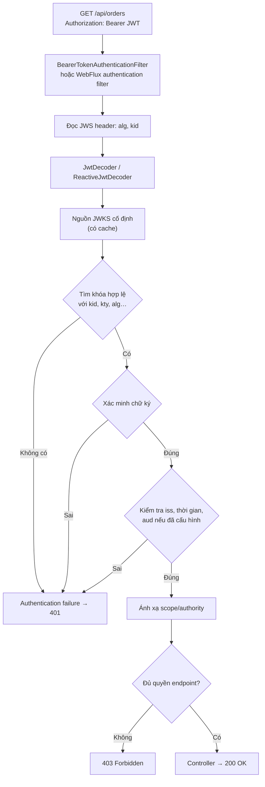
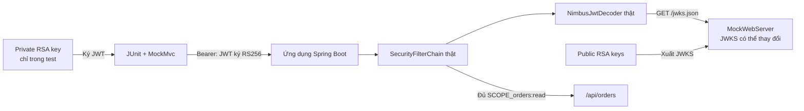
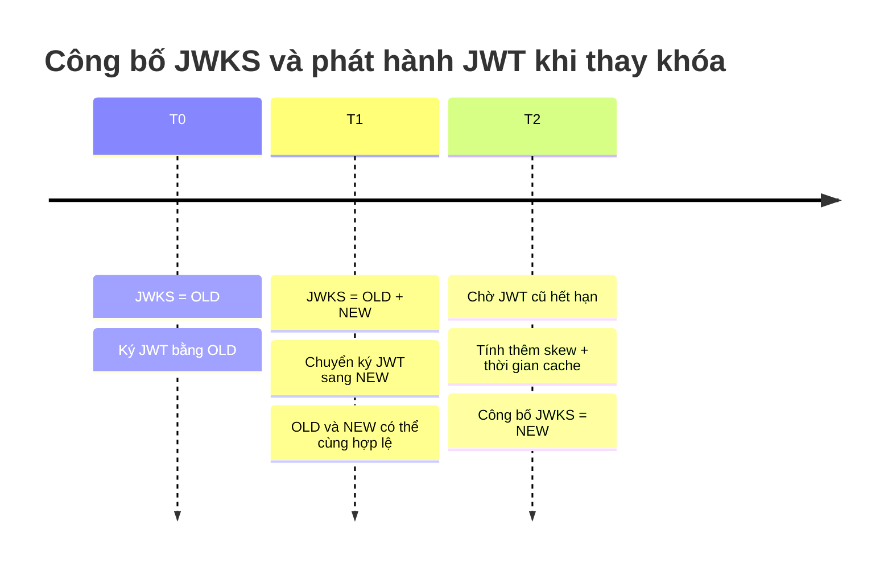

# JWK Set, lựa chọn `kid` và thay khóa trong hạ tầng kiểm thử

> **Chương:** JWT và token thực  
> **Module:** `SPRING_SECURITY_TESTING`  
> **Mục tiêu:** Kiểm chứng xác thực, phân quyền và bảo vệ HTTP bằng `spring-security-test` trên Servlet và Reactive; đặc biệt, kiểm thử JWT được **ký bằng khóa thật của test**, được xác minh bằng `JwtDecoder` và được lựa chọn khóa qua `kid` trong một JWK Set (JWKS) giả lập.

Một resource server không nên chấp nhận JWT chỉ vì token có ba phần ngăn bằng dấu chấm, có `sub` hợp lệ hoặc có claim `scope` mong muốn. Nó cần xác minh chữ ký, thuật toán cho phép, thời hạn, issuer, audience (nếu hệ thống yêu cầu) và cuối cùng là quyền truy cập endpoint. Khi nhà cung cấp danh tính thay khóa ký, hệ thống còn phải chọn đúng khóa công khai từ JWKS và chịu được một giai đoạn hai khóa cùng tồn tại.

Bài học này xây dựng hạ tầng kiểm thử tái lập được: sinh hai cặp RSA riêng cho test, phát hành JWKS chỉ chứa public key, ký JWT bằng private key, gửi header `Authorization: Bearer` đến ứng dụng, sau đó thay nội dung JWKS để kiểm chứng `kid`, chu kỳ cập nhật cache và quy trình xoay khóa.

## 1. Kiến thức nền cần phân biệt

### 1.1. JWT, JWS, JWK và JWK Set

| Khái niệm | Vai trò | Điều cần kiểm chứng |
| --- | --- | --- |
| JWT | Dạng token mang các claim như `iss`, `sub`, `aud`, `exp`, `scope` | Claim đúng với chính sách ứng dụng |
| JWS | Cơ chế ký, thường tạo JWT ba phần `header.payload.signature` | Chữ ký được xác minh với thuật toán và khóa được phép |
| JWK | Biểu diễn một khóa bằng JSON, ví dụ RSA public key với `kty`, `n`, `e`, `kid` | Khóa có loại, mục đích và tham số phù hợp |
| JWKS | JSON chứa mảng `keys` gồm nhiều JWK | Decoder tìm được khóa đang phát hành và xử lý luân phiên khóa |
| `kid` | Key ID trong header JWS, gợi ý khóa cần chọn từ JWKS | ID khớp khóa phù hợp, xử lý được ID lạ hoặc thay khóa |
| `alg` | Thuật toán JWS công bố trong header, ví dụ `RS256` | Decoder chỉ chấp nhận các thuật toán được cấu hình tin cậy |

Ví dụ cấu trúc JWKS (ký hiệu `…` chỉ dữ liệu được rút gọn, **không phải khóa có thể sử dụng**):

```json
{
  "keys": [
    {
      "kty": "RSA",
      "use": "sig",
      "kid": "signing-2026-01",
      "alg": "RS256",
      "n": "base64url-public-modulus-…",
      "e": "AQAB"
    },
    {
      "kty": "RSA",
      "use": "sig",
      "kid": "signing-2026-02",
      "alg": "RS256",
      "n": "base64url-new-public-modulus-…",
      "e": "AQAB"
    }
  ]
}
```

Một JWT có thể có header tương tự:

```json
{
  "alg": "RS256",
  "typ": "JWT",
  "kid": "signing-2026-02"
}
```

**Điều cốt lõi:** `kid` nằm trong header do bên gửi token cung cấp; nó **chưa được tin cậy** trước khi xác minh chữ ký. Decoder dùng `kid` như một gợi ý để tìm khóa công khai phù hợp trong nguồn JWKS **đã được cấu hình tin cậy**, sau đó dùng khóa đó để xác minh chữ ký. `kid` không tự chứng minh token hợp lệ, không thay cho kiểm tra `iss`, `aud`, `exp`, `nbf` và không cấp quyền truy cập.

### 1.2. Luồng chọn khóa và kiểm chứng



Trong thực tế, điều kiện chọn JWK còn phụ thuộc triển khai và metadata khóa (`kty`, `use`, `key_ops`, `alg`). Không nên khẳng định thư viện sẽ luôn lấy “phần tử đầu tiên có `kid` trùng”; bộ JWKS phải tránh ID mơ hồ hoặc xung đột. Trình tự kiểm tra cụ thể còn phụ thuộc filter chain và decoder đang dùng.

**Lưu ý bảo mật:** JWKS của resource server chỉ cần **public key**. Private key phải nằm ở phía nơi phát hành token, kể cả trong test. Không đặt private key vào HTTP response, log hay fixture được công bố. JWT ký kiểu JWS không mã hóa payload: người nhận token có thể đọc claims sau khi giải mã Base64URL.

## 2. Chọn đúng cấp độ kiểm thử trong Spring Security

Trong `SPRING_SECURITY_TESTING`, người học có thể dùng `MockMvc`, `WebTestClient`, `@WithMockUser`, `SecurityContext` và các helper JWT/OAuth2/OIDC. Tuy nhiên mỗi công cụ chứng minh một phạm vi khác nhau:

| Cách tạo người dùng/token | Có chạy authorization của ứng dụng? | Có đọc Bearer header và chọn JWKS? | Có kiểm chứng chữ ký RSA/ECDSA thật? |
| --- | --- | --- | --- |
| `@WithMockUser` / `user()` | Có thể, nếu filter chain và test integration còn hiệu lực | Không | Không |
| `jwt()` (MockMvc) hoặc `mockJwt()` (WebTestClient) | Có thể | Không | Không |
| Bearer header + mock `JwtDecoder` | Có | Có xử lý bearer token, nhưng không lấy khóa thật qua decoder | Không |
| **Bearer header + decoder thật + JWKS stub + JWT ký thật** | **Có** | **Có** | **Có** |
| Bearer header + nhà cung cấp danh tính thật | Có | Có | Có, nhưng phụ thuộc hạ tầng ngoài |

`jwt()` rất hữu ích khi chỉ cần test một quyền cụ thể, ví dụ:

```java
mockMvc.perform(get("/api/orders")
        .with(jwt().authorities(
            new SimpleGrantedAuthority("SCOPE_orders:read"))))
    .andExpect(status().isOk());
```

Nhưng test trên đã chuẩn bị trước `JwtAuthenticationToken`, nên **không phát hiện** lỗi `kid`, JWKS cache, chữ ký sai, URL key server, thuật toán sai hoặc decoder không thể tải khóa. Để chứng minh các hành vi đó, phải gửi một JWT đã ký thật qua header Bearer và giữ `JwtDecoder` thật.

## 3. Thiết kế môi trường kiểm thử JWT đáng tin cậy

Chúng ta mô phỏng resource server có endpoint `GET /api/orders`. Người dùng phải có authority `SCOPE_orders:read`; token từ issuer `https://issuer.example.test/tenant`; JWKS được phục vụ qua một HTTP server chạy trên loopback, không gọi hệ thống định danh thật.



Nguyên tắc của fixture:

1. **Tạo khóa test riêng**; khóa private không đi vào JWKS. Nên dùng RSA tối thiểu 2048 bit cho ví dụ `RS256`.
2. **Giữ filter chain của ứng dụng** và cấu hình Resource Server thật. Chỉ mô phỏng HTTP endpoint cung cấp JWKS.
3. **Tạo JWT có chữ ký thật**, `kid` cụ thể, `iss`, `exp` và quyền đúng.
4. **Cấp JWKS động** để mô phỏng giai đoạn chuyển khóa.
5. **Dọn HTTP server sau test**, không dùng issuer hay khóa production, không cần internet.

### 3.1. Dependency và cấu hình Servlet

Ví dụ Gradle với Spring Boot 3.x và Spring Security 6.x:

```groovy
dependencies {
    implementation("org.springframework.boot:spring-boot-starter-oauth2-resource-server")

    testImplementation("org.springframework.boot:spring-boot-starter-test")
    testImplementation("org.springframework.security:spring-security-test")
    testImplementation("com.squareup.okhttp3:mockwebserver:4.12.0")
}
```

Thư viện Nimbus JOSE + JWT thường đã đến qua starter Resource Server; tránh tự thêm một phiên bản khác nếu không cần. Cấu hình endpoint minh họa:

```java
@Configuration
class ApiSecurity {
    @Bean
    SecurityFilterChain apiSecurity(HttpSecurity http) throws Exception {
        return http
            .securityMatcher("/api/**")
            .authorizeHttpRequests(auth -> auth
                .requestMatchers(HttpMethod.GET, "/api/orders")
                    .hasAuthority("SCOPE_orders:read")
                .anyRequest().authenticated())
            .oauth2ResourceServer(oauth2 ->
                oauth2.jwt(Customizer.withDefaults()))
            .sessionManagement(session -> session
                .sessionCreationPolicy(SessionCreationPolicy.STATELESS))
            .csrf(AbstractHttpConfigurer::disable)
            .build();
    }
}

@RestController
class OrdersController {
    @GetMapping("/api/orders")
    List<String> orders() {
        return List.of("order-001");
    }
}
```

Ví dụ tắt CSRF vì API minh họa chỉ nhận Bearer token trong header và không dựa vào cookie phiên để xác thực. Với ứng dụng dùng cookie/session hoặc endpoint có nguy cơ CSRF, **không sao chép máy móc** lựa chọn này; giữ chính sách CSRF của ứng dụng và kiểm thử nó riêng.

Spring Boot có thể tự cấu hình `JwtDecoder` từ:

```properties
spring.security.oauth2.resourceserver.jwt.issuer-uri=https://issuer.example.test/tenant
spring.security.oauth2.resourceserver.jwt.jwk-set-uri=http://localhost:<dynamic-port>/jwks.json
```

Địa chỉ `<dynamic-port>` ở đây là ký hiệu, sẽ được lấy từ server giả lập khi test chạy. Khai báo cả `issuer-uri` và `jwk-set-uri` cho phép dùng endpoint JWKS đã biết mà không phải gọi OIDC/OAuth2 discovery ở issuer khi khởi động, đồng thời vẫn kiểm tra claim `iss` theo cấu hình tiêu chuẩn. Nếu ứng dụng tự khai báo `JwtDecoder` hoặc bộ validator tùy chỉnh, cần kiểm tra chính bean đó vì auto-configuration có thể lùi lại.

### 3.2. Sinh khóa RSA, public JWKS và JWT được ký thật

Ví dụ sau sử dụng Nimbus. Helper `newKey` tạo hai private key riêng biệt, `jwks` chỉ xuất public key; `signedToken` ký token bằng private key và đặt `kid` vào JWS header:

```java
static final String ISSUER = "https://issuer.example.test/tenant";
static final RSAKey KEY_OLD = newKey("signing-2026-01");
static final RSAKey KEY_NEW = newKey("signing-2026-02");

static RSAKey newKey(String kid) {
    try {
        return new RSAKeyGenerator(2048)
            .keyID(kid)
            .generate();
    } catch (JOSEException e) {
        throw new IllegalStateException("Cannot create test RSA key", e);
    }
}

static String jwks(RSAKey... keys) {
    List<JWK> publicKeys = new ArrayList<>();
    for (RSAKey key : keys) {
        publicKeys.add(key.toPublicJWK());
    }
    return new JWKSet(publicKeys).toString();
}

static String signedToken(
        RSAKey signingKey, String headerKid, Duration lifetime)
        throws JOSEException {
    Instant now = Instant.now();
    JWTClaimsSet claims = new JWTClaimsSet.Builder()
        .issuer(ISSUER)
        .subject("alice")
        .audience("orders-api")
        .claim("scope", "orders:read")
        .issueTime(Date.from(now))
        .notBeforeTime(Date.from(now.minusSeconds(5)))
        .expirationTime(Date.from(now.plus(lifetime)))
        .build();

    JWSHeader header = new JWSHeader.Builder(JWSAlgorithm.RS256)
        .type(JOSEObjectType.JWT)
        .keyID(headerKid)
        .build();

    SignedJWT jwt = new SignedJWT(header, claims);
    jwt.sign(new RSASSASigner(signingKey));
    return jwt.serialize();
}
```

Các kiểu chính gồm `com.nimbusds.jose.*`, `com.nimbusds.jose.jwk.*`, `com.nimbusds.jose.jwk.gen.RSAKeyGenerator`, `com.nimbusds.jose.crypto.RSASSASigner`, `com.nimbusds.jwt.*` và các lớp thời gian, collection của Java.

Trong helper, `headerKid` là tham số riêng với `signingKey` để chủ động tạo test sai: ký bằng `KEY_NEW` nhưng khai báo `kid` của `KEY_OLD` sẽ cho thấy **khớp ID khóa không bảo đảm chữ ký đúng**. Không bao giờ dùng mẫu này trong mã phát hành token thật.

### 3.3. HTTP server cấp JWK Set có thể thay đổi

MockWebServer cho phép thay JWKS giữa các request mà không phải restart ứng dụng:

```java
static final AtomicReference<String> PUBLISHED_JWKS =
    new AtomicReference<>(jwks(KEY_OLD));

static final MockWebServer JWKS_SERVER = new MockWebServer();

static {
    JWKS_SERVER.setDispatcher(new Dispatcher() {
        @Override
        public MockResponse dispatch(RecordedRequest request) {
            if (!"/jwks.json".equals(request.getPath())) {
                return new MockResponse().setResponseCode(404);
            }
            return new MockResponse()
                .setResponseCode(200)
                .addHeader("Content-Type", "application/json")
                .setBody(PUBLISHED_JWKS.get());
        }
    });
    try {
        JWKS_SERVER.start();
    } catch (IOException e) {
        throw new ExceptionInInitializerError(e);
    }
}
```

Các import riêng cho stub là `okhttp3.mockwebserver.MockWebServer`, `Dispatcher`, `MockResponse`, `RecordedRequest` và `java.util.concurrent.atomic.AtomicReference`. Biến `PUBLISHED_JWKS` được thay bằng `jwks(KEY_OLD, KEY_NEW)` khi đến thời điểm công bố khóa mới.

Tích hợp vào Spring Boot test bằng `@DynamicPropertySource`. Đoạn sau được đặt trong cùng lớp test với các trường/hàm ở trên:

```java
@SpringBootTest
@AutoConfigureMockMvc(addFilters = true)
class JwkRotationIT {
    // Đặt ISSUER, KEY_OLD, KEY_NEW, PUBLISHED_JWKS,
    // JWKS_SERVER và các helper ở các mục trên tại đây.

    @Autowired
    MockMvc mvc;

    @DynamicPropertySource
    static void jwtProperties(DynamicPropertyRegistry registry) {
        registry.add(
            "spring.security.oauth2.resourceserver.jwt.issuer-uri",
            () -> ISSUER);
        registry.add(
            "spring.security.oauth2.resourceserver.jwt.jwk-set-uri",
            () -> JWKS_SERVER.url("/jwks.json").toString());
    }

    @BeforeEach
    void publishOriginalKey() {
        PUBLISHED_JWKS.set(jwks(KEY_OLD));
    }

    @AfterAll
    static void stopJwks() throws IOException {
        JWKS_SERVER.shutdown();
    }

    void expectJwt(String rawJwt, ResultMatcher expected) throws Exception {
        mvc.perform(get("/api/orders")
                .header(HttpHeaders.AUTHORIZATION, "Bearer " + rawJwt))
            .andExpect(expected);
    }
}
```

Lớp hiển thị theo các mảnh để người học dễ đọc: thực tế ghép phần helper, server và các phương thức test vào **một** lớp test. Các lớp cần import thêm gồm `DynamicPropertyRegistry`, `DynamicPropertySource`, `MockMvc`, `ResultMatcher`, `HttpHeaders`, các annotation JUnit và Spring Boot Test; `get`, `status` là static import từ `MockMvcRequestBuilders`, `MockMvcResultMatchers`.

`@AutoConfigureMockMvc(addFilters = true)` bảo đảm request đi qua servlet filter chain. Không dùng `@WithMockUser`, `jwt()` hoặc mock `JwtDecoder` trong các ca kiểm chứng chữ ký và JWKS này. Chỉ stub dịch vụ trả JWKS; decoder và bearer filter vẫn thật.

## 4. Các ca kiểm thử `kid` và chữ ký

Đặt các phương thức dưới đây trong `JwkRotationIT` ở trên.

### 4.1. Khóa đang công bố được chấp nhận

```java
@Test
void acceptsJwtSignedByPublishedKid() throws Exception {
    String token = signedToken(
        KEY_OLD, KEY_OLD.getKeyID(), Duration.ofMinutes(10));

    expectJwt(token, status().isOk());
}
```

Ca này kiểm chứng xuyên suốt: Bearer header → `SecurityFilterChain` → `JwtDecoder` → public JWK → chữ ký RS256 → claim thời gian/issuer → authority `SCOPE_orders:read` → controller.

### 4.2. `kid` lạ bị từ chối

```java
@Test
void rejectsUnknownKid() throws Exception {
    String token = signedToken(
        KEY_NEW, "kid-never-published", Duration.ofMinutes(10));

    expectJwt(token, status().isUnauthorized());
}
```

Dù JWT có chữ ký hợp lệ theo `KEY_NEW`, JWKS của test không chứa khóa công khai với ID tương ứng. Decoder phải từ chối request. Nó **có thể** thử tải lại JWKS khi gặp ID chưa biết, tùy thư viện/cấu hình cache; đừng cố định assertion về số lượng HTTP request trong ca chức năng này.

### 4.3. `kid` đúng nhưng chữ ký sai

```java
@Test
void rejectsSignatureFromAnotherPrivateKey() throws Exception {
    String token = signedToken(
        KEY_NEW, KEY_OLD.getKeyID(), Duration.ofMinutes(10));

    expectJwt(token, status().isUnauthorized());
}
```

Header tuy nói `kid=signing-2026-01`, chữ ký lại được tạo bằng private key của `signing-2026-02`. Public key ứng với `kid` trong JWKS không thể xác minh chữ ký, nên token bị từ chối. Đây là ca quan trọng để tránh hiểu lầm rằng kiểm tra `kid` là đủ.

### 4.4. Token hết hạn bị từ chối

```java
@Test
void rejectsExpiredToken() throws Exception {
    String token = signedToken(
        KEY_OLD, KEY_OLD.getKeyID(), Duration.ofHours(-2));

    expectJwt(token, status().isUnauthorized());
}
```

Thời hạn âm trong helper chỉ nhằm tạo test: `exp` đã ở quá khứ hai giờ. Chọn khoảng cách đủ lớn để tránh sai lệch do clock skew cho phép của bộ kiểm tra thời gian. Nên viết thêm ca `nbf` ở tương lai, `iss` khác cấu hình và thiếu `scope`:

- Chữ ký hợp lệ nhưng `exp` quá hạn hoặc `nbf` chưa đến → `401` khi validator tương ứng được bật.
- Chữ ký hợp lệ nhưng `iss` không khớp issuer đã tin cậy → `401`.
- Token xác thực thành công nhưng không có `SCOPE_orders:read` → `403`.
- Sai hoặc thiếu `aud` → `401` **chỉ khi đã cấu hình kiểm tra audience**; không mặc định suy ra mọi decoder đều kiểm tra audience cho ứng dụng.

Với REST Resource Server thông thường, `401` là lỗi xác thực Bearer, `403` là đã xác thực nhưng thiếu quyền. Nếu ứng dụng có entry point/access-denied handler tùy chỉnh, kiểm tra và assert theo chính hành vi của ứng dụng.

## 5. Kiểm thử thay khóa (key rotation) có giai đoạn chồng lấn

Một kế hoạch thay khóa an toàn thường có ba giai đoạn:

| Giai đoạn | JWKS công bố | Khóa ký token mới | Kỳ vọng |
| --- | --- | --- | --- |
| T0 — Trước khi thay | `[OLD]` | `OLD` | Token OLD được chấp nhận |
| T1 — Chuyển tiếp | `[OLD, NEW]` | Chuyển từ `OLD` sang `NEW` | Token cũ chưa hết hạn và token mới đều hợp lệ |
| T2 — Rút khóa cũ | `[NEW]` | `NEW` | Token NEW hợp lệ; token OLD bị từ chối **sau khi cache không còn OLD** |



### 5.1. Ca chấp nhận cả hai khóa trong giai đoạn chồng lấn

```java
@Test
void rotationOverlapAcceptsOldAndNewTokens() throws Exception {
    String oldToken = signedToken(
        KEY_OLD, KEY_OLD.getKeyID(), Duration.ofMinutes(10));

    // Đầu giai đoạn: chỉ OLD đang được công bố.
    PUBLISHED_JWKS.set(jwks(KEY_OLD));
    expectJwt(oldToken, status().isOk());

    // Công bố NEW nhưng giữ OLD để các JWT cũ vẫn hợp lệ.
    PUBLISHED_JWKS.set(jwks(KEY_OLD, KEY_NEW));
    String newToken = signedToken(
        KEY_NEW, KEY_NEW.getKeyID(), Duration.ofMinutes(10));

    expectJwt(newToken, status().isOk());
    expectJwt(oldToken, status().isOk());
}
```

Với các phiên bản Nimbus/Spring Security thường dùng, yêu cầu có `kid` chưa biết trong cache có thể kích hoạt tải lại JWKS và cho phép token NEW. **Đây là hành vi cần kiểm chứng với đúng phiên bản của ứng dụng**, không phải cam kết mọi decoder luôn refresh ngay lập tức. Nếu test thất bại, hãy xem cache, cơ chế refresh, endpoint JWKS, headers và kết quả lựa chọn JWK trước khi điều chỉnh kỳ vọng.

Nếu tổ chức muốn kiểm tra **chính sách cache/refresh** một cách xác định, hãy bổ sung bài test chuyên biệt với cache được cấu hình rõ, nguồn thời gian có thể kiểm soát hoặc decoder mới cho từng pha. Tránh `Thread.sleep(...)` theo thời lượng ngẫu nhiên rồi cho rằng mọi môi trường sẽ nhận khóa mới cùng lúc.

### 5.2. Rút khóa cũ và hiệu ứng cache

Việc đổi response trên MockWebServer từ `[OLD, NEW]` sang `[NEW]` **không đồng nghĩa** mọi decoder đang chạy lập tức quên OLD. Một decoder có JWKS cache ấm có thể tiếp tục xác minh token ký bằng OLD cho đến khi cache hết hạn hoặc được làm mới. Chỉ đọc lại response của MockWebServer không thể chứng minh khóa cũ đã bị thu hồi ở tất cả resource server.

Muốn test **trạng thái JWKS sau khi rút khóa** mà không phụ thuộc thời gian cache, dùng một decoder mới và cùng policy validator:

```java
PUBLISHED_JWKS.set(jwks(KEY_NEW));

NimbusJwtDecoder freshDecoder = NimbusJwtDecoder
    .withJwkSetUri(JWKS_SERVER.url("/jwks.json").toString())
    .jwsAlgorithm(SignatureAlgorithm.RS256)
    .build();

freshDecoder.setJwtValidator(
    JwtValidators.createDefaultWithIssuer(ISSUER));

String oldToken = signedToken(
    KEY_OLD, KEY_OLD.getKeyID(), Duration.ofMinutes(10));
String newToken = signedToken(
    KEY_NEW, KEY_NEW.getKeyID(), Duration.ofMinutes(10));

assertThrows(JwtException.class, () -> freshDecoder.decode(oldToken));
assertEquals("alice", freshDecoder.decode(newToken).getSubject());
```

Đoạn này là một **kiểm thử trực tiếp decoder mới**, không phải MockMvc end-to-end; nó chứng minh JWKS sau khi rút khóa chỉ cho phép NEW với cấu hình decoder vừa tạo. Để kiểm tra resource server đang chạy chuyển từ OLD sang NEW đúng thời điểm, cần test riêng về TTL/cache invalidation trên **chính decoder đang phục vụ HTTP**, và assert trạng thái HTTP sau cơ chế làm mới đã được kiểm soát. Không tái sử dụng một `JwtDecoder` có cache cũ để kết luận khóa OLD đã bị thu hồi tức thì.

**Khuyến nghị vận hành:** Phát hành public key NEW trước khi ký token NEW; giữ OLD trong JWKS ít nhất bằng thời gian token OLD còn hợp lệ, cộng biên độ clock skew và độ trễ phân phối/cache thích hợp. Sau đó mới rút OLD. Nếu khóa private bị lộ, đây là sự cố thu hồi khẩn cấp và cần kế hoạch riêng; rút JWKS đơn thuần có thể không loại bỏ ngay tác dụng của cache đã ấm.

## 6. Thuật toán, metadata khóa và các trường hợp âm tính nâng cao

### 6.1. Đặt allowlist cho thuật toán ký

Header `alg` là dữ liệu từ token; decoder không được chuyển sang thuật toán khác chỉ vì token yêu cầu. Với tài nguyên chỉ hỗ trợ `RS256`, cấu hình rõ thuật toán:

```java
NimbusJwtDecoder decoder = NimbusJwtDecoder
    .withJwkSetUri(jwksUri)
    .jwsAlgorithm(SignatureAlgorithm.RS256)
    .build();
```

`jwsAlgorithm` ở đây chỉ định thuật toán mà decoder chấp nhận; `jwksUri` phải lấy từ cấu hình đáng tin cậy. Trong một số cấu hình Spring Security, `RS256` đã là mặc định; viết rõ giúp test không vô tình chấp nhận thuật toán khác khi cấu hình thay đổi.

Nên bao phủ:

- Header `alg` không nằm trong allowlist, chẳng hạn `HS256` trong hệ thống chỉ cho phép RS256 → từ chối.
- Token không ký (`alg=none`) → từ chối.
- JWT ký đúng với khóa khác nhưng gắn cùng `kid` → từ chối vì chữ ký không khớp.
- JWKS chứa `kty` hoặc `use` không phù hợp, không có khóa dùng được → từ chối.
- JWKS có nhiều khóa trùng `kid` → nhận diện đây là cấu hình publisher sai; không dựa vào thứ tự mảng để tiên đoán decoder chọn gì.
- JWT chứa header như `jku` hoặc `x5u` trỏ đến URL lạ → decoder phải chỉ tin nguồn khóa được cấu hình; không tự fetch URL tùy ý lấy từ token.

Đừng ghi private key hoặc token access thực vào log khi test lỗi; chỉ dùng khóa và token giả lập được tạo riêng cho môi trường test.

### 6.2. Kiểm tra issuer, audience và thời gian ngoài chữ ký

Chữ ký hợp lệ vẫn chưa đủ. Ví dụ custom decoder validate cả issuer và audience khi ứng dụng yêu cầu:

```java
NimbusJwtDecoder decoder = NimbusJwtDecoder
    .withJwkSetUri(jwksUri)
    .jwsAlgorithm(SignatureAlgorithm.RS256)
    .build();

OAuth2TokenValidator<Jwt> audienceValidator =
    new JwtClaimValidator<List<String>>(
        "aud",
        audiences -> audiences != null &&
            audiences.contains("orders-api"));

decoder.setJwtValidator(
    new DelegatingOAuth2TokenValidator<>(
        JwtValidators.createDefaultWithIssuer(ISSUER),
        audienceValidator));
```

`JwtValidators.createDefaultWithIssuer` gồm các kiểm tra tiêu chuẩn và ràng buộc `iss`; `audienceValidator` ở đây minh họa một policy ứng dụng cụ thể. Nếu resource server dùng `@Bean JwtDecoder` như trên, hãy cho integration test sử dụng **chính bean đó**. Tạo một decoder phụ bên ngoài rồi chỉ test nó không đủ để chứng minh filter chain đang dùng cùng policy.

Với Spring Boot, các thuộc tính có sẵn cho audience hoặc validator mặc định phụ thuộc phiên bản và cấu hình; kiểm tra bean thực thay vì suy luận rằng claim `aud` luôn được so khớp. Các ca `nbf`/`exp` sát ranh giới nên sử dụng clock có thể điều khiển hoặc biên độ thời gian đủ lớn để test ổn định.

## 7. Reactive: cùng mục tiêu với WebTestClient

Trên WebFlux, `SecurityWebFilterChain` và `ReactiveJwtDecoder` đảm nhiệm vai trò tương ứng. Để kiểm chứng chữ ký và JWKS, tiếp tục dùng JWT đã ký thật, gửi header Bearer và giữ resource server filter thật:

```java
@Bean
SecurityWebFilterChain reactiveSecurity(ServerHttpSecurity http) {
    return http
        .authorizeExchange(exchanges -> exchanges
            .pathMatchers(HttpMethod.GET, "/api/orders")
                .hasAuthority("SCOPE_orders:read")
            .anyExchange().authenticated())
        .oauth2ResourceServer(oauth2 ->
            oauth2.jwt(Customizer.withDefaults()))
        .csrf(ServerHttpSecurity.CsrfSpec::disable)
        .build();
}
```

Với ứng dụng Reactive dùng `spring-boot-starter-oauth2-resource-server`, các property issuer/JWKS tương tự có thể cấu hình `ReactiveJwtDecoder`. Nếu bind `WebTestClient` vào application context:

```java
@SpringBootTest(webEnvironment = SpringBootTest.WebEnvironment.MOCK)
class ReactiveJwksIT {
    @Autowired ApplicationContext context;

    WebTestClient client;

    @BeforeEach
    void bindClient() {
        client = WebTestClient.bindToApplicationContext(context)
            .apply(SecurityMockServerConfigurers.springSecurity())
            .configureClient()
            .build();
    }

    @Test
    void acceptsRealSignedBearerJwt() throws Exception {
        String token = signedToken(
            KEY_OLD, KEY_OLD.getKeyID(), Duration.ofMinutes(10));

        client.get()
            .uri("/api/orders")
            .headers(headers -> headers.setBearerAuth(token))
            .exchange()
            .expectStatus().isOk();
    }
}
```

Ví dụ Reactive dùng lại bộ helper khóa/JWKS và phải nạp cùng properties JWKS thử nghiệm (qua `@DynamicPropertySource` hoặc cấu hình test thích hợp); handler `GET /api/orders` được giả định tồn tại. `SecurityMockServerConfigurers.springSecurity()` gắn các WebFilter bảo mật thực vào `WebTestClient` khi client được bind với context. Nếu dùng `WebTestClient.bindToServer()` qua cổng HTTP, chỉ cần gửi header Bearer như client thật và để server tự áp dụng filter chain.

Để so sánh, `mutateWith(SecurityMockServerConfigurers.mockJwt())` cài sẵn principal JWT trong test. Cách này phù hợp với test authorization hoặc controller, nhưng **không** xác minh chữ ký, `kid` hay truy cập JWKS. Không dùng `mockJwt()` làm bằng chứng cho quy trình thay khóa.

## 8. Kiểm thử lỗi hạ tầng JWKS và tránh test chập chờn

| Tình huống | Kỳ vọng / cách đo | Lưu ý |
| --- | --- | --- |
| JWKS trả `200` với đúng public key | Token hợp lệ → `200`, chữ ký sai → `401` | Kiểm tra HTTP route và authority thực |
| JWKS trả `404`, `500` hoặc JSON hỏng khi cache chưa có key | Decoder không thể xác minh → `401` | Tránh khẳng định chính xác kiểu exception ngoài public API của ứng dụng |
| JWKS server mất kết nối khi decoder có cache còn hợp lệ | Token dùng key đã cache **có thể** vẫn qua | Test riêng cache ấm và cache lạnh |
| Công bố `kid` NEW nhưng decoder đang cache `[OLD]` | Kiểm tra cơ chế refresh theo version/thiết lập decoder | Không hardcode rằng refresh luôn xảy ra sau một số giây |
| Rút OLD khỏi JWKS khi decoder còn cache OLD | OLD có thể vẫn xác minh được | Phải xét TTL, invalidate cache hoặc decoder mới |
| Token có cùng `kid` nhưng key material bị đổi | Hành vi cache/refresh khó dự đoán; dễ gây lỗi xác minh | Khi thay khóa, **dùng `kid` mới**, không tái sử dụng ID |
| JWKS có hai entry với `kid` trùng nhau | Cấu hình cấp phát khóa mơ hồ | Test khâu phát hành JWKS để phát hiện trùng ID |
| Sai `iss` hoặc `aud` | `401` khi các validator tương ứng được bật | Đừng suy ra validation từ payload tự nó |
| Đúng JWT nhưng thiếu scope | `403` | Phân biệt authentication với authorization |

Một vài nguyên tắc giúp test ổn định:

1. Dùng cổng ngẫu nhiên và loopback để chạy song song mà không xung đột với dịch vụ thật.
2. Không dùng khóa/token production, không cần gọi OIDC discovery hoặc internet; tránh phụ thuộc thời gian sống của nhà cung cấp bên ngoài.
3. Kiểm soát trạng thái fixture: nếu nhiều test dùng chung `AtomicReference` và decoder cache, chạy tuần tự hoặc tạo môi trường độc lập cho từng test. Reset HTTP response **không reset** cache decoder.
4. Không khẳng định số lần gọi endpoint JWKS trong test nghiệp vụ khi cache/refresh phụ thuộc phiên bản. Nếu cần đo số lần tải, cấu hình cache và test thuật toán cache một cách riêng biệt.
5. Kiểm tra đường đi thành công **và** đường từ chối. Các ca chỉ có `401` có thể vô tình xanh vì endpoint/cấu hình bị hỏng; ca `200` với token thật chứng minh chuỗi có thể hoạt động.
6. Không dùng `Thread.sleep` để “chờ cache tự hết hạn” nếu không kiểm soát TTL. Ưu tiên decoder/cache mới hoặc clock giả lập khi test chính sách rút khóa.
7. Khi điều tra, bật DEBUG cho `org.springframework.security` và log HTTP stub có chọn lọc. Tránh ghi raw JWT hoặc private key vào output CI.

## 9. Bài thực hành và tiêu chí đánh giá

**Yêu cầu:** Xây dựng một resource server Servlet với `GET /api/orders` cần `SCOPE_orders:read`, một JWKS server nội bộ với hai RSA key, helper phát hành JWT ký bằng RS256 và tập test `MockMvc`. Chạy lại cùng ma trận bằng `WebTestClient` trên biến thể WebFlux.

Thực hiện theo trình tự:

1. Công bố `OLD`, ký token bằng OLD; kiểm tra endpoint trả `200`.
2. Dùng `kid` không công bố, `kid` trỏ OLD nhưng ký bằng NEW, token quá hạn; tất cả phải bị từ chối.
3. Công bố `[OLD, NEW]` rồi ký token mới bằng NEW; kiểm tra cả token OLD còn hạn và token NEW đều dùng được trong giai đoạn chuyển tiếp.
4. Chuyển JWKS thành `[NEW]`, dùng decoder mới để chứng minh chỉ NEW được nhận. Sau đó viết bài test riêng cho cache nếu ứng dụng có yêu cầu thời gian thu hồi.
5. Giữ chữ ký hợp lệ nhưng đổi issuer, audience hoặc scope; kiểm tra `401` hay `403` theo đúng validator và authorization rule đang cấu hình.
6. Thử JWKS endpoint lỗi khi cache lạnh, sau đó khi cache ấm; ghi nhận và diễn giải khác biệt.

Một bài làm được xem là đạt khi có thể chỉ ra **bằng chứng độc lập** cho bốn điều: (1) filter chain đọc Bearer header; (2) decoder chọn public key bằng `kid` từ JWKS tin cậy và xác minh chữ ký thật; (3) claim/authority được kiểm tra đúng; (4) giai đoạn thay khóa và tác động của cache được hiểu đúng, không kết luận thu hồi tức thời chỉ từ việc đổi HTTP response.

**Ghi nhớ:** Trong kiểm thử JWT/OAuth2/OIDC bằng Spring Security, `@WithMockUser`, `jwt()` và `mockJwt()` trả lời câu hỏi “người dùng/token đã xác thực có được phép gọi endpoint không?”. JWT **được ký thật**, gửi qua Bearer header, với `JwtDecoder` hoặc `ReactiveJwtDecoder` thật và JWKS được kiểm soát mới trả lời câu hỏi “ứng dụng có thực sự xác minh token, chọn đúng `kid` và xử lý thay khóa an toàn không?”.
