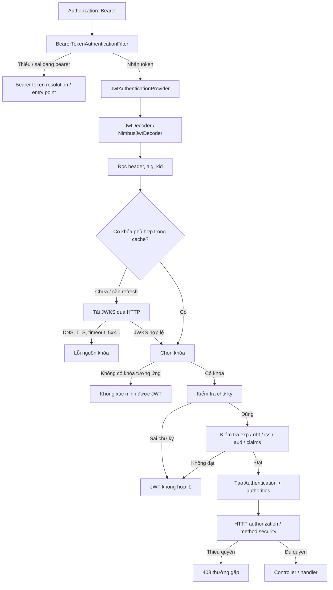
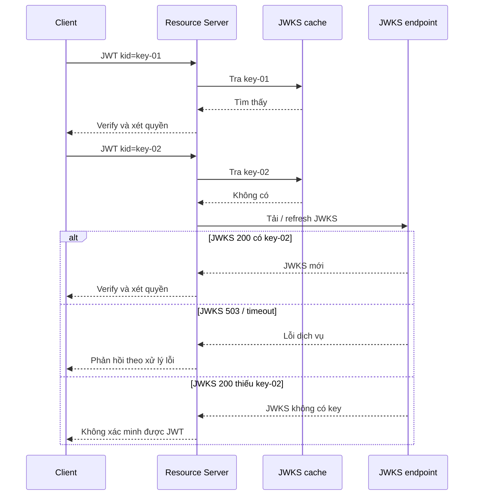

# Tách lỗi tải khóa từ xa với lỗi giá trị token

Một API dùng JWT Bearer có thể từ chối cùng một request vì **không lấy được khóa công khai từ JWKS endpoint** hoặc vì **token thật sự không hợp lệ**. Hai tình huống có thể cùng biểu hiện thành `401 Unauthorized`, một exception từ `JwtDecoder` hoặc thông báo “invalid token”, nhưng cách xử lý và cách kiểm thử phải khác nhau. Nếu hệ thống quản lý khóa đang gián đoạn mà test kết luận “JWT sai chữ ký”, người vận hành sẽ tìm lỗi sai chỗ. Ngược lại, nếu một JWT bị sửa nội dung mà ứng dụng chỉ dựa vào lỗi tải JWKS để giải thích, bài kiểm thử đã bỏ qua yêu cầu xác minh tính toàn vẹn token.

Trong chương **JWT và token thực** của **SPRING_SECURITY_TESTING**, chúng ta kiểm chứng xác thực, phân quyền và bảo vệ HTTP thực tế bằng `spring-security-test` trên **Servlet** và **Reactive**. Bài học đi từ `MockMvc`/`WebTestClient` đến `JwtDecoder` và `ReactiveJwtDecoder`, giải thích giới hạn của JWT giả lập so với token có chữ ký thật, và thiết kế test phân biệt **lỗi tải khóa từ xa** với **lỗi giá trị token**.

## 1. Hiểu đúng hai trục lỗi

JWT ký bất đối xứng thường chứa ba thành phần `header.payload.signature`. Header có thể ghi `alg` (thuật toán ký) và `kid` (định danh khóa). Resource Server cần khóa **công khai** tương ứng để kiểm tra chữ ký; nhiều ứng dụng lấy khóa công khai từ địa chỉ **JWKS (JSON Web Key Set)** của nhà phát hành token.

Ví dụ một JWT header và một phản hồi JWKS (chỉ để minh họa cấu trúc):

```json
{
  "typ": "JWT",
  "alg": "RS256",
  "kid": "signing-key-2026-11"
}
```

```json
{
  "keys": [
    {
      "kty": "RSA",
      "kid": "signing-key-2026-11",
      "use": "sig",
      "alg": "RS256",
      "n": "<public-modulus-base64url>",
      "e": "AQAB"
    }
  ]
}
```

Giá trị `n` ở trên là placeholder, **không phải JWKS có thể dùng để xác minh chữ ký**. Trong bài test thật, hãy xuất `n` và `e` từ một cặp khóa RSA dùng riêng cho test. Khóa riêng chỉ nằm ở phía ký token; JWKS công bố khóa công khai.

Có ít nhất hai điều kiện độc lập:

1. **Nguồn khóa có sẵn và đáng tin cậy:** có thể truy cập JWKS endpoint hoặc sử dụng bản cache hợp lệ; dữ liệu JWKS đúng cú pháp, có key phù hợp với thuật toán và `kid`.
2. **Token hợp lệ theo chính sách ứng dụng:** định dạng đọc được, thuật toán được cho phép, chữ ký xác minh thành công, thời gian `exp`/`nbf` hợp lệ, `iss`/`aud` và các claim tùy biến đạt yêu cầu.

Mất mạng không làm JWT trước đó tự động sai chữ ký. Token có chữ ký sai không trở thành hợp lệ chỉ vì JWKS trả `200 OK`.

| Nguồn khóa | Giá trị token | Kết quả nên suy ra |
|---|---|---|
| JWKS truy cập được, khóa đúng | Chữ ký và claims hợp lệ | JWT có thể được xác thực, sau đó mới kiểm tra quyền |
| JWKS truy cập được, khóa đúng | Chữ ký sai/hết hạn/sai issuer | **Lỗi token hoặc validation policy** |
| JWKS trả 200 nhưng không có khóa phù hợp | `kid`/thuật toán không khớp bộ khóa được công bố | **Không tìm được khóa phù hợp**; cần điều tra token, rotation và cấu hình, chưa đủ chứng minh mạng lỗi |
| JWKS trả 503, timeout, DNS/TLS lỗi | Token có thể hợp lệ hoặc không | **Chưa có đủ khóa để kết luận chữ ký**; chỉ biết quá trình lấy khóa thất bại |
| Đã có khóa đúng trong cache | Endpoint tạm mất kết nối | Decoder **có thể** tiếp tục xác minh được token tùy cách cache/refresh; không mặc định sẽ gửi HTTP request |

Điểm quan trọng: một token sai `kid` có thể khiến thư viện thử tải lại JWKS. Việc nhìn thấy một HTTP request đến JWKS **không đủ** để kết luận lỗi nằm ở mạng; phải xem HTTP request đó đã trả về gì và khóa có phù hợp hay không.

## 2. Theo dõi từng bước xử lý token

Với Spring Security Resource Server dùng JWT, luồng thông thường trên Servlet là:



Sơ đồ là mô hình chẩn đoán, không phải biểu đồ đầy đủ mọi nhánh xử lý của một phiên bản Spring Security/Nimbus. Ví dụ, lỗi cú pháp JWT có thể xảy ra trước khi thư viện cần bất kỳ khóa nào; thuật toán không hỗ trợ cũng có thể bị chặn trước tải khóa. Bộ nhớ cache, cơ chế refresh, loại key selector và cách ứng dụng cấu hình decoder có thể thay đổi thứ tự quan sát được.

### Spring Security xử lý lỗi ở đâu?

- **Servlet:** `BearerTokenAuthenticationFilter` trích Bearer token; `JwtAuthenticationProvider` dùng `JwtDecoder`; kết quả là `JwtAuthenticationToken` nếu xác thực thành công, rồi `AuthorizationFilter` và/hoặc method security xét quyền.
- **Reactive:** `AuthenticationWebFilter`, authentication manager tương ứng và `ReactiveJwtDecoder` làm công việc tương đương theo luồng phản ứng; `WebFilterChainProxy` và `AuthorizationWebFilter` thực hiện security trên WebFlux.
- **JWT giả lập trong test:** `jwt()` của MockMvc và `mockJwt()` của WebTestClient thường chèn `Authentication` đã dựng sẵn, do đó **không kiểm tra** việc gửi token thật qua HTTP, đọc JWKS, tải khóa hoặc xác minh chữ ký.

Không suy ra nguyên nhân chỉ từ HTTP status. Tùy đường đi của exception và cấu hình entry point/error handler, lỗi nguồn khóa có thể xuất hiện dưới dạng phản hồi xác thực, phản hồi lỗi server, hoặc một exception nổi lên trong test. Cần xác định **exception cause + trạng thái JWKS endpoint + thời điểm decoder được gọi**.

## 3. JWKS, issuer discovery và các cấu hình dễ nhầm

Spring Security OAuth2 Resource Server thường được cấu hình theo một trong các cách sau:

```yaml
spring:
  security:
    oauth2:
      resourceserver:
        jwt:
          issuer-uri: https://identity.example.test/realms/demo
```

Với `issuer-uri`, Resource Server phải biết các metadata của nhà phát hành, trong đó có thể gồm `jwks_uri`. Việc truy vấn **OIDC/OAuth2 metadata discovery** và việc truy vấn **JWKS** là hai loại truy vấn khác nhau. Tùy phiên bản và cách cấu hình, discovery có thể diễn ra khi khởi tạo decoder/application hoặc được trì hoãn đến lần cần sử dụng. Nếu lỗi khởi động xảy ra tại metadata URL, chưa thể nói đó là lỗi tải tập khóa JWKS.

```yaml
spring:
  security:
    oauth2:
      resourceserver:
        jwt:
          issuer-uri: https://identity.example.test/realms/demo
          jwk-set-uri: https://identity.example.test/realms/demo/protocol/openid-connect/certs
```

Việc chỉ định `jwk-set-uri` có thể bỏ bước discovery cần mạng khi khởi động trong cách cấu hình Resource Server phù hợp, đồng thời `issuer-uri` vẫn được dùng để xác minh claim `iss`. Nếu chỉ cấu hình `jwk-set-uri`, đừng mặc định issuer sẽ được kiểm tra; hãy xác nhận bộ validators đang có.

| Thành phần ngoài | Ví dụ địa chỉ | Khi lỗi, cần ghi nhận |
|---|---|---|
| Issuer metadata | `/.well-known/openid-configuration` hoặc endpoint metadata theo issuer | URL thật được gọi, HTTP status, cấu hình discovery, thời điểm gọi |
| JWKS | `/protocol/openid-connect/certs`, `/.well-known/jwks.json` | HTTP status, timeout, chứng chỉ TLS, response format, `kid` có trong key set |
| JWT | `Authorization: Bearer eyJ...` | Alg/`kid` và claims **đã giải mã an toàn để debug**, policy xác minh; không log token thật |

**Cảnh báo phân loại:** `503` từ JWKS endpoint không đồng nghĩa API luôn phải trả `503`. Thư viện có thể biến một sự cố bên ngoài thành `JwtException` hoặc exception khác. Muốn API trả một status cụ thể cho tình huống này, cần thiết kế và kiểm thử chính sách xử lý lỗi đó; không tự giả định hành vi của Spring Security.

## 4. Phân loại theo bằng chứng, không theo thông báo lỗi

### Nhóm A — Lỗi tải khóa từ xa

Các tình huống:

- DNS không phân giải được hostname của JWKS endpoint.
- TCP connect timeout hoặc socket/read timeout.
- TLS handshake/certificate trust thất bại, lỗi mTLS hoặc proxy.
- HTTP `500`/`502`/`503`/`504` từ nhà cung cấp khóa.
- JWKS endpoint phản hồi sai định dạng JSON hoặc một body không phải JWK Set.
- Endpoint yêu cầu xác thực/proxy cấu hình sai làm request nhận `401`/`403`; đây là lỗi **truy cập dịch vụ khóa**, khác với HTTP 401/403 mà API trả cho client của mình.

Những lỗi này thuộc **đường lấy khóa hoặc parse phản hồi khóa**. Chúng có thể xuất hiện với một JWT hoàn toàn hợp lệ nếu decoder chưa cache khóa tương ứng.

### Nhóm B — Lỗi giá trị token hoặc validation

Các tình huống:

- JWT sai dạng compact hoặc không có đủ ba đoạn.
- `alg` khác thuật toán decoder cho phép; ví dụ token tự khai báo `none` trong khi API yêu cầu RS256.
- Chữ ký không khớp với khóa công khai.
- `kid` không khớp khóa đã công bố và nhà phát hành thực sự không ký bằng khóa đó.
- `exp` đã qua, `nbf` còn ở tương lai; chênh lệch đồng hồ vượt ngưỡng cho phép.
- `iss` không trùng issuer tin cậy, `aud` không bao gồm audience được yêu cầu.
- Claim nghiệp vụ không hợp lệ theo `OAuth2TokenValidator<Jwt>` tùy chỉnh.

Nhiều lỗi trong nhóm này có thể được xác minh bằng **JWKS trả 200 chứa đúng khóa**. Để chứng minh “token sai” một cách sạch sẽ, phải cố định nguồn khóa và chỉ thay đổi token.

### Nhóm C — Không tìm được key phù hợp, cần phân định thêm

`kid` trong token không có trong JWKS vừa tải được có thể đến từ:

- Token được phát hành bằng khóa cũ đã bị gỡ khỏi JWKS.
- Token giả mạo sử dụng `kid` ngẫu nhiên.
- Cấu hình Resource Server trỏ sai realm/tenant/issuer.
- Khóa mới của issuer chưa kịp xuất hiện trên endpoint hoặc cache chưa refresh.
- Thuật toán, loại khóa, `use`/`key_ops` không phù hợp, dù `kid` trùng.

Nếu JWKS trả **200 hợp lệ nhưng thiếu khóa**, đây là bằng chứng **mismatch giữa token và key set**. Nếu thư viện cần refresh JWKS nhưng refresh gặp timeout, lúc đó mới có **bằng chứng tải khóa thất bại**. Hai nguyên nhân có thể cùng xuất hiện; không nên gộp vào một nhãn “JWT hỏng”.

## 5. Lập ma trận kiểm thử điều khiển hai biến

Thiết kế test tốt phải giữ ổn định token khi thay JWKS endpoint, và giữ ổn định JWKS endpoint khi thay token:

| Test | Phản hồi JWKS | Token gửi vào decoder | Khẳng định chính |
|---|---|---|---|
| Control A | `200`, public key A | JWT ký bằng private key A, chưa hết hạn | Decode thành công |
| Control B | `200`, public key A | JWT ký bằng private key B nhưng cùng `kid` | Chữ ký sai dù JWKS hoạt động |
| Control C | `200`, public key A | JWT ký A nhưng `exp` trong quá khứ | Token bị từ chối do thời gian |
| Control D | `200`, public key A | JWT ký A nhưng `iss` không hợp lệ | Validator của issuer từ chối |
| Failure E | `503` | **Cùng JWT hợp lệ ở A** | Decoder cần khóa mới và không lấy được khóa |
| Failure F | Timeout | **Cùng JWT hợp lệ ở A** | Decoder gặp lỗi I/O trong lúc tìm khóa |
| Failure G | `200`, public key B | JWT ký A, `kid` chỉ có ở A | Không tìm được key tương ứng dù JWKS sẵn sàng |

Đừng dùng một decoder đã lấy khóa ở Control A để kiểm thử E: cache có thể khiến nó không cần liên hệ JWKS lần nữa. Khi muốn kiểm tra đường tải khóa, dùng decoder **mới**, token có `kid` mới hoặc cấu hình cache có kiểm soát. Đồng thời kiểm tra rằng server JWKS giả lập **thực sự nhận request**. Nếu không có request ra ngoài, test không chứng minh tình huống mất kết nối.

## 6. Test trực tiếp JwtDecoder với JWKS giả lập

Thay vì gọi nhà phát hành thật, có thể dựng một HTTP server cục bộ trong test để trả JWKS theo từng kịch bản. Ví dụ dưới đây sử dụng **OkHttp MockWebServer**, **Nimbus JOSE + JWT** và JUnit 5:

```kotlin
dependencies {
    testImplementation("org.springframework.boot:spring-boot-starter-test")
    testImplementation("org.springframework.security:spring-security-test")
    // Thêm MockWebServer tương thích với phiên bản OkHttp được dự án quản lý:
    testImplementation("com.squareup.okhttp3:mockwebserver:<compatible-version>")
}
```

`<compatible-version>` là placeholder cần thay bằng version phù hợp với BOM của dự án. Các kiểu `com.nimbusds.jose.*`/`com.nimbusds.jwt.*` có trong dependency JOSE khi dùng Spring Security OAuth2 JWT.

Trước hết, tạo một cặp khóa RSA cho test và ký JWT bằng **private key**; public key được đưa vào JWKS:

```java
import com.nimbusds.jose.JWSAlgorithm;
import com.nimbusds.jose.JWSHeader;
import com.nimbusds.jose.crypto.RSASSASigner;
import com.nimbusds.jose.jwk.JWKSet;
import com.nimbusds.jose.jwk.RSAKey;
import com.nimbusds.jose.jwk.gen.RSAKeyGenerator;
import com.nimbusds.jwt.JWTClaimsSet;
import com.nimbusds.jwt.SignedJWT;
import java.time.Instant;
import java.util.Date;

final class JwtFixtures {
    static RSAKey newRsaKey(String kid) throws Exception {
        return new RSAKeyGenerator(2048).keyID(kid).generate();
    }

    static String publicJwks(RSAKey key) {
        return new JWKSet(key.toPublicJWK()).toString();
    }

    static String signedToken(
            RSAKey key, String kid, Instant expiration, String issuer)
            throws Exception {
        Instant now = Instant.now();
        var claims = new JWTClaimsSet.Builder()
                .subject("alice")
                .issuer(issuer)
                .issueTime(Date.from(now))
                .notBeforeTime(Date.from(now.minusSeconds(5)))
                .expirationTime(Date.from(expiration))
                .claim("scope", "reports.read")
                .build();

        var header = new JWSHeader.Builder(JWSAlgorithm.RS256)
                .keyID(kid)
                .build();
        var jwt = new SignedJWT(header, claims);
        jwt.sign(new RSASSASigner(key.toPrivateKey()));
        return jwt.serialize();
    }

    private JwtFixtures() {}
}
```

Ở đây `kid` cố ý được truyền độc lập với key thực tế để có thể mô phỏng JWT ký bằng **khóa B** nhưng khai báo cùng `kid` với **khóa A**. Đó là một ca kiểm thử chữ ký sai có kiểm soát. Không sử dụng khóa production và không đưa private key vào JWKS.

### 6.1. JWKS sẵn sàng, token đúng: đối chứng thành công

```java
import static org.junit.jupiter.api.Assertions.*;
import java.time.Instant;
import java.util.concurrent.TimeUnit;
import okhttp3.mockwebserver.MockResponse;
import okhttp3.mockwebserver.MockWebServer;
import org.junit.jupiter.api.Test;
import org.springframework.security.oauth2.jwt.NimbusJwtDecoder;

class DecoderRemoteJwksTest {

    @Test
    void validTokenWorksWhenJwksIsAvailable() throws Exception {
        var signingKey = JwtFixtures.newRsaKey("kid-a");
        var token = JwtFixtures.signedToken(
                signingKey, "kid-a", Instant.now().plusSeconds(300),
                "https://issuer.example.test");

        var jwksServer = new MockWebServer();
        jwksServer.start();
        try {
            jwksServer.enqueue(new MockResponse()
                    .setResponseCode(200)
                    .setHeader("Content-Type", "application/json")
                    .setBody(JwtFixtures.publicJwks(signingKey)));

            var decoder = NimbusJwtDecoder
                    .withJwkSetUri(jwksServer.url("/jwks").toString())
                    .build();

            var jwt = decoder.decode(token);
            assertEquals("alice", jwt.getSubject());
            var request = jwksServer.takeRequest(3, TimeUnit.SECONDS);
            assertNotNull(request, "Decoder phải thực sự gọi JWKS");
            assertEquals("/jwks", request.getPath());
        } finally {
            jwksServer.shutdown();
        }
    }
}
```

Ví dụ này chỉ định trực tiếp `jwk-set-uri` nên không thực hiện issuer metadata discovery. Claim `iss` trong ví dụ chưa được kiểm chứng trừ khi ta cài thêm issuer validator; đây là phép thử **nạp khóa và xác minh chữ ký**, không phải toàn bộ chính sách token.

### 6.2. JWKS trả 200 nhưng chữ ký token sai

```java
@Test
void badSignatureIsTokenFailureNotJwksOutage() throws Exception {
    var publishedKey = JwtFixtures.newRsaKey("kid-a");
    var attackerKey = JwtFixtures.newRsaKey("kid-a");
    var forgedToken = JwtFixtures.signedToken(
            attackerKey, "kid-a", Instant.now().plusSeconds(300),
            "https://issuer.example.test");

    var server = new MockWebServer();
    server.start();
    try {
        server.enqueue(new MockResponse()
                .setResponseCode(200)
                .setHeader("Content-Type", "application/json")
                .setBody(JwtFixtures.publicJwks(publishedKey)));

        var decoder = NimbusJwtDecoder
                .withJwkSetUri(server.url("/jwks").toString())
                .build();

        assertThrows(JwtException.class, () -> decoder.decode(forgedToken));
        assertNotNull(server.takeRequest(3, TimeUnit.SECONDS),
                "JWKS phải truy cập được trong phép thử này");
    } finally {
        server.shutdown();
    }
}
```

Trong test trên, `JwtException` là assertion đủ rộng cho lỗi xác thực JWT ở decoder. Không nên assert toàn bộ message phụ thuộc Nimbus/Spring Security vì nội dung có thể thay đổi theo version. Bằng chứng mạnh hơn là **JWKS phản hồi 200 với key A**, còn chữ ký được tạo bằng **private key B**.

### 6.3. Token hợp lệ nhưng JWKS trả 503

```java
@Test
void jwksUnavailableIsRemoteKeyFailure() throws Exception {
    var correctKey = JwtFixtures.newRsaKey("kid-a");
    var validToken = JwtFixtures.signedToken(
            correctKey, "kid-a", Instant.now().plusSeconds(300),
            "https://issuer.example.test");

    // Đối chứng: CHÍNH token này giải mã được khi JWKS hoạt động.
    var healthyServer = new MockWebServer();
    healthyServer.start();
    try {
        healthyServer.enqueue(new MockResponse()
                .setResponseCode(200)
                .setHeader("Content-Type", "application/json")
                .setBody(JwtFixtures.publicJwks(correctKey)));
        var healthyDecoder = NimbusJwtDecoder.withJwkSetUri(
                healthyServer.url("/jwks").toString()).build();
        assertEquals("alice", healthyDecoder.decode(validToken).getSubject());
        assertNotNull(healthyServer.takeRequest(3, TimeUnit.SECONDS));
    } finally {
        healthyServer.shutdown();
    }

    var server = new MockWebServer();
    server.start();
    try {
        server.enqueue(new MockResponse()
                .setResponseCode(503)
                .setHeader("Content-Type", "text/plain")
                .setBody("temporarily unavailable"));

        var decoder = NimbusJwtDecoder
                .withJwkSetUri(server.url("/jwks").toString())
                .build();

        assertThrows(JwtException.class, () -> decoder.decode(validToken));
        var request = server.takeRequest(3, TimeUnit.SECONDS);
        assertNotNull(request, "Phải chứng minh có request tải JWKS");
        assertEquals("/jwks", request.getPath());
    } finally {
        server.shutdown();
    }
}
```

Ở đây JWT được ký đúng bằng `correctKey`; nguyên nhân decoder không thể xác thực là nguồn khóa trả lỗi. Khi cần kiểm tra cả **cause**, hãy lấy exception thực tế và kiểm tra chuỗi nguyên nhân từ HTTP client/remote JWK source phù hợp phiên bản thư viện, thay vì gán cứng một class lỗi nội bộ có thể thay đổi. Một vài cấu hình có thể retry hoặc cache nên số lần gọi JWKS không nhất thiết bằng một; test chỉ khẳng định đã đi tới endpoint giả lập.

> Các đoạn 6.2 và 6.3 là **phương thức bổ sung vào class test** của mục 6.1, dùng cùng imports và `JwtFixtures`. Cần thêm `import org.springframework.security.oauth2.jwt.JwtException;`. Không ghép nguyên các đoạn ở ngoài class Java.

### 6.4. JWKS vẫn khỏe, token đã hết hạn

```java
@Test
void expiredTokenFailsAfterSuccessfulKeyRetrieval() throws Exception {
    var key = JwtFixtures.newRsaKey("kid-a");
    var expired = JwtFixtures.signedToken(
            key, "kid-a", Instant.now().minusSeconds(3600),
            "https://issuer.example.test");

    var server = new MockWebServer();
    server.start();
    try {
        server.enqueue(new MockResponse()
                .setResponseCode(200)
                .setHeader("Content-Type", "application/json")
                .setBody(JwtFixtures.publicJwks(key)));

        var decoder = NimbusJwtDecoder
                .withJwkSetUri(server.url("/jwks").toString())
                .build();

        assertThrows(JwtValidationException.class,
                () -> decoder.decode(expired));
        assertNotNull(server.takeRequest(3, TimeUnit.SECONDS));
    } finally {
        server.shutdown();
    }
}
```

`JwtValidationException` cho thấy JWT vượt qua quá trình giải mã/xác minh chữ ký nhưng không đạt validators của Spring Security. Thêm import `org.springframework.security.oauth2.jwt.JwtValidationException`. Ngưỡng thời gian trong ví dụ lùi một giờ để tránh sự nhầm lẫn do clock skew nhỏ; không kiểm thử hết hạn bằng vài mili giây sát biên nếu mục tiêu là phân loại nguyên nhân.

## 7. Issuer và audience là lỗi claim, không phải lỗi JWKS

Một token có chữ ký hợp lệ nhưng phát hành cho một issuer hoặc audience khác vẫn có thể bị từ chối. Việc JWKS có chứa key tương ứng **không tự làm token phù hợp với resource server**.

```java
String trustedIssuer = "https://issuer.example.test";
String expectedAudience = "api://reports";

OAuth2TokenValidator<Jwt> issuerAndTime =
        JwtValidators.createDefaultWithIssuer(trustedIssuer);

OAuth2TokenValidator<Jwt> audience = jwt ->
        jwt.getAudience().contains(expectedAudience)
                ? OAuth2TokenValidatorResult.success()
                : OAuth2TokenValidatorResult.failure(
                    new OAuth2Error(
                        "invalid_token",
                        "Token audience is not accepted",
                        null));

decoder.setJwtValidator(
        new DelegatingOAuth2TokenValidator<>(issuerAndTime, audience));
```

Các kiểu trên thuộc `org.springframework.security.oauth2.core.*` và `org.springframework.security.oauth2.jwt.*`; đoạn này đặt sau khi tạo một `NimbusJwtDecoder` trong test hoặc cấu hình thực tế. `JwtValidators.createDefaultWithIssuer(...)` gồm các validator mặc định phù hợp cộng kiểm tra issuer; audience là policy riêng của API.

Thiết kế ba test riêng:

1. **JWT ký A, JWKS A, `iss` đúng, `aud` đúng** → decode thành công.
2. **JWT ký A, JWKS A, `iss` sai, `aud` đúng** → lỗi issuer.
3. **JWT ký A, JWKS A, `iss` đúng, `aud` sai** → lỗi audience.

Khi viết fixture cho các test này, thêm `.audience("api://reports")` hoặc giá trị khác vào `JWTClaimsSet.Builder`. Giữ nguyên khóa ký, `kid`, JWKS response, `exp` và `nbf`. Nếu token có nhiều lỗi đồng thời, thứ tự validator hoặc cách gom lỗi có thể khiến message đầu tiên không ổn định; chỉ nên thay một claim mỗi test.

## 8. MockMvc: đừng dùng jwt() để chứng minh JWKS hoạt động

Hai test nhìn tương tự nhưng đo lường **hai cấp khác nhau**.

### Cấp 1: giả lập Authentication để kiểm tra authorization

```java
import static org.springframework.security.test.web.servlet.request
        .SecurityMockMvcRequestPostProcessors.jwt;
import static org.springframework.test.web.servlet.request.MockMvcRequestBuilders.get;
import static org.springframework.test.web.servlet.result.MockMvcResultMatchers.status;

@Test
void readScopeCanAccessReport() throws Exception {
    mockMvc.perform(get("/api/reports/7")
            .with(jwt().authorities(
                    new SimpleGrantedAuthority("SCOPE_reports.read"))))
            .andExpect(status().isOk());
}
```

Ca này phù hợp khi mục tiêu là `hasAuthority("SCOPE_reports.read")`, `@PreAuthorize` hoặc controller đọc principal. `jwt()` dựng authentication giả và **bỏ qua xác minh Bearer token thật qua JwtDecoder**. Không có bằng chứng nào cho thấy app đã tải JWKS hay từ chối một chữ ký sai.

### Cấp 2: HTTP Authorization header chứa JWT ký thật

```java
@Test
void signedBearerTokenPassesRealDecoder() throws Exception {
    String token = JwtFixtures.signedToken(
            testSigningKey,
            "kid-a",
            Instant.now().plusSeconds(300),
            "https://issuer.example.test");

    mockMvc.perform(get("/api/reports/7")
            .header(HttpHeaders.AUTHORIZATION, "Bearer " + token))
            .andExpect(status().isOk());
}
```

Đây là **phần method test** cần được đặt trong `@SpringBootTest` với `@AutoConfigureMockMvc`, controller/rule HTTP có thật, một `testSigningKey` của fixture, decoder Resource Server dùng JWKS server giả lập, và body của mock server đã được cấu hình trước khi request đến. Không được thay bằng `.with(jwt())`, `@WithMockUser` hoặc mock `JwtDecoder` nếu chính mục tiêu test là đường xác minh JWT.

Ví dụ thuộc tính test kết nối JWKS local qua `@DynamicPropertySource`:

```java
@DynamicPropertySource
static void jwtProperties(DynamicPropertyRegistry registry) {
    registry.add(
        "spring.security.oauth2.resourceserver.jwt.jwk-set-uri",
        () -> jwksServer.url("/jwks").toString());
}
```

`jwksServer` ở đây là mock server dùng chung cho **test class** và phải được khởi động **trước khi Spring tạo decoder**. Vì `@DynamicPropertySource` dùng static method nên server/fixture cần quản lý vòng đời phù hợp, không lấy instance `@BeforeEach` một cách ngẫu nhiên. Khi có nhiều test, tách mỗi kịch bản bằng decoder/context độc lập hoặc làm chủ cache và hàng đợi phản hồi của server.

Để tránh nhầm lỗi do security policy khác, ca kiểm tra khóa JWKS cần dùng **route có thật và đúng quyền**. Một JWT ký thành công nhưng chỉ có scope đọc có thể vẫn trả `403` ở endpoint yêu cầu scope ghi; đó là lỗi authorization, không phải lỗi xác minh chữ ký.

### Đọc HTTP response cho đúng

| Kết quả HTTP | Có thể kết luận ngay? | Cần bằng chứng bổ sung |
|---|---|---|
| `401` khi chữ ký bị sửa | Chưa; có thể cũng là lỗi JWKS hoặc entry point | JWKS 200, khóa đúng, exception/validation tương ứng |
| `401` khi JWKS 503 | Chưa; đó có thể là behavior hiện tại của decoder/filter | Server nhận request, status JWKS 503, decoder chưa có key trong cache |
| `403` khi JWT hợp lệ | Có thể là thiếu authority hoặc method security | Authentication đã tạo, claim-to-authority converter, matcher |
| `200` với `.with(jwt())` | Chỉ chứng minh test với Authentication giả lập | Thêm test Bearer header thật để chứng minh JWT verification |
| `500`/`503` khi JWKS down | Chỉ chứng minh API đã trả lỗi theo cấu hình | Xem cause của exception và chính sách mapping lỗi trong app |

## 9. Reactive: WebTestClient và ReactiveJwtDecoder

Với WebFlux, `mockJwt()` là công cụ kiểm tra authorization ở cấp Authentication. Nó cũng không tải JWKS:

```java
import static org.springframework.security.test.web.reactive.server
        .SecurityMockServerConfigurers.mockJwt;

@Test
void authorizedReactiveRequest() {
    webTestClient.mutateWith(mockJwt().authorities(
                    new SimpleGrantedAuthority("SCOPE_reports.read")))
            .get().uri("/api/reports/7")
            .exchange()
            .expectStatus().isOk();
}
```

Để kiểm chứng decoder thật, có thể tách test trực tiếp cho `ReactiveJwtDecoder`:

```java
var reactiveDecoder = NimbusReactiveJwtDecoder
        .withJwkSetUri(jwksServer.url("/jwks").toString())
        .build();

StepVerifier.create(reactiveDecoder.decode(realSignedToken))
        .assertNext(jwt -> assertEquals("alice", jwt.getSubject()))
        .verifyComplete();
```

Ví dụ này cần `reactor-test`, một JWKS server đang chạy và đã trả public key tương ứng; `realSignedToken` được ký bằng private key của test. Với lỗi khóa:

```java
StepVerifier.create(reactiveDecoder.decode(realSignedToken))
        .expectError(JwtException.class)
        .verify();
```

Phép thử lỗi phải dùng **decoder mới** hoặc bảo đảm cache chưa có key, đồng thời đổi JWKS server sang trả `503`/timeout trước khi subscribe. Tránh tái sử dụng chính `reactiveDecoder` vừa decode thành công, vì bản cache có thể khiến nhánh lỗi không được thực thi. Một case hết hạn có thể khẳng định `JwtValidationException` tương ứng khi JWKS vẫn trả 200.

Ở cấp HTTP, `WebTestClient` gửi JWT ký thật qua header:

```java
webTestClient.get()
        .uri("/api/reports/7")
        .headers(headers -> headers.setBearerAuth(realSignedToken))
        .exchange()
        .expectStatus().isOk();
```

Phải bảo đảm test client được gắn vào WebFlux application context có **SecurityWebFilterChain** thực tế và decoder dùng JWKS local; ví dụ client tự tạo bằng `WebTestClient.bindToApplicationContext(context).apply(springSecurity()).configureClient().build()` trong cấu hình test thích hợp. Nếu không cài security filters, status 200 không chứng minh JWT được xác thực. Với ứng dụng chạy trên cổng thật, `WebTestClient` bind đến server đang chạy cũng kiểm tra đường HTTP nhưng cần cấu hình test JWT tương ứng.

## 10. Cache và key rotation: điểm hay làm test mất tính xác định

Giả sử issuer phát hành JWT bằng `kid=key-01`. Resource Server đã tải JWKS và cache khóa này. Sau đó issuer rotate sang `kid=key-02`; token mới có thể khiến decoder tìm kiếm khóa mới:



Giá trị TTL, cơ chế refresh, số lần thử lại, kích thước cache và việc tái sử dụng cache phụ thuộc decoder/HTTP client/configuration. **Không được giả định** request đầu tiên luôn gọi JWKS hoặc request thứ hai luôn lấy từ cache. Trong test cần:

- Tạo decoder riêng cho mỗi kịch bản nguồn khóa hoặc chủ động quản lý cache được cấp cho decoder.
- Dùng `kid` và key pair mới để kiểm tra rotation, tránh tình cờ trùng khóa đã cache.
- Quan sát request thực sự đi đến JWKS server, response được trả và exception được tạo.
- Không phụ thuộc thứ tự thực thi của các test nếu dùng mock HTTP server chung.
- Không assert cứng “đúng một request JWKS” trừ khi test đang kiểm soát đầy đủ refresh/retry và phiên bản thư viện.

Một ví dụ chẩn đoán sai phổ biến: test A vừa lấy key thành công, test B cho JWKS server trả 503, nhưng decoder ở test B có cache key từ A nên JWT vẫn hợp lệ. Đây là kết quả có thể đúng ở runtime, **không có nghĩa JWKS down đã được kiểm thử**.

## 11. Quy tắc xử lý sự cố ở production

Khi endpoint JWKS thật có vấn đề, nguyên tắc bảo mật là **không chấp nhận JWT chưa xác minh được**. Nếu cache vẫn chứa khóa công khai phù hợp và còn có thể dùng theo policy, decoder có thể tiếp tục xác minh JWT như bình thường. Nhưng việc tải khóa thất bại không được biến thành “bỏ qua signature verification” hay tự tạo Authentication tin cậy.

Một chính sách ứng dụng có thể phân biệt:

| Loại vấn đề | Xử lý ưu tiên | Quan sát/metrics nên ghi |
|---|---|---|
| Chữ ký sai, token hết hạn, issuer/audience sai | Từ chối token theo authentication policy | Nhóm lỗi validation, issuer ID đã chuẩn hóa, clock skew |
| JWKS endpoint timeout/5xx | Từ chối hoặc phản hồi lỗi tạm thời theo thiết kế API; cho phép cache hợp lệ nếu decoder hỗ trợ | Endpoint, timeout, HTTP status, số lần lỗi, thời điểm gần nhất lấy key thành công |
| JWKS 200 không có `kid` | Kiểm tra key rotation, issuer, tenant và bộ khóa công bố | `kid`, danh sách key IDs (không chứa key private), thời gian refresh |
| OAuth2/OIDC metadata discovery lỗi | Kiểm tra URL issuer/discovery và giai đoạn khởi tạo | Metadata URL, HTTP/TLS response, log khởi tạo decoder |
| JWT hợp lệ nhưng thiếu scope | Từ chối truy cập theo authorization policy | Authorities sau khi chuyển đổi, resource/matcher được áp dụng |

Không trả chi tiết “signature invalid”, “kid not found”, “JWK endpoint DNS failed” vào body công khai nếu chúng tiết lộ cấu hình nhạy cảm hoặc khiến hợp đồng lỗi dễ bị khai thác. Có thể dùng mã lỗi nội bộ và correlation ID để truy vết, với log và metrics giới hạn quyền truy cập. **Không log toàn bộ Bearer token**, refresh token hoặc private key; chỉ ghi các thông tin tối thiểu đủ chẩn đoán theo chính sách bảo mật của dự án.

Nếu API cần trả `503 Service Unavailable` cho sự cố phụ thuộc JWKS, hãy viết xử lý lỗi có chủ đích và test lại trên Servlet/Reactive; không giả định mọi `JwtException` đều là network outage. `JwtException` cũng có thể đại diện cho lỗi token thật, nên mapping tất cả thành 503 vừa sai ý nghĩa vừa làm sai tín hiệu vận hành.

## 12. Checklist khắc phục một test JWT bị đỏ

1. **Xác nhận test đang kiểm gì:** nếu dùng `jwt()`/`mockJwt()`, bạn đang kiểm authorization với principal giả; muốn kiểm JWK/decoder phải dùng token ký thật và decoder thật.
2. **Kiểm tra đường HTTP của decoder:** `issuer-uri` có thể cần metadata discovery; `jwk-set-uri` là địa chỉ JWK Set. Ghi endpoint thật mà code đã gọi; không suy luận từ cấu hình dự kiến.
3. **Đọc header JWT mà không tin nó:** `kid` và `alg` là dữ liệu do client/token cung cấp, chưa được xác thực. Chúng có thể định hướng chọn khóa theo decoder policy nhưng không được dùng để tự chấp nhận token.
4. **Xác minh JWKS server:** server có nhận request không, trả 200/503/timeout, body là JWK Set hợp lệ không, khóa có `kid`/`alg` phù hợp không?
5. **Tách chữ ký khỏi claims:** dùng cùng bộ khóa với token ký đúng rồi chỉ đổi signature; tiếp theo dùng token ký đúng nhưng hết hạn/sai `iss`/`aud` để định vị validator.
6. **Kiểm soát cache:** dùng decoder mới cho test mất kết nối; quản lý TTL/refresh/kid để mỗi test có thể tái hiện.
7. **Nhìn hai lớp exception và response:** exception decoder gốc chỉ ra đường lỗi; HTTP status chỉ ra cách ứng dụng đã chuyển exception thành phản hồi.
8. **Kiểm tra authorization sau cùng:** một JWT hợp lệ vẫn có thể trả 403 do thiếu scope/role hoặc method security, hoặc 404 do routing.

Một mẫu ghi nhận chứng cứ khi báo lỗi:

```text
Test case       : jwksUnavailableIsRemoteKeyFailure
Bearer input    : JWT ký bởi private key A, kid=kid-a, exp còn hạn
Decoder         : NimbusJwtDecoder, JWK Set URI trỏ mock server cục bộ
JWKS request    : GET /jwks, có request thực tế
JWKS response   : HTTP 503
Decoder result  : JwtException (xem cause và message của phiên bản đang dùng)
Classification  : REMOTE_KEY_FETCH_FAILED
HTTP API status : Kiểm thử riêng theo contract endpoint / error handler
```

Và đối chứng có cùng định dạng:

```text
Test case       : badSignatureIsTokenFailureNotJwksOutage
Bearer input    : JWT ký bởi private key B, header kid=kid-a
Decoder         : NimbusJwtDecoder, JWK Set URI trỏ mock server cục bộ
JWKS request    : GET /jwks, có request thực tế
JWKS response   : HTTP 200, public key A với kid=kid-a
Decoder result  : JwtException (lỗi xác minh JWT)
Classification  : TOKEN_SIGNATURE_INVALID
HTTP API status : Kiểm thử riêng theo contract endpoint / entry point
```

Các nhãn `REMOTE_KEY_FETCH_FAILED` và `TOKEN_SIGNATURE_INVALID` chỉ là **nhãn phân loại của báo cáo kiểm thử**, không phải mã exception mặc định của Spring Security.

## 13. Bài thực hành

Giả sử ứng dụng cho phép `GET /api/invoices/42` với authority `SCOPE_invoices.read`. Nhà phát hành tin cậy có issuer `https://id.example.test`, audience `api://invoices` và JWKS endpoint được thay bằng mock server cục bộ trong test.

Hãy viết các bài kiểm thử độc lập:

1. Tạo key A, publish public key A vào JWKS, ký JWT A có `kid`, `exp`, `iss`, `aud` và `scope` đúng. Gửi qua HTTP Bearer và xác nhận endpoint trả thành công.
2. Giữ JWKS A trả 200, ký JWT bằng private key B nhưng khai báo `kid` của A. Chứng minh decoder từ chối chữ ký dù nguồn khóa hoạt động.
3. Giữ JWT A ở câu 1, tạo decoder mới và đổi JWKS response thành 503. Xác nhận có HTTP request tới JWKS, decoder thất bại và ghi nhận nguyên nhân thuộc tải khóa.
4. Cho JWKS trả 200 chứa key A, nhưng ký JWT đã hết hạn; khẳng định lỗi thời gian/validation mà không đổ lỗi cho mạng.
5. Đổi duy nhất claim `aud` thành `api://other` với validator audience được cài đặt. Chứng minh chữ ký vẫn đúng nhưng policy từ chối.
6. Với một JWT hợp lệ nhưng chỉ có `SCOPE_invoices.write`, xác nhận HTTP `403` do thiếu quyền `SCOPE_invoices.read`; không lẫn với hai nhóm lỗi decoder.
7. Lặp lại thử nghiệm với `NimbusReactiveJwtDecoder` hoặc `WebTestClient` và giải thích vì sao `mockJwt()` không đủ để kiểm thử kết nối JWKS.

**Tiêu chí hoàn thành:** Mỗi kết luận dựa trên ít nhất một **đối chứng thành công**, một **thay đổi đầu vào được kiểm soát**, và **bằng chứng về nguồn khóa** (response hoặc request log). Tài liệu test phân loại riêng lỗi lấy khóa, lỗi kiểm tra token và lỗi authorization; không nhận định nguồn lỗi chỉ bằng `401` hoặc một đoạn text của exception.
