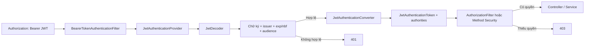

# Giữ bộ chuyển đổi authorities và validator thật trong kiểm thử tích hợp

Một bài test Spring Security có thể xanh dù cấu hình JWT ở ứng dụng thực đang sai. Chẳng hạn, request `MockMvc` dùng `.with(jwt().authorities(new SimpleGrantedAuthority("SCOPE_reports.read")))` nhận `200 OK`, nhưng điều đó chỉ chứng minh endpoint chấp nhận một `Authentication` **đã được gắn sẵn authority**. Nó không chứng minh ứng dụng đã xác minh chữ ký, issuer, audience, thời hạn của JWT hoặc đã biến claim `scope` thành authority đúng cách.

Trong module **SPRING_SECURITY_TESTING**, người học kiểm chứng xác thực, phân quyền và bảo vệ HTTP bằng `spring-security-test` trên Servlet và Reactive, với `MockMvc`, `WebTestClient`, `@WithMockUser`, `SecurityContext`, JWT/OAuth2/OIDC giả lập và các ca được phép/bị từ chối. Bài này đi sâu vào một nguyên tắc khi kiểm thử **access token thật**: **giữ nguyên decoder, validator và bộ chuyển đổi authorities đang chạy ở production**; chỉ thay nguồn cấp khóa công khai/JWKS bằng nguồn được kiểm soát trong test.

## 1. Pipeline bảo mật cần được kiểm chứng

Với Spring Security OAuth2 Resource Server (Servlet), một request mang JWT thường đi qua chuỗi:



Một yêu cầu có thể bị chặn bởi filter khác như CSRF trước tầng authorization; sơ đồ minh họa đường đi của JWT khi request hợp lệ ở các tầng còn lại.

Các lớp kiểm tra khác nhau trả lời những câu hỏi độc lập:

| Lớp | Điều phải xác minh | Ví dụ lỗi cần bắt |
|---|---|---|
| `JwtDecoder` | Chữ ký, cấu trúc JWT, khóa công khai và thuật toán hợp lệ | Chấp nhận token do khóa khác ký |
| `OAuth2TokenValidator<Jwt>` | `iss`, `aud`, `exp`, `nbf`, token type/tenant theo chính sách | Chấp nhận access token đã hết hạn hoặc dành cho API khác |
| `JwtAuthenticationConverter` | Claim nào trở thành principal, scope và role trở thành authority nào | `scope=reports.read` không tạo `SCOPE_reports.read` |
| HTTP/method authorization | Chính sách endpoint yêu cầu authority/role nào | `REPORT_VIEWER` được truy cập trang admin |
| Service/data | Sau khi bị từ chối, dữ liệu có còn nguyên và không bị lộ không | Trả `403` nhưng vẫn ghi vào DB |

**Không thể kết luận một JWT đã được xác thực chỉ bằng việc có `SecurityContext` chứa `Authentication`.** Công cụ test có thể dựng sẵn `Authentication` mà không đi qua bộ giải mã.

### 1.1. So sánh các kỹ thuật thường dùng

| Test setup | Decoder thật? | Validator JWT thật? | Converter authorities thật? | Mục tiêu phù hợp |
|---|---|---|---|---|
| `@WithMockUser` | Không | Không | Không | Kiểm tra authorization theo user/role giả lập |
| `.with(user("alice"))` | Không | Không | Không | Kiểm tra endpoint trong security context giả lập |
| `.with(jwt())` | Không | Không | Thông thường không; tạo `JwtAuthenticationToken` trực tiếp | Kiểm tra phân quyền theo claims/authorities do test dựng |
| `.with(jwt().authorities(...))` | Không | Không | Không; authority đã được test đặt sẵn | Kiểm tra matcher theo authority có sẵn |
| Header Bearer nhưng `JwtDecoder` bị mock trả JWT | Không xác minh chữ ký/validator thật | Không, trừ khi mock tự gọi validator | Có thể có | Kiểm tra một phần filter/converter |
| Header Bearer **JWT đã ký**, decoder/validator/converter thật | Có | Có | Có | **Kiểm thử tích hợp token thực** |

Ví dụ sau đây **không** kiểm chứng bộ chuyển đổi scope của ứng dụng:

```java
mockMvc.perform(get("/api/reports/read")
        .with(jwt().authorities(
                new SimpleGrantedAuthority("SCOPE_reports.read"))))
    .andExpect(status().isOk());
```

Ngay cả khi converter production bị cấu hình `scopes.setAuthorityPrefix("")`, test vẫn có thể xanh, vì test tự chèn kết quả cần đạt. Khi mục tiêu là kiểm tra converter, hãy gửi **raw claim** trong chuỗi JWT ký thật qua header Bearer, rồi assert authority thực tế xuất hiện.

## 2. Ranh giới được phép giả lập

Không cần gọi identity provider production cho mọi integration test. Chỉ cần thay nguồn cấp khóa công khai bằng server test có thể kiểm soát, đồng thời giữ bộ xử lý JWT nguyên bản.

| Thành phần | Production | Integration test |
|---|---|---|
| `SecurityFilterChain` | Cấu hình ứng dụng | **Giữ nguyên** |
| `JwtDecoder` / `NimbusJwtDecoder` | Cấu hình ứng dụng | **Giữ nguyên** |
| Validators: issuer, audience, timestamp, custom | Cấu hình ứng dụng | **Giữ nguyên** (giá trị kỳ vọng theo môi trường test) |
| Converter scope/role/principal | Bean production | **Giữ nguyên** |
| JWKS | Máy chủ identity provider | HTTP server loopback trả public key test |
| Khóa riêng | Chỉ IdP sở hữu | Khóa riêng sinh trong bộ test để ký token |
| Token | Token phát bởi IdP | JWT tự tạo với cấu trúc/claims giống hợp đồng |
| Controller/service | Mã nguồn ứng dụng | **Giữ nguyên** |

Giữ đồng nhất **các cơ chế** có ý nghĩa hơn việc cố dùng nguyên URL, issuer hay khóa production. Test nên tự cấp khóa test và issuer/audience test bằng cấu hình môi trường, nhưng vẫn chạy cùng thuật toán decoder và cùng tổ hợp validator.

Trong ví dụ dưới đây, một API báo cáo yêu cầu:

- `GET /api/reports/read`: authority `SCOPE_reports.read`.
- `GET /api/reports/admin`: authority `ROLE_REPORT_ADMIN`.
- Token có `iss=https://id.example.invalid/issuer`, `aud=reports-api`.
- Scope nằm ở claim `scope`, role nằm trong `realm_access.roles`.
- Chữ ký RSA SHA-256 (`RS256`) với public key lấy từ JWKS.

Các claim này là **hợp đồng minh họa**; triển khai thực phải khớp claim và quy tắc của identity provider đang dùng. Đặc biệt, một OIDC ID token không tự nhiên là OAuth2 access token phù hợp để gọi API chỉ vì nó cũng có chữ ký JWT.

## 3. Cấu hình production: decoder và validators thật

Ví dụ tương thích với mô hình Spring Boot 3.x / Spring Security 6.x, Java 17+. Phụ thuộc Gradle:

```groovy
dependencies {
    implementation 'org.springframework.boot:spring-boot-starter-web'
    implementation 'org.springframework.boot:spring-boot-starter-security'
    implementation 'org.springframework.boot:spring-boot-starter-oauth2-resource-server'

    testImplementation 'org.springframework.boot:spring-boot-starter-test'
    testImplementation 'org.springframework.security:spring-security-test'

    // JWKS HTTP server cục bộ; không mock JwtDecoder.
    testImplementation 'com.squareup.okhttp3:mockwebserver:4.12.0'
}

tasks.named('test') {
    useJUnitPlatform()
}
```

Dùng dependency management của Spring Boot tương ứng, không tùy tiện ghép nhiều phiên bản Spring Security không tương thích.

`application.yml` minh họa:

```yaml
app:
  jwt:
    issuer: https://id.example.invalid/issuer
    audience: reports-api
    jwk-set-uri: https://id.example.invalid/issuer/keys
```

Đặt các bean sau trong một class `@Configuration(proxyBeanMethods = false)` (ví dụ `JwtSecurityConfig`):

```java
@Bean
JwtDecoder jwtDecoder(
        @Value("${app.jwt.issuer}") String issuer,
        @Value("${app.jwt.audience}") String audience,
        @Value("${app.jwt.jwk-set-uri}") String jwkSetUri) {

    NimbusJwtDecoder decoder =
            NimbusJwtDecoder.withJwkSetUri(jwkSetUri)
                    .jwsAlgorithm(SignatureAlgorithm.RS256)
                    .build();

    // Giữ validator mặc định (gồm kiểm tra thời gian)
    // và bổ sung issuer được mong đợi.
    OAuth2TokenValidator<Jwt> issuerAndTime =
            JwtValidators.createDefaultWithIssuer(issuer);

    OAuth2TokenValidator<Jwt> audienceValidator = jwt -> {
        if (jwt.getAudience() != null
                && jwt.getAudience().contains(audience)) {
            return OAuth2TokenValidatorResult.success();
        }

        return OAuth2TokenValidatorResult.failure(
                new OAuth2Error(
                        "invalid_token",
                        "JWT không dành cho reports-api",
                        null));
    };

    decoder.setJwtValidator(
            new DelegatingOAuth2TokenValidator<>(
                    issuerAndTime, audienceValidator));

    return decoder;
}
```

Các import quan trọng:

```java
import org.springframework.beans.factory.annotation.Value;
import org.springframework.context.annotation.Bean;
import org.springframework.context.annotation.Configuration;
import org.springframework.security.oauth2.core.OAuth2Error;
import org.springframework.security.oauth2.core.OAuth2TokenValidator;
import org.springframework.security.oauth2.core.OAuth2TokenValidatorResult;
import org.springframework.security.oauth2.core.DelegatingOAuth2TokenValidator;
import org.springframework.security.oauth2.jose.jws.SignatureAlgorithm;
import org.springframework.security.oauth2.jwt.Jwt;
import org.springframework.security.oauth2.jwt.JwtDecoder;
import org.springframework.security.oauth2.jwt.JwtValidators;
import org.springframework.security.oauth2.jwt.NimbusJwtDecoder;
```

Lựa chọn này có một số điểm đáng chú ý:

1. `NimbusJwtDecoder.withJwkSetUri` lấy public key từ JWKS để xác minh chữ ký; test phải đưa token **đã ký** chứ không truyền JWT object dựng sẵn vào filter.
2. `.jwsAlgorithm(SignatureAlgorithm.RS256)` chỉ định thuật toán chữ ký được tin cậy. Không lấy thuật toán từ header `alg` của token rồi tự động chấp nhận mọi giá trị.
3. `JwtValidators.createDefaultWithIssuer(issuer)` kết hợp validator mặc định (đặc biệt `exp`, `nbf`) với issuer validation. Đừng bỏ validator này khi thêm audience validator.
4. Audience phải chứa **định danh API nhận token**; chữ ký hợp lệ không đủ để cho phép một token vốn dành cho API khác.
5. Các test hết hạn/chưa có hiệu lực nên đặt thời gian cách xa biên clock skew, vì timestamp validator có thể cho phép sai lệch đồng hồ nhỏ.

**Lỗi điển hình:** thay `DelegatingOAuth2TokenValidator<>(issuerAndTime, audienceValidator)` bằng một validator chỉ kiểm `aud`. Khi đó có nguy cơ bỏ kiểm tra issuer/thời gian và test ký JWT hợp lệ sẽ không phát hiện được nếu không có ca âm tính riêng cho `iss`, `exp`, `nbf`.

## 4. Cấu hình production: converter authorities thật

Một JWT có claim:

```json
{
  "iss": "https://id.example.invalid/issuer",
  "aud": ["reports-api"],
  "sub": "alice",
  "scope": "reports.read reports.export",
  "realm_access": {
    "roles": ["REPORT_ADMIN"]
  }
}
```

Nếu API cần phân quyền theo `hasAuthority("SCOPE_reports.read")` và `hasRole("REPORT_ADMIN")`, converter phải chuyển thành các authority:

```text
SCOPE_reports.read
SCOPE_reports.export
ROLE_REPORT_ADMIN
```

Khai báo **một bean converter dùng chung** giữa các môi trường:

```java
@Bean
JwtAuthenticationConverter jwtAuthenticationConverter() {
    JwtGrantedAuthoritiesConverter scopeConverter =
            new JwtGrantedAuthoritiesConverter();

    scopeConverter.setAuthoritiesClaimName("scope");
    scopeConverter.setAuthorityPrefix("SCOPE_");

    JwtAuthenticationConverter converter =
            new JwtAuthenticationConverter();

    converter.setPrincipalClaimName("sub");

    converter.setJwtGrantedAuthoritiesConverter(jwt -> {
        Set<GrantedAuthority> result =
                new LinkedHashSet<>(scopeConverter.convert(jwt));

        Map<String, Object> realm =
                jwt.getClaimAsMap("realm_access");

        Object rawRoles = realm == null
                ? null : realm.get("roles");

        if (rawRoles instanceof Collection<?> roles) {
            for (Object item : roles) {
                if (item instanceof String role && !role.isBlank()) {
                    result.add(new SimpleGrantedAuthority(
                            "ROLE_" + role));
                }
            }
        }

        return result;
    });

    return converter;
}
```

Import bổ sung:

```java
import java.util.Collection;
import java.util.LinkedHashSet;
import java.util.Map;
import java.util.Set;
import org.springframework.security.core.GrantedAuthority;
import org.springframework.security.core.authority.SimpleGrantedAuthority;
import org.springframework.security.oauth2.server.resource.authentication.JwtAuthenticationConverter;
import org.springframework.security.oauth2.server.resource.authentication.JwtGrantedAuthoritiesConverter;
```

Không chuyển trực tiếp một chuỗi role nằm trong request parameter, header tùy ý hoặc JSON body thành authority. Quyền được cấp phải đến từ claim của **token đã xác minh và thuộc issuer/audience được tin cậy**, hoặc được đối chiếu với nguồn ủy quyền server tin cậy.

### Gắn converter vào SecurityFilterChain

```java
@Bean
SecurityFilterChain securityFilterChain(
        HttpSecurity http,
        JwtAuthenticationConverter jwtConverter) throws Exception {

    http.authorizeHttpRequests(auth -> auth
            .requestMatchers(HttpMethod.GET, "/api/reports/read")
                .hasAuthority("SCOPE_reports.read")
            .requestMatchers(HttpMethod.GET, "/api/reports/admin")
                .hasRole("REPORT_ADMIN")
            .anyRequest().denyAll())
        .oauth2ResourceServer(oauth2 -> oauth2
            .jwt(jwt -> jwt
                .jwtAuthenticationConverter(jwtConverter)));

    return http.build();
}
```

Import:

```java
import org.springframework.http.HttpMethod;
import org.springframework.security.config.annotation.web.builders.HttpSecurity;
import org.springframework.security.web.SecurityFilterChain;
```

`hasRole("REPORT_ADMIN")` tương đương kiểm tra authority `ROLE_REPORT_ADMIN`. `hasAuthority("SCOPE_reports.read")` yêu cầu **đúng chuỗi** `SCOPE_reports.read`, không tự thêm `SCOPE_`.

Controller minh họa để quan sát principal và authorities:

```java
@RestController
@RequestMapping("/api/reports")
class ReportController {

    @GetMapping("/read")
    Map<String, Object> read(Authentication authentication) {
        List<String> authorities = authentication.getAuthorities()
                .stream()
                .map(GrantedAuthority::getAuthority)
                .sorted()
                .toList();

        return Map.of(
                "principal", authentication.getName(),
                "authorities", authorities);
    }

    @GetMapping("/admin")
    ResponseEntity<Void> admin() {
        return ResponseEntity.noContent().build();
    }
}
```

Import:

```java
import java.util.List;
import java.util.Map;
import org.springframework.http.ResponseEntity;
import org.springframework.security.core.Authentication;
import org.springframework.security.core.GrantedAuthority;
import org.springframework.web.bind.annotation.GetMapping;
import org.springframework.web.bind.annotation.RequestMapping;
import org.springframework.web.bind.annotation.RestController;
```

Trong production, thường không cần trả nguyên danh sách authorities về client. Endpoint `/read` cố ý trả dữ liệu này để minh họa test; trong ứng dụng thật có thể kiểm tra authorization bằng hành vi endpoint và một test hook nội bộ.

**Lưu ý:** Nếu ứng dụng có nhiều `SecurityFilterChain` với `securityMatcher` và `@Order`, integration test phải gọi đúng URL đi qua chain Resource Server đang thử. Một chain khác bắt request trước có thể làm test nhận `401`/`403` sai nguyên nhân.

## 5. Ký JWT bằng private key test, cấp JWKS qua HTTP cục bộ

Để kiểm thử tính hợp lệ token **trên đúng pipeline**, hãy tạo một cặp khóa RSA trong test. JWKS chỉ được công bố **public key**; private key chỉ dùng để tạo JWT test. Sau đó Spring Security đọc chuỗi token từ `Authorization: Bearer ...`, tải JWKS và tự xác minh chữ ký bằng `NimbusJwtDecoder`.

Mẫu test sau sử dụng `MockWebServer` chạy trên loopback, cổng được cấp động. `@DynamicPropertySource` thay ba giá trị cấu hình mà không thay bean decoder/converter.

### 5.1. Test tích hợp Spring Boot + MockMvc

```java
@SpringBootTest
@AutoConfigureMockMvc
class RealJwtAuthorizationIT {

    private static final String ISSUER =
            "https://id.example.invalid/issuer";
    private static final String AUDIENCE = "reports-api";

    private static final RSAKey TRUSTED_KEY = newRsaKey("test-kid");
    private static final RSAKey UNTRUSTED_KEY = newRsaKey("test-kid");
    private static final MockWebServer JWKS_SERVER = startJwksServer();

    @Autowired
    MockMvc mockMvc;

    @DynamicPropertySource
    static void jwtProperties(DynamicPropertyRegistry registry) {
        registry.add("app.jwt.issuer", () -> ISSUER);
        registry.add("app.jwt.audience", () -> AUDIENCE);
        registry.add("app.jwt.jwk-set-uri",
                () -> JWKS_SERVER.url("/jwks").toString());
    }

    private static RSAKey newRsaKey(String kid) {
        try {
            KeyPairGenerator generator =
                    KeyPairGenerator.getInstance("RSA");
            generator.initialize(2048);
            KeyPair pair = generator.generateKeyPair();

            return new RSAKey.Builder(
                    (RSAPublicKey) pair.getPublic())
                    .privateKey((RSAPrivateKey) pair.getPrivate())
                    .keyID(kid)
                    .build();
        } catch (GeneralSecurityException ex) {
            throw new IllegalStateException(
                    "Không tạo được khóa JWT test", ex);
        }
    }

    private static MockWebServer startJwksServer() {
        MockWebServer server = new MockWebServer();

        // Chỉ public key của TRUSTED_KEY được đưa vào JWKS.
        String jwks = new JWKSet(
                TRUSTED_KEY.toPublicJWK()).toString();

        server.setDispatcher(new Dispatcher() {
            @Override
            public MockResponse dispatch(RecordedRequest request) {
                if ("/jwks".equals(request.getPath())) {
                    return new MockResponse()
                            .setResponseCode(200)
                            .setHeader("Content-Type",
                                    "application/json")
                            .setBody(jwks);
                }
                return new MockResponse().setResponseCode(404);
            }
        });

        try {
            server.start();
        } catch (IOException ex) {
            throw new ExceptionInInitializerError(ex);
        }
        return server;
    }

    private static String signedJwt(
            RSAKey signingKey,
            String issuer,
            List<String> audiences,
            String scope,
            List<String> roles,
            Instant nbf,
            Instant exp) throws Exception {

        JWTClaimsSet.Builder claims = new JWTClaimsSet.Builder()
                .jwtID(UUID.randomUUID().toString())
                .issuer(issuer)
                .subject("alice")
                .audience(audiences)
                .issueTime(Date.from(Instant.now().minusSeconds(30)))
                .notBeforeTime(Date.from(nbf))
                .expirationTime(Date.from(exp));

        if (scope != null) {
            claims.claim("scope", scope);
        }
        if (roles != null) {
            claims.claim("realm_access",
                    Map.of("roles", roles));
        }

        SignedJWT token = new SignedJWT(
                new JWSHeader.Builder(JWSAlgorithm.RS256)
                        .keyID(signingKey.getKeyID())
                        .build(),
                claims.build());

        token.sign(new RSASSASigner(
                signingKey.toRSAPrivateKey()));

        return token.serialize();
    }

    private static String validToken(
            String scope, List<String> roles) throws Exception {
        Instant now = Instant.now();

        return signedJwt(
                TRUSTED_KEY,
                ISSUER,
                List.of(AUDIENCE),
                scope,
                roles,
                now.minusSeconds(60),
                now.plusSeconds(300));
    }

    @Test
    void signedTokenGoesThroughRealDecoderAndConverter()
            throws Exception {

        String token = validToken(
                "reports.read reports.export",
                List.of("REPORT_ADMIN"));

        mockMvc.perform(get("/api/reports/read")
                    .header(HttpHeaders.AUTHORIZATION,
                            "Bearer " + token))
                .andExpect(status().isOk())
                .andExpect(jsonPath("$.principal").value("alice"))
                .andExpect(jsonPath("$.authorities",
                        hasItems(
                                "SCOPE_reports.read",
                                "SCOPE_reports.export",
                                "ROLE_REPORT_ADMIN")));
    }

    @Test
    void roleClaimEnablesAdminEndpoint() throws Exception {
        String token = validToken(
                "reports.read", List.of("REPORT_ADMIN"));

        mockMvc.perform(get("/api/reports/admin")
                    .header(HttpHeaders.AUTHORIZATION,
                            "Bearer " + token))
                .andExpect(status().isNoContent());
    }

    @Test
    void signedTokenWithoutRequiredScopeIsForbidden()
            throws Exception {
        String token = validToken(
                "reports.export", List.of());

        mockMvc.perform(get("/api/reports/read")
                    .header(HttpHeaders.AUTHORIZATION,
                            "Bearer " + token))
                .andExpect(status().isForbidden());
    }

    @Test
    void signedTokenWithoutAdminRoleIsForbidden()
            throws Exception {
        String token = validToken(
                "reports.read", List.of("REPORT_VIEWER"));

        mockMvc.perform(get("/api/reports/admin")
                    .header(HttpHeaders.AUTHORIZATION,
                            "Bearer " + token))
                .andExpect(status().isForbidden());
    }

    @Test
    void wrongIssuerIsUnauthorized() throws Exception {
        Instant now = Instant.now();

        String token = signedJwt(
                TRUSTED_KEY,
                "https://untrusted-issuer.example.invalid",
                List.of(AUDIENCE),
                "reports.read",
                List.of(),
                now.minusSeconds(60),
                now.plusSeconds(300));

        mockMvc.perform(get("/api/reports/read")
                    .header(HttpHeaders.AUTHORIZATION,
                            "Bearer " + token))
                .andExpect(status().isUnauthorized());
    }

    @Test
    void wrongAudienceIsUnauthorized() throws Exception {
        Instant now = Instant.now();

        String token = signedJwt(
                TRUSTED_KEY,
                ISSUER,
                List.of("billing-api"),
                "reports.read",
                List.of(),
                now.minusSeconds(60),
                now.plusSeconds(300));

        mockMvc.perform(get("/api/reports/read")
                    .header(HttpHeaders.AUTHORIZATION,
                            "Bearer " + token))
                .andExpect(status().isUnauthorized());
    }

    @Test
    void expiredJwtIsUnauthorized() throws Exception {
        Instant now = Instant.now();

        String token = signedJwt(
                TRUSTED_KEY,
                ISSUER,
                List.of(AUDIENCE),
                "reports.read",
                List.of(),
                now.minusSeconds(900),
                now.minusSeconds(300));

        mockMvc.perform(get("/api/reports/read")
                    .header(HttpHeaders.AUTHORIZATION,
                            "Bearer " + token))
                .andExpect(status().isUnauthorized());
    }

    @Test
    void jwtBeforeNbfIsUnauthorized() throws Exception {
        Instant now = Instant.now();

        String token = signedJwt(
                TRUSTED_KEY,
                ISSUER,
                List.of(AUDIENCE),
                "reports.read",
                List.of(),
                now.plusSeconds(300),
                now.plusSeconds(900));

        mockMvc.perform(get("/api/reports/read")
                    .header(HttpHeaders.AUTHORIZATION,
                            "Bearer " + token))
                .andExpect(status().isUnauthorized());
    }

    @Test
    void tokenSignedByDifferentKeyIsUnauthorized()
            throws Exception {
        Instant now = Instant.now();

        String token = signedJwt(
                UNTRUSTED_KEY,
                ISSUER,
                List.of(AUDIENCE),
                "reports.read",
                List.of(),
                now.minusSeconds(60),
                now.plusSeconds(300));

        mockMvc.perform(get("/api/reports/read")
                    .header(HttpHeaders.AUTHORIZATION,
                            "Bearer " + token))
                .andExpect(status().isUnauthorized());
    }

    @Test
    void requestWithoutBearerTokenIsUnauthorized()
            throws Exception {
        mockMvc.perform(get("/api/reports/read"))
                .andExpect(status().isUnauthorized());
    }

    @AfterAll
    static void closeJwksServer() throws IOException {
        JWKS_SERVER.shutdown();
    }
}
```

Các import chính của lớp test:

```java
import com.nimbusds.jose.JWSAlgorithm;
import com.nimbusds.jose.JWSHeader;
import com.nimbusds.jose.crypto.RSASSASigner;
import com.nimbusds.jose.jwk.JWKSet;
import com.nimbusds.jose.jwk.RSAKey;
import com.nimbusds.jwt.JWTClaimsSet;
import com.nimbusds.jwt.SignedJWT;
import okhttp3.mockwebserver.Dispatcher;
import okhttp3.mockwebserver.MockResponse;
import okhttp3.mockwebserver.MockWebServer;
import okhttp3.mockwebserver.RecordedRequest;
import org.junit.jupiter.api.AfterAll;
import org.junit.jupiter.api.Test;
import org.springframework.beans.factory.annotation.Autowired;
import org.springframework.boot.test.autoconfigure.web.servlet.AutoConfigureMockMvc;
import org.springframework.boot.test.context.SpringBootTest;
import org.springframework.http.HttpHeaders;
import org.springframework.test.context.DynamicPropertyRegistry;
import org.springframework.test.context.DynamicPropertySource;
import org.springframework.test.web.servlet.MockMvc;

import java.io.IOException;
import java.security.GeneralSecurityException;
import java.security.KeyPair;
import java.security.KeyPairGenerator;
import java.security.interfaces.RSAPrivateKey;
import java.security.interfaces.RSAPublicKey;
import java.time.Instant;
import java.util.Date;
import java.util.List;
import java.util.Map;
import java.util.UUID;

import static org.hamcrest.Matchers.hasItems;
import static org.springframework.test.web.servlet.request.MockMvcRequestBuilders.get;
import static org.springframework.test.web.servlet.result.MockMvcResultMatchers.*;
```

Đặt test ở package có thể tìm thấy ứng dụng `@SpringBootApplication`, cấu hình `JwtSecurityConfig` và controller từ mục 3. Với dự án không dùng mặc định component scanning, chỉ định class cấu hình cần thiết cho `@SpringBootTest`; đảm bảo đúng chain/bean của production được nạp.

**Các chi tiết có chủ ý trong fixture:**

- JWKS chỉ chứa **public key của `TRUSTED_KEY`**. `UNTRUSTED_KEY` được sinh độc lập nhưng cố tình có cùng `kid`. Nhờ đó decoder có thể tra được `kid`, và test âm tính phải thất bại ở **xác minh chữ ký**, thay vì chỉ thất bại vì không tìm thấy khóa.
- `MockWebServer` chạy trước khi Spring khởi tạo context, còn `@DynamicPropertySource` cung cấp URI thực mà nó đang phục vụ. Test không gọi dịch vụ IdP bên ngoài.
- Không có `@WithMockUser`, `.with(jwt())`, `@MockBean JwtDecoder` hay `@MockitoBean JwtDecoder`. Cả chuỗi token → filter → decoder → validator → converter → authorization được kiểm tra.
- Các bài test thời gian đặt `exp`/`nbf` cách thời điểm hiện tại nhiều phút để vượt clock skew của validator.
- Nhóm test có cả **đối chứng dương**: token hợp lệ qua endpoint, và **ca âm tính đơn điều kiện**: issuer sai, audience sai, thời gian sai, chữ ký sai hoặc thiếu quyền.

Không ghi private key production hoặc access token thật vào fixture, log hay báo cáo CI. Khóa tạo ra ở đây chỉ dành cho bộ test.

## 6. Đọc trạng thái 401 và 403 đúng ngữ cảnh

Trên API Resource Server minh họa, kết quả kỳ vọng là:

| Đầu vào | Authentication | Authorization | HTTP dự kiến |
|---|---|---|---|
| Không có Bearer token | Không được thiết lập | Chưa đến kiểm quyền theo JWT | `401` |
| Chữ ký không khớp JWKS | Thất bại | Không được cấp quyền | `401` |
| JWT hết hạn | Thất bại validator thời gian | Không được cấp quyền | `401` |
| JWT có `nbf` ở tương lai | Thất bại validator thời gian | Không được cấp quyền | `401` |
| JWT sai `iss` | Thất bại issuer validator | Không được cấp quyền | `401` |
| JWT sai `aud` | Thất bại audience validator | Không được cấp quyền | `401` |
| JWT hợp lệ nhưng chỉ có `reports.export` | Thành công | Thiếu `SCOPE_reports.read` | `403` |
| JWT hợp lệ nhưng chỉ có `REPORT_VIEWER` | Thành công | Thiếu `ROLE_REPORT_ADMIN` | `403` |
| JWT hợp lệ, scope đọc phù hợp | Thành công | Có authority đọc | `200` |
| JWT hợp lệ, role admin phù hợp | Thành công | Có role admin | `204` |

Không dùng status như bằng chứng duy nhất rằng **đúng cơ chế** đã chặn. Chẳng hạn, test hết hạn phải gửi token có chữ ký, issuer và audience hợp lệ; nếu token còn sai chữ ký, kết quả `401` sẽ không chứng minh validator `exp` được gọi.

### Vì sao cần test cả trường hợp thành công?

Nếu sai JWKS URI hoặc không khởi tạo được JWT decoder, mọi token đều có thể nhận `401`; test âm tính vẫn xanh. Bài test token hợp lệ nhận `200`/`204` chứng minh được server JWKS và decoder hoạt động trước khi diễn giải các kết quả âm tính. Tương tự, nếu route admin luôn bị `403` do một matcher sai, test thiếu role vẫn xanh; test role đúng phải nhận `204` mới phát hiện được.

## 7. Cách test bắt hồi quy converter và validators

Giả sử ai đó thay production converter:

```java
// Lỗi cấu hình: bỏ tiền tố SCOPE_.
scopeConverter.setAuthorityPrefix("");
```

Khi gửi JWT có `scope: "reports.read"`, bộ converter tạo `reports.read` thay vì `SCOPE_reports.read`. Test `signedTokenGoesThroughRealDecoderAndConverter` phải thất bại vì route yêu cầu `SCOPE_reports.read`.

Nếu chỉ dùng:

```java
.with(jwt().authorities(
        new SimpleGrantedAuthority("SCOPE_reports.read")))
```

test không thấy hồi quy, vì nó bỏ qua converter.

Tương tự, nếu production chuyển từ:

```java
decoder.setJwtValidator(
        new DelegatingOAuth2TokenValidator<>(
                issuerAndTime, audienceValidator));
```

thành:

```java
// Lỗi bảo mật: không còn audience validator.
decoder.setJwtValidator(issuerAndTime);
```

một token được ký hợp lệ với `aud=["billing-api"]` có thể lọt vào API báo cáo. Test `wrongAudienceIsUnauthorized` sẽ chuyển sang đỏ.

Nếu đổi nhầm đường dẫn role:

```java
// Sai khi IdP dùng realm_access.roles:
Object rawRoles = jwt.getClaim("roles");
```

test `roleClaimEnablesAdminEndpoint` sẽ đỏ vì converter không tạo `ROLE_REPORT_ADMIN`.

Đây là mục tiêu chính của kiểm thử tích hợp: nó **phải thất bại khi một thành phần bảo mật production bị thay đổi sai**. Có thể thử mutation cục bộ, quan sát test chuyển đỏ rồi hoàn nguyên; không cần thêm mutation vào mã đã commit.

## 8. Dùng mock JWT đúng nơi: test nhanh cho ma trận phân quyền

`@WithMockUser`, `jwt()` và `mockJwt()` vẫn rất hữu ích. Đừng bỏ chúng chỉ vì chúng không giải mã token thật. Chúng phù hợp khi cần kiểm tra nhiều tổ hợp endpoint/role/owner mà việc phát hành JWT mới cho từng ca tạo thêm chi phí không cần thiết.

Ví dụ:

```java
@Test
void exportScopeCannotReadReport() throws Exception {
    mockMvc.perform(get("/api/reports/read")
            .with(jwt().authorities(
                    new SimpleGrantedAuthority(
                            "SCOPE_reports.export"))))
        .andExpect(status().isForbidden());
}
```

Test này kiểm tra **quy tắc HTTP authorization** dưới một danh tính có sẵn. Nó không có trách nhiệm chứng minh chữ ký/claim mapping. Nên tách các nhóm rõ ràng:

| Nhóm test | Công cụ | Cam kết kiểm tra |
|---|---|---|
| Controller/authorization nhanh | `@WithMockUser`, `.with(user())`, `.with(jwt())` | Các matcher, role, scope, đối tượng khi authentication đã tồn tại |
| Converter unit test | Gọi bean `JwtAuthenticationConverter` với claim thô | Ánh xạ `sub`, `scope`, `scp`, roles theo hợp đồng |
| Validator unit test | Gọi validator với `Jwt` đại diện | Các rule issuer/audience/tenant/time riêng biệt |
| **HTTP JWT integration** | **Bearer JWT ký thật, decoder + validators + converter thật** | Kết nối các lớp bảo mật đúng thực tế |
| E2E với IdP thử nghiệm | Gọi identity provider thật trong môi trường test | Discovery, cấp phát token, claim thực, key rotation, liên thông mạng |

Một phương pháp tiết kiệm là giữ nhiều test mock nhỏ và một **bộ test tích hợp có chọn lọc** đủ bắt hồi quy chữ ký, issuer, audience, thời gian và converter.

## 9. Phân biệt JWT authorization và CSRF khi kiểm thử request ghi

Khi thêm `POST /api/reports/publish`, một request có token hợp lệ vẫn có thể nhận `403` từ `CsrfFilter` nếu ứng dụng bật CSRF cho request đó. Như vậy test không chứng minh được việc thiếu `ROLE_REPORT_ADMIN`.

Nếu ứng dụng sử dụng CSRF, hãy cung cấp token CSRF hợp lệ khi **kiểm tra quyền**:

```java
mockMvc.perform(post("/api/reports/publish")
        .with(csrf())
        .header(HttpHeaders.AUTHORIZATION,
                "Bearer " + validToken(
                        "reports.write",
                        List.of("REPORT_VIEWER"))))
    .andExpect(status().isForbidden());
```

Đây là ví dụ mở rộng, chỉ chạy được khi đã bổ sung controller và matcher phù hợp cho `POST /api/reports/publish`. Thêm test đối chứng với `REPORT_ADMIN` và CSRF hợp lệ: phải thành công để chứng minh `403` đến từ phân quyền.

Một API thuần Bearer stateless không sử dụng cookie/session cho authentication có thể có chính sách CSRF khác. Chỉ tắt CSRF khi thiết kế ứng dụng thật xác định đúng nhu cầu, không tắt trong test nhằm che một lỗi cấu hình.

Đối với `POST`, `PATCH`, `DELETE`, ngoài `401`/`403` hãy xác minh **không ghi trái phép**: so sánh DB trước/sau, kiểm tra outbox/event hoặc mock cổng gửi email. Status đúng nhưng service đã ghi dữ liệu trước khi chặn vẫn là lỗi phân quyền.

## 10. Tương đương trong Reactive với WebTestClient

Với WebFlux, `mockJwt()` của Spring Security Test giúp dựng `Authentication` trong ngữ cảnh Reactor để test rule nhanh:

```java
client.mutateWith(mockJwt()
        .authorities(new SimpleGrantedAuthority(
                "SCOPE_reports.read")))
    .get()
    .uri("/api/reports/read")
    .exchange()
    .expectStatus().isOk();
```

Lời gọi này **không chứng minh việc phân tích chữ ký access token từ HTTP**. Khi cần decoder thật, dùng `WebTestClient` với chuỗi JWT ký và header Bearer:

```java
@SpringBootTest(webEnvironment =
        SpringBootTest.WebEnvironment.RANDOM_PORT)
class ReactiveRealJwtIT {

    @Autowired
    WebTestClient client;

    @Test
    void bearerJwtPassesRealDecoder() throws Exception {
        String token = signedTestAccessToken();

        client.get()
            .uri("/api/reports/read")
            .header(HttpHeaders.AUTHORIZATION,
                    "Bearer " + token)
            .exchange()
            .expectStatus().isOk();
    }
}
```

Đây là **khung minh họa**, cần bổ sung bộ tạo token `signedTestAccessToken()`, JWKS test và ứng dụng WebFlux. Không dùng nguyên `JwtDecoder`/`SecurityFilterChain` Servlet cho WebFlux. Thay bằng `ReactiveJwtDecoder`, `SecurityWebFilterChain` và converter phù hợp Reactor. Ví dụ về decoder:

```java
NimbusReactiveJwtDecoder decoder =
        NimbusReactiveJwtDecoder.withJwkSetUri(jwkSetUri)
                .jwsAlgorithm(SignatureAlgorithm.RS256)
                .build();

decoder.setJwtValidator(
        new DelegatingOAuth2TokenValidator<>(
                JwtValidators.createDefaultWithIssuer(issuer),
                audienceValidator));
```

Converter imperative có thể được bọc bằng `ReactiveJwtAuthenticationConverterAdapter` khi phù hợp:

```java
@Bean
ReactiveJwtAuthenticationConverterAdapter reactiveAdapter(
        JwtAuthenticationConverter converter) {
    return new ReactiveJwtAuthenticationConverterAdapter(converter);
}

@Bean
SecurityWebFilterChain securityWebFilterChain(
        ServerHttpSecurity http,
        ReactiveJwtAuthenticationConverterAdapter converter) {
    return http.authorizeExchange(exchanges -> exchanges
            .pathMatchers(HttpMethod.GET, "/api/reports/read")
                .hasAuthority("SCOPE_reports.read")
            .anyExchange().denyAll())
        .oauth2ResourceServer(resourceServer -> resourceServer
            .jwt(jwt -> jwt
                .jwtAuthenticationConverter(converter)))
        .build();
}
```

Nếu `WebTestClient` gửi HTTP tới server đang chạy trên cổng thực, `.mutateWith(mockJwt())` không tự gửi JWT qua mạng tới server. Header `Authorization` cùng token ký thật mới đi qua đường HTTP và `ReactiveJwtDecoder` của server.

## 11. Các validator mở rộng vẫn phải đi qua cùng pipeline

Một số API cần thêm ràng buộc ngoài chữ ký, issuer, audience, thời gian. Những quy tắc này phải nằm trong **validator production** và phải có test âm tính riêng.

### 11.1. Audience là danh sách

Claim `aud` có thể gồm nhiều giá trị. Sử dụng `jwt.getAudience()` để so sánh thành viên chính xác:

```java
OAuth2TokenValidator<Jwt> audience = jwt ->
        jwt.getAudience() != null
                && jwt.getAudience().contains("reports-api")
            ? OAuth2TokenValidatorResult.success()
            : OAuth2TokenValidatorResult.failure(
                    new OAuth2Error(
                            "invalid_token",
                            "wrong audience",
                            null));
```

Không dùng `jwt.getClaim("aud").toString().contains("reports-api")`; phép kiểm chuỗi có thể chấp nhận một giá trị trông gần giống nhưng không bằng audience cần thiết.

### 11.2. Tenant

Ví dụ tenant nằm trong claim `tenant_id`:

```java
Set<String> allowedTenants =
        Set.of("tenant-a", "tenant-b");

OAuth2TokenValidator<Jwt> tenantValidator = jwt -> {
    String tenant = jwt.getClaimAsString("tenant_id");
    if (tenant != null && allowedTenants.contains(tenant)) {
        return OAuth2TokenValidatorResult.success();
    }
    return OAuth2TokenValidatorResult.failure(
            new OAuth2Error(
                    "invalid_token",
                    "tenant_id không được chấp nhận",
                    null));
};
```

Thêm validator này vào `DelegatingOAuth2TokenValidator` **cùng** issuer/time/audience. Token tenant sai phải bị `401`; token tenant đúng nhưng user không được đọc bản ghi cụ thể phải tiếp tục bị từ chối bởi **authorization**. Tenant claim không tự thay thế phân quyền theo tài nguyên/owner.

### 11.3. Access token so với OIDC ID token

Một ID token có thể có chữ ký hợp lệ và issuer đúng nhưng **không được phát hành để gọi resource server**. API cần kiểm tra `aud` của chính API, scope, token type hay `token_use` tùy hợp đồng của IdP. Khi issuer có phân biệt token use, tạo test với token loại khác và kiểm tra bị từ chối. Không áp đặt một tên claim cố định cho mọi nhà cung cấp vì các IdP có cấu trúc khác nhau.

### 11.4. Thuật toán và xoay khóa

- Chỉ cho phép các thuật toán chữ ký được hệ thống tin cậy; không diễn giải `alg=none` như một token hợp lệ.
- Kiểm thử nhiều `kid` khi JWKS xoay khóa: cung cấp public key tương ứng cho mỗi token cần được chấp nhận.
- Nếu JWKS không chứa public key cho chữ ký của token, token phải bị loại. Việc cache JWKS có thể ảnh hưởng thời điểm refresh; tạo test riêng cho cơ chế cache/rotation thay vì trộn với test issuer hoặc role.
- Các test kiểm `exp`/`nbf` sát ranh giới cần kiểm soát clock và clock skew, tránh phụ thuộc thời điểm chạy CI.

## 12. Những dấu hiệu test xanh giả

| Dấu hiệu | Vì sao chưa đủ | Cách làm khi cần test tích hợp |
|---|---|---|
| Test tên `realJwtTest` nhưng có `@WithMockUser` | Không giải mã JWT | Dùng Bearer đã ký qua header |
| `.with(jwt().authorities(...))` | Test tự cấp authority | Đưa `scope`/role vào claim thô của token |
| `@MockBean JwtDecoder` hoặc `@MockitoBean JwtDecoder` | Bỏ qua chữ ký và phần lớn validator | Giữ `NimbusJwtDecoder` thật, giả lập JWKS |
| Dùng `MockMvcBuilders.standaloneSetup` không gắn security | Không chạy chain filter đúng | `@SpringBootTest` + `@AutoConfigureMockMvc` hoặc cấu hình filter đầy đủ |
| Chỉ assert `403` khi thiếu scope | Có thể thất bại do CSRF hoặc JWT invalid | Token hợp lệ, CSRF hợp lệ nếu cần, và ca đối chứng dương |
| Chỉ assert `401` khi token hết hạn | Có thể do JWKS URL sai | Ca token hợp lệ phải nhận `200` |
| Sai issuer, sai audience, hết hạn trong cùng token | Không biết validator nào đã chặn | Mỗi ca âm tính sai đúng một điều kiện |
| Test dùng ID token thay access token | Không đại diện token dành cho API | Dựng access token đúng contract IdP |
| Test converter với `roles=ADMIN`, nhưng production dùng `realm_access.roles` | Tránh được lỗi mapping thật | Dùng chính dạng claims của production |
| `401`/`403` được assert mà không xét DB | Có thể vẫn ghi, phát event hoặc lộ dữ liệu | Snapshot trạng thái, kiểm body và side effects |
| MockWebServer bị đóng khi context còn dùng | Test lỗi ngẫu nhiên do cache/lifecycle | Đồng bộ vòng đời JWKS server với test context |

Một test tốt phải **đỏ** nếu production bỏ audience validator, chấp nhận token ký bằng khóa khác, bỏ kiểm tra `exp`, đổi nhầm tiền tố `SCOPE_` hoặc đọc sai claim role. Đây là kiểm chứng mạnh hơn một assertion `200/403` sau khi test tự cấp sẵn `Authentication`.

## 13. Quy trình thực hành trên dự án có sẵn

1. **Xác định hợp đồng token:** issuer, JWKS, audience, thuật toán, scope claim, role claim, tên principal, token type và tenant nếu có.
2. **Giữ đúng cấu hình bảo mật trong bài test:** `SecurityFilterChain`, `JwtDecoder`, validators và converter thật. Kiểm tra filter chain nào bắt URL cần thử.
3. **Chuẩn bị JWKS test:** sinh cặp RSA riêng, trả public key từ HTTP server loopback, truyền URL bằng `@DynamicPropertySource`.
4. **Tạo token dương:** chữ ký đúng, issuer/audience đúng, còn hạn, có scope/role cần thiết. Kiểm tra request Bearer thành công và authorities đúng.
5. **Tạo token âm tính tách biệt:** chữ ký sai, issuer sai, audience sai, hết hạn, chưa có hiệu lực, thiếu scope, thiếu role. Assert `401` hoặc `403` đúng tầng.
6. **Bổ sung kiểm thử cấp tài nguyên:** xác minh token hợp lệ của user A không được đọc/ghi tài nguyên của user B, kể cả khi cùng role. Kiểm tra cả response và trạng thái lưu trữ.
7. **Dùng mock JWT cho ma trận lớn:** `spring-security-test` phù hợp cho rule test nhanh; một nhóm integration test nhỏ vẫn phải giữ pipeline thực.
8. **Chạy thử hồi quy cục bộ:** tạm đổi prefix scope hoặc bỏ audience validator, xác nhận test tương ứng thất bại, sau đó hoàn nguyên.

Khi test gửi **JWT thực đã ký qua HTTP**, sử dụng bộ giải mã, validators, converter và rules phân quyền giống ứng dụng, mỗi kết quả `401`, `403` và `200` mới có bằng chứng rõ về **thứ gì đã được xác minh**. Đây là nền tảng để phát hiện lỗi cấu hình token/authorities trước khi chúng trở thành lỗ hổng xác thực hoặc phân quyền trong môi trường chạy thật.
