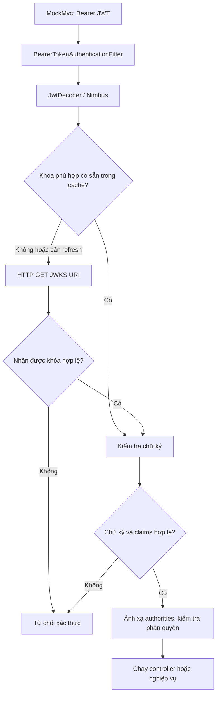

# Giới hạn cache khóa và phụ thuộc mạng trong ca xoay khóa

Trong ứng dụng Spring Security xác thực **JWT thật**, chữ ký token thường được kiểm tra bằng khóa công khai tải từ **JWKS** (JSON Web Key Set) của nhà cung cấp danh tính. Bộ giải mã có thể **cache tập khóa** để tránh gọi mạng trên mọi request. Cơ chế này cải thiện hiệu năng nhưng tạo ra tình huống khó khi nhà cung cấp **xoay khóa ký**: JWT mới có thể dùng khóa chưa nằm trong cache, trong khi JWT cũ vẫn có thể được xác thực bằng khóa đã bị xóa khỏi JWKS của nhà cung cấp.

Bài thuộc chương **JWT và token thực** của module `SPRING_SECURITY_TESTING`, tập trung vào **giới hạn của cache khóa và phụ thuộc mạng** khi xoay khóa. Người học sẽ dùng `MockMvc` và JWT được ký thật, kiểm soát JWKS server tại máy test, mô phỏng lỗi mạng và phân biệt kiểm thử chữ ký thật với `.with(jwt())`/`@WithMockUser`. Cùng nguyên tắc có thể áp dụng cho `WebTestClient` trên ứng dụng Reactive.

> Không giả định mọi phiên bản Spring Security/Nimbus có cùng TTL cache, chính sách tải lại khi `kid` mới xuất hiện hoặc retry network giống nhau. Bài test phải đo đúng hành vi của cấu hình đang sử dụng.

## 1. Vì sao JWT phụ thuộc JWKS và mạng?

JWT ký bất đối xứng có header, payload và chữ ký. Ví dụ header của JWT dùng RSA:

```json
{
  "alg": "RS256",
  "typ": "JWT",
  "kid": "signing-key-k2"
}
```

`kid` (*key ID*) giúp bộ kiểm tra lựa chọn khóa công khai có ID phù hợp. JWKS có thể công bố **nhiều khóa công khai** trong giai đoạn chuyển đổi:

```json
{
  "keys": [
    {
      "kty": "RSA",
      "kid": "signing-key-k1",
      "use": "sig",
      "alg": "RS256",
      "n": "<modulus-k1>",
      "e": "AQAB"
    },
    {
      "kty": "RSA",
      "kid": "signing-key-k2",
      "use": "sig",
      "alg": "RS256",
      "n": "<modulus-k2>",
      "e": "AQAB"
    }
  ]
}
```

Các chuỗi `n` trên chỉ là placeholder minh họa, không phải dữ liệu khóa RSA hợp lệ. Khi test, phải tạo keypair thật và xuất **khóa công khai** ra JWKS; tuyệt đối không phát khóa riêng.

Spring Security Resource Server nhận `Authorization: Bearer <token>` qua filter chain, rồi `JwtDecoder` xác minh chữ ký bằng khóa phù hợp. Decoder cũng phải áp dụng các điều kiện về thời gian, issuer, audience và các claims khác theo cấu hình. Có khóa phù hợp **chưa đủ** để tin token: nó vẫn có thể sai chữ ký, hết hạn hoặc không dành cho API này.



Sơ đồ mô tả luồng logic. Thời điểm lấy JWKS, điều kiện dùng cache, cách refresh khi gặp `kid` lạ, retry và fallback khi server gặp sự cố **phụ thuộc thư viện và cấu hình**. Không nên biến sơ đồ thành khẳng định rằng cứ gặp một `kid` mới thì chắc chắn có đúng một HTTP GET.

**Phân biệt cache khóa với cache JWT:** JWKS cache giữ tập khóa công khai hoặc dữ liệu tải từ JWKS. Nó không tự làm một token hết hạn trở nên hợp lệ, cũng không thay thế việc xác minh chữ ký/claims cho từng request.

## 2. Lịch xoay khóa đúng và cửa sổ rủi ro

Giả sử nhà cung cấp đang ký JWT với khóa riêng `K1` (`kid=k1`) và chuẩn bị chuyển sang `K2` (`kid=k2`). Một lịch xoay khóa có kiểm soát:

| Mốc | JWKS công bố | Ký token mới | Điều resource server cần xử lý |
|---|---|---|---|
| T0 | `[K1]` | K1 | Có thể đã cache K1 từ trước. |
| T1 | `[K1, K2]` | K1 | Công bố khóa công khai K2 trước để client có thể làm mới cache. |
| T2 | `[K1, K2]` | **K2** | Token có `kid=k2` cần lấy K2 nếu cache còn K1. |
| T3 | `[K1, K2]` | K2 | Giữ K1 để JWT cũ chưa hết hạn vẫn xác minh được. |
| T4 | `[K2]` | K2 | Gỡ K1 khi thời hạn token cũ và yêu cầu bảo mật cho phép. |

Khoảng overlap cần xem xét **thời hạn tối đa của token đã ký bởi K1**, độ lệch đồng hồ được chấp nhận và trạng thái cache của các node. Gỡ K1 quá sớm có thể làm token hợp lệ về thời gian bị từ chối; gỡ K1 muộn sẽ kéo dài thời gian sử dụng khóa cũ.

Đặc biệt, **xóa K1 khỏi JWKS không đồng nghĩa thu hồi K1 ngay lập tức**: một node đã cache K1 có thể vẫn xác minh JWT ký bởi K1 cho tới khi refresh hoặc hết hạn cache. Nếu khóa riêng K1 bị lộ, đó là sự cố bảo mật cần quy trình thu hồi bổ sung, không chỉ cập nhật một JSON trên JWKS server.

## 3. Ma trận cache và lỗi mạng

| Điều kiện | Hành vi có thể xảy ra | Ý nghĩa kiểm thử |
|---|---|---|
| JWT ký K1, cache có K1, JWKS online | Xác minh được bằng cache mà không tải JWKS mỗi request. | Đo số GET thực tế; không giả định mọi request tạo mạng. |
| JWT ký K2, cache chỉ có K1, JWKS đã công bố K2 | Decoder có thể làm mới và tìm K2, hoặc phải đợi chính sách refresh/cache. | Quan sát thời điểm chấp nhận K2 và lần tải lại JWKS. |
| JWT ký K2, cache chưa có K2, JWKS đang 503/timeout | Không lấy được khóa công khai mới để xác thực chữ ký. | Không được cho phép token chỉ vì `kid` mới; nghiệp vụ không chạy. |
| JWT ký K1, cache còn K1, JWKS đang 503 | Có thể vẫn xác minh được nếu cache còn hiệu lực và chính sách cho phép. | Kiểm tra hành vi khi cache còn hợp lệ và sau khi hết hạn. |
| Nhà cung cấp đã xóa K1, node vẫn cache K1 | JWT cũ có thể vẫn qua bước xác minh chữ ký khi claims còn hợp lệ. | Đánh giá độ trễ thu hồi khóa thực tế. |
| Token hết hạn hoặc sai `iss`/`aud` | Phải thất bại dù tìm được khóa. | Không đánh đồng tìm thấy khóa với xác thực token thành công. |

Không thể kết luận “mạng mất thì mọi token đều 401” hoặc “đã có cache thì mạng mất không ảnh hưởng”. Câu trả lời phụ thuộc khóa nào đang được cache, cơ chế refresh, timeout và cách ứng dụng xử lý exception. Với một Resource Server thông thường, JWT không xác thực được dẫn đến **401 Unauthorized**; status có thể khác nếu ứng dụng tự cấu hình exception handler.

### Cache TTL không phải thời hạn token

TTL của JWKS cache và thời hạn `exp` của JWT là hai đại lượng độc lập. Cache còn giữ khóa **không** kéo dài hiệu lực JWT. Trái lại, token còn `exp` nhưng khóa công khai không thể lấy được vẫn có thể không xác thực được.

Khi dùng `NimbusJwtDecoder.withJwkSetUri(uri)`, kiểm tra tài liệu và hành vi của **phiên bản Nimbus/Spring Security thực tế** thay vì hardcode một “TTL mặc định”. Nếu thêm `.cache(cache)` để dùng Spring `Cache` riêng, phải xác định TTL, cách invalidation, phạm vi issuer và xử lý `kid` chưa có. Một cache giữ dữ liệu vô hạn có thể làm thay đổi đáng kể khả năng nhận khóa mới và thời điểm ngừng tin khóa cũ.

## 4. Cấu hình Spring Resource Server có timeout và claim validation

Ví dụ Java Servlet sử dụng `NimbusJwtDecoder` để cố định JWKS URI, timeout khi gọi HTTP, thuật toán ký chấp nhận và validator issuer/audience. Các dependency chính gồm `spring-boot-starter-security`, `spring-boot-starter-oauth2-resource-server`, `spring-boot-starter-web`, `spring-boot-starter-test` và `spring-security-test`.

```java
import org.springframework.beans.factory.annotation.Value;
import org.springframework.context.annotation.Bean;
import org.springframework.context.annotation.Configuration;
import org.springframework.http.client.SimpleClientHttpRequestFactory;
import org.springframework.security.config.Customizer;
import org.springframework.security.config.annotation.web.builders.HttpSecurity;
import org.springframework.security.oauth2.core.DelegatingOAuth2TokenValidator;
import org.springframework.security.oauth2.core.OAuth2Error;
import org.springframework.security.oauth2.core.OAuth2TokenValidator;
import org.springframework.security.oauth2.core.OAuth2TokenValidatorResult;
import org.springframework.security.oauth2.jose.jws.SignatureAlgorithm;
import org.springframework.security.oauth2.jwt.Jwt;
import org.springframework.security.oauth2.jwt.JwtDecoder;
import org.springframework.security.oauth2.jwt.JwtValidators;
import org.springframework.security.oauth2.jwt.NimbusJwtDecoder;
import org.springframework.security.web.SecurityFilterChain;
import org.springframework.web.client.RestTemplate;

@Configuration
class ApiSecurityConfig {

    @Bean
    JwtDecoder jwtDecoder(
            @Value("${app.jwt.jwks-uri}") String jwksUri,
            @Value("${app.jwt.issuer}") String issuer,
            @Value("${app.jwt.audience}") String audience
    ) {
        var requestFactory = new SimpleClientHttpRequestFactory();
        requestFactory.setConnectTimeout(1000);
        requestFactory.setReadTimeout(2000);

        var decoder = NimbusJwtDecoder.withJwkSetUri(jwksUri)
                .jwsAlgorithm(SignatureAlgorithm.RS256)
                .restOperations(new RestTemplate(requestFactory))
                .build();

        OAuth2TokenValidator<Jwt> issuerAndTime =
                JwtValidators.createDefaultWithIssuer(issuer);
        OAuth2TokenValidator<Jwt> audienceValidator = jwt ->
                jwt.getAudience().contains(audience)
                        ? OAuth2TokenValidatorResult.success()
                        : OAuth2TokenValidatorResult.failure(
                                new OAuth2Error(
                                        "invalid_token",
                                        "Required audience is missing",
                                        null));
        decoder.setJwtValidator(
                new DelegatingOAuth2TokenValidator<>(
                        issuerAndTime, audienceValidator));
        return decoder;
    }

    @Bean
    SecurityFilterChain securityFilterChain(HttpSecurity http) throws Exception {
        return http
                .authorizeHttpRequests(auth -> auth
                        .requestMatchers("/api/**").authenticated()
                        .anyRequest().permitAll())
                .oauth2ResourceServer(oauth2 ->
                        oauth2.jwt(Customizer.withDefaults()))
                .build();
    }
}
```

`.restOperations(...)` cấu hình timeout cho **việc tải JWKS**. Hai giá trị 1.000 ms và 2.000 ms chỉ là ví dụ; hãy lựa chọn theo SLO. `.jwsAlgorithm(RS256)` là danh sách thuật toán được phép do ứng dụng quyết định, không nên chấp nhận thuật toán tùy ý từ header chưa đáng tin.

Nếu tự tạo `JwtDecoder` từ `jwk-set-uri`, phải bảo đảm có validator cho issuer, audience và thời gian theo yêu cầu của API; đừng cho rằng chỉ cấu hình URI là đủ. Các request `POST`, `PUT`, `DELETE` cũng chịu chính sách CSRF của filter chain. Các ví dụ test bên dưới sử dụng `GET` để tránh nhầm lỗi CSRF với lỗi JWT.

Trong test, property `app.jwt.jwks-uri` phải trỏ tới **server JWKS chạy tại loopback**, không trỏ tới IdP production. Như vậy ca thử không phụ thuộc Internet, rate limit, lịch xoay khóa hay chứng chỉ thực của nhà cung cấp.

## 5. Sinh token ký thật bằng Nimbus JOSE + JWT

`.with(jwt())` từ `spring-security-test` tạo một `Authentication` giả lập, thích hợp khi kiểm tra phân quyền nhưng không buộc `JwtDecoder` xác minh chữ ký. Để kiểm tra JWKS và network, cần **JWT ký thật** với một RSA private key test, gửi qua `Authorization: Bearer ...`.

Fixture sau tạo hai keypair độc lập, phát public JWKS và ký access token:

```java
import java.time.Instant;
import java.util.Arrays;
import java.util.Date;

import com.nimbusds.jose.JOSEException;
import com.nimbusds.jose.JOSEObjectType;
import com.nimbusds.jose.JWSAlgorithm;
import com.nimbusds.jose.JWSHeader;
import com.nimbusds.jose.crypto.RSASSASigner;
import com.nimbusds.jose.jwk.JWKSet;
import com.nimbusds.jose.jwk.KeyUse;
import com.nimbusds.jose.jwk.RSAKey;
import com.nimbusds.jose.jwk.gen.RSAKeyGenerator;
import com.nimbusds.jwt.JWTClaimsSet;
import com.nimbusds.jwt.SignedJWT;

final class JwtFixtures {
    static final String ISSUER = "https://issuer.test";
    static final String AUDIENCE = "orders-api";

    static RSAKey signingKey(String kid) throws JOSEException {
        return new RSAKeyGenerator(2048)
                .keyID(kid)
                .keyUse(KeyUse.SIGNATURE)
                .algorithm(JWSAlgorithm.RS256)
                .generate();
    }

    static String publicJwks(RSAKey... keys) {
        return new JWKSet(Arrays.stream(keys)
                .map(RSAKey::toPublicJWK)
                .toList()).toString();
    }

    static String sign(RSAKey key) throws JOSEException {
        Instant now = Instant.now();
        var claims = new JWTClaimsSet.Builder()
                .issuer(ISSUER)
                .subject("learner-42")
                .audience(AUDIENCE)
                .issueTime(Date.from(now))
                .expirationTime(Date.from(now.plusSeconds(300)))
                .claim("scope", "orders.read")
                .build();
        var jwt = new SignedJWT(
                new JWSHeader.Builder(JWSAlgorithm.RS256)
                        .type(JOSEObjectType.JWT)
                        .keyID(key.getKeyID())
                        .build(),
                claims);
        jwt.sign(new RSASSASigner(key.toRSAPrivateKey()));
        return jwt.serialize();
    }
}
```

Vì `publicJwks(...)` chỉ xuất `toPublicJWK()`, khóa riêng không xuất hiện trong response JWKS. Hai khóa K1/K2 được tạo riêng cho từng ca test và có `kid` khác nhau. JWT từ hàm `sign(...)` có chữ ký RSA thật; muốn API chấp nhận, decoder phải lấy được đúng khóa công khai và kiểm tra chữ ký, `iss`, `aud`, `exp`.

## 6. Tạo JWKS HTTP server cục bộ có thể đổi nội dung và trả lỗi

Để mô phỏng xoay khóa, JWKS server cần thay được nội dung trả về mà vẫn giữ **cùng URL**. Ta có thể dùng WireMock/MockWebServer hoặc một server HTTP nhỏ từ JDK như sau:

```java
import java.io.IOException;
import java.net.InetSocketAddress;
import java.nio.charset.StandardCharsets;
import java.util.concurrent.atomic.AtomicInteger;
import java.util.concurrent.atomic.AtomicReference;
import com.sun.net.httpserver.HttpServer;

final class LocalJwksServer implements AutoCloseable {
    private final HttpServer server;
    private final AtomicReference<String> body =
            new AtomicReference<>("{\"keys\":[]}");
    private final AtomicInteger responseCode = new AtomicInteger(200);
    private final AtomicInteger totalRequests = new AtomicInteger();

    LocalJwksServer() throws IOException {
        server = HttpServer.create(
                new InetSocketAddress("127.0.0.1", 0), 0);
        server.createContext("/jwks", exchange -> {
            totalRequests.incrementAndGet();
            int code = responseCode.get();
            byte[] bytes = body.get().getBytes(StandardCharsets.UTF_8);
            exchange.getResponseHeaders()
                    .set("Content-Type", "application/json");

            if (code == 200) {
                exchange.sendResponseHeaders(200, bytes.length);
                try (var output = exchange.getResponseBody()) {
                    output.write(bytes);
                }
            } else {
                exchange.sendResponseHeaders(code, -1);
                exchange.close();
            }
        });
        server.start();
    }

    String url() {
        return "http://127.0.0.1:"
                + server.getAddress().getPort() + "/jwks";
    }

    void publish(String json) {
        body.set(json);
        responseCode.set(200);
    }

    void failWith(int status) {
        responseCode.set(status); // Ví dụ: 503 Service Unavailable
    }

    int requests() {
        return totalRequests.get();
    }

    @Override
    public void close() {
        server.stop(0);
    }
}
```

Đây là fixture dùng trong test; `http://127.0.0.1` chỉ truy cập máy cục bộ. Trong production, phải dùng nguồn JWKS đáng tin, giao thức an toàn và kiểm soát đích truy cập. Để mô phỏng **read timeout** thay vì HTTP 503, dùng test server có khả năng trì hoãn trả response quá thời gian timeout (ví dụ WireMock fixed delay).

Trong một test class `@SpringBootTest`, dùng `@DynamicPropertySource` để cấp URI động trước khi Spring tạo decoder:

```java
import java.io.IOException;
import java.io.UncheckedIOException;
import org.junit.jupiter.api.AfterAll;
import org.springframework.test.context.DynamicPropertyRegistry;
import org.springframework.test.context.DynamicPropertySource;

static final LocalJwksServer jwks = startJwks();

static LocalJwksServer startJwks() {
    try {
        return new LocalJwksServer();
    } catch (IOException e) {
        throw new UncheckedIOException(e);
    }
}

@DynamicPropertySource
static void properties(DynamicPropertyRegistry registry) {
    registry.add("app.jwt.jwks-uri", jwks::url);
    registry.add("app.jwt.issuer", () -> JwtFixtures.ISSUER);
    registry.add("app.jwt.audience", () -> JwtFixtures.AUDIENCE);
}

@AfterAll
static void stopJwks() {
    jwks.close();
}
```

Những thành viên `static` trên đặt **bên trong test class**, không phải đoạn Java top-level độc lập. Cần bảo đảm test Spring nạp chính `ApiSecurityConfig` đã nêu; nếu có nhiều filter chain/profile, phải khớp chain chứa Resource Server.

## 7. Kiểm thử với MockMvc và Bearer JWT thực

Tạo endpoint đơn giản để xác nhận JWT đã được xác thực:

```java
import org.springframework.web.bind.annotation.GetMapping;
import org.springframework.web.bind.annotation.RestController;

@RestController
class ProbeController {
    @GetMapping("/api/probe")
    String probe() {
        return "verified";
    }
}
```

Trong lớp test có `@SpringBootTest`, `@AutoConfigureMockMvc`, `@Autowired MockMvc mockMvc` và fixture bên trên, viết ca K1 hợp lệ:

```java
import org.springframework.http.HttpHeaders;

import static org.springframework.test.web.servlet.request
        .MockMvcRequestBuilders.get;
import static org.springframework.test.web.servlet.result
        .MockMvcResultMatchers.content;
import static org.springframework.test.web.servlet.result
        .MockMvcResultMatchers.status;

@Test
void tokenSignedByPublishedK1_isAccepted() throws Exception {
    RSAKey k1 = JwtFixtures.signingKey("k1");
    jwks.publish(JwtFixtures.publicJwks(k1));
    String token = JwtFixtures.sign(k1);

    mockMvc.perform(get("/api/probe")
                    .header(HttpHeaders.AUTHORIZATION, "Bearer " + token))
            .andExpect(status().isOk())
            .andExpect(content().string("verified"));
}
```

Không dùng `@WithMockUser` hoặc `.with(jwt())` trong test này. Request bắt buộc đi qua `BearerTokenAuthenticationFilter` và `JwtDecoder` thật, đồng thời kích hoạt tải JWKS khi decoder cần khóa.

Ca K2 chưa có trong JWKS:

```java
@Test
void tokenSignedByUnpublishedK2_isRejected() throws Exception {
    RSAKey k1 = JwtFixtures.signingKey("k1");
    RSAKey k2 = JwtFixtures.signingKey("k2");
    jwks.publish(JwtFixtures.publicJwks(k1));

    mockMvc.perform(get("/api/probe")
                    .header(HttpHeaders.AUTHORIZATION,
                            "Bearer " + JwtFixtures.sign(k2)))
            .andExpect(status().isUnauthorized());
}
```

Hai ví dụ là **hai kịch bản độc lập**: chúng cần decoder/cache mới hoặc cơ chế cách ly phù hợp. Nếu cùng dùng một Spring context với cache giữ khóa từ test trước, kết quả có thể phụ thuộc thứ tự chạy. Có thể dùng test class riêng/`@DirtiesContext` có chủ đích hoặc một giải pháp reset cache do dự án hỗ trợ. Trong ca đang kiểm thử *rotation*, ngược lại, **phải giữ nguyên decoder** để quan sát cache ấm.

Để kiểm tra xoay khóa trên chính decoder đó, lần lượt:

1. Công bố `[K1]`, gửi JWT ký K1 để làm ấm cache, xác minh trả 200.
2. Cập nhật JWKS cùng URL thành `[K1,K2]`, nhưng **không tạo lại decoder**.
3. Gửi JWT ký K2; ghi nhận response và chênh lệch `jwks.requests()` trước/sau request.
4. Nếu K2 chưa được nhận, tìm hiểu cơ chế refresh đang cấu hình; khi có cách kiểm soát TTL/invalidation, kích hoạt nó một cách xác định rồi kiểm tra lại.
5. Đổi server sang 503, gửi token ký K1 hoặc K2 đã/ chưa nằm trong cache để xác định ranh giới ứng dụng còn phục vụ được khi offline.

Không dùng `Thread.sleep(...)` để đợi một TTL không được xác minh; cách đó vừa chậm vừa dễ gây test flaky. Với tình huống **cold cache**, tạo decoder/context mới. Với tình huống **warm cache**, giữ decoder và dùng công cụ điều khiển thời gian/cache nếu có.

### Kiểm chứng số lần truy vấn JWKS

`LocalJwksServer.requests()` đếm request mạng. Test có thể ghi nhận:

```java
int before = jwks.requests();

mockMvc.perform(get("/api/probe")
                .header(HttpHeaders.AUTHORIZATION,
                        "Bearer " + tokenSignedWithK2))
        .andExpect(status().isOk());

int jwksFetches = jwks.requests() - before;
// Đánh giá jwksFetches theo hợp đồng refresh/cache của ứng dụng.
```

Ở đây `tokenSignedWithK2` là JWT thật từ fixture. Khi test cam kết “có tải lại để nhận K2”, cần assert có fetch khi **cơ chế đang kiểm tra** yêu cầu; tránh viết assertion quá yếu như `>= 0` và tránh hardcode “chính xác một GET” khi thư viện có thể retry hoặc có bước cache phụ.

## 8. Các ca cần bao phủ khi đánh giá giới hạn cache

| Ca | Thiết lập | Kết quả hoặc bằng chứng cần xác minh |
|---|---|---|
| A. Khóa đầu tiên hoạt động | JWKS có K1, JWT ký K1 còn hạn. | 200, đi qua decoder thật. |
| B. Khóa mới chưa công bố | JWKS chỉ K1, JWT ký K2. | Không xác thực; nghiệp vụ không chạy. |
| C. Hai khóa cùng tồn tại | JWKS có K1+K2, decoder cold cache. | Token ký bằng cả hai khóa được chấp nhận khi claims đúng. |
| D. Cache giữ K1 khi công bố K2 | Warm K1, cập nhật JWKS thêm K2, gửi JWT K2. | Đo thời điểm refresh, số GET, thời gian nhận K2. |
| E. JWKS 503 và `kid` chưa biết | Cache không có khóa của token, mạng lỗi. | Không cho phép token chưa xác minh được. |
| F. JWKS 503 nhưng cache có K1 | Warm K1, làm hỏng JWKS, gửi JWT K1 còn hạn. | Xác định điều kiện cache còn giúp tiếp tục và lúc nào thất bại. |
| G. Gỡ K1 | Warm K1 rồi JWKS chỉ còn K2. | Xác minh khoảng trễ trước khi khóa K1 bị loại khỏi cache. |
| H. Giả mạo chữ ký | Header có `kid=k1` nhưng ký bằng khóa khác. | 401, không chạy nghiệp vụ; `kid` không chứng minh chữ ký. |
| I. Claims sai | Ký đúng nhưng sai `iss`/`aud` hoặc `exp` đã qua. | Bị từ chối dù khóa có trong cache. |
| J. Timeout tải JWKS | Không có khóa cần thiết trong cache; server đáp ứng chậm hơn timeout. | Không treo request vô hạn, không cấp quyền nhầm. |

**Fail closed** nghĩa là khi không xác minh được token chưa đáng tin, ứng dụng không được coi nó đã xác thực. Status có thể phụ thuộc exception handler, nhưng không được trả dữ liệu bảo vệ hoặc thực hiện nghiệp vụ cho token không được xác minh. Với các API có tác dụng phụ, thêm assertion về mock dependency hoặc trạng thái cơ sở dữ liệu để chứng minh nghiệp vụ chưa chạy.

## 9. Các sai lầm phổ biến

1. **Dùng `.with(jwt())` để kiểm thử JWKS rotation:** Cách này giả lập `Authentication` và không buộc decoder kiểm tra chữ ký/tải khóa; phù hợp với test authorization, không đủ cho bài này.
2. **Mock `JwtDecoder`:** `@MockitoBean JwtDecoder` làm mất đúng tầng JWKS/cache/network cần kiểm tra. Chỉ mock decoder khi mục tiêu là controller đã nhận JWT hợp lệ.
3. **Phụ thuộc IdP thật:** JWKS production có thể đổi bất ngờ, gặp lỗi DNS/TLS hoặc rate limit. Sử dụng JWKS HTTP server cục bộ để tái lập chính xác.
4. **Chia sẻ cache giữa các test độc lập:** K2 đã được tải ở ca trước làm sai điều kiện “cache chỉ có K1”. Phải cô lập decoder hoặc reset có kiểm soát.
5. **Nhầm cache TTL với `exp`:** Khóa còn trong cache không cứu được token hết hạn. Tạo ca kiểm tra `exp` riêng.
6. **Kỳ vọng xóa khóa khỏi JWKS là thu hồi ngay:** Cache ở resource server có thể tiếp tục tin K1 cho tới khi refresh.
7. **Hardcode TTL của Nimbus hoặc số GET:** Cơ chế refresh có thể thay đổi theo version và cache adapter. Test hành vi xác định rõ, ghi nhận fetch thực tế.
8. **Chỉ kiểm tra status:** Lỗi 401 có thể do sai issuer, audience, token hết hạn hay thiếu khóa; cần kiểm tra fixture claims, log an toàn và hoạt động nghiệp vụ.
9. **Cho phép thuật toán/URI tùy ý từ token:** Ứng dụng phải giới hạn thuật toán và lấy khóa từ JWKS URI đáng tin đã cấu hình.
10. **Quên sự khác biệt của lỗi mạng:** Timeout, 503 và cache miss khác nhau; không kết luận “có cache thì luôn hoạt động offline”.

## 10. Vận hành và quan sát trong production

Ngoài test, cần chính sách xoay khóa có thời gian overlap, công bố khóa mới trước khi ký, thời hạn JWT rõ ràng và kế hoạch thu hồi trong sự cố lộ private key. Cấu hình timeout/retry phải tránh request treo vô hạn hoặc hàng loạt truy vấn JWKS do `kid` ngẫu nhiên. Cache cần TTL, cách invalidation và phạm vi issuer được kiểm chứng.

Nên theo dõi tỷ lệ lỗi xác thực, timeout JWKS, HTTP 5xx của JWKS, số lần refresh và tình huống thiếu `kid`, nhưng **không ghi nguyên access token hoặc private key vào log**. Có thể ghi mã lỗi và `kid` sau khi xử lý an toàn để phục vụ chẩn đoán. Kết quả test dùng mock JWKS là bằng chứng về cấu hình ứng dụng, không bảo đảm toàn bộ đặc điểm mạng của môi trường production.

## 11. Khi ứng dụng dùng WebFlux

Với Reactive Resource Server, dùng `ReactiveJwtDecoder` (chẳng hạn `NimbusReactiveJwtDecoder`) và `WebTestClient`, nhưng vẫn gửi JWT ký thật qua Bearer header:

```java
webTestClient.get()
        .uri("/api/probe")
        .headers(headers ->
                headers.setBearerAuth(JwtFixtures.sign(k2)))
        .exchange()
        .expectStatus().isOk();
```

Đoạn này giả định `k2` đã được công bố trong JWKS local và Reactive decoder đang dùng URI đó. `mutateWith(mockJwt())` hữu ích khi chỉ cần giả lập xác thực/authority nhưng không kiểm tra JWKS, chữ ký hoặc timeout. Không suy luận TTL hay cách refresh của Reactive decoder chỉ từ kết quả Servlet; kiểm tra riêng phiên bản và cấu hình Reactive.

## 12. Checklist hoàn thành

- [ ] Test dùng ít nhất hai RSA keypair độc lập, `kid` khác nhau; JWKS chỉ chứa khóa công khai.
- [ ] Gửi token ký thật qua `Authorization: Bearer <JWT>`, dùng Resource Server filter và `JwtDecoder` thật.
- [ ] Có ca K1 thành công, K2 chưa công bố, K1/K2 overlap và đổi JWKS trên cùng URL khi cache đang ấm.
- [ ] Có ca JWKS 503/timeout, cache miss, cache warm, gỡ K1 và token sai chữ ký/claims.
- [ ] Kết quả bị từ chối không cho phép truy cập dữ liệu hoặc thực thi nghiệp vụ bảo vệ.
- [ ] Kiểm tra `iss`, `aud`, `exp` và thuật toán được phép bên cạnh tìm khóa.
- [ ] Ghi rõ chính sách TTL/refresh theo phiên bản thư viện, theo dõi request JWKS và cô lập cache giữa test độc lập.
- [ ] Không dựa vào delay ngẫu nhiên hoặc giả định xóa khóa khỏi JWKS thì token cũ bị thu hồi tức thì.

**Ghi nhớ:** Xoay khóa JWT là sự phối hợp giữa **khóa đang được nhà cung cấp công bố, khóa mà token đang dùng và khóa resource server đang cache**. Kiểm thử chỉ có ý nghĩa khi quan sát đúng quá trình xác minh chữ ký và tải khóa qua mạng, đồng thời xác nhận ứng dụng không vô tình chấp nhận token khi thiếu bằng chứng xác thực.
