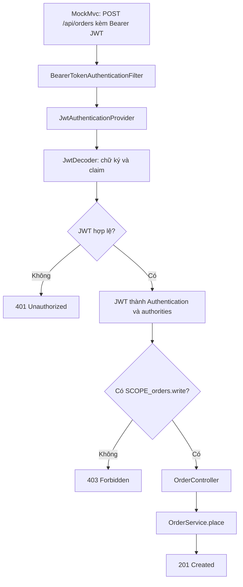

# Xác minh cả phản hồi từ chối và việc nghiệp vụ không được gọi

Một API trả về **401 Unauthorized** hoặc **403 Forbidden** chưa tự động chứng minh rằng yêu cầu nguy hiểm đã bị chặn trước khi xử lý dữ liệu. Trong một số cấu hình sai, mã nghiệp vụ có thể chạy trước khi lỗi được chuyển thành phản hồi HTTP. Kiểm thử bảo mật vì thế cần hai khẳng định độc lập: **phản hồi từ chối đúng** và **thao tác nghiệp vụ được bảo vệ không hề được gọi**.

Bài học thuộc chương **JWT và token thực** của module **SPRING_SECURITY_TESTING**. Module hướng tới kiểm chứng xác thực, phân quyền và bảo vệ HTTP trên Servlet và Reactive bằng `spring-security-test`, `MockMvc`, `WebTestClient`, SecurityContext cùng JWT/OAuth2/OIDC giả lập hoặc thật. Ở đây ta tập trung vào Spring Security Servlet: gửi **JWT được ký thật** qua header `Authorization: Bearer`, giải mã bằng `JwtDecoder` thực, rồi dùng `MockMvc` và Mockito để xác minh toàn bộ hành vi chặn truy cập. Cuối bài sẽ đối chiếu với WebFlux.

## 1. Hai câu hỏi khác nhau trong một ca kiểm thử từ chối

Giả sử API nhận đơn đặt hàng qua `POST /api/orders`. Hệ thống chỉ cho phép tài khoản có authority `SCOPE_orders.write` tạo đơn. Nếu token không hợp lệ hoặc thiếu quyền, một bài kiểm thử tốt cần trả lời:

1. **HTTP đã từ chối đúng chưa?** Yêu cầu không được xác thực thường phải nhận `401`; người dùng đã xác thực nhưng thiếu quyền phải nhận `403`.
2. **Nghiệp vụ có bị chặn thực sự chưa?** Phương thức `OrderService.place(...)` không được chạy, nên không tạo đơn hoặc phát lệnh xử lý ngoài ý muốn.

Ví dụ về một ca kiểm thử thiếu sót:

```java
mvc.perform(post("/api/orders")
        .header("Authorization", "Bearer " + tokenThieuQuyen)
        .contentType(MediaType.APPLICATION_JSON)
        .content("{\"sku\":\"BOOK-1\",\"quantity\":2}"))
    .andExpect(status().isForbidden());
```

Đoạn mã chỉ kiểm tra đầu ra HTTP. Nó không tự xác minh rằng `OrderService` chưa được gọi. Ngược lại, chỉ dùng `verifyNoInteractions(orderService)` cũng chưa chứng minh hệ thống trả đúng `401` hay `403`, hoặc phản hồi có header phù hợp cho bearer token.

Kiểm thử mục tiêu cần có cấu trúc:

```java
mvc.perform(/* request phải bị từ chối */)
    .andExpect(status().isForbidden());

verifyNoInteractions(orderService);
```

Với **JWT và token thực**, cần thêm một điều kiện nữa: token được gửi qua bearer filter và được kiểm tra bằng decoder thật, thay vì gắn sẵn một `Authentication` giả vào request.

### Phân biệt 401 và 403

| Trạng thái request | Ý nghĩa | Phản hồi thường gặp |
| --- | --- | --- |
| Không có bearer token khi endpoint yêu cầu xác thực | Chưa xác thực | `401 Unauthorized` |
| Token bị sửa chữ ký hoặc ký bằng khóa khác | Xác thực thất bại | `401 Unauthorized` |
| Token đã hết hạn, chưa có hiệu lực hoặc sai issuer đã cấu hình kiểm tra | Xác thực thất bại | `401 Unauthorized` |
| Token hợp lệ, nhưng thiếu `SCOPE_orders.write` | Đã xác thực nhưng không đủ quyền | `403 Forbidden` |
| Token hợp lệ, có `SCOPE_orders.write` | Được phép vào controller | Phản hồi nghiệp vụ, ví dụ `201 Created` |

Kết quả cụ thể phụ thuộc `AuthenticationEntryPoint`, `AccessDeniedHandler` và chính sách ứng dụng; bảng trên mô tả cấu hình Spring Security OAuth2 Resource Server mặc định cho API bearer.

## 2. Đường đi của request: filter phải chặn trước controller

Trong một ứng dụng Servlet dùng Spring Security Resource Server, luồng xử lý rút gọn là:



Mục tiêu kiểm thử ở nhánh `401` và `403` là **không đi tới `OrderService.place`**. Tầng bảo mật phải quyết định trước khi mã nghiệp vụ tạo đơn được gọi.

`jwt()` trong `spring-security-test` rất hữu ích để kiểm tra policy nhanh, nhưng thường dựng sẵn `JwtAuthenticationToken` cho request. Nó không tự chứng minh rằng bearer filter thực sự giải mã và kiểm tra chữ ký token. Muốn kiểm tra **token thực**, cần gửi chuỗi JWT ba phần qua header `Authorization` và dùng bộ `JwtDecoder` thật, được cấu hình với **khóa công khai thử nghiệm**.

> JWT ký thật trong bài này là token được ký bằng khóa kiểm thử sinh tại chỗ. Đây không phải token của người dùng hay khóa của nhà cung cấp danh tính thật. Chỉ các claim và chữ ký mà decoder được cấu hình chấp nhận mới có giá trị trong kịch bản kiểm thử.

## 3. Ứng dụng mẫu: endpoint tạo đơn được bảo vệ

Ví dụ dùng Java 17+, Spring Boot 3.x với Spring Security 6.x, `spring-boot-starter-web`, `spring-boot-starter-oauth2-resource-server`, `spring-boot-starter-test` và `spring-security-test`. Những API từ `@MockitoBean` thuộc Spring Framework 6.2+/Spring Boot 3.4+; dự án trên phiên bản cũ có thể cần `@MockBean` tương ứng.

Định nghĩa contract nghiệp vụ và controller:

```java
import org.springframework.http.HttpStatus;
import org.springframework.http.ResponseEntity;
import org.springframework.web.bind.annotation.PostMapping;
import org.springframework.web.bind.annotation.RequestBody;
import org.springframework.web.bind.annotation.RequestMapping;
import org.springframework.web.bind.annotation.RestController;

record OrderRequest(String sku, int quantity) {}
record OrderReceipt(String id) {}

interface OrderService {
    OrderReceipt place(String sku, int quantity);
}

@RestController
@RequestMapping("/api/orders")
class OrderController {
    private final OrderService orderService;

    OrderController(OrderService orderService) {
        this.orderService = orderService;
    }

    @PostMapping
    ResponseEntity<OrderReceipt> place(@RequestBody OrderRequest request) {
        OrderReceipt receipt =
                orderService.place(request.sku(), request.quantity());
        return ResponseEntity.status(HttpStatus.CREATED).body(receipt);
    }
}
```

Trong ứng dụng thực, `OrderService` sẽ có implementation gọi database hoặc hệ thống khác. Trong kiểm thử dưới đây, `@MockitoBean` cung cấp mock tại ranh giới nghiệp vụ để có thể quan sát rõ phương thức có bị gọi hay không. Khi tích hợp vào dự án sẵn có, dùng service mà controller thực sự gọi.

Cấu hình bảo mật cho riêng nhóm endpoint `/api/**`:

```java
import org.springframework.context.annotation.Bean;
import org.springframework.context.annotation.Configuration;
import org.springframework.core.annotation.Order;
import org.springframework.http.HttpMethod;
import org.springframework.security.config.annotation.web.builders.HttpSecurity;
import org.springframework.security.config.http.SessionCreationPolicy;
import org.springframework.security.web.SecurityFilterChain;

@Configuration
class OrderApiSecurity {

    @Bean
    @Order(1)
    SecurityFilterChain apiSecurity(HttpSecurity http) throws Exception {
        return http
            .securityMatcher("/api/**")
            .csrf(csrf -> csrf.disable())
            .sessionManagement(session -> session
                .sessionCreationPolicy(SessionCreationPolicy.STATELESS))
            .authorizeHttpRequests(auth -> auth
                .requestMatchers(HttpMethod.POST, "/api/orders")
                    .hasAuthority("SCOPE_orders.write")
                .anyRequest().authenticated()
            )
            .oauth2ResourceServer(oauth2 -> oauth2
                .jwt(jwt -> { })
            )
            .build();
    }
}
```

Tại đây:

- `securityMatcher("/api/**")` giới hạn chain này vào API, thuận tiện khi ứng dụng còn dùng form login ở chain khác.
- `hasAuthority("SCOPE_orders.write")` đối chiếu chính xác authority do `JwtGrantedAuthoritiesConverter` mặc định tạo từ scope `orders.write`.
- `SessionCreationPolicy.STATELESS` phù hợp với mô hình dùng bearer token cho mỗi request.
- `.oauth2ResourceServer(...jwt...)` kích hoạt cơ chế nhận bearer và `JwtDecoder`.
- `csrf.disable()` trong ví dụ **chỉ dành cho API thuần bearer, không dựa vào cookie/session của trình duyệt**. Nếu endpoint hỗ trợ cookie hoặc phương thức xác thực dễ bị trình duyệt gửi tự động, phải đánh giá CSRF riêng; không tắt toàn ứng dụng chỉ để test vượt qua `403` do CSRF.

Trước khi diễn giải một `403` là thiếu scope, cần bảo đảm request **không bị từ chối trước đó vì CSRF**. Nếu CSRF bật, một POST không có CSRF token có thể trả `403` dù JWT chưa hề được kiểm tra. Việc đối chiếu header và việc xác thực trong các ca kiểm thử sẽ giúp phân biệt nguyên nhân.

## 4. Tạo JWT ký RS256 bằng khóa kiểm thử và giải mã thật

Để thử chữ ký bị sửa, token quá hạn và issuer sai, ta cần một **cặp khóa RSA dùng trong test** và `NimbusJwtDecoder` thật. Decoder chỉ tin khóa công khai của cặp khóa này; `NimbusJwtEncoder` ký token bằng khóa riêng. Khóa sinh trong bộ nhớ khi test khởi động, không đưa khóa production hay token nhạy cảm vào repository.

`@TestConfiguration` sau cung cấp cả encoder dùng để tạo JWT thử nghiệm và decoder dùng bởi Resource Server. Nếu ứng dụng của bạn đã có bean `JwtDecoder`, bean test đánh dấu `@Primary` để các cấu hình autowire bằng type ưu tiên decoder thử nghiệm; hãy kiểm tra ứng dụng có wiring đặc biệt nào dùng bean theo tên hoặc cấp decoder trực tiếp hay không.

```java
import java.security.KeyPair;
import java.security.KeyPairGenerator;
import java.security.NoSuchAlgorithmException;
import java.security.interfaces.RSAPrivateKey;
import java.security.interfaces.RSAPublicKey;

import com.nimbusds.jose.jwk.JWKSet;
import com.nimbusds.jose.jwk.RSAKey;
import com.nimbusds.jose.jwk.source.ImmutableJWKSet;
import org.springframework.boot.test.context.TestConfiguration;
import org.springframework.context.annotation.Bean;
import org.springframework.context.annotation.Primary;
import org.springframework.security.oauth2.jwt.JwtDecoder;
import org.springframework.security.oauth2.jwt.JwtEncoder;
import org.springframework.security.oauth2.jwt.JwtValidators;
import org.springframework.security.oauth2.jwt.NimbusJwtDecoder;
import org.springframework.security.oauth2.jwt.NimbusJwtEncoder;

@TestConfiguration(proxyBeanMethods = false)
class JwtTestKeys {
    static final String ISSUER = "https://issuer.test.example";
    private static final KeyPair TRUSTED_KEYS = newRsaKeyPair();

    @Bean
    @Primary
    JwtDecoder testJwtDecoder() {
        NimbusJwtDecoder decoder = NimbusJwtDecoder
            .withPublicKey((RSAPublicKey) TRUSTED_KEYS.getPublic())
            .build();
        decoder.setJwtValidator(
            JwtValidators.createDefaultWithIssuer(ISSUER));
        return decoder;
    }

    @Bean
    JwtEncoder testJwtEncoder() {
        return encoderFor(TRUSTED_KEYS);
    }

    static JwtEncoder encoderFor(KeyPair keys) {
        RSAKey jwk = new RSAKey.Builder((RSAPublicKey) keys.getPublic())
            .privateKey((RSAPrivateKey) keys.getPrivate())
            .keyID("test-rsa-key")
            .build();
        return new NimbusJwtEncoder(
            new ImmutableJWKSet<>(new JWKSet(jwk)));
    }

    static KeyPair newRsaKeyPair() {
        try {
            KeyPairGenerator generator = KeyPairGenerator.getInstance("RSA");
            generator.initialize(2048);
            return generator.generateKeyPair();
        } catch (NoSuchAlgorithmException exception) {
            throw new IllegalStateException(exception);
        }
    }
}
```

Phần JWT sử dụng `JwtClaimsSet` và `JwsHeader` của Spring Security:

```java
import java.time.Instant;

import org.springframework.security.oauth2.jose.jws.SignatureAlgorithm;
import org.springframework.security.oauth2.jwt.JwtClaimsSet;
import org.springframework.security.oauth2.jwt.JwtEncoder;
import org.springframework.security.oauth2.jwt.JwtEncoderParameters;
import org.springframework.security.oauth2.jwt.JwsHeader;

// Hàm tiện ích đặt trong lớp test ở mục tiếp theo.
private String signedToken(JwtEncoder signer, String issuer, String scope,
                           Instant issuedAt, Instant expiresAt) {
    JwtClaimsSet claims = JwtClaimsSet.builder()
        .issuer(issuer)
        .subject("alice-42")
        .issuedAt(issuedAt)
        .expiresAt(expiresAt)
        .claim("scope", scope)
        .build();

    JwsHeader header = JwsHeader.with(SignatureAlgorithm.RS256)
        .keyId("test-rsa-key")
        .build();

    return signer.encode(JwtEncoderParameters.from(header, claims))
        .getTokenValue();
}
```

Token do hàm này trả về là **JWT JWS compact** gồm ba phần `base64url(header).base64url(payload).base64url(signature)`. Với `JwtDecoder` thật, không thể sửa `scope` hay `exp` trong payload sau khi ký mà vẫn được chấp nhận: thay đổi nội dung phá vỡ chữ ký.

Trong các ca kiểm thử:

- **Hợp lệ:** ký bằng `TRUSTED_KEYS`, có issuer chính xác, `exp` trong tương lai và `scope: "orders.write"`.
- **Thiếu quyền:** token vẫn ký đúng và còn hạn, nhưng `scope: "orders.read"`.
- **Hết hạn:** token ký đúng nhưng `exp` nằm xa trong quá khứ, vượt sai số đồng hồ được validator cho phép.
- **Sai issuer:** token ký đúng nhưng `iss` khác issuer mà decoder chấp nhận.
- **Sai chữ ký:** ký bằng cặp khóa RSA khác; decoder chỉ tin public key gốc nên phải từ chối.

## 5. MockMvc: kiểm tra từng nhánh từ chối và không gọi OrderService

Đặt các đoạn mã dưới đây trong cùng lớp kiểm thử Spring Boot và import `JwtTestKeys`. `@AutoConfigureMockMvc` tạo `MockMvc` với Spring Security filters của application context; các request gửi header bearer thực, **không** dùng `.with(jwt())` để chèn `Authentication` dựng sẵn.

```java
import java.time.Instant;

import org.junit.jupiter.api.Test;
import org.springframework.beans.factory.annotation.Autowired;
import org.springframework.boot.test.autoconfigure.web.servlet.AutoConfigureMockMvc;
import org.springframework.boot.test.context.SpringBootTest;
import org.springframework.context.annotation.Import;
import org.springframework.http.HttpHeaders;
import org.springframework.http.MediaType;
import org.springframework.security.oauth2.jwt.JwtEncoder;
import org.springframework.test.context.bean.override.mockito.MockitoBean;
import org.springframework.test.web.servlet.MockMvc;

import static org.hamcrest.Matchers.containsString;
import static org.mockito.Mockito.verifyNoInteractions;
import static org.springframework.test.web.servlet.request.MockMvcRequestBuilders.post;
import static org.springframework.test.web.servlet.result.MockMvcResultMatchers.header;
import static org.springframework.test.web.servlet.result.MockMvcResultMatchers.status;

@SpringBootTest
@AutoConfigureMockMvc
@Import(JwtTestKeys.class)
class RealJwtRejectionTest {
    private static final String BODY =
        "{\"sku\":\"BOOK-1\",\"quantity\":2}";

    @Autowired MockMvc mvc;
    @Autowired JwtEncoder testJwtEncoder;
    @MockitoBean OrderService orderService;

    private String validToken(String scope) {
        Instant now = Instant.now();
        return signedToken(testJwtEncoder, JwtTestKeys.ISSUER, scope,
                           now.minusSeconds(10), now.plusSeconds(600));
    }

    // Dán nguyên hàm signedToken(...) ở mục 4 vào lớp này.

    @Test
    void missingBearer_returns401_andDoesNotCallBusiness() throws Exception {
        mvc.perform(post("/api/orders")
                .contentType(MediaType.APPLICATION_JSON)
                .content(BODY))
            .andExpect(status().isUnauthorized())
            .andExpect(header().string(HttpHeaders.WWW_AUTHENTICATE,
                                       containsString("Bearer")));

        verifyNoInteractions(orderService);
    }

    @Test
    void insufficientScope_returns403_andDoesNotCallBusiness()
            throws Exception {
        String token = validToken("orders.read");

        mvc.perform(post("/api/orders")
                .header(HttpHeaders.AUTHORIZATION, "Bearer " + token)
                .contentType(MediaType.APPLICATION_JSON)
                .content(BODY))
            .andExpect(status().isForbidden())
            .andExpect(header().string(HttpHeaders.WWW_AUTHENTICATE,
                                       containsString("insufficient_scope")));

        verifyNoInteractions(orderService);
    }

    @Test
    void expiredJwt_returns401_andDoesNotCallBusiness() throws Exception {
        Instant now = Instant.now();
        String expired = signedToken(testJwtEncoder, JwtTestKeys.ISSUER,
            "orders.write", now.minusSeconds(1200), now.minusSeconds(600));

        mvc.perform(post("/api/orders")
                .header(HttpHeaders.AUTHORIZATION, "Bearer " + expired)
                .contentType(MediaType.APPLICATION_JSON)
                .content(BODY))
            .andExpect(status().isUnauthorized());

        verifyNoInteractions(orderService);
    }

    @Test
    void wrongIssuer_returns401_andDoesNotCallBusiness() throws Exception {
        Instant now = Instant.now();
        String wrongIssuer = signedToken(testJwtEncoder,
            "https://other-issuer.test.example", "orders.write",
            now.minusSeconds(10), now.plusSeconds(600));

        mvc.perform(post("/api/orders")
                .header(HttpHeaders.AUTHORIZATION, "Bearer " + wrongIssuer)
                .contentType(MediaType.APPLICATION_JSON)
                .content(BODY))
            .andExpect(status().isUnauthorized());

        verifyNoInteractions(orderService);
    }

    @Test
    void wrongSignature_returns401_andDoesNotCallBusiness()
            throws Exception {
        JwtEncoder untrustedSigner = JwtTestKeys.encoderFor(
            JwtTestKeys.newRsaKeyPair());
        Instant now = Instant.now();
        String foreignSignature = signedToken(untrustedSigner,
            JwtTestKeys.ISSUER, "orders.write",
            now.minusSeconds(10), now.plusSeconds(600));

        mvc.perform(post("/api/orders")
                .header(HttpHeaders.AUTHORIZATION,
                        "Bearer " + foreignSignature)
                .contentType(MediaType.APPLICATION_JSON)
                .content(BODY))
            .andExpect(status().isUnauthorized());

        verifyNoInteractions(orderService);
    }
}
```

Các phương thức trong lớp minh họa cần có **hàm `signedToken(...)` đầy đủ ở mục 4** và các import của hàm đó. Khi sao chép vào dự án, giữ cùng issuer, thuật toán ký, tên authority và matcher bảo mật với code đang kiểm thử.

### Vì sao `verifyNoInteractions` phù hợp với mục tiêu này?

`verifyNoInteractions(orderService)` của Mockito yêu cầu mock **không nhận bất cứ lời gọi phương thức nào** trong test. Nếu controller đi vào `OrderService.place(...)` rồi mới gặp lỗi, assertion này sẽ thất bại dù phản hồi HTTP cuối cùng vẫn là `401` hoặc `403`. Trong Spring Boot test, mock do `@MockitoBean` quản lý thường được reset giữa các phương thức test, nên việc xác minh tập trung vào request của từng ca.

Nếu chỉ muốn kiểm tra một thao tác nhất định, có thể dùng:

```java
import static org.mockito.Mockito.never;
import static org.mockito.Mockito.verify;

verify(orderService, never()).place("BOOK-1", 2);
```

Cách này chỉ chứng minh **đúng lời gọi với hai tham số đó** không xảy ra. Một lời gọi khác như `place("BOOK-2", 2)` vẫn có thể lọt qua. Nếu điều kiện an toàn là *không được gọi thao tác tạo đơn với bất cứ tham số nào*, hãy dùng:

```java
import static org.mockito.ArgumentMatchers.anyInt;
import static org.mockito.ArgumentMatchers.anyString;

verify(orderService, never()).place(anyString(), anyInt());
```

`verifyNoInteractions` còn mạnh hơn: bảo đảm không có method nào của mock được gọi. Chọn cách phù hợp với contract nghiệp vụ; nếu service có các method đọc vô hại được gọi hợp lệ trước khi từ chối, nên chỉ xác minh **không có thao tác gây thay đổi trạng thái**.

## 6. Ca đối chứng: token được phép phải thực sự gọi nghiệp vụ

Một bộ kiểm thử chỉ kiểm tra những nhánh bị từ chối có thể vẫn xanh nếu bạn vô tình cấu hình **chặn tất cả request**. Vì vậy, cần một ca đối chứng với JWT được ký thật, chưa hết hạn, đúng issuer và mang scope `orders.write`.

Thêm phương thức sau **vào cùng lớp `RealJwtRejectionTest`**:

```java
import static org.mockito.Mockito.times;
import static org.mockito.Mockito.verify;
import static org.mockito.Mockito.verifyNoMoreInteractions;
import static org.mockito.Mockito.when;
import static org.springframework.test.web.servlet.result.MockMvcResultMatchers.jsonPath;

@Test
void validWriteScope_returns201_andCallsBusinessOnce() throws Exception {
    String token = validToken("orders.write");
    when(orderService.place("BOOK-1", 2))
        .thenReturn(new OrderReceipt("order-100"));

    mvc.perform(post("/api/orders")
            .header(HttpHeaders.AUTHORIZATION, "Bearer " + token)
            .contentType(MediaType.APPLICATION_JSON)
            .content(BODY))
        .andExpect(status().isCreated())
        .andExpect(jsonPath("$.id").value("order-100"));

    verify(orderService, times(1)).place("BOOK-1", 2);
    verifyNoMoreInteractions(orderService);
}
```

Ca này kết hợp **được phép** và **nghiệp vụ thực sự được gọi đúng một lần**. Một `201` duy nhất không chứng minh service được gọi, vì controller có thể trả kết quả tĩnh; `verify(..., times(1))` làm rõ điều kiện. Ngược lại, chỉ thấy service được gọi cũng chưa đủ chứng minh API tạo phản hồi đúng cho client; cần assert cả `201` và dữ liệu trả về.

Khi có những kiểm thử đối chứng sau, ta thu được ma trận hành vi rõ ràng:

| Kịch bản | Phản hồi | `OrderService.place(...)` |
| --- | --- | --- |
| Không có bearer | `401` | Không được gọi |
| JWT ký bằng khóa lạ | `401` | Không được gọi |
| JWT hết hạn | `401` | Không được gọi |
| JWT sai issuer | `401` | Không được gọi |
| JWT hợp lệ, `scope=orders.read` | `403` | Không được gọi |
| JWT hợp lệ, `scope=orders.write` | `201` | Được gọi đúng một lần |

## 7. Đọc kết quả từ chối cho đúng nguyên nhân

Để xác nhận một test thực sự kiểm tra JWT, không nên chỉ nhìn con số `401` hoặc `403`. Trước mỗi lần đánh giá, hãy đối chiếu các yếu tố sau:

| Điểm cần kiểm tra | Sai lệch thường gặp | Cách nhận biết |
| --- | --- | --- |
| Filter chain | Test tạo `MockMvc` không áp dụng Spring Security filter | `@AutoConfigureMockMvc` hoặc `springSecurity()` khi cấu hình thủ công |
| Loại token | `.with(jwt())` dựng sẵn `Authentication` | Gửi header `Authorization: Bearer <JWS>` với `JwtDecoder` thật |
| CSRF | POST trả `403` do thiếu CSRF, dù token có quyền | Xem cấu hình CSRF và xác minh token đã xác thực trước khi kết luận thiếu scope |
| Policy | `hasAuthority` sử dụng prefix khác quyền tạo từ scope | So khớp `SCOPE_orders.write` với `scope: "orders.write"` |
| Signature | Token sửa nội dung nhưng test vẫn chấp nhận | Bảo đảm decoder thật dùng public key tin cậy |
| Issuer/expiry | Decoder chưa gắn validator cần thiết | Cấu hình và test `JwtValidators.createDefaultWithIssuer(...)` |
| Phản hồi | Controller bắt lỗi rồi tự trả `403` sau khi service đã chạy | Thêm `verifyNoInteractions` hoặc kiểm tra thao tác gây tác dụng phụ |
| Nhiều chain | Request đi qua chain khác với chain JWT | Kiểm tra `securityMatcher`, `@Order` và endpoint khớp chain |

### Có thể kiểm tra `WWW-Authenticate` không?

Với OAuth2 Bearer Token, header `WWW-Authenticate` giúp client biết đây là cơ chế Bearer. Khi JWT không hợp lệ, phản hồi `401` thường có `Bearer` kèm thông tin lỗi `invalid_token`; khi đã xác thực nhưng không đủ quyền, `403` thường có `insufficient_scope`. Việc assert **một phần có ý nghĩa của header** thường bền hơn sao chép nguyên chuỗi chứa thông điệp lỗi có thể thay đổi giữa các phiên bản.

Ví dụ:

```java
.andExpect(status().isUnauthorized())
.andExpect(header().string(HttpHeaders.WWW_AUTHENTICATE,
                           containsString("Bearer")));
```

Không nên yêu cầu phản hồi trả về chính token hoặc thông tin nhạy cảm. HTTP status và header có ích cho client, trong khi chi tiết xác thực nên được lưu theo chính sách logging an toàn.

### Vì sao token phải hết hạn đủ xa trong quá khứ?

`JwtTimestampValidator` có thể cho phép sai số đồng hồ nhất định giữa bên phát hành và bên xác minh. Đặt `exp` chỉ sớm hơn hiện tại một vài giây có thể khiến ca kiểm thử chập chờn hoặc được chấp nhận hợp lệ. Ví dụ dùng `now.minusSeconds(600)` để vượt một khoảng sai số thường gặp, từ đó kiểm tra chắc nhánh `401` vì token quá hạn.

### Ranh giới của một bài test không gọi service

Mockito xác nhận **lời gọi đến mock** chứ không tự chứng minh toàn bộ database, message broker hoặc dịch vụ ngoài không đổi. Trong ứng dụng thực, hãy đặt mock/spy tại ranh giới tạo tác dụng phụ cần bảo vệ (service ghi dữ liệu, repository hoặc publisher). Nếu nhiều nhánh mã khác có thể ghi dữ liệu mà không đi qua mock này, cần thêm kiểm thử tích hợp quan sát DB hoặc sự kiện.

Đặc biệt với **method security** như `@PreAuthorize` trên một phương thức service, lời gọi tới proxy có thể xảy ra trước khi method body bị chặn. Lúc này `verifyNoInteractions` trên proxy/mock ở sai vị trí có thể không phản ánh chính xác “logic ghi dữ liệu có chạy hay không”. Mẫu trong bài áp dụng **HTTP authorization tại filter chain trước controller**. Với kiểm thử method security, nên quan sát collaborator tạo tác dụng phụ *bên trong* method đã bảo vệ.

## 8. Bài thử mutation: phát hiện cấu hình bảo mật bị hỏng

Để đánh giá giá trị thực của các assertion, có thể cố tình tạo sai lệch **chỉ trong nhánh test/thực hành**, chạy lại suite rồi khôi phục:

1. **Bỏ `hasAuthority("SCOPE_orders.write")`:** test thiếu scope phải báo lỗi; nếu service bị gọi, `verifyNoInteractions` cho thấy rủi ro cụ thể.
2. **Tạm chấp nhận mọi JWT không xác minh chữ ký:** ca sai chữ ký hoặc issuer phải thất bại; nếu test vẫn xanh, có thể test chưa thực sự đi qua decoder mong muốn.
3. **Đổi policy thành `denyAll()`:** tất cả ca từ chối có thể vẫn qua, nhưng ca đối chứng `201` và `verify(...times(1))` phải báo lỗi.
4. **Cho controller gọi `orderService.place(...)` rồi mới trả `403`:** assertion HTTP riêng lẻ vẫn có thể qua, nhưng `verifyNoInteractions` phải báo lỗi.
5. **Đổi `scope` từ `orders.write` sang `orders.read`:** token vẫn hợp lệ về mặt chữ ký, nhưng `403` là kết quả đúng của authorization.

Mục đích không phải cố tình làm hệ thống lỗi trong production, mà để xác nhận bài kiểm thử sẽ đỏ khi một đặc tính bảo mật cần bảo đảm bị phá vỡ.

## 9. Đối chiếu khi dùng WebFlux và WebTestClient

Ứng dụng Reactive không dùng `MockMvc` và `JwtDecoder` đồng bộ của Servlet. Các thành phần tương ứng là `WebTestClient`, `SecurityWebFilterChain`, `ReactiveJwtDecoder` và các web filter của WebFlux. Với JWT ký thật, cấu hình `NimbusReactiveJwtDecoder` tin public key kiểm thử; gửi header `Authorization: Bearer` qua `WebTestClient` kết nối với application context có security chain.

Ví dụ khung một ca từ chối trên Reactive (giả sử `webTestClient`, `realSignedTokenWithoutScope` và `orderService` đã được chuẩn bị trong test WebFlux):

```java
import static org.mockito.Mockito.verifyNoInteractions;

webTestClient.post()
    .uri("/api/orders")
    .headers(headers -> headers.setBearerAuth(realSignedTokenWithoutScope))
    .bodyValue(new OrderRequest("BOOK-1", 2))
    .exchange()
    .expectStatus().isForbidden();

verifyNoInteractions(orderService);
```

Nguyên tắc vẫn giống Servlet: **status bị từ chối** và **collaborator nghiệp vụ không được gọi** là hai khẳng định riêng. Với xử lý bất đồng bộ, nếu việc ghi dữ liệu được lên lịch ngoài reactive chain hoặc trên scheduler khác, cần đồng bộ/kết thúc chuỗi xử lý đúng cách trước khi verify, hoặc dùng công cụ quan sát/kiểm thử tín hiệu phù hợp. `mockJwt()` của reactive testing giúp test quyền nhanh nhưng cũng không tự chứng minh chữ ký JWT được giải mã thật.

## 10. Bài thực hành và tiêu chí hoàn thành

Hãy mở rộng API mẫu với một endpoint `POST /api/refunds` yêu cầu `SCOPE_refunds.write`. Dùng một collaborator `RefundService.issueRefund(...)` đại diện cho thao tác tạo hoàn tiền, sau đó viết:

1. Ca không có bearer → `401`, `RefundService` không có interaction.
2. Ca JWT hợp lệ nhưng chỉ có `orders.write` → `403`, `RefundService` không có interaction.
3. Ca JWT bị thay payload sau khi ký → `401`, `RefundService` không có interaction.
4. Ca JWT được ký đúng, đúng issuer, còn hạn, có `refunds.write` → HTTP thành công theo contract, `issueRefund(...)` được gọi đúng một lần.
5. Ca JWT được ký đúng nhưng `exp` rất xa trong quá khứ → `401`, không có interaction.

Khi chạy kiểm thử, cần nhìn được cả **trường hợp được phép** lẫn **trường hợp bị từ chối**. Nếu chỉ dùng `.with(jwt())`, hãy ghi rõ rằng test đang giả lập security context; để xác minh token ký thật, phải có ít nhất một ca gửi Bearer JWS qua decoder thật.

**Tiêu chí đạt:** người học giải thích được khác biệt giữa `401` và `403`, tạo và ký JWT bằng khóa thử nghiệm, kiểm chứng chữ ký/thời hạn/issuer qua `JwtDecoder` thật, assert phản hồi bằng `MockMvc`, đồng thời dùng Mockito chứng minh rằng nhánh bị từ chối **không gọi phương thức nghiệp vụ có tác dụng phụ**. Trong trường hợp được phép, phải chứng minh nghiệp vụ được gọi đúng số lần và phản hồi HTTP phù hợp.

### Tài liệu tham khảo

- [Spring Security — OAuth 2.0 Resource Server JWT](https://docs.spring.io/spring-security/reference/servlet/oauth2/resource-server/jwt.html): cơ chế giải mã JWT, validator và chuyển scope sang authority.
- [Spring Security — Testing OAuth 2.0 with MockMvc](https://docs.spring.io/spring-security/reference/servlet/test/mockmvc/oauth2.html): giới hạn của `jwt()` request postprocessor.
- [Spring Security — Servlet Authorization](https://docs.spring.io/spring-security/reference/servlet/authorization/authorize-http-requests.html): kiểm tra quyền trước khi yêu cầu tới controller.
- [Mockito — Verification](https://site.mockito.org/): `verifyNoInteractions`, `never`, `times` và `verifyNoMoreInteractions`.
