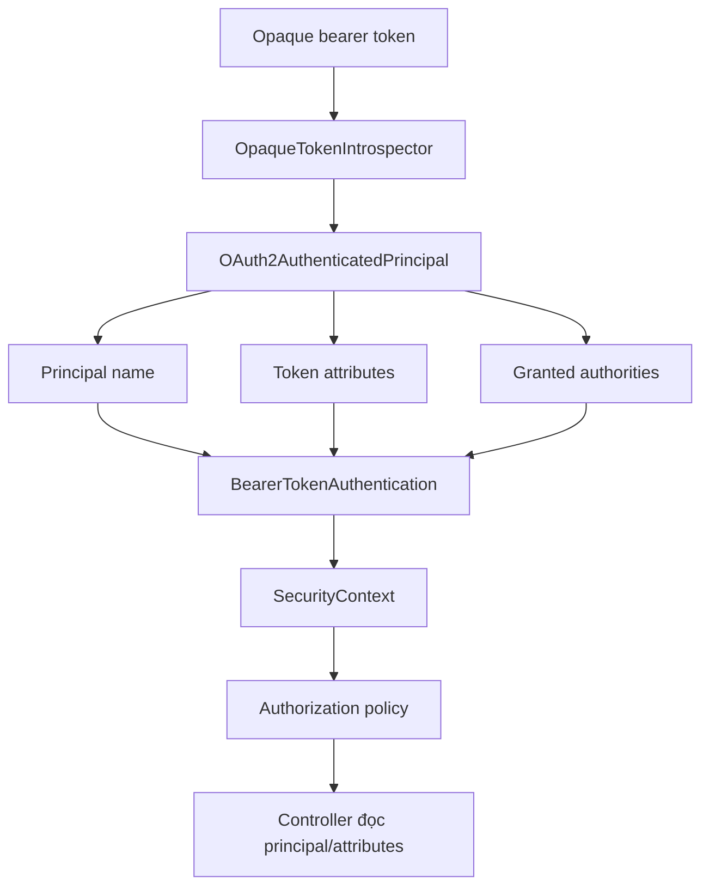

# Kiểm tra quyền và truy cập token attributes ở controller

## 1. Controller nhận được gì sau khi opaque token được xác thực?

Opaque access token thường chỉ là một chuỗi không chứa claims có thể đọc trực tiếp. Khi Resource Server xác thực token qua `OpaqueTokenIntrospector`, Spring Security nhận về một principal đã được xác thực, gồm tên principal, attributes và authorities. Các thành phần này được đặt trong `BearerTokenAuthentication` và đưa vào `SecurityContext` cho request hiện tại.

Controller có thể đọc principal để lấy thông tin đã được introspection xác nhận, chẳng hạn `sub`, `user_id`, `tenant_id` hoặc `client_id`. Authorization policy có thể dùng authorities như `SCOPE_invoice:read` để kiểm tra hành động, đồng thời so sánh `tenant_id` trong principal với tenant của tài nguyên.

Trong module **SPRING_SECURITY_TESTING**, ta kiểm chứng xác thực, phân quyền và bảo vệ HTTP bằng `spring-security-test` trên Servlet và Reactive. Bài này tập trung vào hai việc ở controller: **đọc token attributes từ principal** và **kiểm tra quyền truy cập theo scope cùng tenant**. Ví dụ sử dụng `MockMvc` với `opaqueToken()` để cấp principal giả lập có cấu trúc xác định.

Sau bài học, bạn có thể:

- Giải thích quan hệ giữa `BearerTokenAuthentication`, `OAuth2AuthenticatedPrincipal`, attributes và authorities.
- Đọc principal trong controller bằng `@AuthenticationPrincipal`.
- Đọc attributes trực tiếp từ `BearerTokenAuthentication#getTokenAttributes()` khi cần.
- Kết hợp `hasAuthority(...)` với policy kiểm tra tenant trong `@PreAuthorize`.
- Viết ca `200`, `401`, `403` cho đúng scope, thiếu scope, thiếu claim và tenant không khớp.
- Phân biệt dữ liệu đã được introspection xác thực với dữ liệu client tự gửi trong URL, header hoặc body.

## 2. Principal, attributes và authorities là ba phần khác nhau

Khi opaque token được introspect thành công, `OpaqueTokenIntrospector` trả về một `OAuth2AuthenticatedPrincipal`. Resource Server dùng principal này để tạo `BearerTokenAuthentication`.



| Thành phần | API thường dùng | Ý nghĩa |
| --- | --- | --- |
| Principal name | `principal.getName()` hoặc `authentication.getName()` | Tên định danh mà introspector cung cấp; thường dựa trên `sub`, nhưng phụ thuộc implementation |
| Token attributes | `principal.getAttribute("tenant_id")` hoặc `authentication.getTokenAttributes().get("tenant_id")` | Claims/attributes được introspection trả về |
| Authorities | `authentication.getAuthorities()` | Quyền dùng cho `hasAuthority`, `hasRole` và các rule authorization |
| Opaque access token | `authentication.getToken()` | Đối tượng access token, không phải map attributes |

Không nhầm `getToken()` với `getTokenAttributes()`. Khi controller cần `tenant_id`, hãy đọc từ principal hoặc token attributes. Không cố parse chuỗi opaque token như JWT; opaque token không có cấu trúc claims công khai để controller tự giải mã.

### Principal name không nhất thiết là `sub`

Nhiều introspection response dùng `sub` làm subject, nhưng `OAuth2AuthenticatedPrincipal#getName()` là hợp đồng tên do principal implementation cung cấp. `OpaqueTokenIntrospector` tùy biến có thể chọn `username`, `user_name` hoặc một định danh khác. Controller nên dựa vào hợp đồng mà ứng dụng cấu hình và kiểm thử, không tự giả định `getName()` luôn bằng `sub`.

## 3. Đọc token attributes trong controller

Giả sử endpoint hồ sơ cần trả về tên principal cùng tenant đã được xác minh. Có thể nhận `OAuth2AuthenticatedPrincipal` qua `@AuthenticationPrincipal`:

```java
package com.example.api;

import java.util.Map;

import org.springframework.security.core.annotation.AuthenticationPrincipal;
import org.springframework.security.oauth2.core.OAuth2AuthenticatedPrincipal;
import org.springframework.web.bind.annotation.GetMapping;
import org.springframework.web.bind.annotation.RestController;

@RestController
public class ProfileController {

    @GetMapping("/api/profile")
    public Map<String, String> profile(
            @AuthenticationPrincipal OAuth2AuthenticatedPrincipal principal) {

        Object tenantValue = principal.getAttribute("tenant_id");
        if (!(tenantValue instanceof String tenantId)) {
            throw new IllegalStateException(
                    "Principal không có tenant_id dạng chuỗi đã xác minh");
        }

        return Map.of(
                "subject", principal.getName(),
                "tenantId", tenantId);
    }
}
```

`@AuthenticationPrincipal` lấy principal từ `Authentication` hiện hành. Với opaque token, kiểu phù hợp thường là `OAuth2AuthenticatedPrincipal`. Đoạn code kiểm tra kiểu của attribute trước khi dùng để tránh ép kiểu mù quáng. Trong API thực tế, lỗi thiếu claim có thể được chuyển thành lỗi xác thực/authorization theo chính sách ứng dụng thay vì trả `IllegalStateException`; ví dụ ở đây làm rõ hợp đồng dữ liệu cần có.

### 3.1. Nhận trực tiếp `BearerTokenAuthentication`

Nếu controller cần đọc nhiều token attributes hoặc cần kiểm tra loại authentication cụ thể, có thể nhận `BearerTokenAuthentication`:

```java
package com.example.api;

import java.util.Map;

import org.springframework.security.oauth2.server.resource.authentication.BearerTokenAuthentication;
import org.springframework.web.bind.annotation.GetMapping;
import org.springframework.web.bind.annotation.RestController;

@RestController
public class TokenInfoController {

    @GetMapping("/api/token-info")
    public Map<String, Object> tokenInfo(
            BearerTokenAuthentication authentication) {
        return Map.of(
                "name", authentication.getName(),
                "tenantId", authentication.getTokenAttributes().get("tenant_id"),
                "clientId", authentication.getTokenAttributes().get("client_id"));
    }
}
```

`BearerTokenAuthentication` triển khai `Authentication`/`Principal`, vì vậy Spring MVC có thể cung cấp đối tượng principal phù hợp cho tham số controller. Cách này gắn controller với loại authentication opaque bearer cụ thể. Nếu muốn controller phụ thuộc abstraction principal hơn, `@AuthenticationPrincipal OAuth2AuthenticatedPrincipal` thường linh hoạt hơn.

Không trả toàn bộ token attributes cho client theo kiểu debug. Introspection response có thể chứa thông tin nội bộ, định danh người dùng hoặc metadata không nên công khai. Chỉ trả các trường API thực sự cần.

## 4. Phân quyền bằng scope và tenant

Giả sử API đọc hóa đơn có chính sách:

1. Request phải được xác thực bằng opaque bearer token.
2. Authentication phải có authority `SCOPE_invoice:read`.
3. Principal phải có attribute `tenant_id` dạng chuỗi.
4. `tenant_id` đã xác minh phải trùng tenant trong đường dẫn.

Ta tách kiểm tra tenant thành component riêng để biểu thức `@PreAuthorize` dễ đọc và có thể kiểm thử độc lập.

### 4.1. Policy kiểm tra tenant từ principal đã xác thực

```java
package com.example.security;

import org.springframework.security.core.Authentication;
import org.springframework.security.oauth2.core.OAuth2AuthenticatedPrincipal;
import org.springframework.stereotype.Component;

@Component("opaqueTenantPolicy")
public class OpaqueTenantPolicy {

    public boolean matches(Authentication authentication, String requestedTenant) {
        if (authentication == null || !authentication.isAuthenticated()) {
            return false;
        }

        Object principalObject = authentication.getPrincipal();
        if (!(principalObject instanceof OAuth2AuthenticatedPrincipal principal)) {
            return false;
        }

        Object tenantValue = principal.getAttribute("tenant_id");
        return tenantValue instanceof String tenantId
                && tenantId.equals(requestedTenant);
    }
}
```

Policy kiểm tra kiểu principal và attribute trước khi so sánh. Khi authentication không phải opaque-token principal hoặc thiếu `tenant_id`, policy trả `false` và request bị từ chối. Cách kiểm tra này cũng tránh `ClassCastException` nếu một test vô tình dùng `@WithMockUser` hoặc `jwt()` cho endpoint đang yêu cầu principal opaque token.

### 4.2. Controller áp dụng cả scope và tenant policy

```java
package com.example.api;

import java.util.Map;

import org.springframework.security.access.prepost.PreAuthorize;
import org.springframework.security.core.annotation.AuthenticationPrincipal;
import org.springframework.security.core.parameters.P;
import org.springframework.security.oauth2.core.OAuth2AuthenticatedPrincipal;
import org.springframework.web.bind.annotation.GetMapping;
import org.springframework.web.bind.annotation.PathVariable;
import org.springframework.web.bind.annotation.RequestMapping;
import org.springframework.web.bind.annotation.RestController;

@RestController
@RequestMapping("/api/tenants")
public class InvoiceController {

    @GetMapping("/{tenantId}/invoices")
    @PreAuthorize("hasAuthority('SCOPE_invoice:read') and "
            + "@opaqueTenantPolicy.matches(authentication, #tenantId)")
    public Map<String, String> invoices(
            @PathVariable("tenantId") @P("tenantId") String tenantId,
            @AuthenticationPrincipal OAuth2AuthenticatedPrincipal principal) {

        String tokenTenant = principal.getAttribute("tenant_id");
        return Map.of(
                "subject", principal.getName(),
                "requestedTenant", tenantId,
                "tokenTenant", tokenTenant);
    }
}
```

`@EnableMethodSecurity` phải được bật để `@PreAuthorize` có hiệu lực. `@P("tenantId")` đặt tên tham số cho SpEL một cách tường minh; biểu thức dùng `#tenantId` để đọc tenant trên URL. Controller chỉ chạy sau khi scope và tenant policy đều cho phép.

Ví dụ trả `tokenTenant` để minh họa controller đọc claim. Trong API production, chỉ trả tenant nếu hợp đồng response cần trường đó; không phản chiếu claims nhạy cảm chỉ để tiện debug.

### 4.3. Không tin tenant do client tự khai báo

Tenant trên URL, query parameter, header hoặc request body là dữ liệu do client gửi. Nó chỉ cho biết client đang yêu cầu tài nguyên thuộc tenant nào; nó không chứng minh người gọi có quyền với tenant đó. Giá trị dùng để xác minh phải đến từ principal đã được introspection xác thực hoặc từ membership service đáng tin cậy.

Không viết policy kiểu:

```java
// Không an toàn: cả hai giá trị đều do client gửi.
return requestHeaderTenant.equals(requestedTenant);
```

Hãy so sánh tenant yêu cầu với claim/membership đã xác minh, như `OpaqueTenantPolicy` ở trên. Nếu người dùng có thể chọn tenant hoạt động, server phải xác minh membership trước khi phát hành token hoặc trước khi thiết lập principal cho request.

## 5. Cấu hình Resource Server và method security

Một cấu hình Servlet minh họa:

```java
package com.example.security;

import org.springframework.context.annotation.Bean;
import org.springframework.context.annotation.Configuration;
import org.springframework.security.config.annotation.method.configuration.EnableMethodSecurity;
import org.springframework.security.config.annotation.web.builders.HttpSecurity;
import org.springframework.security.oauth2.server.resource.introspection.OpaqueTokenIntrospector;
import org.springframework.security.web.SecurityFilterChain;

@Configuration
@EnableMethodSecurity
public class ApiSecurityConfiguration {

    @Bean
    SecurityFilterChain apiSecurity(
            HttpSecurity http,
            OpaqueTokenIntrospector introspector) throws Exception {

        return http
                .authorizeHttpRequests(authorize -> authorize
                        .requestMatchers("/api/**").authenticated()
                        .anyRequest().permitAll())
                .oauth2ResourceServer(resourceServer -> resourceServer
                        .opaqueToken(opaque -> opaque.introspector(introspector)))
                .build();
    }
}
```

`OpaqueTokenIntrospector` có thể là implementation mặc định được cấu hình từ introspection URI/client credentials hoặc implementation tùy biến. Filter chain yêu cầu request `/api/**` phải authenticated; method security kiểm tra scope và tenant chi tiết. Trong test dùng `opaqueToken()`, helper cài authentication cho request mock nên không gọi introspector; tuy nhiên application context vẫn cần bean introspector nếu cấu hình filter chain yêu cầu bean đó.

## 6. Kiểm thử controller bằng `MockMvc` và `opaqueToken()`

Dependency test với Gradle:

```gradle
dependencies {
    testImplementation("org.springframework.boot:spring-boot-starter-test")
    testImplementation("org.springframework.security:spring-security-test")
}
```

Test configuration có thể cung cấp một introspector cục bộ để application context khởi động. Khi dùng request post-processor `opaqueToken()`, introspector này không được gọi:

```java
package com.example.security;

import java.util.List;
import java.util.Map;

import org.springframework.boot.test.context.TestConfiguration;
import org.springframework.context.annotation.Bean;
import org.springframework.security.core.authority.SimpleGrantedAuthority;
import org.springframework.security.oauth2.core.DefaultOAuth2AuthenticatedPrincipal;
import org.springframework.security.oauth2.server.resource.introspection.OpaqueTokenIntrospector;

@TestConfiguration
public class OpaqueTokenTestConfiguration {

    @Bean
    OpaqueTokenIntrospector opaqueTokenIntrospector() {
        return token -> new DefaultOAuth2AuthenticatedPrincipal(
                "alice",
                Map.of("sub", "alice", "tenant_id", "tenant-a"),
                List.of(new SimpleGrantedAuthority("SCOPE_invoice:read")));
    }
}
```

Đây là bean test double cho context; nó trả principal cố định nếu runtime introspector được gọi. Test `opaqueToken()` bên dưới cung cấp principal/authorities riêng cho từng request, nên không dựa vào giá trị cố định này.

### 6.1. Ca được phép

```java
package com.example.api;

import org.junit.jupiter.api.Test;
import org.springframework.beans.factory.annotation.Autowired;
import org.springframework.boot.test.autoconfigure.web.servlet.AutoConfigureMockMvc;
import org.springframework.boot.test.context.SpringBootTest;
import org.springframework.context.annotation.Import;
import org.springframework.security.core.authority.SimpleGrantedAuthority;
import org.springframework.test.web.servlet.MockMvc;

import static org.springframework.security.test.web.servlet.request
        .SecurityMockMvcRequestPostProcessors.opaqueToken;
import static org.springframework.test.web.servlet.request.MockMvcRequestBuilders.get;
import static org.springframework.test.web.servlet.result.MockMvcResultMatchers.jsonPath;
import static org.springframework.test.web.servlet.result.MockMvcResultMatchers.status;

@SpringBootTest
@AutoConfigureMockMvc
@Import(OpaqueTokenTestConfiguration.class)
class InvoiceControllerSecurityTests {

    @Autowired
    MockMvc mvc;

    @Test
    void correctScopeAndTenantCanRead() throws Exception {
        mvc.perform(get("/api/tenants/tenant-a/invoices")
                .with(opaqueToken()
                        .attributes(attrs -> {
                            attrs.put("sub", "alice");
                            attrs.put("tenant_id", "tenant-a");
                        })
                        .authorities(new SimpleGrantedAuthority("SCOPE_invoice:read"))))
                .andExpect(status().isOk())
                .andExpect(jsonPath("$.subject").value("alice"))
                .andExpect(jsonPath("$.tokenTenant").value("tenant-a"));
    }
}
```

Test này kiểm tra controller đọc được principal và claim, đồng thời policy cho phép đúng scope và tenant. Cần import `SimpleGrantedAuthority`; các static imports cho `opaqueToken`, `get`, `jsonPath` và `status` đã thể hiện ở đầu lớp.

### 6.2. Thiếu scope bị từ chối

```java
@Test
void authenticatedPrincipalWithoutInvoiceScopeIsForbidden() throws Exception {
    mvc.perform(get("/api/tenants/tenant-a/invoices")
            .with(opaqueToken()
                    .attributes(attrs -> {
                        attrs.put("sub", "alice");
                        attrs.put("tenant_id", "tenant-a");
                    })
                    .authorities()))
            .andExpect(status().isForbidden());
}
```

Authentication vẫn tồn tại nhưng không có `SCOPE_invoice:read`, nên method security từ chối với `403`. Đây là ca authorization; fixture không bị thiếu và factory/helper vẫn tạo principal thành công.

### 6.3. Có scope nhưng tenant không khớp

```java
@Test
void scopeDoesNotGrantAccessToAnotherTenant() throws Exception {
    mvc.perform(get("/api/tenants/tenant-a/invoices")
            .with(opaqueToken()
                    .attributes(attrs -> {
                        attrs.put("sub", "bob");
                        attrs.put("tenant_id", "tenant-b");
                    })
                    .authorities(new SimpleGrantedAuthority("SCOPE_invoice:read"))))
            .andExpect(status().isForbidden());
}
```

Ca này chứng minh scope không tự cấp quyền truy cập mọi tenant. Người dùng có quyền đọc hóa đơn nhưng chỉ được đọc dữ liệu của tenant đã xác minh.

### 6.4. Thiếu tenant attribute cũng bị từ chối

```java
@Test
void missingTenantClaimIsForbidden() throws Exception {
    mvc.perform(get("/api/tenants/tenant-a/invoices")
            .with(opaqueToken()
                    .attributes(attrs -> attrs.put("sub", "alice"))
                    .authorities(new SimpleGrantedAuthority("SCOPE_invoice:read"))))
            .andExpect(status().isForbidden());
}
```

Principal đã xác thực và có scope, nhưng policy không thể chứng minh tenant membership nên từ chối. Không mặc định tenant thiếu là tenant trong URL.

### 6.5. Anonymous request

```java
@Test
void requestWithoutBearerAuthenticationIsUnauthorized() throws Exception {
    mvc.perform(get("/api/tenants/tenant-a/invoices"))
            .andExpect(status().isUnauthorized());
}
```

Kỳ vọng `401` giả định Resource Server bearer entry point mặc định. Nếu ứng dụng thay `AuthenticationEntryPoint`, status/response có thể tùy chỉnh. Phân biệt `401` khi chưa xác thực hoặc token bị từ chối với `403` khi authentication đã tồn tại nhưng thiếu scope/tenant.

## 7. Truy cập claim trực tiếp trong biểu thức bảo mật

Không phải lúc nào controller cũng cần nhận principal. Có thể dùng `@PreAuthorize` và bean policy để kiểm tra claim trước khi gọi controller/service. Cách này hữu ích khi nhiều endpoint cùng chia sẻ quy tắc tenant.

Ví dụ policy đã nhận `Authentication`; nếu cần kiểm tra một claim khác như `client_id`, có thể mở rộng theo cùng nguyên tắc:

```java
public boolean isExpectedClient(Authentication authentication, String expectedClientId) {
    if (!(authentication.getPrincipal() instanceof OAuth2AuthenticatedPrincipal principal)) {
        return false;
    }
    Object clientId = principal.getAttribute("client_id");
    return clientId instanceof String value && value.equals(expectedClientId);
}
```

Sau đó dùng biểu thức:

```java
@PreAuthorize("hasAuthority('SCOPE_invoice:read') and "
        + "@opaqueTenantPolicy.isExpectedClient(authentication, 'billing-api')")
```

Đừng đưa logic truy cập database phức tạp hoặc quyết định nghiệp vụ lớn vào SpEL. Khi policy cần tra cứu membership/resource ownership, giữ logic trong bean service có tên rõ ràng và kiểm thử riêng. Tránh gọi cùng một lookup tốn kém nhiều lần trong một biểu thức authorization.

## 8. Dùng `@AuthenticationPrincipal` expression khi chỉ cần một attribute

Spring Security hỗ trợ biểu thức trên `@AuthenticationPrincipal`. Nếu một handler chỉ cần tenant ID, có thể lấy trực tiếp attribute:

```java
@GetMapping("/api/my-tenant")
public Map<String, String> myTenant(
        @AuthenticationPrincipal(expression = "attributes['tenant_id']")
        String tenantId) {
    return Map.of("tenantId", tenantId);
}
```

Cách này ngắn gọn, nhưng controller không còn nhận principal đầy đủ. Nó phù hợp khi attribute luôn tồn tại và đã được xác minh trước đó. Nếu claim có thể thiếu hoặc sai kiểu, nhận `OAuth2AuthenticatedPrincipal` rồi kiểm tra tường minh sẽ dễ xử lý lỗi hơn. Expression chỉ truy cập dữ liệu principal; nó không thay thế authorization policy.

## 9. Claims đã introspect và dữ liệu client gửi

Một request có thể chứa cùng lúc:

- Bearer token trong `Authorization` header.
- Tenant ID trong URL path.
- Tenant ID trong query parameter hoặc request body.
- Các header do proxy/gateway bổ sung.

Chỉ các attributes do introspection tin cậy trả về mới là dữ liệu danh tính được Resource Server xác nhận. URL/header/body là input của client, phải được kiểm tra bằng policy trước khi truy cập tài nguyên. Nếu request body có `tenantId`, không dùng nó để ghi đè `tenant_id` từ principal hoặc để quyết định người dùng thuộc tenant nào.

| Dữ liệu | Nguồn | Dùng để |
| --- | --- | --- |
| `principal.getAttribute("tenant_id")` | Introspection result | Xác định tenant đã được xác thực |
| `principal.getName()` | Principal do introspector tạo | Định danh người gọi theo hợp đồng principal |
| `SCOPE_invoice:read` | Authority trên authentication | Kiểm tra hành động đọc |
| `{tenantId}` trên URL | Client request | Chọn tài nguyên được yêu cầu, cần so sánh với tenant đã xác minh |
| `tenantId` trong JSON body | Client request | Dữ liệu nghiệp vụ cần validate; không phải bằng chứng membership |

Nếu ứng dụng cho phép user chọn tenant hoạt động, việc chuyển tenant phải qua một bước server xác minh membership. Không chỉ thay giá trị URL rồi coi đó là tenant mới của principal.

## 10. Opaque token runtime: introspector quyết định attributes và authorities

`opaqueToken()` trong MockMvc cấp attributes và authorities trực tiếp cho authentication giả lập. Nó không gọi `OpaqueTokenIntrospector` và không kiểm tra token thật. Muốn xác minh controller nhận đúng dữ liệu **do runtime introspection tạo**, hãy test `OpaqueTokenIntrospector` hoặc gửi bearer header qua filter chain với introspector test double.

Một introspector test double có thể trả principal đã xác định:

```java
@Bean
OpaqueTokenIntrospector opaqueTokenIntrospector() {
    return token -> new DefaultOAuth2AuthenticatedPrincipal(
            "alice",
            Map.of("sub", "alice", "tenant_id", "tenant-a"),
            AuthorityUtils.createAuthorityList("SCOPE_invoice:read"));
}
```

Sau đó request dùng header `Authorization: Bearer test-token` thay vì `.with(opaqueToken())`. Request sẽ đi qua bearer filter và introspector test double. Cách này xác minh kết nối runtime giữa filter, introspector, principal và policy; nó vẫn không chứng minh authorization server thật hoạt động hoặc client credentials hợp lệ.

## 11. Reactive/WebFlux

Trong WebFlux, Spring Security truyền authentication qua Reactor Context. Controller reactive có thể nhận principal bằng `@AuthenticationPrincipal` tương tự Servlet; policy có thể dùng `ReactiveAuthorizationManager` hoặc reactive method security tùy kiến trúc. Với `WebTestClient`, cấp principal opaque-token phù hợp qua `mockAuthentication(...)` để kiểm tra request pipeline.

Ví dụ minh họa dùng authentication principal đã dựng:

```java
import java.time.Instant;
import java.util.Map;

import org.springframework.security.core.Authentication;
import org.springframework.security.core.authority.AuthorityUtils;
import org.springframework.security.oauth2.core.DefaultOAuth2AuthenticatedPrincipal;
import org.springframework.security.oauth2.core.OAuth2AccessToken;
import org.springframework.security.oauth2.core.OAuth2AuthenticatedPrincipal;
import org.springframework.security.oauth2.server.resource.authentication.BearerTokenAuthentication;

OAuth2AuthenticatedPrincipal principal = new DefaultOAuth2AuthenticatedPrincipal(
        "alice",
        Map.of("sub", "alice", "tenant_id", "tenant-a"),
        AuthorityUtils.createAuthorityList("SCOPE_invoice:read"));

Authentication authentication = new BearerTokenAuthentication(
        principal,
        new OAuth2AccessToken(
                OAuth2AccessToken.TokenType.BEARER,
                "opaque-test-token",
                Instant.now(),
                Instant.now().plusSeconds(300)),
        principal.getAuthorities());

webTestClient.mutateWith(mockAuthentication(authentication))
        .get().uri("/api/reactive/tenants/tenant-a/invoices")
        .exchange()
        .expectStatus().isOk();
```

Đây là minh họa cho cách đặt authentication trong request Reactive; các import cần thiết được liệt kê trong snippet, cùng `WebTestClient` và static import `SecurityMockServerConfigurers.mockAuthentication`. Nếu chỉ cần test authorization cho opaque token, hãy cân nhắc helper/mock configurer phù hợp với phiên bản Spring Security đang dùng. Test này không chạy introspection runtime; nó cấp sẵn principal và authorities vào Reactor Context của request.

## 12. Lỗi thường gặp

| Hiện tượng | Nguyên nhân thường gặp | Cách xử lý |
| --- | --- | --- |
| `principal.getAttribute("tenant_id")` trả `null` | Introspector không trả claim hoặc test không cấp attribute | Kiểm tra introspection result và tên key; bổ sung fixture đúng |
| `principal.getName()` không giống `sub` | Principal implementation chọn name từ attribute khác | Xác định hợp đồng `getName()` trong introspector và assert rõ |
| `hasAuthority('SCOPE_invoice:read')` bị từ chối | Authority thiếu prefix hoặc mapper dùng quy ước khác | Assert authorities thực tế và thống nhất policy |
| Đúng scope nhưng vẫn truy cập tenant khác | Policy không so sánh claim tenant với tài nguyên | Thêm tenant policy dựa trên principal đã xác minh |
| Dùng `@WithMockUser` gây lỗi principal type | Controller yêu cầu `OAuth2AuthenticatedPrincipal` | Dùng `opaqueToken()` hoặc authentication opaque-token phù hợp |
| Request thiếu claim trả `500` | Controller ép kiểu hoặc dereference claim trước khi validate | Kiểm tra claim trong policy/handler và xử lý thiếu dữ liệu rõ ràng |
| `opaqueToken()` test pass nhưng bearer token thật fail | Test helper bỏ qua introspector | Test introspector và bearer filter chain riêng |
| `401` và `403` bị nhầm lẫn | Chưa phân biệt authentication failure với authorization denial | Không có authentication hợp lệ: `401`; đã xác thực nhưng policy từ chối: `403` theo entry point/handler cấu hình |

Khi debug, kiểm tra theo thứ tự: authentication có đúng loại không; principal name là gì; attribute có tồn tại và đúng kiểu không; authority có đúng chuỗi không; policy có so sánh tenant với tài nguyên không. Không in raw access token hoặc toàn bộ attributes nhạy cảm vào log.

## 13. Bài thực hành

Xây dựng endpoint `GET /api/tenants/{tenantId}/invoices` với scope `SCOPE_invoice:read` và claim `tenant_id`:

1. Dùng `@AuthenticationPrincipal OAuth2AuthenticatedPrincipal` để đọc `sub`/principal name và `tenant_id`.
2. Tạo policy kiểm tra `tenant_id` là chuỗi và trùng tenant trên URL.
3. Viết test `opaqueToken()` với scope và tenant đúng; kỳ vọng `200`.
4. Bỏ scope nhưng giữ principal; kỳ vọng `403`.
5. Giữ scope nhưng đổi tenant; kỳ vọng `403`.
6. Bỏ `tenant_id`; kỳ vọng policy từ chối.
7. Gửi request anonymous; xác nhận entry point trả `401` theo cấu hình.
8. Viết test introspector test double và gửi bearer header qua filter chain để xác minh attributes runtime.
9. Chuyển một endpoint sang WebFlux và kiểm tra principal trong Reactor Context bằng `WebTestClient`.

### Câu hỏi tự đánh giá

- `OAuth2AuthenticatedPrincipal#getName()` khác `getAttribute("sub")` ở điểm nào?
- Vì sao controller nên đọc tenant từ principal đã introspect thay vì từ request body?
- `BearerTokenAuthentication#getTokenAttributes()` và `getAuthorities()` phục vụ hai mục đích gì?
- Tại sao cần cả `hasAuthority(...)` và policy so sánh tenant?
- Một test `opaqueToken()` chứng minh được gì về controller và không chứng minh được gì về introspection runtime?
- Khi nào nên nhận `OAuth2AuthenticatedPrincipal`, khi nào nên nhận trực tiếp `BearerTokenAuthentication`?

## Tài liệu tham khảo

- [Spring Security — OAuth 2.0 Resource Server Opaque Token](https://docs.spring.io/spring-security/reference/servlet/oauth2/resource-server/opaque-token.html)
- [Spring Security — Testing Opaque Token Authentication](https://docs.spring.io/spring-security/reference/servlet/test/mockmvc/oauth2.html)
- [Spring Security — `OAuth2AuthenticatedPrincipal` API](https://docs.spring.io/spring-security/reference/api/java/org/springframework/security/oauth2/core/OAuth2AuthenticatedPrincipal.html)
- [Spring Security — `BearerTokenAuthentication` API](https://docs.spring.io/spring-security/reference/api/java/org/springframework/security/oauth2/server/resource/authentication/BearerTokenAuthentication.html)
- [Spring Security — Method Security](https://docs.spring.io/spring-security/reference/servlet/authorization/method-security.html)
- [Spring Security — Reactive Web Testing](https://docs.spring.io/spring-security/reference/reactive/test/web/index.html)

Controller nên đọc các attributes cần thiết từ principal mà Resource Server đã xác thực, còn policy nên kiểm tra authorities và phạm vi tài nguyên trước khi cho phép thao tác. `opaqueToken()` giúp tạo principal xác định cho test authorization; kiểm thử introspector runtime riêng sẽ xác nhận claims và authorities thật được chuyển vào authentication đúng cách.
