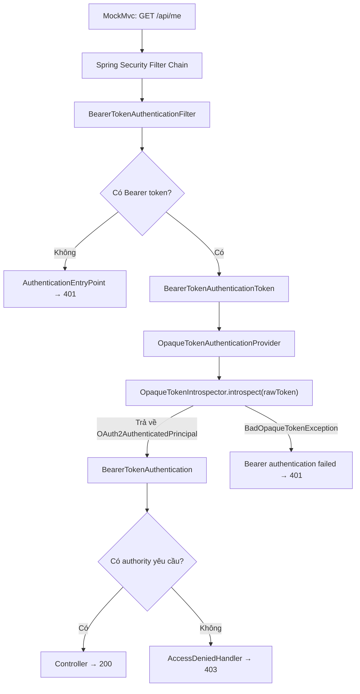

# Mock `OpaqueTokenIntrospector` để kiểm soát kết quả và lỗi

Khi một API Spring Security nhận `Authorization: Bearer <access-token>`, token có thể là **opaque token**: một chuỗi không mang thông tin có thể đọc/kiểm chứng cục bộ như JWT. Resource Server thường phải hỏi OAuth2 Authorization Server qua **token introspection** để biết token còn hiệu lực, thuộc người dùng nào và có những quyền gì. Đây cũng là một ranh giới quan trọng trong kiểm thử: ta cần kiểm chứng API xử lý đúng khi introspection thành công, trả về token không hợp lệ hoặc gặp sự cố.

Trong module **`SPRING_SECURITY_TESTING`**, mục tiêu là kiểm chứng xác thực, phân quyền và bảo vệ HTTP bằng `spring-security-test` trên Servlet và Reactive. Bài học này dùng **MockMvc trên ứng dụng Servlet** để gửi bearer token qua HTTP thực tế nhưng **mock `OpaqueTokenIntrospector`**. Cách đó giúp chủ động dựng kết quả introspection và lỗi, đồng thời vẫn thực thi security filter chain, authentication provider, controller và quy tắc authorization.

Sau bài học, người học có thể:

- Giải thích chính xác vai trò của `OpaqueTokenIntrospector` trong OAuth2 Resource Server và điểm khác biệt với `JwtDecoder`.
- Đăng ký mock introspector làm bean trong Spring test context, gửi token qua header và `verify(introspector).introspect(rawToken)`.
- Dựng `OAuth2AuthenticatedPrincipal` có `sub`, thuộc tính và authorities theo từng kịch bản.
- Kiểm chứng `200 OK`, `401 Unauthorized`, `403 Forbidden` và header `WWW-Authenticate` tương ứng với từng nhánh.
- Phân biệt lỗi **token không còn hợp lệ** với lỗi **kết nối tới introspection endpoint** và nhận biết giới hạn của việc mock.
- Chọn đúng giữa request post-processor `opaqueToken()` và mock introspector; biết cách đối chiếu với `ReactiveOpaqueTokenIntrospector` / `mockOpaqueToken()` của WebFlux.

## 1. Opaque token được xác thực như thế nào?

Client gửi một chuỗi access token thông qua HTTP. Trong môi trường production, `OpaqueTokenIntrospector` thường gọi một introspection endpoint theo OAuth2 Token Introspection (RFC 7662), dùng thông tin xác thực của resource server để nhận metadata token. Phản hồi có thể chứa:

```json
{
  "active": true,
  "sub": "alice",
  "scope": "profile reports.read",
  "client_id": "reporting-ui",
  "exp": 1790000000
}
```

`active: true` có nghĩa Authorization Server cho biết token đang có hiệu lực ở thời điểm introspection. Thư viện introspector chuẩn xử lý dữ liệu nhận được, tạo một `OAuth2AuthenticatedPrincipal` và ánh xạ các scope phù hợp thành authorities, thường mang tiền tố `SCOPE_`. Nếu token bị thu hồi/hết hạn/không hợp lệ thì introspector từ chối; API không nên cấp danh tính và quyền cho token đó.

Trong Spring Security Servlet, chuỗi xử lý có thể hình dung như sau:



Điểm thử được **thay thế bằng Mockito** là lời gọi `introspect(rawToken)`. Các khâu đọc header, chạy filter chain, tạo `Authentication` và áp dụng authorization vẫn hoạt động theo cấu hình Spring Security của ứng dụng.

| Thành phần | Vai trò | Có còn chạy thật khi mock introspector? |
| --- | --- | --- |
| `BearerTokenAuthenticationFilter` | Đọc header `Authorization: Bearer ...` và tạo yêu cầu xác thực | Có |
| `OpaqueTokenAuthenticationProvider` | Gọi introspector và chuyển kết quả thành `Authentication` | Có |
| `OpaqueTokenIntrospector` | Kiểm tra token và trả `OAuth2AuthenticatedPrincipal` | **Được mock** |
| `SecurityContextHolder` | Chứa `Authentication` của request trong Servlet | Có |
| `AuthorizationFilter` | Kiểm tra quyền truy cập endpoint | Có |
| Introspection HTTP endpoint | Xác minh `active`, scope, hết hạn, thu hồi ở hệ thống định danh | **Không được gọi** |

Trong cấu hình mặc định, kết quả xác thực thành công là `BearerTokenAuthentication`; principal của nó có kiểu `OAuth2AuthenticatedPrincipal`. Đây là đặc điểm cần phân biệt với `JwtAuthenticationToken` khi Resource Server dùng `JwtDecoder`. Opaque token có thể mang định dạng bất kỳ, kể cả chuỗi trông giống JWT: điều quyết định trong bài này là **cơ chế introspection đang được cấu hình**, không phải số phần trong chuỗi token.

## 2. Mock introspector khác gì `opaqueToken()` của spring-security-test?

Spring Security Test cho phép mô phỏng người dùng đã xác thực qua:

```java
mockMvc.perform(get("/api/me")
        .with(opaqueToken().attributes(attrs ->
                attrs.put("sub", "alice"))))
        .andExpect(status().isOk());
```

`opaqueToken()` ở đây là `SecurityMockMvcRequestPostProcessors.opaqueToken()`. Nó đặt trước một `BearerTokenAuthentication` giả lập cho request; **không cần gửi header Bearer, không gọi `OpaqueTokenIntrospector` và không liên hệ Authorization Server**.

Nếu mục tiêu chỉ là phân quyền hoặc controller khi đã có principal thì cách này đơn giản và hợp lý. Nhưng nếu muốn kiểm chứng **đọc bearer token từ header rồi gọi đúng introspector**, phải gửi header và mock **bean introspector**:

```java
when(introspector.introspect("opaque-active"))
        .thenReturn(principal);

mockMvc.perform(get("/api/me")
                .header(HttpHeaders.AUTHORIZATION,
                        "Bearer opaque-active"))
        .andExpect(status().isOk());

verify(introspector).introspect("opaque-active");
```

| Phương pháp | Có gửi raw bearer token? | Introspector có được gọi? | Thích hợp kiểm tra |
| --- | --- | --- | --- |
| `.with(opaqueToken())` | Không cần | Không | Authorization và controller với danh tính opaque giả lập |
| `.with(jwt())` | Không cần | Không | Authorization với `JwtAuthenticationToken` giả lập |
| `.with(user(...))` / `@WithMockUser` | Không cần | Không | Quyền theo người dùng dạng username/password giả lập |
| HTTP `Authorization: Bearer ...` + mock introspector | Có | Có | Bearer resolution, authentication provider, authorities, 200/401/403 |
| HTTP bearer + introspection server giả lập | Có | Có | HTTP client, serialization, `active`, timeout, credential và mapping thật |

Không dùng `opaqueToken()` để khẳng định test đã kiểm tra được token introspection. Việc test được endpoint với principal giả lập là một lớp bằng chứng khác.

## 3. Ứng dụng Servlet mẫu dùng Opaque Token Resource Server

Các ví dụ hướng tới **Java 17+ / Spring Boot 3.x / Spring Security 6.x** với `spring-boot-starter-web`, `spring-boot-starter-security`, `spring-boot-starter-oauth2-resource-server`, `spring-boot-starter-test` và `spring-security-test`. API bean mocking có thể thay đổi giữa các phiên bản; bên dưới dùng `@TestConfiguration` + Mockito để tránh phụ thuộc vào `@MockBean`/`@MockitoBean`.

Hãy đặt các lớp ứng dụng, cấu hình và controller trong package được Spring Boot scan. Trong project Java thực tế, mỗi `public class` nên đặt ở file Java cùng tên.

```java
import org.springframework.boot.SpringApplication;
import org.springframework.boot.autoconfigure.SpringBootApplication;

@SpringBootApplication
public class OpaqueDemoApplication {
    public static void main(String[] args) {
        SpringApplication.run(OpaqueDemoApplication.class, args);
    }
}
```

### Bảo vệ hai endpoint bằng scope

`GET /api/me` cần người dùng đã xác thực; `GET /api/reports/monthly` cần `SCOPE_reports.read`:

```java
import org.springframework.context.annotation.Bean;
import org.springframework.context.annotation.Configuration;
import org.springframework.security.config.Customizer;
import org.springframework.security.config.annotation.web.builders.HttpSecurity;
import org.springframework.security.config.http.SessionCreationPolicy;
import org.springframework.security.web.SecurityFilterChain;

@Configuration
class OpaqueApiSecurityConfig {

    @Bean
    SecurityFilterChain apiSecurity(HttpSecurity http) throws Exception {
        return http
                .securityMatcher("/api/**")
                .authorizeHttpRequests(auth -> auth
                        .requestMatchers("/api/reports/**")
                        .hasAuthority("SCOPE_reports.read")
                        .anyRequest().authenticated())
                .sessionManagement(session ->
                        session.sessionCreationPolicy(
                                SessionCreationPolicy.STATELESS))
                .oauth2ResourceServer(oauth ->
                        oauth.opaqueToken(Customizer.withDefaults()))
                .build();
    }
}
```

Tùy ứng dụng, có thể cấu hình thêm CSRF, exception handlers, `OpaqueTokenAuthenticationConverter` hoặc nhiều `SecurityFilterChain`. Ở đây toàn bộ các request ví dụ là GET, nên chỉ tập trung vào introspection và quyền; `securityMatcher("/api/**")` có nghĩa ví dụ này chỉ định chain cho các URL bắt đầu bằng `/api/`.

**Production** cần cấu hình introspection thật qua bean `OpaqueTokenIntrospector` hoặc thuộc tính tương thích với Spring Boot, ví dụ `spring.security.oauth2.resourceserver.opaquetoken.introspection-uri/client-id/client-secret`. **Test dưới đây** cung cấp mock introspector riêng nên không có HTTP đến Identity Provider.

### Controller đọc kết quả `BearerTokenAuthentication`

```java
import java.util.Map;
import org.springframework.security.core.GrantedAuthority;
import org.springframework.security.oauth2.server.resource.authentication.BearerTokenAuthentication;
import org.springframework.web.bind.annotation.GetMapping;
import org.springframework.web.bind.annotation.RestController;

@RestController
class OpaqueApiController {

    @GetMapping("/api/me")
    Map<String, Object> me(BearerTokenAuthentication authentication) {
        return Map.of(
                "name", authentication.getName(),
                "subject", authentication.getTokenAttributes().get("sub"),
                "authorities", authentication.getAuthorities().stream()
                        .map(GrantedAuthority::getAuthority)
                        .toList()
        );
    }

    @GetMapping("/api/reports/monthly")
    String report(BearerTokenAuthentication authentication) {
        return "report for " + authentication.getName();
    }
}
```

`getTokenAttributes()` lấy metadata được gắn vào principal sau introspection. `getName()` lấy tên danh tính do principal cung cấp. Khi tạo mock principal, ta kiểm soát cả tên, attributes lẫn authorities để làm rõ sự khác biệt giữa **thông tin người dùng** và **quyền truy cập**.

## 4. Tạo bean mock `OpaqueTokenIntrospector`

Một cách ổn định cho test context là định nghĩa bean introspector dưới dạng Mockito mock và inject lại đúng bean đó vào test:

```java
import org.springframework.boot.test.context.TestConfiguration;
import org.springframework.context.annotation.Bean;
import org.springframework.context.annotation.Primary;
import org.springframework.security.oauth2.server.resource.introspection.OpaqueTokenIntrospector;
import static org.mockito.Mockito.mock;

@TestConfiguration(proxyBeanMethods = false)
class MockIntrospectionConfiguration {
    @Bean
    @Primary
    OpaqueTokenIntrospector testIntrospector() {
        return mock(OpaqueTokenIntrospector.class);
    }
}
```

`@Primary` hữu ích khi có nhiều candidate trong test context; tuy nhiên không giúp nếu security chain tự tạo hoặc được chỉ định dùng introspector khác, ví dụ `.opaqueToken(opaque -> opaque.introspector(otherInstance))`. Trong trường hợp đó, phải bảo đảm test thay đúng **instance được filter chain sử dụng**.

Với Spring Framework có `@MockitoBean`, có thể dùng cách khác:

```java
import org.springframework.test.context.bean.override.mockito.MockitoBean;
import org.springframework.security.oauth2.server.resource.introspection.OpaqueTokenIntrospector;

@MockitoBean
OpaqueTokenIntrospector introspector;
```

`@MockitoBean` thuộc các phiên bản Spring Test có hỗ trợ (ví dụ Spring Framework 6.2+); ứng dụng cũ có thể dùng `@MockBean` của Spring Boot theo phiên bản tương thích. **Chỉ dùng một chiến lược khai báo mock cho một bean**, tránh vô tình tạo hai introspector khiến Mockito ghi nhận lời gọi trên bean khác với bean đang được Spring Security sử dụng.

## 5. Bộ kiểm thử MockMvc: token hợp lệ, không hợp lệ và thiếu quyền

Mục tiêu của lớp test sau là **vẫn chạy authentication filter thật** nhưng kiểm soát từng nhánh qua `when(introspector.introspect(token))`. Trong ví dụ, `MockIntrospectionConfiguration` là class test configuration ở mục trước.

```java
import java.util.Map;
import org.junit.jupiter.api.BeforeEach;
import org.junit.jupiter.api.Test;
import org.springframework.beans.factory.annotation.Autowired;
import org.springframework.boot.test.autoconfigure.web.servlet.AutoConfigureMockMvc;
import org.springframework.boot.test.context.SpringBootTest;
import org.springframework.http.HttpHeaders;
import org.springframework.security.core.authority.AuthorityUtils;
import org.springframework.security.oauth2.core.DefaultOAuth2AuthenticatedPrincipal;
import org.springframework.security.oauth2.core.OAuth2AuthenticatedPrincipal;
import org.springframework.security.oauth2.server.resource.introspection.BadOpaqueTokenException;
import org.springframework.security.oauth2.server.resource.introspection.OpaqueTokenIntrospector;
import org.springframework.test.web.servlet.MockMvc;

import static org.hamcrest.Matchers.containsString;
import static org.hamcrest.Matchers.hasItem;
import static org.hamcrest.Matchers.startsWith;
import static org.mockito.Mockito.reset;
import static org.mockito.Mockito.verify;
import static org.mockito.Mockito.verifyNoInteractions;
import static org.mockito.Mockito.when;
import static org.springframework.test.web.servlet.request.MockMvcRequestBuilders.get;
import static org.springframework.test.web.servlet.result.MockMvcResultMatchers.content;
import static org.springframework.test.web.servlet.result.MockMvcResultMatchers.header;
import static org.springframework.test.web.servlet.result.MockMvcResultMatchers.jsonPath;
import static org.springframework.test.web.servlet.result.MockMvcResultMatchers.status;

@SpringBootTest(classes = {
        OpaqueDemoApplication.class,
        MockIntrospectionConfiguration.class
})
@AutoConfigureMockMvc
class OpaqueIntrospectionMvcTest {

    @Autowired MockMvc mockMvc;
    @Autowired OpaqueTokenIntrospector introspector;

    private static OAuth2AuthenticatedPrincipal principal(
            String name, String authority, String scope) {
        return new DefaultOAuth2AuthenticatedPrincipal(
                name,
                Map.of(
                        "sub", name,
                        "scope", scope,
                        "active", true
                ),
                AuthorityUtils.createAuthorityList(authority)
        );
    }

    @BeforeEach
    void resetBeforeEachTest() {
        reset(introspector);
    }

    @Test
    void activeToken_returns200AndPrincipal() throws Exception {
        when(introspector.introspect("opaque-profile"))
                .thenReturn(principal(
                        "alice", "SCOPE_profile", "profile"));

        mockMvc.perform(get("/api/me")
                        .header(HttpHeaders.AUTHORIZATION,
                                "Bearer opaque-profile"))
                .andExpect(status().isOk())
                .andExpect(jsonPath("$.name").value("alice"))
                .andExpect(jsonPath("$.subject").value("alice"))
                .andExpect(jsonPath("$.authorities",
                        hasItem("SCOPE_profile")));

        verify(introspector).introspect("opaque-profile");
    }

    @Test
    void tokenWithRequiredScope_returns200() throws Exception {
        when(introspector.introspect("opaque-reports"))
                .thenReturn(principal(
                        "bob", "SCOPE_reports.read", "reports.read"));

        mockMvc.perform(get("/api/reports/monthly")
                        .header(HttpHeaders.AUTHORIZATION,
                                "Bearer opaque-reports"))
                .andExpect(status().isOk())
                .andExpect(content().string("report for bob"));

        verify(introspector).introspect("opaque-reports");
    }

    @Test
    void activeTokenWithoutRequiredAuthority_returns403()
            throws Exception {
        when(introspector.introspect("opaque-profile-only"))
                .thenReturn(principal(
                        "alice", "SCOPE_profile", "profile"));

        mockMvc.perform(get("/api/reports/monthly")
                        .header(HttpHeaders.AUTHORIZATION,
                                "Bearer opaque-profile-only"))
                .andExpect(status().isForbidden());

        verify(introspector).introspect("opaque-profile-only");
    }

    @Test
    void revokedOrInvalidToken_returns401() throws Exception {
        when(introspector.introspect("opaque-revoked"))
                .thenThrow(new BadOpaqueTokenException(
                        "Token is inactive"));

        mockMvc.perform(get("/api/me")
                        .header(HttpHeaders.AUTHORIZATION,
                                "Bearer opaque-revoked"))
                .andExpect(status().isUnauthorized())
                .andExpect(header().string(
                        HttpHeaders.WWW_AUTHENTICATE,
                        containsString("invalid_token")));

        verify(introspector).introspect("opaque-revoked");
    }

    @Test
    void absentBearer_returns401WithoutIntrospection()
            throws Exception {
        mockMvc.perform(get("/api/me"))
                .andExpect(status().isUnauthorized())
                .andExpect(header().string(
                        HttpHeaders.WWW_AUTHENTICATE,
                        startsWith("Bearer")));

        verifyNoInteractions(introspector);
    }
}
```

Ở lớp test này, `@AutoConfigureMockMvc` phải giữ security filter chain đang hoạt động; nếu vô tình dùng `addFilters = false`, kết quả không còn phản ánh đường xác thực bearer. `@BeforeEach` reset Mockito mock giữa các test dùng chung context; không nên chạy các test chia sẻ cùng mock này đồng thời khi còn có reset/stub tương tranh.

**Ý nghĩa của ba kiểu assertion:**

1. `status().isOk()/isUnauthorized()/isForbidden()` kiểm tra phản hồi HTTP.
2. `jsonPath(...)` hoặc `content().string(...)` kiểm tra controller thực sự nhận được danh tính mong đợi sau introspection.
3. `verify(introspector).introspect("...")` xác nhận filter và provider đã truyền **đúng raw bearer token** đến introspector.

Nếu một test 401 **không có header** vẫn PASS nhưng `verifyNoInteractions(introspector)` cũng PASS, đó là hành vi đúng: request không có bearer token nên chưa có chuỗi nào để introspect. Với token có header, `verify(...)` là bằng chứng thiết thực rằng request đã đi qua đúng thành phần.

### Đọc kết quả 200 / 401 / 403

| Tình huống | Kết quả mock introspector | Kết quả HTTP | Kết luận |
| --- | --- | --- | --- |
| Không gửi bearer | Không có lời gọi introspector | `401` | Chưa có danh tính xác thực |
| Bearer đã bị thu hồi | Ném `BadOpaqueTokenException` | `401` | Xác thực thất bại; token bị từ chối |
| Bearer hợp lệ, thiếu quyền xem báo cáo | Principal có `SCOPE_profile` | `403` | Xác thực thành công, authorization từ chối |
| Bearer hợp lệ, có quyền xem báo cáo | Principal có `SCOPE_reports.read` | `200` | Xác thực và phân quyền thành công |
| Bearer hợp lệ, gọi `/api/me` | Principal bất kỳ được chấp nhận | `200` | Endpoint chỉ cần `authenticated()` |

Các kết quả này giả định cấu hình Resource Server và entry point/denied handler theo mặc định trong ví dụ. Ứng dụng có exception handler tùy biến hoặc nhiều security chain có thể trả status khác; khi đó test cần theo contract thực tế của URL đó.

## 6. Kiểm soát scope và authorities đúng chỗ

Phản hồi introspection thực thường chứa claim `scope`:

```json
{
  "active": true,
  "sub": "alice",
  "scope": "profile reports.read"
}
```

`SpringOpaqueTokenIntrospector` hoặc implementation introspector thật có thể chuyển scope thành authorities `SCOPE_profile` và `SCOPE_reports.read`. Nhưng **khi tự mock nguyên phương thức `introspect()`**, test phải cung cấp **authorities trong `OAuth2AuthenticatedPrincipal`** nếu muốn chúng có hiệu lực. Chỉ đặt attribute `"scope": "reports.read"` rồi trả principal có danh sách authorities rỗng không tương đương với việc đã chạy mapping của implementation introspector thật.

Ví dụ:

```java
// Có thuộc tính "scope" nhưng principal KHÔNG có authority tương ứng.
OAuth2AuthenticatedPrincipal noAuthority =
        new DefaultOAuth2AuthenticatedPrincipal(
                "alice",
                Map.of(
                        "sub", "alice",
                        "scope", "reports.read",
                        "active", true),
                AuthorityUtils.NO_AUTHORITIES
        );

when(introspector.introspect("opaque-without-authority"))
        .thenReturn(noAuthority);

mockMvc.perform(get("/api/reports/monthly")
                .header(HttpHeaders.AUTHORIZATION,
                        "Bearer opaque-without-authority"))
        .andExpect(status().isForbidden());
```

Với cấu hình converter/provider thông dụng sử dụng authorities của principal, đây là cách kiểm tra khác biệt giữa **metadata về scope** và **quyền được cấp cho Authentication**. Nếu ứng dụng tùy biến `OpaqueTokenAuthenticationConverter` để tự đọc lại attributes và tạo authorities, kết quả cần được kiểm tra theo converter thực sự được cấu hình.

Để mô phỏng nhiều quyền, truyền đủ authority vào principal:

```java
OAuth2AuthenticatedPrincipal multiScope =
        new DefaultOAuth2AuthenticatedPrincipal(
                "alice",
                Map.of(
                        "sub", "alice",
                        "scope", "profile reports.read",
                        "active", true),
                AuthorityUtils.createAuthorityList(
                        "SCOPE_profile", "SCOPE_reports.read")
        );
```

Không nhầm `hasRole("reports.read")` với `hasAuthority("SCOPE_reports.read")`. `hasRole` thường ghép tiền tố `ROLE_`, trong khi scope của Resource Server thường có tiền tố `SCOPE_`. Một 403 sau introspection có thể đơn giản là do rule quyền không khớp authority, không liên quan đến token bị thu hồi.

**Về tên principal:** Constructor `DefaultOAuth2AuthenticatedPrincipal(name, attributes, authorities)` cho phép kiểm soát `getName()` độc lập với giá trị `sub` trong metadata. Trong ví dụ dùng cả hai là `alice` để thể hiện hợp đồng đơn giản. Nếu server dùng `username`, `client_id` hoặc claim tùy chỉnh làm tên, hãy định nghĩa và kiểm thử rõ quy tắc ánh xạ.

## 7. Lỗi token không hợp lệ và lỗi hạ tầng introspection

Hai nhóm lỗi cần được phân biệt trong thiết kế API và test.

### 7.1. Token inactive, sai hoặc đã bị thu hồi

Với introspector chuẩn, phản hồi `active: false` khiến token không được xác thực. Khi mock **phương thức introspect**, cần mô phỏng bằng exception diễn đạt token không hợp lệ:

```java
when(introspector.introspect("opaque-inactive"))
        .thenThrow(new BadOpaqueTokenException(
                "Token is inactive"));
```

Đây là nhánh `401 Unauthorized` theo bearer entry point thông dụng, có thể kèm challenge:

```http
HTTP/1.1 401 Unauthorized
WWW-Authenticate: Bearer error="invalid_token"
```

Header có thể chứa thêm realm/error description hoặc giá trị khác tùy cấu hình. Không nên so sánh cứng toàn bộ header nếu yêu cầu ứng dụng chỉ là thông báo token không hợp lệ; assertion chứa `invalid_token` thường bền hơn.

**Không mô phỏng inactive bằng cách trả principal có `active: false` rồi chờ 401.** Khi Mockito được cấu hình **trả về principal**, nó đã bỏ qua bước kiểm tra `active` của introspector thật. Provider có thể tiếp tục coi kết quả đó là đã xác thực. Test dạng này có nguy cơ tạo hiểu lầm rằng Spring Security bỏ qua token bị thu hồi trong production.

### 7.2. Introspection endpoint timeout hoặc không khả dụng

Sự cố kết nối, lỗi xác thực client tại introspection endpoint hoặc phản hồi không đọc được có thể được biểu diễn bằng `OAuth2IntrospectionException` hoặc exception khác của thư viện HTTP/implementation. Đây là **lỗi không kiểm chứng được tính hợp lệ của token**, khác với kết luận chắc chắn `active: false`.

```java
import org.springframework.security.oauth2.server.resource.introspection.OAuth2IntrospectionException;

when(introspector.introspect("opaque-unchecked"))
        .thenThrow(new OAuth2IntrospectionException(
                "Introspection service unavailable"));
```

Không tự động đặt kỳ vọng `401` cho **mọi** `OAuth2IntrospectionException`. Cách exception được `OpaqueTokenAuthenticationProvider` xử lý và phản hồi cuối cùng có thể phụ thuộc phiên bản Spring Security, tầng exception translation và handler được cấu hình. Với timeout/hỏng hạ tầng, nhiều ứng dụng chọn phản hồi lỗi server phù hợp (ví dụ 503 khi đã có policy) và tuyệt đối không cho phép truy cập theo cơ chế fail-open.

Khi thiết kế test riêng cho lỗi hạ tầng:

1. Xác định **chính sách fail-closed**: không tạo `Authentication` được phép truy cập.
2. Ghi rõ status/error contract mong muốn của ứng dụng cho lỗi upstream trước khi assert.
3. Test riêng logic chuyển exception sang response nếu ứng dụng có `AuthenticationEntryPoint` hoặc handler tùy biến.
4. Tránh đưa raw token, client secret và toàn bộ exception nội bộ vào log hoặc error body.

Ví dụ chỉ trình bày cách stub lỗi; không tự khẳng định mã HTTP cố định cho môi trường chưa định nghĩa error policy.

### 7.3. Các giá trị bất thường từ mock

Nếu Mockito không được stub cho một token, mock có thể trả `null`. Đây không phải một kết quả introspection hợp lệ để dùng làm ca “inactive”. Nó có thể gây lỗi lập trình hoặc kết quả khó giải thích tùy phiên bản. Hãy stub rõ token thành công hoặc exception cho từng ca; dùng `verify(...)` để biết token nào thực tế đã được chuyển vào introspector.

## 8. So sánh test mock introspector với test introspection thật

Mock `OpaqueTokenIntrospector` **không** gọi endpoint RFC 7662. Vì vậy test này chứng minh luồng Bearer và authorization của Resource Server, nhưng không chứng minh client credentials, HTTPS, request encoding, `active`, parsing scope hoặc khả năng xử lý timeout của client introspection.

| Hành vi | Mock `OpaqueTokenIntrospector` bằng Mockito | Introspection thật qua HTTP test server |
| --- | --- | --- |
| Bearer header được filter trích xuất | Có | Có |
| Provider gọi `introspect(rawToken)` | Có thể `verify` | Có thể quan sát request server |
| 200/401/403 sau authentication/authorization | Có | Có |
| Ánh xạ principal/authorities trả từ mock | Có | Không cần mock, kiểm tra ánh xạ thật |
| HTTP form gửi tới introspection endpoint | Không | Có |
| Client authentication cho endpoint | Không | Có |
| Xử lý response `active: true/false` | Chỉ mô phỏng qua trả về/exception | Có |
| Xử lý lỗi network, timeout, sai payload | Chỉ mô phỏng exception | Có thể kiểm chứng end-to-end hơn |
| Thu hồi token thật ở Authorization Server | Không | Cần môi trường IdP phù hợp |

Khi cần test thực client introspection, có thể dùng HTTP stub server như WireMock hoặc MockWebServer để trả nội dung introspection đã định trước; lúc đó **không mock `OpaqueTokenIntrospector`**. Giữ credentials test và endpoint giả lập nội bộ. Đối với API doanh nghiệp, nên có cả test 200/401/403 nhanh bằng Mockito và một số test tích hợp cho parse response, mapping scopes và trường hợp lỗi upstream.

## 9. Reactive: đối chiếu đúng API của WebTestClient

WebFlux dùng **`ReactiveOpaqueTokenIntrospector`**, trả về `Mono<OAuth2AuthenticatedPrincipal>`. Nó khác với interface Servlet trả kết quả đồng bộ. Với `WebTestClient` và `SecurityWebFilterChain`, cách mock tương ứng:

```java
import reactor.core.publisher.Mono;

when(reactiveIntrospector.introspect("reactive-active"))
        .thenReturn(Mono.just(principal));

webTestClient.get()
        .uri("/api/me")
        .header(HttpHeaders.AUTHORIZATION, "Bearer reactive-active")
        .exchange()
        .expectStatus().isOk();

verify(reactiveIntrospector).introspect("reactive-active");
```

Đoạn này minh họa **đường gọi reactive**; để chạy riêng cần một WebFlux application context, bean mock `ReactiveOpaqueTokenIntrospector`, `SecurityWebFilterChain` cấu hình `oauth2ResourceServer(...opaqueToken...)`, `WebTestClient` đã bind vào ứng dụng và endpoint tương ứng.

Với token bị từ chối có thể stub:

```java
when(reactiveIntrospector.introspect("reactive-inactive"))
        .thenReturn(Mono.error(
                new BadOpaqueTokenException("inactive")));
```

Spring Security Test còn hỗ trợ `mockOpaqueToken()` cho WebTestClient:

```java
webTestClient.mutateWith(mockOpaqueToken()
                .attributes(attrs -> attrs.put("sub", "alice")))
        .get()
        .uri("/api/me")
        .exchange()
        .expectStatus().isOk();
```

`mockOpaqueToken()` cấp trước danh tính vào security context để kiểm tra phân quyền, tương tự `opaqueToken()` trên MockMvc. Muốn quan sát bước gọi introspector từ header Bearer thì dùng **HTTP header + mock `ReactiveOpaqueTokenIntrospector`**. Không dùng `MockMvc` với reactive security filters hoặc dùng `OpaqueTokenIntrospector` đồng bộ thay thế `ReactiveOpaqueTokenIntrospector` rồi giả định chúng tương đương.

## 10. Lỗi thường gặp khi kiểm thử opaque token

**Tắt security filters rồi kỳ vọng introspection chạy:** Nếu `@AutoConfigureMockMvc(addFilters = false)` hoặc dựng standalone MockMvc không gắn security filter chain, request có thể đến controller mà không qua xác thực bearer. Kiểm tra cấu hình test và xác minh `introspect(...)` thực sự được gọi.

**Dùng `opaqueToken()` để kiểm chứng header:** Post-processor này mô phỏng authentication sẵn. Nó không kiểm tra parsing header, không thực hiện introspection và không phát hiện sai cấu hình bean introspector.

**Mock nhầm bean:** Production chain có thể chỉ định `introspector(customInstance)` hoặc dùng bean được cấu hình khác; mock đã inject vào test chưa chắc là instance được provider sử dụng. Dùng `verify(...)`, kiểm tra wiring và tránh nhiều bean trùng mục đích.

**Chỉ gán `scope` attribute nhưng không thêm authority:** Mock trả principal phải có các quyền phù hợp với cách converter/provider trong ứng dụng đang hoạt động. Không mặc định mock sẽ tái sử dụng logic mapping scope của introspector thật.

**Trả `active: false` như một principal “đăng nhập thất bại”:** Đây là dữ liệu đã vượt qua ranh giới introspector. Để mô phỏng token inactive, stub `BadOpaqueTokenException`; kiểm thử việc đọc `active` phải thuộc test introspector thật.

**Nhầm 401 và 403:** 401 thường biểu thị chưa có token hoặc token không được xác thực. 403 thường xảy ra sau khi đã có danh tính nhưng thiếu quyền. Trường hợp POST thiếu CSRF cũng có thể là 403; cần tách test CSRF khỏi test bearer.

**Coi mọi lỗi introspection là token sai:** Lỗi network/timeout không cho biết token active hay inactive. Thiết kế API fail-closed và kiểm tra status theo error contract thay vì luôn assert 401.

**Để lộ token qua test log:** Chuỗi opaque token có thể là secret ngoài thực tế. Dùng hằng test không có giá trị thật, tránh log header hoặc phản hồi introspection chứa token production, kể cả khi test thất bại.

**Dùng test giả lập để tuyên bố đã kiểm tra thu hồi token thật:** Mock có thể ném lỗi theo ý muốn, nhưng không chứng minh Authorization Server thực sự từ chối token đã bị thu hồi. Phần này cần test integration hoặc môi trường IdP thử nghiệm.

## 11. Checklist kiểm chứng và bài tập thực hành

Một bộ test MockMvc với `OpaqueTokenIntrospector` nên bao gồm:

- GET không có header Bearer: 401 và `verifyNoInteractions(introspector)`.
- GET có Bearer hợp lệ: mock trả principal, response 200, thông tin principal đúng, `verify(introspector).introspect(rawToken)`.
- GET vào route yêu cầu scope: principal đủ authority trả 200; principal thiếu authority trả 403.
- GET với token inactive/revoked: mock ném `BadOpaqueTokenException`, API trả 401.
- Ít nhất một ca kiểm tra thực sự dùng **Bearer header** và một ca authorization nhanh dùng `opaqueToken()` để phân biệt phạm vi.
- Nếu có error policy cho introspection timeout, kiểm chứng riêng lỗi upstream mà không cho request vượt authorization.
- Nếu có custom `OpaqueTokenAuthenticationConverter`, xác minh principal/authorities được chuyển đúng từ introspection result.

**Bài tập 1:** Thêm endpoint `GET /api/audit` yêu cầu `SCOPE_audit.read`. Viết ba test với token không có scope audit, token có scope audit và token inactive. Mỗi test phải xác minh raw token được introspect.

**Bài tập 2:** Tạo principal có attribute `"scope": "reports.read"` nhưng `AuthorityUtils.NO_AUTHORITIES`. Dự đoán status khi truy cập `/api/reports/monthly` trong cấu hình ví dụ, chạy test và giải thích tại sao kết quả khác với việc trả principal đã có `SCOPE_reports.read`.

**Bài tập 3:** Thử dùng `.with(opaqueToken())` thay cho header Bearer trong ca `activeToken_returns200AndPrincipal`. Quan sát vì sao endpoint có thể vẫn trả 200 nhưng Mockito không ghi nhận lời gọi `introspect(...)`.

**Bài tập 4:** Thiết kế một test tích hợp dùng HTTP introspection server giả lập trả `active: false`. So sánh điều gì được kiểm chứng thêm so với test Mockito ném `BadOpaqueTokenException`.

### Tài liệu tham khảo

- [Spring Security — OAuth2 Resource Server Opaque Token (Servlet)](https://docs.spring.io/spring-security/reference/6.5/servlet/oauth2/resource-server/opaque-token.html)
- [Spring Security — Testing OAuth2 with MockMvc](https://docs.spring.io/spring-security/reference/6.5/servlet/test/mockmvc/oauth2.html)
- [Spring Security — Opaque Token (Reactive)](https://docs.spring.io/spring-security/reference/6.5/reactive/oauth2/resource-server/opaque-token.html)
- [RFC 7662 — OAuth 2.0 Token Introspection](https://www.rfc-editor.org/rfc/rfc7662)

Khi cần kiểm chứng **Bearer token đi từ header tới authentication provider và tạo ra kết quả xác thực/phân quyền**, mock `OpaqueTokenIntrospector` là điểm chèn thích hợp. Khi cần kiểm chứng **Authorization Server trả token active/inactive, scope mapping và lỗi HTTP của introspection client**, phải kiểm thử implementation introspector thật bằng một endpoint giả lập hoặc môi trường tích hợp phù hợp. Tách rõ hai trách nhiệm này giúp test Spring Security phản ánh đúng hành vi mà mỗi lớp thực sự đảm nhiệm.
