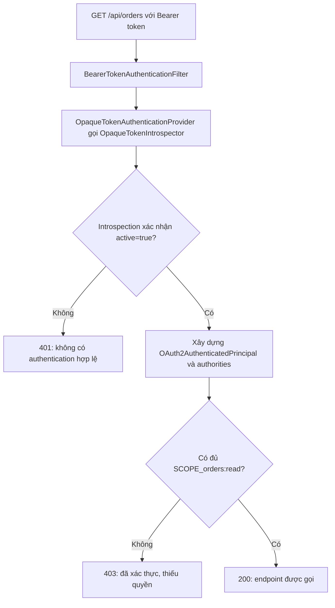

# Phản hồi active=false, thiếu scope hoặc thiếu dữ liệu cần thiết

Khi API dùng **opaque access token**, chuỗi token chỉ là một định danh mà Resource Server thường không thể tự giải mã để biết người dùng, quyền hoặc thời hạn. Thay vào đó, API gửi token tới **introspection endpoint** của Authorization Server để nhận kết quả: token còn hiệu lực hay không, thuộc chủ thể nào và được cấp những scope nào.

Bài thuộc chương **Opaque token** của module **SPRING_SECURITY_TESTING**. Trọng tâm là kiểm chứng xác thực, phân quyền và bảo vệ HTTP thực tế bằng Spring Security trên Servlet với **MockMvc** và `spring-security-test`; cuối bài đối chiếu cách thử trên Reactive bằng **WebTestClient**. Ta sẽ phân biệt ba tình huống có thể dễ bị nhầm lẫn:

1. Introspection trả `{"active":false}`: token **không được xác thực**.
2. Introspection trả `{"active":true}` nhưng **thiếu scope cần thiết**: token có thể được xác thực nhưng **không được cấp quyền** tới endpoint nhất định.
3. Introspection trả `{"active":true}` nhưng **thiếu thông tin ứng dụng yêu cầu**, chẳng hạn `tenant_id` hay `sub`: cần phân biệt các field tùy chọn theo chuẩn với chính sách kiểm tra bổ sung của API.

Mục tiêu là kiểm tra các trường hợp được phép và bị từ chối theo đúng đường đi `Authorization: Bearer ...`, không suy đoán từ một status code đơn lẻ.

## 1. Opaque token và phản hồi introspection

Một yêu cầu thường có hai đoạn HTTP riêng biệt:

```text
Client                         Resource Server                  Authorization Server
  |                                   |                                    |
  | GET /api/orders                   |                                    |
  | Authorization: Bearer opa-123     |                                    |
  |---------------------------------->|                                    |
  |                                   | POST /oauth2/introspect            |
  |                                   | token=opa-123                       |
  |                                   |----------------------------------->|
  |                                   |            {"active":true,...}     |
  |                                   |<-----------------------------------|
  |              200 / 403 / 401      |                                    |
  |<----------------------------------|                                    |
```

Introspection thường gửi token trong body `application/x-www-form-urlencoded`; Resource Server xác thực với Authorization Server bằng cơ chế được cấu hình, ví dụ HTTP Basic với client ID và client secret. Không chuyển client secret này về phía trình duyệt.

Ví dụ phản hồi introspection **hợp lệ** theo RFC 7662:

```json
{
  "active": true,
  "sub": "alice",
  "client_id": "web-client",
  "scope": "orders:read profile:read",
  "exp": 1893456000
}
```

Và phản hồi cho token không còn hiệu lực:

```json
{
  "active": false
}
```

**Điểm phân biệt quan trọng:** HTTP `200 OK` từ **introspection endpoint** chỉ có nghĩa Authorization Server đã trả lời được yêu cầu introspection. Body `active:false` vẫn cho biết token không hợp lệ; Resource Server phải từ chối bearer token đó. Không được suy luận `HTTP 200 của introspection` thành `HTTP 200 của API`.

Theo RFC 7662, `active` là boolean cần có trong phản hồi introspection thành công. Các trường như `scope`, `client_id`, `username`, `token_type`, `exp`, `iat`, `nbf`, `sub`, `aud` và `iss` là thông tin bổ sung, có thể vắng mặt tùy loại token và nhà cung cấp. `scope` theo chuẩn là **chuỗi các scope phân tách bằng dấu cách**, ví dụ `"orders:read profile:read"`.

### Bảng kỳ vọng hành vi

Giả sử API có `GET /api/profile` chỉ đòi xác thực và `GET /api/orders` yêu cầu `SCOPE_orders:read`:

| Phản hồi introspection | `/api/profile` | `/api/orders` | Giải thích |
| --- | --- | --- | --- |
| `{"active":false}` | 401 | 401 | Token không được xác thực |
| `{"active":true,"sub":"alice"}` | 200 | 403 | Xác thực được nhưng thiếu `orders:read` |
| `{"active":true,"sub":"alice","scope":"orders:read"}` | 200 | 200 | Có quyền yêu cầu |
| `{"active":true,"sub":"alice","scope":"profile:read"}` | 200 | 403 | Có scope khác, không có `orders:read` |
| `{"active":true}` | Tùy introspector và hợp đồng danh tính | Tùy introspector/quyền | Không mặc định coi thiếu mọi field là 401 |
| `{"active":true,"sub":"alice"}`, nhưng API **bắt buộc** `tenant_id` | Từ chối **nếu API đã cài kiểm tra riêng** | Từ chối **nếu API đã cài kiểm tra riêng** | `tenant_id` là quy tắc ứng dụng, không phải field bắt buộc của RFC 7662 |

Các mã 401/403 bên trên giả định chuỗi bảo mật HTTP bearer mặc định và các endpoint được cấu hình như ví dụ. Ở ứng dụng thật, handler hoặc quy tắc tùy biến có thể thay đổi cách trả lỗi; bài kiểm thử phải đối chiếu hợp đồng HTTP của chính sản phẩm.

## 2. Ba tầng kiểm tra không nên gộp làm một



Cần đặt riêng ba loại trách nhiệm:

- **Authentication:** token có được Authorization Server chấp nhận hay không. `active=false` là lỗi xác thực, thông thường trả 401.
- **Authorization:** principal đã được xác thực có authority cần thiết không. `active=true` nhưng thiếu `SCOPE_orders:read` thường dẫn tới 403 trên endpoint yêu cầu scope ấy.
- **Ràng buộc dữ liệu nghiệp vụ:** ứng dụng có bắt buộc `tenant_id`, `account_id`, `sub` hoặc `aud` không. Một số field không bắt buộc theo RFC nhưng có thể bắt buộc theo **chính sách API**; cần kiểm tra rõ ở tầng thích hợp và quyết định từ chối truy cập an toàn khi dữ liệu bị thiếu.

Một câu lệnh `.authenticated()` **không yêu cầu scope cụ thể**. Nếu muốn từ chối token `active=true` thiếu scope, endpoint phải có ràng buộc quyền, chẳng hạn `.hasAuthority("SCOPE_orders:read")`.

## 3. Cấu hình một Resource Server trên Servlet

Với Spring Boot 3.x, dùng các dependency tương ứng:

```gradle
dependencies {
    implementation("org.springframework.boot:spring-boot-starter-web")
    implementation("org.springframework.boot:spring-boot-starter-security")
    implementation("org.springframework.boot:spring-boot-starter-oauth2-resource-server")

    testImplementation("org.springframework.boot:spring-boot-starter-test")
    testImplementation("org.springframework.security:spring-security-test")

    // Chỉ dành cho test: giả lập endpoint introspection qua HTTP cục bộ.
    testImplementation("com.squareup.okhttp3:mockwebserver:4.12.0")
}
```

Cấu hình minh họa khi kết nối Authorization Server thật:

```yaml
spring:
  security:
    oauth2:
      resourceserver:
        opaquetoken:
          introspection-uri: https://auth.example.test/oauth2/introspect
          client-id: resource-api
          client-secret: ${INTROSPECTION_CLIENT_SECRET}
```

Đây là cấu hình opaque token; không dùng `jwt.issuer-uri` để giả định opaque token tự mang claim có thể giải mã. Trong môi trường thật, cần lưu client secret bằng cơ chế bí mật phù hợp, dùng HTTPS và cấu hình đúng endpoint introspection được cung cấp. Test ở mục sau **thay URI bằng máy chủ HTTP cục bộ**, không phải gọi tới `auth.example.test`.

Ví dụ SecurityFilterChain và controller:

```java
import org.springframework.context.annotation.Bean;
import org.springframework.context.annotation.Configuration;
import org.springframework.http.HttpMethod;
import org.springframework.security.config.Customizer;
import org.springframework.security.config.annotation.web.builders.HttpSecurity;
import org.springframework.security.web.SecurityFilterChain;
import org.springframework.web.bind.annotation.GetMapping;
import org.springframework.web.bind.annotation.RestController;

@Configuration
class OpaqueSecurityConfig {

    @Bean
    SecurityFilterChain securityFilterChain(HttpSecurity http) throws Exception {
        return http
            .authorizeHttpRequests(authorize -> authorize
                .requestMatchers(HttpMethod.GET, "/api/orders")
                    .hasAuthority("SCOPE_orders:read")
                .requestMatchers(HttpMethod.GET, "/api/profile")
                    .authenticated()
                .anyRequest().denyAll()
            )
            .oauth2ResourceServer(oauth2 ->
                oauth2.opaqueToken(Customizer.withDefaults()))
            .build();
    }
}

@RestController
class ApiController {

    @GetMapping("/api/orders")
    String orders() {
        return "orders";
    }

    @GetMapping("/api/profile")
    String profile() {
        return "profile";
    }
}
```

Với introspector mặc định, các scope trả về trong thuộc tính `scope` thường được ánh xạ thành `GrantedAuthority` có tiền tố `SCOPE_`. Ví dụ `"orders:read profile:read"` cung cấp `SCOPE_orders:read` và `SCOPE_profile:read`. Không có `scope` thì không tự sinh quyền đọc orders.

## 4. Kiểm thử HTTP introspection thật bằng MockMvc

Mục tiêu là giữ lại đường đi thực tế từ `Authorization` header qua `BearerTokenAuthenticationFilter` tới `OpaqueTokenIntrospector`. Ta giả lập **chỉ Authorization Server** bằng `MockWebServer`; Spring Security vẫn tự gửi HTTP introspection và xử lý JSON nhận được. Điều này khác với việc đặt sẵn principal qua `opaqueToken()` của `spring-security-test`.

Ví dụ giả định dự án có `@SpringBootApplication` quét được các lớp ở mục 3. Test sau dùng JUnit 5, Spring Boot 3.x và máy chủ HTTP loopback:

```java
import java.io.IOException;

import okhttp3.mockwebserver.MockResponse;
import okhttp3.mockwebserver.MockWebServer;
import org.junit.jupiter.api.AfterAll;
import org.junit.jupiter.api.Test;
import org.springframework.beans.factory.annotation.Autowired;
import org.springframework.boot.test.autoconfigure.web.servlet.AutoConfigureMockMvc;
import org.springframework.boot.test.context.SpringBootTest;
import org.springframework.http.HttpHeaders;
import org.springframework.test.context.DynamicPropertyRegistry;
import org.springframework.test.context.DynamicPropertySource;
import org.springframework.test.web.servlet.MockMvc;

import static org.springframework.test.web.servlet.request.MockMvcRequestBuilders.get;
import static org.springframework.test.web.servlet.result.MockMvcResultMatchers.content;
import static org.springframework.test.web.servlet.result.MockMvcResultMatchers.status;

@SpringBootTest
@AutoConfigureMockMvc
class OpaqueIntrospectionHttpTests {

    private static final MockWebServer introspectionServer = startServer();

    @Autowired
    MockMvc mvc;

    private static MockWebServer startServer() {
        try {
            MockWebServer server = new MockWebServer();
            server.start();
            return server;
        } catch (IOException ex) {
            throw new ExceptionInInitializerError(ex);
        }
    }

    @DynamicPropertySource
    static void introspectionProperties(DynamicPropertyRegistry registry) {
        registry.add(
            "spring.security.oauth2.resourceserver.opaquetoken.introspection-uri",
            () -> introspectionServer.url("/introspect").toString());
        registry.add(
            "spring.security.oauth2.resourceserver.opaquetoken.client-id",
            () -> "resource-api-test");
        registry.add(
            "spring.security.oauth2.resourceserver.opaquetoken.client-secret",
            () -> "local-test-secret");
    }

    @AfterAll
    static void shutdown() throws IOException {
        introspectionServer.shutdown();
    }

    private static void reply(String responseJson) {
        introspectionServer.enqueue(new MockResponse()
            .setResponseCode(200)
            .addHeader("Content-Type", "application/json")
            .setBody(responseJson));
    }

    @Test
    void inactiveTokenReturns401EvenThoughIntrospectionHttpReturns200()
            throws Exception {
        reply("""
            {"active":false}
            """);

        mvc.perform(get("/api/profile")
                .header(HttpHeaders.AUTHORIZATION, "Bearer inactive-token"))
            .andExpect(status().isUnauthorized());
    }

    @Test
    void activeTokenWithoutScopeCannotReadProtectedOrders()
            throws Exception {
        reply("""
            {"active":true,"sub":"alice"}
            """);

        mvc.perform(get("/api/orders")
                .header(HttpHeaders.AUTHORIZATION, "Bearer no-scope-token"))
            .andExpect(status().isForbidden());
    }

    @Test
    void activeTokenWithoutScopeStillPassesAuthenticatedOnlyRoute()
            throws Exception {
        reply("""
            {"active":true,"sub":"alice"}
            """);

        mvc.perform(get("/api/profile")
                .header(HttpHeaders.AUTHORIZATION, "Bearer no-scope-token"))
            .andExpect(status().isOk())
            .andExpect(content().string("profile"));
    }

    @Test
    void activeTokenWithRequiredScopeCanReadOrders()
            throws Exception {
        reply("""
            {"active":true,"sub":"alice","scope":"orders:read"}
            """);

        mvc.perform(get("/api/orders")
                .header(HttpHeaders.AUTHORIZATION, "Bearer read-token"))
            .andExpect(status().isOk())
            .andExpect(content().string("orders"));
    }

    @Test
    void otherScopeDoesNotGrantOrdersRead()
            throws Exception {
        reply("""
            {"active":true,"sub":"alice","scope":"profile:read"}
            """);

        mvc.perform(get("/api/orders")
                .header(HttpHeaders.AUTHORIZATION, "Bearer other-scope-token"))
            .andExpect(status().isForbidden());
    }
}
```

Mỗi test xếp đúng **một phản hồi** vào hàng đợi của HTTP mock server và kích hoạt đúng **một request** đi qua introspection. Ví dụ này phù hợp với các test chạy tuần tự; khi dự án chạy kiểm thử song song, hãy tách máy chủ/fixture cho từng test hoặc đồng bộ để không tráo các phản hồi giữa ca kiểm thử.

### Vì sao các assertion này có ý nghĩa?

1. **`inactiveTokenReturns401EvenThoughIntrospectionHttpReturns200`:** mock Authorization Server trả HTTP 200 nhưng body `active=false`. Spring Security phải từ chối bearer token, nên Resource Server trả 401.
2. **`activeTokenWithoutScopeCannotReadProtectedOrders`:** introspection nói token còn hiệu lực, nhưng principal không có `SCOPE_orders:read`. Spring Security đã qua xác thực rồi mới chặn ở authorization, nên trả 403.
3. **`activeTokenWithoutScopeStillPassesAuthenticatedOnlyRoute`:** cùng kiểu token thiếu scope vẫn được vào endpoint chỉ yêu cầu `authenticated()`; test này chứng minh rõ **thiếu scope không đồng nghĩa token inactive**.
4. **`activeTokenWithRequiredScopeCanReadOrders`:** cả authentication lẫn authorization đều đạt.
5. **`otherScopeDoesNotGrantOrdersRead`:** một scope hợp lệ nhưng khác tên không được dùng thay scope yêu cầu.

Ở sản phẩm có tùy biến mapping scope, hãy kiểm tra authorities thực tế rồi sửa assertion theo hợp đồng ứng dụng. Đừng tự kết luận rằng chuỗi `"orders:read"` là một role hay authority không có tiền tố nếu cấu hình mặc định đang tạo `SCOPE_orders:read`.

### Kiểm chứng introspection request đã được gửi đi

Nếu muốn kiểm chứng mạnh hơn cho giao tiếp HTTP, có thể đọc lại request mà mock server đã nhận:

```java
import java.util.concurrent.TimeUnit;
import okhttp3.mockwebserver.RecordedRequest;

RecordedRequest captured =
    introspectionServer.takeRequest(1, TimeUnit.SECONDS);

assertThat(captured).isNotNull();
assertThat(captured.getPath()).isEqualTo("/introspect");
assertThat(captured.getBody().readUtf8())
    .contains("token=inactive-token");
```

Đặt đoạn này sau lời gọi MockMvc trong một test phù hợp, thêm static import `org.assertj.core.api.Assertions.assertThat`. Token có thể được URL-encode trong body; với `inactive-token` như ví dụ thì chuỗi vẫn dễ nhận diện. Nếu muốn xác minh HTTP Basic, kiểm tra header Authorization của **request introspection tới mock server** mà không in client secret ra log.

## 5. Thiếu dữ liệu: cần phân biệt chuẩn giao thức và hợp đồng API

Đây là phần rất dễ viết sai phép thử. Trong RFC 7662, `active` là field trọng tâm; `sub`, `scope`, `tenant_id` **không mặc nhiên là bộ field bắt buộc chung** cho mọi loại token. Token dùng trong giao tiếp giữa hai dịch vụ có thể có `client_id` mà không có một người dùng cuối ở `sub`. `tenant_id` là claim riêng của ứng dụng, không thuộc field bắt buộc của RFC.

Có ba nhóm cần xử lý khác nhau:

| Thiếu thông tin | Cách hiểu | Quy tắc kiểm thử |
| --- | --- | --- |
| `active` hoặc `active` không phải boolean hợp lệ | Phản hồi introspection không thỏa hợp đồng tối thiểu | Không được xác thực token như `active=true`; kiểm tra lỗi theo thư viện và chính sách |
| `scope` trong phản hồi `active=true` | Có thể là token không được cấp scope nào | Endpoint chỉ `authenticated()` có thể cho qua; endpoint cần scope phải chặn |
| `sub`, `tenant_id`, `aud` hoặc dữ liệu ứng dụng cần | Có thể tùy chọn theo giao thức nhưng bắt buộc theo nghiệp vụ | Định nghĩa hợp đồng rõ ràng; nếu thiếu, đặt validator và viết test cho nó |

**Không nên mặc định viết test “`active=true` nhưng thiếu `sub` luôn là 401”** khi chưa có kiểm tra tương ứng. Kết quả tùy cách introspector khởi tạo principal, cách Resource Server sử dụng danh tính và các quy tắc ứng dụng. Một endpoint chỉ xét authority có thể có hành vi khác endpoint yêu cầu `sub` để truy vấn dữ liệu người dùng.

### Ví dụ: API bắt buộc có tenant_id

Giả sử đây là API đa tenant và thiết kế yêu cầu mọi token truy cập API phải có `tenant_id` khác rỗng. Ta có thể **bọc introspector thật** để từ chối token ngay sau khi introspection thành công nhưng trước khi tạo Authentication.

Ví dụ cho phiên bản Spring Security 6.x có `NimbusOpaqueTokenIntrospector`:

```java
import org.springframework.beans.factory.annotation.Value;
import org.springframework.context.annotation.Bean;
import org.springframework.context.annotation.Configuration;
import org.springframework.security.oauth2.core.OAuth2AuthenticatedPrincipal;
import org.springframework.security.oauth2.server.resource.introspection.BadOpaqueTokenException;
import org.springframework.security.oauth2.server.resource.introspection.NimbusOpaqueTokenIntrospector;
import org.springframework.security.oauth2.server.resource.introspection.OpaqueTokenIntrospector;

@Configuration
class StrictIntrospectionConfig {

    @Bean
    OpaqueTokenIntrospector strictIntrospector(
            @Value("${spring.security.oauth2.resourceserver.opaquetoken.introspection-uri}")
            String uri,
            @Value("${spring.security.oauth2.resourceserver.opaquetoken.client-id}")
            String clientId,
            @Value("${spring.security.oauth2.resourceserver.opaquetoken.client-secret}")
            String clientSecret) {

        OpaqueTokenIntrospector delegate =
            new NimbusOpaqueTokenIntrospector(uri, clientId, clientSecret);

        return token -> {
            OAuth2AuthenticatedPrincipal principal = delegate.introspect(token);
            String tenantId = principal.getAttribute("tenant_id");

            if (tenantId == null || tenantId.isBlank()) {
                throw new BadOpaqueTokenException(
                    "Missing tenant_id required by this API");
            }
            return principal;
        };
    }
}
```

Cấu hình này là **phương án thay thế** cho introspector tự cấu hình của Boot, không đặt đồng thời với một bean `OpaqueTokenIntrospector` khác cùng phạm vi nếu không có cơ chế chọn bean tường minh. Khi khai báo bean trên trong ứng dụng test, cập nhật fixture introspection của các ca được chấp nhận bằng `"tenant_id":"tenant-a"`.

Sau khi thêm validator, có thể viết ca kiểm thử:

```java
@Test
void activeTokenMissingMandatoryTenantIsRejected() throws Exception {
    reply("""
        {"active":true,"sub":"alice","scope":"orders:read"}
        """);

    mvc.perform(get("/api/orders")
            .header(HttpHeaders.AUTHORIZATION, "Bearer no-tenant-token"))
        .andExpect(status().isUnauthorized());
}

@Test
void tokenWithMandatoryTenantAndScopeIsAccepted() throws Exception {
    reply("""
        {
          "active": true,
          "sub": "alice",
          "scope": "orders:read",
          "tenant_id": "tenant-a"
        }
        """);

    mvc.perform(get("/api/orders")
            .header(HttpHeaders.AUTHORIZATION, "Bearer complete-token"))
        .andExpect(status().isOk());
}
```

Hai phép thử này chỉ đúng khi ứng dụng đã kích hoạt `StrictIntrospectionConfig` hoặc cấu hình tương đương. Mục đích của `BadOpaqueTokenException` là biến vi phạm hợp đồng dữ liệu thành lỗi xác thực token. Nếu sản phẩm muốn coi thiếu tenant là lỗi **phân quyền** hoặc xử lý bằng endpoint riêng, hãy thiết kế rule và status tương ứng thay vì dùng đoạn mã này một cách máy móc.

**Đặt rule gần nguồn dữ liệu được kiểm tra:** validation `tenant_id`, `aud` hay `client_id` cần được thực hiện trước khi ứng dụng truy cập tài nguyên nhạy cảm. Không chuyển giá trị thiếu thành tenant mặc định hoặc coi chuỗi rỗng là một tenant hợp lệ.

## 6. Vì sao opaqueToken() giả lập không đủ để chứng minh active=false?

`spring-security-test` cung cấp postprocessor `opaqueToken()` để gắn principal và authorities vào ngữ cảnh bảo mật của MockMvc. Đây là công cụ tốt để kiểm thử **authorization** mà không cần gọi Authorization Server:

```java
import org.springframework.security.core.authority.SimpleGrantedAuthority;

import static org.springframework.security.test.web.servlet.request.SecurityMockMvcRequestPostProcessors.opaqueToken;

mvc.perform(get("/api/orders")
        .with(opaqueToken().authorities(
            new SimpleGrantedAuthority("SCOPE_orders:read"))))
    .andExpect(status().isOk());
```

Điều đáng chú ý: đoạn test trên có thể trả 200 dù ứng dụng thật sẽ từ chối chuỗi bearer token có `active=false`, vì `opaqueToken()` **bỏ qua việc gửi token tới introspection endpoint**. Tương tự, `@WithMockUser` và `@WithSecurityContext` giả lập danh tính để thử phân quyền, không chứng minh kết quả introspection.

Nên chia test thành hai mục đích rõ ràng:

- **Test quyền truy cập nhanh:** dùng `opaqueToken()` với các authorities cụ thể để kiểm tra `hasAuthority`, `hasRole`, cấu hình URL và method security.
- **Test xác thực opaque token:** gửi `Authorization: Bearer ...` thật, trả các JSON introspection khác nhau từ HTTP mock server và kiểm chứng status 401, 403, 200; thêm test cho timeout, HTTP error và dữ liệu thiếu nếu ứng dụng phụ thuộc chúng.

Không nên đặt tên một test dùng `opaqueToken()` là “inactive token bị từ chối”; helper này không có chức năng xác nhận `active=false` với nhà phát hành.

## 7. Các tình huống biên cần kiểm thử

| Trường hợp | Nguy cơ khi kiểm thử hời hợt | Cách kiểm tra đúng |
| --- | --- | --- |
| Introspection trả 200 với `active=false` | Chỉ assert HTTP 200 upstream rồi kết luận token hợp lệ | Assert HTTP 401 từ Resource Server |
| Introspection trả `active=true` nhưng thiếu `scope` | Luôn kỳ vọng 401, bỏ qua bước authorization | Assert 403 với endpoint cần scope và 200 với endpoint chỉ cần xác thực |
| Introspection trả `active=true` và scope khác | Chấp nhận mọi chuỗi scope | Kiểm tra đúng authority `SCOPE_<scope>` |
| Introspection thiếu hoặc sai kiểu `active` | “Fail open” nếu chỉ kiểm tra field có tồn tại | Bảo đảm token không được xác thực như active |
| Introspection timeout/HTTP 5xx | Nhầm sự cố nhà cung cấp với `active=false` | Kiểm chứng xử lý lỗi, monitoring và HTTP contract riêng; không tự quy 401 cho mọi lỗi hệ thống |
| Introspection thiếu `tenant_id` mà API yêu cầu | Đọc null, dùng tenant mặc định, truy cập nhầm dữ liệu | Bật validator theo hợp đồng và assert từ chối |
| Token có scope đọc nhưng request đòi scope ghi | Kiểm tra `authenticated()` là đủ | Assert 403 với `SCOPE_orders:write` |
| Test chỉ gọi `opaqueToken()` | Không chạy HTTP introspection | Có thêm bộ test dùng bearer header thật |

Lưu ý phân biệt **token không hợp lệ** (`active=false`) với **dịch vụ introspection không khả dụng** (timeout, lỗi mạng, HTTP 5xx). Cả hai đều phải tránh cấp quyền truy cập thiếu bằng chứng, nhưng cách báo lỗi và quan sát vận hành không nhất thiết giống nhau.

Introspection có thể được cache theo cấu hình ứng dụng. Nếu sử dụng cache, kiểm thử phải kiểm soát hiệu lực cache hoặc dùng token khác nhau cho từng ca. Nếu không, một token đã cache `active=true` có thể làm ta tưởng rằng phản hồi `active=false` mới không được áp dụng, dù ứng dụng không hề gọi introspection lại.

## 8. Liên hệ với Reactive và WebTestClient

Trên Spring WebFlux, ý tưởng bảo mật tương đương nhưng luồng xử lý dùng `SecurityWebFilterChain` và `ReactiveOpaqueTokenIntrospector`. `WebTestClient` thích hợp để gửi bearer token qua HTTP test:

```java
// Khi WebTestClient đã được bind vào ứng dụng WebFlux
// và ReactiveOpaqueTokenIntrospector đã được cấu hình:
webTestClient.get()
    .uri("/api/orders")
    .headers(headers -> headers.setBearerAuth("no-scope-token"))
    .exchange()
    .expectStatus().isForbidden();
```

Các test `mockOpaqueToken()` trong Reactive cũng tạo authentication giả lập, hữu ích để kiểm tra permission, nhưng không xác minh phản hồi `active=false` từ HTTP introspection. Muốn kiểm chứng remote introspection, hãy cấu hình `ReactiveOpaqueTokenIntrospector` trỏ tới một mock HTTP server hoặc sử dụng một fixture tương ứng trên reactive stack.

Với JWT thì khác: API thường có thể xác minh chữ ký và claim tại chỗ. Với opaque token, API thường phải tin kết quả **introspection** (trực tiếp hoặc qua cơ chế cache được kiểm soát). Khi đối chiếu với OAuth2/OIDC, đừng giả định rằng một token có dạng JWT và một opaque token có cùng đường đi xác thực.

## 9. Bài tập thực hành

1. Chạy ca `active=false` và giải thích tại sao introspection endpoint trả HTTP 200 nhưng API lại trả HTTP 401.
2. Cho `/api/profile` dùng `authenticated()` và `/api/orders` dùng `hasAuthority("SCOPE_orders:read")`. Gửi cùng phản hồi `active=true` không có `scope`, rồi so sánh 200 và 403.
3. Đổi `scope` thành `"profile:read orders:write"`. Dự đoán kết quả GET `/api/orders`, sau đó xác nhận bằng MockMvc.
4. Bổ sung `StrictIntrospectionConfig` bắt buộc `tenant_id`. Viết một test thiếu tenant bị từ chối và một test đủ tenant cùng scope được chấp nhận.
5. Thử introspection trả `{"active":true,"scope":"orders:read"}` không có `sub`. Quan sát hành vi cụ thể của phiên bản introspector đang dùng, rồi xác định xem API có thực sự bắt buộc `sub` hay không.
6. Mô phỏng Authorization Server trả HTTP 503. Kiểm chứng ứng dụng không tự cho phép truy cập nếu chưa nhận được kết quả xác thực; ghi nhận cách ứng dụng phản hồi lỗi hệ thống.
7. Viết một test authorization dùng `opaqueToken()`, sau đó viết test cùng endpoint bằng bearer token và HTTP mock server. Nêu rõ mỗi test đang kiểm chứng tầng nào.

## 10. Ghi nhớ

- **`active=false` không phải một token có ít quyền; đó là token không được xác thực.** Resource Server từ chối nó ngay cả khi HTTP introspection trả 200.
- **`active=true` không đồng nghĩa có mọi quyền.** Không có scope cần thiết thường dẫn tới 403 trên endpoint yêu cầu authority, trong khi một endpoint chỉ cần `authenticated()` vẫn có thể chấp nhận.
- **Không phải mọi thuộc tính vắng mặt đều là lỗi giao thức.** Xác định rõ dữ liệu nào bắt buộc theo RFC, dữ liệu nào bắt buộc theo hợp đồng nghiệp vụ và đặt validator tương ứng.
- **Mock authentication khác với kiểm thử introspection.** `opaqueToken()` và `@WithMockUser` giúp kiểm thử phân quyền; kiểm chứng `active=false` thực tế cần đi qua introspector bằng bearer token.
- **Kiểm tra đúng nguồn của status HTTP.** 200 của Authorization Server khác 200 của API; 401 vì xác thực thất bại khác 403 vì thiếu quyền.

Trong **SPRING_SECURITY_TESTING**, một bộ kiểm thử opaque token có ý nghĩa cần chứng minh cả ba: **token được chấp nhận hay bị từ chối, principal được cấp những authorities nào và dữ liệu bắt buộc cho nghiệp vụ có đầy đủ không**. Chỉ khi tách rõ ba câu hỏi này mới tránh được lỗi cấp quyền vô tình hoặc từ chối sai người dùng hợp lệ.

