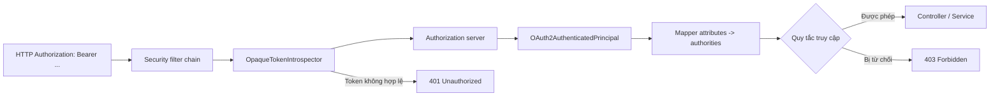

# Ánh xạ attributes thành quyền theo cấu hình ứng dụng

Trong chương **Opaque token** của module **SPRING_SECURITY_TESTING**, người học kiểm chứng xác thực, phân quyền và bảo vệ HTTP thực tế với `spring-security-test` trên ứng dụng Servlet và Reactive. Các công cụ `MockMvc`, `WebTestClient`, `@WithMockUser`, `SecurityContext`, JWT/OAuth2/OIDC giả lập hỗ trợ xác minh yêu cầu được phép hoặc bị từ chối. Riêng opaque access token đòi hỏi hiểu rõ cách ứng dụng chuyển **attributes trả về từ introspection** thành các `GrantedAuthority` để quyết định truy cập.

Giả sử máy chủ ủy quyền trả `app_roles: ["REPORT_VIEWER"]` và `scope: "reports.read"`. Ứng dụng có thể quy định `REPORT_VIEWER` ánh xạ thành `ROLE_REPORT_VIEWER`, còn `reports.read` thành `SCOPE_reports.read`. Hai authority này khác nhau: người dùng có scope không tự động có role; vai trò cũng không mặc nhiên thay thế scope.

Mục tiêu bài học là định nghĩa chính sách ánh xạ có thể kiểm chứng, triển khai `OpaqueTokenIntrospector` tùy biến, viết các test chấp nhận/từ chối và phân biệt kiểm thử authentication giả lập với kiểm thử Bearer token thực sự đi qua introspector.

## 1. Opaque token, introspection và dữ liệu nguồn

Khác với JWT tự chứa claims trong payload, opaque token thường là chuỗi mà resource server không thể tự diễn giải. Khi client gửi:

```http
GET /api/reports HTTP/1.1
Authorization: Bearer opaque-access-token
```

Resource server sử dụng `OpaqueTokenIntrospector` để kiểm tra token với authorization server. Một phản hồi introspection minh họa:

```json
{
  "active": true,
  "sub": "user-42",
  "client_id": "reports-web",
  "scope": "reports.read profile.read",
  "app_roles": ["REPORT_VIEWER"],
  "tenant_id": "tenant-a",
  "aud": ["reports-api"],
  "exp": 1894701840
}
```

Khi introspection thành công, `OAuth2AuthenticatedPrincipal` mang theo các attributes và authorities để Spring Security tạo authentication. Nếu token không hoạt động, không xác thực được hoặc bị từ chối, luồng này phải dừng; ứng dụng không được tự tạo principal hợp lệ từ nội dung client gửi.



Hai thuộc tính `app_roles` và `tenant_id` là **quy ước riêng của hệ thống ví dụ**; OAuth2 introspection không bắt buộc mọi nhà phát hành phải trả chúng. Trước khi viết code, cần xác định đúng tên, kiểu, ngữ nghĩa và độ tin cậy của từng trường. Quyền chỉ được lấy từ kết quả introspection tin cậy, không lấy từ header, query string hoặc JSON body do client tự khai.

## 2. Thiết kế quy tắc ánh xạ trước khi triển khai

Ta định nghĩa hợp đồng:

| Attribute | Giá trị hợp lệ | Authority tương ứng | Quy tắc |
| --- | --- | --- | --- |
| `scope` | Có scope `reports.read` | `SCOPE_reports.read` | Quyền kỹ thuật từ authorization server |
| `app_roles` | Phần tử `REPORT_VIEWER` | `ROLE_REPORT_VIEWER` | Được xem báo cáo |
| `app_roles` | Phần tử `REPORT_ADMIN` | `ROLE_REPORT_ADMIN` | Được quản trị báo cáo |
| `app_roles` | Thiếu, rỗng, sai kiểu, giá trị lạ | Không cấp thêm role | Mặc định từ chối |
| `tenant_id` | `tenant-a` | Không tự sinh role | Dùng để kiểm soát phạm vi tenant riêng |

Trong ví dụ, `app_roles` phải là một `Collection` gồm các chuỗi khớp chính xác, phân biệt chữ hoa/chữ thường. Nếu authorization server trả vai trò trong một chuỗi, một object lồng nhau hoặc namespace khác, chỉ thay đổi mapper sau khi thống nhất hợp đồng; không tự đoán cách tách chuỗi.

Hai nguyên tắc quan trọng:

1. **Allowlist quyền.** Chỉ chấp nhận `REPORT_VIEWER` và `REPORT_ADMIN`. Không ghép mọi giá trị thành `"ROLE_" + rawValue` rồi cấp quyền không có kiểm soát.
2. **Bảo toàn authorities do introspector gốc đã tạo.** Nếu đã có `SCOPE_reports.read`, mapper thêm role nghiệp vụ nhưng không xóa scope đó. Endpoint phải quyết định rõ có cần một quyền hay cần đồng thời nhiều quyền.

`getAuthorities()` và `getAttributes()` là hai nguồn thông tin khác nhau trong `OAuth2AuthenticatedPrincipal`: một dữ liệu attribute có mặt **chưa đồng nghĩa** authority tương ứng đã tồn tại.

## 3. Triển khai decorator cho `OpaqueTokenIntrospector`

Một cách thiết kế dễ kiểm thử là để introspector gốc xác thực token và thu thập attributes, sau đó decorator thực hiện ánh xạ role:

```java
import java.util.Collection;
import java.util.LinkedHashSet;
import java.util.Set;
import org.springframework.security.core.GrantedAuthority;
import org.springframework.security.core.authority.SimpleGrantedAuthority;
import org.springframework.security.oauth2.core.DefaultOAuth2AuthenticatedPrincipal;
import org.springframework.security.oauth2.core.OAuth2AuthenticatedPrincipal;
import org.springframework.security.oauth2.server.resource.introspection.OpaqueTokenIntrospector;

public final class RoleMappingIntrospector implements OpaqueTokenIntrospector {

    private final OpaqueTokenIntrospector delegate;

    public RoleMappingIntrospector(OpaqueTokenIntrospector delegate) {
        this.delegate = delegate;
    }

    @Override
    public OAuth2AuthenticatedPrincipal introspect(String token) {
        OAuth2AuthenticatedPrincipal principal = delegate.introspect(token);

        Set<GrantedAuthority> authorities =
                new LinkedHashSet<>(principal.getAuthorities());

        Object rawRoles = principal.getAttribute("app_roles");
        if (rawRoles instanceof Collection<?> roles) {
            for (Object role : roles) {
                if ("REPORT_VIEWER".equals(role)) {
                    authorities.add(new SimpleGrantedAuthority(
                            "ROLE_REPORT_VIEWER"));
                } else if ("REPORT_ADMIN".equals(role)) {
                    authorities.add(new SimpleGrantedAuthority(
                            "ROLE_REPORT_ADMIN"));
                }
            }
        }

        return new DefaultOAuth2AuthenticatedPrincipal(
                principal.getName(),
                principal.getAttributes(),
                authorities);
    }
}
```

Lớp này có những tính chất cần kiểm chứng:

- Nếu `delegate.introspect(token)` từ chối token, exception tiếp tục truyền ra ngoài; mapper không tạo principal dự phòng.
- `LinkedHashSet` giữ lại các scope/authority từ delegate và tránh trùng lặp.
- `app_roles` phải là collection. Giá trị `null`, một chuỗi đơn, số nguyên hoặc phần tử không trùng allowlist không tạo quyền mới.
- Các attributes khác như `sub` và `tenant_id` được giữ nguyên để logic nghiệp vụ tiếp tục sử dụng.
- Mã không tự nâng `REPORT_ADMIN` thành `REPORT_VIEWER`. Nếu policy muốn admin được phép xem báo cáo, hãy quy định minh bạch ở rule authorization và viết test cho hành vi đó.

Lưu ý: `DefaultOAuth2AuthenticatedPrincipal` tạo đối tượng principal mới với tên, attributes và authorities đã được chỉ định. Đừng tùy ý ghi đè `sub`, `client_id`, `exp` hay `active` trong quá trình ánh xạ role.

## 4. Kết nối mapper với resource server Servlet

Một `SecurityFilterChain` yêu cầu vai trò xem báo cáo và xác thực bằng opaque token có thể cấu hình như sau:

```java
import org.springframework.context.annotation.Bean;
import org.springframework.context.annotation.Configuration;
import org.springframework.security.config.Customizer;
import org.springframework.security.config.annotation.web.builders.HttpSecurity;
import org.springframework.security.web.SecurityFilterChain;

@Configuration
class ApiSecurityConfiguration {

    @Bean
    SecurityFilterChain securityFilterChain(HttpSecurity http)
            throws Exception {
        http.authorizeHttpRequests(auth -> auth
                .requestMatchers("/api/reports/**")
                .hasAuthority("ROLE_REPORT_VIEWER")
                .anyRequest().authenticated())
            .oauth2ResourceServer(oauth2 ->
                    oauth2.opaqueToken(Customizer.withDefaults()));
        return http.build();
    }
}
```

Khai báo một bean introspector chứa decorator:

```java
import org.springframework.beans.factory.annotation.Value;
import org.springframework.context.annotation.Bean;
import org.springframework.context.annotation.Configuration;
import org.springframework.security.oauth2.server.resource.introspection.NimbusOpaqueTokenIntrospector;
import org.springframework.security.oauth2.server.resource.introspection.OpaqueTokenIntrospector;

@Configuration
class IntrospectionConfiguration {

    @Bean
    OpaqueTokenIntrospector opaqueTokenIntrospector(
            @Value("${spring.security.oauth2.resourceserver.opaquetoken.introspection-uri}")
            String uri,
            @Value("${spring.security.oauth2.resourceserver.opaquetoken.client-id}")
            String clientId,
            @Value("${spring.security.oauth2.resourceserver.opaquetoken.client-secret}")
            String clientSecret) {

        OpaqueTokenIntrospector original =
                new NimbusOpaqueTokenIntrospector(uri, clientId, clientSecret);
        return new RoleMappingIntrospector(original);
    }
}
```

Ví dụ dùng `NimbusOpaqueTokenIntrospector` trên những phiên bản Spring Security còn cung cấp API này; hãy đối chiếu API introspector của phiên bản được sử dụng khi nâng cấp. Các thông số introspection phải lấy từ cấu hình/secret store của ứng dụng, không hardcode credentials thật.

Nếu ứng dụng có nhiều `SecurityFilterChain` hoặc nhiều bean introspector, cần bảo đảm chain bảo vệ endpoint thực sự nhận đúng decorator. Việc unit test một class mapper PASS không chứng minh wiring trong Spring context đã đúng.

## 5. Kiểm thử hàm ánh xạ độc lập

Tạo delegate giả trả principal đã xác thực, từ đó kiểm tra mapper có cấp đúng role, giữ scope và từ chối giá trị sai hay không:

```java
import static org.junit.jupiter.api.Assertions.assertFalse;
import static org.junit.jupiter.api.Assertions.assertTrue;
import java.util.List;
import java.util.Map;
import org.junit.jupiter.api.Test;
import org.springframework.security.core.authority.SimpleGrantedAuthority;
import org.springframework.security.oauth2.core.DefaultOAuth2AuthenticatedPrincipal;
import org.springframework.security.oauth2.core.OAuth2AuthenticatedPrincipal;
import org.springframework.security.oauth2.server.resource.introspection.OpaqueTokenIntrospector;

class RoleMappingIntrospectorTest {

    private OAuth2AuthenticatedPrincipal mapped(Object roles) {
        OpaqueTokenIntrospector delegate = token ->
                new DefaultOAuth2AuthenticatedPrincipal(
                        "user-42",
                        Map.of("sub", "user-42", "app_roles", roles),
                        List.of(new SimpleGrantedAuthority(
                                "SCOPE_reports.read")));
        return new RoleMappingIntrospector(delegate).introspect("valid");
    }

    @Test
    void viewer_duocCapRole_vaGiuScope() {
        var result = mapped(List.of("REPORT_VIEWER"));

        assertTrue(result.getAuthorities().contains(
                new SimpleGrantedAuthority("ROLE_REPORT_VIEWER")));
        assertTrue(result.getAuthorities().contains(
                new SimpleGrantedAuthority("SCOPE_reports.read")));
        assertFalse(result.getAuthorities().contains(
                new SimpleGrantedAuthority("ROLE_REPORT_ADMIN")));
    }

    @Test
    void unknownRole_khongDuocCap() {
        var result = mapped(List.of("SUPER_ADMIN"));

        assertFalse(result.getAuthorities().contains(
                new SimpleGrantedAuthority("ROLE_REPORT_VIEWER")));
        assertFalse(result.getAuthorities().contains(
                new SimpleGrantedAuthority("ROLE_REPORT_ADMIN")));
    }

    @Test
    void saiKieu_khongDuocCapRole() {
        var result = mapped("REPORT_VIEWER");

        assertFalse(result.getAuthorities().contains(
                new SimpleGrantedAuthority("ROLE_REPORT_VIEWER")));
    }
}
```

Với test **thiếu `app_roles`**, hãy tạo `Map` không có key đó; không truyền `null` vào `Map.of(...)` vì `Map.of` cấm giá trị null. Test `mapped(List.of())` sẽ kiểm tra collection rỗng. Test delegate ném exception cũng có ích để xác minh decorator không biến token bị từ chối thành token hợp lệ.

Unit test này chỉ kiểm chứng mapping. Nó không gọi HTTP introspection thật và không cho biết resource server có đang sử dụng đúng bean mapper hay không.

## 6. Khác biệt giữa `opaqueToken()` và Bearer HTTP

Spring Security Test cho phép gắn principal opaque giả lập vào `MockMvc`:

```java
import static org.springframework.security.test.web.servlet.request
        .SecurityMockMvcRequestPostProcessors.opaqueToken;
import static org.springframework.test.web.servlet.request.MockMvcRequestBuilders.get;
import static org.springframework.test.web.servlet.result.MockMvcResultMatchers.status;
import java.util.List;
import org.springframework.security.core.authority.SimpleGrantedAuthority;

mockMvc.perform(get("/api/reports")
        .with(opaqueToken()
            .attributes(attrs -> {
                attrs.put("sub", "user-42");
                attrs.put("app_roles", List.of("REPORT_VIEWER"));
            })
            .authorities(new SimpleGrantedAuthority("ROLE_REPORT_VIEWER"))))
    .andExpect(status().isOk());
```

Test trên xác minh **người đã được cấp `ROLE_REPORT_VIEWER`** truy cập endpoint thành công, nhưng `opaqueToken()` tự dựng authentication giả. Nó **không gọi `OpaqueTokenIntrospector`** và không chứng minh `app_roles` đã được mapper chuyển thành authority.

Nếu chỉ đặt attributes:

```java
mockMvc.perform(get("/api/reports")
        .with(opaqueToken()
            .attributes(attrs ->
                    attrs.put("app_roles", List.of("REPORT_VIEWER")))))
    .andExpect(status().isForbidden());
```

thì `403` có thể đơn giản vì authentication giả chưa được cấp `ROLE_REPORT_VIEWER`. Điều đó không phản ánh lỗi hay thành công của mapper. Muốn kiểm tra mapper chạy trong filter chain, cần gửi header `Authorization: Bearer ...`, cấu hình introspector test và để resource server xử lý request.

`@WithMockUser` cũng không dùng được để xác minh introspection: nó tạo một kiểu authentication giả khác cho những bài kiểm thử Spring Security không phụ thuộc vào token.

## 7. Kiểm thử HTTP thật qua introspector được kiểm soát

Ví dụ dưới dùng `@WebMvcTest`, filter chain resource server và fake introspector phản hồi khác nhau theo chuỗi token. Request đi qua Bearer authentication, gọi `RoleMappingIntrospector`, rồi quyết định `200`/`403`/`401`.

Giả định class `RoleMappingIntrospector` ở mục 3 đã nằm trong cùng package với test:

```java
import static org.springframework.test.web.servlet.request.MockMvcRequestBuilders.get;
import static org.springframework.test.web.servlet.result.MockMvcResultMatchers.content;
import static org.springframework.test.web.servlet.result.MockMvcResultMatchers.status;

import java.util.List;
import java.util.Map;
import org.junit.jupiter.api.Test;
import org.springframework.beans.factory.annotation.Autowired;
import org.springframework.boot.test.autoconfigure.web.servlet.WebMvcTest;
import org.springframework.boot.test.context.TestConfiguration;
import org.springframework.context.annotation.Bean;
import org.springframework.context.annotation.Import;
import org.springframework.http.HttpHeaders;
import org.springframework.security.config.Customizer;
import org.springframework.security.config.annotation.web.builders.HttpSecurity;
import org.springframework.security.core.authority.SimpleGrantedAuthority;
import org.springframework.security.oauth2.core.DefaultOAuth2AuthenticatedPrincipal;
import org.springframework.security.oauth2.server.resource.introspection.BadOpaqueTokenException;
import org.springframework.security.oauth2.server.resource.introspection.OpaqueTokenIntrospector;
import org.springframework.security.web.SecurityFilterChain;
import org.springframework.test.web.servlet.MockMvc;
import org.springframework.web.bind.annotation.GetMapping;
import org.springframework.web.bind.annotation.RestController;

@WebMvcTest(controllers = OpaqueRoleHttpTest.ReportController.class)
@Import(OpaqueRoleHttpTest.TestSecurity.class)
class OpaqueRoleHttpTest {

    @Autowired MockMvc mockMvc;

    @Test
    void tokenCoViewerRole_choPhep() throws Exception {
        mockMvc.perform(get("/api/reports")
                .header(HttpHeaders.AUTHORIZATION, "Bearer reader-token"))
            .andExpect(status().isOk())
            .andExpect(content().string("visible"));
    }

    @Test
    void tokenHopLeNhungThieuRole_tuChoi() throws Exception {
        mockMvc.perform(get("/api/reports")
                .header(HttpHeaders.AUTHORIZATION, "Bearer guest-token"))
            .andExpect(status().isForbidden());
    }

    @Test
    void tokenKhongHopLe_chuaXacThuc() throws Exception {
        mockMvc.perform(get("/api/reports")
                .header(HttpHeaders.AUTHORIZATION, "Bearer invalid-token"))
            .andExpect(status().isUnauthorized());
    }

    @Test
    void khongCoToken_chuaXacThuc() throws Exception {
        mockMvc.perform(get("/api/reports"))
            .andExpect(status().isUnauthorized());
    }

    @RestController
    static class ReportController {
        @GetMapping("/api/reports")
        String reports() {
            return "visible";
        }
    }

    @TestConfiguration
    static class TestSecurity {

        @Bean
        SecurityFilterChain filterChain(HttpSecurity http)
                throws Exception {
            http.authorizeHttpRequests(auth -> auth
                    .requestMatchers("/api/reports")
                    .hasAuthority("ROLE_REPORT_VIEWER")
                    .anyRequest().denyAll())
                .oauth2ResourceServer(oauth2 ->
                        oauth2.opaqueToken(Customizer.withDefaults()));
            return http.build();
        }

        @Bean
        OpaqueTokenIntrospector introspector() {
            OpaqueTokenIntrospector fake = token -> {
                if (!"reader-token".equals(token)
                        && !"guest-token".equals(token)) {
                    throw new BadOpaqueTokenException(
                            "Inactive or unknown token");
                }

                List<String> roles = "reader-token".equals(token)
                        ? List.of("REPORT_VIEWER")
                        : List.of("UNRECOGNIZED");

                return new DefaultOAuth2AuthenticatedPrincipal(
                        "user-42",
                        Map.of(
                                "sub", "user-42",
                                "app_roles", roles,
                                "active", true),
                        List.of(new SimpleGrantedAuthority(
                                "SCOPE_reports.read")));
            };
            return new RoleMappingIntrospector(fake);
        }
    }
}
```

Trong ví dụ này, `reader-token` được coi là hoạt động và có role hợp lệ nên nhận `200`; `guest-token` được xác thực nhưng không có role được chấp nhận nên nhận `403`; `invalid-token` khiến introspection ném `BadOpaqueTokenException` và trả `401`. Không có Bearer token cũng bị từ chối với `401`.

Test này thực hiện filter chain, bean introspector và mapper, **nhưng fake introspection không gọi máy chủ ủy quyền bên ngoài**. Muốn kiểm tra request introspection thực tế, `active=false`, credentials, timeout, status HTTP bất thường và dữ liệu từ server, cần thêm integration test dùng HTTP mock server hoặc authorization server thử nghiệm.

## 8. Kết hợp role và scope trong một chính sách

Với nghiệp vụ cần **cả** role và scope, có thể dùng method security:

```java
@PreAuthorize(
    "hasAuthority('SCOPE_reports.read') and "
    + "hasAuthority('ROLE_REPORT_VIEWER')"
)
public Report readReport() {
    // Truy vấn báo cáo theo phạm vi đã được phép.
}
```

Để biểu thức hoạt động, ứng dụng phải bật `@EnableMethodSecurity` và gọi method qua Spring bean/proxy. Nếu ứng dụng xác minh quyền ngay trong `authorizeHttpRequests` thì không cần thêm `@PreAuthorize` chỉ vì mục đích test; hãy kiểm tra chính sách ở nơi đang được áp dụng.

Ma trận cần bao phủ:

| Scope | Role | Kỳ vọng với chính sách AND |
| --- | --- | --- |
| `SCOPE_reports.read` | `ROLE_REPORT_VIEWER` | `200` nếu không có điều kiện khác |
| Có scope | Không có role | `403` |
| Không có scope | Có role | `403` |
| Không có cả hai | Không có | `403` |
| Token bị introspection từ chối | Bất kỳ | `401` |

Nếu rule quy định admin có thể xem mọi báo cáo, đừng mặc nhiên suy ra điều đó từ tên `ROLE_REPORT_ADMIN`; phải viết policy và test rõ tình huống admin có/không có scope.

## 9. Quyền theo tenant và tài nguyên

Giả sử principal có `tenant_id="tenant-a"` và `ROLE_REPORT_VIEWER`. Khi yêu cầu `GET /api/tenants/tenant-b/reports`, việc có role xem báo cáo **chưa đủ** để đọc dữ liệu tenant B.

Ví dụ chính sách:

```java
@PreAuthorize(
    "hasAuthority('ROLE_REPORT_VIEWER') and "
    + "@tenantGuard.matches(authentication, #tenantId)"
)
@GetMapping("/api/tenants/{tenantId}/reports")
public List<Report> reports(@PathVariable String tenantId) {
    return reportService.findByTenantId(tenantId);
}
```

`tenantGuard.matches(...)` là method nghiệp vụ do ứng dụng triển khai để so `tenant_id` từ principal đã xác thực với tenant trên đường dẫn. Trong Spring Security method security, cần bảo đảm biểu thức `#tenantId` lấy đúng tên tham số (chẳng hạn dùng `@P("tenantId")` khi cần). Service/repository cũng phải giới hạn truy vấn theo tenant thật của dữ liệu, không chỉ kiểm tra một ID trên URL.

Phải có cặp test: đúng role và tenant → được phép; đúng role nhưng tenant khác → bị từ chối theo hợp đồng ứng dụng, thường `403` hoặc `404` nếu hệ thống che giấu sự tồn tại tài nguyên. Việc chuyển `tenant_id` thành một authority toàn cục là không đủ để chứng minh cách ly dữ liệu giữa các tenant.

## 10. Reactive WebFlux: cùng chính sách, khác interface

Ứng dụng Reactive sử dụng `ReactiveOpaqueTokenIntrospector` và `SecurityWebFilterChain`. Decorator có thể tái sử dụng logic mapper đã tách thành hàm thuần:

```java
import org.springframework.security.oauth2.core.OAuth2AuthenticatedPrincipal;
import org.springframework.security.oauth2.server.resource.introspection.ReactiveOpaqueTokenIntrospector;
import reactor.core.publisher.Mono;

class ReactiveRoleMappingIntrospector
        implements ReactiveOpaqueTokenIntrospector {

    private final ReactiveOpaqueTokenIntrospector delegate;
    private final RolePrincipalMapper mapper;

    ReactiveRoleMappingIntrospector(
            ReactiveOpaqueTokenIntrospector delegate,
            RolePrincipalMapper mapper) {
        this.delegate = delegate;
        this.mapper = mapper;
    }

    @Override
    public Mono<OAuth2AuthenticatedPrincipal> introspect(String token) {
        return delegate.introspect(token).map(mapper::map);
    }
}
```

`RolePrincipalMapper` là class/interface **do ứng dụng tự định nghĩa**, với phương thức `OAuth2AuthenticatedPrincipal map(OAuth2AuthenticatedPrincipal)` chứa logic allowlist giống mục 3; đây không phải class có sẵn trong Spring Security. Lấy bean `ReactiveOpaqueTokenIntrospector` thực sự được WebFlux chain sử dụng, không giả định bean Servlet `OpaqueTokenIntrospector` tự có hiệu lực ở Reactive.

Kiểm thử `WebTestClient` khi context đã cấu hình Reactive opaque-token resource server và test introspector:

```java
webTestClient.get()
    .uri("/api/reports")
    .headers(h -> h.setBearerAuth("reader-token"))
    .exchange()
    .expectStatus().isOk();

webTestClient.get()
    .uri("/api/reports")
    .headers(h -> h.setBearerAuth("guest-token"))
    .exchange()
    .expectStatus().isForbidden();
```

`SecurityMockServerConfigurers.mockOpaqueToken()` phù hợp với kiểm thử rule trên authentication giả lập trong WebFlux; tương tự `opaqueToken()` của Servlet, nó không chứng minh introspector và mapper đã chạy. Dùng Bearer header khi mục tiêu là ánh xạ attributes từ introspection trong đường HTTP.

## 11. Ma trận test cho các dữ liệu bất thường

Giả sử policy endpoint yêu cầu đúng `ROLE_REPORT_VIEWER`:

| Kết quả introspection | Kết quả mapping | Status dự kiến |
| --- | --- | --- |
| `active=true`, `app_roles=["REPORT_VIEWER"]` | Có `ROLE_REPORT_VIEWER` | `200` |
| `active=true`, `app_roles=["REPORT_ADMIN"]` | Chỉ có `ROLE_REPORT_ADMIN` | `403` theo policy viewer-only |
| `active=true`, `app_roles=["SUPER_ADMIN"]` | Không thêm role | `403` |
| `active=true`, `app_roles=[]` | Không thêm role | `403` |
| `active=true`, thiếu `app_roles` | Không thêm role | `403` |
| `active=true`, `app_roles="REPORT_VIEWER"` | Sai kiểu, không thêm role | `403` |
| `active=true`, `app_roles=[123]` | Không thêm role từ phần tử sai kiểu | `403` |
| Token không hoạt động hoặc bị thu hồi | Không tạo principal hợp lệ | `401` |
| Không gửi token | Chưa xác thực | `401` |

Đây là kỳ vọng cho filter chain mẫu, không dùng form login hay entry point/access-denied handler tùy chỉnh. Nếu ứng dụng cấu hình cách trả lỗi khác, status/body phải được kiểm tra theo hợp đồng HTTP thực tế.

Đừng chỉ kiểm tra mã HTTP: khi endpoint trả dữ liệu hoặc gây side effect, hãy assert payload hoặc xác minh service/repository không bị gọi cho yêu cầu trái quyền. Với API ghi, nếu bật CSRF, cần cung cấp CSRF hợp lệ trong test để không nhầm lỗi CSRF với lỗi role.

## 12. Lỗi thường gặp và cách phòng tránh

**Cho rằng `opaqueToken().attributes(...)` tự tạo `GrantedAuthority`.** Post-processor này cho phép dựng authentication giả; nó không chạy mapper ứng dụng. Kiểm tra mapping bằng unit test và Bearer HTTP test.

**Chỉ có test `200` sau khi tự đặt `authorities(...)`.** Bài test ấy chứng minh rule cho phép khi authority đã có, chưa chứng minh nguồn attributes được chuyển đổi đúng.

**Ghép tiền tố role từ mọi giá trị.** Một attribute lạ có thể tạo ra authority ngoài chính sách. Giữ allowlist rõ ràng, kiểm tra kiểu dữ liệu và phân biệt chữ hoa/thường.

**Đồng nhất OAuth scope với application role.** `SCOPE_reports.read` không phải `ROLE_REPORT_VIEWER`; `hasRole("REPORT_VIEWER")` mặc định tìm `ROLE_REPORT_VIEWER`, còn `hasAuthority("...")` so chính xác chuỗi đầy đủ.

**Cho rằng một role toàn cục đủ cho mọi tenant.** Cần xác minh `tenant_id` và ràng buộc dữ liệu của tài nguyên khi chính sách yêu cầu phân tách tenant.

**Nuốt lỗi introspection rồi tạo principal dự phòng.** Token bị thu hồi, introspection báo inactive, lỗi thông tin xác thực hoặc lỗi mạng không được chuyển thành quyền hợp lệ chỉ để giữ endpoint hoạt động.

**Thay đổi introspector nhưng không kiểm tra wiring.** Khi nhiều filter chain hoặc nhiều bean cùng tồn tại, class mapper có thể đúng nhưng HTTP vẫn dùng bean khác. Bearer HTTP test đi qua security chain sẽ làm lộ vấn đề.

**Bỏ qua cache introspection.** Nếu ứng dụng cache kết quả, thời gian nhận biết token bị thu hồi hoặc vai trò vừa đổi phụ thuộc vào TTL cache. Kiểm thử riêng chính sách cache nếu hệ thống sử dụng.

**Chỉ dựa vào `@WithMockUser`.** Nó không thể chứng minh opaque token đã được introspection và map quyền. Chọn đúng công cụ theo lớp cần kiểm tra.

## 13. Checklist hoàn tất

- Đã xác định schema, kiểu dữ liệu và nguồn tin cậy cho từng attribute introspection.
- Đã thống nhất allowlist `app_roles` → `ROLE_*`, cùng quy tắc scope → `SCOPE_*`.
- Decorator giữ nguyên authorities đã được delegate chấp nhận và không cấp thêm role lạ hoặc sai kiểu.
- Token không hợp lệ trả lỗi xác thực; token hợp lệ nhưng thiếu quyền trả lỗi phân quyền theo hợp đồng API.
- Unit test bao phủ role đúng, lạ, thiếu, rỗng, sai kiểu, nhiều role và giữ scope.
- Test `opaqueToken()` được dùng để kiểm chứng hành vi với authentication giả lập.
- Có ít nhất một test Bearer HTTP đi qua introspector/decorator để xác minh mapping thực sự được áp dụng.
- Nếu cần nhiều quyền đồng thời, đã test đủ các tổ hợp scope/role.
- Với nghiệp vụ nhiều tenant, đã test cả role đúng nhưng tenant sai và ràng buộc dữ liệu.
- Với WebFlux, đã dùng `ReactiveOpaqueTokenIntrospector` và `WebTestClient` phù hợp.

**Kết quả mong đợi:** chỉ attributes hợp lệ do introspection tin cậy trả về mới tạo authorities được ứng dụng công nhận. Kết hợp unit test mapper, test phân quyền với `opaqueToken()` và Bearer HTTP test giúp phát hiện cả lỗi chuyển đổi role lẫn lỗi wiring, đồng thời phân biệt rõ yêu cầu chưa xác thực (`401`) và đã xác thực nhưng thiếu quyền (`403`).
