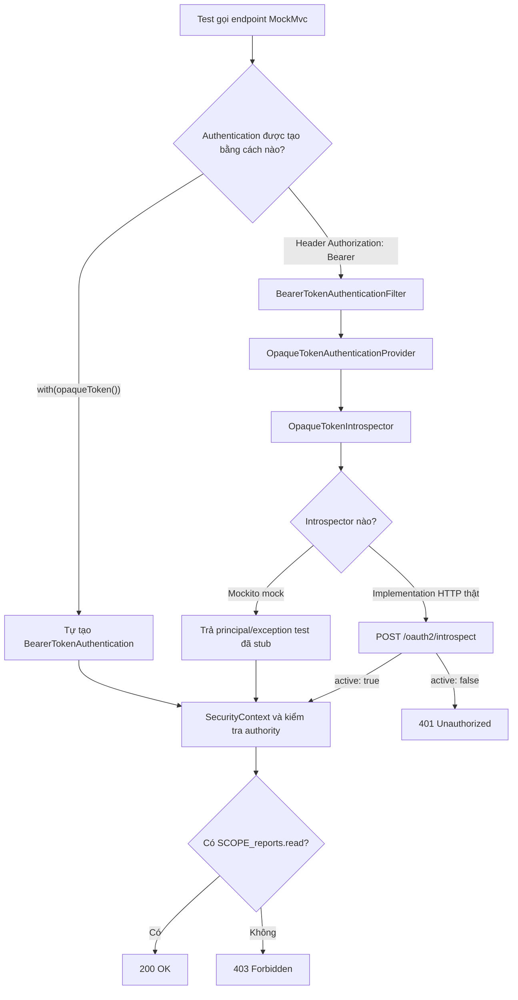

# Không suy ra introspection thật đã hoạt động từ một principal giả lập

Trong ứng dụng Spring Security OAuth2 Resource Server, opaque access token thường được kiểm tra bằng một lời gọi đến **OAuth 2.0 Token Introspection Endpoint** của Authorization Server. Tuy nhiên, khi viết test với `MockMvc`, bạn có thể gắn trực tiếp một `BearerTokenAuthentication` hoặc `OAuth2AuthenticatedPrincipal` giả vào request. Khi đó, endpoint trả về `200 OK` chỉ chứng minh **ứng dụng chấp nhận authentication đã dàn dựng**, không chứng minh có lời gọi introspection hay token thực sự còn hiệu lực.

Bài học thuộc module **SPRING_SECURITY_TESTING**, tập trung kiểm chứng xác thực, phân quyền và bảo vệ HTTP trên Servlet và Reactive bằng `spring-security-test`. Chủ đề chính là cách phân biệt rõ ba mức kiểm thử opaque token: `opaqueToken()` helper, mock `OpaqueTokenIntrospector`, và **introspection HTTP thực tới một server kiểm thử**. Chỉ kết luận hệ thống phát hành đã xác nhận token khi có bằng chứng đúng ở ranh giới cần kiểm chứng.

## 1. Opaque token và introspection hoạt động như thế nào?

Opaque token là chuỗi mà Resource Server không thể tự suy ra giá trị tin cậy chỉ bằng cách đọc định dạng. Ví dụ:

```http
GET /api/reports/current HTTP/1.1
Authorization: Bearer tkn_Q7p8k2...
```

Với cấu hình **opaque token**, Spring Security xử lý theo trình tự:

1. `BearerTokenAuthenticationFilter` đọc Bearer token từ request.
2. `OpaqueTokenAuthenticationProvider` chuyển chuỗi token đến `OpaqueTokenIntrospector.introspect(rawToken)`.
3. Introspector thực gọi HTTP đến endpoint introspection đã cấu hình, kèm client credentials dành cho Resource Server.
4. Authorization Server trả kết quả gồm `active` và các thông tin như `sub`, `scope`, `client_id`, `exp`.
5. Nếu hợp lệ, Spring Security tạo `BearerTokenAuthentication` mang `OAuth2AuthenticatedPrincipal` và authorities. Khi thiếu scope cần thiết, HTTP authorization từ chối bằng `403 Forbidden`.

Lời gọi introspection điển hình theo RFC 7662:

```http
POST /oauth2/introspect HTTP/1.1
Host: auth.example.test
Authorization: Basic <client-credentials>
Content-Type: application/x-www-form-urlencoded

token=tkn_Q7p8k2...
```

Phản hồi có thể là:

```json
{
  "active": true,
  "sub": "alice",
  "scope": "reports.read",
  "client_id": "reporting-web",
  "exp": 1795600000
}
```

Khi token bị thu hồi, hết hạn hoặc không hợp lệ, phản hồi introspection thường là:

```json
{
  "active": false
}
```

Trong luồng mặc định, `scope=reports.read` được chuyển thành authority `SCOPE_reports.read`. Controller có thể nhận trực tiếp `BearerTokenAuthentication`, rồi truy cập `getTokenAttributes().get("sub")`.

**Điểm mấu chốt:** `OAuth2AuthenticatedPrincipal` là **kết quả chứa danh tính và thuộc tính**. Test có thể tạo đối tượng này bằng tay. Bản thân sự xuất hiện của principal trong `SecurityContext` không chứng minh request đã đi qua bước 2–4.



## 2. Ba mức kiểm thử opaque token

| Mức | Test thực hiện | Đi qua Bearer filter | Gọi introspector | Gửi HTTP introspection |
| --- | --- | :---: | :---: | :---: |
| 1. `with(opaqueToken())` | Đưa trực tiếp principal và authorities giả vào request | Không theo đường xác minh token | Không | Không |
| 2. Mock `OpaqueTokenIntrospector` | Gửi Bearer header thật vào ứng dụng, mock `introspect` | Có | Có, nhưng là mock | Không |
| 3. HTTP introspector + local fake server | Gửi Bearer header và dùng introspector thật kết nối tới endpoint giả lập | Có | Có | Có |
| 4. Tích hợp Authorization Server thử nghiệm | Dùng token do server thử nghiệm cấp/thu hồi | Có | Có | Có, với hệ thống phát hành |

Mức 1 tốt cho **phân quyền** và logic tiêu thụ principal. Mức 2 tốt cho luồng Bearer, exception mapping và việc gọi đúng `introspect(rawToken)`. Mức 3 xác minh HTTP contract, HTTP Basic client credential, body form và cách xử lý `active`. Mức 4 mới kiểm chứng **tình trạng token theo hệ thống phát hành thật**.

Để đọc một test chính xác, hãy hỏi: *Dữ liệu principal đến từ đâu? Có bằng chứng nào cho thấy lời gọi `introspect` đã chạy? Có bằng chứng rằng endpoint HTTP đã nhận request?*

## 3. Ứng dụng Servlet mẫu cho toàn bộ bài

Ví dụ sử dụng Java 17+, Spring Boot, Spring MVC, Spring Security OAuth2 Resource Server, JUnit 5 và `spring-security-test`. Các đoạn Java lược bỏ `package`/`import` để tập trung vào hành vi; dùng các import tương ứng với phiên bản thư viện của dự án.

Dependency Gradle chính:

```groovy
dependencies {
    implementation 'org.springframework.boot:spring-boot-starter-web'
    implementation 'org.springframework.boot:spring-boot-starter-security'
    implementation 'org.springframework.boot:spring-boot-starter-oauth2-resource-server'

    testImplementation 'org.springframework.boot:spring-boot-starter-test'
    testImplementation 'org.springframework.security:spring-security-test'
}
```

Controller chỉ trả kết quả nếu Resource Server đã có một `BearerTokenAuthentication` và caller được phép:

```java
@RestController
@RequestMapping("/api/reports")
class ReportController {

    @GetMapping("/current")
    Map<String, String> current(BearerTokenAuthentication authentication) {
        String subject =
            (String) authentication.getTokenAttributes().get("sub");

        return Map.of(
            "subject", subject,
            "result", "report-visible"
        );
    }
}
```

Cấu hình bắt buộc authority `SCOPE_reports.read`:

```java
@Configuration
class ResourceServerSecurityConfig {

    @Bean
    SecurityFilterChain securityFilterChain(HttpSecurity http) throws Exception {
        return http
            .authorizeHttpRequests(auth -> auth
                .requestMatchers(HttpMethod.GET, "/api/reports/current")
                    .hasAuthority("SCOPE_reports.read")
                .anyRequest().denyAll()
            )
            .oauth2ResourceServer(oauth2 ->
                oauth2.opaqueToken(Customizer.withDefaults())
            )
            .build();
    }
}
```

Ở môi trường triển khai thật, có thể cấu hình HTTP introspection qua properties:

```yaml
spring:
  security:
    oauth2:
      resourceserver:
        opaquetoken:
          introspection-uri: https://auth.example.test/oauth2/introspect
          client-id: reporting-api
          client-secret: REPLACE_WITH_ENV_SECRET
```

Không đưa secret sản xuất vào source code hoặc tài liệu test. `client-id` và `client-secret` ở đây dùng để **Resource Server xác thực với introspection endpoint**, khác với Bearer token của người dùng.

Trong test Servlet, `@SpringBootTest` và `@AutoConfigureMockMvc` thường nạp bộ lọc HTTP bảo mật. Application context còn cần `OpaqueTokenIntrospector` bean hợp lệ; nó có thể do cấu hình production hoặc annotation test `@MockitoBean` cung cấp. **Bean có mặt trong context không đồng nghĩa có lời gọi introspection thực**.

## 4. Mức 1: opaqueToken() tạo principal giả

Spring Security Test cung cấp `SecurityMockMvcRequestPostProcessors.opaqueToken()`. Nó khởi tạo `BearerTokenAuthentication` với một `OAuth2AuthenticatedPrincipal` đơn giản và đặt authentication này vào request test. Mặc định helper dùng `sub=user` và `SCOPE_read`; ta tùy chỉnh cho scope đang kiểm tra.

```java
@SpringBootTest
@AutoConfigureMockMvc
class OpaquePrincipalMockMvcTest {

    @Autowired MockMvc mvc;

    @MockitoBean OpaqueTokenIntrospector introspector;

    @Test
    void principalGiảCóQuyềnNhưngKhôngIntrospect() throws Exception {
        mvc.perform(get("/api/reports/current")
                .with(opaqueToken()
                    .attributes(attrs -> attrs.put("sub", "alice"))
                    .authorities(
                        new SimpleGrantedAuthority("SCOPE_reports.read")
                    )
                ))
            .andExpect(status().isOk())
            .andExpect(jsonPath("$.subject").value("alice"));

        verifyNoInteractions(introspector);
    }

    @Test
    void principalGiảThiếuQuyềnBị403() throws Exception {
        mvc.perform(get("/api/reports/current")
                .with(opaqueToken()
                    .attributes(attrs -> attrs.put("sub", "bob"))
                    .authorities(
                        new SimpleGrantedAuthority("SCOPE_inventory.read")
                    )
                ))
            .andExpect(status().isForbidden());

        verifyNoInteractions(introspector);
    }
}
```

`@MockitoBean` thuộc Spring Framework 6.2+; với Spring Boot cũ hơn, dùng `@MockBean` tương ứng phiên bản. Ở đây mock chỉ để ứng dụng có bean introspector cho việc khởi tạo Resource Server. Không stub kết quả `introspect` vì helper đã tạo authentication **trước khi Resource Server cần đọc token**.

Quan sát: test `200` và `403` đều xác nhận được policy, nhưng `verifyNoInteractions(introspector)` chứng minh **không có introspection**.

Bạn cũng có thể đưa principal hoàn toàn do test tạo:

```java
OAuth2AuthenticatedPrincipal fake =
    new DefaultOAuth2AuthenticatedPrincipal(
        "alice",
        Map.of("sub", "alice", "tenant_id", "tenant-a"),
        AuthorityUtils.createAuthorityList("SCOPE_reports.read")
    );

mvc.perform(get("/api/reports/current")
        .with(opaqueToken().principal(fake)))
    .andExpect(status().isOk());
```

Nếu test thêm `attrs.put("active", true)`, nó cũng chỉ thêm một giá trị vào map giả, **không phải phản hồi introspection theo RFC 7662**. Thậm chí chuỗi token thật đã bị thu hồi vẫn không ảnh hưởng các test dùng helper này.

### @WithMockUser và principal tự tạo cũng không chứng minh introspection

`@WithMockUser` thường tạo `UsernamePasswordAuthenticationToken`, khác `BearerTokenAuthentication` của opaque token Resource Server. Một test `@WithMockUser(authorities = "SCOPE_reports.read")` có thể chứng minh authorization tại endpoint khác, nhưng không kiểm chứng Bearer token hay introspection. Với controller cần `BearerTokenAuthentication` như ví dụ, dùng `@WithMockUser` còn có thể tạo loại principal không tương thích.

`@WithSecurityContext`, `.with(authentication(...))` hoặc thao tác trực tiếp `SecurityContextHolder` cũng có ý nghĩa tương tự: cung cấp authentication giả. Để kết luận token đã được kiểm tra, cần một mức test khác.

## 5. Mức 2: giả lập OpaqueTokenIntrospector nhưng đi qua Bearer filter

Khác mức 1, bây giờ test gửi **header Bearer thật** tới ứng dụng. `BearerTokenAuthenticationFilter` lấy raw token rồi gọi provider. Mockito trả về `OAuth2AuthenticatedPrincipal` cho token cụ thể hoặc ném exception.

```java
@SpringBootTest
@AutoConfigureMockMvc
class MockedIntrospectorMvcTest {

    @Autowired MockMvc mvc;

    @MockitoBean OpaqueTokenIntrospector introspector;

    private static OAuth2AuthenticatedPrincipal fakePrincipal(
            String sub, String authority) {
        return new DefaultOAuth2AuthenticatedPrincipal(
            sub,
            Map.of("sub", sub),
            AuthorityUtils.createAuthorityList(authority)
        );
    }

    @Test
    void headerBearerGọiĐúngIntrospectorMock() throws Exception {
        when(introspector.introspect("opaque-active"))
            .thenReturn(fakePrincipal("alice", "SCOPE_reports.read"));

        mvc.perform(get("/api/reports/current")
                .header(HttpHeaders.AUTHORIZATION, "Bearer opaque-active"))
            .andExpect(status().isOk())
            .andExpect(jsonPath("$.subject").value("alice"));

        verify(introspector).introspect("opaque-active");
    }

    @Test
    void tokenĐãGiảLậpXácThựcNhưngThiếuScope() throws Exception {
        when(introspector.introspect("opaque-limited"))
            .thenReturn(fakePrincipal("bob", "SCOPE_inventory.read"));

        mvc.perform(get("/api/reports/current")
                .header(HttpHeaders.AUTHORIZATION, "Bearer opaque-limited"))
            .andExpect(status().isForbidden());

        verify(introspector).introspect("opaque-limited");
    }

    @Test
    void tokenBịTừChốiTrả401() throws Exception {
        when(introspector.introspect("opaque-revoked"))
            .thenThrow(new BadOpaqueTokenException("Token inactive"));

        mvc.perform(get("/api/reports/current")
                .header(HttpHeaders.AUTHORIZATION, "Bearer opaque-revoked"))
            .andExpect(status().isUnauthorized())
            .andExpect(header().string(
                HttpHeaders.WWW_AUTHENTICATE, containsString("Bearer")
            ));

        verify(introspector).introspect("opaque-revoked");
    }
}
```

Trong ví dụ, `BadOpaqueTokenException` mô phỏng token bị đánh giá là không hợp lệ. **Đừng đồng nhất lỗi token với lỗi hạ tầng**: timeout, lỗi DNS, HTTP 5xx hay credential introspection sai có thể được báo như lỗi dịch vụ, không nhất thiết là `401`.

Mức 2 kiểm tra được việc filter lấy chuỗi `opaque-active` đúng và ứng dụng chuyển kết quả xác thực thành `200`/`403`/`401` theo fixture. Nhưng **không có HTTP POST đến Authorization Server**, vì lệnh `when(...).thenReturn(...)` đã chặn ngay ở interface introspector.

Đặc biệt, đoạn `fakePrincipal` tự gán `SCOPE_reports.read`; nó chưa chứng minh rằng implementation HTTP introspector có thể chuyển phản hồi `"scope":"reports.read"` thành authority đó. Muốn kiểm tra mapping thật, cần giữ lại implementation introspector hoặc kiểm thử riêng phần ánh xạ quyền.

## 6. Mức 3: introspector thật gọi HTTP tới server thử nghiệm

Muốn có bằng chứng về HTTP introspection, test phải sử dụng **implementation `OpaqueTokenIntrospector` thực**, chỉ thay endpoint từ Authorization Server bên ngoài bằng một HTTP server kiểm thử như WireMock.

Khi đó, test có thể quan sát trọn hành trình:

- Header `Authorization: Bearer opaque-active` được Resource Server nhận.
- Introspector phát HTTP `POST` tới path cấu hình.
- HTTP request chứa form field `token=opaque-active` và Basic client credential đúng.
- JSON `active: true`, `scope: reports.read` tạo authentication có quyền.
- JSON `active: false` bị từ chối mà không cần Mockito ném exception.

### 6.1. Ví dụ với WireMock 3

Thêm WireMock vào dependency `testImplementation` theo phiên bản thư viện đang sử dụng. Không gắn `@MockitoBean OpaqueTokenIntrospector` trong test này: đó là điều kiện quan trọng để chạy qua introspector thực.

Ví dụ dưới đây giả định Resource Server dùng **Spring Boot auto-configuration từ `spring.security.oauth2.resourceserver.opaquetoken.*`**, chưa tự thay thế introspector bằng bean/DSL tùy biến.

```java
@SpringBootTest
@AutoConfigureMockMvc
class HttpIntrospectionContractTest {

    private static final WireMockServer idp =
        new WireMockServer(WireMockConfiguration.options().dynamicPort());

    static {
        idp.start();
    }

    @Autowired MockMvc mvc;

    @DynamicPropertySource
    static void config(DynamicPropertyRegistry registry) {
        registry.add(
            "spring.security.oauth2.resourceserver.opaquetoken.introspection-uri",
            () -> idp.baseUrl() + "/oauth2/introspect"
        );
        registry.add(
            "spring.security.oauth2.resourceserver.opaquetoken.client-id",
            () -> "client-test"
        );
        registry.add(
            "spring.security.oauth2.resourceserver.opaquetoken.client-secret",
            () -> "test-only-secret"
        );
    }

    @BeforeEach
    void reset() {
        idp.resetAll();
    }

    @AfterAll
    static void stop() {
        idp.stop();
    }

    @Test
    void activeTokenĐượcIntrospectQuaHttp() throws Exception {
        idp.stubFor(post(urlEqualTo("/oauth2/introspect"))
            .withBasicAuth("client-test", "test-only-secret")
            .withRequestBody(containing("token=opaque-active"))
            .willReturn(okJson("""
                {
                  "active": true,
                  "sub": "alice",
                  "scope": "reports.read"
                }
                """))
        );

        mvc.perform(get("/api/reports/current")
                .header(HttpHeaders.AUTHORIZATION, "Bearer opaque-active"))
            .andExpect(status().isOk())
            .andExpect(jsonPath("$.subject").value("alice"));

        idp.verify(1, postRequestedFor(urlEqualTo("/oauth2/introspect"))
            .withRequestBody(containing("token=opaque-active")));
    }

    @Test
    void inactiveTokenĐượcServerThôngBáoTrả401() throws Exception {
        idp.stubFor(post(urlEqualTo("/oauth2/introspect"))
            .withBasicAuth("client-test", "test-only-secret")
            .withRequestBody(containing("token=opaque-revoked"))
            .willReturn(okJson("""
                {"active": false}
                """))
        );

        mvc.perform(get("/api/reports/current")
                .header(HttpHeaders.AUTHORIZATION, "Bearer opaque-revoked"))
            .andExpect(status().isUnauthorized());

        idp.verify(1, postRequestedFor(urlEqualTo("/oauth2/introspect"))
            .withRequestBody(containing("token=opaque-revoked")));
    }

    @Test
    void activeNhưngThiếuScopeTrả403() throws Exception {
        idp.stubFor(post(urlEqualTo("/oauth2/introspect"))
            .withBasicAuth("client-test", "test-only-secret")
            .withRequestBody(containing("token=opaque-limited"))
            .willReturn(okJson("""
                {
                  "active": true,
                  "sub": "bob",
                  "scope": "inventory.read"
                }
                """))
        );

        mvc.perform(get("/api/reports/current")
                .header(HttpHeaders.AUTHORIZATION, "Bearer opaque-limited"))
            .andExpect(status().isForbidden());

        idp.verify(1, postRequestedFor(urlEqualTo("/oauth2/introspect"))
            .withRequestBody(containing("token=opaque-limited")));
    }
}
```

Các static imports WireMock như `post`, `postRequestedFor`, `urlEqualTo`, `containing`, `okJson` nằm trong `com.github.tomakehurst.wiremock.client.WireMock`. `WireMockServer` và `WireMockConfiguration` nằm dưới `com.github.tomakehurst.wiremock`. Các import Spring/JUnit/MockMvc được lược bỏ. Tùy phiên bản WireMock, API dựng stub có thể thay đổi nên cần căn theo dependency đã chọn.

Stub có `withBasicAuth(...)` buộc Resource Server gửi credentials đúng. `idp.verify(...)` xác nhận server đã thực sự nhận HTTP POST chứa raw token. Kết hợp hai điều này mạnh hơn chỉ `andExpect(status().isOk())`.

Nếu ứng dụng production đã có `@Bean OpaqueTokenIntrospector` hoặc `oauth2.opaqueToken().introspector(custom)`, property test có thể không thay thế implementation đó. Phải bảo đảm bean/filter chain thực sự sử dụng URL local trước khi khẳng định đã kiểm tra HTTP introspection.

**Giới hạn quan trọng:** WireMock thật sự nhận HTTP request, nhưng nó là **server giả lập**. Bài kiểm thử này chứng minh giao thức trao đổi qua HTTP và phản ứng của Resource Server với JSON, chưa chứng minh `opaque-active` là token được một Authorization Server sản xuất cấp.

### 6.2. Quan sát cả request, response và trạng thái đã xác thực

Có ít nhất ba lớp assertion bổ trợ:

| Assertion | Chứng minh điều gì? |
| --- | --- |
| `status().isOk()` / `isUnauthorized()` / `isForbidden()` | Hệ thống phản hồi theo tình huống |
| `jsonPath("$.subject")` | Principal/attributes thực sự đi tới controller |
| `idp.verify(postRequestedFor(...))` | HTTP introspection đã rời Resource Server và đến server thử nghiệm |
| Stub yêu cầu `withBasicAuth(...)` | Client credential của lời gọi introspection phù hợp |
| Stub với `active:false` | Implementation xử lý phản hồi “inactive” từ endpoint HTTP |

Với token có ký tự cần URL encoding, đừng chỉ `containing("token=")` mà bỏ qua giá trị. Hãy kiểm tra form parameter đã giải mã. Nếu hệ thống cache introspection, số lần HTTP có thể khác số request; khi đó test phải thiết kế fixture và assertion theo chính sách cache, không mặc định mỗi request đều có POST.

### 6.3. Các nhánh lỗi nên mở rộng

| Trường hợp | Kết quả cần kiểm chứng |
| --- | --- |
| `active: true`, có `reports.read` | Cho phép `200` |
| `active: true`, chỉ có `inventory.read` | Đã xác thực nhưng thiếu quyền, `403` |
| `active: false` | Token không hợp lệ, thường `401` |
| Introspection endpoint trả 401 vì client credential sai | Lỗi xác thực client introspection, không tự động coi là token inactive |
| Endpoint timeout / HTTP 5xx | Lỗi dịch vụ xác thực; HTTP mapping phụ thuộc cấu hình ứng dụng |
| JSON response thiếu hoặc sai kiểu `active` | Introspector phải xử lý phản hồi không hợp lệ |
| Scope tùy biến từ hệ thống phát hành | Cần kiểm thử converter/wrapper thực sự sinh authorities |
| Endpoint sử dụng caching | Kiểm tra số lần gọi/TTL, lưu ý token bị thu hồi có thể chưa phản ánh ngay |

Không dùng exception chung của Mockito làm bằng chứng cho hành vi HTTP 5xx hay thời gian timeout của client thực. Muốn kiểm thử timeout hoặc lỗi wire, phải tạo hành vi tương ứng ở server stub và kiểm tra implementation đang chạy.

## 7. Muốn chứng minh introspection với Authorization Server thật, cần gì?

Một hệ thống staging hoặc test Authorization Server cho phép kiểm chứng việc cấp phát/thu hồi token và introspection end-to-end. Kịch bản:

1. Đăng ký resource server client test với endpoint introspection thật, quyền truy cập và client credentials riêng.
2. Lấy một opaque access token bằng OAuth2 flow thực tế phù hợp với hệ thống thử nghiệm.
3. Gửi token đó qua HTTP `Authorization: Bearer <raw-token>`, không gắn `opaqueToken()` helper.
4. Quan sát rằng Resource Server truy vấn endpoint cấu hình và nhận `active:true`; thử policy theo scopes trả về.
5. Thu hồi token ở Authorization Server, gửi lại request, kiểm tra `active:false` / lỗi xác thực phù hợp; xét ảnh hưởng của cache và TTL.
6. Xóa/che token và client secret trong log, báo cáo test và artifact CI.

Kết quả của môi trường staging là bằng chứng cho **tích hợp với hệ thống phát hành đã cấu hình ở staging**. Nó không tự động bao phủ production nếu production dùng endpoint, credentials, chính sách token hoặc caching khác.

## 8. Những cách diễn giải sai cần tránh

### 8.1. Đặt tên “token valid” cho test dùng helper

```java
@Test
void tokenIsValid() throws Exception {
    mvc.perform(get("/api/reports/current")
            .with(opaqueToken()
                .authorities(new SimpleGrantedAuthority("SCOPE_reports.read"))))
        .andExpect(status().isOk());
}
```

Test chỉ chứng minh helper tạo được authentication có quyền. Tên chính xác hơn là `simulatedPrincipalWithRequiredScopeIsAllowed`. Không có thông tin token raw, không có trạng thái `active` được xác minh.

### 8.2. Thêm active=true vào principal giả

```java
mvc.perform(get("/api/reports/current")
        .with(opaqueToken()
            .attributes(attrs -> {
                attrs.put("sub", "alice");
                attrs.put("active", true);
            })
            .authorities(new SimpleGrantedAuthority("SCOPE_reports.read"))
        ))
    .andExpect(status().isOk());
```

Trường `active=true` chỉ là một phần của map do test đặt, không phải response RFC 7662 đã được server xác minh. `OpaqueTokenIntrospector` không được gọi.

### 8.3. Trộn opaqueToken() với Authorization header

Nếu request vừa có `.with(opaqueToken())` vừa có `Authorization: Bearer garbage`, luồng phụ thuộc cấu hình filter và cách security context của test được áp dụng. Tránh kết luận từ tình huống nhập nhằng đó. Dùng một trong hai cách rõ ràng:

- Kiểm thử policy: `.with(opaqueToken())`, **không** Bearer header.
- Kiểm thử token processing: gửi Bearer header, cấu hình introspector mock hoặc HTTP thật, **không** dùng helper.

### 8.4. Tắt filters trong một bài test bảo mật

`@AutoConfigureMockMvc(addFilters = false)` hoặc chỉ `standaloneSetup(controller)` có thể làm test controller chạy nhưng không qua Resource Server filter chain. Khi cần kiểm tra introspection hoặc `401/403` ở ranh giới HTTP, phải giữ Spring Security filters. Nếu tự dựng `MockMvc` từ application context:

```java
MockMvc mvc = MockMvcBuilders
    .webAppContextSetup(webApplicationContext)
    .apply(springSecurity())
    .build();
```

### 8.5. Nhầm @WithMockUser, JWT và OIDC login

`@WithMockUser` chủ yếu tạo `UsernamePasswordAuthenticationToken`. `jwt()` tạo `JwtAuthenticationToken` giả cho JWT Resource Server; `opaqueToken()` tạo `BearerTokenAuthentication` giả cho opaque Resource Server. `oauth2Login()` và `oidcLogin()` phục vụ OAuth2/OIDC Client login. Không helper nào trong số này tự xác nhận rằng HTTP introspection đã tới Authorization Server.

Nếu cấu hình Resource Server dùng opaque introspection, định dạng chuỗi token không quyết định cách xác minh: chuỗi trông như JWT cũng có thể được gửi tới introspection endpoint. Khi cấu hình JWT decoder thay thế, đó là cơ chế kiểm chứng khác và cần test khác.

### 8.6. Bỏ qua ánh xạ claims, quyền và caching thực tế

Khi mock một `OAuth2AuthenticatedPrincipal` đã có `SCOPE_reports.read`, test chưa kiểm chứng cách scope từ response JSON được ánh xạ. Nếu hệ thống dùng `roles`, `tenant_id` hoặc wrapper introspector tùy biến, hãy kiểm tra bean thật ở mức phù hợp. Với hệ thống cache introspection, một token bị thu hồi có thể chưa được phát hiện cho tới khi cache hết hạn; test cần xác định chính sách kỳ vọng.

## 9. Mở rộng sang Reactive / WebTestClient

Trong WebFlux, helper tương ứng là `mockOpaqueToken()` của `SecurityMockServerConfigurers`, còn bean introspection là `ReactiveOpaqueTokenIntrospector` (khác `OpaqueTokenIntrospector` Servlet).

```java
webTestClient
    .mutateWith(mockOpaqueToken()
        .attributes(attrs -> attrs.put("sub", "alice"))
        .authorities(new SimpleGrantedAuthority("SCOPE_reports.read")))
    .get()
    .uri("/api/reports/current")
    .exchange()
    .expectStatus().isOk();
```

Đây là ví dụ **trong ứng dụng WebFlux có `SecurityWebFilterChain` và `WebTestClient` đã tích hợp `springSecurity()`**. `mockOpaqueToken()` tạo authentication trong reactive security context; nó **không** gọi introspection thực.

Muốn kiểm thử đường Bearer Reactive, hãy gửi header `Authorization: Bearer ...` qua `WebTestClient`, dùng `ReactiveOpaqueTokenIntrospector` mock hoặc implementation HTTP thật, rồi xác minh đúng lời gọi/HTTP request như trong Servlet.

## 10. Bài thực hành và checklist đánh giá

Thực hành cùng endpoint `/api/reports/current` ở ba mức:

1. Chạy test với `opaqueToken()`: `alice` có `SCOPE_reports.read` nhận `200`, `bob` thiếu quyền nhận `403`. `verifyNoInteractions(introspector)` phải PASS.
2. Chuyển sang gửi Bearer header và mock `OpaqueTokenIntrospector`: `verify(introspector).introspect(rawToken)` phải PASS. Thử trả principal có scope đúng/sai và ném `BadOpaqueTokenException`.
3. Bỏ mock; cấu hình introspector HTTP thật với WireMock. Stub `active:true` và `active:false`, kiểm tra `200/401` và dùng `idp.verify(...)` để chứng minh HTTP POST thực tế đã tới server stub.
4. Cho token `active:true` nhưng scope sai; xác nhận `403` khác với `401` của token bị từ chối.
5. Thử HTTP 5xx, timeout và custom authority mapping để hiểu ranh giới kiểm thử còn thiếu.

| Điều được kiểm chứng | `opaqueToken()` | Mock introspector | HTTP introspector + WireMock |
| --- | :---: | :---: | :---: |
| Controller đọc được principal | Có | Có | Có |
| Phân quyền theo authority | Có | Có | Có |
| Bearer header được xử lý | Không | Có | Có |
| `introspect(rawToken)` thực sự được gọi | Không | Có, mock | Có, implementation thật |
| HTTP POST đến endpoint introspection | Không | Không | Có |
| JSON `active:false` được xử lý | Không | Chỉ mô phỏng lỗi | Có |
| Client credential/body của introspection | Không | Không | Có |
| Token do Authorization Server thật cấp hoặc thu hồi | Không | Không | Không; cần integration test riêng |

**Tiêu chí hoàn thành:** Test dùng principal giả chỉ chứng minh hành vi *sau khi đã có authentication*. Test dùng introspector mock chứng minh Spring Security gọi đúng interface và xử lý kết quả stub. Test dùng introspector HTTP thật + WireMock mới cho bằng chứng về lời gọi introspection theo giao thức. Với câu hỏi “Authorization Server thực đã công nhận hoặc thu hồi token chưa?”, cần integration test với hệ thống phát hành.

## Tài liệu tham khảo

- [Spring Security — Testing OAuth 2.0 (Servlet)](https://docs.spring.io/spring-security/reference/servlet/test/mockmvc/oauth2.html): `opaqueToken()`, attributes, authorities và principal giả trong `MockMvc`.
- [Spring Security — OAuth 2.0 Resource Server Opaque Token](https://docs.spring.io/spring-security/reference/servlet/oauth2/resource-server/opaque-token.html): `OpaqueTokenIntrospector`, `BearerTokenAuthentication`, `active`, scope, configuration.
- [Spring Security — Reactive Testing OAuth 2.0](https://docs.spring.io/spring-security/reference/reactive/test/web/oauth2.html): `mockOpaqueToken()` với `WebTestClient`.
- [RFC 7662 — OAuth 2.0 Token Introspection](https://www.rfc-editor.org/rfc/rfc7662): request và response `active` của introspection endpoint.
