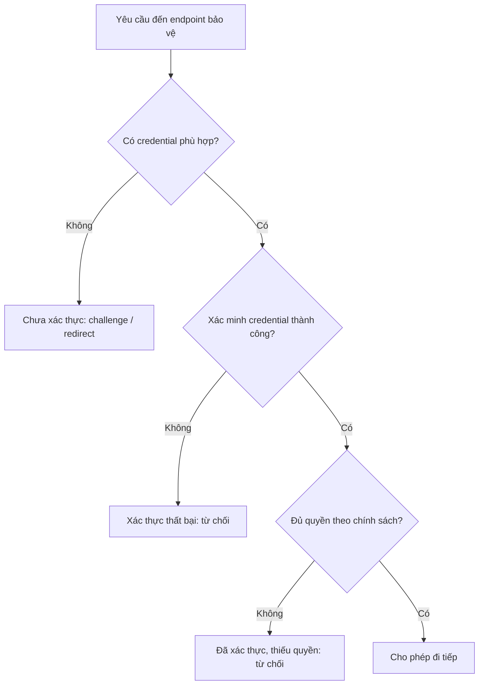

# Ca chưa đăng nhập, đủ quyền, thiếu quyền và thông tin xác thực sai

> **Chương:** Chiến lược kiểm thử  
> **Phạm vi:** `SPRING_SECURITY_TESTING` — kiểm chứng xác thực, phân quyền và bảo vệ HTTP bằng `spring-security-test` trên ứng dụng Servlet và Reactive. Bài học dùng `MockMvc`, `WebTestClient`, `@WithMockUser`, `SecurityContext` và các hình thức giả lập JWT/OAuth2/OIDC để phân biệt rõ **được phép**, **bị từ chối** và **xác thực thất bại**.

## 1. Bốn ca nền tảng và điều mỗi ca chứng minh

Khi kiểm thử endpoint được bảo vệ bằng Spring Security, chỉ có một bài test với quản trị viên nhận HTTP 200 là chưa đủ. Ta cần biết hệ thống phản ứng ra sao với ít nhất bốn trạng thái:

1. **Chưa đăng nhập (anonymous / unauthenticated):** không có thông tin xác thực cho request.
2. **Đã đăng nhập và đủ quyền (authenticated + authorized):** danh tính hợp lệ, có những quyền mà chính sách yêu cầu.
3. **Đã đăng nhập nhưng thiếu quyền (authenticated + forbidden):** danh tính hợp lệ nhưng không đủ authority, role, scope hoặc quyền trên tài nguyên.
4. **Thông tin xác thực sai (invalid credentials):** client *cố gắng* xác thực nhưng chứng cứ sai, không được biến thành một danh tính đã được xác thực.

Bốn trường hợp không thể thay thế cho nhau. Trong API minh họa dùng HTTP Basic và trả lỗi theo quy ước REST, kết quả điển hình là:

| Ca | Danh tính được xác minh? | Đủ quyền? | Kết quả HTTP ví dụ | Điều chứng minh |
|---|---|---|---|---|
| A — Chưa đăng nhập | Không | Chưa thể xét | `401 Unauthorized` | Tài nguyên yêu cầu xác thực |
| B — Đủ quyền | Có | Có | `200 OK` | Quy tắc cho phép chủ thể hợp lệ |
| C — Thiếu quyền | Có | Không | `403 Forbidden` | Quy tắc thực sự chặn quyền thiếu |
| D — Credentials sai | **Xác thực thất bại** | Chưa thể xét | `401 Unauthorized` | Cơ chế xác thực từ chối thông tin sai |

Đây là **kỳ vọng của cấu hình API ví dụ**, không phải quy luật status bất biến: ứng dụng form login có thể trả `302` chuyển hướng đến trang đăng nhập; truy cập tài nguyên khác chủ đôi khi cố ý trả `404`; policy có thể có quy tắc khác. Hãy ghi rõ hành vi mong đợi trước khi viết assertion.

### Phân biệt “không có credentials” và “credentials không hợp lệ”

Hai trường hợp A và D đều có thể trả `401`, nhưng phạm vi bằng chứng khác nhau:

- Với **A**, client hoàn toàn không gửi Authorization header, session hay token phù hợp. Hệ thống phải từ chối truy cập vào tài nguyên được bảo vệ.
- Với **D**, client gửi một password sai, Bearer token lỗi hoặc chứng cứ xác thực khác không hợp lệ. Authentication filter/provider/decoder phải kiểm tra và từ chối chứng cứ đó.

Một request **không có thông tin xác thực** không chứng minh việc kiểm tra password hay chữ ký JWT hoạt động. Ngược lại, một test **dùng `@WithMockUser`** không chứng minh được việc từ chối password sai, bởi annotation đã cấp sẵn một `Authentication` giả.

### Sơ đồ quyết định



Sơ đồ mô tả luồng quyết định khái niệm. Trong hệ thống thực, một request `POST` thiếu CSRF có thể bị chặn bởi CSRF filter trước khi đến kiểm tra quyền; một endpoint `permitAll()` có thể không yêu cầu credentials. Vì vậy, cần cô lập từng điều kiện khi thiết kế ca test.

## 2. Xác định hợp đồng của một endpoint trước khi chọn helper

Giả sử một ứng dụng báo cáo dùng Spring Security có:

- `GET /public/status`: ai cũng được truy cập.
- `GET /api/reports`: chỉ principal có authority `REPORT_READ` được đọc.
- `POST /api/reports/export`: người có `REPORT_EXPORT` được xuất báo cáo; nhánh web dùng session/cookie và yêu cầu CSRF token.
- `GET /partner/reports`: chỉ Bearer JWT hợp lệ có scope `reports.read` được truy cập.

Trong bài, ta lấy `GET /api/reports` làm endpoint chính, vì `GET` không bị CSRF filter cản trong cấu hình thông thường. API ví dụ dùng **HTTP Basic**, một `SecurityFilterChain` áp dụng rule `hasAuthority("REPORT_READ")` và authentication entry point gửi `401` khi thiếu hoặc sai credentials.

Hai người dùng mẫu:

| Principal | Mật khẩu minh họa | Authorities | Mục đích |
|---|---|---|---|
| `an` | `correct-password` | `REPORT_READ` | Kiểm thử đủ quyền |
| `binh` | `binh-password` | `ORDER_READ` | Kiểm thử thiếu quyền |

Mật khẩu chỉ phục vụ fixture local; không được đặt tài khoản thật hay thông tin bí mật sản xuất vào mã test.

Một hợp đồng có thể kiểm chứng:

> Một request `GET /api/reports` không có danh tính được xác thực phải bị thử thách xác thực; một danh tính hợp lệ thiếu `REPORT_READ` phải bị từ chối; danh tính hợp lệ có `REPORT_READ` được đọc báo cáo; bất kỳ password sai nào đều không được cấp danh tính hợp lệ, kể cả khi username đó có `REPORT_READ`.

Từ hợp đồng này tạo bốn test chính, và một test thứ năm với credentials **đúng** để đối chứng ca password sai. Nếu chỉ thử password sai mà chưa thử password đúng, một cấu hình khóa hết người dùng cũng có thể làm bài kiểm thử “đỏ/xanh” gây hiểu nhầm.

## 3. Đặc tả đầy đủ cho bốn ca

| ID | Request | Thiết lập danh tính | Kỳ vọng | Bằng chứng bổ sung |
|---|---|---|---|---|
| `R01` | `GET /api/reports` | Không session, không Authorization header | `401` | Không nhận nội dung báo cáo |
| `R02` | `GET /api/reports` | `an` được xác thực với `REPORT_READ` | `200` | Body là báo cáo được phép |
| `R03` | `GET /api/reports` | `binh` được xác thực, chỉ có `ORDER_READ` | `403` | Không nhận nội dung báo cáo |
| `R04` | `GET /api/reports` | Header Basic chứa `an` + password sai | `401` | Không nhận nội dung báo cáo |
| `R05` | `GET /api/reports` | Header Basic chứa `an` + password đúng | `200` | Decoder của Basic header và authentication provider chấp nhận |

**R02** và **R03** kiểm tra quy tắc phân quyền. Có thể dùng `@WithMockUser`, `user()` hoặc helper Reactive `mockUser()` để cấp principal giả và tập trung vào quyền. **R04** và **R05** kiểm tra quá trình xác thực, do đó phải gửi credentials thực vào authentication filter/provider đang chạy. Không dùng `@WithMockUser` để dựng R04/R05.

Một test chất lượng có thể phát hiện các lỗi giả định:

- Nếu lỡ đổi `hasAuthority("REPORT_READ")` thành `authenticated()`, **R03 phải thất bại**.
- Nếu lỡ đổi thành `permitAll()`, **R01 và R03 phải thất bại**.
- Nếu authentication provider chấp nhận mọi password, **R04 phải thất bại**.
- Nếu credentials đúng bị từ chối do cấu hình sai, **R05 phải thất bại**.
- Nếu controller trả dữ liệu sai dù status `200`, assertion nội dung của **R02/R05 phải thất bại**.

## 4. Cấu hình Servlet minh họa để làm rõ hành vi

Đoạn code sau thể hiện cách cấu hình HTTP Basic và rule `REPORT_READ`. Nó là ví dụ học tập cho một ứng dụng Spring Boot Servlet có MVC controller:

```java
@Configuration
@EnableWebSecurity
class ReportSecurityConfig {

    @Bean
    SecurityFilterChain securityFilterChain(HttpSecurity http) throws Exception {
        return http
            .authorizeHttpRequests(auth -> auth
                .requestMatchers(HttpMethod.GET, "/public/status").permitAll()
                .requestMatchers(HttpMethod.GET, "/api/reports")
                    .hasAuthority("REPORT_READ")
                .anyRequest().denyAll()
            )
            .httpBasic(Customizer.withDefaults())
            .build();
    }

    @Bean
    PasswordEncoder passwordEncoder() {
        return PasswordEncoderFactories.createDelegatingPasswordEncoder();
    }

    @Bean
    UserDetailsService userDetailsService(PasswordEncoder encoder) {
        UserDetails reader = User.withUsername("an")
            .password(encoder.encode("correct-password"))
            .authorities("REPORT_READ")
            .build();

        UserDetails ordinaryUser = User.withUsername("binh")
            .password(encoder.encode("binh-password"))
            .authorities("ORDER_READ")
            .build();

        return new InMemoryUserDetailsManager(reader, ordinaryUser);
    }
}

@RestController
class ReportController {

    @GetMapping("/api/reports")
    String reports() {
        return "sales-report";
    }

    @GetMapping("/public/status")
    String status() {
        return "OK";
    }
}
```

Cấu hình này:

- Yêu cầu `REPORT_READ` cho `GET /api/reports`.
- Bật HTTP Basic để request có thể gửi username/password qua `Authorization: Basic ...`.
- Dùng `UserDetailsService` và `PasswordEncoder` thật trong context để xác minh password đúng/sai.
- Từ chối những endpoint khác không được khai báo bằng `anyRequest().denyAll()`.

Khi dùng HTTP Basic, credential được gửi trong header của **mỗi request**. Mã ví dụ cần chạy trong môi trường HTTPS nếu được triển khai ngoài local, vì Base64 của Basic header không phải mã hóa bảo mật.

**Lưu ý:** `httpBasic()` tạo authentication entry point có thể trả `401` và header `WWW-Authenticate`. Một ứng dụng bật form login hoặc nhiều filter chain có thể có hành vi khác. Nếu kiểm thử yêu cầu `401` cụ thể, hãy xác định đúng entry point áp dụng cho endpoint.

## 5. Test Servlet bằng MockMvc: phân quyền giả lập và credentials thật

Với `@SpringBootTest` và `@AutoConfigureMockMvc`, request đi qua application context và các security filters của ứng dụng (miễn là filter không bị tắt). Ví dụ:

```java
@SpringBootTest
@AutoConfigureMockMvc
class ReportAccessSecurityTest {

    @Autowired
    MockMvc mvc;

    @Test
    void r01_anonymousIsChallenged() throws Exception {
        mvc.perform(get("/api/reports"))
            .andExpect(status().isUnauthorized())
            .andExpect(content().string(""));
    }

    @Test
    @WithMockUser(username = "an", authorities = "REPORT_READ")
    void r02_authenticatedAndAuthorizedCanRead() throws Exception {
        mvc.perform(get("/api/reports"))
            .andExpect(status().isOk())
            .andExpect(content().string("sales-report"));
    }

    @Test
    @WithMockUser(username = "binh", authorities = "ORDER_READ")
    void r03_authenticatedWithoutPermissionIsForbidden() throws Exception {
        mvc.perform(get("/api/reports"))
            .andExpect(status().isForbidden())
            .andExpect(content().string(""));
    }

    @Test
    void r04_wrongPasswordDoesNotAuthenticate() throws Exception {
        mvc.perform(get("/api/reports")
                .with(httpBasic("an", "wrong-password")))
            .andExpect(status().isUnauthorized())
            .andExpect(content().string(""));
    }

    @Test
    void r05_correctPasswordAuthenticatesAndAllowsAccess()
            throws Exception {
        mvc.perform(get("/api/reports")
                .with(httpBasic("an", "correct-password")))
            .andExpect(status().isOk())
            .andExpect(content().string("sales-report"));
    }
}
```

Đoạn test dùng JUnit Jupiter, Spring Boot Test và `spring-security-test`; lược bỏ `import` cho dễ đọc. Các static imports tương ứng thường gồm:

- `MockMvcRequestBuilders.get` và `MockMvcResultMatchers.status`/`content`.
- `SecurityMockMvcRequestPostProcessors.httpBasic`.
- `WithMockUser` từ `org.springframework.security.test.context.support`.

Trong test thật, nếu ứng dụng có trang lỗi tùy biến hoặc xử lý body của `401`/`403`, đừng cố định `content().string("")` một cách máy móc. Hãy kiểm tra điều quan trọng hơn: **không chứa dữ liệu nhạy cảm**, không lộ báo cáo và phản hồi đúng hợp đồng. Header `WWW-Authenticate` có thể được assert ở ca Basic nếu đó là yêu cầu API.

### Vì sao R02/R03 dùng @WithMockUser, R04/R05 dùng httpBasic?

`@WithMockUser` thiết lập `SecurityContext` giả trước khi chạy test. Authentication đã được coi là hợp lệ; từ đó test đi thẳng vào quy tắc phân quyền. Không cần phụ thuộc password encoder hoặc database tài khoản.

`httpBasic("an", "wrong-password")` lại chỉ tạo HTTP Basic header trên request. Spring Security phải đọc header, tìm user `an`, so sánh password qua encoder/provider và quyết định. Đây là cách phù hợp để kiểm tra credentials sai ở lớp authentication.

Nếu R04 còn đặt `@WithMockUser` trên method hoặc class, security context giả có thể ảnh hưởng đường đi và khiến kết luận về password sai không đáng tin. Hãy giữ test xác thực thật độc lập với mock authentication.

### Cách dùng request-scoped user() khi muốn dữ liệu hóa test

Một biến thể của R02/R03 dùng `user()` để thay authority cho mỗi request:

```java
mvc.perform(get("/api/reports")
        .with(user("an")
            .authorities(new SimpleGrantedAuthority("REPORT_READ"))))
    .andExpect(status().isOk());

mvc.perform(get("/api/reports")
        .with(user("binh")
            .authorities(new SimpleGrantedAuthority("ORDER_READ"))))
    .andExpect(status().isForbidden());
```

`user()` dựng principal ở phía test; nó **không kiểm tra mật khẩu** và cũng không chứng minh người dùng có tồn tại trong `UserDetailsService`. Ưu điểm là có thể dùng nhiều danh tính khác nhau trong cùng một bài test hoặc `@ParameterizedTest`.

## 6. Cặp đối chứng: kiểm tra người thiếu quyền thay vì chỉ kiểm tra anonymous

Một tình huống dễ bị bỏ sót: cả hai request này đều bị từ chối, nhưng vì hai lý do khác nhau:

```text
Request 1:
  GET /api/reports
  Authorization: [none]
  -> 401 (phải xác thực)

Request 2:
  GET /api/reports
  Authentication: binh
  Authorities: [ORDER_READ]
  -> 403 (đã xác thực nhưng thiếu REPORT_READ)
```

Nếu chỉ có Request 1, hệ thống vẫn có thể cho **mọi user đã đăng nhập** đọc báo cáo. Ca thiếu quyền là bằng chứng chính sách `REPORT_READ` thực sự có hiệu lực.

Kiểm thử thiếu quyền nên dùng một danh tính hợp lệ, có authority cụ thể nhưng **không chứa** authority cần thiết. Ví dụ:

- `roles = "USER"` tạo `ROLE_USER`; không đồng nghĩa với `REPORT_READ`.
- `authorities = "REPORT_READ"` cấp đúng chuỗi authority mà `hasAuthority("REPORT_READ")` so sánh.
- `roles = "ADMIN"` thường tạo `ROLE_ADMIN`; chỉ có thể đọc báo cáo nếu policy cho admin quyền đọc hoặc rule riêng công nhận vai trò admin. Đừng mặc định mọi admin được phép qua mọi rule.

**Lỗi phổ biến:** dùng `@WithMockUser` mặc định làm test thiếu quyền. Giá trị mặc định thường là username `user` và role `USER`, nhưng khi hệ thống thay đổi rule hoặc tự động thêm quyền, ý nghĩa test trở nên khó đọc. Khai báo tường minh `authorities = "ORDER_READ"` hoặc đúng quyền thiếu mà bạn muốn thử sẽ dễ đánh giá hơn.

## 7. Trường hợp thông tin xác thực sai cần được thử thế nào?

Thông tin xác thực sai có nhiều dạng, phụ thuộc cơ chế đăng nhập. Không phải mọi request lỗi đều được thử bằng cùng một helper.

| Cơ chế | Input sai cần tạo | Đường kiểm chứng phù hợp | Điều không nên nhầm |
|---|---|---|---|
| HTTP Basic | Username không tồn tại; password sai | Gửi Basic header qua `httpBasic()` hoặc HTTP client thật | Không dùng `@WithMockUser` để giả lập sai password |
| Form login | Username/password sai; form parameter sai | Gửi `POST` vào login-processing URL thật, thêm CSRF phù hợp | Không dùng `formLogin()` rồi mặc nhiên suy ra login đã thất bại |
| Session | Session hết hạn, session không còn hiệu lực | Sử dụng session/cookie thật đã vô hiệu hóa | Không dùng user giả để chứng minh thời hạn session |
| JWT Bearer | Sai chữ ký, hết hạn, sai issuer/audience theo validator | Gửi `Authorization: Bearer ...` vào decoder thực | `jwt()`/`mockJwt()` giả lập authentication, không xác minh chữ ký |
| OAuth2/OIDC | State/code/token không hợp lệ, issuer/nonce tùy luồng | Integration/E2E qua login flow, client và provider test phù hợp | `oauth2Login()`/`oidcLogin()` mô phỏng danh tính đã login |
| Tài khoản bị khóa/tắt | Credentials đúng nhưng account không được phép login | Authentication provider/user details thực | User giả bằng mock chưa chứng minh trạng thái account |

### Wrong password không phải insufficient authority

Giả sử `an` có `REPORT_READ`, nhưng client gửi password sai. Không được trả `200` nhờ quyền đọc của `an`, vì Spring chưa có bằng chứng client thật sự là `an`. Kết quả đúng của cấu hình Basic ví dụ là `401`.

Sau khi xác thực thành công với `binh`, client có danh tính thật nhưng chỉ có `ORDER_READ`. Khi gọi API cần `REPORT_READ`, hệ thống có thể trả `403`. Đây là hai tầng kiểm tra nối tiếp nhau: **xác minh danh tính trước, kiểm tra quyền sau**.

Trong hệ thống phân tán, đôi khi authentication ở API gateway và authorization ở service. Test cần xác định nơi nào kiểm tra credentials, nơi nào tin header đã được gateway xác minh, và không giả định tất cả đều diễn ra trong một filter chain.

## 8. WebFlux: cùng bốn ca trên Reactive WebTestClient

Trong ứng dụng Reactive, Spring Security sử dụng `SecurityWebFilterChain` và Reactor security context. Có thể cấu hình một resource tương tự:

```java
@Configuration
@EnableWebFluxSecurity
class ReactiveReportSecurityConfig {

    @Bean
    SecurityWebFilterChain webFilterChain(ServerHttpSecurity http) {
        return http
            .authorizeExchange(exchanges -> exchanges
                .pathMatchers(HttpMethod.GET, "/api/reports")
                    .hasAuthority("REPORT_READ")
                .anyExchange().denyAll()
            )
            .httpBasic(Customizer.withDefaults())
            .build();
    }

    @Bean
    MapReactiveUserDetailsService reactiveUsers(PasswordEncoder encoder) {
        UserDetails reader = User.withUsername("an")
            .password(encoder.encode("correct-password"))
            .authorities("REPORT_READ")
            .build();

        UserDetails ordinary = User.withUsername("binh")
            .password(encoder.encode("binh-password"))
            .authorities("ORDER_READ")
            .build();

        return new MapReactiveUserDetailsService(reader, ordinary);
    }

    @Bean
    PasswordEncoder passwordEncoder() {
        return PasswordEncoderFactories.createDelegatingPasswordEncoder();
    }
}
```

Giả sử ứng dụng WebFlux có handler `GET /api/reports` trả `Mono.just("sales-report")`. Một test bind `WebTestClient` vào context có thể kiểm tra từng tình huống:

```java
@SpringBootTest(properties = "spring.main.web-application-type=reactive")
class ReactiveReportAccessTest {

    @Autowired
    ApplicationContext context;

    WebTestClient client;

    @BeforeEach
    void setUp() {
        client = WebTestClient.bindToApplicationContext(context)
            .apply(springSecurity())
            .configureClient()
            .build();
    }

    @Test
    void r01_anonymousIsChallenged() {
        client.get().uri("/api/reports")
            .exchange()
            .expectStatus().isUnauthorized();
    }

    @Test
    void r02_authorizedUserCanRead() {
        client.mutateWith(mockUser("an")
                .authorities(
                    new SimpleGrantedAuthority("REPORT_READ")))
            .get().uri("/api/reports")
            .exchange()
            .expectStatus().isOk()
            .expectBody(String.class).isEqualTo("sales-report");
    }

    @Test
    void r03_userWithoutPermissionIsForbidden() {
        client.mutateWith(mockUser("binh")
                .authorities(
                    new SimpleGrantedAuthority("ORDER_READ")))
            .get().uri("/api/reports")
            .exchange()
            .expectStatus().isForbidden();
    }

    @Test
    void r04_wrongBasicPasswordIsRejected() {
        client.get().uri("/api/reports")
            .headers(h -> h.setBasicAuth("an", "wrong-password"))
            .exchange()
            .expectStatus().isUnauthorized();
    }

    @Test
    void r05_correctBasicPasswordIsAccepted() {
        client.get().uri("/api/reports")
            .headers(h -> h.setBasicAuth("an", "correct-password"))
            .exchange()
            .expectStatus().isOk();
    }
}
```

Trong đoạn mã:

- `springSecurity()` là API của `SecurityMockServerConfigurers` trong `spring-security-test` cho server-side `WebTestClient`.
- `mockUser()` đến từ `SecurityMockServerRequestPostProcessors`, cung cấp principal giả cho R02/R03.
- `headers(h -> h.setBasicAuth(...))` thực sự thêm HTTP Basic header. Với client bind vào application context và security config đã nạp đúng, R04/R05 đi qua cơ chế xác thực Basic và `ReactiveUserDetailsService`.
- `WebTestClient` ở ví dụ đang **bind vào context trong tiến trình**, chưa gửi TCP/HTTP đến máy chủ thật. Để kiểm chứng qua mạng, dùng `bindToServer()` hoặc client được auto-configure cho server đang chạy và gửi credentials thật.

Không dùng `@WithMockUser` cho R04/R05, vì mục tiêu là xác minh credentials. Đối với code Reactive kiểm tra security context bên trong chuỗi `Mono`/`Flux`, cần biết danh tính nằm trong Reactor context; đặt trực tiếp `SecurityContextHolder` kiểu ThreadLocal không đại diện đầy đủ cho cơ chế này.

## 9. JWT: anonymous, scope đúng, scope thiếu và token sai

Với API Bearer JWT, bốn ca cũng tồn tại, nhưng “đủ quyền” thường là **authority được ánh xạ từ scope/claim**.

Giả sử `GET /partner/reports` chỉ chấp nhận access token hợp lệ có scope `reports.read`. Bảng hợp đồng:

| ID | Đầu vào | Quyết định mong đợi | Điều test |
|---|---|---|---|
| `J01` | Không có Bearer token | `401` | API yêu cầu xác thực |
| `J02` | JWT hợp lệ có scope `reports.read` | `200` | Được phép theo scope |
| `J03` | JWT hợp lệ chỉ có `reports.write` | `403` | Thiếu quyền đọc |
| `J04` | JWT sai chữ ký | `401` | Signature validation |
| `J05` | JWT hết hạn | `401` | Expiration validation |
| `J06` | JWT sai issuer/audience so với validator được cấu hình | `401` | Kiểm tra issuer/audience đã khai báo |

### Test scope bằng JWT giả lập: phù hợp cho J02/J03

Servlet với `MockMvc`:

```java
mvc.perform(get("/partner/reports")
        .with(jwt().authorities(
            new SimpleGrantedAuthority("SCOPE_reports.read"))))
    .andExpect(status().isOk());

mvc.perform(get("/partner/reports")
        .with(jwt().authorities(
            new SimpleGrantedAuthority("SCOPE_reports.write"))))
    .andExpect(status().isForbidden());
```

Reactive với `WebTestClient` bind vào application context:

```java
client.mutateWith(mockJwt()
        .authorities(
            new SimpleGrantedAuthority("SCOPE_reports.read")))
    .get().uri("/partner/reports")
    .exchange()
    .expectStatus().isOk();
```

Trong cấu hình resource server phổ biến, scope `reports.read` được ánh xạ thành authority `SCOPE_reports.read`; điều này có thể thay đổi nếu ứng dụng dùng custom converter. Helper `jwt().authorities(...)` hoặc `mockJwt().authorities(...)` gán quyền trực tiếp, vì vậy cũng **không tự kiểm chứng converter** ánh xạ claims thành authorities.

### Test token sai: phải đi qua JwtDecoder thật

J04/J05/J06 khác bản chất. Khi gọi `with(jwt())` hoặc `mockJwt()`, test đã cung cấp authentication giả lập và không bắt decoder xác minh chữ ký, `exp`, `iss` hay `aud`.

Để kiểm thử JWT không hợp lệ:

1. Dựng resource server với `JwtDecoder`/`ReactiveJwtDecoder` và validators phù hợp. Nếu kiểm tra audience thì cấu hình audience validator rõ ràng; đừng giả định mọi validator mặc định đều kiểm tra audience.
2. Tạo token có chữ ký sai, token hết hạn hoặc issuer/audience sai (mỗi test chỉ thay đổi một điểm so với token hợp lệ).
3. Gửi **Authorization header** đến API, ví dụ qua `MockMvc`:

```java
mvc.perform(get("/partner/reports")
        .header(HttpHeaders.AUTHORIZATION, "Bearer " + invalidJwt))
    .andExpect(status().isUnauthorized());
```

4. Thêm token hợp lệ đối chứng để tránh kết luận sai từ hệ thống đang chặn mọi token.
5. Kiểm tra dữ liệu bảo vệ không bị lộ, và nếu có side effect thì không xảy ra.

Biến `invalidJwt` trong ví dụ phải chứa token được sinh đúng tình huống test, không phải chuỗi tùy ý nếu bạn định chứng minh riêng rằng “token **hết hạn** bị từ chối”. Chuỗi rác có thể bị chặn do lỗi định dạng trước khi kiểm tra `exp`.

Ngoài JWT, các helper `oauth2Login()`, `oidcLogin()` (Servlet) hoặc `mockOAuth2Login()`, `mockOidcLogin()` (Reactive) rất phù hợp để kiểm tra authorization dựa trên principal và claims **đã xác thực**. Chúng không phải công cụ chứng minh full login redirect/callback, authorization code exchange, OIDC nonce/issuer validation hoặc lỗi từ identity provider; những ca đó cần test tích hợp luồng xác thực phù hợp.

## 10. Thao tác ghi: CSRF có thể làm sai kết luận về thiếu quyền

Ở `GET /api/reports`, ta thường có thể quan sát riêng các kết quả `401`/`403`. Với `POST`, `PUT`, `PATCH` và `DELETE` của nhánh **session/cookie có CSRF protection**, kiểm thử cần kiểm soát thêm CSRF token.

Xét `POST /api/reports/export` yêu cầu authority `REPORT_EXPORT` và CSRF:

| Danh tính | Quyền | CSRF | Mục tiêu ca test | Kỳ vọng ví dụ |
|---|---|---|---|---|
| Đã đăng nhập | Có `REPORT_EXPORT` | Thiếu | Chứng minh CSRF protection | `403` |
| Đã đăng nhập | Thiếu `REPORT_EXPORT` | Hợp lệ | Chứng minh phân quyền | `403` |
| Đã đăng nhập | Có `REPORT_EXPORT` | Hợp lệ | Chứng minh nhánh cho phép | `2xx` theo hợp đồng |
| Chưa đăng nhập | — | Hợp lệ | Chứng minh yêu cầu xác thực | `401`/redirect theo entry point |

Nếu viết test thiếu quyền mà **không cấp CSRF**, response `403` có thể đến từ CSRF filter trước khi Spring Security kiểm tra authority. Test xanh khi rule `REPORT_EXPORT` đã bị gỡ.

Servlet:

```java
mvc.perform(post("/api/reports/export")
        .with(user("binh").authorities(
            new SimpleGrantedAuthority("ORDER_READ")))
        .with(csrf()))
    .andExpect(status().isForbidden());

mvc.perform(post("/api/reports/export")
        .with(user("an").authorities(
            new SimpleGrantedAuthority("REPORT_EXPORT")))
        .with(csrf()))
    .andExpect(status().is2xxSuccessful());
```

Reactive:

```java
client.mutateWith(mockUser("binh")
        .authorities(new SimpleGrantedAuthority("ORDER_READ")))
    .mutateWith(csrf())
    .post().uri("/api/reports/export")
    .exchange()
    .expectStatus().isForbidden();
```

Ví dụ phụ thuộc endpoint và cấu hình thực sự có rule/export handler. `csrf()` trong Servlet là `SecurityMockMvcRequestPostProcessors.csrf()`; trong Reactive là `SecurityMockServerRequestPostProcessors.csrf()`. Không chuyển nguyên helper giữa hai stack.

Nếu API chỉ dùng Bearer token và không dựa vào credential tự động đính kèm như cookie/session, chính sách CSRF có thể khác. Cần kiểm tra mô hình xác thực và cấu hình thật của từng nhánh trước khi định nghĩa ma trận.

## 11. Kiểm tra kết quả nào ngoài status?

Nhận đúng status rất quan trọng nhưng không đủ để kết luận hệ thống an toàn.

| Nhóm ca | Assertion tối thiểu | Assertion tăng độ tin cậy |
|---|---|---|
| Anonymous | HTTP challenge/redirect theo hợp đồng | Không có nội dung bí mật; response không nhầm với trang công khai |
| Đủ quyền | `2xx` và body đúng | Dữ liệu thuộc principal/tenant đúng; không lộ dữ liệu không được phép |
| Thiếu quyền | `403`/`404` theo hợp đồng | Body không lộ resource; service không đọc/ghi vượt quyền |
| Credentials sai | Authentication thất bại và response từ chối | Không tạo session authenticated; không cấp token; không lộ dữ liệu |
| Thao tác ghi bị từ chối | Response từ chối | Repository giữ nguyên; không phát sự kiện hay gọi tác vụ nhạy cảm |

Ví dụ, `DELETE /api/orders/42` bị từ chối phải giữ nguyên đơn trong DB. `POST /api/payments/refund` bị từ chối không được tạo giao dịch hoàn tiền trước rồi mới phát hiện thiếu quyền. Những kiểm tra này thường phù hợp với integration test có repository/fixture và có thể kết hợp với unit test policy.

Một số hệ thống che giấu sự tồn tại resource bằng `404` thay cho `403`. Test phải dựa trên quyết định thiết kế: không truy cập được tài nguyên, không lộ dữ liệu, không ghi trạng thái. Đừng khẳng định mọi request “thiếu quyền” đều bắt buộc `403`.

### Authentication có thể đúng nhưng resource-level authorization vẫn sai

Ngay cả R02 với `REPORT_READ` được phép, một báo cáo có thể thuộc tenant khác và không được phép. Lúc đó phải thêm ma trận ownership/tenant:

- Cùng authority nhưng **đúng tenant** → có thể `200`.
- Cùng authority nhưng **sai tenant** → phải bị từ chối theo chính sách.
- Client giả mạo query/path/claim để chỉ sang tenant khác → vẫn không được vượt quyền.

Cần dùng hai tài nguyên có chủ khác nhau để thật sự phát hiện lỗi IDOR/BOLA; chỉ đổi username nhưng truy cập cùng một tài nguyên công khai không chứng minh được kiểm soát đối tượng.

## 12. Chọn tầng test để mỗi ca tạo đúng loại bằng chứng

| Nội dung cần kiểm tra | Tầng test phù hợp | Vì sao |
|---|---|---|
| Quy tắc role/authority hoặc quyền theo owner/tenant trong một hàm | Unit test | Nhanh, cô lập logic điều kiện |
| Anonymous, đủ quyền, thiếu quyền tại HTTP matcher | Web slice hoặc integration với security filter chain | Quan sát `401`/`403`/`200` |
| HTTP Basic password đúng/sai qua authentication provider | Integration có provider/user store/encoder thật | `@WithMockUser` không kiểm tra password |
| JWT scope đúng/thiếu | Web slice hoặc integration với `jwt()`/`mockJwt()` | Cô lập authorization theo scope giả lập |
| JWT sai chữ ký/hết hạn/issuer/audience | Integration qua decoder/validator thật | Bắt lỗi xác minh token |
| Login redirect, OIDC callback, cookie/session hoặc logout | Integration HTTP/E2E | Bắt lỗi luồng thực, cookie, trạng thái trình duyệt |
| Thao tác bị từ chối không thay đổi DB | Integration có storage/fixture phù hợp | Khẳng định side effect không xảy ra |

`@WebMvcTest` và `@WebFluxTest` là các kiểu web slice. Các cấu hình security cần thiết phải thật sự được đưa vào test slice; nếu mock service chứa rule ở method security, test slice không chứng minh rule service đó. `@SpringBootTest` nạp context rộng hơn nhưng **không mặc nhiên là E2E**; khi dùng `MockMvc`/`WebTestClient.bindToApplicationContext(...)`, request vẫn ở trong tiến trình.

Ngược lại, `@SpringBootTest(webEnvironment = RANDOM_PORT)` và một HTTP client gửi credentials thật có thể chứng minh nhiều lớp hơn. Nhưng “request qua network” vẫn chưa tự động kiểm tra một hành trình OAuth2/OIDC hoàn chỉnh nếu identity provider đã bị thay bằng mock.

## 13. Mẫu dữ liệu hóa bốn ca khi số endpoint tăng

Khi nhiều API có chính sách tương tự, nên biểu diễn **ca kiểm thử** theo dữ liệu có tên rõ ràng. Không phải mọi ca đều chạy cùng một cách: anonymous/authorized/forbidden có thể dùng mock security context, còn invalid credential phải qua authentication mechanism thật.

Một bảng đầu vào:

| ID | Endpoint | Principal/credentials | Quyền được cấp | Kỳ vọng |
|---|---|---|---|---|
| `T01` | `GET /api/reports` | Anonymous | — | `401` |
| `T02` | `GET /api/reports` | Mock principal `an` | `REPORT_READ` | `200` |
| `T03` | `GET /api/reports` | Mock principal `binh` | `ORDER_READ` | `403` |
| `T04` | `GET /api/reports` | Basic `an` + password sai | Không được xác thực | `401` |
| `T05` | `GET /api/reports` | Basic `an` + password đúng | Provider trả `REPORT_READ` | `200` |
| `T06` | `GET /public/status` | Anonymous | — | `200` |

Dùng `@ParameterizedTest` cho nhóm mock principal:

```java
static Stream<Arguments> authorizationCases() {
    return Stream.of(
        Arguments.of("T02", "an", "REPORT_READ", 200),
        Arguments.of("T03", "binh", "ORDER_READ", 403)
    );
}

@ParameterizedTest(name = "{0}: {1} -> {3}")
@MethodSource("authorizationCases")
void shouldApplyReportAuthorities(
        String id, String userName, String authority,
        int expectedStatus) throws Exception {

    mvc.perform(get("/api/reports")
            .with(user(userName).authorities(
                new SimpleGrantedAuthority(authority))))
        .andExpect(status().is(expectedStatus));
}
```

Giữ riêng test credentials sai dùng `httpBasic()`/HTTP header. Nếu gộp sai bằng cách dựng `@WithMockUser(username = "an")` rồi cố “mô phỏng password sai”, dữ liệu ca test sẽ ghi một intent mà cách chạy không thể chứng minh.

Tên ca nên phản ánh quyết định:

```text
anonymous_isChallenged
reportReader_isAllowed
authenticatedWithoutReadPermission_isForbidden
wrongPassword_isRejected
correctPassword_isAccepted
expiredJwt_isRejectedByDecoder
```

### Kiểm tra cặp đối chứng thay đổi đúng một biến

Để biết tại sao test thất bại, mỗi cặp so sánh nên chỉ thay đổi một yếu tố:

- R02 và R03: danh tính đã xác thực, endpoint giống nhau; khác **authority**.
- R04 và R05: username và endpoint giống nhau; khác **password**.
- J02 và J03: JWT giả lập; khác **scope/authority**.
- J04 và một JWT hợp lệ cùng claims: khác **chữ ký**.
- Một thao tác ghi đủ quyền: một request có CSRF hợp lệ, một request thiếu CSRF.

Nếu đồng thời đổi principal, tenant, HTTP method, CSRF và password, một status `403` không còn chỉ rõ hệ thống chặn theo chính sách nào.

## 14. Những sai lầm làm test có vẻ đúng nhưng bằng chứng sai

| Sai lầm | Hệ quả | Cách sửa |
|---|---|---|
| Dùng `@WithMockUser` để test mật khẩu sai | Không có bước xác minh password | Gửi password qua Basic/form login thật |
| Chỉ có test với user đủ quyền | Rule có thể bị mở thành `authenticated()` mà vẫn xanh | Thêm authenticated thiếu quyền |
| Không thử anonymous | Endpoint có thể vô tình `permitAll()` | Thêm ca không credentials |
| Kết luận `401` và `403` giống nhau | Mất phân biệt authentication và authorization | Ghi rõ input, policy và HTTP status |
| Dùng `jwt()` để kiểm tra expired/signed JWT | Decoder không chạy xác minh chữ ký/thời hạn | Gửi Bearer token thật qua decoder |
| Thử POST thiếu quyền nhưng không cấp CSRF | Bị CSRF chặn trước khi đến rule phân quyền | Cấp CSRF hợp lệ cho test quyền |
| Gắn `@WithMockUser` ở cấp class, sau đó test invalid Basic | Mock context có thể che đường authentication thật | Tách test credentials thật khỏi mock auth |
| Tắt filters bằng `addFilters = false` | Kiểm thử không đi qua hàng rào HTTP | Bật filter chain trong test bảo mật |
| Test sai mapping authority/role | `ADMIN` khác `ROLE_ADMIN`; scope có prefix riêng | Dùng đúng chuỗi policy thực kiểm tra |
| Chỉ assert HTTP status | Không phát hiện rò rỉ dữ liệu hoặc side effect | Kiểm tra body, DB, sự kiện khi cần |
| Xem một request `@SpringBootTest` là E2E | Không chứng minh luồng IdP/network/cookie thực | Chọn HTTP/E2E phù hợp mục tiêu |
| Credentials sai nhưng request vẫn có session hợp lệ | Hệ thống có thể dùng session để xác thực | Dùng session mới/độc lập hoặc vô hiệu hóa phiên cũ |

Một test là bằng chứng đáng tin khi người đọc biết **bước nào đã được giả lập**, **bước nào thực sự chạy**, và **một lỗi cụ thể sẽ làm assertion nào thất bại**.

## 15. Bài tập thực hành: xây đủ bốn ca cho hai endpoint

Giả sử hệ thống quản lý tài liệu có:

- `GET /api/documents/42`: chỉ user có authority `DOCUMENT_READ` và thuộc tenant chứa tài liệu mới được xem.
- `POST /api/documents/42/publish`: chỉ user có `DOCUMENT_PUBLISH`, cùng tenant, tài liệu ở trạng thái `DRAFT` được xuất bản; web session yêu cầu CSRF.
- Người dùng `mai` có `DOCUMENT_READ` ở tenant `alpha`; người dùng `nam` chỉ có `DOCUMENT_EDIT` ở `alpha`; user `lan` có `DOCUMENT_READ` ở tenant `beta`.
- Nhánh đối tác `GET /partner/documents` yêu cầu JWT có `SCOPE_documents.read`.

**Yêu cầu 1 — Ma trận:** viết các ca chưa đăng nhập, đủ quyền, thiếu quyền và credentials sai cho `GET /api/documents/42`. Ghi status mong đợi và một assertion đảm bảo không lộ nội dung tài liệu. Nếu ứng dụng dùng form login, sửa kỳ vọng ẩn danh theo entry point đã chọn.

**Yêu cầu 2 — Phân quyền theo dữ liệu:** thêm hai ca cùng authority `DOCUMENT_READ` nhưng khác tenant. Nêu vì sao có quyền đọc chung chưa đủ để truy cập tài liệu tenant khác.

**Yêu cầu 3 — CSRF:** với `POST /api/documents/42/publish`, tạo cặp request đủ quyền có/thiếu CSRF; thêm ca thiếu `DOCUMENT_PUBLISH` nhưng có CSRF hợp lệ. Với các ca bị từ chối, xác nhận tài liệu vẫn ở trạng thái `DRAFT`.

**Yêu cầu 4 — Credentials thật:** gửi HTTP Basic password sai và đúng qua authentication provider, hoặc form login thật nếu ứng dụng sử dụng form login. Giải thích tại sao `@WithMockUser` không thay thế được phần này.

**Yêu cầu 5 — JWT:** viết cặp scope đúng/thiếu bằng `jwt()` hoặc `mockJwt()` và một test Bearer token hết hạn qua decoder thật. Phân biệt kết luận của hai loại test.

**Tiêu chí hoàn thành:** Khi nhìn vào từng ca, bạn có thể chỉ ra ngay chủ thể đã được xác thực hay chưa, có quyền gì, security component nào xử lý request, vì sao kết quả là được phép/`401`/`403` (hoặc redirect theo hợp đồng), và liệu test có chứng minh đúng thứ mình định chứng minh hay không.

Một bộ test có đủ **anonymous, authorized, forbidden và invalid credentials** mới cho thấy sự khác biệt giữa bảo vệ endpoint, thực thi quyền và từ chối chứng cứ đăng nhập không hợp lệ. Với Spring Security Testing, sự khác biệt ấy quyết định lúc nào dùng `@WithMockUser`/`mockUser()` và lúc nào phải đưa credentials thật qua bộ lọc xác thực.
