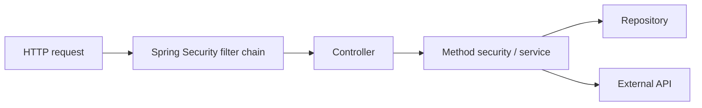

# Chọn giả lập ở lớp phụ thuộc mà không bỏ qua lớp đang kiểm tra

> **Chương:** Chiến lược kiểm thử  
> **Module:** `SPRING_SECURITY_TESTING` — kiểm chứng xác thực, phân quyền và bảo vệ HTTP bằng `spring-security-test` trên ứng dụng Servlet và Reactive. Bài sử dụng `MockMvc`, `WebTestClient`, `@WithMockUser`, `SecurityContext`, JWT/OAuth2/OIDC giả lập và các ca được phép hoặc bị từ chối.

## 1. Giả lập để cô lập vấn đề, không để tạo kết quả đúng sẵn

Một bài test Spring Security có thể chạy rất nhanh và luôn xanh, nhưng không chứng minh được hàng rào bảo mật cần kiểm tra. Ví dụ:

- Test muốn chứng minh `GET /api/reports` yêu cầu `REPORT_READ`, nhưng lại bỏ Spring Security filters khỏi `MockMvc`.
- Test muốn chứng minh `@PreAuthorize` chặn người thiếu quyền, nhưng thay nguyên service chứa annotation bằng Mockito mock.
- Test muốn chứng minh JWT hết hạn bị từ chối, nhưng dùng `jwt()`/`mockJwt()` để cấp sẵn một principal đã xác thực.
- Test muốn chứng minh login với password sai bị chặn, nhưng đặt `@WithMockUser` và không cho password đi qua authentication provider.
- Test muốn chứng minh CSRF hoạt động, nhưng dùng `csrf()` cho mọi request và không có ca thiếu hoặc sai token.

Cùng là “giả lập”, nhưng có hai vị trí hoàn toàn khác nhau:

1. **Lớp phụ thuộc bên ngoài mục tiêu:** có thể thay bằng stub, fake hoặc mock để kiểm soát dữ liệu và loại bỏ nhiễu.
2. **Lớp đang được kiểm chứng:** phải chạy cơ chế thật của lớp đó, nếu không assertion chỉ chứng minh hành vi của bản giả lập.

Quy tắc làm việc:

> **Giữ thật cơ chế quyết định mà test muốn chứng minh; giả lập các phụ thuộc mà cơ chế ấy cần để vận hành.**

Một bài kiểm thử vẫn có thể dùng danh tính giả lập và chứng minh phân quyền đúng, vì mục tiêu lúc ấy là **authorization sau khi đã xác thực**. Nhưng cùng bài test không thể tự nhận đã chứng minh cơ chế **authentication** thật.

### Mục tiêu sau bài học

Bạn sẽ biết cách:

- Vẽ ranh giới giữa **system under test (SUT)** và các phụ thuộc để quyết định mock cái gì.
- Giữ nguyên `SecurityFilterChain`, `SecurityWebFilterChain`, security context, method-security interceptor hoặc JWT decoder khi chúng chính là lớp cần kiểm tra.
- Dùng `@MockitoBean`, Mockito, `@WithMockUser`, `user()`, `mockUser()`, `jwt()` và `mockJwt()` có chủ đích.
- Thiết kế cặp ca **cho phép/từ chối** đủ mạnh để phát hiện một chính sách bị mở rộng ngoài ý muốn.
- Nhận diện những “test xanh giả” do mock vượt qua lớp bảo mật.

## 2. Xác định ranh giới: thứ gì phải chạy thật?

Hình dung một yêu cầu HTTP trong ứng dụng Servlet:



Với WebFlux, request đi qua `SecurityWebFilterChain`, handler/controller và các thành phần Reactive; security context được truyền theo Reactor context.

Tùy câu hỏi cần chứng minh, **điểm đặt mock sẽ dịch chuyển**:

| Mục tiêu test | Cần giữ thật | Có thể giả lập | Dấu hiệu test đáng tin |
|---|---|---|---|
| Rule HTTP yêu cầu `REPORT_READ` | Security filter chain, matcher, request pipeline | Service trả dữ liệu, repository, API ngoài | Thiếu quyền `403`, đủ quyền `2xx`; denied request không gọi service |
| Rule `@PreAuthorize` trong service | Spring-managed service và method-security interceptor | Repository, gateway ngoài, thời gian | Gọi qua bean/proxy: thiếu quyền bị chặn trước khi đọc dữ liệu |
| Quy tắc owner/tenant trong policy | Hàm kiểm tra owner/tenant | Nguồn dữ liệu trả owner/tenant | Đổi owner/tenant thì kết quả allow/deny đổi theo |
| CSRF protection | CSRF filter, cấu hình request/session phù hợp | Nghiệp vụ phía sau | Thiếu/sai token bị chặn; token hợp lệ đi qua lớp CSRF |
| HTTP Basic sai password | Authentication filter, provider, encoder, user lookup | DB người dùng bằng store kiểm thử có dữ liệu xác định | Password sai bị từ chối, đúng được xác thực |
| JWT signature/issuer/expiry validation | Decoder, validators, bearer-token filter | JWKS server/IdP ở ranh giới HTTP nếu cần | Token lỗi bị chặn, token hợp lệ đối chứng được chấp nhận |
| JWT scope authorization | Rule phân quyền cho scope, filter chain | JWT principal/claims giả lập | Cùng endpoint: scope đủ được phép, scope thiếu `403` |
| Luồng OAuth2/OIDC thực | Client registration, redirects, callback và token exchange cần kiểm tra | IdP test có hành vi giao thức rõ ràng | Hành trình qua những bước xác thực được yêu cầu |
| Controller ánh xạ dữ liệu | MVC/WebFlux controller và serializer | Service trả dữ liệu cố định | Status, body và HTTP mapping đúng |

Bảng này không có nghĩa mọi thứ “càng thật càng tốt”. Nếu test về rule HTTP `hasAuthority` bị phụ thuộc vào database ở xa hoặc hệ thống thanh toán, rất khó xác định nguyên nhân khi test đỏ. Mock service phía sau controller thường giúp test chính sách HTTP **chính xác hơn**, vì nó giữ ổn định dữ liệu không liên quan.

Ngược lại, nếu mục tiêu là “service bảo vệ dữ liệu bằng `@PreAuthorize`”, mock chính service đó loại bỏ interceptor và làm mất giá trị kiểm thử.

## 3. Mock, stub, fake và test helper có vai trò khác nhau

Trong mã kiểm thử Java, các thuật ngữ đôi khi được gọi chung là “mock”. Nên phân biệt theo điều đang quan sát:

| Kỹ thuật | Chức năng | Ví dụ |
|---|---|---|
| **Stub** | Trả kết quả được thiết lập trước cho dependency | `when(reportService.read()).thenReturn("report")` |
| **Mock** | Cho phép xác minh tương tác giữa SUT và dependency | `verifyNoInteractions(reportService)` khi bị `403` |
| **Fake** | Triển khai đơn giản có hành vi hữu ích | Kho dữ liệu in-memory dùng cho test |
| **Test fixture** | Dựng trạng thái dữ liệu/danh tính có chủ đích | Hai đơn hàng khác owner, khác tenant |
| **Spring Security test helper** | Đặt user, JWT, CSRF token vào luồng test | `@WithMockUser`, `user()`, `jwt()`, `mockUser()` |

Một phương thức như `@WithMockUser` **không tạo mock của SecurityFilterChain**; nó thiết lập danh tính cho phép ta kiểm tra rule phân quyền với danh tính đó. Tương tự, `with(csrf())` cung cấp token cho request kiểm thử, còn CSRF filter vẫn có thể thực thi và kiểm tra token.

Với Spring Test hiện đại có `@MockitoBean` (từ Spring Framework 6.2) để thay một bean trong `ApplicationContext` bằng Mockito mock. Những dự án Spring Boot cũ hơn có thể dùng `@MockBean` tương ứng. Hai annotation này gắn mock vào Spring context; khác với `@Mock` thuần Mockito chỉ tạo object trong phạm vi unit test. Đổi phiên bản thư viện cần chọn annotation mà dự án hỗ trợ.

**Không nên thay authentication, authorization hoặc method-security component bằng mock chỉ vì test dễ dựng hơn.** Hãy xác định lớp nào thật sự phải đưa ra quyết định bảo mật trong mỗi ca.

## 4. Tình huống xuyên suốt: đọc báo cáo nội bộ

Giả sử ứng dụng Servlet có API:

- `GET /public/status`: không cần đăng nhập.
- `GET /api/reports`: chỉ principal có authority `REPORT_READ`.
- Service đọc dữ liệu báo cáo từ repository, đôi khi gọi một external API phân tích.
- Người dùng `an` có `REPORT_READ`; người dùng `binh` chỉ có `ORDER_READ`.

Hợp đồng cho route `GET /api/reports`:

| ID | Principal | Quyền | Kỳ vọng | Bằng chứng bổ sung |
|---|---|---|---|---|
| `P01` | Anonymous | Không có | `401` với HTTP Basic entry point trong ví dụ | Không đọc service hoặc trả dữ liệu báo cáo |
| `P02` | `an` | `REPORT_READ` | `200` | Trả đúng nội dung, service được gọi |
| `P03` | `binh` | `ORDER_READ` | `403` | Service không được gọi |
| `P04` | `an` nhưng password sai khi login Basic | Không được xác thực | `401` | Authentication provider từ chối credential |
| `P05` | `an` với password đúng qua Basic | `REPORT_READ` sau xác thực | `200` | Provider/encoder và rule cùng chạy |

Chúng ta sẽ **không dùng một loại mock cho cả năm ca**:

- `P01`–`P03` phục vụ kiểm chứng rule HTTP, nên có thể giả lập người dùng và service.
- `P04`–`P05` phục vụ kiểm chứng password, nên phải thực thi authentication filter/provider/encoder cùng user fixture.

Đây là quyết định thiết kế test, không phải khác biệt ngẫu nhiên về annotation.

## 5. Ví dụ đúng: giữ filter chain, mock service ở phía sau

Ứng dụng Servlet tối giản:

```java
public interface ReportService {
    String readReport();
}

@RestController
class ReportController {

    private final ReportService reports;

    ReportController(ReportService reports) {
        this.reports = reports;
    }

    @GetMapping("/api/reports")
    String read() {
        return reports.readReport();
    }
}

@Configuration
@EnableWebSecurity
class ReportHttpSecurity {

    @Bean
    SecurityFilterChain reportChain(HttpSecurity http) throws Exception {
        return http
            .authorizeHttpRequests(auth -> auth
                .requestMatchers(HttpMethod.GET, "/api/reports")
                    .hasAuthority("REPORT_READ")
                .anyRequest().denyAll()
            )
            .httpBasic(Customizer.withDefaults())
            .build();
    }
}
```

Hãy kiểm tra **rule HTTP**, không phải nội dung thực của repository. Web slice cho Servlet:

```java
@WebMvcTest(ReportController.class)
@Import(ReportHttpSecurity.class)
class ReportHttpPolicyTest {

    @Autowired
    MockMvc mvc;

    @MockitoBean
    ReportService reports;

    @Test
    void p01_anonymousIsRejectedBeforeServiceCall() throws Exception {
        mvc.perform(get("/api/reports"))
            .andExpect(status().isUnauthorized());

        verifyNoInteractions(reports);
    }

    @Test
    @WithMockUser(username = "binh", authorities = "ORDER_READ")
    void p03_authenticatedWithoutReadAuthorityIsRejected()
            throws Exception {

        mvc.perform(get("/api/reports"))
            .andExpect(status().isForbidden());

        verifyNoInteractions(reports);
    }

    @Test
    @WithMockUser(username = "an", authorities = "REPORT_READ")
    void p02_readerCanReachService() throws Exception {
        when(reports.readReport()).thenReturn("report-acme");

        mvc.perform(get("/api/reports"))
            .andExpect(status().isOk())
            .andExpect(content().string("report-acme"));

        verify(reports).readReport();
    }
}
```

Ví dụ lược bỏ imports của JUnit 5, Spring Security Test, Spring Boot Test, Spring Framework `@MockitoBean` và Mockito. Khi viết trong dự án thật, bảo đảm phiên bản Spring hỗ trợ annotation tương ứng.

### Vì sao đặt mock tại ReportService là phù hợp?

Mục tiêu được phát biểu là “**SecurityFilterChain có yêu cầu `REPORT_READ` hay không?**”. Service không đưa ra quyết định quyền tại lớp đang kiểm tra; ở bài test này nó chỉ cung cấp response có thể quan sát. Vì vậy:

- Request anonymous hoặc thiếu authority bị chặn trước controller: `verifyNoInteractions(reports)` là dấu hiệu hữu ích.
- Request có authority được gọi qua controller và nhận dữ liệu đã stub: test biết policy đã cho phép đi tiếp.
- Bỏ `hasAuthority("REPORT_READ")` hoặc thay bằng `authenticated()` khiến ca thiếu quyền bị phá vỡ.

Nếu `ReportService` còn chứa kiểm soát quyền khác, web slice trên **không chứng minh rule service**. Ta cần một bài test riêng giữ service thật, như phần tiếp theo.

### Ví dụ sai dễ mắc

```java
@AutoConfigureMockMvc(addFilters = false) // Bỏ các Servlet filters.
class InsecureTest {
    // Sau đó kết luận route đã có Spring Security protection.
}
```

Khi filters không được áp dụng cho `MockMvc`, response `200` chỉ cho thấy controller/service trả thành công; nó không xác nhận `SecurityFilterChain` hoạt động. Tương tự, `MockMvcBuilders.standaloneSetup(controller)` chỉ dựng controller và các thành phần được cung cấp; không được mặc nhiên suy ra security đã chạy nếu chưa tích hợp đúng filter chain.

Một sai lầm khác là mock `AuthorizationManager` rồi đặt `when(...).thenReturn(allow)` trong chính bài test muốn chứng minh logic manager. Điều đó chỉ chứng minh mock trả kết quả đã ép, không chứng minh manager áp chính sách.

## 6. Khi mục tiêu là method security: giữ service và proxy thật

Giả sử chính service có annotation `@PreAuthorize`:

```java
interface InvoiceStore {
    String loadText(String invoiceId);
}

@Service
class InvoiceService {

    private final InvoiceStore store;

    InvoiceService(InvoiceStore store) {
        this.store = store;
    }

    @PreAuthorize("hasAuthority('INVOICE_READ')")
    public String readInvoice(String id) {
        return store.loadText(id);
    }
}

@Configuration
@EnableMethodSecurity
class InvoiceMethodSecurityConfig {}
```

Nếu test chỉ tạo `new InvoiceService(storeMock)`, annotation `@PreAuthorize` không được Spring thực thi. Nếu thay `InvoiceService` bằng `@MockitoBean`, phương thức bị mock cũng không chứng minh security interceptor. **Để kiểm tra method security**, hãy gọi service qua bean do Spring quản lý và chỉ mock dependency `InvoiceStore`:

```java
@SpringBootTest
class InvoiceMethodSecurityTest {

    @Autowired
    InvoiceService invoices;

    @MockitoBean
    InvoiceStore store;

    @Test
    @WithMockUser(username = "binh", authorities = "ORDER_READ")
    void missingInvoiceAuthorityCannotReachStore() {
        assertThatThrownBy(() -> invoices.readInvoice("42"))
            .isInstanceOf(AccessDeniedException.class);

        verifyNoInteractions(store);
    }

    @Test
    @WithMockUser(username = "an", authorities = "INVOICE_READ")
    void invoiceReaderCanRead() {
        when(store.loadText("42")).thenReturn("invoice-42");

        assertThat(invoices.readInvoice("42"))
            .isEqualTo("invoice-42");

        verify(store).loadText("42");
    }
}
```

Ví dụ này giả định application context có bean `InvoiceService` và cấu hình `@EnableMethodSecurity` đã được nạp. Đây là kiểm thử tích hợp method-security proxy; không phải unit test thuần.

**Đường gọi cũng là một phần cần kiểm tra.** Nếu một method bảo vệ bằng `@PreAuthorize` được gọi từ method khác trong **cùng instance** qua `this.securedMethod()`, cơ chế proxy thông thường có thể không intercept lời gọi nội bộ. Test nên đi qua đúng bean và đường gọi mà ứng dụng thật dùng.

### Nếu chính logic phân quyền nằm trong một component riêng?

Ví dụ `OrderAccessPolicy` đọc owner từ `OrderRepository` và kiểm tra tenant. Khi mục tiêu là logic của `OrderAccessPolicy`, **giữ policy thật**, còn repository có thể được mock để trả owner/tenant/trạng thái khác nhau.

```java
class OrderAccessPolicy {

    private final OrderReader orders;

    OrderAccessPolicy(OrderReader orders) {
        this.orders = orders;
    }

    boolean mayDelete(String actor, String orderId) {
        OrderRecord order = orders.find(orderId);
        return order != null
            && order.status().equals("DRAFT")
            && actor.equals(order.ownerId());
    }
}
```

Để kiểm tra nhánh khác owner, stub `OrderReader` trả owner = `an` rồi gọi policy với actor = `binh`; để kiểm tra nhánh cho phép, giữ mọi dữ kiện khác và đổi actor = `an`. Mock repository là hợp lý vì policy đang được kiểm chứng.

Tuy nhiên, unit test đó chưa chứng minh controller hoặc service **thực sự gọi** policy. Thêm test tích hợp cho đường gọi và phản hồi HTTP, đặc biệt khi quyền theo owner/tenant là hàng rào cuối cùng bảo vệ dữ liệu.

## 7. Reactive WebFlux: giữ SecurityWebFilterChain, mock gateway sau controller

Trong ứng dụng Reactive, tương đương với Servlet filter chain là `SecurityWebFilterChain`. Để kiểm chứng rule ở HTTP boundary, có thể dùng web slice:

```java
interface ReportFeed {
    Mono<String> read();
}

@RestController
class ReactiveReportController {

    private final ReportFeed feed;

    ReactiveReportController(ReportFeed feed) {
        this.feed = feed;
    }

    @GetMapping("/api/reports")
    Mono<String> reports() {
        return feed.read();
    }
}

@Configuration
@EnableWebFluxSecurity
class ReactiveReportSecurity {

    @Bean
    SecurityWebFilterChain chain(ServerHttpSecurity http) {
        return http
            .authorizeExchange(exchanges -> exchanges
                .pathMatchers(HttpMethod.GET, "/api/reports")
                    .hasAuthority("REPORT_READ")
                .anyExchange().denyAll()
            )
            .httpBasic(Customizer.withDefaults())
            .build();
    }
}
```

Bài test:

```java
@WebFluxTest(ReactiveReportController.class)
@Import(ReactiveReportSecurity.class)
class ReactiveReportHttpPolicyTest {

    @Autowired
    ApplicationContext context;

    @MockitoBean
    ReportFeed feed;

    WebTestClient client;

    @BeforeEach
    void setUp() {
        client = WebTestClient.bindToApplicationContext(context)
            .apply(springSecurity())
            .configureClient()
            .build();
    }

    @Test
    void unauthorizedUserDoesNotReachFeed() {
        client.mutateWith(mockUser("binh")
                .authorities(new SimpleGrantedAuthority("ORDER_READ")))
            .get().uri("/api/reports")
            .exchange()
            .expectStatus().isForbidden();

        verifyNoInteractions(feed);
    }

    @Test
    void readerCanReachFeed() {
        when(feed.read()).thenReturn(Mono.just("report-acme"));

        client.mutateWith(mockUser("an")
                .authorities(new SimpleGrantedAuthority("REPORT_READ")))
            .get().uri("/api/reports")
            .exchange()
            .expectStatus().isOk()
            .expectBody(String.class).isEqualTo("report-acme");

        verify(feed).read();
    }
}
```

Trong snippet Reactive, `springSecurity()` đến từ `SecurityMockServerConfigurers` và `mockUser()` đến từ `SecurityMockServerRequestPostProcessors` của `spring-security-test`. Chúng được dùng với `WebTestClient` bind vào application context và áp dụng WebFlux security trong môi trường test.

Mục tiêu ở đây là rule `REPORT_READ` trong `SecurityWebFilterChain`. Mock `ReportFeed` ổn vì feed nằm **sau lớp đang kiểm tra**. Nếu `ReportFeed` là nơi kiểm tra owner/tenant thì test phải bổ sung một lớp khác giữ feed thật.

Ở code Reactive, principal có thể đi qua **Reactor context**. Đặt một `Authentication` vào `SecurityContextHolder` kiểu ThreadLocal không bảo đảm phương thức bảo vệ Reactive sẽ đọc được nó. Khi test `@EnableReactiveMethodSecurity`, cần dùng Spring-managed publisher/bean và thiết lập security context theo cơ chế Reactive phù hợp.

## 8. Authentication: đừng giả lập chính bước xác minh credentials

Các helper `@WithMockUser`, `user()` và `mockUser()` thích hợp để thử một rule **sau khi authentication thành công**. Chúng không gửi password sai vào authentication provider.

Nếu câu hỏi là “**HTTP Basic với password sai có bị từ chối không?**”, cần giữ thật các bước xử lý credentials:

```text
HTTP Basic header
  -> BasicAuthenticationFilter
  -> AuthenticationManager / AuthenticationProvider
  -> UserDetailsService + PasswordEncoder
  -> Authentication thành công hoặc thất bại
  -> Authorization rule
```

Một test Servlet có thể gửi:

```java
@SpringBootTest
@AutoConfigureMockMvc
class BasicAuthenticationTest {

    @Autowired
    MockMvc mvc;

    @Test
    void wrongPasswordIsRejected() throws Exception {
        mvc.perform(get("/api/reports")
                .with(httpBasic("an", "wrong-password")))
            .andExpect(status().isUnauthorized());
    }

    @Test
    void correctPasswordIsAccepted() throws Exception {
        mvc.perform(get("/api/reports")
                .with(httpBasic("an", "correct-password")))
            .andExpect(status().isOk());
    }
}
```

Ví dụ giả định ứng dụng có HTTP Basic entry point, user `an` với password đã mã hóa đúng qua `PasswordEncoder`, và authority `REPORT_READ`. Vì đó là mục tiêu authentication, **không đặt `@WithMockUser` lên class/test**, không mock `PasswordEncoder.matches(...)` để luôn trả true và không thay provider bằng stub luôn cho phép.

Có thể dùng **user store kiểm thử** như `InMemoryUserDetailsManager` để tránh database sản xuất. Khi đó ta vẫn kiểm tra đường đi authentication provider + encoder, còn phụ thuộc persistence được thay bằng dữ liệu được kiểm soát. Nếu chính bài test cần chứng minh cơ chế tra cứu tài khoản qua JDBC/JPA, user store đó phải được đưa vào phạm vi kiểm thử với dữ liệu tích hợp phù hợp.

### Form login có ranh giới riêng

`formLogin()` trong Spring Security Test là helper mô phỏng POST đăng nhập với các field đúng quy ước; nó có ích để **gửi credentials vào login-processing URL**. Cần kiểm tra response thành công/thất bại theo cấu hình app, CSRF token nếu áp dụng, session và các redirect được mong đợi.

Ngược lại, `oauth2Login()` và `oidcLogin()` cung cấp principal/OAuth2 login giả lập cho kiểm tra authorization dựa trên attributes/claims; chúng không chứng minh redirect đến IdP, trao đổi authorization code, token validation hoặc OIDC nonce đã hoạt động.

## 9. JWT: khác nhau giữa kiểm tra scope và kiểm tra chữ ký

Với resource server, chuỗi xử lý khái niệm:

```text
Authorization: Bearer <token>
  -> BearerTokenAuthenticationFilter (Servlet)
     hoặc bộ lọc tương ứng trong WebFlux
  -> JwtDecoder / ReactiveJwtDecoder + validators
  -> JwtAuthenticationConverter / authority mapping
  -> SecurityFilterChain / SecurityWebFilterChain authorization
  -> Controller / service
```

### Trường hợp A: mục tiêu là phân quyền theo scope

Giữ thật rule `hasAuthority("SCOPE_reports.read")`; giả lập JWT đã xác thực:

```java
// Servlet: MockMvc + spring-security-test
mvc.perform(get("/partner/reports")
        .with(jwt().authorities(
            new SimpleGrantedAuthority("SCOPE_reports.read"))))
    .andExpect(status().isOk());

mvc.perform(get("/partner/reports")
        .with(jwt().authorities(
            new SimpleGrantedAuthority("SCOPE_reports.write"))))
    .andExpect(status().isForbidden());
```

Reactive:

```java
client.mutateWith(mockJwt().authorities(
        new SimpleGrantedAuthority("SCOPE_reports.read")))
    .get().uri("/partner/reports")
    .exchange()
    .expectStatus().isOk();
```

Hai ví dụ giả định resource server và endpoint được cấu hình cho quyền đã nêu. `jwt()`/`mockJwt()` dựng authentication hoặc token giả lập phù hợp với test; nó **không chứng minh chữ ký, hạn dùng, issuer hoặc audience** của token thực đã được kiểm tra.

Ngoài ra, `authorities(...)` gán authority trực tiếp. Nếu ứng dụng có `JwtAuthenticationConverter` chuyển `scope` hay custom claim thành authority, cách gán trực tiếp **chưa kiểm chứng converter đó**.

### Trường hợp B: mục tiêu là converter ánh xạ claims sang quyền

Giữ converter thật, tạo `Jwt` test với các claims được kiểm soát, rồi gọi converter để kiểm tra authorities đầu ra. Có thể mock một nguồn metadata cần thiết, nhưng **không mock chính converter** nếu muốn kiểm tra ánh xạ `scope`/`tenant_id`/`groups`.

Sau unit test converter, thêm một integration test để chắc rằng resource server thực sự **sử dụng converter ấy**. Một converter đúng nhưng quên cấu hình vào chain vẫn có thể làm quyền bị cấp sai.

### Trường hợp C: mục tiêu là decoder/validator JWT

Gửi Bearer token thực qua HTTP request; giữ decoder và validators thật, ví dụ:

```java
mvc.perform(get("/partner/reports")
        .header(HttpHeaders.AUTHORIZATION, "Bearer " + expiredJwt))
    .andExpect(status().isUnauthorized());
```

`expiredJwt` phải là token được tạo có cấu trúc/chữ ký đúng với bộ khóa của test nhưng `exp` đã quá hạn, để chắc chắn ca kiểm thử chứng minh **kiểm tra thời hạn**. Một chuỗi ngẫu nhiên chỉ chứng minh token sai định dạng bị từ chối.

Có thể dùng JWKS HTTP server giả lập ở **ranh giới bên ngoài ứng dụng** để cung cấp public key trong test mà vẫn cho `NimbusJwtDecoder` cùng validators của ứng dụng thực thi. Với các ca như sai chữ ký, sai issuer, sai audience, thay đúng **một biến so với token hợp lệ** và kiểm tra ca đối chứng token hợp lệ được phép.

| Câu hỏi về JWT | Có thể mock | Cần giữ thật |
|---|---|---|
| Scope `reports.read` mới được đọc | JWT principal/claims | Authorization rule |
| Claims được ánh xạ đúng thành authority | Nguồn claims; phụ thuộc converter nếu có | Converter và phép biến đổi |
| Token hết hạn bị chặn | JWKS/IdP cung cấp khóa test | Bearer filter, decoder, validators |
| JWT dùng sai issuer/audience bị chặn | Dịch vụ phát hành test | Validator tương ứng trong cấu hình app |
| OIDC login qua redirect/callback hoạt động | IdP thử nghiệm có hành vi xác định | Luồng client, redirect, callback, kiểm tra state/nonce được đặt mục tiêu |

## 10. CSRF: giả lập token nhưng vẫn giữ bộ lọc kiểm tra

CSRF minh họa rõ sự khác nhau giữa **giả lập dữ liệu đầu vào** và **giả lập cơ chế đang thử**.

Khi bảo vệ `POST /api/orders` trên nhánh dùng cookie/session:

- Dùng `with(csrf())` để tạo **request có token hợp lệ**.
- Không gọi `csrf()`, hoặc dùng `csrf().useInvalidToken()`, để kiểm tra tình huống **thiếu hoặc sai token**.
- Vẫn phải đi qua CSRF filter thật.
- Khi thử **phân quyền POST**, luôn cung cấp CSRF hợp lệ để không vô tình chỉ kiểm tra CSRF.

```java
@Test
@WithMockUser(username = "an", authorities = "ORDER_CREATE")
void validCsrfAllowsAuthorizedPostToReachBusinessLogic() throws Exception {
    mvc.perform(post("/api/orders")
            .with(csrf())
            .contentType(MediaType.APPLICATION_JSON)
            .content("{\"sku\":\"A1\",\"quantity\":1}"))
        .andExpect(status().isCreated());
}

@Test
@WithMockUser(username = "an", authorities = "ORDER_CREATE")
void missingCsrfIsRejected() throws Exception {
    mvc.perform(post("/api/orders")
            .contentType(MediaType.APPLICATION_JSON)
            .content("{\"sku\":\"A1\",\"quantity\":1}"))
        .andExpect(status().isForbidden());
}

@Test
@WithMockUser(username = "an", authorities = "ORDER_CREATE")
void invalidCsrfIsRejected() throws Exception {
    mvc.perform(post("/api/orders")
            .with(csrf().useInvalidToken())
            .contentType(MediaType.APPLICATION_JSON)
            .content("{\"sku\":\"A1\",\"quantity\":1}"))
        .andExpect(status().isForbidden());
}
```

Ví dụ giả định endpoint trả `201` khi tạo thành công, CSRF đang bật, payload hợp lệ và authority tạo đơn đã được cấp. Những ca bị từ chối nên kiểm tra thêm **không tạo bản ghi** hoặc không phát sự kiện nghiệp vụ.

Trong Reactive, helper tương ứng là `WebTestClient.mutateWith(csrf())` thuộc `SecurityMockServerRequestPostProcessors`. Nó cung cấp token cho mock exchange, không tự chứng minh quy trình một trình duyệt lấy CSRF token qua cookie/form. Nếu mục tiêu là toàn bộ luồng phát hành và gửi token từ UI, dùng integration/E2E với cookie/session thật.

Không nên bắt mọi resource server chỉ dùng Bearer token stateless phải có cùng chính sách CSRF như web session. Cần căn cứ mô hình credentials và cấu hình ứng dụng.

## 11. Phân biệt cấu hình test, dữ liệu test và lớp đang kiểm tra

Một test thất bại có thể do ba nguyên nhân khác nhau:

| Vấn đề | Ví dụ | Cách kiểm chứng |
|---|---|---|
| **Cấu hình không được nạp** | `@WebMvcTest` thiếu import security chain cần thử | Kiểm tra security beans, matcher và filter chain thực sự chạy |
| **Dữ liệu giả sai** | Mock principal có `ROLE_ADMIN` nhưng rule cần `ADMIN` hoặc `REPORT_READ` | So sánh đúng authority/role/scope theo chính sách |
| **Logic bảo mật sai** | Matcher chỉ yêu cầu `authenticated()` thay vì `REPORT_READ` | Có cặp test đủ quyền và đã xác thực nhưng thiếu quyền |

Đừng sửa một test đỏ bằng cách tắt filters, cho phép mọi route, bỏ `@PreAuthorize` hay stub security manager luôn cho phép. Những thay đổi ấy có thể làm mất nguyên nhân cần phát hiện.

Một ví dụ rất dễ sai là trộn **rule HTTP và rule service**:

- Filter chain yêu cầu `authenticated()` cho `GET /api/orders/{id}`.
- Service chỉ cho chủ sở hữu hoặc admin truy cập.
- Slice test mock service, nhận `200` dưới principal không phải chủ đơn.

Slice test này không chứng minh service có chặn người dùng sai owner. Cần tích hợp service thật và dữ liệu owner/tenant rõ ràng; vẫn có thể giả lập các nguồn dữ liệu bên dưới nếu mục tiêu là logic service.

**Cảnh báo về principal:** `@WithMockUser` mặc định sử dụng principal của Spring Security. Nếu service thật cast sang một custom principal hoặc đọc tenant từ JWT claim, mock user mặc định có thể không đi đúng đường chạy thực. Khi đó dùng `@WithSecurityContext`/`@WithUserDetails` hoặc dựng `JwtAuthenticationToken` phù hợp; tách riêng bài test cho claim mapping thật.

## 12. Cặp đối chứng và assertion giúp chống “test xanh giả”

Một bài test từ chối chỉ đáng tin khi các điều kiện không liên quan **đều hợp lệ**:

- Test phân quyền trên `POST`: có CSRF hợp lệ.
- Test ownership: principal được xác thực, có role/authority phù hợp, nhưng tài nguyên là của người khác.
- Test tenant: cùng authority và action, chỉ đổi tenant của tài nguyên.
- Test expired JWT: token đúng cấu trúc, chữ ký và issuer, chỉ đổi `exp`.
- Test password sai: cùng username và endpoint, chỉ đổi password.
- Test method security: gọi **bean thật** qua Spring proxy, không gọi instance mới.

Một bảng “được phép/bị từ chối” hữu ích cho `GET /api/reports`:

| Test | Principal | Authority | Ràng buộc khác | Kỳ vọng |
|---|---|---|---|---|
| `T01` | Anonymous | — | Không có credentials | `401` |
| `T02` | `an` | `REPORT_READ` | Mock identity; service stub | `200`, service được gọi |
| `T03` | `binh` | `ORDER_READ` | Mock identity; service stub | `403`, service không được gọi |
| `T04` | `an` qua Basic | Provider cấp `REPORT_READ` | Password sai | `401` |
| `T05` | `an` qua Basic | Provider cấp `REPORT_READ` | Password đúng | `200` |

Khi viết assertions, nên kiểm tra ít nhất ba loại bằng chứng:

1. **Quyết định truy cập:** HTTP `401`/`403`/`2xx` hoặc redirect theo contract.
2. **Không lộ dữ liệu:** body bị từ chối không chứa báo cáo, đơn hàng hoặc dữ liệu tenant khác.
3. **Không tác động phụ:** request bị từ chối không đi đến dependency xử lý hoặc không làm đổi repository.

`verifyNoInteractions(serviceMock)` rất phù hợp khi service nằm ngay phía sau security chain và ta muốn chắc chắn request bị chặn trước controller. Nhưng nó **không thể thay thế kiểm tra DB thực** nếu service có nhiều đường ghi, gửi message hoặc side effects khác; integration test cần xác minh trạng thái dữ liệu khi hậu quả quan trọng.

## 13. Ma trận quyết định đặt mock

Trước khi tạo `@MockitoBean` hoặc dùng một security test helper, hãy đi qua bảng sau:

| Câu hỏi | Nếu câu trả lời là “có” | Hành động |
|---|---|---|
| Tôi đang kiểm tra URL matcher hoặc HTTP authorization? | Có | Giữ filter chain, mock service/repository phía sau |
| Tôi đang kiểm tra `@PreAuthorize`/`@PostAuthorize`? | Có | Giữ bean và method-security interceptor, mock dependency của bean |
| Tôi đang kiểm tra owner/tenant từ dữ liệu? | Có | Giữ logic policy, cho repository trả fixture đủ trường; thêm integration để chứng minh wiring |
| Tôi đang kiểm tra password/credential? | Có | Gửi credentials vào provider/filter thật; dùng user fixture test thay DB sản xuất nếu phù hợp |
| Tôi đang kiểm tra issuer, signature, expiry của JWT? | Có | Giữ decoder/validators thật, mock JWKS/IdP ở ranh giới bên ngoài khi cần |
| Tôi chỉ đang kiểm tra rule scope của request đã xác thực? | Có | Có thể dùng `jwt()`/`mockJwt()` với scope khác nhau |
| Tôi đang kiểm tra CSRF filter? | Có | Giữ filter thật, tạo cặp token hợp lệ/thiếu/sai |
| Tôi đang kiểm tra callback OAuth2/OIDC thực? | Có | Giữ luồng client/callback cần chứng minh, dùng IdP test phù hợp |
| Tôi muốn bảo đảm thao tác bị từ chối không ghi DB? | Có | Dùng test tích hợp với repository/transaction và fixture có thể quan sát |

Một cách nhanh để kiểm tra thiết kế mock là đặt câu hỏi:

> **Nếu tôi cố tình làm hỏng quy tắc bảo mật đang kiểm tra, test nào sẽ đỏ?**

Nếu bỏ `hasAuthority("REPORT_READ")` mà các test vẫn xanh, có thể bạn đã mock đúng chỗ cần chạy thật, hoặc chưa có ca thiếu quyền. Nếu bỏ `@PreAuthorize` mà test vẫn xanh, có thể test không đi qua interceptor. Nếu decoder luôn chấp nhận JWT mà bài test vẫn xanh, test có thể chỉ đang kiểm tra mock principal.

## 14. Bài tập áp dụng: hoàn tiền theo quyền và trạng thái đơn

Giả sử hệ thống thanh toán có:

- `POST /api/payments/{id}/refund`: chỉ principal có `PAYMENT_REFUND` và cùng tenant được hoàn tiền.
- Thanh toán phải ở trạng thái `SETTLED`; không hoàn tiền lần hai.
- Nhánh quản trị dùng session/cookie, bật CSRF.
- Service gửi request tới payment gateway bên ngoài và cập nhật repository.
- Một nhánh tích hợp đối tác khác dùng Bearer JWT với scope `payments.refund`.

Hãy thiết kế test với bốn mục tiêu khác nhau:

**Mục tiêu A — HTTP authorization:** xác minh người đã xác thực nhưng thiếu `PAYMENT_REFUND` nhận `403`. Mock service hoàn tiền để nhận biết nó **không được gọi**, giữ filter chain thật. Cấp CSRF hợp lệ để quyền là điều kiện khác biệt duy nhất.

**Mục tiêu B — Business policy:** xác minh không refund thanh toán `P100` khi owner/tenant sai hoặc trạng thái không phải `SETTLED`. Giữ policy/service thật, có thể stub repository/gateway ở ranh giới phù hợp. Đừng mock luôn method chứa kiểm tra tenant/trạng thái.

**Mục tiêu C — JWT validation:** gửi token hết hạn hoặc sai chữ ký qua decoder thật. Có thể dùng JWKS test server, nhưng không dùng `mockJwt()` để thay bước validation.

**Mục tiêu D — Side effects:** gửi request thiếu quyền và xác minh repository không thay đổi, gateway không bị gọi. Chọn integration test có dữ liệu/transaction xác định để bảo đảm kiểm tra đúng tác động cần ngăn.

Sau đó vẽ sơ đồ request thực tế của dự án, đánh dấu mỗi component bằng **REAL** hoặc **MOCK**, và giải thích vì sao ranh giới ấy bảo toàn ý nghĩa của assertion.

### Câu hỏi tự kiểm

1. Nếu `@MockitoBean` thay service có `@PreAuthorize`, điều gì không còn được test?
2. Tại sao `jwt().authorities(new SimpleGrantedAuthority("SCOPE_payments.refund"))` có thể kiểm tra scope nhưng không kiểm tra chữ ký?
3. Test `POST` thiếu quyền trả `403` khi thiếu CSRF có chứng minh phân quyền không? Phải sửa đầu vào ra sao?
4. Khi mock repository trong unit test policy, cần thêm loại test nào để bảo đảm controller thật gọi policy?
5. Khi authentication test dùng mật khẩu sai, vì sao không được đặt `@WithMockUser`?
6. Nếu test đủ quyền và thiếu quyền đều bị `403`, vì sao chưa thể kết luận rule đang hoạt động đúng?

**Tiêu chí hoàn thành:** Bạn có thể chỉ ra lớp đang được kiểm chứng, những phụ thuộc nào được giả lập, những lớp bảo mật nào vẫn thực thi và bằng chứng nào sẽ thất bại nếu rào chắn bị gỡ. Khi đó việc dùng Mockito, `spring-security-test`, `MockMvc` và `WebTestClient` mới mang lại một bộ kiểm thử có ý nghĩa, thay vì chỉ tạo các phản hồi đã được dựng sẵn.
