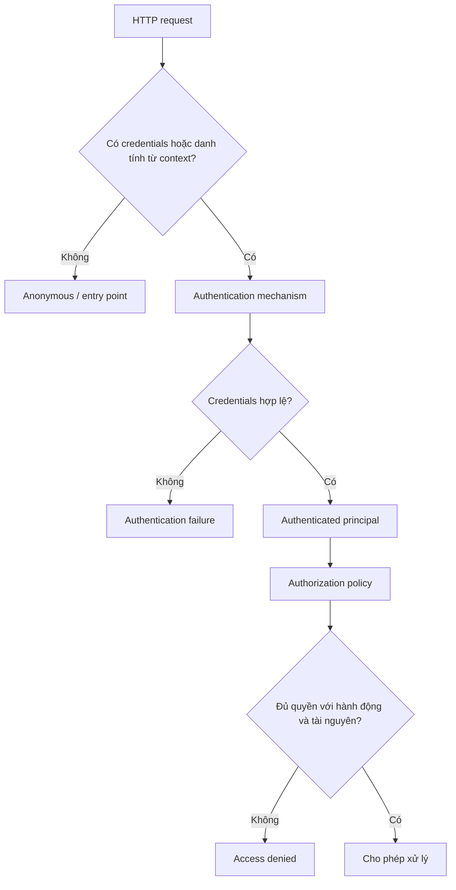

# Phân biệt kiểm thử chính sách phân quyền với kiểm thử cơ chế xác thực

> **Chương:** Chiến lược kiểm thử  
> **Module:** `SPRING_SECURITY_TESTING` — kiểm chứng xác thực, phân quyền và bảo vệ HTTP bằng `spring-security-test` trên ứng dụng Servlet và Reactive. Nội dung sử dụng `MockMvc`, `WebTestClient`, `@WithMockUser`, `SecurityContext` và JWT/OAuth2/OIDC giả lập.

## 1. Hai câu hỏi bảo mật khác nhau

Khi một request đến endpoint được bảo vệ, ứng dụng phải trả lời hai câu hỏi theo thứ tự logic:

1. **Authentication — xác thực:** request đại diện cho ai? Bằng chứng danh tính có hợp lệ không?
2. **Authorization — phân quyền:** principal đã được xác thực có được thực hiện hành động này trên tài nguyên cụ thể không?

Ví dụ ứng dụng quản lý báo cáo:

- Người dùng gửi username/password đúng. Authentication provider xác minh credentials và tạo một `Authentication` đại diện cho người dùng `an`.
- Người dùng `an` có authority `REPORT_READ`. Authorization policy cho phép `GET /api/reports`.
- Người dùng `binh` cũng đăng nhập thành công nhưng chỉ có `ORDER_READ`. Cùng request đó bị từ chối vì thiếu `REPORT_READ`.
- Người không gửi credentials không có principal đã xác thực nên không thể đi đến quyết định “có quyền đọc báo cáo hay không”.
- Người gửi password sai không được coi là `an`, dù tài khoản `an` có quyền đọc báo cáo.

**Authentication xác lập danh tính đã được chấp nhận; authorization quyết định danh tính ấy được làm gì.** Hai khâu có liên quan chặt chẽ nhưng cần những bộ test khác nhau.

### Luồng quyết định khái quát



Sơ đồ là mô hình khái niệm. Một endpoint công khai có thể cho anonymous đi tiếp; CSRF filter hoặc các bộ lọc bảo vệ request khác có thể từ chối trước khi authorization rule được đánh giá. Vì vậy, test phải xác định **cơ chế nào đang được kiểm tra**.

## 2. Phân biệt bằng đầu vào và bằng chứng

| Tiêu chí | Kiểm thử authentication | Kiểm thử authorization |
|---|---|---|
| Câu hỏi | Credentials/danh tính có hợp lệ không? | Principal có được phép hành động không? |
| Đầu vào quan trọng | Password, Basic header, session, Bearer token, OAuth2/OIDC response | `Authentication` đã được chấp nhận, authorities, claims, resource, action, context |
| Thành phần thường cần chạy thật | Authentication filter/provider, `PasswordEncoder`, `UserDetailsService`, decoder/validator hoặc login flow | Request authorization matcher, method-security interceptor, policy owner/tenant |
| Có thể giả lập | DB user store hoặc IdP/JWKS ở ranh giới ngoài nếu không phải mục tiêu | Principal/`SecurityContext`/JWT đã xác thực để cô lập policy |
| Kết quả thường quan sát | Authentication success/failure, challenge/redirect, session/token được tạo hoặc không | `200`/`403`/`404` theo policy, dữ liệu có/không được truy cập |
| Helper phù hợp | `httpBasic()` gửi credentials; login request thật; Bearer header qua decoder | `@WithMockUser`, `user()`, `mockUser()`, `jwt()`, `mockJwt()` |
| Không tự chứng minh | Một request ẩn danh bị `401` không chứng minh password encoder đúng | Một principal giả có quyền đọc không chứng minh password/token được xác minh thật |

**Một HTTP status có thể giống nhau nhưng bằng chứng khác nhau.** Request không credentials và request password sai đều thường nhận `401` trong API Basic. Request đã xác thực nhưng thiếu authority thường nhận `403`. Hãy kiểm tra đầu vào và đường đi, không phân loại test chỉ dựa trên status.

### Authentication object không phải credential

`Authentication` trong Spring Security là abstraction chứa principal, credentials, authorities và trạng thái xác thực. Khi test dùng `@WithMockUser`, `user()` hoặc `jwt()`, test đang cung cấp một authentication giả lập cho security context/request. Nó không có nghĩa hệ thống đã xác minh password hay chữ ký token.

Ngược lại, một HTTP Basic header chỉ là thông tin client gửi. Nó cần được filter chuyển thành authentication, rồi provider xác minh. Một Bearer JWT cần được decoder/validators chấp nhận trước khi resource server tạo authentication.

## 3. Chốt hợp đồng test cho một API

Giả sử ứng dụng Servlet có `GET /api/reports`:

- Chỉ người có authority `REPORT_READ` được đọc.
- Ứng dụng dùng HTTP Basic trong ví dụ này.
- `UserDetailsService` có user `an` với password fixture hợp lệ và authority `REPORT_READ`.
- User `binh` có password fixture hợp lệ nhưng chỉ có `ORDER_READ`.
- API trả `401` cho request anonymous hoặc Basic credentials không hợp lệ, `403` cho user đã xác thực nhưng thiếu quyền, `200` cho người đủ quyền.

Ma trận:

| ID | Input | Authentication | Authorization | HTTP kỳ vọng |
|---|---|---|---|---|
| A01 | Không có Authorization header | Chưa xác thực | Chưa được đánh giá | `401` |
| A02 | Basic `an` + password sai | Thất bại | Không được đánh giá | `401` |
| A03 | Basic `an` + password đúng | Thành công | Có `REPORT_READ` | `200` |
| A04 | Basic `binh` + password đúng | Thành công | Thiếu `REPORT_READ` | `403` |
| A05 | Mock principal `an` + `REPORT_READ` | Giả lập thành công | Được phép | `200` |
| A06 | Mock principal `binh` + `ORDER_READ` | Giả lập thành công | Bị từ chối | `403` |

A01–A04 là các ca authentication + authorization đi qua đường xác thực Basic thực. A05–A06 cô lập policy bằng danh tính giả lập. Chúng có thể cùng tồn tại trong bộ test mà không trùng mục đích.

**Quy tắc quan trọng:** khi kiểm thử authorization, mọi điều kiện authentication phải được thiết lập hợp lệ để test không dừng ở bước trước. Khi kiểm thử authentication, không đặt sẵn principal giả rồi kết luận password/token đã được xác minh.

## 4. Kiểm thử authentication: credentials đúng và sai

### 4.1. HTTP Basic với MockMvc

`httpBasic(username, password)` trong `spring-security-test` tạo header Basic cho request. Khi request đi qua filter chain có HTTP Basic và authentication provider thật, Spring Security xử lý credentials như request thông thường.

Ví dụ cấu hình ứng dụng:

```java
@Configuration
@EnableWebSecurity
class ReportSecurityConfig {

    @Bean
    SecurityFilterChain reportChain(HttpSecurity http) throws Exception {
        return http
            .authorizeHttpRequests(auth -> auth
                .requestMatchers(HttpMethod.GET, "/api/reports")
                    .hasAuthority("REPORT_READ")
                .anyRequest().denyAll()
            )
            .httpBasic(Customizer.withDefaults())
            .build();
    }

    @Bean
    PasswordEncoder passwordEncoder() {
        return PasswordEncoderFactories.createDelegatingPasswordEncoder();
    }

    @Bean
    UserDetailsService users(PasswordEncoder encoder) {
        UserDetails reader = User.withUsername("an")
            .password(encoder.encode("correct-password"))
            .authorities("REPORT_READ")
            .build();

        UserDetails ordinary = User.withUsername("binh")
            .password(encoder.encode("binh-password"))
            .authorities("ORDER_READ")
            .build();

        return new InMemoryUserDetailsManager(reader, ordinary);
    }
}
```

Test xác thực:

```java
@SpringBootTest
@AutoConfigureMockMvc
class BasicAuthenticationTest {

    @Autowired
    MockMvc mvc;

    @Test
    void anonymousRequestIsChallenged() throws Exception {
        mvc.perform(get("/api/reports"))
            .andExpect(status().isUnauthorized());
    }

    @Test
    void wrongPasswordIsRejected() throws Exception {
        mvc.perform(get("/api/reports")
                .with(httpBasic("an", "wrong-password")))
            .andExpect(status().isUnauthorized());
    }

    @Test
    void correctPasswordAuthenticatesReader() throws Exception {
        mvc.perform(get("/api/reports")
                .with(httpBasic("an", "correct-password")))
            .andExpect(status().isOk());
    }
}
```

Đoạn code giả định controller, filter chain và user store trên cùng application context. Imports được lược bỏ; `httpBasic` đến từ `SecurityMockMvcRequestPostProcessors`. Không tắt filters bằng `@AutoConfigureMockMvc(addFilters = false)`, nếu mục tiêu là kiểm tra authentication filter.

Một user store in-memory có thể phù hợp để kiểm tra password authentication mà không cần DB thật. Trong test này, `UserDetailsService` và `PasswordEncoder` thực thi; chỉ persistence được thay bằng fixture. Nếu mục tiêu là kiểm tra JDBC/JPA lookup, phải đưa user store persistence vào phạm vi tích hợp.

### 4.2. Đừng dùng @WithMockUser để kiểm tra password

Đoạn sau kiểm tra **authorization**, không kiểm tra authentication:

```java
@Test
@WithMockUser(username = "an", authorities = "REPORT_READ")
void readerCanAccessReport() throws Exception {
    mvc.perform(get("/api/reports"))
        .andExpect(status().isOk());
}
```

Spring Test thiết lập security context với principal đã được xác thực. Không có password nào đi qua `AuthenticationManager` hay `PasswordEncoder.matches`. Vì vậy, test này không phát hiện được lỗi như:

- Password encoder cấu hình sai.
- UserDetailsService không tìm được user.
- Authentication provider từ chối credentials hợp lệ.
- Authentication filter không đọc đúng header.

Dùng nó khi mục tiêu là rule `REPORT_READ`, và dùng request credentials thực khi mục tiêu là password verification.

### 4.3. Form login và trạng thái tài khoản

Với form login, test phải gửi request đến login-processing URL thực với parameter mà ứng dụng cấu hình, thường là `username` và `password`. Có thể dùng `formLogin()` helper để tạo request theo mặc định Spring Security; nếu app tùy chỉnh URL hoặc tên field, test cần khớp cấu hình thực tế.

Ngoài password sai, authentication mechanism có thể từ chối user vì:

- Tài khoản bị khóa (`locked`).
- Tài khoản bị vô hiệu hóa (`disabled`).
- Tài khoản hết hạn (`account expired`).
- Credentials hết hạn (`credentials expired`).

Nếu các trạng thái này là policy của sản phẩm, tạo user fixture tương ứng và cho request đi qua provider thật. Không mock provider trả về failure, vì như vậy chỉ kiểm tra cách ứng dụng xử lý kết quả failure đã được dựng sẵn.

Khi xác minh lỗi đăng nhập, tránh làm lộ việc username có tồn tại hay không. Hợp đồng bên ngoài thường dùng thông báo lỗi chung; test không nên yêu cầu response phân biệt “username tồn tại nhưng password sai” với “username không tồn tại” nếu điều đó tạo user enumeration.

## 5. Kiểm thử authorization: đưa principal đã xác thực vào policy

Khi mục tiêu là “chỉ người có `REPORT_READ` được xem”, ta không cần lặp lại password authentication ở mọi tổ hợp quyền. Dùng danh tính giả lập để kiểm tra policy:

```java
@SpringBootTest
@AutoConfigureMockMvc
class ReportAuthorizationTest {

    @Autowired
    MockMvc mvc;

    @Test
    @WithMockUser(username = "an", authorities = "REPORT_READ")
    void reportReaderIsAllowed() throws Exception {
        mvc.perform(get("/api/reports"))
            .andExpect(status().isOk());
    }

    @Test
    @WithMockUser(username = "binh", authorities = "ORDER_READ")
    void authenticatedUserWithoutReportAuthorityIsForbidden()
            throws Exception {
        mvc.perform(get("/api/reports"))
            .andExpect(status().isForbidden());
    }
}
```

Ở đây, cả hai test đều bắt đầu từ một principal đã được thiết lập. Điểm thay đổi là authority. Cặp test cho thấy policy có phân biệt quyền cần thiết.

### Role và authority phải khớp chính sách

- `@WithMockUser(roles = "ADMIN")` tạo authority `ROLE_ADMIN`.
- `@WithMockUser(authorities = "ADMIN")` tạo authority chính xác `ADMIN`.
- `hasRole("ADMIN")` thường kiểm tra `ROLE_ADMIN`.
- `hasAuthority("REPORT_READ")` kiểm tra chính xác `REPORT_READ`.

Không dùng `roles` để giả lập một authority tùy ý nếu code yêu cầu chuỗi khác. Một test có thể xanh do quyền đã được dựng sai hoặc rule không được kiểm tra đúng như dự định.

### Khi nào dùng request post-processor user()?

`user("an").authorities(...)` tạo authentication cho riêng request:

```java
mvc.perform(get("/api/reports")
        .with(user("an")
            .authorities(new SimpleGrantedAuthority("REPORT_READ"))))
    .andExpect(status().isOk());

mvc.perform(get("/api/reports")
        .with(user("binh")
            .authorities(new SimpleGrantedAuthority("ORDER_READ"))))
    .andExpect(status().isForbidden());
```

Cách này tiện khi test nhiều principal trong cùng một method hoặc tạo test data-driven. Nó vẫn là authentication giả lập và không gọi authentication provider.

## 6. Kiểm tra quyền trên method và tài nguyên

Authorization có thể được thực thi ở nhiều lớp:

| Lớp | Ví dụ | Bằng chứng cần có |
|---|---|---|
| URL/request | `authorizeHttpRequests` | Request matcher cho đúng path và HTTP method |
| Method security | `@PreAuthorize`, `@PostAuthorize` | Gọi bean qua Spring proxy/interceptor |
| Resource/business policy | Owner, tenant, trạng thái đối tượng | Tài nguyên cụ thể bị kiểm tra theo principal đã xác thực |

Ví dụ service:

```java
@Service
class InvoiceService {

    @PreAuthorize("hasAuthority('INVOICE_READ')")
    public Invoice read(String id) {
        return repository.findById(id).orElseThrow();
    }
}
```

Nếu test muốn chứng minh `@PreAuthorize`, không gọi `new InvoiceService(...)` và không mock `InvoiceService`. Hãy nạp method security và gọi bean Spring-managed; có thể mock repository. Dùng một principal thiếu quyền để xác nhận exception từ chối được phát ra trước khi repository được gọi.

Với kiểm soát owner/tenant, role có thể giống nhau nhưng tài nguyên khác nhau:

- `an` và `binh` đều có `ORDER_READ`.
- Đơn `42` thuộc `an`, đơn `43` thuộc `binh`.
- `binh` đọc đơn `43` được phép; đọc đơn `42` bị từ chối theo policy.

Đây là authorization theo **đối tượng**, không phải authentication. Dùng `@WithMockUser` hoặc `user()` để thiết lập principal, nhưng giữ policy và đường lấy owner/tenant thực trong test đang kiểm chứng.

## 7. JWT: tách xác thực token khỏi phân quyền theo scope

Với OAuth2 Resource Server, một Bearer JWT trải qua ít nhất hai giai đoạn:

1. **Authentication:** token có cấu trúc/chữ ký hợp lệ, còn hạn và thỏa validators (issuer, audience nếu được cấu hình). Decoder tạo `JwtAuthenticationToken`.
2. **Authorization:** authorities được ánh xạ từ scope/claim và được dùng trong matcher hoặc method security.

Ma trận ví dụ:

| ID | Bearer token | Authentication | Authorization | Kỳ vọng |
|---|---|---|---|---|
| J01 | Không có token | Chưa xác thực | — | `401` |
| J02 | Token hợp lệ có `reports.read` | Thành công | Đủ scope | `200` |
| J03 | Token hợp lệ chỉ có `reports.write` | Thành công | Thiếu scope đọc | `403` |
| J04 | Token sai chữ ký | Thất bại | — | `401` |
| J05 | Token hết hạn | Thất bại | — | `401` |
| J06 | Token sai issuer hoặc audience theo validator được cấu hình | Thất bại | — | `401` |

### Authorization theo scope: dùng JWT giả lập

Servlet:

```java
mvc.perform(get("/partner/reports")
        .with(jwt().authorities(
            new SimpleGrantedAuthority("SCOPE_reports.read"))))
    .andExpect(status().isOk());

mvc.perform(get("/partner/reports")
        .with(jwt().authorities(
            new SimpleGrantedAuthority("SCOPE_reports.write"))))
    .andExpect(status().isForbidden());
```

Reactive:

```java
client.mutateWith(mockJwt().authorities(
        new SimpleGrantedAuthority("SCOPE_reports.read")))
    .get().uri("/partner/reports")
    .exchange()
    .expectStatus().isOk();
```

Các helper `jwt()` và `mockJwt()` hữu ích để kiểm tra authorization theo authorities/claims đã được dựng. Tuy nhiên, khi chỉ định `authorities(...)` trực tiếp, test không chứng minh `JwtAuthenticationConverter` đã ánh xạ claim đúng; nó cũng không chứng minh chữ ký hay hạn dùng token.

### Authentication JWT: dùng decoder/validators thật

Để kiểm tra J04/J05/J06, gửi header `Authorization: Bearer ...` qua resource server thực và để `JwtDecoder` hoặc `ReactiveJwtDecoder` xác minh token. Tạo token có cấu trúc phù hợp với test:

- Token sai chữ ký nhưng claims khác hợp lệ.
- Token có chữ ký đúng nhưng `exp` đã quá hạn.
- Token đúng chữ ký nhưng `iss` không được tin cậy.
- Token đúng chữ ký/issuer nhưng `aud` không chứa audience được API yêu cầu (nếu ứng dụng cấu hình audience validation).

Một chuỗi ngẫu nhiên không đủ chứng minh “expired token bị chặn”; nó có thể thất bại ngay ở bước parse. Mỗi test nên thay đổi một yếu tố so với token hợp lệ và có ca token hợp lệ đối chứng.

## 8. OAuth2 và OIDC: login giả lập khác với kiểm tra giao thức

`oauth2Login()` và `oidcLogin()` (Servlet), `mockOAuth2Login()` và `mockOidcLogin()` (Reactive) giúp tạo principal/claims đã đăng nhập để kiểm tra authorization:

- User có claim `groups` tương ứng authority quản trị được truy cập.
- User không có claim đó bị từ chối.
- Policy dùng `preferred_username` hoặc `email` để liên kết tài khoản nội bộ thì principal giả lập phải cung cấp đúng claim/attribute mà code thực đọc.

Những helper này không tự chứng minh:

- Redirect đến authorization endpoint đúng.
- `state` và `nonce` được kiểm tra.
- Authorization code được đổi thành token.
- ID token có chữ ký, issuer, audience hợp lệ.
- Callback và session được tạo đúng qua giao thức.

Nếu mục tiêu là giao thức OAuth2/OIDC, cần integration/E2E với client registration và một IdP test có hành vi xác định. Có thể mock IdP tại biên hệ thống để không phụ thuộc nhà cung cấp ngoài, nhưng OAuth2 client, callback handler và validation mà ta muốn kiểm tra phải chạy thật.

## 9. Session, SecurityContext và danh tính được lưu giữ

Authentication không chỉ xuất hiện ở request đầu tiên. Ứng dụng session-based có thể lưu security context để những request sau tiếp tục dùng danh tính đã đăng nhập.

Các câu hỏi cần kiểm chứng tùy chính sách:

- Đăng nhập thành công có tạo session/security context đúng không?
- Request tiếp theo với session cookie đó có principal/authorities như mong đợi không?
- Logout có vô hiệu hóa session hoặc xóa security context theo cấu hình không?
- Session hết hạn có khiến request sau trở về trạng thái anonymous không?
- Session fixation protection được cấu hình đúng và session ID thay đổi sau đăng nhập khi policy yêu cầu?

`@WithMockUser` không kiểm tra quá trình lưu/khôi phục session. Để kiểm tra session, dùng request login thực qua MockMvc/HTTP client, giữ cookie/session giữa các request và quan sát trạng thái sau logout/hết hạn. `SecurityContextHolder` là nơi truy cập context trong Servlet theo cơ chế cấu hình; Reactive dùng `ReactiveSecurityContextHolder` và Reactor context. Không dùng test ThreadLocal để kết luận context truyền đúng trong pipeline Reactive.

## 10. CSRF là lớp bảo vệ request độc lập

CSRF không phải authentication và cũng không phải quyền nghiệp vụ. Một user đã xác thực, có authority đúng, vẫn có thể bị chặn vì request thiếu CSRF token khi dùng credentials tự động gửi kèm như session cookie.

Với `POST /api/reports/export`:

| Principal | Authority | CSRF | Mục tiêu | Kỳ vọng |
|---|---|---|---|---|
| Anonymous | — | Hợp lệ hoặc không | Authentication | `401`/redirect theo entry point |
| User hợp lệ | Thiếu `REPORT_EXPORT` | Token hợp lệ | Authorization | `403` |
| User đủ quyền | `REPORT_EXPORT` | Thiếu/sai token | CSRF | `403` |
| User đủ quyền | `REPORT_EXPORT` | Token hợp lệ | Cho phép | `2xx` |

Khi kiểm tra authorization của POST, cấp CSRF hợp lệ để filter CSRF không che khuất kết quả quyền. Khi kiểm tra CSRF, giữ authentication và authority đủ để chỉ token là biến khác biệt.

Servlet dùng `with(csrf())` hoặc `csrf().useInvalidToken()`; Reactive dùng `mutateWith(csrf())`. Những helper này tạo đầu vào token cho test, còn CSRF filter vẫn phải chạy. Với API Bearer stateless, xác định riêng chính sách CSRF theo mô hình credentials thực tế.

## 11. Phân loại lỗi và status theo contract

Các status thường gặp trong API:

| Tình huống | Status thường dùng | Ý nghĩa |
|---|---|---|
| Chưa cung cấp credentials cho tài nguyên bảo vệ | `401` | Cần authentication |
| Credentials sai/hết hạn/không hợp lệ | `401` | Authentication thất bại |
| Authentication hợp lệ nhưng thiếu authority | `403` | Authorization từ chối |
| Resource không tồn tại hoặc cố tình che giấu quyền truy cập | `404` | Theo chính sách tài nguyên |
| Request hợp lệ về quyền nhưng trạng thái nghiệp vụ không cho phép | `409` hoặc contract riêng | Không đồng nghĩa thiếu quyền |
| Form login yêu cầu đăng nhập | Có thể `302` | Redirect đến trang login |

Đừng khẳng định `401` và `403` là hai mã bắt buộc trong mọi ứng dụng. Authentication entry point, access denied handler, form login, API gateway và policy che giấu resource có thể thay đổi response. Test phải ghi status, header, body theo **contract của ứng dụng**.

Một request password sai không nên được coi là “đã xác thực nhưng thiếu quyền”. Một request của user hợp lệ thiếu authority không nên bị mô tả là “credentials sai”. Phân biệt đúng giúp log, metrics và kiểm thử phản ánh đúng nguyên nhân.

## 12. Tổ chức test suite để không lặp lại toàn bộ authentication

Một bộ test hiệu quả phân chia mục tiêu:

| Nhóm test | Dữ liệu danh tính | Thành phần giữ thật | Số lượng nên tập trung |
|---|---|---|---|
| Authentication mechanism | Credentials thật hoặc token thật | Provider/encoder, decoder/validators, login flow | Bao phủ success, failure và trạng thái tài khoản |
| Authorization policy | Principal/claims giả lập | Matcher, method security, resource policy | Nhiều tổ hợp role/authority/owner/tenant |
| HTTP integration | Mock hoặc credentials thật tùy mục tiêu | Filter chain + controller/service cần tích hợp | Các đường nối giữa security và business |
| Session/OAuth2/OIDC flow | Cookie/token sinh từ flow | Login, callback, context persistence, logout | Một số journey trọng yếu |
| Side-effect protection | Principal theo ca | Service/repository hoặc gateway phù hợp | Các ca từ chối thao tác ghi |

Không cần thử password sai cho mọi authority. Hãy kiểm tra authentication provider một lần cho các dạng credentials và trạng thái tài khoản có ý nghĩa; sau đó dùng principal giả lập để chạy ma trận authorization rộng hơn. Ngược lại, không được chỉ dùng principal giả lập rồi kết luận password/JWT/OIDC mechanism đã đúng.

### Tách tên test để thể hiện mục đích

```text
Authentication:
  basic_wrongPassword_isRejected
  basic_correctPassword_createsAuthenticatedRequest
  jwt_expiredToken_isRejectedByDecoder
  accountDisabled_cannotAuthenticate

Authorization:
  reportReader_canReadReports
  orderReader_cannotReadReports
  owner_canReadOwnOrder
  anotherTenant_cannotReadOrder

Request protection:
  authenticatedPost_withoutCsrf_isRejected
  authorizedPost_withCsrf_isAllowed

Session / protocol:
  logout_invalidatesSession
  oidcCallback_createsExpectedPrincipal
```

Tên test nên nói rõ lớp đang kiểm tra và biến đầu vào. Một test tên `invalidUserCannotAccess` quá chung chung: không cho biết user không tồn tại, password sai hay user hợp lệ nhưng thiếu quyền.

## 13. Những lỗi thiết kế test thường gặp

**Dùng @WithMockUser cho authentication.** Annotation cung cấp authentication giả; nó không xác minh password hoặc token. Dùng credentials qua filter/provider hoặc Bearer token qua decoder thật.

**Dùng credentials thật trong mọi authorization test.** Cách này làm test chậm và khiến mỗi lỗi quyền phụ thuộc password store. Khi chỉ kiểm tra policy, dựng principal giả có authority cụ thể.

**Mock luôn AuthenticationManager hoặc AuthorizationManager.** Nếu manager là đối tượng cần kiểm tra, stub kết quả của nó sẽ loại bỏ chính logic cần chứng minh. Mock các phụ thuộc bên dưới, như user store hoặc nguồn dữ liệu ngoài, nếu phù hợp.

**Chỉ kiểm tra anonymous.** Endpoint có thể yêu cầu đăng nhập nhưng lại cho mọi user đã đăng nhập truy cập. Thêm ca authenticated nhưng thiếu authority.

**Chỉ kiểm tra JWT scope với mockJwt.** Test đó không kiểm tra chữ ký, issuer, audience hay expiry. Tách decoder integration tests.

**Dùng test POST thiếu CSRF để chứng minh thiếu quyền.** Filter CSRF có thể từ chối trước authorization. Cấp token hợp lệ khi test policy.

**Mock service chứa @PreAuthorize.** Method-security interceptor không chạy trên mock. Gọi Spring-managed bean thật qua proxy.

**Bỏ filters để test dễ xanh.** Khi filters bị tắt, test không chứng minh request security.

**Không kiểm tra dữ liệu bị từ chối.** `403` không tự chứng minh không có side effect. Với thao tác ghi, xác minh repository, event hoặc gateway không bị tác động.

## 14. Bài tập: kiểm thử authentication và authorization của API thanh toán

Ứng dụng có hai bề mặt:

- Web admin đăng nhập bằng form login/session.
- API đối tác dùng OAuth2 Resource Server với JWT.

Chính sách:

- `GET /admin/payments` yêu cầu `PAYMENT_READ`.
- `POST /admin/payments/{id}/refund` yêu cầu `PAYMENT_REFUND`, cùng tenant và payment ở trạng thái `SETTLED`; request session phải có CSRF.
- `GET /partner/payments` yêu cầu JWT có scope `payments.read`.
- Token phải có issuer tin cậy, audience phù hợp và chưa hết hạn.

Hãy thiết kế các nhóm test:

1. **Authentication:** form login password đúng/sai; user bị khóa/vô hiệu hóa; JWT thiếu token, sai chữ ký, hết hạn, sai issuer/audience. Nêu thành phần nào phải chạy thật.
2. **Authorization:** principal đã được xác thực có/thiếu `PAYMENT_READ`; người có quyền nhưng khác tenant; payment thuộc tenant khác. Dùng principal/JWT giả lập khi mục tiêu là policy.
3. **CSRF:** user đủ quyền nhưng thiếu token; user thiếu quyền nhưng có token hợp lệ; user đủ quyền và token hợp lệ. Ghi rõ ca nào đang kiểm tra CSRF và ca nào kiểm tra authorization.
4. **Method security:** nếu service refund có `@PreAuthorize`, thiết kế test gọi bean thật và mock gateway/repository ở ranh giới phù hợp.
5. **Side effects:** khi refund bị từ chối, xác minh payment vẫn `SETTLED`, không tạo refund record và gateway không nhận lệnh.

Với mỗi test, ghi bốn điểm: **SUT là gì**, **danh tính/credentials được tạo thế nào**, **component nào chạy thật**, **assertion nào chứng minh kết quả**.

**Tiêu chí hoàn thành:** Bạn có thể giải thích vì sao cùng một API có test dùng `@WithMockUser`, test dùng password thật, test dùng `jwt()` và test dùng Bearer token thật; mỗi loại phải chứng minh một phần khác nhau của chuỗi bảo mật. Khi tách được hai câu hỏi authentication và authorization, bạn sẽ chọn đúng công cụ của `spring-security-test` và biết giới hạn bằng chứng mà từng test tạo ra.
