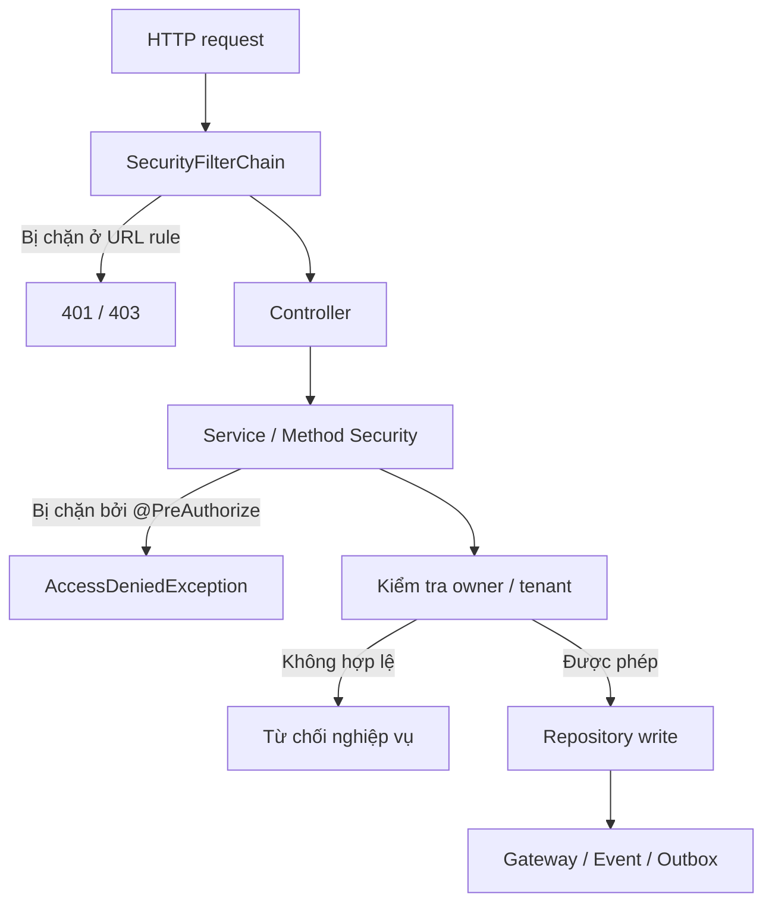

# Kiểm tra tác dụng phụ không xảy ra khi truy cập bị từ chối

> **Chương:** Chiến lược kiểm thử  
> **Module:** `SPRING_SECURITY_TESTING` — kiểm chứng xác thực, phân quyền và bảo vệ HTTP bằng `spring-security-test` trên ứng dụng Servlet và Reactive. Bài dùng `MockMvc`, `WebTestClient`, `@WithMockUser`, `SecurityContext` và danh tính JWT/OAuth2/OIDC giả lập để xác minh một request bị từ chối không làm thay đổi trạng thái nghiệp vụ.

## 1. Vì sao chỉ kiểm tra 403 là chưa đủ?

Giả sử `binh` cố xóa đơn hàng `42` do `an` sở hữu. API trả `403 Forbidden`. Nhìn vào status, ta có thể nghĩ hệ thống đã bảo vệ tài nguyên. Nhưng vẫn có những lỗi nguy hiểm:

- Controller đã gọi service và service đã xóa đơn trước khi một bước kiểm tra quyền phát hiện người dùng không phải chủ sở hữu.
- Repository đã cập nhật trạng thái, sau đó controller mới trả lỗi.
- Payment gateway đã nhận lệnh hoàn tiền dù response cuối cùng là `403`.
- Domain event hoặc message đã được gửi đến queue trước khi quyền bị từ chối.
- File export đã được tạo hoặc lưu vào object storage dù client không được tải xuống.
- Một tác vụ bất đồng bộ đã được lên lịch và tiếp tục chạy sau khi request trả lỗi.

**HTTP response bị từ chối không tự chứng minh hệ thống không gây tác dụng phụ.** Kiểm thử phải xác minh cả quyết định truy cập lẫn trạng thái của hệ thống sau quyết định đó.

Một hợp đồng bảo mật đầy đủ cho request bị từ chối có thể gồm:

1. Client nhận đúng response theo contract (`403` hoặc `404`, đôi khi `401`).
2. Response không tiết lộ dữ liệu nhạy cảm.
3. Không thực hiện business write, delete, transfer, refund, export hoặc hành động tương tự.
4. Không gửi command/event/message có thể gây thay đổi ở hệ thống khác.
5. Trạng thái dữ liệu liên quan vẫn đúng như trước request.
6. Các audit/security log được phép ghi nhận việc từ chối vẫn hoạt động theo chính sách.

Điểm cuối rất quan trọng: “không có side effect” ở đây nghĩa là **không có tác động nghiệp vụ trái phép**. Ứng dụng vẫn có thể cần ghi security audit event cho một lần truy cập bị từ chối.

## 2. Phân loại tác dụng phụ cần kiểm tra

Không phải mọi tương tác với dependency đều là thay đổi dữ liệu. Phân biệt đọc để ra quyết định và ghi làm thay đổi trạng thái:

| Nhóm | Ví dụ | Khi request bị từ chối |
|---|---|---|
| Đọc phục vụ authorization | Tìm owner, tenant, trạng thái đơn | Có thể được phép và cần thiết |
| Đọc dữ liệu nghiệp vụ nhạy cảm | Lấy toàn bộ báo cáo hoặc nội dung tài liệu | Chỉ đọc sau khi được phép, nếu policy yêu cầu |
| Ghi database | `save`, `delete`, cập nhật số dư/trạng thái | Không được xảy ra nếu thao tác bị từ chối |
| Gọi hệ thống ngoài | Payment/refund, shipping, email, storage | Không gửi lệnh nghiệp vụ trái phép |
| Phát event/message | Domain event, Kafka/RabbitMQ, outbox | Không phát event mô tả hành động chưa được phép |
| Lập lịch bất đồng bộ | Job, scheduler, task executor | Không khởi chạy công việc bị từ chối |
| Tạo tài nguyên | File export, báo cáo, upload, token | Không tạo tài nguyên không được phép |
| Audit bảo mật | Ghi nhận access denied, principal, resource | Thường vẫn cần theo policy |
| Metrics/telemetry | Counter access denied, trace | Có thể được ghi; không phải business mutation |

Ví dụ kiểm soát quyền sở hữu có thể cần truy vấn `orderRepository.findById(id)` để biết ai là chủ đơn. Khi người dùng khác chủ truy cập, **truy vấn đọc này không phải lỗi**. Điều cần chứng minh là không có `save`, `delete`, gọi gateway hoặc phát event xóa đơn.

Vì vậy, không nên dùng `verifyNoInteractions(orderRepository)` một cách máy móc cho mọi ca bị từ chối. Assertion đó chỉ đúng nếu chính sách cho phép chặn request trước khi repository được truy cập, ví dụ thiếu authority ở filter chain.

## 3. Chọn ranh giới kiểm soát và đặt assertion tương ứng

Một request Servlet có thể đi qua:



Cần biết request bị từ chối ở lớp nào:

| Điểm từ chối | Thành phần có thể đã chạy | Assertion phù hợp |
|---|---|---|
| URL authorization trong filter chain | Security filters; controller/service chưa chạy | `verifyNoInteractions(service)` |
| Method-security interceptor trước method body | Proxy/interceptor và biểu thức policy; method body chưa chạy | Không có tương tác từ method body; có thể có truy vấn policy nếu expression gọi bean |
| Kiểm tra owner/tenant bên trong service | Service và các truy vấn đọc cần thiết | Không có write, gateway call, event hoặc outbox record |
| Kiểm tra trạng thái nghiệp vụ | Service đã đọc đối tượng | Dữ liệu không đổi, không phát lệnh |
| CSRF filter | Security filters trước controller | Controller/service không được gọi |
| Decoder từ chối JWT | Bearer authentication filter/decoder | Authorization và business layer không chạy |

Với Reactive, cấu trúc tương tự nhưng dùng `SecurityWebFilterChain` và pipeline `Mono`/`Flux`. Kiểm tra side effect cần quan sát cả subscription: một publisher có thể chưa thực thi cho đến khi được subscribe.

## 4. Test request bị chặn ở HTTP authorization: service không được gọi

Nếu policy được đặt tại `SecurityFilterChain`, một user đã xác thực nhưng thiếu authority phải bị chặn trước controller. Đây là trường hợp phù hợp với `verifyNoInteractions`.

Ví dụ controller và service:

```java
interface ReportService {
    String readReport();
}

@RestController
class ReportController {

    private final ReportService reports;

    ReportController(ReportService reports) {
        this.reports = reports;
    }

    @GetMapping("/api/reports")
    String read() {
        return reports.readReport();
    }
}

@Configuration
@EnableWebSecurity
class ReportSecurityConfig {

    @Bean
    SecurityFilterChain chain(HttpSecurity http) throws Exception {
        return http
            .authorizeHttpRequests(auth -> auth
                .requestMatchers(HttpMethod.GET, "/api/reports")
                    .hasAuthority("REPORT_READ")
                .anyRequest().denyAll()
            )
            .httpBasic(Customizer.withDefaults())
            .build();
    }
}
```

Web slice giữ security chain thật và mock service phía sau controller:

```java
@WebMvcTest(ReportController.class)
@Import(ReportSecurityConfig.class)
class ReportDeniedNoServiceCallTest {

    @Autowired
    MockMvc mvc;

    @MockitoBean
    ReportService reports;

    @Test
    void authenticatedUserWithoutReportAuthorityIsDenied()
            throws Exception {

        mvc.perform(get("/api/reports")
                .with(user("binh").authorities(
                    new SimpleGrantedAuthority("ORDER_READ"))))
            .andExpect(status().isForbidden());

        verifyNoInteractions(reports);
    }

    @Test
    void anonymousUserIsChallenged() throws Exception {
        mvc.perform(get("/api/reports"))
            .andExpect(status().isUnauthorized());

        verifyNoInteractions(reports);
    }

    @Test
    void authorizedUserReachesService() throws Exception {
        when(reports.readReport()).thenReturn("report-acme");

        mvc.perform(get("/api/reports")
                .with(user("an").authorities(
                    new SimpleGrantedAuthority("REPORT_READ"))))
            .andExpect(status().isOk())
            .andExpect(content().string("report-acme"));

        verify(reports).readReport();
    }
}
```

Ví dụ giả định dự án dùng Spring Framework hỗ trợ `@MockitoBean`; với phiên bản cũ hơn có thể dùng annotation mock bean tương ứng của Spring Boot. Imports được lược bỏ.

Test này chứng minh:

- `binh` đã được giả lập là authenticated nhưng thiếu `REPORT_READ`.
- Filter chain thật từ chối request với `403`.
- Controller không gọi `ReportService`.
- Ca đối chứng cho user có authority được phép đi đến service.

Không tắt filter bằng `@AutoConfigureMockMvc(addFilters = false)` hoặc dựng standalone controller không có security filter rồi kết luận policy HTTP đã được kiểm tra.

## 5. Test method security: method body không chạy khi bị @PreAuthorize chặn

`@PreAuthorize` được thực thi bởi method-security interceptor trên Spring-managed bean. Khi điều kiện không thỏa, interceptor từ chối **trước khi method body được gọi**.

Ví dụ service:

```java
@Service
class ReportExportService {

    private final ExportRepository repository;
    private final ExportGateway gateway;

    ReportExportService(
            ExportRepository repository,
            ExportGateway gateway) {
        this.repository = repository;
        this.gateway = gateway;
    }

    @PreAuthorize("hasAuthority('REPORT_EXPORT')")
    public String export() {
        ExportFile file = repository.createExport();
        return gateway.upload(file);
    }
}
```

Kiểm thử qua bean thật, mock các dependency của method:

```java
@SpringBootTest
class ReportExportMethodSecurityTest {

    @Autowired
    ReportExportService exports;

    @MockitoBean
    ExportRepository repository;

    @MockitoBean
    ExportGateway gateway;

    @Test
    @WithMockUser(username = "binh", authorities = "REPORT_READ")
    void userWithoutExportAuthorityCannotCreateOrUploadFile() {
        assertThatThrownBy(() -> exports.export())
            .isInstanceOf(AccessDeniedException.class);

        verifyNoInteractions(repository, gateway);
    }

    @Test
    @WithMockUser(username = "an", authorities = "REPORT_EXPORT")
    void exporterCanCreateAndUploadFile() {
        ExportFile file = new ExportFile("export-1");
        when(repository.createExport()).thenReturn(file);
        when(gateway.upload(file)).thenReturn("https://files.example.test/export-1");

        assertThat(exports.export())
            .isEqualTo("https://files.example.test/export-1");

        verify(repository).createExport();
        verify(gateway).upload(file);
    }
}
```

Đây là test tích hợp method security:

- `@EnableMethodSecurity` phải được bật trong application context.
- `ReportExportService` phải là bean thật được Spring proxy.
- Test gọi bean được inject, không gọi `new ReportExportService(...)`.
- Repository và gateway được mock vì chúng nằm sau lớp method-security đang kiểm tra.

Nếu mock cả `ReportExportService`, interceptor không có cơ hội chặn method body; test sẽ không chứng minh `@PreAuthorize`.

### Lưu ý về self-invocation

Nếu một method trong service gọi method được bảo vệ khác trên cùng object qua `this.securedMethod()`, proxy-based method security có thể không intercept lời gọi nội bộ. Test phải đi qua đúng đường gọi của ứng dụng hoặc cấu trúc lại boundary để lời gọi bảo vệ đi qua Spring proxy.

## 6. Authorization theo owner/tenant: đọc để kiểm tra nhưng không được ghi

Một số policy cần tải đối tượng để xác định owner hoặc tenant. Khi đó service có thể được gọi, repository có thể thực hiện truy vấn đọc; điều cần bảo đảm là không có mutation.

Giả sử đơn `42` thuộc `an` và ở trạng thái `DRAFT`. `binh` có quyền thao tác chung `ORDER_CANCEL` nhưng không phải chủ đơn. Quy tắc nghiệp vụ chỉ cho chủ đơn hoặc admin hủy đơn.

Một service minh họa:

```java
@Service
class OrderService {

    private final OrderRepository orders;
    private final PaymentGateway payments;
    private final ApplicationEventPublisher events;

    OrderService(
            OrderRepository orders,
            PaymentGateway payments,
            ApplicationEventPublisher events) {
        this.orders = orders;
        this.payments = payments;
        this.events = events;
    }

    @Transactional
    @PreAuthorize("hasAuthority('ORDER_CANCEL')")
    public void cancel(Long id, String actor) {
        Order order = orders.findById(id).orElseThrow();

        if (!order.getOwner().equals(actor)) {
            throw new AccessDeniedException("Not the order owner");
        }

        if (!order.isDraft()) {
            throw new IllegalStateException("Order is not cancellable");
        }

        order.cancel();
        orders.save(order);
        payments.cancelAuthorization(order.getPaymentReference());
        events.publishEvent(new OrderCancelled(order.getId()));
    }
}
```

Đây là ví dụ rút gọn để minh họa ranh giới; trong ứng dụng thực, không nên nhận `actor` trực tiếp từ request body hoặc query parameter. Lấy principal từ `Authentication`/security context đã xác thực, hoặc truyền một actor đã được xác lập từ lớp bảo mật.

Với test owner mismatch, `@PreAuthorize` cho phép `binh` đi vào method vì có `ORDER_CANCEL`. Service đọc order để kiểm tra owner rồi từ chối. Vì vậy, assertion đúng là **cho phép truy vấn đọc nhưng cấm mutation**:

```java
@Test
@WithMockUser(username = "binh", authorities = "ORDER_CANCEL")
void anotherOwnerCannotCancelOrder() {
    Order order = draftOrder(42L, "an");
    when(orders.findById(42L)).thenReturn(Optional.of(order));

    assertThatThrownBy(() -> service.cancel(42L, "binh"))
        .isInstanceOf(AccessDeniedException.class);

    verify(orders).findById(42L);
    verify(orders, never()).save(any());
    verify(payments, never()).cancelAuthorization(anyString());
    verify(events, never()).publishEvent(any(OrderCancelled.class));
}
```

Ví dụ trên cần fixture và mock được inject đúng vào bean test; nếu muốn kiểm tra transaction, persistence hoặc method-security thực, gọi Spring-managed service trong application context và không tạo instance bằng constructor trực tiếp.

**Không** dùng `verifyNoInteractions(orders)` cho ca này: service cần đọc đơn để biết owner. Dùng `never()` trên các phương thức ghi/gọi gateway/phát event mới diễn tả đúng yêu cầu.

## 7. Kiểm tra trạng thái database trước và sau request

Mockito verification chứng minh một collaborator không được gọi theo cách test đã cấu hình. Với thao tác quan trọng, nên bổ sung integration test quan sát dữ liệu thật trong DB test.

Quy trình:

1. Seed bản ghi ở trạng thái ban đầu, ví dụ đơn `42` thuộc `an`, trạng thái `DRAFT`.
2. Gửi request dưới danh tính `binh`, đủ authority chung nhưng không phải owner.
3. Xác minh response bị từ chối theo contract.
4. Đọc lại bản ghi bằng một truy vấn độc lập hoặc persistence context đã refresh.
5. So sánh các trường quan trọng: owner, status, amount, version, updatedAt và các liên kết.
6. Xác minh không có record phụ như refund, cancellation, outbox hoặc export job.

Ví dụ Servlet với MockMvc:

```java
@Test
@WithMockUser(username = "binh", authorities = "ORDER_CANCEL")
void deniedCancellationLeavesOrderUnchanged() throws Exception {
    Order before = orderRepository.saveAndFlush(
        draftOrder(42L, "an"));

    mvc.perform(post("/api/orders/42/cancel")
            .with(csrf()))
        .andExpect(status().isForbidden());

    entityManager.clear();

    Order after = orderRepository.findById(before.getId())
        .orElseThrow();

    assertThat(after.getOwner()).isEqualTo("an");
    assertThat(after.getStatus()).isEqualTo(OrderStatus.DRAFT);
    assertThat(after.getVersion()).isEqualTo(before.getVersion());

    assertThat(outboxRepository
        .findByAggregateId(before.getId()))
        .isEmpty();
}
```

Ví dụ giả định endpoint có CSRF protection và request đã được cấp token hợp lệ để tập trung kiểm tra ownership; fixture/repository/outbox được cấu hình trong integration test. Nếu outbox có bản ghi từ các hành động trước đó, hãy lọc theo ID hoặc tạo trạng thái ban đầu sạch.

### Cẩn thận với transaction của test

Nhiều test Spring chạy trong transaction và rollback sau khi hoàn tất. Điều đó giúp cô lập dữ liệu, nhưng có thể che khuất lỗi nếu assertion chỉ nhìn persistence context đang giữ entity cũ.

- Dùng `flush()` và `clear()` khi phù hợp để buộc ghi và đọc lại.
- Nếu cần chứng minh trạng thái sau commit hoặc event sau commit, dùng transaction boundary phù hợp thay vì chỉ dựa vào transaction rollback của test.
- Kiểm tra outbox/event record sau khi service transaction hoàn tất.
- Với async worker, cần xác minh task không được tạo hoặc worker không xử lý message bị cấm.

Không nên chạy `REQUIRES_NEW` hay gọi hệ thống ngoài trong test rồi kỳ vọng rollback của transaction cha sẽ hoàn tác chúng. Transaction DB không thể tự rollback email, HTTP call, file upload hoặc message đã gửi ra broker.

## 8. External gateway, event và message: không để lệnh chạy trước khi bị từ chối

Các side effect ngoài DB thường khó khôi phục hơn. Ví dụ refund:

- Kiểm tra quyền và tenant phải hoàn tất trước khi gọi payment gateway.
- Chỉ khi payment thuộc tenant được phép, đúng chủ thể/quyền và trạng thái là `SETTLED` mới gửi refund.
- Nếu bị từ chối, gateway không được nhận lệnh refund.

Một unit/integration test có thể mock gateway để xác minh tương tác:

```java
@Test
@WithMockUser(username = "binh", authorities = "PAYMENT_REFUND")
void wrongTenantDoesNotCallRefundGateway() {
    Payment payment = settledPayment(100L, "acme");
    when(paymentRepository.findById(100L))
        .thenReturn(Optional.of(payment));

    assertThatThrownBy(() -> refundService.refund(100L, "beta"))
        .isInstanceOf(AccessDeniedException.class);

    verify(paymentRepository).findById(100L);
    verify(paymentRepository, never()).save(any());
    verify(refundGateway, never()).refund(any());
    verify(outboxRepository, never()).save(any());
}
```

Ví dụ giả định policy từ chối tenant `beta` khi payment thuộc `acme`. Trong production, tenant nên lấy từ principal đã xác thực hoặc security context; tham số tenant ở ví dụ chỉ giúp minh họa dữ liệu test và không được tin trực tiếp từ client.

### Event đồng bộ và event sau commit

Nếu service gọi `ApplicationEventPublisher.publishEvent` trước khi xác minh quyền, listener đồng bộ có thể chạy ngay và gây side effect. Với event được xử lý sau commit (`@TransactionalEventListener(phase = AFTER_COMMIT)`), test cần xác minh transaction bị từ chối không commit và listener không chạy.

Nếu ứng dụng dùng transactional outbox, assertion nên kiểm tra không tạo outbox row cho thao tác bị từ chối. Outbox bảo đảm event được phát sau commit; nó không tự sửa một lỗi authorization nếu application đã ghi outbox trước khi kiểm tra quyền.

### Message broker và tác vụ bất đồng bộ

Khi dùng Kafka/RabbitMQ/task executor:

- Mock producer hoặc task scheduler để xác minh không có command được gửi ở test policy.
- Integration test với broker/container nếu cần chứng minh message thực sự không xuất hiện.
- Với task executor, kiểm tra không submit task hoặc không tạo job record.
- Không chỉ kiểm tra controller trả lỗi trong khi worker vẫn có thể nhận message đã gửi trước đó.

Đối với thao tác nhạy cảm, nên đặt kiểm tra quyền và quyết định ghi nhận command trong cùng transaction hoặc boundary nhất quán trước khi phát lệnh ra ngoài.

## 9. Kiểm tra CSRF và thứ tự từ chối

Một request POST có thể bị chặn ở CSRF filter trước khi đến authorization hoặc controller. Nếu muốn kiểm tra “user thiếu quyền không gây side effect”, hãy cung cấp CSRF token hợp lệ để không nhầm lỗi CSRF với lỗi authorization.

| Test case | Principal | Authority | CSRF | Mục tiêu | Assertion |
|---|---|---|---|---|---|
| C01 | Anonymous | — | Token hợp lệ hoặc không theo flow | Authentication | `401`/redirect; service không gọi |
| C02 | User đã xác thực | Thiếu `ORDER_CANCEL` | Hợp lệ | Authorization | `403`; business service không chạy nếu rule ở filter |
| C03 | User đã xác thực | Có `ORDER_CANCEL`, sai owner | Hợp lệ | Object authorization | `403`; đọc có thể xảy ra, không ghi/gateway |
| C04 | User đã xác thực | Đủ quyền, đúng owner | Thiếu | CSRF | `403`; controller/service không gọi |
| C05 | User đã xác thực | Đủ quyền, đúng owner | Hợp lệ | Cho phép | Thành công và side effect đúng một lần |

Servlet helper:

```java
mvc.perform(post("/api/orders/42/cancel")
        .with(user("binh").authorities(
            new SimpleGrantedAuthority("ORDER_CANCEL")))
        .with(csrf()))
    .andExpect(status().isForbidden());

mvc.perform(post("/api/orders/42/cancel")
        .with(user("an").authorities(
            new SimpleGrantedAuthority("ORDER_CANCEL")))
        .with(csrf()))
    .andExpect(status().isNoContent());
```

Reactive helper:

```java
client.mutateWith(mockUser("binh")
        .authorities(new SimpleGrantedAuthority("ORDER_CANCEL")))
    .mutateWith(csrf())
    .post().uri("/api/orders/42/cancel")
    .exchange()
    .expectStatus().isForbidden();
```

Ví dụ cần khớp endpoint, CSRF configuration và policy thật. Nếu C02 bị chặn tại request matcher, service không được gọi. Nếu C03 bị chặn bởi ownership check trong service, service được gọi để đọc owner nhưng không được thực hiện mutation. Hai assertion phải khác nhau.

## 10. Reactive: kiểm tra publisher không tạo side effect

Trong WebFlux, side effect có thể được biểu diễn bằng các lời gọi trong pipeline `Mono`/`Flux`. Một publisher chỉ thực thi khi được subscribe; test phải kích hoạt exchange hoặc subscribe publisher để quan sát hành vi.

Ví dụ controller gọi service Reactive:

```java
interface ReactiveOrderService {
    Mono<Void> cancel(Long id);
}

@RestController
class ReactiveOrderController {

    private final ReactiveOrderService orders;

    ReactiveOrderController(ReactiveOrderService orders) {
        this.orders = orders;
    }

    @PostMapping("/api/orders/{id}/cancel")
    Mono<Void> cancel(@PathVariable Long id) {
        return orders.cancel(id);
    }
}
```

Security chain bảo vệ route:

```java
@Bean
SecurityWebFilterChain orderChain(ServerHttpSecurity http) {
    return http
        .authorizeExchange(exchanges -> exchanges
            .pathMatchers(HttpMethod.POST, "/api/orders/**")
                .hasAuthority("ORDER_CANCEL")
            .anyExchange().denyAll()
        )
        .build();
}
```

Test với WebTestClient, giữ security filter chain và mock service:

```java
@WebFluxTest(ReactiveOrderController.class)
@Import(OrderReactiveSecurityConfig.class)
class ReactiveDeniedRequestTest {

    @Autowired
    ApplicationContext context;

    @MockitoBean
    ReactiveOrderService orders;

    WebTestClient client;

    @BeforeEach
    void setUp() {
        client = WebTestClient.bindToApplicationContext(context)
            .apply(springSecurity())
            .configureClient()
            .build();
    }

    @Test
    void userWithoutCancelAuthorityDoesNotSubscribeToBusinessService() {
        client.mutateWith(mockUser("binh")
                .authorities(new SimpleGrantedAuthority("ORDER_READ")))
            .mutateWith(csrf())
            .post().uri("/api/orders/42/cancel")
            .exchange()
            .expectStatus().isForbidden();

        verifyNoInteractions(orders);
    }
}
```

Ở đây, request có CSRF helper để kiểm tra authority matcher; service mock không được gọi nên publisher nghiệp vụ không được lấy ra/subscribe. Nếu policy owner/tenant nằm trong service Reactive, cần test riêng với service thật và xác minh repository write/gateway publisher không được subscribe khi policy từ chối.

### Tránh tạo side effect trước khi trả Mono

Một lỗi thường gặp là gọi một API blocking hoặc phát event ngay khi xây dựng publisher:

```java
public Mono<Void> cancel(Long id) {
    gateway.cancel(id); // Gọi ngay, ngoài pipeline.
    return repository.deleteById(id);
}
```

Ngay cả khi publisher phía sau bị cancel hoặc authorization thất bại ở lớp khác, lời gọi gateway có thể đã xảy ra. Với API Reactive, các thao tác side effect nên nằm trong publisher có kiểm soát subscription và được sắp xếp sau bước authorization; tuy vậy, chỉ đưa vào `Mono.defer` không thay thế kiểm soát quyền. Cần đảm bảo authorization xảy ra trước khi publisher nghiệp vụ được subscribe.

Ví dụ mô tả thứ tự:

```java
public Mono<Void> cancel(Long id, Authentication auth) {
    return repository.findById(id)
        .switchIfEmpty(Mono.error(new NotFoundException()))
        .flatMap(order -> {
            if (!policy.canCancel(auth, order)) {
                return Mono.error(new AccessDeniedException("Denied"));
            }
            return repository.save(order.cancelled())
                .then(gateway.cancel(order.paymentReference()))
                .then(events.publish(new OrderCancelled(order.id())));
        });
}
```

Đây là pseudocode gần Java để minh họa luồng; kiểu trả về của gateway/event phải được điều chỉnh theo API thực tế. Test cần chứng minh khi policy trả false, nhánh save/gateway/event không được subscribe. Có thể dùng Mockito verification hoặc Reactor test publisher để quan sát subscription.

## 11. @PostAuthorize không phải hàng rào an toàn cho mutation

`@PostAuthorize` đánh giá điều kiện **sau khi method đã thực thi và trả về kết quả**. Nó có thể hữu ích cho một số quy tắc kiểm tra kết quả đọc, nhưng không phù hợp làm hàng rào duy nhất trước một mutation.

Ví dụ nguy hiểm:

```java
@PostAuthorize("returnObject.owner == authentication.name")
public Order cancelAndReturn(Long id) {
    Order order = repository.findById(id).orElseThrow();
    order.cancel();
    repository.save(order);
    return order;
}
```

Nếu điều kiện hậu kiểm không thỏa, caller có thể nhận access denied nhưng method đã cập nhật entity hoặc thực hiện lời gọi ngoài. Việc transaction có rollback hay không phụ thuộc transaction boundary, loại exception, propagation và side effect; external gateway/message không tự rollback cùng DB.

Đối với thao tác thay đổi trạng thái:

- Dùng `@PreAuthorize` cho điều kiện có thể quyết định trước method body.
- Kiểm tra owner/tenant/trạng thái trước khi ghi hoặc gọi external system.
- Giữ mutation trong transaction thích hợp.
- Phát event sau khi commit hoặc dùng transactional outbox nếu kiến trúc yêu cầu.
- Kiểm thử rõ rằng denied request không ghi dữ liệu và không phát lệnh.

`@PostAuthorize` không “sửa lại” side effect đã xảy ra. Đừng chỉ assert exception của method; hãy assert repository/gateway/event state.

## 12. Transaction, rollback và giới hạn của tính nguyên tử

Transaction database có thể rollback các thay đổi trong cùng transaction khi một exception phù hợp được ném ra. Tuy nhiên, không được dùng rollback như một lời bào chữa cho thứ tự kiểm tra quyền sai.

Một số tình huống:

- Method ghi DB rồi ném `AccessDeniedException` bên trong transaction: DB có thể rollback nếu exception làm transaction đánh dấu rollback-only và boundary bao trọn thao tác.
- Method gọi payment gateway trước khi ném exception: giao dịch bên ngoài có thể đã xảy ra và không thể rollback bằng DB transaction.
- Method publish event đồng bộ: listener có thể đã chạy trước rollback.
- Method gửi message đến broker: message có thể đã được nhận dù DB rollback.
- Method chạy `@Async`: task có thể bắt đầu trước khi transaction cha kết thúc.

Thiết kế an toàn là **xác minh quyền trước mutation**, không dựa vào rollback để xóa dấu vết của một hành động đã bị từ chối. Với hệ thống phân tán, dùng outbox/command pattern và transaction boundary có chủ ý; kiểm thử xác minh command chỉ được tạo sau quyết định cho phép.

## 13. Thiết kế assertions không quá rộng

Chọn assertion đúng với boundary:

| Assertion | Khi phù hợp | Khi dễ sai |
|---|---|---|
| `verifyNoInteractions(service)` | Filter chain chặn trước controller | Service phải được gọi để đọc owner/tenant |
| `verify(repo, never()).save(any())` | Có thể có truy vấn đọc nhưng không được ghi | Repository dùng bulk update qua method khác chưa được verify |
| `verify(gateway, never()).refund(any())` | Refund bị từ chối trước external call | Gateway được bọc bởi adapter khác mà test không quan sát |
| Đọc DB trước/sau | Cần chứng minh dữ liệu không đổi | Chỉ đọc entity còn cache trong persistence context |
| Kiểm tra outbox rỗng | Event/command được lưu qua outbox | Fixture có outbox cũ không được lọc |
| Kiểm tra không submit task | Async work không được lên lịch | Task được tạo qua scheduler khác chưa được quan sát |
| Kiểm tra audit event | Chính sách yêu cầu ghi nhận denial | Nhầm security audit hợp lệ với business event trái phép |

Không nên viết `verifyNoMoreInteractions` cho mọi dependency nếu nó không phục vụ mục tiêu; assertion quá rộng dễ làm test mong manh khi implementation thêm một truy vấn đọc hoặc metric hợp lệ. Tập trung vào các tương tác **không được phép** và trạng thái nghiệp vụ phải giữ nguyên.

Một audit log `ACCESS_DENIED` có thể được phép ghi. Vì vậy, test “không có tương tác nào với mọi collaborator” có thể sai về mặt policy. Tách business gateway/outbox khỏi audit sink và assert từng nhóm đúng yêu cầu.

## 14. Bài tập: từ chối hoàn tiền mà không gây tác dụng phụ

Ứng dụng thanh toán có `POST /api/payments/{id}/refund`. Chính sách:

- User phải có `PAYMENT_REFUND`.
- Payment và principal phải thuộc cùng tenant.
- Payment phải ở trạng thái `SETTLED`.
- Web session yêu cầu CSRF token.
- Khi được phép, hệ thống cập nhật payment, tạo refund record, gửi lệnh gateway và phát event/outbox.
- Khi bị từ chối, không được tạo refund, không đổi payment và không gửi lệnh gateway; security audit denial vẫn được phép.

Hãy thiết kế tối thiểu các ca:

1. Anonymous request bị chặn trước controller.
2. User đã xác thực nhưng thiếu `PAYMENT_REFUND`, có CSRF hợp lệ.
3. User đủ authority nhưng khác tenant.
4. User đúng tenant nhưng payment không ở trạng thái `SETTLED`.
5. User đủ quyền, cùng tenant, đúng trạng thái và CSRF hợp lệ.
6. User đủ quyền nhưng thiếu CSRF.

Với mỗi ca, ghi rõ:

- Request bị từ chối ở filter chain, method-security interceptor hay business policy?
- Có được phép đọc payment để kiểm tra owner/tenant/status không?
- Repository method nào không được gọi (`save`, `delete`, tạo refund record)?
- Gateway, event publisher, outbox hoặc task scheduler nào không được kích hoạt?
- DB state nào phải giữ nguyên?
- Audit event nào vẫn được phép xuất hiện?

**Tiêu chí hoàn thành:** Bạn có thể chứng minh một response `403` không chỉ là một con số HTTP. Với mỗi boundary, bạn biết phần nào có thể chạy, phần nào phải dừng, dữ liệu nào có thể được đọc để ra quyết định, và mọi mutation/gateway command/event trái phép đều không xảy ra. Đó là bằng chứng cần có để bảo vệ tính toàn vẹn của hệ thống khi Spring Security từ chối truy cập.
