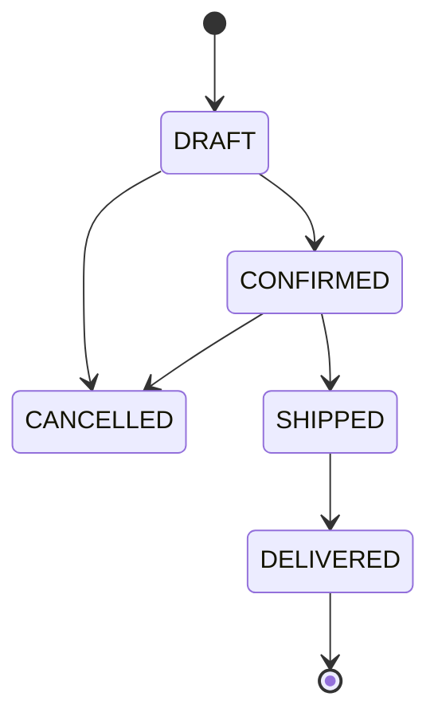

# Ca biên theo chủ sở hữu, tenant và trạng thái tài nguyên

> **Chương:** Chiến lược kiểm thử  
> **Module:** `SPRING_SECURITY_TESTING` — kiểm chứng xác thực, phân quyền và bảo vệ HTTP bằng `spring-security-test` trên ứng dụng Servlet và Reactive. Bài tập trung vào kiểm soát truy cập theo đối tượng, tenant và vòng đời tài nguyên bằng `MockMvc`, `WebTestClient` và danh tính được thiết lập trong `SecurityContext`.

## 1. Vì sao role đúng vẫn có thể truy cập sai dữ liệu?

Một rule như `hasAuthority("ORDER_READ")` chỉ trả lời một phần câu hỏi: principal có quyền đọc loại tài nguyên này không? Nó chưa trả lời người đó được đọc **đơn hàng nào**.

Ví dụ `an` và `binh` đều có authority `ORDER_READ`. Đơn `42` thuộc `an`, đơn `43` thuộc `binh`. Nếu `binh` thay ID trên URL từ `/api/orders/43` thành `/api/orders/42` mà vẫn đọc được đơn `42`, ứng dụng có lỗi phân quyền ở cấp đối tượng, thường được gọi là **IDOR** hoặc **BOLA**.

Tương tự, hai người dùng có cùng role nhưng thuộc hai tenant khác nhau không nhất thiết được xem cùng dữ liệu. Một admin có thể có quyền quản trị trong tenant `acme` nhưng không được tự động vượt sang tenant `beta` nếu chính sách yêu cầu cô lập tenant.

Ngoài danh tính và quyền, trạng thái tài nguyên cũng ảnh hưởng hành động. Chủ đơn có thể hủy đơn `DRAFT` nhưng không được hủy đơn `SHIPPED`; nhân viên có thể refund thanh toán `SETTLED` nhưng không được refund lần hai khi đã `REFUNDED`.

Bài này tập trung vào ba chiều cần kiểm tra cùng nhau:

- **Chủ sở hữu (owner):** tài nguyên thuộc về ai?
- **Tenant / phạm vi dữ liệu:** tài nguyên thuộc tổ chức, khách hàng hoặc workspace nào?
- **Trạng thái tài nguyên (resource state):** hành động có hợp lệ ở thời điểm hiện tại không?

Một test chỉ dùng `@WithMockUser(roles = "USER")` rồi assert `200`/`403` thường chưa đủ để chứng minh các chiều này.

## 2. Viết chính sách theo đối tượng, không chỉ theo URL

Trước khi tạo test, mô tả quyền theo bộ thuộc tính:

```text
Decision = Policy(
    principal,
    action,
    resource,
    tenant,
    resourceOwner,
    resourceState,
    requestContext
)
```

Ví dụ hợp đồng của API quản lý đơn hàng:

| Hành động | Điều kiện cho phép | Trường hợp từ chối |
|---|---|---|
| Đọc đơn | Chủ đơn hoặc nhân viên có quyền đọc trong đúng tenant | Người khác chủ, tenant khác, tài nguyên không được chia sẻ |
| Sửa địa chỉ giao hàng | Chủ đơn, đúng tenant, đơn ở `DRAFT` hoặc `CONFIRMED` theo nghiệp vụ | Sai owner/tenant hoặc đơn đã gửi đi |
| Hủy đơn | Chủ đơn hoặc support được phân công, đơn ở trạng thái có thể hủy | Sai owner, support không được phân công, đơn đã giao |
| Refund | Nhân viên có `PAYMENT_REFUND` trong tenant sở hữu payment, payment `SETTLED` | Sai tenant, thiếu authority, đã refund hoặc trạng thái không hợp lệ |
| Admin xem dữ liệu | Có `ROLE_ADMIN` trong phạm vi tenant được cấp | Admin tenant khác nếu không có quyền cross-tenant |

Đây là contract minh họa. Một sản phẩm có thể định nghĩa admin toàn hệ thống hoặc admin theo tenant; có thể trả `403` hoặc `404` cho tài nguyên không được truy cập. Test phải phản ánh policy đã chọn.

### Tách ba câu hỏi

1. **Authentication:** principal có được xác thực không? Ví dụ `an` đã đăng nhập.
2. **Coarse-grained authorization:** principal có quyền thực hiện loại hành động không? Ví dụ có `ORDER_CANCEL`.
3. **Object-level authorization và state policy:** principal có quyền trên chính đơn `42`, trong tenant cụ thể và trạng thái hiện tại không?

Có thể kiểm tra ba câu hỏi ở các tầng khác nhau, nhưng phải có ít nhất một đường kiểm thử tích hợp chứng minh chúng được nối đúng với endpoint thực tế.

## 3. Dựng fixture có khả năng phát hiện lỗi

Fixture tốt phải tạo ra các đối tượng chỉ khác nhau ở một thuộc tính quan trọng. Ví dụ:

| Tài nguyên | Owner | Tenant | State | Ghi chú |
|---|---|---|---|---|
| Đơn `42` | `an` | `acme` | `DRAFT` | Đơn của người thử chính |
| Đơn `43` | `binh` | `acme` | `DRAFT` | Cùng tenant, khác owner |
| Đơn `44` | `an` | `acme` | `SHIPPED` | Cùng owner, state khác |
| Đơn `50` | `chi` | `beta` | `DRAFT` | Khác tenant |
| Đơn `51` | null | `acme` | `DRAFT` | Dữ liệu thiếu owner, nếu domain cho phép |
| Đơn `52` | `an` | `acme` | `CANCELLED` | Đã hủy |

Danh tính mẫu:

| Principal | Authorities | Tenant | Vai trò trong ma trận |
|---|---|---|---|
| `an` | `ORDER_READ`, `ORDER_EDIT`, `ORDER_CANCEL` | `acme` | Chủ đơn 42, 44, 52 |
| `binh` | `ORDER_READ`, `ORDER_CANCEL` | `acme` | Cùng tenant nhưng không sở hữu đơn 42 |
| `chi` | `ORDER_READ`, `ORDER_CANCEL` | `beta` | Khác tenant |
| `support-1` | `ORDER_SUPPORT` | `acme` | Nhân viên hỗ trợ được phân công theo policy |
| `admin-acme` | `ROLE_ADMIN` | `acme` | Admin giới hạn tenant |
| `admin-global` | `ROLE_PLATFORM_ADMIN` | Toàn hệ thống | Admin xuyên tenant nếu policy cho phép |
| Anonymous | Không có | — | Không có danh tính |

Nếu chỉ có một user và một đơn hàng, test có thể xanh ngay cả khi hệ thống bỏ qua owner. Cặp `42`/`43` chứng minh owner; cặp `42`/`50` chứng minh tenant; cặp `42`/`44` chứng minh trạng thái.

Với dữ liệu owner null, cần xác định domain có cho phép tài nguyên chưa gán owner không. Nếu không, đó là dữ liệu lỗi cần xử lý an toàn; tuyệt đối không để phép so sánh null làm tài nguyên trở thành công khai.

## 4. Ma trận ca biên theo owner, tenant và state

Giả định API `GET /api/orders/{id}` cho phép chủ đơn và admin cùng tenant; `DELETE /api/orders/{id}` yêu cầu `ORDER_CANCEL` và đơn phải ở trạng thái `DRAFT`. Nhánh session bật CSRF cho DELETE.

| ID | Principal | Tài nguyên | Điều kiện | Kết quả mong đợi |
|---|---|---|---|---|
| O01 | `an` | Đơn 42 | Đúng owner, đúng tenant | Đọc được `200` |
| O02 | `binh` | Đơn 42 | Cùng tenant, khác owner | Bị từ chối `403`/`404` theo contract |
| O03 | `chi` | Đơn 42 | Khác tenant, khác owner | Bị từ chối; không lộ dữ liệu |
| O04 | `admin-acme` | Đơn 42 | Admin cùng tenant | Cho phép theo policy |
| O05 | `admin-acme` | Đơn 50 | Admin tenant acme truy cập beta | Bị từ chối nếu admin bị giới hạn tenant |
| O06 | `admin-global` | Đơn 50 | Có quyền cross-tenant rõ ràng | Cho phép theo policy |
| O07 | `an` | Đơn 44 | Đúng owner nhưng state SHIPPED | Không được hủy; lỗi state theo contract |
| O08 | `an` | Đơn 52 | Đúng owner nhưng đã CANCELLED | Không hủy lần hai |
| O09 | `binh` | Đơn 42 | Có ORDER_CANCEL nhưng sai owner; CSRF hợp lệ | Bị từ chối; không ghi/gateway/event |
| O10 | `an` | Đơn 42 | Đủ quyền, đúng owner, DRAFT; thiếu CSRF | CSRF từ chối trước nghiệp vụ |
| O11 | `an` | ID không tồn tại | Tài nguyên không có | `404` theo contract |
| O12 | `an` | Đơn 51 | Owner null hoặc dữ liệu bất thường | Fail closed; không cho truy cập mặc định |
| O13 | `an` | Đơn 42 | Gửi ownerId/tenantId giả trong request | Server vẫn dùng owner/tenant đã lưu |
| O14 | `binh` | Đơn 42 | ID đổi từ đơn của mình sang đơn người khác | Bị từ chối; phát hiện IDOR |
| O15 | `support-1` | Đơn 42 | Đúng tenant nhưng không được phân công | Bị từ chối nếu policy yêu cầu assignment |
| O16 | `support-1` | Đơn 42 | Đúng tenant và được phân công | Cho phép nếu role và assignment đều hợp lệ |

`O07`/`O08` là từ chối theo **vòng đời nghiệp vụ**, không nhất thiết là authorization failure. Có thể dùng `409 Conflict` khi trạng thái hiện tại không cho phép chuyển đổi. `O02`/`O03` là từ chối truy cập tài nguyên; sản phẩm có thể dùng `404` để che giấu sự tồn tại tài nguyên.

## 5. Kiểm tra IDOR: đổi ID không được đổi quyền

Một trong những test có giá trị cao nhất là giữ nguyên principal và thay resource ID:

```text
Request A:
  principal = binh
  GET /api/orders/43
  order 43 owner = binh
  -> ALLOW

Request B:
  principal = binh
  GET /api/orders/42
  order 42 owner = an
  -> DENY
```

Nếu cả hai request đều `200`, route có thể chỉ kiểm tra `ORDER_READ` mà không kiểm tra owner. Nếu test chỉ có request B mà không có request A, endpoint có thể đang chặn tất cả và test vẫn xanh; cặp allow/deny giúp xác nhận policy có phân biệt đúng.

ID dạng UUID hoặc khó đoán không thay thế authorization. Kẻ tấn công có thể nhận ID qua log, URL chia sẻ, response, referrer hoặc dữ liệu khác. Quyền phải được kiểm tra ở server cho từng tài nguyên.

### Không tin ownerId hoặc tenantId do client gửi

Một payload như:

```json
{
  "ownerId": "an",
  "tenantId": "acme",
  "address": "New address"
}
```

không phải bằng chứng người gửi là `an` hoặc thuộc tenant `acme`. Danh tính lấy từ principal đã xác thực; owner/tenant của tài nguyên lấy từ dữ liệu phía server. Nếu API cho phép chuyển owner hoặc chuyển tenant, đó phải là một thao tác nghiệp vụ riêng với quyền và quy trình xác nhận riêng.

Test cần thử gửi owner/tenant giả và xác minh server không dùng các trường này để cấp quyền.

## 6. Kiểm tra tenant isolation và admin scope

Tenant isolation thường có nhiều lớp:

- Principal thuộc tenant nào?
- Tài nguyên thuộc tenant nào?
- Repository query có giới hạn tenant không?
- Admin là admin trong một tenant hay admin toàn nền tảng?
- Một tài khoản có thể thuộc nhiều tenant không, và tenant active được chọn từ đâu?

Một lỗi phổ biến là kiểm tra role nhưng bỏ tenant:

```java
// Không đủ nếu dữ liệu cần được giới hạn theo tenant:
@PreAuthorize("hasAuthority('ORDER_READ')")
public Order read(Long id) {
    return repository.findById(id).orElseThrow();
}
```

Có thể cần kiểm tra cả authority lẫn tenant/owner trong policy. Ví dụ biểu thức method security có thể gọi bean policy, hoặc service tải tài nguyên rồi kiểm tra:

```java
@PreAuthorize("hasAuthority('ORDER_READ')")
public Order read(Long id, Actor actor) {
    Order order = repository.findById(id).orElseThrow();

    if (!actor.tenantId().equals(order.getTenantId())) {
        throw new AccessDeniedException("Tenant mismatch");
    }

    if (!actor.hasAuthority("ROLE_ADMIN")
            && !actor.userId().equals(order.getOwnerId())) {
        throw new AccessDeniedException("Not the owner");
    }

    return order;
}
```

Ví dụ trên giả định `Actor` được dựng từ security context phía server, không nhận trực tiếp từ request body. Trong production có thể dùng `@AuthenticationPrincipal` ở controller để lấy principal rồi truyền xuống service, hoặc một `CurrentActor` resolver đọc context.

**Admin không đồng nghĩa toàn quyền toàn hệ thống.** Nếu admin tenant `acme` chỉ được quản trị `acme`, test `O05` là bắt buộc. Nếu sản phẩm có platform admin xuyên tenant, hãy cấp authority riêng như `ROLE_PLATFORM_ADMIN` và test riêng `O06`. Không dùng một chuỗi `ROLE_ADMIN` mơ hồ cho cả hai phạm vi.

### Tenant filter trong repository

Một cách giảm nguy cơ là giới hạn query ngay tại data access, ví dụ tìm đơn theo cả ID và tenant:

```java
Optional<Order> findByIdAndTenantId(Long id, String tenantId);
```

Nhưng query có tenant filter không thay thế policy owner/role. Test cần chứng minh:

- Tenant khác không lấy được bản ghi.
- Cùng tenant nhưng khác owner vẫn bị chặn nếu policy yêu cầu owner.
- Admin có quyền rộng hơn chỉ trong phạm vi được cấp.
- Các query update/delete cũng áp dụng cùng tenant boundary, không chỉ query đọc.

## 7. Kiểm tra state transition, không chỉ so sánh một status

Tài nguyên có vòng đời thường được mô tả bằng state machine. Ví dụ đơn hàng:



Không phải mọi chuyển đổi đều hợp lệ. Policy hủy đơn có thể là:

- Chủ đơn hoặc support được phân công.
- Đúng tenant.
- Có authority cần thiết.
- Trạng thái hiện tại thuộc `DRAFT` hoặc `CONFIRMED`.
- CSRF hợp lệ trên nhánh session/cookie.
- Chuyển đổi chỉ xảy ra một lần.

Tạo ma trận chuyển trạng thái:

| Current state | Action | Principal/context | Expected |
|---|---|---|---|
| `DRAFT` | Cancel | Owner, đúng tenant, đủ quyền | Cho phép |
| `CONFIRMED` | Cancel | Owner, đúng tenant, đủ quyền | Cho phép theo policy |
| `SHIPPED` | Cancel | Owner, đúng tenant, đủ quyền | Từ chối state |
| `CANCELLED` | Cancel | Owner, đúng tenant, đủ quyền | Từ chối duplicate transition |
| `DRAFT` | Cancel | Non-owner, đủ authority chung | Từ chối owner |
| `DRAFT` | Cancel | Owner, sai tenant context | Từ chối tenant |
| `DRAFT` | Cancel | Owner, thiếu CSRF | Từ chối request protection |

Phân biệt nguyên nhân từ chối:

- **403/404:** principal không có quyền trên đối tượng.
- **409:** principal có quyền nhưng trạng thái hiện tại không cho phép hành động.
- **401:** chưa có authentication hợp lệ.
- **403 do CSRF:** request token không hợp lệ; chưa chứng minh owner/state policy.

Status thực tế phải theo contract của API. Quan trọng là test không gom mọi loại từ chối vào một assertion duy nhất, vì khi đó khó biết policy nào đã chặn.

## 8. Dựng principal có tenant/claim phù hợp trong MockMvc

`@WithMockUser` tiện cho username và authorities, nhưng principal mặc định không chứa tenant tùy chỉnh. Nếu policy đọc `tenantId` từ principal, hãy dùng authentication có principal đúng kiểu.

Ví dụ model:

```java
public record AppPrincipal(
        String userId,
        String tenantId) implements Principal {

    @Override
    public String getName() {
        return userId;
    }
}
```

Tạo request post-processor:

```java
private static RequestPostProcessor actor(
        String userId,
        String tenantId,
        String... authorities) {

    var granted = Arrays.stream(authorities)
        .map(SimpleGrantedAuthority::new)
        .toList();

    var principal = new AppPrincipal(userId, tenantId);
    var authentication =
        UsernamePasswordAuthenticationToken.authenticated(
            principal, null, granted);

    return authentication(authentication);
}
```

Test hai chiều owner/tenant:

```java
@Test
void ownerInSameTenantCanReadOrder() throws Exception {
    mvc.perform(get("/api/orders/42")
            .with(actor("an", "acme", "ORDER_READ")))
        .andExpect(status().isOk())
        .andExpect(jsonPath("$.id").value(42));
}

@Test
void sameTenantButDifferentOwnerCannotReadOrder() throws Exception {
    mvc.perform(get("/api/orders/42")
            .with(actor("binh", "acme", "ORDER_READ")))
        .andExpect(status().isForbidden());
}

@Test
void differentTenantCannotReadOrder() throws Exception {
    mvc.perform(get("/api/orders/42")
            .with(actor("chi", "beta", "ORDER_READ")))
        .andExpect(status().isForbidden());
}
```

Ví dụ giả định app dùng principal `AppPrincipal` trong authentication và controller/service đọc principal đó. Imports được lược bỏ. Nếu dùng `@WithUserDetails` với `UserDetails` tùy chỉnh hoặc annotation `@WithSecurityContext`, có thể tái sử dụng fixture theo cách phù hợp với test context.

Không ép principal thành `User` mặc định khi production code thực tế cần `AppPrincipal`; cast sai kiểu có thể làm test thất bại vì fixture chứ không phải policy.

## 9. Kiểm thử endpoint qua MockMvc với dữ liệu thật ở lớp repository

Một web slice có thể mock service để kiểm tra matcher URL, nhưng nó không kiểm chứng owner/tenant policy nếu policy nằm trong service. Đối với policy ở service, dùng integration test giữ service và repository thật hoặc ít nhất giữ policy thật.

Ví dụ endpoint nhận `Authentication` từ Spring MVC và truyền xuống service:

```java
@RestController
class OrderController {

    private final OrderService orders;

    OrderController(OrderService orders) {
        this.orders = orders;
    }

    @GetMapping("/api/orders/{id}")
    OrderDto read(
            @PathVariable Long id,
            Authentication authentication) {
        return orders.read(id, authentication);
    }
}
```

Service giữ policy:

```java
@Service
class OrderService {

    private final OrderRepository repository;

    OrderService(OrderRepository repository) {
        this.repository = repository;
    }

    public OrderDto read(Long id, Authentication authentication) {
        AppPrincipal actor = (AppPrincipal) authentication.getPrincipal();
        Order order = repository.findById(id).orElseThrow();

        if (!actor.tenantId().equals(order.getTenantId())) {
            throw new AccessDeniedException("Tenant mismatch");
        }

        if (!actor.userId().equals(order.getOwnerId())
                && !authentication.getAuthorities().stream()
                    .anyMatch(a -> a.getAuthority().equals("ROLE_ADMIN"))) {
            throw new AccessDeniedException("Not owner");
        }

        return OrderDto.from(order);
    }
}
```

Đây là ví dụ minh họa; production nên cân nhắc trả `404` để che giấu tài nguyên và xử lý exception qua handler phù hợp. Test tích hợp có thể seed đơn `42`/`43`/`50` trong DB test, gửi các principal tương ứng và assert response lẫn dữ liệu.

Với test `@SpringBootTest` + `@AutoConfigureMockMvc`:

- Không mock `OrderService` nếu mục tiêu là policy trong service.
- Không tắt filters nếu cần kiểm tra request security.
- Có thể dùng repository test fixture để tạo owner/tenant/state.
- Sau request bị từ chối, đọc lại DB để bảo đảm không có thay đổi.
- Kiểm tra response body không lộ thông tin đơn hàng.

## 10. Reactive WebFlux: cùng policy, khác context và client

Với WebFlux, `SecurityWebFilterChain` bảo vệ route; principal và context có thể nằm trong Reactor context. Khi policy cần tenant, custom principal có thể cung cấp tenant ID:

```java
public record ReactiveActor(
        String userId,
        String tenantId) implements Principal {

    @Override
    public String getName() {
        return userId;
    }
}
```

Dựng authentication cho `WebTestClient` bằng mock principal phù hợp:

```java
var auth = UsernamePasswordAuthenticationToken.authenticated(
    new ReactiveActor("binh", "acme"),
    null,
    List.of(new SimpleGrantedAuthority("ORDER_READ")));

client.mutateWith(mockAuthentication(auth))
    .get().uri("/api/orders/42")
    .exchange()
    .expectStatus().isForbidden();
```

Ví dụ này giả định endpoint dùng policy đọc actor từ Reactive security context. `mockAuthentication` là helper Reactive tương ứng trong `SecurityMockServerConfigurers`; với principal đơn giản chỉ cần username và authorities, `mockUser()` có thể đủ, nhưng tenant custom cần principal phù hợp.

Nếu dùng `@EnableReactiveMethodSecurity`, test phải gọi bean Reactive được Spring quản lý và subscribe publisher thông qua `WebTestClient` hoặc Reactor test tool. Không kiểm tra context Reactive bằng `SecurityContextHolder` kiểu ThreadLocal.

### Side effect trong Reactive

Một publisher chỉ thực thi khi được subscribe. Khi owner/tenant policy từ chối, test cần chứng minh publisher ghi dữ liệu hoặc gọi gateway không được subscribe. Ví dụ có thể dùng Mockito verification hoặc test publisher để quan sát việc subscribe.

Nếu service trả `Mono.error(new AccessDeniedException(...))` trước nhánh `repository.save`/gateway, test nên kiểm tra cả error/status lẫn không có interaction với nhánh mutation. Đừng gọi external API ngay khi tạo publisher trước khi kiểm tra policy.

## 11. Tài nguyên thiếu, null owner, deleted và nested resource

Các trường hợp biên thường bị bỏ qua vì fixture “bình thường” luôn có owner và tenant hợp lệ.

### Tài nguyên không tồn tại

`GET /api/orders/999` có thể trả `404`. Không nên trả `403` cho một ID không tồn tại trừ khi API có contract riêng. Nếu hệ thống dùng `404` cho cả “không tồn tại” và “không được phép”, test cần xác minh cả hai trường hợp không tiết lộ dữ liệu và response không cho phép dò ID.

### Owner null hoặc tenant null

Nếu dữ liệu cũ/import lỗi có owner null, policy phải fail closed. Không nên viết logic kiểu:

```java
if (order.getOwnerId() == null
        || actor.userId().equals(order.getOwnerId())) {
    return true;
}
```

Điều kiện trên biến tài nguyên không có owner thành tài nguyên công khai cho mọi user. Nếu domain có tài nguyên chưa gán owner, hãy định nghĩa rõ ai được phép truy cập (ví dụ admin trong tenant) và test riêng.

### Tài nguyên đã xóa hoặc soft-delete

Nếu dùng soft delete, repository có thể trả về tài nguyên đã xóa. Test phải xác định:

- User thông thường có được xem tài nguyên đã xóa không?
- Admin có thể restore không?
- API trả `404` hay trạng thái riêng?
- Các endpoint update/delete có vô tình thao tác trên bản ghi đã xóa không?

### Nested resource và parent-child mismatch

Một URL như `/api/accounts/10/orders/42` chứa hai ID. Phải xác minh đơn `42` thực sự thuộc account `10` và account đó thuộc tenant/principal được phép. Không được chỉ kiểm tra quyền trên parent hoặc chỉ kiểm tra owner của child mà bỏ liên kết giữa hai đối tượng.

Tạo fixture sai liên kết (order 42 thuộc account 11 nhưng request gọi account 10) và assert bị từ chối. Đây là một ca tốt để phát hiện BOLA qua nested route.

### Tài nguyên được chia sẻ hoặc ủy quyền

Nếu owner chia sẻ tài liệu cho user khác, policy có thể cho phép collaborator với quyền `DOCUMENT_READ`. Test cần phân biệt owner, collaborator được chia sẻ, user không được chia sẻ và admin. Không suy ra mọi user cùng tenant đều được xem mọi tài liệu.

## 12. Cạnh tranh và TOCTOU: quyền đúng lúc đọc có thể sai lúc ghi

Một lỗi tinh vi xảy ra khi dữ liệu thay đổi giữa lúc kiểm tra quyền và lúc mutation:

1. Service đọc đơn `42`, thấy owner là `an`.
2. Một transaction khác chuyển đơn sang tenant khác hoặc thay owner.
3. Request đầu tiếp tục ghi dựa trên dữ liệu cũ.

Đây là rủi ro **TOCTOU** (*time of check to time of use*). Tùy domain, có thể giảm bằng:

- Thực hiện kiểm tra và ghi trong transaction có isolation phù hợp.
- Dùng optimistic locking với `@Version` để phát hiện bản ghi thay đổi.
- Dùng pessimistic lock khi cần đảm bảo thứ tự và đã đánh giá tác động.
- Đưa tenant/owner/state vào điều kiện update/delete nguyên tử.
- Thiết kế command idempotent để request lặp không tạo mutation nhiều lần.

Ví dụ repository update có điều kiện:

```sql
UPDATE orders
SET status = 'CANCELLED',
    version = version + 1
WHERE id = :id
  AND tenant_id = :tenantId
  AND owner_id = :ownerId
  AND status = 'DRAFT'
```

Nếu số dòng cập nhật là 0, không được giả định thao tác thành công; có thể tài nguyên không tồn tại, không còn thuộc owner/tenant đó hoặc đã đổi trạng thái. API cần ánh xạ kết quả theo contract và tránh lộ thông tin không cần thiết.

Không phải test đơn vị nào cũng tái hiện được race condition. Với rủi ro cao, cần integration/concurrency test dùng DB thật phù hợp, hai transaction cạnh tranh và xác minh chỉ một chuyển đổi thành công.

## 13. Thiết kế bộ test tối thiểu nhưng đủ sức phát hiện lỗi

Với mỗi hành động nhạy cảm, cân nhắc các nhóm:

| Nhóm | Ví dụ tối thiểu |
|---|---|
| Authentication | Anonymous bị chặn |
| Coarse permission | Có/thiếu authority |
| Owner | Chủ tài nguyên được phép; người khác chủ bị từ chối |
| Tenant | Cùng tenant được xét tiếp; tenant khác bị từ chối |
| Admin scope | Admin trong tenant; platform admin nếu có |
| Resource state | Trạng thái hợp lệ; trạng thái cấm; trạng thái đã hoàn tất |
| Resource integrity | ID không tồn tại; owner null; nested parent-child mismatch |
| Client tampering | Giả mạo ownerId/tenantId không làm thay đổi quyết định |
| Side effect | Denied request không ghi DB/gọi gateway/phát event |
| Concurrency | Không ghi dựa trên owner/state đã lỗi thời khi rủi ro đòi hỏi |

Không nhất thiết nhân tất cả tổ hợp thành hàng trăm test. Giữ lại các cặp chỉ khác một thuộc tính và những ranh giới có hậu quả cao. Mỗi policy quan trọng phải có ca cho phép đối chứng; nếu mọi test đều bị từ chối, hệ thống có thể đang chặn tất cả thay vì thực thi đúng quyền.

Một test cần đỏ khi:

- Bỏ owner check.
- Bỏ tenant check.
- Đổi role admin tenant thành quyền toàn hệ thống.
- Cho phép hủy đơn đã giao.
- Tin ownerId/tenantId do client gửi.
- Không kiểm tra quan hệ giữa parent và child resource.
- Không kiểm soát race khi dữ liệu bị thay đổi đồng thời (nếu đây là rủi ro trong scope).

## 14. Bài tập thực hành: tài liệu nhiều tenant

Một ứng dụng quản lý tài liệu có:

- `GET /api/tenants/{tenantId}/documents/{documentId}`: chủ tài liệu hoặc collaborator được chia sẻ có `DOCUMENT_READ` được xem trong tenant tương ứng.
- `PATCH /api/tenants/{tenantId}/documents/{documentId}`: chủ tài liệu có `DOCUMENT_EDIT` được sửa khi tài liệu ở trạng thái `DRAFT`; session web yêu cầu CSRF.
- `POST /api/tenants/{tenantId}/documents/{documentId}/archive`: chỉ admin tenant hoặc owner có quyền archive; tài liệu không được ở trạng thái `ARCHIVED`.
- Platform admin có quyền cross-tenant riêng.

Hãy tạo fixture tối thiểu:

- Document `D1` owner `an`, tenant `acme`, `DRAFT`.
- Document `D2` owner `binh`, tenant `acme`, `DRAFT`.
- Document `D3` owner `chi`, tenant `beta`, `DRAFT`.
- Document `D4` owner `an`, tenant `acme`, `ARCHIVED`.
- Một collaborator được chia sẻ `D1` với quyền đọc nhưng không có quyền sửa.

Viết tối thiểu 12 test gồm:

1. Owner đọc được tài liệu của mình.
2. User cùng tenant nhưng khác owner và không được chia sẻ bị từ chối.
3. Collaborator được chia sẻ đọc được nhưng không sửa được.
4. User khác tenant bị từ chối dù có `DOCUMENT_READ`.
5. Admin `acme` không tự động đọc tài liệu `beta` nếu policy giới hạn tenant.
6. Platform admin truy cập cross-tenant theo quyền riêng.
7. Owner sửa tài liệu `DRAFT` với CSRF hợp lệ.
8. Owner thiếu CSRF bị chặn và tài liệu không đổi.
9. Owner sửa tài liệu `ARCHIVED` bị từ chối theo state policy.
10. Client gửi tenantId/ownerId giả không vượt quyền.
11. Nested route dùng tenant ID không khớp document bị từ chối.
12. Hai request archive cạnh tranh không tạo hai sự kiện archive hoặc hai mutation không hợp lệ.

Với từng test, nêu rõ tầng từ chối (filter chain, method security hay resource policy), HTTP status theo contract, body có lộ dữ liệu không, và DB/event state sau request.

**Tiêu chí hoàn thành:** Bộ test phân biệt được quyền trên loại tài nguyên với quyền trên từng đối tượng, kiểm tra owner và tenant độc lập, kiểm tra chuyển trạng thái hợp lệ, và phát hiện việc giả mạo ID hoặc race condition. Khi đó các ca biên mới bảo vệ được dữ liệu thực tế thay vì chỉ chứng minh một role có thể gọi một URL.
