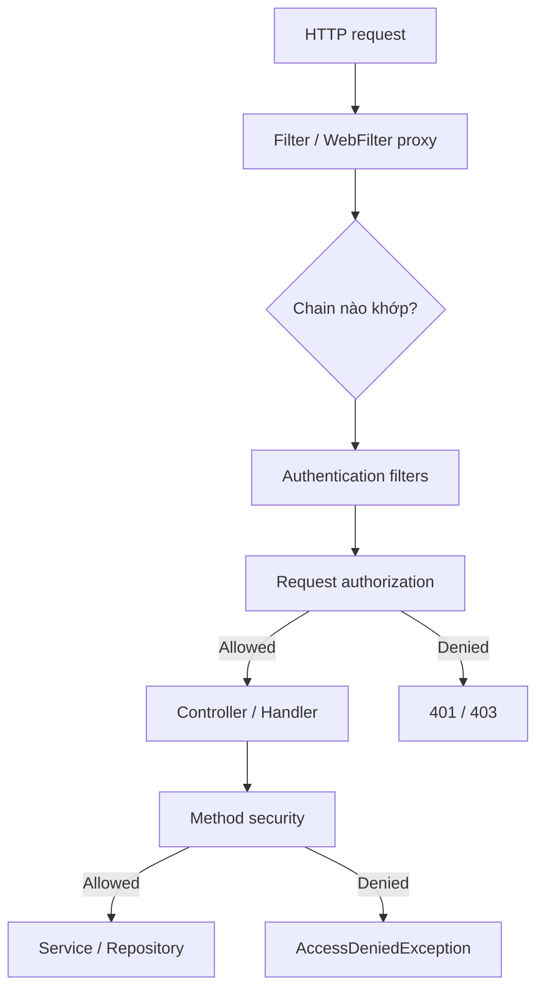

# Bằng chứng cần có để tránh kết quả đạt do cấu hình bị vô hiệu hóa

> **Chương:** Chiến lược kiểm thử  
> **Module:** `SPRING_SECURITY_TESTING` — kiểm chứng xác thực, phân quyền và bảo vệ HTTP bằng `spring-security-test` trên ứng dụng Servlet và Reactive. Bài sử dụng `MockMvc`, `WebTestClient`, `@WithMockUser`, `SecurityContext` và JWT/OAuth2/OIDC giả lập.

## 1. Test xanh chưa chắc hàng rào bảo mật đang chạy

Một bài test có thể nhận `200 OK` hoặc `403 Forbidden` đúng như mong đợi nhưng vẫn không chứng minh cấu hình Spring Security đang hoạt động. Nguyên nhân thường là test vô tình bỏ qua chính lớp cần kiểm tra:

- `@AutoConfigureMockMvc(addFilters = false)` khiến request không đi qua các Servlet filters được đăng ký cho MockMvc.
- `MockMvcBuilders.standaloneSetup(controller)` dựng controller độc lập nhưng không tự động nạp toàn bộ security filter chain.
- `WebTestClient.bindToController(...)` chỉ dựng handler/controller; nếu không gắn WebFlux security phù hợp, request có thể không đi qua `SecurityWebFilterChain`.
- Một test configuration thay security chain bằng `permitAll()` hoặc mock authorization manager luôn cho phép.
- Profile kiểm thử nạp cấu hình bảo mật yếu hơn cấu hình ứng dụng cần xác minh.
- `@WithMockUser` tạo principal giả lập; test chỉ kiểm tra controller trả dữ liệu và không có ca anonymous/thiếu quyền để chứng minh filter chain thực sự chặn request.
- `@MockitoBean` thay service đang chứa `@PreAuthorize`, hoặc test gọi một object được tạo bằng `new` nên method-security proxy không chạy.
- JWT decoder hoặc authentication provider bị mock trả về kết quả cố định, khiến test không kiểm tra credentials/token.

**Bằng chứng đáng tin phải cho thấy request đi qua đúng lớp bảo mật và sẽ thất bại nếu lớp đó bị gỡ hoặc bị nới lỏng.**

Một security test suite nên có ba loại bằng chứng:

1. **Bằng chứng cấu hình được nạp:** đúng security chain, matcher, method security, CSRF và decoder được đưa vào context.
2. **Bằng chứng hành vi:** request anonymous, thiếu quyền và đủ quyền nhận kết quả khác nhau theo contract.
3. **Bằng chứng chống bypass:** test không tắt filters, không thay policy đang kiểm tra bằng mock/permitAll, và có ca đối chứng khiến lỗi cấu hình làm test thất bại.

## 2. Xác định lớp nào phải chạy thật

Trong Servlet, request thường đi qua `FilterChainProxy`, chọn `SecurityFilterChain` đầu tiên khớp request rồi mới đến controller. Trong WebFlux, request đi qua `WebFilterChainProxy` và `SecurityWebFilterChain` tương ứng.



Chọn test double theo mục tiêu:

| Mục tiêu | Thành phần phải giữ thật | Có thể giả lập |
|---|---|---|
| URL/method authorization | Filter chain, chain matcher, request authorization manager | Service/repository phía sau |
| Authentication Basic/form login | Authentication filter, provider, password encoder, user lookup cần kiểm tra | User store bằng fixture in-memory nếu DB không thuộc phạm vi |
| JWT signature/expiry/issuer validation | Bearer filter, decoder và validators | JWKS/IdP ở biên ngoài nếu test key server không phải mục tiêu |
| Authorization theo JWT scope | Authorization matcher và scope mapping nếu muốn kiểm tra mapping | Principal/JWT đã xác thực bằng `jwt()`/`mockJwt()` khi chỉ thử policy |
| Method security | Spring-managed service bean và method-security interceptor | Repository/gateway phía sau method |
| CSRF | CSRF filter và security chain | Token request bằng helper để tạo trường hợp hợp lệ/thiếu/sai |
| Owner/tenant policy | Logic policy và đường lấy owner/tenant tin cậy | Repository data source nếu đang unit test policy |
| HTTP response/body | Controller, serializer và security chain trong phạm vi cần kiểm tra | Service trả dữ liệu cố định |

Không có yêu cầu tất cả dependency phải thật. Điều quan trọng là **lớp quyết định bảo mật mà test tuyên bố kiểm tra phải thực sự chạy**.

## 3. Những dấu hiệu cấu hình có thể bị vô hiệu hóa

### 3.1. Tắt toàn bộ filters trong MockMvc

Đây là cấu hình nguy hiểm khi mục tiêu test là request security:

```java
@SpringBootTest
@AutoConfigureMockMvc(addFilters = false)
class ReportSecurityTest {
    // Request không đi qua các Servlet filters được đăng ký cho MockMvc.
}
```

Nếu test này nhận `200` khi gọi controller, nó không chứng minh authentication hoặc authorization. Không dùng `addFilters = false` cho bài test cần xác minh Spring Security filter chain.

Có thể tắt filters trong một test MVC chỉ kiểm tra serialization hoặc mapping không liên quan security, nhưng phải đặt tên/phạm vi rõ ràng để không ai diễn giải kết quả đó thành security coverage.

### 3.2. Dựng standalone MockMvc mà không gắn security

```java
MockMvc mvc = MockMvcBuilders
    .standaloneSetup(new ReportController(reportService))
    .build();
```

Cách dựng này phù hợp cho controller unit/slice rất hẹp. Nó không tự động chứng minh cấu hình Spring Security của application context. Nếu cần test filter chain, dùng `webAppContextSetup` với filter thực hoặc `@WebMvcTest`/`@SpringBootTest` có security configuration phù hợp.

Khi tự dựng MockMvc với Spring Security, có thể áp dụng `springSecurity()` cùng `FilterChainProxy` thực của ứng dụng:

```java
MockMvc mvc = MockMvcBuilders
    .webAppContextSetup(context)
    .apply(springSecurity())
    .build();
```

Đừng tự tạo một filter chain cho phép mọi request rồi dùng nó làm bằng chứng cho chain sản phẩm.

### 3.3. WebTestClient không đi qua WebFlux security

`WebTestClient.bindToController(...)` là cách dựng test client ở cấp controller. Nếu mục tiêu là `SecurityWebFilterChain`, phải tích hợp security filter chain phù hợp hoặc bind vào application context rồi apply `springSecurity()`.

```java
WebTestClient client =
    WebTestClient.bindToApplicationContext(context)
        .apply(springSecurity())
        .configureClient()
        .build();
```

Cấu hình trên giả định application context đã nạp `SecurityWebFilterChain` cần kiểm tra. `springSecurity()` kết nối test client với WebFlux security test support; nó không tự tạo ra policy đúng nếu chain bị thiếu hoặc bị thay bằng cấu hình cho phép tất cả.

### 3.4. Test profile dùng policy khác production

Ví dụ test profile có một chain:

```java
@Bean
@Profile("test")
SecurityFilterChain testChain(HttpSecurity http) throws Exception {
    return http
        .authorizeHttpRequests(auth -> auth.anyRequest().permitAll())
        .build();
}
```

Nếu production dùng rule `hasAuthority("REPORT_READ")` nhưng test profile cho phép mọi request, các test HTTP sẽ không kiểm tra được policy production. Đừng thay security policy trong test chỉ để giảm setup. Hãy thay dependency bên ngoài (database, gateway, IdP) bằng fixture/mock, đồng thời giữ rule bảo mật cần chứng minh.

Nếu ứng dụng có cấu hình khác nhau theo profile, cần có test chạy với profile và properties đại diện cho môi trường triển khai quan trọng. Có thể có test riêng cho profile test, staging và production-like nếu policy khác nhau có chủ đích.

### 3.5. Mock chính thành phần đưa ra quyết định

Các ví dụ sau làm mất mục tiêu kiểm thử nếu chúng xuất hiện trong test cần kiểm tra đúng thành phần đó:

- Mock `AuthorizationManager` rồi stub luôn kết quả allow.
- Mock `JwtDecoder` trả một `Jwt` cố định trong test muốn chứng minh chữ ký/expiry.
- Mock `AuthenticationProvider` trả authenticated trong test muốn kiểm tra password.
- Mock service có `@PreAuthorize` trong test muốn chứng minh method security.
- Dùng custom test chain `permitAll()` thay chain thật.

Mock các dependency phía sau là hợp lý; mock chính cơ chế cần chứng minh thì không.

## 4. Bằng chứng hành vi: ca anonymous, thiếu quyền và đủ quyền

Sự hiện diện của bean `SecurityFilterChain` hoặc `SecurityWebFilterChain` không đủ chứng minh đúng chain đã được áp dụng cho URL. Bằng chứng mạnh hơn là một request thực sự thể hiện các quyết định khác nhau.

Giả sử API Servlet:

- `GET /public/status` công khai.
- `GET /api/reports` yêu cầu authority `REPORT_READ`.
- API dùng HTTP Basic entry point, anonymous/credentials sai trả `401`.
- Principal đã xác thực nhưng thiếu quyền nhận `403`.

Ma trận smoke test:

| ID | Request | Principal | Kỳ vọng |
|---|---|---|---|
| S01 | `GET /public/status` | Anonymous | `200` |
| S02 | `GET /api/reports` | Anonymous | `401` |
| S03 | `GET /api/reports` | User có `ORDER_READ` | `403` |
| S04 | `GET /api/reports` | User có `REPORT_READ` | `200` |
| S05 | `GET /api/reports` | Basic password sai | `401` |

Tại sao cần cả S01 và S02? S01 chứng minh endpoint công khai vẫn hoạt động; S02 chứng minh route bảo vệ không bị mở. S03 phân biệt authorization với authentication. S04 là positive control: hệ thống không chặn tất cả request. S05 kiểm tra credentials nếu authentication Basic thuộc phạm vi test.

Nếu cấu hình bị đổi thành `anyRequest().permitAll()`, S02/S03 phải thất bại. Nếu cấu hình bị đổi thành `anyRequest().denyAll()`, S01/S04 phải thất bại. Cặp positive/negative controls giúp phát hiện cả mở quá rộng lẫn chặn quá rộng.

### Một test smoke hoàn chỉnh với MockMvc

```java
@SpringBootTest
@AutoConfigureMockMvc
class SecurityChainSmokeTest {

    @Autowired
    MockMvc mvc;

    @MockitoBean
    ReportService reports;

    @Test
    void publicEndpointRemainsPublic() throws Exception {
        mvc.perform(get("/public/status"))
            .andExpect(status().isOk());
    }

    @Test
    void anonymousCannotReadProtectedReport() throws Exception {
        mvc.perform(get("/api/reports"))
            .andExpect(status().isUnauthorized())
            .andExpect(header().string(
                HttpHeaders.WWW_AUTHENTICATE,
                startsWith("Basic")));

        verifyNoInteractions(reports);
    }

    @Test
    @WithMockUser(username = "binh", authorities = "ORDER_READ")
    void authenticatedUserWithoutReportAuthorityIsDenied()
            throws Exception {
        mvc.perform(get("/api/reports"))
            .andExpect(status().isForbidden());

        verifyNoInteractions(reports);
    }

    @Test
    @WithMockUser(username = "an", authorities = "REPORT_READ")
    void reportReaderCanReachController() throws Exception {
        when(reports.read()).thenReturn("report-acme");

        mvc.perform(get("/api/reports"))
            .andExpect(status().isOk())
            .andExpect(content().string("report-acme"));

        verify(reports).read();
    }
}
```

Imports được lược bỏ; `@MockitoBean` cần phiên bản Spring Framework hỗ trợ, hoặc dùng mock-bean annotation tương ứng của phiên bản dự án.

Ví dụ giả định application context đã nạp **security configuration thực** và `@AutoConfigureMockMvc` giữ filters ở trạng thái mặc định bật. Không có `addFilters = false`, không có test chain `permitAll()`. Service được mock vì mục tiêu của smoke test là request authorization; filter chain và controller vẫn chạy.

Nếu API dùng form login thay vì Basic, thay assertion anonymous thành redirect đến login page theo contract; đừng yêu cầu `WWW-Authenticate: Basic` khi app không dùng Basic.

## 5. Kiểm tra đúng filter chain được chọn khi có nhiều chain

Một ứng dụng có thể khai báo nhiều `SecurityFilterChain`, ví dụ:

- `/api/partner/**` dùng Bearer JWT.
- `/admin/**` dùng session/form login.
- Các route còn lại dùng cấu hình web mặc định.

`FilterChainProxy` chọn **chain đầu tiên khớp request** theo thứ tự. Việc context có nhiều chain bean không đảm bảo route đi vào chain mong muốn. Một matcher rộng đặt trước matcher cụ thể có thể khiến chain phía sau không bao giờ được dùng.

Cách kiểm tra:

1. Liệt kê các route đại diện cho từng chain.
2. Gửi anonymous request để xác minh entry point/challenge đúng.
3. Gửi credentials thuộc cơ chế tương ứng (Basic, session, Bearer).
4. Gửi principal hợp lệ nhưng thiếu authority để kiểm tra authorization.
5. Gửi principal đủ quyền để xác nhận route không bị chặn nhầm.
6. Kiểm tra một route không được chain nào dự định bảo vệ; cân nhắc fallback chain từ chối mặc định.

Ví dụ bảng:

| Route | Cơ chế dự kiến | Negative control | Positive control |
|---|---|---|---|
| `/api/partner/reports` | Bearer JWT | Không token / thiếu `SCOPE_reports.read` | Token scope đúng |
| `/admin/reports` | Session/form login | Anonymous / thiếu `REPORT_READ` | Session user có quyền |
| `/api/internal/health` | Theo policy nội bộ | Không có internal authority | Service identity được phép |

Không dựa duy nhất vào tên bean hoặc `@Order` trong code để kết luận. Test hành vi từng nhóm URL sẽ phát hiện sai matcher, thứ tự chain và entry point.

### Không để route rơi khỏi mọi chain

Nếu dùng `securityMatcher` để giới hạn một chain, request không khớp chain nào có thể không được chain đó bảo vệ. Hãy cân nhắc một chain fallback áp dụng cho phần còn lại và từ chối mặc định, hoặc chứng minh rõ route đó công khai theo contract.

## 6. Kiểm tra method security độc lập với URL filter chain

Request authorization và method security là hai lớp khác nhau. Một URL có thể cho phép user đã đăng nhập vào controller nhưng service cần authority riêng.

Để chứng minh `@PreAuthorize`:

- Bật `@EnableMethodSecurity` trong configuration được nạp.
- Inject service bean do Spring quản lý.
- Gọi method qua proxy.
- Không mock service đang kiểm tra.
- Có principal đủ quyền và thiếu quyền.
- Xác minh dependency phía sau không được gọi khi interceptor từ chối.

Ví dụ:

```java
@SpringBootTest
class InvoiceMethodSecuritySmokeTest {

    @Autowired
    InvoiceService invoices;

    @MockitoBean
    InvoiceRepository repository;

    @Test
    @WithMockUser(authorities = "ORDER_READ")
    void missingInvoicePermissionIsDeniedBeforeRepositoryRead() {
        assertThatThrownBy(() -> invoices.read("INV-42"))
            .isInstanceOf(AccessDeniedException.class);

        verifyNoInteractions(repository);
    }

    @Test
    @WithMockUser(authorities = "INVOICE_READ")
    void invoiceReaderCanReachRepository() {
        when(repository.load("INV-42"))
            .thenReturn(new Invoice("INV-42"));

        assertThat(invoices.read("INV-42").id())
            .isEqualTo("INV-42");

        verify(repository).load("INV-42");
    }
}
```

Test này chỉ chứng minh method security nếu `InvoiceService` thật được Spring proxy và `@EnableMethodSecurity` thực sự được nạp. Nếu test tự tạo `new InvoiceService(...)`, gọi qua self-invocation hoặc mock `InvoiceService`, interceptor có thể không chạy.

Một assertion phụ có thể kiểm tra bean là proxy bằng `AopUtils.isAopProxy(invoices)`, nhưng đó chỉ là dấu hiệu cấu trúc. Bằng chứng quan trọng vẫn là ca thiếu quyền bị từ chối và ca đủ quyền đi tiếp.

## 7. CSRF: chứng minh filter không bị tắt

Một bộ test chỉ luôn gọi `with(csrf())` chứng minh request có token hợp lệ đi qua, nhưng chưa chứng minh request thiếu token bị chặn. Nếu CSRF vô tình bị disable trong test profile, các test có token vẫn xanh.

Với endpoint session/cookie `POST /api/orders`:

```java
@Test
@WithMockUser(username = "an", authorities = "ORDER_CREATE")
void postWithoutCsrfIsRejected() throws Exception {
    mvc.perform(post("/api/orders")
            .contentType(MediaType.APPLICATION_JSON)
            .content("{\"sku\":\"A-1\"}"))
        .andExpect(status().isForbidden());

    verifyNoInteractions(orderService);
}

@Test
@WithMockUser(username = "an", authorities = "ORDER_CREATE")
void postWithCsrfAndPermissionIsAccepted() throws Exception {
    when(orderService.create(any()))
        .thenReturn(new OrderResponse("O-100"));

    mvc.perform(post("/api/orders")
            .with(csrf())
            .contentType(MediaType.APPLICATION_JSON)
            .content("{\"sku\":\"A-1\"}"))
        .andExpect(status().isCreated());

    verify(orderService).create(any());
}
```

Hai test tạo positive/negative control cho CSRF. Nếu CSRF bị disable, test thiếu token sẽ nhận kết quả khác và thất bại. Nếu user thiếu quyền, hãy cấp CSRF hợp lệ trong test authorization để không nhầm CSRF failure với permission failure.

Reactive tương ứng dùng `WebTestClient`:

```java
client.mutateWith(mockUser("an")
        .authorities(new SimpleGrantedAuthority("ORDER_CREATE")))
    .post().uri("/api/orders")
    .bodyValue(Map.of("sku", "A-1"))
    .exchange()
    .expectStatus().isForbidden();

client.mutateWith(mockUser("an")
        .authorities(new SimpleGrantedAuthority("ORDER_CREATE")))
    .mutateWith(csrf())
    .post().uri("/api/orders")
    .bodyValue(Map.of("sku", "A-1"))
    .exchange()
    .expectStatus().isCreated();
```

Ví dụ giả định CSRF bật trong WebFlux security chain và controller chấp nhận payload. Với API Bearer stateless, chính sách CSRF có thể khác; test phải phản ánh thiết kế xác thực thực tế.

## 8. JWT: phân biệt mock authentication với decoder đang hoạt động

`jwt()` trong MockMvc và `mockJwt()` trong WebTestClient rất hữu ích để kiểm tra authorization theo scope. Tuy nhiên, helper dựng authentication/token giả lập; nó không xác minh chữ ký, issuer, audience hay expiration bằng decoder thực.

Để chứng minh resource server đang hoạt động:

| Ca | Đầu vào | Kỳ vọng |
|---|---|---|
| J01 | Không Bearer token | `401` |
| J02 | Token hợp lệ, scope đủ | `200` |
| J03 | Token hợp lệ, scope thiếu | `403` |
| J04 | Token sai chữ ký | `401` |
| J05 | Token hết hạn | `401` |
| J06 | Token sai issuer/audience theo validators đã cấu hình | `401` |

J02/J03 có thể dùng `jwt()`/`mockJwt()` nếu mục tiêu là authorization. J04–J06 phải gửi token qua `JwtDecoder`/`ReactiveJwtDecoder` thật. Đừng mock decoder trả một JWT cố định trong test muốn chứng minh token validation.

Ví dụ test decoder qua HTTP:

```java
@Test
void expiredBearerTokenIsRejectedByRealDecoder() throws Exception {
    mvc.perform(get("/partner/reports")
            .header(HttpHeaders.AUTHORIZATION,
                "Bearer " + expiredJwt))
        .andExpect(status().isUnauthorized());

    verifyNoInteractions(partnerReportService);
}
```

`expiredJwt` phải là token có định dạng và chữ ký hợp lệ cho key test nhưng có `exp` đã quá hạn. Nếu dùng chuỗi ngẫu nhiên, test chỉ chứng minh parser từ chối dữ liệu hỏng, không chứng minh expiration validator.

Để tránh test luôn đỏ do decoder hỏng, có ca đối chứng với token hợp lệ được ký bằng test key và được phép truy cập. Nếu có nhiều resource server chain, xác minh URL thực sự đi qua chain có decoder đang kiểm tra.

## 9. Profile và test configuration phải bảo toàn security contract

Test cần cô lập dependency, không nên thay đổi chính sách bảo mật một cách âm thầm.

### Những thay đổi test thường hợp lý

- Thay DB sản xuất bằng DB test hoặc Testcontainers.
- Dùng `InMemoryUserDetailsManager` cho password fixture nếu không kiểm tra persistence.
- Mock payment gateway, email provider, message broker.
- Dùng JWKS test server cung cấp public key thử nghiệm trong khi decoder thật vẫn xác minh token.
- Dùng principal giả lập để kiểm tra authorization matrix.

### Những thay đổi làm mất bằng chứng

- Test profile thay `hasAuthority("REPORT_READ")` bằng `authenticated()` hoặc `permitAll()`.
- Tắt CSRF để mọi POST dễ chạy.
- Tắt toàn bộ filters.
- Thay `AuthorizationManager` hoặc `JwtDecoder` bằng mock luôn cho phép.
- Bỏ `@EnableMethodSecurity` nhưng test service bằng object tự tạo.
- Dùng controller standalone và không gắn security filters nhưng vẫn đặt tên test là security test.

Nếu có cấu hình bảo mật khác nhau theo profile, hãy kiểm tra rõ profile nào đang active và tại sao. Một test chạy profile test không tự chứng minh cấu hình production; cần test với profile/properties gần môi trường triển khai cho các policy quan trọng. Không đưa secret production vào test chỉ để làm điều đó.

## 10. Kiểm tra các cấu hình bypass phổ biến

| Cấu hình / cách dựng | Rủi ro | Bằng chứng cần có |
|---|---|---|
| `addFilters = false` | MockMvc bỏ qua registered filters | Anonymous request bị chặn qua filter chain thật |
| `web.ignoring()` cho route cần bảo vệ | Request bỏ qua security filters | Dùng matcher phù hợp; test route không bị ignore |
| `permitAll()` cho matcher rộng | Mở route bảo vệ | Test anonymous và thiếu authority phải thất bại nếu policy bị nới |
| `securityMatcher` sai hoặc quá hẹp | Route không vào chain dự kiến | Smoke test mỗi nhóm URL/chain |
| Chain catch-all đặt trước chain đặc thù | Chain cụ thể không được chọn | Test credentials/entry point riêng cho từng route |
| Mock `AuthorizationManager` | Không chạy policy thật | Dùng policy thật, mock dependency bên dưới |
| Mock `JwtDecoder` | Không xác minh token | Token hợp lệ và lỗi qua decoder thật |
| Mock service có `@PreAuthorize` | Bỏ method-security interceptor | Inject service thật qua proxy |
| `@WithMockUser` cho mọi test | Không kiểm tra authentication thật | Có test credentials thật nếu authentication nằm trong scope |
| Chỉ có test positive | Rule bị mở quá rộng vẫn xanh | Thêm anonymous/insufficient-authority negative controls |
| Chỉ có test negative | Hệ thống chặn tất cả vẫn xanh | Thêm positive control cho principal đủ quyền |

`web.ignoring()` khác `permitAll()`: `permitAll()` cho phép request qua security chain và vẫn có thể áp dụng security headers, CSRF hoặc các filter khác; `web.ignoring()` bỏ qua filter chain cho request khớp. Với endpoint công khai, cân nhắc `permitAll()` nếu vẫn cần các bảo vệ HTTP khác.

## 11. Bằng chứng ở tầng controller, service và dữ liệu

Một test HTTP có thể chứng minh route được bảo vệ nhưng không chứng minh service bảo vệ tài nguyên theo owner/tenant. Hãy xác định nơi policy được thực thi:

| Policy đặt ở đâu | Test cần giữ thật | Mock có thể dùng |
|---|---|---|
| Request matcher | Filter chain và matcher | Service phía sau |
| Method security | Service proxy và interceptor | Repository/gateway |
| Owner/tenant trong service | Service/policy và cách lấy principal | Repository có fixture nếu unit test; DB test nếu cần wiring |
| State transition | Logic transition và kiểm soát ghi | Gateway/outbox phía sau |
| Persistence tenant filter | Repository/query/DB | Các dịch vụ không liên quan |

Ví dụ nếu `@PreAuthorize` chặn trước method body, có thể assert repository không được gọi. Nếu service phải đọc order để kiểm tra owner, repository có thể được gọi để đọc; hãy assert không có `save`, `delete`, gateway hoặc event.

Đối với các thao tác thay đổi dữ liệu, nên kiểm tra state trước/sau bằng integration test. Một status `403` không đủ nếu bản ghi đã thay đổi trước khi lỗi được trả về.

## 12. Kiểm tra test có nhạy với việc security bị gỡ hay không

Một test suite có thể có nhiều assertion nhưng vẫn không phát hiện cấu hình bị bypass. Hãy đánh giá từng policy bằng câu hỏi:

> Nếu xóa matcher, tắt filter, đổi authority thành `authenticated()` hoặc tắt CSRF, test nào chắc chắn đỏ?

Có thể dùng **mutation testing** hoặc thử thay đổi tạm thời trong một branch local để đánh giá độ nhạy của test. Không cần giữ mutation trong code sản phẩm; mục tiêu là xác nhận test có thể phát hiện lỗi cụ thể.

Ví dụ:

| Mutation giả định | Test phải thất bại |
|---|---|
| `hasAuthority("REPORT_READ")` → `authenticated()` | User đã xác thực nhưng thiếu quyền nhận `403` |
| `hasAuthority("REPORT_READ")` → `permitAll()` | Anonymous request bị từ chối |
| Xóa CSRF protection | POST thiếu token bị từ chối |
| Xóa `@PreAuthorize` | Method-security test thiếu authority |
| Bỏ owner check | User khác chủ không được truy cập tài nguyên |
| Tắt JWT expiry validator | Token hết hạn bị từ chối |
| Bỏ security filter registration trong MockMvc | Anonymous smoke test không còn nhận challenge dự kiến |

Nếu mutation không làm test thất bại, hoặc test đang không đi qua lớp đó, hoặc bộ ca chưa có đầu vào phân biệt. Hãy sửa test design thay vì thêm assertion không liên quan.

## 13. Checklist review một security test

Trước khi chấp nhận test, kiểm tra:

- Test đang tuyên bố kiểm chứng **authentication**, **request authorization**, **method security**, **CSRF**, **JWT validation** hay **resource policy**?
- Security chain/filter tương ứng có được nạp và áp dụng vào test client không?
- Có vô tình dùng `addFilters = false`, standalone client không security hoặc test chain `permitAll()` không?
- Với nhiều chain, route có khớp đúng chain dự kiến không?
- Có negative control anonymous hoặc authenticated thiếu quyền không?
- Có positive control đủ quyền không?
- Principal giả lập có đúng role/authority/scope và kiểu principal không?
- Nếu test authentication, credentials có thực sự đi qua provider/decoder/login flow không?
- Nếu test method security, có gọi Spring-managed bean qua proxy không?
- Nếu test CSRF, có cả ca token thiếu/sai và token hợp lệ không?
- Nếu test JWT signature/expiry/issuer, decoder/validators có thật không?
- Request bị từ chối có tránh lộ body và side effect không?
- Profile/properties của test có bảo toàn policy cần triển khai không?

Không phải mọi test đơn lẻ phải trả lời tất cả câu hỏi. Nhưng bộ test cho mỗi security boundary phải có đủ bằng chứng tương ứng và không được dựa vào một cấu hình đã vô hiệu hóa chính boundary đó.

## 14. Bài tập: chứng minh cấu hình security vẫn hoạt động trong test

Một ứng dụng có:

- `GET /api/reports` yêu cầu `REPORT_READ`.
- `POST /api/reports/export` yêu cầu `REPORT_EXPORT` và CSRF.
- `GET /partner/reports` dùng Bearer JWT với scope `reports.read`.
- `InvoiceService.read(id)` được bảo vệ bằng `@PreAuthorize("hasAuthority('INVOICE_READ')")`.
- Hai `SecurityFilterChain`: một cho `/partner/**`, một cho các route còn lại.

Hãy thiết kế bộ smoke test:

1. Anonymous gọi `GET /api/reports`: status/challenge đúng và report service không được gọi.
2. User authenticated thiếu `REPORT_READ`: `403`, body không có dữ liệu, service không được gọi.
3. User có `REPORT_READ`: `200`, body đúng, service được gọi.
4. POST export thiếu CSRF: `403`, export service không chạy; có CSRF và đủ quyền thì thành công.
5. User thiếu `INVOICE_READ` gọi service qua bean thật: method security từ chối trước repository.
6. Partner không token, token thiếu scope, token scope đúng: ba kết quả khác nhau qua chain partner.
7. Token hết hạn: decoder thật từ chối; không mock `JwtDecoder`.
8. Thử mutation: đổi matcher thành `permitAll()`, tắt CSRF hoặc bỏ method security; test tương ứng phải đỏ.

Sau đó review test setup: xác minh không có `addFilters = false`, không có chain test-only cho phép mọi request, không mock lớp đang kiểm tra và profile dùng cho test có policy tương đương môi trường cần bảo vệ.

**Tiêu chí hoàn thành:** Bạn có thể đưa ra bằng chứng rằng đúng filter chain, method-security interceptor, CSRF filter và JWT decoder đã chạy; các ca anonymous/thiếu quyền bị từ chối, ca đủ quyền được phép, và một thay đổi làm vô hiệu hóa security sẽ khiến test thất bại. Khi đó kết quả xanh mới có ý nghĩa rằng ứng dụng được bảo vệ theo contract.
