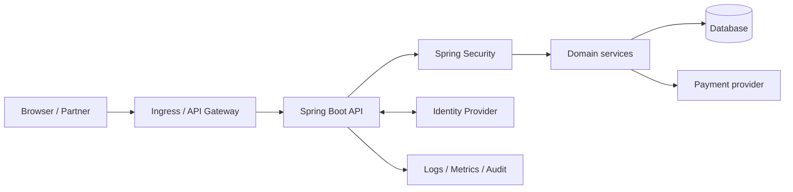
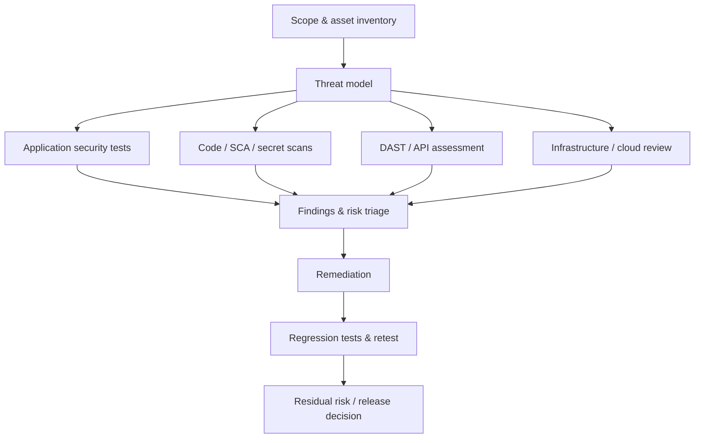

# Giới hạn của kiểm thử ứng dụng so với đánh giá bảo mật tổng thể

> **Chương:** Chiến lược kiểm thử  
> **Module:** `SPRING_SECURITY_TESTING` — kiểm chứng xác thực, phân quyền và bảo vệ HTTP bằng `spring-security-test` trên ứng dụng Servlet và Reactive. Bài phân định bằng chứng mà `MockMvc`, `WebTestClient`, `@WithMockUser`, `SecurityContext` và các helper JWT/OAuth2/OIDC có thể tạo ra với những nội dung cần đánh giá bảo mật ở phạm vi hệ thống.

## 1. Một bộ test ứng dụng tốt không đồng nghĩa hệ thống đã an toàn

Kiểm thử Spring Security có thể chứng minh một số hành vi rất cụ thể:

- Anonymous request vào `GET /api/reports` bị yêu cầu xác thực.
- User đã xác thực nhưng thiếu `REPORT_READ` nhận `403`.
- User có quyền đọc chỉ xem được dữ liệu thuộc tenant của mình.
- POST thiếu CSRF token bị chặn.
- JWT hết hạn bị decoder từ chối khi test đi qua decoder thật.
- Request bị từ chối không ghi dữ liệu hoặc gọi payment gateway.

Đó là bằng chứng quan trọng về **hành vi của ứng dụng trong những điều kiện đã kiểm thử**. Nhưng chúng không tự chứng minh:

- Mọi endpoint, HTTP method, phiên bản API và đường dẫn quản trị đều được bảo vệ.
- Cấu hình triển khai thực tế giống cấu hình test.
- Reverse proxy, TLS, DNS, firewall, cloud IAM, container và Kubernetes được cấu hình an toàn.
- Không có lỗ hổng XSS, SSRF, injection, deserialization hoặc lỗi logic ngoài các ca đã viết.
- Dependency không có CVE chưa được phát hiện.
- Secrets không bị lộ trong image, log, CI/CD, backup hoặc hệ thống quan sát.
- Hệ thống chịu được tấn công thực tế, lưu lượng bất thường hoặc chuỗi khai thác kết hợp nhiều thành phần.
- Quy trình phát hiện, phản ứng và khôi phục sự cố hoạt động hiệu quả.

**Application security testing là một nguồn bằng chứng, không phải giấy chứng nhận an toàn cho toàn bộ hệ thống.** Một bài test xanh chỉ nói rằng các assertion đã đặt ra được thỏa mãn trong môi trường, dữ liệu và phạm vi chạy của bài test đó.

Mục tiêu bài học là giúp người học:

1. Xác định chính xác phạm vi và giới hạn của unit, slice, integration và end-to-end security tests.
2. Phân biệt kiểm thử chính sách ứng dụng với đánh giá bảo mật tổng thể.
3. Biết khi nào cần threat modeling, code/config review, SAST, SCA, DAST, penetration testing và kiểm tra hạ tầng.
4. Kết hợp các loại bằng chứng theo rủi ro mà không suy diễn quá mức từ test coverage.
5. Lập kế hoạch đánh giá, xử lý phát hiện và kiểm tra lại sau khắc phục.

## 2. Phạm vi mà Spring Security tests thực sự quan sát

Một bài test chỉ quan sát những thành phần mà nó đưa vào đường chạy. Tên annotation không quyết định toàn bộ phạm vi.

| Cách kiểm thử | Bằng chứng có thể thu được | Những gì chưa tự chứng minh |
|---|---|---|
| Unit test policy/service | Nhánh logic role, owner, tenant, trạng thái | Filter chain, HTTP mapping, cấu hình triển khai |
| `@WebMvcTest` + `MockMvc` | MVC slice và Servlet security filters nếu được nạp đúng | Mạng thật, TLS, reverse proxy, browser |
| `@WebFluxTest` + `WebTestClient` bind context | WebFlux handler và security web filters được tích hợp vào client test | Hạ tầng mạng/proxy và browser thật |
| `@SpringBootTest` + `@AutoConfigureMockMvc` | Nhiều bean và filter chain trong application context | HTTP socket, TLS termination, load balancer |
| `WebTestClient.bindToServer()` hoặc HTTP client đến server thật | Request qua HTTP stack đang chạy | Toàn bộ môi trường production nếu server test không giống production |
| E2E qua browser | Hành trình người dùng, cookie, redirect, UI và API trong môi trường test | Tất cả cấu hình cloud/network và mọi đường khai thác |

### Một số ví dụ về ranh giới

- `@WithMockUser` tạo authentication giả lập. Nó có thể kiểm tra authorization theo authority, nhưng không xác minh password, account lock, session fixation hoặc login flow.
- `jwt()`/`mockJwt()` có thể kiểm tra authorization theo claims/authorities đã dựng. Chúng không kiểm tra chữ ký, issuer, audience hay expiration qua decoder thật.
- `with(csrf())` cung cấp token hợp lệ cho request test. Nó không tự chứng minh browser lấy token, lưu cookie và gửi token đúng trong toàn bộ UI flow.
- `MockMvc` chạy request mô phỏng trong tiến trình. Nó không tự kiểm tra TLS handshake, header do ingress thêm, proxy trust, CDN, WAF hoặc cấu hình cookie của browser.
- Một repository mock có thể giúp cô lập authorization, nhưng không chứng minh query thực tế giới hạn tenant đúng trong database.

Hãy ghi rõ trong test report: **thành phần nào thật, thành phần nào giả lập, profile nào được nạp, request đi qua loại client nào và kết luận chỉ áp dụng cho phạm vi nào.**

## 3. Bản đồ các loại đánh giá bảo mật

Các kỹ thuật đánh giá trả lời những câu hỏi khác nhau. Không có một công cụ duy nhất thay thế toàn bộ phần còn lại.

| Hoạt động | Thời điểm / góc nhìn | Câu hỏi chính | Ví dụ phát hiện |
|---|---|---|---|
| Threat modeling | Thiết kế, kiến trúc | Tài sản, trust boundary, attacker và đường tấn công là gì? | Luồng tenant isolation không có kiểm soát; token có quyền quá rộng |
| Code review bảo mật | Đọc mã và thay đổi | Logic, API và cách dùng framework có sai không? | IDOR, kiểm tra quyền sau mutation, xử lý exception làm lộ dữ liệu |
| SAST | Phân tích source/bytecode | Có pattern code nguy hiểm hoặc luồng dữ liệu đáng ngờ không? | SQL injection, command injection, unsafe deserialization |
| SCA | Dependency và package | Thành phần bên thứ ba có lỗ hổng hoặc giấy phép/rủi ro nào? | Dependency có CVE, thư viện cũ không còn hỗ trợ |
| Secret scanning | Source, history, artifact, CI | Có credential hoặc private key bị commit/lưu sai không? | API key, cloud token, private signing key |
| IaC/container scanning | Terraform, manifest, image, build | Hạ tầng và artifact có cấu hình nguy hiểm không? | Container chạy root, image có package lỗi thời, storage công khai |
| DAST | Ứng dụng đang chạy, góc nhìn bên ngoài | Endpoint phản ứng ra sao với request bất thường? | Header/cookie thiếu, input xử lý nguy hiểm, route lộ |
| API security testing | Contract và API đang chạy | Authentication, authorization, object access, rate limit có đúng không? | BOLA, mass assignment, excessive data exposure |
| Penetration testing | Đánh giá có chủ đích theo scope | Có thể khai thác chuỗi điểm yếu để đạt tác động thực tế không? | Chiếm quyền, vượt tenant, lộ dữ liệu, leo thang quyền |
| Infrastructure/cloud review | Network, cloud, identity, runtime | Hệ thống được triển khai và vận hành an toàn không? | Security group mở rộng, IAM quá quyền, metadata endpoint lộ |
| Operational readiness | Monitoring, response, recovery | Có phát hiện và xử lý sự cố được không? | Alert thiếu, log không đủ, backup không khôi phục được |

Các hoạt động có thể chồng lấn. Ví dụ API DAST có thể phát hiện BOLA; penetration test có thể kết hợp BOLA với lỗi business workflow; code review có thể tìm nguyên nhân trong service. Giá trị nằm ở góc nhìn và loại bằng chứng, không chỉ tên công cụ.

## 4. Threat modeling: phát hiện điều chưa được nghĩ đến trong test case

Threat modeling bắt đầu từ tài sản và luồng dữ liệu, không bắt đầu từ danh sách test hiện có.

Với ứng dụng quản lý đơn hàng:

- **Tài sản:** thông tin khách hàng, địa chỉ giao hàng, payment reference, báo cáo doanh thu, access token.
- **Chủ thể:** khách hàng, support, admin tenant, platform admin, đối tác API, anonymous.
- **Trust boundary:** browser → ingress → application, application → identity provider, application → database, application → payment gateway.
- **Threat:** giả mạo danh tính, sửa ID, vượt tenant, chiếm token, replay request, lạm dụng quyền support, lộ dữ liệu qua log.
- **Control:** authentication, authorization, tenant isolation, CSRF, validation, rate limit, audit, secret management.

Một sơ đồ luồng dữ liệu giúp thấy các boundary:



Security test của ứng dụng có thể kiểm tra một phần các rule ở Spring Security và domain service. Threat modeling còn hỏi:

- Ingress có xác minh TLS và chuyển tiếp header an toàn không?
- App có tin `X-Forwarded-For` hoặc tenant header từ client không?
- Token có audience đúng service không?
- Payment provider callback có xác minh chữ ký và chống replay không?
- Log có vô tình ghi token, password hoặc dữ liệu cá nhân không?
- Nếu database bị đọc, dữ liệu nhạy cảm có được bảo vệ ở mức phù hợp không?

Threat model là nguồn tạo test case mới. Nếu threat model chỉ ra “khách hàng có thể đổi order ID để xem đơn người khác”, hãy tạo cặp fixture khác owner và test IDOR. Nếu chỉ ra “partner token có thể dùng nhầm API”, hãy kiểm tra audience và scope. Nhưng threat model không tự chứng minh control đã được triển khai; cần test, review hoặc kiểm tra runtime tương ứng.

## 5. SAST và code review: nhìn vào đường đi trong mã nguồn

SAST phân tích source/bytecode để tìm pattern có khả năng gây lỗ hổng. Code review bảo mật xem xét ý nghĩa của logic và cách các thành phần được nối với nhau.

Ví dụ service:

```java
public Order readOrder(Long id, Authentication authentication) {
    Order order = repository.findById(id).orElseThrow();
    return order;
}
```

Một unit test cho `hasAuthority("ORDER_READ")` ở URL có thể xanh, nhưng đoạn service trên không kiểm tra owner/tenant. SAST có thể không tự kết luận đây là BOLA vì cần hiểu domain; code review và test theo object ownership có thể phát hiện.

Một ví dụ khác:

```java
public void refund(Long paymentId) {
    gateway.refund(paymentId);
    authorization.checkCanRefund(paymentId);
}
```

Nếu quyền được kiểm tra sau khi gọi gateway, đây là lỗi thứ tự thực thi. Test side effect có thể phát hiện nếu xác minh gateway không được gọi khi quyền bị từ chối. Code review có thể phát hiện ngay cả khi test chưa có case tương ứng.

SAST hữu ích với injection, path traversal, unsafe API, hardcoded secret pattern và một số luồng dữ liệu. Nhưng công cụ có thể có false positive/false negative, và thường không hiểu đầy đủ:

- Ai là owner của record?
- Tenant nào được phép truy cập?
- Một workflow có hợp lệ theo trạng thái nghiệp vụ không?
- Một endpoint mới có cần quyền đặc biệt theo policy của tổ chức không?

Vì vậy, kết quả SAST cần được triage bởi người hiểu code và domain. Không coi “không có finding” là bằng chứng không có lỗi logic hoặc lỗ hổng kiến trúc.

## 6. SCA và secret scanning: những gì application tests thường không thấy

Ứng dụng có thể vượt qua mọi test Spring Security nhưng vẫn dùng dependency có lỗ hổng đã công bố. SCA kiểm tra dependency trực tiếp và gián tiếp, phiên bản, license và thông tin vulnerability theo nguồn dữ liệu của công cụ.

Các câu hỏi cần xem xét:

- Dependency có CVE phù hợp với phiên bản đang dùng không?
- Lỗ hổng có ảnh hưởng đến cấu hình và code path thực tế không?
- Có phiên bản vá hoặc biện pháp giảm thiểu không?
- Dependency đã hết vòng đời hỗ trợ chưa?
- Có package không cần thiết hoặc không rõ nguồn gốc không?

Secret scanning tìm credential trong source, commit history, config, image và artifact. Test không thể chứng minh secret không từng bị commit hoặc không bị lộ ở CI log.

Khi phát hiện secret:

1. Xem secret có còn hiệu lực không.
2. Revoke/rotate theo quy trình của nhà cung cấp.
3. Kiểm tra log, history và nơi artifact được phân phối.
4. Xóa khỏi nguồn đang quản lý và xử lý history theo quy trình phù hợp.
5. Tìm nguyên nhân đưa secret vào source để ngăn tái diễn.

Xóa chuỗi khỏi commit mới không làm credential cũ tự hết hiệu lực. Cần thu hồi/rotate nếu secret đã bị lộ.

## 7. DAST và API security assessment: nhìn ứng dụng đang chạy

DAST gửi request đến ứng dụng đã triển khai để quan sát phản hồi. Nó có thể phát hiện một số vấn đề mà unit test hoặc slice test không thấy:

- Route không được bảo vệ trong deployment profile.
- Security header hoặc cookie attribute thiếu ở response thực.
- Redirect, CORS, cache behavior khác cấu hình dự kiến.
- Input bất thường làm lộ exception hoặc dữ liệu.
- Endpoint cũ/phiên bản API khác vẫn truy cập được.
- Rate limit hoặc request size policy không hoạt động như mong đợi.

API security assessment tập trung vào contract và logic API:

- Anonymous, token thiếu scope, token hết hạn.
- Thay ID và tenant để tìm BOLA.
- Mass assignment hoặc over-posting.
- Excessive data exposure.
- Chuyển trạng thái sai trình tự.
- Replay, duplicate request và idempotency.
- Rate limit và abuse control.

DAST không nhìn thấy mọi logic nội bộ và có thể không khám phá được các route yêu cầu workflow phức tạp. Nó cũng có thể bỏ qua lỗi nếu tài khoản test không có đủ role hoặc dữ liệu mẫu. Kết quả cần kết hợp với route inventory, API specification, test accounts có phạm vi quyền rõ ràng và kiểm thử thủ công.

**Chỉ chạy DAST/active scan trên hệ thống được phép đánh giá**, trong scope và cửa sổ đã thống nhất. Scan có thể tạo tải, thay đổi dữ liệu hoặc kích hoạt email/payment/job; dùng môi trường test có dữ liệu giả và giới hạn an toàn.

## 8. Penetration testing: kiểm tra khả năng khai thác trong phạm vi xác định

Penetration test là hoạt động đánh giá có chủ đích, mô phỏng góc nhìn attacker để xác định điểm yếu có thể khai thác và tác động. Nó có thể kết hợp:

- Reconnaissance và kiểm tra bề mặt tấn công.
- Authentication/session weaknesses.
- Authorization bypass, IDOR/BOLA và privilege escalation.
- Input validation, injection và lỗi business logic.
- Misconfiguration của deployment.
- Chuỗi khai thác nhiều lỗ hổng để đạt tác động lớn hơn.

Một bài test tự động có thể chứng minh `binh` không đọc được order `42` trong fixture. Pentest có thể thử nhiều cách để lấy ID, đổi tenant, khai thác endpoint export, dùng token từ một luồng khác hoặc kết hợp lỗi ở gateway để tìm đường vượt policy.

Nhưng penetration test cũng có giới hạn:

- Chỉ bao phủ hệ thống, tài khoản, thời gian và kỹ thuật trong scope.
- Không thể thử mọi input, trạng thái và tổ hợp.
- Một lần không tìm thấy lỗ hổng không chứng minh không tồn tại lỗ hổng.
- Kết quả có thể lỗi thời khi code, dependency, cloud configuration hoặc kiến trúc thay đổi.
- Không thay thế kiểm thử liên tục trong CI/CD.

Báo cáo pentest nên ghi rõ scope, thời điểm, môi trường, phương pháp, hạn chế, finding, mức độ ảnh hưởng, bằng chứng, khuyến nghị và kết quả retest. Không chỉ ghi “passed” mà thiếu phạm vi và điều kiện đánh giá.

## 9. Infrastructure, cloud và deployment review

Spring Security tests chủ yếu quan sát hành vi ứng dụng. Các lớp bên ngoài có thể tạo hoặc phá vỡ bảo vệ:

| Thành phần | Rủi ro cần đánh giá | Bằng chứng phù hợp |
|---|---|---|
| TLS / certificate | Kết nối không được mã hóa hoặc certificate sai | TLS configuration scan, certificate inventory, HTTPS test |
| Reverse proxy / ingress | Header trust sai, route mở, TLS termination sai | Config review, deployment test, external scan |
| Firewall / security group | Port quản trị hoặc DB mở công khai | Network rule review, external exposure scan |
| Cloud IAM | Service identity quá quyền | IAM policy review, cloud posture assessment |
| Container / image | Chạy root, package lỗi thời, capability thừa | Image scan, runtime configuration review |
| Kubernetes | RBAC rộng, secret/config mount sai, service public | Manifest/IaC scan, cluster review |
| Database | Network access, privilege, backup, encryption | DB configuration review, restore test |
| Object storage | Bucket public, policy quá rộng | Storage policy review, access test |
| CI/CD | Pipeline có thể sửa artifact hoặc đọc secret quá mức | Pipeline permission review, provenance/signing checks |
| Observability | Token/PII bị ghi vào log, alert thiếu | Log review, data masking test, incident exercise |

Một test chạy local không thể xác minh security group của production. Một `MockMvc` assertion về `Strict-Transport-Security` không tự chứng minh TLS termination tại ingress đúng. Ngược lại, network scan không chứng minh business policy owner/tenant trong service đúng.

Cần kiểm tra cấu hình triển khai ở nơi nó thực sự có hiệu lực, đồng thời ghi rõ environment và version/configuration được đánh giá.

## 10. Browser, session và giao thức: nơi mock test thường có giới hạn

Một số bảo vệ chỉ thể hiện đầy đủ trong browser hoặc qua giao thức thật:

- Cookie `Secure`, `HttpOnly`, `SameSite` và domain/path.
- Redirect login/logout và việc giữ session giữa nhiều request.
- CSRF token acquisition và gửi lại token qua form/header.
- CORS enforcement của browser.
- CSP, framing, mixed content và hành vi JavaScript.
- OAuth2 authorization code flow, state, PKCE và OIDC nonce.
- Token refresh, revoke, logout và session expiry.

`MockMvc` có thể kiểm tra response header/cookie và filter behavior trong tiến trình. `WebTestClient` bind context có thể kiểm tra WebFlux pipeline. Nhưng browser thật mới quan sát cách trình duyệt xử lý cookie, redirect, CORS, CSP và UI flow; HTTP integration test với server thật giúp kiểm tra network stack nhưng vẫn không thay thế toàn bộ browser behavior.

Với OAuth2/OIDC:

- `oauth2Login()`/`oidcLogin()` và helper Reactive tạo principal đã đăng nhập để kiểm tra authorization theo attributes/claims.
- Chúng không tự kiểm tra IdP redirect, authorization code exchange, state/nonce validation, issuer, token signature hoặc logout ở provider.
- Nếu các bước đó nằm trong scope, dùng IdP test hoặc sandbox có hành vi giao thức thực và chạy integration/E2E tương ứng.

## 11. Dùng OWASP ASVS và tiêu chuẩn làm khung yêu cầu

Một danh sách test tự phát thường bỏ sót nhóm kiểm soát. Có thể dùng khung yêu cầu như OWASP Application Security Verification Standard (ASVS) để tổ chức các nhóm kiểm tra, điều chỉnh theo kiến trúc và rủi ro.

Các nhóm thường cần xem xét:

- Authentication và credential lifecycle.
- Session management.
- Access control và tenant/object authorization.
- Input validation và output encoding.
- Cryptography và key management.
- Error handling và logging.
- Data protection và privacy.
- Communication security.
- Secure configuration.
- API và business logic.
- File upload, export và resource handling.

ASVS là **khung yêu cầu và xác minh**, không phải một công cụ quét duy nhất. Chọn phiên bản, level và yêu cầu áp dụng phù hợp với hệ thống; ghi rõ những mục không áp dụng và lý do. Không tuyên bố đạt một level chỉ dựa trên một vài bài test Spring Security.

Có thể liên kết từng yêu cầu với bằng chứng:

| Yêu cầu | Automated application test | Bằng chứng bổ sung |
|---|---|---|
| Chỉ user có quyền đọc báo cáo | MockMvc/WebTestClient allow/deny | Code review matcher và route inventory |
| User không vượt tenant | Integration test với fixture khác tenant | DAST/API assessment, review query và data model |
| JWT phải đúng issuer/audience | Decoder integration test | Identity provider/config review |
| Session cookie có thuộc tính an toàn | HTTP integration/browser test | Deployment/proxy review |
| Dependency không có vulnerability chưa xử lý | — | SCA và vulnerability triage |
| Database không public | — | Cloud/network configuration assessment |
| Không có secret trong source/artifact | — | Secret scanning và rotation evidence |

## 12. Kết hợp bằng chứng theo rủi ro

Không phải mọi endpoint cần cùng mức đánh giá. Ưu tiên theo:

- Mức nhạy cảm của dữ liệu.
- Tác động của hành động (đọc, sửa, xóa, chuyển tiền, xuất dữ liệu).
- Bề mặt public và mức độ phơi lộ.
- Quyền cần thiết và khả năng leo thang.
- Số lượng tenant/đối tác và độ phức tạp của trust boundary.
- Mức độ thay đổi code, dependency và deployment.
- Yêu cầu pháp lý, hợp đồng hoặc chính sách nội bộ.

Ví dụ ma trận kế hoạch:

| Khu vực | Application tests | Review/scan | Đánh giá sâu hơn |
|---|---|---|---|
| API đọc dữ liệu cá nhân | Anonymous/role/owner/tenant tests | SAST, code review, API inventory | DAST/BOLA testing |
| Refund/payment | Authorization, state, idempotency, side-effect tests | Threat model, code review, SCA | Pentest workflow, gateway integration review |
| JWT resource server | Scope tests, decoder integration tests | Config review, secret/key review | IdP/OIDC integration assessment |
| Admin console | Session/role/CSRF tests | SAST, dependency scan | Browser E2E, penetration test |
| Cloud deployment | Health/config smoke tests | IaC/container/cloud posture review | Network and IAM assessment |

Một ứng dụng xử lý thanh toán hoặc dữ liệu cá nhân cần nhiều lớp bằng chứng hơn endpoint status công khai. Nhưng việc tăng số lượng unit tests không thay thế kiểm tra network, IAM, dependency và workflow thực tế.

## 13. Quản lý phát hiện và xác minh khắc phục

Một finding chỉ có giá trị khi có thể truy vết từ rủi ro đến nguyên nhân, hành động sửa và bằng chứng retest.

Quy trình đề xuất:

1. **Ghi nhận:** mô tả tài sản, endpoint/thành phần, môi trường, điều kiện tái hiện và bằng chứng.
2. **Đánh giá tác động:** dữ liệu nào bị ảnh hưởng, quyền nào có thể bị vượt, khả năng khai thác và phạm vi tenant.
3. **Xác định nguyên nhân:** matcher sai, policy thiếu, code path không kiểm tra owner, dependency lỗi, secret lộ hay deployment config.
4. **Khắc phục:** sửa code/config, rotate secret, cập nhật dependency hoặc thay đổi kiến trúc.
5. **Thêm regression test:** tạo test tự động cho hành vi có thể kiểm tra lặp lại, ví dụ user khác owner nhận `403` và không có side effect.
6. **Retest phù hợp:** chạy lại scanner, integration test, DAST hoặc pentest cho đúng lớp đã sửa.
7. **Đóng finding:** lưu phiên bản, môi trường, người xác minh, bằng chứng retest và rủi ro còn lại.

Không phải finding nào cũng có thể biến thành unit test. Ví dụ public bucket cần kiểm tra cloud policy; CVE cần SCA; TLS cipher cần kiểm tra endpoint thực. Hãy thêm regression test ở nơi phù hợp nhưng vẫn giữ hoạt động đánh giá chuyên biệt.

### Severity và ưu tiên

Dùng phương pháp đánh giá rủi ro nhất quán với tổ chức. Không chỉ dựa vào điểm CVSS nếu finding là lỗi business logic; cần xét tác động dữ liệu, khả năng khai thác, exposure, privilege required và blast radius. Một lỗi IDOR có thể rất nghiêm trọng dù không có injection hoặc memory corruption.

## 14. Một quy trình đánh giá bảo mật tổng thể cho ứng dụng Spring

Một chu trình có thể tổ chức theo các bước:

1. **Xác định scope:** ứng dụng, API version, browser, identity provider, cloud account, environment và thành phần bên thứ ba.
2. **Lập inventory:** endpoint, role, service identity, data store, secrets, trust boundary và luồng dữ liệu.
3. **Threat model:** xác định attacker, tài sản, đường tấn công và control cần có.
4. **Application tests:** unit/slice/integration/E2E cho authentication, authorization, CSRF, owner/tenant, state transition và side effect.
5. **Code và supply-chain review:** SAST, SCA, secret scan, code review.
6. **Runtime/API assessment:** DAST, API security tests, manual workflow testing.
7. **Infrastructure review:** TLS, ingress, network, cloud IAM, container, Kubernetes, DB, storage và CI/CD.
8. **Penetration testing theo scope:** thử khai thác có chủ đích và đánh giá chuỗi tấn công.
9. **Remediation và retest:** sửa, thêm regression evidence và đánh giá lại lớp bị ảnh hưởng.
10. **Ghi nhận residual risk:** những gì chưa kiểm tra, giả định, ngoại lệ và ngày cần đánh giá lại.

Sơ đồ tổng quát:



Các bước có thể lặp lại khi kiến trúc, code, dependency hoặc môi trường thay đổi. Đánh giá bảo mật không phải hoạt động chỉ làm một lần trước release.

## 15. Cách viết kết luận để không phóng đại bằng chứng

Kết luận chính xác nên nói rõ **đã kiểm tra gì**, **ở đâu**, **bằng cách nào**, **không kiểm tra gì** và **rủi ro còn lại**.

Ví dụ kết luận có căn cứ:

> Trong build và test profile đã ghi nhận, các ca MockMvc xác minh request anonymous và user thiếu `REPORT_READ` bị từ chối, user đủ quyền được phép. Integration test xác minh JWT hết hạn bị decoder từ chối. Các test owner/tenant dùng fixture khác nhau và xác nhận request bị từ chối không ghi dữ liệu. Các kết quả này chứng minh những policy đã mô tả hoạt động trong phạm vi application context và cấu hình test được nạp.

Kết luận **không nên** là:

> Ứng dụng hoàn toàn an toàn vì tất cả Spring Security tests đều xanh.

Một báo cáo tốt cần có:

- Commit/build hoặc version được kiểm tra.
- Test profile, properties, security chain và môi trường.
- Thành phần thật và thành phần giả lập.
- Endpoint, role, tenant, token/credential type và các case đã chạy.
- Kết quả, finding và mức độ ảnh hưởng.
- Công cụ/hoạt động bổ sung đã thực hiện.
- Những phần nằm ngoài scope hoặc chưa có bằng chứng.
- Residual risk, owner khắc phục và thời điểm retest.

Nếu chưa có DAST, pentest hoặc cloud review, ghi rõ chúng chưa nằm trong scope. Không tự suy ra “không có lỗ hổng” từ việc không có finding trong một loại test.

## 16. Bài tập: lập kế hoạch đánh giá cho hệ thống thanh toán nhiều tenant

Một hệ thống Spring Boot có:

- Web admin dùng session/form login.
- API đối tác dùng OAuth2 Resource Server với JWT.
- `GET /api/payments/{id}` yêu cầu `PAYMENT_READ` và đúng tenant.
- `POST /api/payments/{id}/refund` yêu cầu `PAYMENT_REFUND`, cùng tenant, payment `SETTLED` và CSRF trên web session.
- Payment gateway bên ngoài, database quan hệ, object storage lưu biên nhận và triển khai trên Kubernetes.

Hãy lập một kế hoạch đánh giá gồm:

1. **Application tests:** anonymous, authenticated thiếu quyền, đủ quyền, sai tenant, state transition, CSRF, JWT scope và decoder validation, không có side effect khi refund bị từ chối.
2. **Threat model:** xác định tài sản, trust boundary, attacker, IDOR/BOLA, token misuse, replay và abuse workflow.
3. **Code/SCA/secret:** nêu nhóm lỗi cần SAST, dependency scan và secret scan tìm kiếm.
4. **DAST/API assessment:** chọn endpoint và luồng cần thử ở môi trường được phép, có dữ liệu giả và giới hạn tác động.
5. **Infrastructure review:** TLS/ingress, Kubernetes RBAC, cloud IAM, DB network, storage policy, secrets và CI/CD.
6. **Penetration test:** xác định scope, tài khoản/role được cấp, dữ liệu, cửa sổ thực hiện và cách xử lý finding.
7. **Remediation:** gắn finding với regression test hoặc loại retest phù hợp; không ép mọi phát hiện thành unit test.

Với mỗi hoạt động, ghi rõ câu hỏi nó trả lời và bằng chứng mà nó không thể thay thế.

**Tiêu chí hoàn thành:** Bạn có thể giải thích vì sao MockMvc/WebTestClient test xanh là bằng chứng cần thiết nhưng có giới hạn; xác định phần nào cần code review, SAST/SCA, DAST, pentest hoặc infrastructure review; và viết kết luận đúng với scope đã đánh giá. Mục tiêu là xây dựng nhiều lớp bằng chứng bổ sung cho nhau, thay vì gán cho một bộ test ứng dụng khả năng bảo đảm toàn bộ hệ thống.
