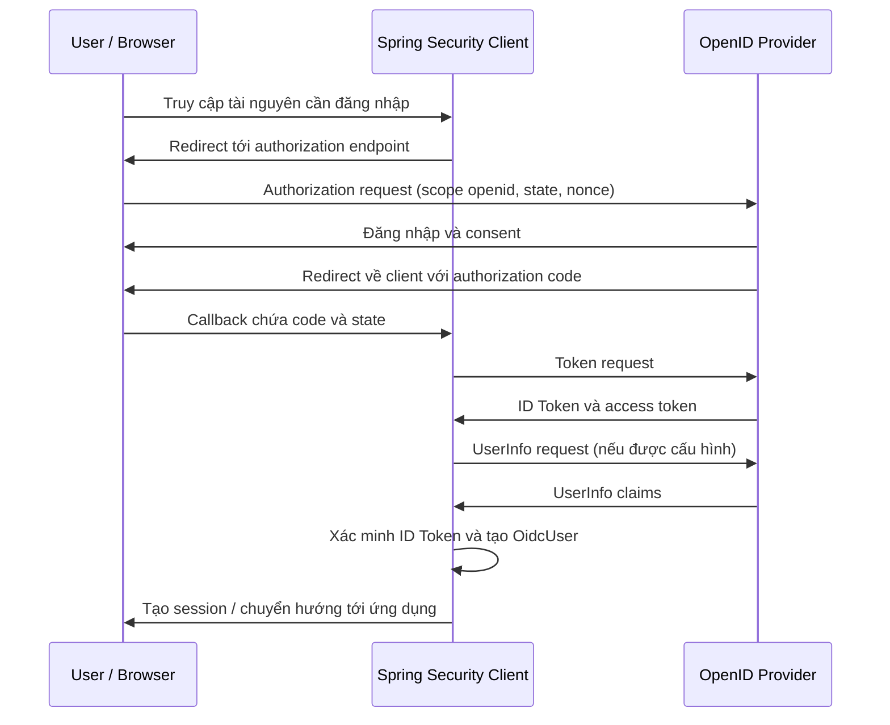

# `oidcLogin` trong MockMvc và principal `OidcUser`

## 1. Mục tiêu của bài học

OpenID Connect (OIDC) mở rộng OAuth2 để bổ sung lớp nhận dạng người dùng. Khi đăng nhập OIDC thành công, Spring Security tạo một authentication chuyên biệt và principal triển khai **`OidcUser`**. Principal này cung cấp thông tin từ ID Token và, nếu được sử dụng, UserInfo endpoint.

Trong ứng dụng Servlet, controller có thể nhận principal bằng `@AuthenticationPrincipal OidcUser`. Khi viết test, `@WithMockUser` không tạo được kiểu principal này; `oauth2Login()` tạo một `OAuth2User` tổng quát. Spring Security Test cung cấp **`oidcLogin()`** để dựng một OIDC authentication giả lập cho request `MockMvc`.

Bài học thuộc chương **Đăng nhập OAuth2 và OIDC** của module **SPRING_SECURITY_TESTING**. Module tập trung kiểm chứng xác thực, phân quyền và bảo vệ HTTP thực tế bằng `spring-security-test` trên ứng dụng Servlet và Reactive; người học sử dụng `MockMvc`, `WebTestClient`, `SecurityContext`, `@WithMockUser` và các công cụ giả lập JWT/OAuth2/OIDC để kiểm tra các ca được phép hoặc bị từ chối.

Sau bài này, bạn có thể:

- Giải thích quan hệ giữa `OAuth2AuthenticationToken` và principal `OidcUser`.
- Dùng `oidcLogin()` trong MockMvc để tạo ID Token và UserInfo claims giả lập.
- Đọc subject, claims, ID Token và UserInfo qua `OidcUser`.
- Kiểm tra authority của OIDC principal và quy tắc phân quyền HTTP.
- Phân biệt OIDC Login với OAuth2 Login thuần túy.
- Hiểu giới hạn của helper đối với chữ ký ID Token, issuer, audience, expiry, nonce và authorization code flow.
- Chọn test riêng cho controller, token validation và tích hợp Identity Provider.

## 2. OIDC bổ sung điều gì cho OAuth2 Login?

OAuth2 là framework ủy quyền. OIDC xây dựng trên OAuth2 để chuẩn hóa cách client nhận biết người dùng. Trong Authorization Code Flow, client nhận authorization code, đổi code lấy token và nhận ID Token theo quy trình OIDC. ID Token là JWT chứa các claim xác định người dùng và thông tin về quá trình xác thực.

Luồng khái quát:



Trong ứng dụng, Spring Security thường biểu diễn kết quả bằng:

| Thành phần | Ý nghĩa |
| --- | --- |
| `OAuth2AuthenticationToken` | Authentication cho người dùng đăng nhập bằng OAuth2 hoặc OIDC |
| `OidcUser` | Principal chứa claims từ ID Token và UserInfo |
| `OidcIdToken` | ID Token đã được biểu diễn thành đối tượng claim-aware |
| `OidcUserInfo` | Các claims lấy từ UserInfo endpoint |
| `OidcUserAuthority` | Authority mang thông tin ID Token và UserInfo |
| `getAuthorizedClientRegistrationId()` | ID cấu hình client đã dùng để đăng nhập |

`OidcUser` kế thừa `OAuth2User`, vì vậy nó cũng có `getName()`, `getAttributes()` và `getAuthorities()`. Nó bổ sung các phương thức truy cập ID Token và UserInfo.

## 3. ID Token và UserInfo khác nhau thế nào?

ID Token và UserInfo đều có thể chứa thông tin người dùng, nhưng có vai trò khác nhau:

- **ID Token** là bằng chứng nhận dạng do OpenID Provider phát hành cho client. Nó có các claim chuẩn như `iss`, `sub`, `aud`, `exp`, `iat`; tùy flow có thể có `nonce`, `auth_time` và các claim khác.
- **UserInfo** là tài nguyên được truy cập bằng access token. Endpoint trả về các claim về người dùng mà client được phép nhận.
- Claim `sub` trong UserInfo phải khớp với subject trong ID Token. Sự không khớp là lỗi giao thức trong luồng OIDC thực tế.

| Nguồn | Ví dụ claim | Truy cập qua |
| --- | --- | --- |
| ID Token | `sub`, `iss`, `aud`, `exp`, `iat`, `auth_time` | `oidcUser.getIdToken()` |
| UserInfo | `name`, `email`, `preferred_username`, `picture` | `oidcUser.getUserInfo()` |
| Tập claims tổng hợp | Các claim OIDC được principal cung cấp | `oidcUser.getClaims()` |
| Tên principal | Thường là `sub` | `oidcUser.getName()` hoặc `getSubject()` |

Không phải mọi provider đều trả tất cả claim. Ứng dụng nên xử lý claim tùy chọn như `email`, `name` hoặc `picture` theo hợp đồng thực tế.

## 4. Principal OidcUser và OAuth2AuthenticationToken

Trong controller, có thể nhận principal trực tiếp:

```java
@GetMapping("/oidc-profile")
OidcProfileResponse profile(
        @AuthenticationPrincipal OidcUser principal) {
    return new OidcProfileResponse(
            principal.getSubject(),
            principal.getClaimAsString("name"),
            principal.getClaimAsString("email")
    );
}
```

Một số phương thức hữu ích:

| Phương thức | Dữ liệu |
| --- | --- |
| `getSubject()` | Subject (`sub`) của người dùng |
| `getName()` | Tên principal theo name attribute key; với OIDC thường là subject |
| `getIdToken()` | Đối tượng `OidcIdToken` |
| `getUserInfo()` | `OidcUserInfo` nếu UserInfo được sử dụng |
| `getClaims()` | Map claims của principal |
| `getClaimAsString("email")` | Lấy một claim dạng chuỗi |
| `getAuthorities()` | Danh sách quyền của principal |

Authentication có thể được ép kiểu khi cần registration ID:

```java
OAuth2AuthenticationToken oidcAuthentication =
        (OAuth2AuthenticationToken) authentication;

String registrationId =
        oidcAuthentication.getAuthorizedClientRegistrationId();
```

Trong code ứng dụng, ưu tiên inject đúng kiểu `OidcUser` nếu controller cần claim OIDC. Nếu chỉ cần giao diện chung, có thể nhận `OAuth2User`, vì `OidcUser` cũng triển khai giao diện đó.

## 5. oidcLogin() của Spring Security Test

Với MockMvc, request post-processor được cung cấp bởi:

```java
import static org.springframework.security.test.web.servlet.request
        .SecurityMockMvcRequestPostProcessors.oidcLogin;
```

Dùng mặc định:

```java
mockMvc.perform(get("/oidc-profile")
        .with(oidcLogin()))
    .andExpect(status().isOk());
```

`oidcLogin()` tạo một OIDC authentication giả lập với principal triển khai `OidcUser`. Test helper cung cấp dữ liệu mặc định hợp lý cho ID Token và user info để controller có thể được gọi mà không cần một Identity Provider bên ngoài.

Có thể tùy chỉnh ID Token:

```java
mockMvc.perform(get("/oidc-profile")
        .with(oidcLogin()
                .idToken(token -> token
                        .claim("sub", "user-123")
                        .claim("name", "Mai Nguyen")
                        .claim("email", "mai@example.test")
                )))
    .andExpect(status().isOk());
```

Và tùy chỉnh UserInfo:

```java
mockMvc.perform(get("/oidc-profile")
        .with(oidcLogin()
                .idToken(token -> token
                        .claim("sub", "user-123"))
                .userInfoToken(userInfo -> userInfo
                        .claim("sub", "user-123")
                        .claim("preferred_username", "mai")
                        .claim("email", "mai@example.test")
                )))
    .andExpect(status().isOk());
```

Khi tự cung cấp UserInfo, hãy đặt `sub` khớp với ID Token để dữ liệu test phản ánh đúng quy tắc OIDC. Request post-processor dựng principal trực tiếp; nó không gửi request tới UserInfo endpoint.

## 6. Cấu hình ClientRegistration cho OIDC test

Security chain bật `oauth2Login()` cần một `ClientRegistrationRepository`. Một OIDC registration phải yêu cầu scope `openid`; thường thêm `profile` và `email` khi ứng dụng cần các claim đó.

Ví dụ cấu hình test:

```java
@TestConfiguration
class OidcClientTestConfiguration {

    @Bean
    ClientRegistrationRepository clientRegistrationRepository() {
        return new InMemoryClientRegistrationRepository(oidcRegistration());
    }

    static ClientRegistration oidcRegistration() {
        return ClientRegistration.withRegistrationId("test-oidc")
                .clientId("test-client")
                .clientSecret("test-secret")
                .clientAuthenticationMethod(
                        ClientAuthenticationMethod.CLIENT_SECRET_BASIC
                )
                .authorizationGrantType(
                        AuthorizationGrantType.AUTHORIZATION_CODE
                )
                .redirectUri(
                        "{baseUrl}/login/oauth2/code/{registrationId}"
                )
                .scope("openid", "profile", "email")
                .authorizationUri("https://idp.example.test/authorize")
                .tokenUri("https://idp.example.test/token")
                .jwkSetUri("https://idp.example.test/jwks")
                .userInfoUri("https://idp.example.test/userinfo")
                .userNameAttributeName("sub")
                .clientName("Test OIDC Provider")
                .build();
    }
}
```

Các URL thuộc miền `.test` chỉ là placeholder. Với test dùng `oidcLogin()`, helper không truy cập authorization endpoint, token endpoint, JWK Set URI hoặc UserInfo endpoint. Repository cung cấp registration để security configuration có thể khởi tạo và để test có thể gắn registration tương ứng.

Các import của test configuration:

```java
import org.springframework.boot.test.context.TestConfiguration;
import org.springframework.context.annotation.Bean;
import org.springframework.security.oauth2.client.registration.ClientRegistration;
import org.springframework.security.oauth2.client.registration.ClientRegistrationRepository;
import org.springframework.security.oauth2.client.registration.InMemoryClientRegistrationRepository;
import org.springframework.security.oauth2.core.AuthorizationGrantType;
import org.springframework.security.oauth2.core.ClientAuthenticationMethod;
```

Trong production, cấu hình OIDC thường dùng `issuer-uri` để Spring Security khám phá metadata của OpenID Provider, gồm authorization endpoint, token endpoint, JWK Set URI và UserInfo endpoint. Cần xác minh issuer và chữ ký ID Token trong luồng thực; một test dùng request post-processor không chứng minh các bước đó.

## 7. SecurityFilterChain và controller mẫu

Ta xây dựng hai endpoint:

- `GET /oidc-profile`: yêu cầu đăng nhập.
- `GET /reports`: yêu cầu authority `report:read`.

### 7.1. Security configuration

```java
@Configuration
class OidcSecurityConfig {

    @Bean
    SecurityFilterChain oidcFilterChain(HttpSecurity http) throws Exception {
        http.authorizeHttpRequests(auth -> auth
                .requestMatchers("/oidc-profile").authenticated()
                .requestMatchers("/reports")
                    .hasAuthority("report:read")
                .anyRequest().denyAll()
        );
        http.oauth2Login(Customizer.withDefaults());
        return http.build();
    }
}
```

Các import:

```java
import org.springframework.context.annotation.Bean;
import org.springframework.context.annotation.Configuration;
import org.springframework.security.config.Customizer;
import org.springframework.security.config.annotation.web.builders.HttpSecurity;
import org.springframework.security.web.SecurityFilterChain;
```

### 7.2. Controller nhận OidcUser

```java
record OidcProfileResponse(
        String subject,
        String name,
        String email,
        String preferredUsername,
        String registrationId
) {}

@RestController
class OidcProfileController {

    @GetMapping("/oidc-profile")
    OidcProfileResponse profile(
            @AuthenticationPrincipal OidcUser principal,
            Authentication authentication) {

        OAuth2AuthenticationToken oidcAuthentication =
                (OAuth2AuthenticationToken) authentication;

        return new OidcProfileResponse(
                principal.getSubject(),
                principal.getClaimAsString("name"),
                principal.getClaimAsString("email"),
                principal.getClaimAsString("preferred_username"),
                oidcAuthentication.getAuthorizedClientRegistrationId()
        );
    }

    @GetMapping("/reports")
    String reports() {
        return "reports";
    }
}
```

Các import:

```java
import org.springframework.security.core.Authentication;
import org.springframework.security.core.annotation.AuthenticationPrincipal;
import org.springframework.security.oauth2.client.authentication.OAuth2AuthenticationToken;
import org.springframework.security.oauth2.core.oidc.user.OidcUser;
import org.springframework.web.bind.annotation.GetMapping;
import org.springframework.web.bind.annotation.RestController;
```

Controller đọc claims từ principal. Trong ứng dụng thực tế, nếu `preferred_username` hoặc `email` không được provider trả về, giá trị có thể là `null`; đừng giả định claim tùy chọn luôn tồn tại.

## 8. Kiểm thử OidcUser bằng MockMvc

### 8.1. Cấu hình test slice

```java
@WebMvcTest(OidcProfileController.class)
@Import({
    OidcSecurityConfig.class,
    OidcClientTestConfiguration.class
})
class OidcLoginMockMvcTest {

    @Autowired
    MockMvc mockMvc;
}
```

Import:

```java
import org.junit.jupiter.api.Test;
import org.springframework.beans.factory.annotation.Autowired;
import org.springframework.boot.test.autoconfigure.web.servlet.WebMvcTest;
import org.springframework.context.annotation.Import;
import org.springframework.test.web.servlet.MockMvc;

import static org.springframework.security.test.web.servlet.request
        .SecurityMockMvcRequestPostProcessors.oidcLogin;
import static org.springframework.security.test.web.servlet.result
        .SecurityMockMvcResultMatchers.authenticated;
import static org.springframework.test.web.servlet.request.MockMvcRequestBuilders.get;
import static org.springframework.test.web.servlet.result.MockMvcResultMatchers.jsonPath;
import static org.springframework.test.web.servlet.result.MockMvcResultMatchers.status;
```

### 8.2. Cung cấp ID Token và UserInfo claims

```java
@Test
void oidcUserClaimsReachController() throws Exception {
    mockMvc.perform(get("/oidc-profile")
            .with(oidcLogin()
                    .clientRegistration(
                                OidcClientTestConfiguration.oidcRegistration()
                    )
                    .idToken(token -> token
                            .claim("sub", "user-123")
                            .claim("name", "Mai Nguyen")
                            .claim("email", "mai@example.test")
                    )
                    .userInfoToken(userInfo -> userInfo
                            .claim("sub", "user-123")
                            .claim("preferred_username", "mai")
                            .claim("email", "mai@example.test")
                    )))
            .andExpect(status().isOk())
            .andExpect(jsonPath("$.subject").value("user-123"))
            .andExpect(jsonPath("$.name").value("Mai Nguyen"))
            .andExpect(jsonPath("$.email").value("mai@example.test"))
            .andExpect(jsonPath("$.preferredUsername").value("mai"))
            .andExpect(jsonPath("$.registrationId").value("test-oidc"));
}
```

Trong ví dụ, `OidcClientTestConfiguration.oidcRegistration()` trả về cùng `ClientRegistration` có registration ID `test-oidc` như bean trong test context. Factory method tĩnh được dùng lại để request post-processor và repository sử dụng cùng một cấu hình. Điều quan trọng là helper sử dụng registration có scope `openid` và name attribute phù hợp.

### 8.3. Kiểm tra trực tiếp principal và ID Token

Ngoài response HTTP, có thể kiểm tra authentication được gắn vào request:

```java
@Test
void requestUsesOidcAuthentication() throws Exception {
    mockMvc.perform(get("/oidc-profile")
            .with(oidcLogin()
                    .clientRegistration(
                            OidcClientTestConfiguration.oidcRegistration()
                    )
                    .idToken(token -> token.claim("sub", "user-123"))))
            .andExpect(status().isOk())
            .andExpect(authenticated().withUsername("user-123"));
}
```

Các static import:

```java
import static org.springframework.security.test.web.servlet.result
        .SecurityMockMvcResultMatchers.authenticated;
import static org.springframework.test.web.servlet.request.MockMvcRequestBuilders.get;
import static org.springframework.test.web.servlet.result.MockMvcResultMatchers.jsonPath;
import static org.springframework.test.web.servlet.result.MockMvcResultMatchers.status;
```

Đây là kiểm tra principal mà request đang sử dụng. Nó không xác minh chữ ký hoặc issuer của ID Token; helper tạo đối tượng token trực tiếp để kiểm tra phần ứng dụng phía sau bước xác thực.

## 9. Kiểm thử authorities của OIDC principal

OIDC principal có thể mang nhiều authority. Để test authorization theo một quyền nghiệp vụ, hãy chỉ định authority rõ ràng:

```java
@Test
void oidcUserWithReportReadCanReadReports() throws Exception {
    mockMvc.perform(get("/reports")
            .with(oidcLogin()
                    .clientRegistration(
                            OidcClientTestConfiguration.oidcRegistration()
                    )
                    .idToken(token -> token.claim("sub", "user-123"))
                    .authorities(
                            new SimpleGrantedAuthority("report:read")
                    )))
            .andExpect(status().isOk())
            .andExpect(content().string("reports"));
}
```

Ca thiếu quyền:

```java
@Test
void oidcUserWithoutReportReadIsForbidden() throws Exception {
    mockMvc.perform(get("/reports")
            .with(oidcLogin()
                    .clientRegistration(
                            OidcClientTestConfiguration.oidcRegistration()
                    )
                    .idToken(token -> token.claim("sub", "user-123"))))
            .andExpect(status().isForbidden());
}
```

Static import:

```java
import org.springframework.security.core.authority.SimpleGrantedAuthority;
import static org.springframework.security.test.web.servlet.request
        .SecurityMockMvcRequestPostProcessors.oidcLogin;
import static org.springframework.test.web.servlet.request.MockMvcRequestBuilders.get;
import static org.springframework.test.web.servlet.result.MockMvcResultMatchers.content;
import static org.springframework.test.web.servlet.result.MockMvcResultMatchers.status;
```

Test thứ nhất cấp `report:read` trực tiếp; test thứ hai không cấp quyền nghiệp vụ này. Khi endpoint yêu cầu `hasAuthority("report:read")`, request thứ hai bị từ chối.

Đừng giả định một claim như `roles: ["ADMIN"]` tự biến thành `ROLE_ADMIN`. Nếu ứng dụng có `GrantedAuthoritiesMapper` hoặc custom `OidcUserService`, hãy kiểm thử mapping đó riêng. Khi dùng `.authorities(...)` trong helper, test đang kiểm tra authorization với tập authority được chỉ định; nó có thể bỏ qua mapping production.

## 10. ID Token claims và UserInfo claims trong test

Có thể cố ý đặt các dữ liệu khác nhau ở hai nguồn để xác minh controller đọc đúng nguồn:

```java
import java.time.Instant;
```

```java
mockMvc.perform(get("/oidc-profile")
        .with(oidcLogin()
                .idToken(token -> token
                        .claim("sub", "user-123")
                        .claim("auth_time", Instant.parse("2025-01-01T10:00:00Z"))
                )
                .userInfoToken(userInfo -> userInfo
                        .claim("sub", "user-123")
                        .claim("name", "Mai Nguyen")
                        .claim("email", "mai@example.test")
                )))
    .andExpect(status().isOk());
```

Đối tượng `OidcUser` cung cấp:

```java
OidcIdToken idToken = oidcUser.getIdToken();
OidcUserInfo userInfo = oidcUser.getUserInfo();

String subject = idToken.getSubject();
String emailFromUserInfo =
        userInfo == null ? null : userInfo.getEmail();
```

Các claim được hợp nhất để tiện truy cập qua principal, nhưng khi nghiệp vụ cần phân biệt nguồn, hãy đọc trực tiếp `getIdToken()` hoặc `getUserInfo()`. Điều này giúp tránh nhầm một profile attribute với claim bảo mật trong ID Token.

## 11. OIDC Login khác OAuth2 Login như thế nào trong test?

Hai helper tạo hai loại authentication/principal khác nhau:

| Cách | Authentication | Principal |
| --- | --- | --- |
| `oauth2Login()` | `OAuth2AuthenticationToken` | `OAuth2User` |
| `oidcLogin()` | `OAuth2AuthenticationToken` | `OidcUser` |

`OidcUser` kế thừa `OAuth2User`, nhưng có thêm ID Token và UserInfo. Nếu controller yêu cầu `OidcUser`, hãy dùng `oidcLogin()`; `oauth2Login()` không tự tạo ID Token hoặc OIDC principal.

Nếu controller chỉ nhận `OAuth2User` và không dùng claim OIDC đặc thù, cả hai principal đều tương thích về kiểu. Tuy nhiên, hãy chọn helper phản ánh đúng hợp đồng mà controller cần.

## 12. @WithMockUser không thay thế oidcLogin()

`@WithMockUser` tạo principal mặc định kiểu `User` và `UsernamePasswordAuthenticationToken`. Nó không tạo `OidcUser`, `OidcIdToken` hoặc OAuth2 authentication mang principal OIDC.

Ví dụ controller:

```java
@GetMapping("/oidc-profile")
String profile(@AuthenticationPrincipal OidcUser principal) {
    return principal.getSubject();
}
```

Nếu test dùng:

```java
@Test
@WithMockUser(username = "mai")
void wrongPrincipalForOidcController() throws Exception {
    mockMvc.perform(get("/oidc-profile"));
}
```

principal không có kiểu mà controller yêu cầu. Tùy cấu hình argument resolver và cách controller sử dụng tham số, ứng dụng có thể nhận `null` hoặc lỗi khi truy cập. Dùng `oidcLogin()` để dựng đúng kiểu principal.

Ngược lại, nếu endpoint chỉ kiểm tra `hasRole("ADMIN")` và không phụ thuộc principal OIDC, `@WithMockUser(roles = "ADMIN")` vẫn có thể phù hợp cho một test authorization riêng. Không cần dùng OIDC helper ở mọi endpoint chỉ vì ứng dụng bật OIDC Login.

## 13. oidcLogin() kiểm tra được gì và không kiểm tra được gì?

`oidcLogin()` tạo một OIDC authentication giả lập để kiểm tra phần ứng dụng sử dụng principal sau khi đăng nhập. Nó phù hợp để xác minh:

- Controller nhận đúng kiểu `OidcUser`.
- Ứng dụng đọc subject và các claims từ ID Token.
- Ứng dụng đọc UserInfo claims nếu có.
- Quy tắc authorization theo authorities.
- Xử lý registration ID và các thuộc tính principal.
- Các ca được phép hoặc bị từ chối sau khi danh tính đã được thiết lập.

Helper không thực hiện OIDC Authorization Code Flow và không xác minh:

- Redirect tới OpenID Provider và authorization request.
- `state` và `nonce` trong callback.
- Authorization code exchange tại token endpoint.
- Chữ ký ID Token và khóa lấy từ JWK Set URI.
- Issuer (`iss`), audience (`aud`), expiry (`exp`) và các validator khác.
- `nonce` trong ID Token có khớp request ban đầu không.
- UserInfo endpoint có được gọi và subject có khớp ID Token không.
- Client authentication, token response hoặc refresh token.

| Mục tiêu | Công cụ phù hợp |
| --- | --- |
| Controller dùng `OidcUser` | `oidcLogin()` + MockMvc |
| Authorization theo authority | `oidcLogin().authorities(...)` |
| Đọc ID Token và UserInfo | `oidcLogin().idToken(...).userInfoToken(...)` |
| Ánh xạ claim thành authority | Test `GrantedAuthoritiesMapper` hoặc custom `OidcUserService` |
| Xác minh chữ ký và claim ID Token | Test decoder/validator với token ký bằng khóa kiểm thử |
| Kiểm tra nonce/state và callback | Integration test với mock/test OpenID Provider |
| Kiểm tra code exchange và UserInfo HTTP | Mock token/UserInfo endpoint hoặc test IdP |

Để kiểm tra flow thật, dùng OpenID Provider giả lập hoặc sandbox và gửi request qua các endpoint OAuth2 Login thực tế. Không dùng tài khoản production hoặc bí mật production trong test.

## 14. Kiểm thử request chưa đăng nhập và entry point

Với OAuth2/OIDC Login, request chưa xác thực có thể được chuyển hướng tới endpoint bắt đầu đăng nhập, thay vì luôn trả `401`. Hành vi phụ thuộc entry point, login page và loại request:

- Ứng dụng web có thể redirect tới `/oauth2/authorization/{registrationId}`.
- API có thể cấu hình entry point trả `401`.
- Ứng dụng có thể có trang đăng nhập tùy chỉnh.

Do đó, khi test khách chưa đăng nhập, hãy kiểm tra cấu hình thực tế và status/Location tương ứng. `oidcLogin()` dùng để tạo danh tính OIDC; để kiểm tra entry point, gửi request không gắn helper:

```java
@Test
void anonymousRequestUsesConfiguredEntryPoint() throws Exception {
    mockMvc.perform(get("/oidc-profile"))
            .andExpect(status().is3xxRedirection());
}
```

Assertion redirect ở trên chỉ phù hợp khi ứng dụng đang dùng entry point chuyển hướng. Nếu API cấu hình `HttpStatusEntryPoint` hoặc bearer entry point, hãy mong đợi status tương ứng thay vì `302`.

## 15. WebFlux và WebTestClient

`oidcLogin()` trong bài là request post-processor dành cho **MockMvc/Servlet**. Với WebFlux, sử dụng `WebTestClient` và configurer của Spring Security Reactive Test; không dùng request post-processor MockMvc cho client Reactive.

Nếu phiên bản Spring Security của dự án cung cấp OIDC configurer cho `WebTestClient`, dùng configurer đó để thiết lập OIDC authentication giả lập và kiểm tra controller Reactive. Nếu chỉ cần kiểm tra một policy chung không phụ thuộc OIDC principal, có thể dùng user mock hoặc JWT mock phù hợp với endpoint. Khi cần xác minh reactive OAuth2/OIDC login flow, phải test các thành phần Reactive tương ứng và Reactor Context.

Tránh đọc `SecurityContextHolder` theo giả định context Reactive luôn nằm trên thread hiện tại. Hãy kiểm tra qua `WebTestClient` và các configurer Reactive.

## 16. Lỗi thường gặp

| Hiện tượng | Nguyên nhân | Cách xử lý |
| --- | --- | --- |
| Controller nhận `OidcUser` nhưng test dùng `@WithMockUser` | Principal mặc định là Spring `User` | Dùng `oidcLogin()` |
| Test dùng `oauth2Login()` nhưng controller cần ID Token | OAuth2User không có OIDC ID Token | Dùng `oidcLogin()` |
| `getSubject()` không đúng | ID Token fixture thiếu hoặc dùng subject khác | Cấu hình `idToken(...)` với `sub` mong đợi |
| UserInfo không có dữ liệu | Chưa cấu hình `userInfoToken(...)` hoặc provider không trả UserInfo | Cấp fixture phù hợp và xử lý UserInfo optional |
| ID Token và UserInfo có subject khác nhau | Fixture vi phạm quan hệ subject của OIDC | Dùng cùng `sub` trong cả hai |
| Endpoint trả `403` | Principal có nhưng thiếu authority | Cấp authority chính xác hoặc kiểm tra mapper |
| Claim `roles` không trở thành authority | Chưa có mapper | Test custom `OidcUserService`/authorities mapper |
| Không tìm thấy ClientRegistrationRepository | Test context chưa nạp OAuth2 client config | Import hoặc cấu hình repository |
| Test helper thành công nhưng production token lỗi | Helper bỏ qua ID Token validation | Test decoder/validator và flow với mock IdP |
| Anonymous nhận redirect thay vì 401 | OAuth2 Login entry point chuyển hướng | Kiểm tra status/Location theo cấu hình |
| WebFlux test không thấy OIDC context | Dùng nhầm helper MockMvc hoặc thiếu Reactive integration | Dùng configurer WebTestClient phù hợp |

Khi debug, kiểm tra lần lượt: **kiểu Authentication → kiểu principal → subject của ID Token → UserInfo → authorities → security matcher → entry point**.

## 17. Bài tập thực hành

Một ứng dụng OIDC Login có provider trả về:

ID Token:

```json
{
  "iss": "https://idp.example.test",
  "sub": "staff-100",
  "aud": "report-client",
  "exp": 1893456000,
  "iat": 1893452400,
  "auth_time": 1893452300
}
```

UserInfo:

```json
{
  "sub": "staff-100",
  "name": "Mai Nguyen",
  "email": "mai@example.test",
  "preferred_username": "mai"
}
```

Các endpoint:

- `GET /oidc-profile`: yêu cầu đăng nhập và trả subject, name, email.
- `GET /reports`: yêu cầu authority `report:read`.
- `POST /reports/approve`: yêu cầu authority `report:approve` và CSRF hợp lệ.

Hãy thực hiện:

1. Tạo OIDC `ClientRegistration` với scope `openid profile email` và name attribute `sub`.
2. Bật `oauth2Login()` trong `SecurityFilterChain`.
3. Viết controller nhận `@AuthenticationPrincipal OidcUser`.
4. Dùng `oidcLogin().idToken(...).userInfoToken(...)` để kiểm tra response profile.
5. Kiểm tra `getIdToken().getSubject()` và `getUserInfo().getSubject()` cùng bằng `staff-100`.
6. Cấp `report:read` bằng `.authorities(...)` và xác minh GET được phép; bỏ authority và xác minh bị từ chối.
7. Cấp `report:approve` cùng CSRF hợp lệ để kiểm tra POST.
8. So sánh principal từ `oauth2Login()` và `oidcLogin()`.
9. Viết test riêng cho validator kiểm tra issuer, audience và expiry của ID Token.
10. Dùng mock OpenID Provider để kiểm tra state, nonce, code exchange và UserInfo HTTP; nêu rõ vì sao `oidcLogin()` không kiểm tra các bước này.

**Câu hỏi tự kiểm tra:** Nếu test `oidcLogin()` trả `200` và controller đọc được `OidcUser.getIdToken()`, có thể kết luận chữ ký ID Token đã được xác minh không? **Không.** Helper tạo principal và ID Token giả lập trực tiếp. Muốn kiểm tra chữ ký, issuer, audience, expiry và nonce, cần test decoder/validator hoặc luồng tích hợp với OpenID Provider giả lập.

## 18. Ghi nhớ

`oidcLogin()` của Spring Security Test tạo một `OAuth2AuthenticationToken` có principal `OidcUser` cho request MockMvc. Dùng `idToken(...)` để cung cấp claims trong ID Token, `userInfoToken(...)` để cung cấp UserInfo claims và `authorities(...)` để kiểm tra authorization. `OidcUser` cho phép truy cập subject, claims, ID Token và UserInfo; `oauth2Login()` tạo principal `OAuth2User` tổng quát.

Helper này kiểm tra controller và chính sách phân quyền sau khi danh tính OIDC đã được dựng sẵn. Nó không xác minh chữ ký ID Token, issuer, audience, expiry, nonce, state, authorization code exchange hoặc UserInfo endpoint thật. Khi cần kiểm chứng những bước đó, hãy dùng decoder/validator test và integration test với OpenID Provider giả lập hoặc sandbox.
