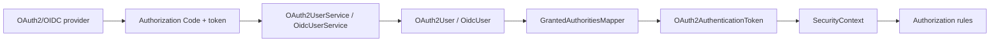

# Tùy chỉnh attributes, authorities và thuộc tính định danh trong OAuth2/OIDC Login

## 1. Bài toán thực tế và mục tiêu

Một ứng dụng Spring Security cho phép đăng nhập qua nhà cung cấp danh tính (Identity Provider, IdP). Sau khi người dùng đăng nhập, ứng dụng cần hiển thị tên, tìm tài khoản nội bộ và quyết định ai được xem báo cáo hoặc quản trị. Tuy nhiên, dữ liệu mà IdP trả về có thể không giống mô hình người dùng của ứng dụng:

- Nhà cung cấp A trả `sub`, `name` và `email`; nhà cung cấp B trả thêm `user_name` hoặc `employee_id`.
- Quyền có thể nằm ở `scope` của access token, claim `app_roles` trong ID Token, UserInfo hoặc hệ thống nội bộ.
- Một màn hình muốn hiển thị `preferred_username`, trong khi khóa định danh ổn định nên dựa trên `iss` và `sub`.
- Controller và lớp phân quyền cần kiểm tra cả trường hợp có quyền, thiếu quyền, thiếu claim và nhiều nhà cung cấp.

Trong module **SPRING_SECURITY_TESTING**, chúng ta dùng `spring-security-test` để kiểm chứng các tình huống trên ở mức HTTP. Trọng tâm của bài là **đăng nhập OAuth2/OIDC trên Servlet với MockMvc**, đồng thời nêu cách tương ứng trên Reactive/WebFlux với WebTestClient. Bài học không giả định rằng một principal giả lập đã trải qua việc trao đổi authorization code với IdP.

Sau bài này, người học có thể:

1. Phân biệt `OAuth2User.getAttributes()`, các claim của `OidcIdToken`/`OidcUserInfo` và `Authentication.getAuthorities()`.
2. Chọn thuộc tính định danh của principal, đồng thời giữ khóa liên kết tài khoản nội bộ an toàn.
3. Tạo principal OAuth2/OIDC có attributes, claims và authorities tùy chỉnh trong test.
4. Dùng MockMvc để xác minh truy cập được phép/bị từ chối theo authority thực sự gắn vào `Authentication`.
5. Kiểm thử riêng logic chuyển claim thành authority; biết vì sao `oauth2Login()`/`oidcLogin()` giả lập không tự kiểm thử toàn bộ quy trình mapping của production.

## 2. Ba thứ không được nhầm lẫn

### 2.1. Attributes và OIDC claims là dữ liệu về người dùng

Với OAuth2 Login không dùng OpenID Connect, principal thường là `OAuth2User`. Dữ liệu nhận từ UserInfo được biểu diễn dưới dạng `Map<String, Object>`:

```java
String providerId = user.getAttribute("sub");
String displayName = user.getAttribute("name");
String email = user.getAttribute("email");
```

Trên OIDC, principal là `OidcUser` (cũng là một `OAuth2User`). Nó có thể truy cập riêng:

```java
String subject = oidcUser.getIdToken().getSubject();
String issuer = oidcUser.getIdToken().getIssuer().toString();
String email = oidcUser.getEmail();

// UserInfo có thể không hiện diện ở một số cấu hình.
OidcUserInfo info = oidcUser.getUserInfo();
String department = info == null ? null : info.getClaimAsString("department");
```

**ID Token** xác nhận danh tính cho OIDC client; **access token** dùng khi gọi tài nguyên được bảo vệ. Không dùng access token thay ID Token để chứng minh đăng nhập OIDC. Việc một claim có trong `getAttributes()` không có nghĩa nó đã được chọn làm khóa định danh hoặc quyền trong Spring Security.

### 2.2. Authorities là đầu vào của quyết định phân quyền

Ứng dụng Spring Security thường kiểm tra các chuỗi `GrantedAuthority#getAuthority()`:

| Thành phần | Ví dụ | Ý nghĩa trong ứng dụng |
| --- | --- | --- |
| Attribute | `email = "user@example.test"` | Thông tin hồ sơ, không tự cấp quyền |
| ID Token claim | `app_roles = ["report-viewer"]` | Nguồn dữ liệu có thể dùng để mapping sau khi đã tin cậy và kiểm tra |
| Authority từ scope | `SCOPE_profile` | Quyền đại diện cho scope; không đồng nghĩa vai trò quản trị |
| Authority vai trò | `ROLE_REPORT_VIEWER` | Chuỗi được `hasRole("REPORT_VIEWER")` kiểm tra |
| Authority tùy biến | `reports:read` | Dùng trực tiếp với `hasAuthority("reports:read")` |

`hasRole("ADMIN")` theo mặc định tìm `ROLE_ADMIN`; `hasAuthority("ADMIN")` tìm chính xác chuỗi `ADMIN`. Một attribute có tên `role` hoặc một claim `app_roles` **không tự động trở thành** `ROLE_*`. Cần mapping tường minh.

### 2.3. Principal name không nhất thiết là mã định danh bền vững

`Authentication.getName()` trên OAuth2 Login thường lấy từ `OAuth2User.getName()`. `DefaultOAuth2User` sử dụng khóa `nameAttributeKey` được cấu hình; `DefaultOidcUser` thường dùng `sub` theo mặc định nhưng có thể nhận tên claim khác.

| Giá trị | Phù hợp để | Cảnh báo |
| --- | --- | --- |
| `preferred_username`, `user_name` | Hiển thị hoặc lấy tên đăng nhập theo hợp đồng IdP | Có thể đổi theo thời gian |
| `email` | Liên lạc, hiển thị | Có thể đổi, bị chuyển nhượng; `email_verified` không bảo đảm tính bất biến |
| `sub` | Nhận diện subject trong ngữ cảnh OIDC issuer/client | Không xem `sub` là duy nhất trên mọi IdP |
| `iss` + `sub` | Khóa liên kết danh tính OIDC trong hệ thống dùng nhiều issuer | Cần kiểm chứng ID Token qua luồng thật và quy ước dữ liệu đa client/pairwise subject |
| Internal user ID | Phân quyền và dữ liệu nội bộ sau khi liên kết | Phải ánh xạ từ danh tính IdP đã được xác minh |

Khi một công ty dùng nhiều IdP, chỉ lưu `sub` có thể gây trùng tên định danh giữa hai issuer. Trong OIDC, thiết kế phổ biến là liên kết bằng cặp **issuer + subject** rồi ánh xạ tới mã người dùng nội bộ. Việc đổi `getName()` sang `preferred_username` phục vụ hiển thị **không nên tự động thay khóa liên kết tài khoản**.

## 3. Luồng mapping trong ứng dụng thật



Các điểm cấu hình có mục đích khác nhau:

| Nhu cầu | Vị trí cấu hình |
| --- | --- |
| Chọn tên principal cho OAuth2 UserInfo | `ClientRegistration.providerDetails.userInfoEndpoint.userNameAttributeName` |
| Thêm, chuẩn hóa hoặc lọc attributes sau khi gọi UserInfo | `OAuth2UserService<OAuth2UserRequest, OAuth2User>` |
| Tùy chỉnh OIDC user theo ID Token và UserInfo | `OAuth2UserService<OidcUserRequest, OidcUser>`, thường ủy quyền cho `OidcUserService` |
| Đổi authorities từ dữ liệu đã có trong principal | `GrantedAuthoritiesMapper` |
| Tra quyền từ hệ thống khác bằng access token | Delegating `OAuth2UserService`/`OidcUserService`, có timeout và chính sách lỗi rõ ràng |
| Giả lập HTTP request đã đăng nhập trong test | `oauth2Login()` và `oidcLogin()` của `spring-security-test` |

Ví dụ chọn thuộc tính UserInfo làm tên principal của provider `partner` (đặt trong cấu hình Spring Boot):

```yaml
spring:
  security:
    oauth2:
      client:
        provider:
          partner:
            user-name-attribute: user_name
```

Cấu hình này cần nằm trong `ClientRegistration` gắn với provider phù hợp và phải có claim `user_name` thực sự được trả về. Nó chủ yếu áp dụng cho tên principal OAuth2 UserInfo; với OIDC, hãy kiểm tra cách `OidcUserService` xây dựng `DefaultOidcUser` và ưu tiên định danh bền vững `sub` cho liên kết tài khoản.

Một `SecurityFilterChain` cho Servlet có thể bảo vệ hai endpoint bằng authority như sau:

```java
@Bean
SecurityFilterChain security(HttpSecurity http) throws Exception {
    return http
        .authorizeHttpRequests(auth -> auth
            .requestMatchers("/api/profile/admin")
                .hasAuthority("ROLE_ADMIN")
            .requestMatchers("/api/profile/**")
                .authenticated()
            .anyRequest().permitAll())
        .oauth2Login(Customizer.withDefaults())
        .build();
}
```

Để thử chiến lược mapping trong **luồng login thật**, có thể đăng ký `GrantedAuthoritiesMapper`:

```java
@Bean
GrantedAuthoritiesMapper appAuthorities() {
    return sourceAuthorities -> {
        Set<GrantedAuthority> mapped =
            new LinkedHashSet<>(sourceAuthorities);

        for (GrantedAuthority source : sourceAuthorities) {
            if (source instanceof OidcUserAuthority oidc) {
                // Chỉ dùng claim này khi IdP đã được tin cậy
                // và hợp đồng issuer/client xác định app_roles.
                Object claim = oidc.getIdToken().getClaim("app_roles");
                if (claim instanceof Collection<?> roles
                        && roles.contains("report-viewer")) {
                    mapped.add(new SimpleGrantedAuthority(
                        "ROLE_REPORT_VIEWER"));
                }
            }
        }
        return mapped;
    };
}
```

Mapper trên giữ các authority hiện có và chỉ bổ sung `ROLE_REPORT_VIEWER` khi một claim hợp lệ chứa giá trị được phép. Nếu đang map quyền cho nhiều tenant, cần xác minh cả issuer, client và tenant mà ứng dụng chấp nhận; **không ánh xạ quyền quản trị chỉ vì chuỗi "admin" xuất hiện ở thuộc tính tùy ý**.

Trong Spring Security Servlet, có thể gắn mapper tường minh bằng:

```java
http.oauth2Login(oauth2 -> oauth2
    .userInfoEndpoint(userInfo -> userInfo
        .userAuthoritiesMapper(appAuthorities())));
```

Ở đây `appAuthorities()` đại diện cho bean/method mapper đã định nghĩa. Trong ứng dụng có cấu hình riêng, nên inject bean mapper thay vì tự tạo lại một instance ngoài container. Đối với mapping có gọi API hoặc database bên ngoài, hãy dùng `OAuth2UserService`/`OidcUserService` phù hợp, kiểm soát timeout và xử lý lỗi theo chính sách.

## 4. Chuẩn bị endpoint để kiểm thử bằng MockMvc

Giả sử một ứng dụng Servlet Spring Boot có `spring-boot-starter-web`, `spring-boot-starter-security`, `spring-boot-starter-oauth2-client`, `spring-boot-starter-test` và `spring-security-test`. Ở Spring Boot 3.x, có thể khai báo:

```groovy
dependencies {
    implementation 'org.springframework.boot:spring-boot-starter-web'
    implementation 'org.springframework.boot:spring-boot-starter-security'
    implementation 'org.springframework.boot:spring-boot-starter-oauth2-client'
    testImplementation 'org.springframework.boot:spring-boot-starter-test'
    testImplementation 'org.springframework.security:spring-security-test'
}
```

Trong test context cần ít nhất một `ClientRegistration` (có thể khai báo provider giả dành riêng cho test) để `oauth2Login()` của ứng dụng khởi tạo được. Chẳng hạn:

```yaml
# application-test.yml: địa chỉ giả, không gọi IdP khi dùng mock login
spring:
  security:
    oauth2:
      client:
        registration:
          demo:
            client-id: demo-client
            client-secret: test-only
            authorization-grant-type: authorization_code
            redirect-uri: "{baseUrl}/login/oauth2/code/{registrationId}"
            scope: profile
        provider:
          demo:
            authorization-uri: https://idp.example.test/authorize
            token-uri: https://idp.example.test/token
            user-info-uri: https://idp.example.test/userinfo
            user-name-attribute: sub
```

Đây là thông số giả phục vụ bài test, **không phải IdP thật**. Với Spring Boot 4.x, các starter dành cho MVC test có thể được tách gói và package import auto-configuration của `@AutoConfigureMockMvc` khác Boot 3; dùng API tương ứng với phiên bản trong dự án.

Tạo các endpoint quan sát danh tính và quyền:

```java
@RestController
class ProfileController {

    @GetMapping("/api/profile/name")
    String name(Authentication authentication) {
        return authentication.getName();
    }

    @GetMapping("/api/profile/external-id")
    String externalId(@AuthenticationPrincipal OAuth2User user) {
        return user.getAttribute("external_id");
    }

    @GetMapping("/api/profile/oidc-sub")
    String oidcSubject(@AuthenticationPrincipal OidcUser user) {
        return user.getIdToken().getSubject();
    }

    @GetMapping("/api/profile/admin")
    String admin() {
        return "admin access granted";
    }
}
```

Controller trên chỉ có vai trò làm probe trong bài học. Mọi endpoint `/api/profile/**` đều yêu cầu đăng nhập theo `SecurityFilterChain` ở mục 3; riêng `/api/profile/admin` cần `ROLE_ADMIN`. Với hệ thống thực, bạn có thể đặt yêu cầu tương đương ở method security bằng `@PreAuthorize`.

## 5. MockMvc: giả lập OAuth2 Login với attributes tùy chỉnh

Thay vì tạo `UsernamePasswordAuthenticationToken` bằng `@WithMockUser`, sử dụng `oauth2Login()` để request mang principal kiểu `OAuth2User` và `OAuth2AuthenticationToken`. Các test sau dùng `@SpringBootTest`, `@AutoConfigureMockMvc` và cấu hình ở mục 3–4:

```java
import java.util.Map;
import org.junit.jupiter.api.Test;
import org.springframework.beans.factory.annotation.Autowired;
import org.springframework.boot.test.autoconfigure.web.servlet.AutoConfigureMockMvc;
import org.springframework.boot.test.context.SpringBootTest;
import org.springframework.security.core.authority.AuthorityUtils;
import org.springframework.security.core.authority.SimpleGrantedAuthority;
import org.springframework.security.oauth2.core.user.DefaultOAuth2User;
import org.springframework.security.oauth2.core.user.OAuth2User;
import org.springframework.test.web.servlet.MockMvc;

import static org.springframework.security.test.web.servlet.request
    .SecurityMockMvcRequestPostProcessors.oauth2Login;
import static org.springframework.test.web.servlet.request
    .MockMvcRequestBuilders.get;
import static org.springframework.test.web.servlet.result
    .MockMvcResultMatchers.*;

@SpringBootTest
@AutoConfigureMockMvc
class OAuth2ProfileTest {
    @Autowired MockMvc mvc;

    @Test
    void customAttributeIsAvailableToController() throws Exception {
        mvc.perform(get("/api/profile/external-id")
                .with(oauth2Login()
                    .attributes(attrs ->
                        attrs.put("external_id", "person-104"))))
            .andExpect(status().isOk())
            .andExpect(content().string("person-104"));
    }

    @Test
    void merelyAddingUserNameAttributeDoesNotChangePrincipalName()
            throws Exception {
        // Test helper mặc định vẫn chọn name attribute là "sub".
        mvc.perform(get("/api/profile/name")
                .with(oauth2Login()
                    .attributes(attrs ->
                        attrs.put("user_name", "alice.remote"))))
            .andExpect(status().isOk())
            .andExpect(content().string("user"));
    }

    @Test
    void customNameAttributeUsesConfiguredKey() throws Exception {
        OAuth2User custom = new DefaultOAuth2User(
            AuthorityUtils.createAuthorityList("SCOPE_profile"),
            Map.of("user_name", "alice.remote",
                   "external_id", "person-104"),
            "user_name"
        );

        mvc.perform(get("/api/profile/name")
                .with(oauth2Login().oauth2User(custom)))
            .andExpect(status().isOk())
            .andExpect(content().string("alice.remote"));
    }

    @Test
    void adminAuthorityGrantsAccess() throws Exception {
        mvc.perform(get("/api/profile/admin")
                .with(oauth2Login().authorities(
                    new SimpleGrantedAuthority("ROLE_ADMIN"))))
            .andExpect(status().isOk())
            .andExpect(content().string("admin access granted"));
    }

    @Test
    void scopeDoesNotImplyAdminRole() throws Exception {
        mvc.perform(get("/api/profile/admin")
                .with(oauth2Login().authorities(
                    new SimpleGrantedAuthority("SCOPE_profile"))))
            .andExpect(status().isForbidden());
    }
}
```

**Phân tích các assertion:**

- `attributes(...)` thêm/sửa dữ liệu thuộc principal giả; controller thực sự đọc được từ `@AuthenticationPrincipal OAuth2User`.
- Giá trị `user_name` có trong attributes **không tự đổi** `OAuth2User.getName()`; ví dụ thứ ba phải tạo `DefaultOAuth2User` với khóa định danh `user_name`.
- `authorities(...)` tạo tập authority cho request test. `ROLE_ADMIN` đáp ứng `hasAuthority("ROLE_ADMIN")`; `SCOPE_profile` thì không.
- `oauth2Login()` cũng cung cấp `OAuth2AuthorizedClient` giả trong repository của test để phục vụ mã lấy authorized client; không nên suy ra access token giả đã được IdP xác minh.

Nếu controller chỉ dùng `Principal#getName()` mà không phụ thuộc API OAuth2, `@WithMockUser` vẫn phù hợp cho một test phân quyền đơn giản. Khi mã dùng `OAuth2User`, `OidcUser` hoặc custom claim, hãy dùng bộ hỗ trợ OAuth2/OIDC đúng kiểu principal.

## 6. MockMvc: OIDC Login với ID Token, UserInfo và tên principal

Với OIDC, nguồn claim cần phân biệt rõ: ID Token có `sub` và các claim xác thực danh tính; UserInfo trả thêm dữ liệu hồ sơ. `oidcLogin()` của spring-security-test cho phép tùy biến từng phần:

```java
import org.junit.jupiter.api.Test;
import org.springframework.beans.factory.annotation.Autowired;
import org.springframework.boot.test.autoconfigure.web.servlet.AutoConfigureMockMvc;
import org.springframework.boot.test.context.SpringBootTest;
import org.springframework.security.core.authority.AuthorityUtils;
import org.springframework.security.oauth2.core.oidc.OidcIdToken;
import org.springframework.security.oauth2.core.oidc.user.DefaultOidcUser;
import org.springframework.security.oauth2.core.oidc.user.OidcUser;
import org.springframework.test.web.servlet.MockMvc;

import static org.springframework.security.test.web.servlet.request
    .SecurityMockMvcRequestPostProcessors.oidcLogin;
import static org.springframework.test.web.servlet.request
    .MockMvcRequestBuilders.get;
import static org.springframework.test.web.servlet.result
    .MockMvcResultMatchers.*;

@SpringBootTest
@AutoConfigureMockMvc
class OidcProfileTest {
    @Autowired MockMvc mvc;

    @Test
    void subjectComesFromMockIdToken() throws Exception {
        mvc.perform(get("/api/profile/oidc-sub")
                .with(oidcLogin().idToken(id ->
                    id.claim("sub", "issuer-subject-204"))))
            .andExpect(status().isOk())
            .andExpect(content().string("issuer-subject-204"));
    }

    @Test
    void userInfoCanContainExtraAttributes() throws Exception {
        mvc.perform(get("/api/profile/external-id")
                .with(oidcLogin()
                    .userInfo(info ->
                        info.claim("external_id", "staff-902"))))
            .andExpect(status().isOk())
            .andExpect(content().string("staff-902"));
    }

    @Test
    void explicitOidcUserChoosesDisplayNameClaim() throws Exception {
        OidcIdToken token = OidcIdToken.withTokenValue("id-token-for-test")
            .claim("sub", "issuer-subject-204")
            .claim("preferred_username", "alice.display")
            .build();
        OidcUser custom = new DefaultOidcUser(
            AuthorityUtils.createAuthorityList("SCOPE_openid"),
            token,
            "preferred_username");

        mvc.perform(get("/api/profile/name")
                .with(oidcLogin().oidcUser(custom)))
            .andExpect(status().isOk())
            .andExpect(content().string("alice.display"));

        mvc.perform(get("/api/profile/oidc-sub")
                .with(oidcLogin().oidcUser(custom)))
            .andExpect(status().isOk())
            .andExpect(content().string("issuer-subject-204"));
    }
}
```

Hai assertion cuối cho thấy **tên của principal** và **subject của ID Token** là hai khái niệm riêng. Với OAuth2 Login không OIDC, dùng `DefaultOAuth2User`; với OIDC, dùng `DefaultOidcUser` để giữ ID Token, UserInfo và name claim nhất quán.

Khi kiểm thử kết hợp claims, hãy tạo fixture minh bạch:

| Trường hợp | Fixture | Điều cần khẳng định |
| --- | --- | --- |
| Có `preferred_username` | Thêm claim vào ID Token | Tên hiển thị đúng khi custom principal chọn claim này |
| Thiếu `preferred_username` | ID Token chỉ có `sub` | Ứng dụng có fallback rõ ràng; không gây 500 |
| Có `external_id` ở UserInfo | Dùng `userInfo(info -> info.claim(...))` | Controller nhận đúng giá trị |
| `email_verified=false` | ID Token hoặc UserInfo đặt false | Logic nghiệp vụ không tự coi email là đã xác minh |
| `app_roles` không đúng kiểu | Claim là chuỗi thay vì mảng | Mapping không cấp quyền ngoài dự kiến |
| Hai issuer có cùng `sub` | Fixture có `iss` khác nhau | Liên kết tài khoản phân biệt hai danh tính |

Giả lập một ID Token bằng `idToken(...)` **không chạy bộ xác minh JWT chữ ký, issuer, audience, nonce hay token endpoint**. Các kiểm tra đó thuộc test của OAuth2/OIDC authentication flow thật hoặc môi trường tích hợp IdP.

## 7. Kiểm thử logic claim → authority riêng biệt

Đây là ranh giới rất dễ tạo test “xanh” giả. Giả sử production có mapper đọc `app_roles` và cấp `ROLE_REPORT_VIEWER`. Test sau:

```java
mvc.perform(get("/api/profile/admin")
        .with(oidcLogin().authorities(
            new SimpleGrantedAuthority("ROLE_ADMIN"))))
    .andExpect(status().isOk());
```

chỉ chứng minh rằng endpoint cho phép một Authentication **đã được cấp sẵn** `ROLE_ADMIN`. Nó **không chứng minh** mapper của production đã chuyển đúng claim thành authority, vì `oidcLogin()` đặt SecurityContext giả và bỏ qua bước gọi `OidcUserService`/`GrantedAuthoritiesMapper` của login thật.

Với mapper ở mục 3, hãy kiểm tra trực tiếp:

```java
import java.util.List;
import org.junit.jupiter.api.Test;
import org.springframework.beans.factory.annotation.Autowired;
import org.springframework.boot.test.context.SpringBootTest;
import org.springframework.security.core.GrantedAuthority;
import org.springframework.security.core.authority.mapping.GrantedAuthoritiesMapper;
import org.springframework.security.oauth2.core.oidc.OidcIdToken;
import org.springframework.security.oauth2.core.oidc.user.OidcUserAuthority;

import static org.assertj.core.api.Assertions.assertThat;

@SpringBootTest
class MappingAssertions {

    // Inject mapper bean thật từ application context.
    @Autowired GrantedAuthoritiesMapper mapper;

    @Test
    void trustedClaimMapsToLocalReportAuthority() {
        OidcIdToken id = OidcIdToken.withTokenValue("test-id-token")
            .claim("sub", "user-104")
            .claim("app_roles", List.of("report-viewer"))
            .build();

        var mapped = mapper.mapAuthorities(
            List.of(new OidcUserAuthority(id, null)));

        assertThat(mapped)
            .extracting(GrantedAuthority::getAuthority)
            .contains("ROLE_REPORT_VIEWER");
    }

    @Test
    void unrecognizedClaimMustNotGrantReportAuthority() {
        OidcIdToken id = OidcIdToken.withTokenValue("test-id-token")
            .claim("sub", "user-105")
            .claim("app_roles", List.of("unknown"))
            .build();

        var mapped = mapper.mapAuthorities(
            List.of(new OidcUserAuthority(id, null)));

        assertThat(mapped)
            .extracting(GrantedAuthority::getAuthority)
            .doesNotContain("ROLE_REPORT_VIEWER");
    }
}
```

Đoạn test dùng `@SpringBootTest` để lấy mapper bean thực từ application context đã cấu hình ở mục 3. Nếu muốn chạy nhanh hơn, có thể tách logic mapping thành một lớp thuần Java rồi unit test trực tiếp mà không cần khởi động toàn bộ Spring container.

Đối với OAuth2 không OIDC, mapper có thể nhận `OAuth2UserAuthority` và đọc `getAttributes()`. Đối với OIDC, mapper có thể nhận `OidcUserAuthority` để đọc `getIdToken()`/`getUserInfo()`. Trong một số trường hợp scope cũng được biểu diễn bằng các authority `SCOPE_*`. Không nên giả định mọi authority truyền vào mapper đều là `OidcUserAuthority`.

Quy tắc thực hành an toàn:

1. Chỉ đọc role/permission từ issuer, client, token và claim mà ứng dụng tin cậy; xác định allowlist giá trị.
2. Không coi `scope=openid` hoặc `email_verified=true` là quyền admin.
3. Giữ các authority cần thiết, tránh vô tình xóa scope khi thay danh sách authority.
4. Khi thiếu claim, sai kiểu dữ liệu hoặc kho quyền gặp lỗi, áp dụng chính sách không cấp thêm quyền.
5. Test kết quả mapping **và** test HTTP authorization sau khi Authentication mang các authority kết quả.

## 8. Trường hợp cần tùy chỉnh OAuth2UserService hoặc OidcUserService

`GrantedAuthoritiesMapper` nhận bộ authority đã sinh và có thể truy cập dữ liệu trong `OAuth2UserAuthority`/`OidcUserAuthority`. Tuy nhiên, khi phải gọi API phân quyền của công ty bằng access token hoặc chuẩn hóa mô hình nhiều IdP, hãy xem xét một `OAuth2UserService` tùy chỉnh:

```java
OAuth2UserService<OAuth2UserRequest, OAuth2User> customUserService =
    request -> {
        OAuth2User delegate =
            new DefaultOAuth2UserService().loadUser(request);

        Map<String, Object> attrs =
            new HashMap<>(delegate.getAttributes());

        // Giả sử hợp đồng IdP có external_id đáng tin cậy.
        // Validate kiểu/định dạng, rồi chuẩn hóa vào thuộc tính nội bộ.
        Object raw = attrs.get("external_id");
        if (raw instanceof String value && !value.isBlank()) {
            attrs.put("linked_external_id", value);
        }

        return new DefaultOAuth2User(
            delegate.getAuthorities(), attrs, "sub");
    };
```

Đăng ký với:

```java
http.oauth2Login(oauth2 -> oauth2
    .userInfoEndpoint(userInfo -> userInfo
        .userService(customUserService)));
```

Ví dụ chỉ minh họa cấu trúc. Để production hoạt động, cần bảo đảm claim chọn làm khóa (ở đây `sub`) luôn tồn tại, xác định nguồn thuộc tính có đáng tin cậy hay không, xử lý lỗi UserInfo và không âm thầm gán lại người dùng khác. Với IdP dùng khóa khác, chọn khóa theo `ClientRegistration` thay vì hardcode `"sub"`.

Trên OIDC, không thay `OidcUser` bằng `DefaultOAuth2User` vì như vậy sẽ mất API ID Token/UserInfo mà controller có thể cần. Hãy ủy quyền cho `OidcUserService` rồi dựng lại `DefaultOidcUser` với `OidcIdToken`, `OidcUserInfo` và tên principal mong muốn. Những test có `oidcLogin().oidcUser(...)` kiểm tra **hành vi downstream của principal đã tùy chỉnh**; để kiểm tra chính service, cần test service với request/response hợp lệ hoặc một IdP giả có token và UserInfo endpoint.

## 9. Tương ứng trên Reactive/WebFlux với WebTestClient

Trong ứng dụng dùng `SecurityWebFilterChain`, đừng mang nguyên `HttpSecurity`, `MockMvc` hoặc `SecurityMockMvcRequestPostProcessors` sang WebFlux. `spring-security-test` có các mutator phù hợp cho `WebTestClient`:

```java
import static org.springframework.security.test.web.reactive.server
    .SecurityMockServerConfigurers.mockOAuth2Login;
import static org.springframework.security.test.web.reactive.server
    .SecurityMockServerConfigurers.mockOidcLogin;

// client đã được cấu hình với springSecurity().
client.mutateWith(mockOAuth2Login()
        .attributes(attrs ->
            attrs.put("external_id", "person-104")))
    .get().uri("/api/profile/external-id")
    .exchange()
    .expectStatus().isOk()
    .expectBody(String.class).isEqualTo("person-104");

client.mutateWith(mockOAuth2Login()
        .authorities(new SimpleGrantedAuthority("SCOPE_profile")))
    .get().uri("/api/profile/admin")
    .exchange()
    .expectStatus().isForbidden();

client.mutateWith(mockOidcLogin()
        .idToken(id -> id.claim("sub", "oidc-person-204")))
    .get().uri("/api/profile/oidc-sub")
    .exchange()
    .expectStatus().isOk()
    .expectBody(String.class).isEqualTo("oidc-person-204");
```

Đây là **mẫu gọi test**, đòi hỏi controller/route WebFlux tương ứng và `WebTestClient` đã liên kết Spring Security (ví dụ `WebTestClient.bindToApplicationContext(context).apply(springSecurity()).configureClient().build()`). Đoạn code không nhằm chạy bên trong ứng dụng Servlet `MockMvc` của các mục trước.

| Servlet | Reactive |
| --- | --- |
| `SecurityFilterChain` + `HttpSecurity` | `SecurityWebFilterChain` + `ServerHttpSecurity` |
| `MockMvc` | `WebTestClient` |
| `oauth2Login()`, `oidcLogin()` request post-processors | `mockOAuth2Login()`, `mockOidcLogin()` mutators |
| `.with(oauth2Login().attributes(...))` | `.mutateWith(mockOAuth2Login().attributes(...))` |
| `.andExpect(status().isForbidden())` | `.expectStatus().isForbidden()` |

Cả hai tầng đều có thể kiểm chứng quyết định phân quyền của request đã được giả lập xác thực, nhưng không tự đi qua OIDC authorization code flow.

## 10. Bộ ca kiểm thử khuyến nghị

| Ca | Đầu vào test | Kết quả mong đợi |
| --- | --- | --- |
| OAuth2 có custom attribute | `attributes(external_id=...)` | Controller đọc đúng ID của provider |
| Đổi tên principal | `DefaultOAuth2User` với `nameAttributeKey=user_name` | `Authentication.getName()` theo `user_name` |
| Chỉ thêm user_name | Thêm attribute nhưng vẫn dùng name key mặc định | Không đổi tên principal ngoài dự kiến |
| OIDC subject | `oidcLogin().idToken(sub=...)` | `OidcUser.getIdToken().getSubject()` đúng |
| OIDC có UserInfo | `userInfo(...)` | Claim được đọc đúng ở vị trí mong đợi |
| OIDC tên hiển thị khác subject | `DefaultOidcUser` chọn `preferred_username` | `getName()` và `getIdToken().getSubject()` khác nhau, đều đúng |
| Có quyền | `ROLE_ADMIN` | Endpoint admin cho phép |
| Thiếu quyền | Chỉ `SCOPE_profile` | Endpoint admin trả 403 |
| Role claim hợp lệ | Mapper nhận `app_roles=["report-viewer"]` | Tạo `ROLE_REPORT_VIEWER` |
| Role claim không hợp lệ | Claim trống, sai kiểu hoặc giá trị lạ | Không cấp `ROLE_REPORT_VIEWER` |
| Thiếu thông tin định danh | Thiếu khóa cấu hình, thiếu `sub` hoặc issuer | Từ chối hoặc trả lỗi có kiểm soát theo policy |
| Trùng `sub` khác issuer | Hai fixture khác `iss` | Không liên kết nhầm tài khoản |
| Cross-tenant role | Role đúng chữ nhưng tenant không khớp | Không được nhận quyền của tenant khác |
| Client registration khác | `clientRegistration(...)` theo client đích | Authorized client và logic client-aware nhất quán |

Với endpoint phân quyền theo method security, thêm ít nhất một ca qua `@PreAuthorize`. Với endpoint chỉ cho phép người dùng đăng nhập, thêm ca anonymous; expected status có thể là redirect (login entry point) hoặc 401 tùy cấu hình, không mặc định tất cả phải là 403.

## 11. Những lỗi phổ biến khi viết test

**1. Dùng `@WithMockUser` cho controller yêu cầu `OidcUser`.** Principal giả là một loại khác, nên controller không nhận đúng dữ liệu OIDC. Dùng `oidcLogin()` hoặc cấu hình một `OidcUser` cụ thể.

**2. Đặt `app_roles` vào attributes rồi mong `hasRole` cho phép.** Claim không tự sinh `GrantedAuthority`. Kiểm tra mapper riêng; sau đó tạo Authentication với authorities mong đợi và kiểm tra HTTP authorization.

**3. Thêm `user_name` rồi tưởng `getName()` đổi ngay.** Cần cấu hình name attribute trong provider hoặc tự xây `DefaultOAuth2User`/`DefaultOidcUser` với khóa mong muốn.

**4. Đổi `getName()` thành email rồi lấy email làm định danh nội bộ.** Email có thể thay đổi. Với OIDC, dùng `iss` + `sub` sau khi xác minh token thật, liên kết sang mã người dùng nội bộ.

**5. Chỉ test trường hợp quyền được cấp.** Không có ca thiếu quyền sẽ không phát hiện lỗi map nhầm `SCOPE_*` sang `ROLE_*` hoặc cấp quyền mặc định quá rộng.

**6. Dùng `oauth2Login()` để kết luận endpoint callback xác minh chữ ký token đúng.** Test helper bỏ qua việc trao đổi code, gọi UserInfo và xác minh IdP. Cần một kiểm thử tích hợp với authorization server mô phỏng hoặc môi trường IdP phù hợp.

**7. Thay toàn bộ authority bằng danh sách mới.** Có thể làm mất scope và authority hợp lệ khác. Xác định chính sách rõ: bảo toàn, bổ sung hay loại bỏ từng loại; test cả authority nguồn và kết quả.

**8. Đọc claim mà không kiểm tra kiểu.** IdP có thể thay đổi schema hoặc thiếu claim. Đừng cast trực tiếp `(List<String>)` khi dữ liệu chưa được kiểm tra; nên ràng buộc kiểu và cho kết quả từ chối an toàn.

**9. Trộn OAuth2 Login với Resource Server JWT.** `oauth2Login()`/`oidcLogin()` dành cho user login; `jwt()` hoặc `mockJwt()` trong test phục vụ bearer JWT của resource server. Chúng tạo các kiểu Authentication và quy trình khác nhau.

## 12. Bài thực hành

**Bài 1 — Chuẩn hóa profile.** Tạo endpoint trả `external_id` của `OAuth2User`; viết test `oauth2Login().attributes(...)` để kiểm tra giá trị có/không có và dữ liệu sai kiểu. Không log toàn bộ token hoặc thông tin cá nhân.

**Bài 2 — Chọn tên định danh.** Tạo `DefaultOAuth2User` có cả `sub` và `user_name`, cấu hình `nameAttributeKey=user_name`. Viết thêm test chỉ thêm attribute để chứng minh tên principal chưa thay đổi.

**Bài 3 — OIDC subject và tên hiển thị.** Tạo `DefaultOidcUser` từ ID Token có `sub` và `preferred_username`. Assert `getName()` theo tên hiển thị nhưng `getIdToken().getSubject()` vẫn là subject ban đầu.

**Bài 4 — Quyền của ứng dụng.** Viết `GrantedAuthoritiesMapper` chỉ cấp `ROLE_REPORT_VIEWER` khi claim `app_roles` hợp lệ. Unit test cả có role, thiếu role, sai kiểu; HTTP test endpoint bảo vệ với và không có authority.

**Bài 5 — So sánh Servlet và Reactive.** Dùng `MockMvc` với `oauth2Login()` và `WebTestClient` với `mockOAuth2Login()` trên hai ứng dụng/fixture tương đương. Kiểm tra quyền từ chối được thể hiện rõ bằng 403, không chỉ kiểm tra một endpoint công khai trả 200.

Tiêu chí đạt: bài test chứng minh được **giá trị attribute/claim**, **tên principal**, **authority đã mapping** và **quyết định cho phép hoặc từ chối truy cập**. Người học giải thích được chính xác phần nào là giả lập SecurityContext và phần nào phải được kiểm chứng qua IdP/authorization code flow thật.

## 13. Tài liệu tham khảo

- [Spring Security — Testing OAuth 2.0 with MockMvc](https://docs.spring.io/spring-security/reference/servlet/test/mockmvc/oauth2.html): `oauth2Login()`, `oidcLogin()`, claims, authorities và custom principal.
- [Spring Security — Advanced OAuth2 Login Configuration (Servlet)](https://docs.spring.io/spring-security/reference/servlet/oauth2/login/advanced.html): `GrantedAuthoritiesMapper` và `OAuth2UserService`/`OidcUserService`.
- [Spring Security — Testing OAuth 2.0 with WebTestClient](https://docs.spring.io/spring-security/reference/reactive/test/web/oauth2.html): `mockOAuth2Login()`, `mockOidcLogin()` trên Reactive.
- [Spring Security — Advanced OAuth2 Login Configuration (Reactive)](https://docs.spring.io/spring-security/reference/reactive/oauth2/login/advanced.html): mapping authorities trong WebFlux.
- [OpenID Connect Core 1.0](https://openid.net/specs/openid-connect-core-1_0.html): các claim `iss`, `sub`, `aud`, ID Token và tính chất định danh OIDC.
