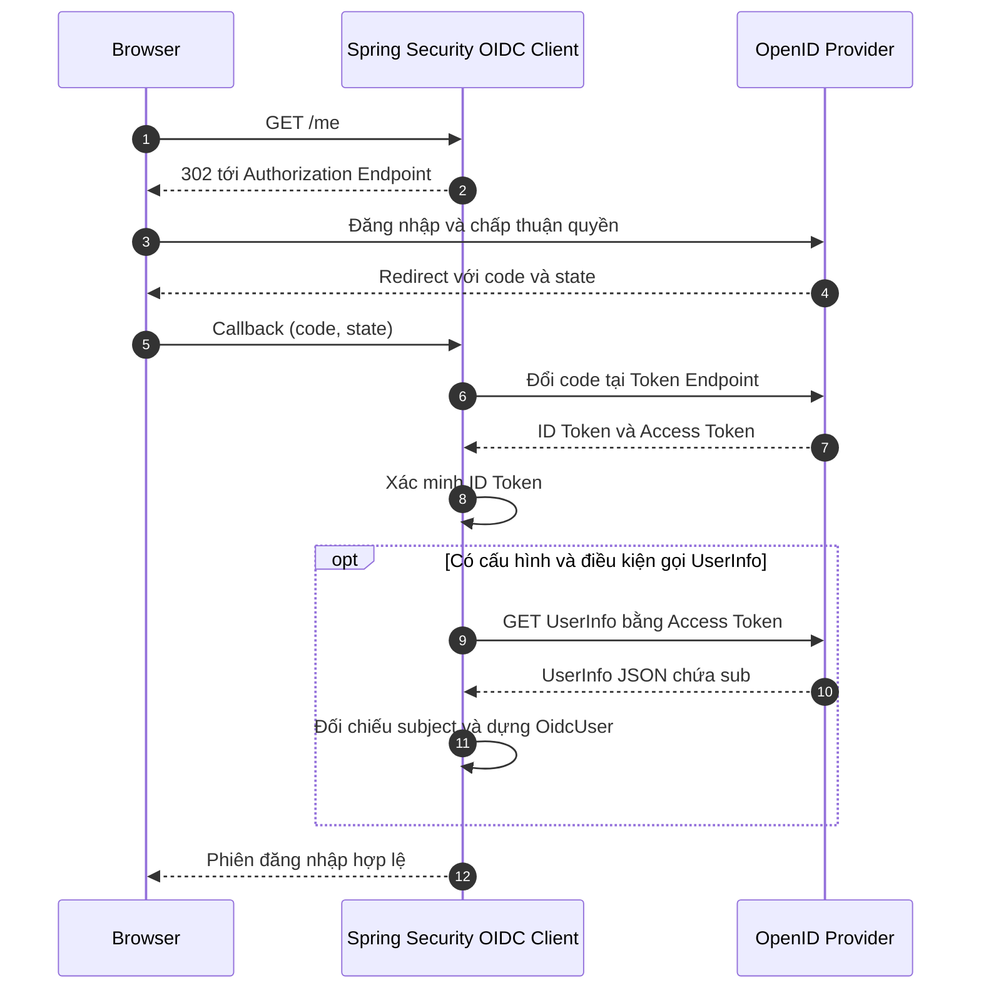

# OidcIdToken, OidcUserInfo và nguồn lấy từng claim

## 1. Cùng một claim có thể đến từ hai nguồn

Một ứng dụng dùng OpenID Connect (OIDC) đăng nhập người dùng rồi hiển thị email trên trang hồ sơ. Sau khi đăng nhập thành công, Spring Security cung cấp `OidcUser`. Tuy nhiên, claim `email` của người dùng có thể nằm trong **ID Token**, trong **phản hồi UserInfo**, xuất hiện ở cả hai hoặc vắng mặt.

Ví dụ phản hồi của nhà cung cấp định danh (OpenID Provider - OP):

**ID Token (payload minh họa):**

```json
{
  "iss": "https://login.example.test",
  "sub": "subject-123",
  "aud": "web-client",
  "iat": 1796000000,
  "exp": 1796003600,
  "email": "old@example.test",
  "email_verified": false
}
```

**UserInfo response:**

```json
{
  "sub": "subject-123",
  "email": "new@example.test",
  "email_verified": true,
  "given_name": "An",
  "family_name": "Nguyễn"
}
```

Cùng một người dùng, hai nguồn chứa email khác nhau. Nếu chỉ gọi `oidcUser.getEmail()`, ứng dụng không thể giải thích chính xác **email đó đến từ nguồn nào**. Đó là lý do cần phân biệt `OidcIdToken`, `OidcUserInfo` và map claims tổng hợp của `OidcUser`.

Bài thuộc chương **Đăng nhập OAuth2 và OIDC** trong module **SPRING_SECURITY_TESTING**, với mục tiêu kiểm chứng xác thực, phân quyền và hành vi HTTP bằng `spring-security-test`. Nội dung gắn với `MockMvc` cho Servlet, `WebTestClient` cho Reactive, đồng thời phân biệt xác thực OIDC giả lập bằng `oidcLogin()`/`mockOidcLogin()` với kiểm thử giao thức và token thực.

Sau bài học, người học có thể:

- Đọc chính xác claim từ ID Token hoặc UserInfo, không nhầm với bản tổng hợp.
- Xác định claim thường có ở đâu, khi nào UserInfo vắng mặt và tại sao cùng key có thể có giá trị khác nhau.
- Thiết kế chính sách chọn nguồn cho email, tên và các thông tin hồ sơ.
- Dùng test OIDC giả lập để phát hiện lỗi lấy nhầm nguồn, lỗi `null`, lỗi sai kiểu và lỗi phân quyền.
- Nêu rõ giới hạn của `@WithMockUser`, `SecurityContext`, `oidcLogin()` và test tích hợp OIDC thực.

## 2. Luồng OIDC và ba đối tượng không được nhầm

Trong Authorization Code Flow điển hình, trình duyệt được chuyển đến OP để đăng nhập; ứng dụng đổi authorization code lấy token, xác minh ID Token rồi tùy cấu hình sử dụng access token để gọi UserInfo Endpoint.



| Đối tượng | Dùng để làm gì? | Các lưu ý |
|---|---|---|
| **ID Token** | Khẳng định sự kiện xác thực và danh tính của người dùng **đối với OIDC client** | Thường là JWT ký với `iss`, `sub`, `aud`, `iat`, `exp`; có thể chứa thêm claims hồ sơ |
| **UserInfo response** | Trả về thông tin người dùng khi client truy vấn UserInfo Endpoint | JSON chứa `sub`, có thể kèm `email`, `name`, `picture`... tùy scope, consent và OP |
| **Access Token** | Ủy quyền client truy cập tài nguyên, trong đó có UserInfo Endpoint | Không tự động là ID Token; có thể là JWT hoặc opaque token |

**ID Token khác access token.** `aud` của ID Token thường gắn với `client_id` của OIDC client; không vì ID Token chứa `email` mà được dùng nó làm bearer credential để gọi API resource server. Quy tắc xác minh JWT access token của API và quy tắc xác minh ID Token trong OIDC login có ranh giới riêng.

Trong một số ứng dụng, UserInfo Endpoint không được gọi do provider không khai báo endpoint, scope/consent không phù hợp, hoặc service lấy UserInfo được tùy biến. **`OidcUser.getUserInfo()` có thể là `null`**, dù người dùng đăng nhập hợp lệ bằng OIDC.

## 3. API Spring Security: nguồn trực tiếp và nguồn tổng hợp

Các API chính thường dùng:

| API | Nguồn | Ý nghĩa |
|---|---|---|
| `OidcUser.getIdToken()` | `OidcIdToken` | Đọc trực tiếp ID Token đã gắn với principal |
| `OidcUser.getUserInfo()` | `OidcUserInfo` | Đọc UserInfo nếu có; có thể `null` |
| `OidcUser.getClaims()` | Map tổng hợp | Thuận tiện cho giao diện nhưng không thể hiện xuất xứ từng key |
| `OidcUser.getEmail()`, `getFullName()` | Accessor của principal | Không nói email/tên do ID Token hay UserInfo cung cấp |
| `OidcIdToken.getClaims()` | Claims riêng của ID Token | Phù hợp để kiểm tra provenance ID Token |
| `OidcUserInfo.getClaims()` | Claims riêng của UserInfo | Phù hợp để kiểm tra provenance UserInfo |

Ví dụ:

```java
OidcIdToken idToken = oidcUser.getIdToken();
OidcUserInfo userInfo = oidcUser.getUserInfo();

Object fromIdToken = idToken.getClaims().get("email");
Object fromUserInfo = userInfo == null
    ? null
    : userInfo.getClaims().get("email");
Object fromMergedPrincipal =
    oidcUser.getClaims().get("email");
```

Ba phép đọc này không tương đương. `DefaultOidcUser` xây dựng claims tổng hợp từ ID Token và UserInfo; khi cùng key có mặt ở hai nguồn, giá trị nhìn qua `getClaims()` phụ thuộc quy tắc tổng hợp của implementation và phiên bản. Nếu yêu cầu nghiệp vụ là **“lấy email từ UserInfo”**, hãy đọc trực tiếp `getUserInfo().getClaims()` và viết test xác nhận nguồn. Không dùng giá trị tổng hợp để suy diễn nó đến từ đâu.

### 3.1. Nguồn thường gặp của từng claim

| Claim | Nguồn có thể xuất hiện | Cách hiểu đúng |
|---|---|---|
| `iss` | ID Token | Issuer, phải khớp nguồn tin cậy trong giao thức |
| `sub` | ID Token **và** UserInfo | Định danh subject; khi dùng UserInfo, hai nguồn **phải khớp** |
| `aud` | ID Token | Audience của ID Token, có thể là string hoặc tập giá trị theo chuẩn |
| `iat`, `exp` | ID Token | Thời điểm phát hành/hết hạn |
| `nonce` | ID Token khi flow sử dụng | Liên kết ID Token với authentication request |
| `auth_time`, `acr`, `amr` | Thường ID Token, nếu OP cấp | Thời gian và bối cảnh xác thực |
| `name`, `given_name`, `family_name` | ID Token hoặc UserInfo | Tùy OP và scope `profile` |
| `preferred_username` | ID Token hoặc UserInfo | Tên hiển thị, có thể thay đổi, không thay `sub` |
| `email`, `email_verified` | ID Token hoặc UserInfo | Nên kiểm tra email và trạng thái verified từ cùng nguồn |
| `picture`, `locale`, `zoneinfo` | ID Token hoặc UserInfo | Claim hồ sơ tùy scope/consent |
| `phone_number`, `address` | ID Token hoặc UserInfo | Dữ liệu riêng tư; không nên log bừa bãi |

Các claim hồ sơ không mặc nhiên có trong mọi token hoặc response. Scope `openid` giúp nhận diện yêu cầu OIDC; `profile`, `email`, `address`, `phone` liên quan nhóm thông tin yêu cầu, **không bảo đảm OP nhất định trả về đầy đủ**.

### 3.2. Hai cấp độ của “nguồn claim”

Cần phân biệt:

1. **Nguồn giao thức:** claim có nằm trong ID Token do Token Endpoint trả về, hay nằm trong JSON của UserInfo Endpoint?
2. **Nguồn trong Java:** ứng dụng đọc `OidcIdToken`, `OidcUserInfo` hay `OidcUser` đã tổng hợp?

Một log chỉ ghi `OidcUser.getEmail()` không chứng minh được nguồn giao thức. Muốn biết chính xác, phải quan sát từng nguồn và cách triển khai principal/service OIDC.

## 4. Ví dụ thực tế: API hiển thị nguồn claim

Để kiểm tra dễ dàng, ta tạo endpoint `GET /me/claim-sources` chỉ trả một số trường có mục đích học tập, không công khai ID Token hoặc toàn bộ hồ sơ.

```java
@RestController
class OidcClaimController {

    @GetMapping("/me/claim-sources")
    ClaimSources claims(@AuthenticationPrincipal OidcUser user) {
        if (user == null) {
            throw new ResponseStatusException(
                HttpStatus.UNAUTHORIZED);
        }

        OidcIdToken idToken = user.getIdToken();
        OidcUserInfo userInfo = user.getUserInfo();
        Map<String, Object> tokenClaims = idToken.getClaims();
        Map<String, Object> infoClaims = userInfo == null
            ? Map.of()
            : userInfo.getClaims();

        return new ClaimSources(
            idToken.getSubject(),
            textClaim(tokenClaims, "email"),
            textClaim(infoClaims, "email"),
            textClaim(infoClaims, "given_name"),
            userInfo != null
        );
    }

    private static String textClaim(
            Map<String, Object> claims, String name) {
        Object value = claims.get(name);
        return value instanceof String text ? text : null;
    }

    record ClaimSources(
        String subject,
        String idTokenEmail,
        String userInfoEmail,
        String userInfoGivenName,
        boolean userInfoAvailable
    ) {}
}
```

Ví dụ dùng Java 17+, Spring MVC và các import cơ bản: `@RestController`, `@GetMapping`, `@AuthenticationPrincipal`, `OidcUser`, `OidcIdToken`, `OidcUserInfo`, `Map`, `HttpStatus`, `ResponseStatusException`. Trong ứng dụng, endpoint cần được bảo vệ bằng security rule `authenticated()`; trường hợp principal bất thường không nên chuyển thành response chứa dữ liệu người dùng khác.

Giải thích hợp đồng tự định nghĩa:

- `subject` lấy từ ID Token.
- `idTokenEmail` lấy duy nhất từ `OidcIdToken`.
- `userInfoEmail` và `userInfoGivenName` lấy duy nhất từ `OidcUserInfo`.
- `userInfoAvailable` cho biết có UserInfo object hay không.
- Nếu claim thiếu hoặc không phải string, hàm `textClaim` trả `null` thay vì ép kiểu không an toàn.

Đây là API minh họa cho test, không phải định dạng JSON bắt buộc của Spring Security. Trong production, chỉ trả thông tin được phép hiển thị và tuân thủ quy tắc quyền riêng tư.

## 5. Kiểm chứng Servlet bằng MockMvc và oidcLogin()

Cần phụ thuộc kiểm thử Spring Security cùng phiên bản với ứng dụng:

```kotlin
// build.gradle.kts
dependencies {
    implementation("org.springframework.boot:spring-boot-starter-oauth2-client")
    testImplementation("org.springframework.boot:spring-boot-starter-test")
    testImplementation("org.springframework.security:spring-security-test")
}
```

`SecurityMockMvcRequestPostProcessors.oidcLogin()` tạo OIDC authentication giả lập. Với `idToken(...)` và `userInfoToken(...)`, test có thể đặt từng claim vào đúng nguồn mà không cần OP, token endpoint hay kết nối mạng.

```java
@SpringBootTest
@AutoConfigureMockMvc
class OidcClaimMvcTest {

    @Autowired
    MockMvc mvc;

    @Test
    void keepsClaimSourcesSeparate() throws Exception {
        mvc.perform(get("/me/claim-sources").with(
                oidcLogin()
                    .idToken(token -> token
                        .claim("sub", "subject-123")
                        .claim("email", "id@example.test")
                        .claim("email_verified", false))
                    .userInfoToken(info -> info
                        .claim("sub", "subject-123")
                        .claim("email", "info@example.test")
                        .claim("email_verified", true)
                        .claim("given_name", "An"))
            ))
            .andExpect(status().isOk())
            .andExpect(jsonPath("$.subject")
                .value("subject-123"))
            .andExpect(jsonPath("$.idTokenEmail")
                .value("id@example.test"))
            .andExpect(jsonPath("$.userInfoEmail")
                .value("info@example.test"))
            .andExpect(jsonPath("$.userInfoGivenName")
                .value("An"))
            .andExpect(jsonPath("$.userInfoAvailable")
                .value(true));
    }

    @Test
    void userInfoWithoutEmailDoesNotInheritIdTokenEmail()
            throws Exception {
        mvc.perform(get("/me/claim-sources").with(
                oidcLogin()
                    .idToken(token -> token
                        .claim("sub", "subject-123")
                        .claim("email", "id-only@example.test"))
                    .userInfoToken(info -> info
                        .claim("sub", "subject-123")
                        .claim("given_name", "An"))
            ))
            .andExpect(status().isOk())
            .andExpect(jsonPath("$.idTokenEmail")
                .value("id-only@example.test"))
            .andExpect(jsonPath("$.userInfoAvailable")
                .value(true));
    }
}
```

Các static import cơ bản: `MockMvcRequestBuilders.get`, `MockMvcResultMatchers.status/jsonPath`, `SecurityMockMvcRequestPostProcessors.oidcLogin`. Ngoài ra cần `@Test`, `@SpringBootTest`, `@AutoConfigureMockMvc`, `@Autowired` và `MockMvc`. Test giả định `OidcClaimController` và security chain cần thiết được nạp trong ứng dụng; với `@WebMvcTest`, phải chủ động import cấu hình cần dùng.

**Tại sao cố ý đặt email khác nhau?** Nếu controller lấy `user.getEmail()` cho cả `idTokenEmail` và `userInfoEmail`, hai giá trị có thể trùng sai và ít nhất một assertion sẽ thất bại. Nếu test dùng email giống nhau ở hai nguồn, lỗi lấy nhầm nguồn rất khó bị phát hiện.

Test thứ hai chứng minh một tình huống khác: **UserInfo có nhưng không có email**, trong khi ID Token có email. Code đã chọn nguồn rõ ràng nên không âm thầm lấy email từ ID Token gán vào trường `userInfoEmail`.

Với response JSON có trường `null`, serialization phụ thuộc cấu hình Jackson (ví dụ có bỏ các trường null hay không). Khi muốn test `userInfoEmail` null, chọn `jsonPath(...).value(nullValue())` hoặc `doesNotExist()` theo contract JSON thật; không nên gọi đó là khác biệt của OIDC.

### 5.1. Khi UserInfo hoàn toàn không có

`OidcUser.getUserInfo()` có thể trả `null`. Để kiểm tra nhánh này một cách chắc chắn, có thể tạo `DefaultOidcUser` từ **chỉ ID Token** rồi truyền vào `oidcLogin().oidcUser(...)`:

```java
@Test
void supportsPrincipalWithoutUserInfo() throws Exception {
    Instant now = Instant.now();
    OidcIdToken idToken = new OidcIdToken(
        "fake-test-id-token",
        now.minusSeconds(10),
        now.plusSeconds(300),
        Map.of(
            "iss", "https://login.example.test",
            "sub", "subject-123",
            "aud", List.of("web-client"),
            "email", "only-id@example.test"
        )
    );

    OidcUser principal = new DefaultOidcUser(
        List.of(new SimpleGrantedAuthority("OIDC_USER")),
        idToken
    );

    mvc.perform(get("/me/claim-sources")
            .with(oidcLogin().oidcUser(principal)))
        .andExpect(status().isOk())
        .andExpect(jsonPath("$.idTokenEmail")
            .value("only-id@example.test"))
        .andExpect(jsonPath("$.userInfoAvailable")
            .value(false));
}
```

Import thêm `Instant`, `List`, `Map`, `DefaultOidcUser` và `SimpleGrantedAuthority`. Chuỗi `fake-test-id-token` không được ký hay giải mã; test chỉ dựng principal ở bộ nhớ. **Không gọi đó là test chữ ký ID Token thật**.

### 5.2. Claim không phải authority

`OidcUser` có claims và authorities. Việc có claim `groups` hoặc `roles` trong token **không tự động cấp quyền** tương ứng nếu ứng dụng chưa có mapping. Khi endpoint được bảo vệ bằng `hasAuthority("ROLE_MEMBER")`, có thể kiểm tra:

```java
mvc.perform(get("/me/claim-sources").with(
        oidcLogin().authorities(
            new SimpleGrantedAuthority("ROLE_MEMBER"))))
    .andExpect(status().isOk());

mvc.perform(get("/me/claim-sources").with(
        oidcLogin().authorities(
            new SimpleGrantedAuthority("ROLE_GUEST"))))
    .andExpect(status().isForbidden());
```

Hai assertion trên chỉ phù hợp nếu endpoint thực sự có quy tắc `ROLE_MEMBER`. Nếu ứng dụng chỉ yêu cầu `authenticated()`, không thể mong nhận 403 cho người dùng đã xác thực thiếu role. Hãy kiểm tra cả matcher, method security và quy tắc chuyển claim thành `GrantedAuthority`.

## 6. Kiểm chứng Reactive bằng WebTestClient và mockOidcLogin()

Với WebFlux, áp dụng cách đặt claim tương tự nhưng dùng `WebTestClient` và `SecurityMockServerConfigurers.mockOidcLogin()`:

```java
@SpringBootTest
@AutoConfigureWebTestClient
class OidcClaimWebFluxTest {

    @Autowired
    WebTestClient client;

    @Test
    void keepsClaimsSeparateInReactiveEndpoint() {
        client.mutateWith(mockOidcLogin()
                .idToken(token -> token
                    .claim("sub", "reactive-456")
                    .claim("email", "id@reactive.example.test"))
                .userInfoToken(info -> info
                    .claim("sub", "reactive-456")
                    .claim("email", "info@reactive.example.test")
                    .claim("given_name", "Bình")))
            .get()
            .uri("/me/claim-sources")
            .exchange()
            .expectStatus().isOk()
            .expectBody()
            .jsonPath("$.subject").isEqualTo("reactive-456")
            .jsonPath("$.idTokenEmail")
                .isEqualTo("id@reactive.example.test")
            .jsonPath("$.userInfoEmail")
                .isEqualTo("info@reactive.example.test")
            .jsonPath("$.userInfoGivenName").isEqualTo("Bình");
    }
}
```

Đoạn code giả định một ứng dụng WebFlux đã có `SecurityWebFilterChain`, handler hoặc controller cho `/me/claim-sources`, và test context nạp được các bean liên quan. Static import là `SecurityMockServerConfigurers.mockOidcLogin`. Khi dựng WebTestClient từ application context thủ công, cần áp dụng Spring Security test configurer:

```java
WebTestClient client = WebTestClient
    .bindToApplicationContext(applicationContext)
    .apply(springSecurity())
    .build();
```

`mockOidcLogin()` tác động lên **mock exchange gắn application context**. Nếu dùng `@SpringBootTest(webEnvironment = RANDOM_PORT)` để gửi HTTP qua cổng thật, nó không tự đưa mock authentication vào server. Muốn test HTTP thật, phải thực hiện login hoặc cấp credential theo cơ chế xác thực của server.

Nguồn dữ liệu của `OidcUser` không thay đổi giữa Servlet và Reactive: `getIdToken()` và `getUserInfo()` vẫn là hai nguồn tách biệt. Khác biệt nằm ở security filter chain và cơ chế gắn principal vào request.

## 7. Thiếu claim, sai kiểu và xác định policy

Không nên ép kiểu không kiểm tra:

```java
// Sai: dễ lỗi ClassCastException nếu claim không phải String.
String email = (String) user.getClaims().get("email");
```

Tốt hơn là kiểm tra kiểu, thiếu key và dữ liệu rỗng:

```java
static Optional<String> nonBlankString(
        Map<String, Object> claims, String key) {
    Object value = claims.get(key);
    if (value instanceof String text && !text.isBlank()) {
        return Optional.of(text);
    }
    return Optional.empty();
}
```

| Trạng thái claim | `containsKey` | `get` | Cách xử lý |
|---|---|---|---|
| Không có key | false | null | Coi là thiếu |
| Có key nhưng JSON null | true | null | Cần xác định policy |
| Kiểu number thay string | true | `Number` | Không ép mù sang string |
| String rỗng | true | `""` | Kiểm tra `isBlank()` nếu cần |
| Email string | true | `String` | Chưa đủ chứng minh email đã được xác minh |

Một claim `email_verified` có thể là Boolean (theo contract OIDC), nhưng nếu test tự đặt string `"true"` thì không nên vô tình coi đó là boolean true. Với dữ liệu từ OP thực, validation/conversion nên tuân theo chuẩn và chính sách issuer.

### 7.1. Chọn email đã xác minh, luôn giữ nguồn

Ứng dụng cần định nghĩa rõ **khi nào** sử dụng email và **nguồn nào** được ưu tiên. Ví dụ policy sau:

- Ưu tiên email trong UserInfo **nếu** chính UserInfo có `email_verified=true` (boolean).
- Nếu không đạt, xét cặp `email` / `email_verified` trong ID Token.
- Nếu không nguồn nào đạt, trả trạng thái thiếu; không tự coi email chưa xác minh là đáng tin.

```java
record ChosenEmail(String value, String source) {}

static Optional<String> verifiedEmail(
        Map<String, Object> claims) {
    Object email = claims.get("email");
    Object verified = claims.get("email_verified");

    if (email instanceof String text
            && !text.isBlank()
            && Boolean.TRUE.equals(verified)) {
        return Optional.of(text);
    }
    return Optional.empty();
}

static Optional<ChosenEmail> chooseEmail(OidcUser user) {
    OidcUserInfo info = user.getUserInfo();

    if (info != null) {
        Optional<String> fromInfo = verifiedEmail(info.getClaims());
        if (fromInfo.isPresent()) {
            return Optional.of(
                new ChosenEmail(fromInfo.get(), "user_info"));
        }
    }

    return verifiedEmail(user.getIdToken().getClaims())
        .map(email -> new ChosenEmail(email, "id_token"));
}
```

Đây là **policy minh họa của ứng dụng**, không phải quy tắc bắt buộc của OIDC hay `DefaultOidcUser`. Ứng dụng có thể cấm fallback hoàn toàn, yêu cầu xác minh bổ sung hoặc chỉ sử dụng UserInfo. Điều quan trọng là policy được thể hiện trong code/test, và `email_verified` được đọc **cùng nguồn với email**.

Ma trận test nên có:

| ID Token | UserInfo | Kết quả theo policy minh họa |
|---|---|---|
| Email A, verified=false | Email B, verified=true | B, `user_info` |
| Email A, verified=true | Email B, verified=false | A, `id_token` |
| Email A, verified=false | Không có UserInfo | Không chọn email |
| Email A, verified=true | UserInfo thiếu email | A, `id_token` |
| Email A, verified=true | Email B, verified là string `"true"` | A, `id_token` |

Để kiểm chứng nguồn claim chính xác, dùng email khác nhau ở hai nguồn trong test. Hai giá trị giống nhau dễ che khuất việc chọn sai.

## 8. UserInfo phải cùng subject với ID Token

`sub` là định danh chủ thể trong OIDC. Khi client lấy UserInfo, **`sub` trong UserInfo response phải khớp chính xác `sub` của ID Token**. Nếu không, dữ liệu UserInfo có thể thuộc người dùng khác; không dùng để cập nhật hồ sơ.

Ví dụ minh họa phép kiểm tra trong một lớp xử lý UserInfo tùy biến:

```java
OidcIdToken idToken = user.getIdToken();
OidcUserInfo userInfo = user.getUserInfo();

if (userInfo != null
        && !Objects.equals(
            idToken.getSubject(),
            userInfo.getSubject())) {
    throw new IllegalStateException(
        "Mismatched subject in OIDC UserInfo");
}
```

`IllegalStateException` ở đây chỉ để minh họa **ràng buộc dữ liệu**. Với OIDC login thực, sự không khớp phải được xử lý thành **authentication failure an toàn** tại bước tiếp nhận UserInfo, không để một exception tùy ý làm lộ thông tin hoặc gây 500 không kiểm soát. Khi viết `OidcUserService` hay reactive service tùy biến, phải giữ các kiểm tra subject và quy tắc giao thức của Spring Security.

**Không dùng email làm định danh bất biến.** Email, tên và `preferred_username` có thể thay đổi. Thường liên kết tài khoản nội bộ theo **cặp `(iss, sub)`**. Provider có thể sử dụng pairwise subject, nên không tự giả định `sub` được giữ nguyên giữa mọi client/sector.

Test `oidcLogin()` chỉ gắn các claim do test tạo; nó **không chứng minh UserInfo endpoint thật đã được đối chiếu `sub`**. Để chứng minh điều đó, cần kiểm thử luồng đăng nhập OIDC tích hợp với OP giả lập.

## 9. Đúng loại principal: @WithMockUser, oauth2Login và oidcLogin

| Công cụ | Điều test được | Điều chưa chứng minh |
|---|---|---|
| `@WithMockUser` | Phân quyền với username/roles trong `SecurityContext` | Principal là `OidcUser` hay có nguồn ID Token/UserInfo |
| `with(user(...))` | Người dùng Servlet mock thông thường | Claim ID Token và UserInfo |
| `with(oauth2Login())` | OAuth2User login giả lập | Có `OidcIdToken` và `OidcUserInfo` của OIDC |
| `with(oidcLogin())` | Dùng OIDC principal giả lập trong MockMvc | Chữ ký ID Token, callback và UserInfo network |
| `mutateWith(mockOidcLogin())` | OIDC authentication trong mock WebFlux exchange | Flow OIDC qua HTTP server thật |
| `with(authentication(...))` hoặc `securityContext(...)` | Tự cấp authentication cho test | Parser/validator token không tự chạy |
| JWT `with(jwt())`, `mockJwt()` | Authorization của resource server với JWT giả lập | OIDC ID Token login, UserInfo, chứng thực ký thật |

`@WithMockUser` thường tạo một `UsernamePasswordAuthenticationToken` với principal không phải `OidcUser`. Nếu controller yêu cầu `@AuthenticationPrincipal OidcUser`, test cần dùng `oidcLogin()` hoặc tạo `Authentication` chứa principal OIDC đúng kiểu.

Cả OAuth2 Client và Resource Server đều có thể dùng JWT nhưng mục tiêu khác nhau. **`oidcLogin()`** giả lập người dùng OIDC đã đăng nhập; **`jwt()`** giả lập một JWT authentication của resource server. Không dùng chúng thay thế nhau khi cần kiểm tra claim `email` trong UserInfo.

## 10. Vì sao test mock OIDC login chưa đủ cho giao thức thật?

Ví dụ:

```java
mvc.perform(get("/me/claim-sources").with(
    oidcLogin()
        .idToken(token -> token.claim("sub", "subject-123"))
));
```

Đoạn này giúp test logic sau khi đã có principal. Nó **không** kiểm tra:

- Redirect đến Authorization Endpoint với đúng `client_id`, `redirect_uri`, `state`, `scope`.
- Authorization code callback và các ràng buộc giao thức tương ứng.
- Chữ ký, issuer, audience, thời gian sống hoặc nonce của ID Token.
- Việc sử dụng access token khi gọi UserInfo Endpoint.
- UserInfo JSON có được đọc/kiểm tra đúng, và `sub` có trùng với ID Token không.
- Mapping authorities từ claims thật của OP, nếu mock test đã tự đặt authorities.

Muốn kiểm thử đầy đủ, tạo OpenID Provider giả lập với authorization endpoint, token endpoint, JWKS và UserInfo endpoint; tiến hành callback trong test client giữ session/cookie. Có thể dùng WireMock hoặc mock server tương đương để điều khiển phản hồi, kiểm tra ứng dụng thực sự gọi UserInfo và từ chối `sub` không khớp.

Bộ test nên phân lớp:

1. **Test controller/service với `oidcLogin()`:** nguồn claim, policy ưu tiên, null, sai kiểu và authorization.
2. **Test tích hợp OIDC client:** issuer/JWKS và ID Token ký bằng khóa thử nghiệm; authorization-code callback, UserInfo call, subject consistency.
3. **Test HTTP cho phép/từ chối:** không đăng nhập nhận redirect hoặc 401 theo entry point; đăng nhập nhưng thiếu quyền nhận 403; đủ quyền nhận 200 nếu controller thành công.
4. **Test JWT bearer Resource Server riêng:** khi cần kiểm chứng access token thật, gửi header `Authorization: Bearer` qua `JwtDecoder`/`ReactiveJwtDecoder` thay vì dùng `oidcLogin()`.

## 11. Những lỗi thường gặp và cách kiểm tra

| Triệu chứng | Nguyên nhân thường gặp | Kiểm chứng/cách xử lý |
|---|---|---|
| `getUserInfo() == null` | Client không tải UserInfo, OP không cung cấp endpoint hoặc scope/config không phù hợp | Test cả có và không có UserInfo; tránh dereference null |
| Email trên giao diện khác payload ID Token | Trùng claim giữa hai nguồn, principal đã merge | Đọc `getIdToken()` và `getUserInfo()` riêng |
| Email không xuất hiện dù scope `email` | OP không trả, consent/policy khác, UserInfo không được gọi | Kiểm tra config provider và integration test |
| Lấy claim bị ClassCastException | Claim thiếu hoặc sai kiểu | Kiểm tra `instanceof` và contract |
| Email đã hiển thị dù `email_verified=false` | Ứng dụng chưa thực hiện policy | Đọc email + verified từ cùng nguồn |
| Test `@WithMockUser` không tạo dữ liệu OIDC | Mock user không phải OIDC principal | Dùng `oidcLogin()`/`mockOidcLogin()` |
| Có claim `roles` nhưng bị 403 | Chưa map claim thành authority hoặc thiếu rule | Kiểm tra `GrantedAuthority` và security matcher |
| Test mock pass nhưng login thực fail | Mock bypass OAuth2/OIDC protocol | Test tích hợp OP giả lập, ID Token verify và UserInfo |
| `sub` của hai nguồn khác nhau | Phản hồi UserInfo không nhất quán | Từ chối trong luồng authentication, không sử dụng dữ liệu |
| Test Resource Server fail dù OIDC login pass | ID Token khác access token và cách xác minh | Tách test theo loại token và security chain |

Khi cần debug, có thể ghi **tên claim, nguồn, việc có/không có UserInfo** trong môi trường kiểm thử. Không log toàn bộ ID Token, access token, email, số điện thoại, địa chỉ hoặc dữ liệu nhận dạng cá nhân từ OP. Nếu cần so sánh payload, sử dụng tài khoản và thông tin giả trong fixture.

## 12. Bài thực hành tổng hợp

Tạo API `GET /me/claim-sources` và một hàm chọn email có chính sách nguồn rõ ràng. Viết các ca sau:

1. **ID Token và UserInfo cùng có email nhưng khác nhau:** mỗi trường phản ánh chính xác nguồn.
2. **ID Token có email, UserInfo không có email:** không tự fallback cho trường chỉ đọc UserInfo.
3. **Có UserInfo với tên nhưng thiếu email:** API vẫn trả được tên.
4. **Không có UserInfo object:** `userInfoAvailable=false`, không phát sinh NullPointerException.
5. **UserInfo email_verified=true, ID Token false:** nếu chính sách ưu tiên email đã verified thì chọn UserInfo.
6. **email_verified là string `"true"`:** không coi là boolean true.
7. **OIDC principal đủ/thiếu authority:** kiểm chứng 200/403 theo rule thực tế.
8. **Chưa đăng nhập:** kiểm tra redirect hoặc 401 theo entry point của ứng dụng.
9. **UserInfo sub khác ID Token:** test luồng tích hợp phải từ chối dữ liệu không nhất quán.
10. **Reactive:** lặp lại ít nhất case email khác nguồn với `WebTestClient` + `mockOidcLogin()`.

**Tiêu chí hoàn thành:** Giải thích và chứng minh được claim nào đọc trực tiếp từ `OidcIdToken`, claim nào đọc từ `OidcUserInfo`, khi nào UserInfo có thể thiếu, cách test collision/missing/typed claims và vì sao `OidcUser.getClaims()` không phải bằng chứng đủ để xác định provenance. Đồng thời phân biệt rõ **test nghiệp vụ với OIDC principal giả lập** và **test xác minh giao thức OIDC/ID Token/UserInfo thực tế**.
