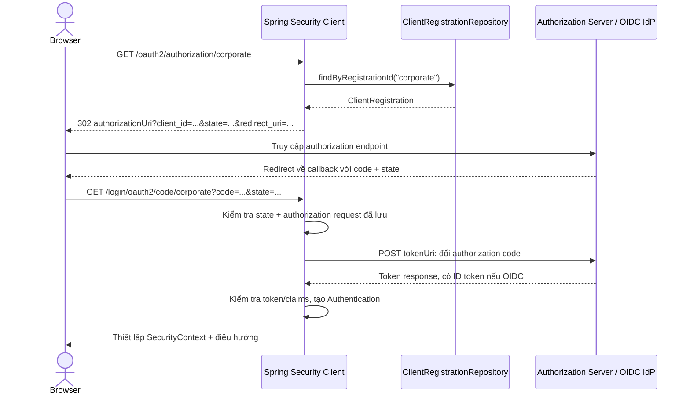
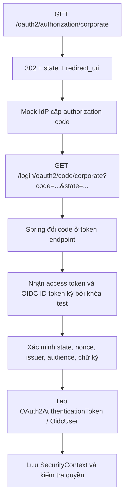

# Tùy chỉnh ClientRegistration cho ngữ cảnh đăng nhập

Trong một ứng dụng Spring Security, người dùng có thể chọn đăng nhập bằng OpenID Connect (OIDC) của công ty, nhà cung cấp OAuth2 bên ngoài hoặc hệ thống nhận dạng của một đối tác. Để điều khiển client nào được dùng, trình duyệt được chuyển đến đâu, callback nào được nhận và những scope nào được yêu cầu, Spring Security sử dụng **`ClientRegistration`**.

Bài học thuộc chương **Đăng nhập OAuth2 và OIDC** của module **SPRING_SECURITY_TESTING**. Mục tiêu của module là kiểm chứng xác thực, phân quyền và bảo vệ HTTP thực tế bằng `spring-security-test` trên ứng dụng **Servlet** và **Reactive**. Người học kết hợp `MockMvc`, `WebTestClient`, `@WithMockUser`, `SecurityContext` cùng các principal JWT/OAuth2/OIDC giả lập để xác nhận cả yêu cầu được phép và bị từ chối. Ở đây, trọng tâm là tùy chỉnh `ClientRegistration` và chứng minh cấu hình đăng nhập thực sự được áp dụng.

## 1. ClientRegistration mô tả điều gì?

Một `ClientRegistration` mô tả **ứng dụng của chúng ta đã đăng ký với một Authorization Server/Identity Provider**:

| Thuộc tính | Ý nghĩa khi đăng nhập | Ví dụ |
|---|---|---|
| `registrationId` | Khóa nội bộ để chọn cấu hình client trong Spring Security | `corporate` |
| `clientId` | ID mà IdP cấp cho ứng dụng | `portal-web` |
| `clientSecret` | Bí mật của confidential client, nếu phương thức xác thực yêu cầu | Đọc từ secret store |
| `clientAuthenticationMethod` | Cách xác thực client với token endpoint | `client_secret_basic` |
| `authorizationGrantType` | Luồng OAuth2 sử dụng | `authorization_code` |
| `redirectUri` | URI callback, có thể chứa template | `{baseUrl}/login/oauth2/code/{registrationId}` |
| `scopes` | Các quyền/claim xin cấp | `openid`, `profile`, `email` |
| `authorizationUri` | Endpoint đưa browser đến để xin authorization code | `https://login.example.test/authorize` |
| `tokenUri` | Endpoint đổi code thành token | `https://login.example.test/token` |
| `jwkSetUri` | Endpoint chứa public keys để xác minh OIDC ID token | `https://login.example.test/jwks` |
| `issuerUri` | Danh tính issuer tin cậy của IdP | `https://login.example.test` |
| `userInfoUri` | Endpoint cung cấp thông tin người dùng khi dùng đến | `https://login.example.test/userinfo` |
| `clientName` | Tên dễ đọc trong giao diện đăng nhập | `Đăng nhập công ty` |

**Đừng nhầm `registrationId` với `clientId`.** `registrationId` là khóa chọn cấu hình trong application, còn `clientId` do nhà cung cấp danh tính cấp. Tương tự, `issuerUri` định danh nhà phát hành token, không nhất thiết trùng `authorizationUri` hay hostname ứng dụng.

### ClientRegistration xuất hiện trong luồng Authorization Code



Với cấu hình mặc định của Servlet OAuth2 Login, URL bắt đầu đăng nhập là `/oauth2/authorization/{registrationId}` và callback được xử lý ở `/login/oauth2/code/{registrationId}`. Hai địa chỉ này thực hiện **hai chức năng khác nhau**. Nếu đổi callback, phải cập nhật đồng bộ URI mẫu trong `ClientRegistration`, matcher nhận callback và allowlist callback của IdP.

## 2. Phân biệt OAuth2 Login, OIDC Login và Bearer JWT

`ClientRegistration` thuộc bối cảnh ứng dụng hoạt động như **OAuth2 Client**. Trong Spring Security:

| Chức năng | Thành phần chính | Principal thường gặp |
|---|---|---|
| OAuth2 browser login | `oauth2Login()`, `ClientRegistrationRepository` | `OAuth2User` trong `OAuth2AuthenticationToken` |
| OIDC browser login | OAuth2 Login với scope `openid`, ID token, OIDC validators | `OidcUser` trong `OAuth2AuthenticationToken` |
| API Resource Server nhận JWT | `oauth2ResourceServer().jwt()`, `JwtDecoder` | `JwtAuthenticationToken` |
| OAuth2 Client gọi API thay mặt người dùng | `OAuth2AuthorizedClientRepository`/manager | Authorized client với access token |

Một ứng dụng có thể dùng đồng thời OIDC Login cho web UI và Bearer JWT cho API. Khi đó cần kiểm tra đúng filter chain của từng đường dẫn. **`ClientRegistration` không thay thế `JwtDecoder` của Resource Server**, và `@WithMockUser` không khởi tạo OAuth2 browser login.

Chỉ cấu hình `scope: openid` cũng chưa đủ để trao quyền `ROLE_ADMIN`. Claim, group, role và scope của IdP phải được ánh xạ thành authorities theo chính sách ứng dụng, thông qua user service hoặc authorities mapper phù hợp.

## 3. Cấu hình cơ bản bằng application.yml

Ứng dụng Spring Boot có dependency OAuth2 Client có thể khai báo:

```yaml
spring:
  security:
    oauth2:
      client:
        registration:
          corporate:
            provider: staff-idp
            client-id: ${OIDC_CLIENT_ID}
            client-secret: ${OIDC_CLIENT_SECRET}
            client-authentication-method: client_secret_basic
            authorization-grant-type: authorization_code
            redirect-uri: "{baseUrl}/login/oauth2/code/{registrationId}"
            scope:
              - openid
              - profile
              - email
            client-name: "Đăng nhập công ty"
        provider:
          staff-idp:
            issuer-uri: https://id.example.test/realms/staff
```

Ở đây, `corporate` là **registration ID** và `staff-idp` là **provider alias**. Việc dùng `provider: staff-idp` cho phép nhiều client registration có thể cùng sử dụng metadata của một provider nhưng khác `clientId` hoặc scopes.

Khi có `issuer-uri`, Spring Security có thể sử dụng cơ chế discovery của nhà phát hành để lấy authorization endpoint, token endpoint, JWKS endpoint và metadata liên quan. Tùy cách dựng `ClientRegistrationRepository` và phiên bản Spring, việc truy cập metadata có thể diễn ra khi khởi tạo ứng dụng hoặc trong quá trình chuẩn bị đăng nhập. Vì vậy, một test offline chỉ cần assert cấu hình cũng có thể thất bại khi IdP không truy cập được.

**Bảo mật cấu hình:** biến môi trường hoặc secret manager chứa secret thật; không ghi secret vào Git hoặc response/log. Public client có thể dùng `ClientAuthenticationMethod.NONE` và PKCE theo cấu hình phù hợp. Không áp dụng `client_secret_basic` cho mọi loại client.

### Redirect URI được tạo như thế nào?

Với registration ở trên:

```text
Registration ID : corporate
Public base URL : https://app.example.test
Redirect template:
  {baseUrl}/login/oauth2/code/{registrationId}
Resolved redirect_uri:
  https://app.example.test/login/oauth2/code/corporate
```

IdP phải chấp nhận chính xác redirect URI này theo quy tắc allowlist của provider. Sai scheme `http`/`https`, port, hostname, prefix hoặc callback path thường gây `redirect_uri_mismatch`. Không giải quyết lỗi bằng cách mở wildcard redirect URI tùy ý.

## 4. Dựng ClientRegistration bằng Java

Với test muốn độc lập mạng/discovery, hoặc khi cấu hình lấy từ nguồn đáng tin cậy khác YAML, có thể tạo `ClientRegistration` trực tiếp:

```java
import org.springframework.context.annotation.Bean;
import org.springframework.context.annotation.Configuration;
import org.springframework.security.oauth2.client.registration.ClientRegistration;
import org.springframework.security.oauth2.client.registration.ClientRegistrationRepository;
import org.springframework.security.oauth2.client.registration.InMemoryClientRegistrationRepository;
import org.springframework.security.oauth2.core.AuthorizationGrantType;
import org.springframework.security.oauth2.core.ClientAuthenticationMethod;

@Configuration
class CorporateClientConfiguration {

    static ClientRegistration corporateRegistration() {
        return ClientRegistration.withRegistrationId("corporate")
                .clientId("portal-web")
                .clientSecret("test-secret-only")
                .clientAuthenticationMethod(
                        ClientAuthenticationMethod.CLIENT_SECRET_BASIC)
                .authorizationGrantType(
                        AuthorizationGrantType.AUTHORIZATION_CODE)
                .redirectUri(
                        "{baseUrl}/login/oauth2/code/{registrationId}")
                .scope("openid", "profile", "email")
                .authorizationUri("https://id.example.test/authorize")
                .tokenUri("https://id.example.test/token")
                .jwkSetUri("https://id.example.test/jwks")
                .issuerUri("https://id.example.test")
                .userInfoUri("https://id.example.test/userinfo")
                .userNameAttributeName("sub")
                .clientName("Đăng nhập công ty")
                .build();
    }

    @Bean
    ClientRegistrationRepository clientRegistrationRepository() {
        return new InMemoryClientRegistrationRepository(
                corporateRegistration());
    }
}
```

Ví dụ Java sử dụng endpoint và secret **giả phục vụ test**. Khi tạo bean `ClientRegistrationRepository` thủ công, Spring Boot có thể không tạo repository tự động từ các registration trong YAML; không giả định hai nguồn cấu hình sẽ được trộn lại.

Khi `ClientRegistration` được dựng trực tiếp, việc có `issuerUri` và `jwkSetUri` không nhất thiết khiến discovery được thực hiện; các endpoint đã được chỉ định. Để kiểm thử chính cơ chế discovery, cần dựng một metadata server giả lập và cấu hình để Spring thực sự gọi nó.

## 5. Hai registration cho nhân viên và đối tác

Nếu ứng dụng có hai login provider, có thể chọn theo đường dẫn:

```yaml
spring:
  security:
    oauth2:
      client:
        registration:
          employees:
            provider: employee-idp
            client-id: ${EMPLOYEES_CLIENT_ID}
            client-secret: ${EMPLOYEES_CLIENT_SECRET}
            authorization-grant-type: authorization_code
            redirect-uri: "{baseUrl}/login/oauth2/code/{registrationId}"
            scope: [openid, profile, email]
            client-name: "Nhân viên"
          partners:
            provider: partner-idp
            client-id: ${PARTNERS_CLIENT_ID}
            client-secret: ${PARTNERS_CLIENT_SECRET}
            authorization-grant-type: authorization_code
            redirect-uri: "{baseUrl}/login/oauth2/code/{registrationId}"
            scope: [openid, email]
            client-name: "Đối tác"
        provider:
          employee-idp:
            issuer-uri: https://id.company.example/employee
          partner-idp:
            issuer-uri: https://id.partner.example/external
```

Trang đăng nhập có thể có hai link:

```text
Đăng nhập nhân viên -> /oauth2/authorization/employees
Đăng nhập đối tác   -> /oauth2/authorization/partners
```

Spring Security lựa chọn `ClientRegistration` theo `registrationId`; code xử lý OIDC sau callback cần biết registration nào đã được chọn để áp dụng đúng issuer/client ID. Khi làm multi-tenant, repository hoặc danh sách đăng ký động phải lấy dữ liệu từ **nguồn cấu hình tin cậy**, không tự tạo issuer, JWKS URL hoặc client secret trực tiếp từ tham số người dùng.

**Lưu ý trang login mặc định:** Nếu dùng repository tự tạo chỉ biết `findByRegistrationId` mà không thể liệt kê registrations, Spring Security có thể không thể hiển thị danh sách lựa chọn đăng nhập tự động. Khi đó cung cấp login page có những link đã được kiểm soát.

## 6. Cấu hình OAuth2 Login trong Servlet

Nếu Spring Boot đã tạo được `ClientRegistrationRepository`, cấu hình cơ bản của Spring Security có thể là:

```java
@Bean
SecurityFilterChain webSecurity(HttpSecurity http) throws Exception {
    http.authorizeHttpRequests(auth -> auth
            .requestMatchers("/", "/login", "/error").permitAll()
            .anyRequest().authenticated());

    http.oauth2Login(Customizer.withDefaults());
    return http.build();
}
```

Nếu muốn trang login và callback khác mặc định:

```java
@Bean
SecurityFilterChain customWebLogin(HttpSecurity http) throws Exception {
    http.authorizeHttpRequests(auth -> auth
            .requestMatchers("/", "/login").permitAll()
            .anyRequest().authenticated());

    http.oauth2Login(login -> login
            .loginPage("/login")
            .authorizationEndpoint(endpoint ->
                    endpoint.baseUri("/sso/start"))
            .redirectionEndpoint(endpoint ->
                    endpoint.baseUri("/sso/callback/*")));
    return http.build();
}
```

Với cấu hình này, trang `/login` do ứng dụng tự cung cấp phải có link như `/sso/start/corporate`. `ClientRegistration.redirectUri` cũng phải đổi thành `{baseUrl}/sso/callback/{registrationId}`, và IdP phải cho phép callback tương ứng.

Không chỉ thay `redirect-uri` trong YAML rồi kết luận Spring sẽ đổi endpoint xử lý callback. URI được gửi sang IdP và matcher của `redirectionEndpoint` là hai cấu hình cần nhất quán.

### Reverse proxy và địa chỉ callback public

Trong môi trường thực, browser có thể gọi `https://portal.example.com` nhưng app nhận kết nối từ proxy ở `http://localhost:8080`. Nếu `{baseUrl}` được resolve theo địa chỉ nội bộ, IdP sẽ từ chối callback hoặc redirect về host sai.

Một tùy chọn Spring Boot thường được dùng khi triển khai sau reverse proxy là:

```yaml
server:
  forward-headers-strategy: framework
```

Ứng dụng cần có ranh giới tin cậy với proxy: không chấp nhận `Forwarded`/`X-Forwarded-*` tùy ý từ client bên ngoài để xây dựng callback. Trên production, kiểm tra giá trị `redirect_uri` thực tế được gửi sang IdP sau proxy, thay vì chỉ xem template của `ClientRegistration`.

## 7. Phân biệt thuộc tính tĩnh với tham số theo lần đăng nhập

Không phải mọi tùy chỉnh ở login URL đều nên thay đổi `ClientRegistration`:

| Nhu cầu | Cấu hình thích hợp |
|---|---|
| IdP, client ID, callback URI chuẩn, scopes chuẩn | `ClientRegistration` |
| Trang hiển thị lựa chọn provider | Login page hoặc login entry point |
| Thêm `prompt=login`, `login_hint` theo lần request | `OAuth2AuthorizationRequestResolver`/request customizer |
| Bật PKCE cho authorization request | Authorization request customizer/phương thức hỗ trợ PKCE |
| Ánh xạ claim/group thành role | OIDC/OAuth2 user service hoặc `GrantedAuthoritiesMapper` |
| Điều hướng sau login thành công/thất bại | Success/failure handler |
| Lưu authorized client/access token | `OAuth2AuthorizedClientRepository` hoặc service |

Ví dụ cấu hình PKCE cho quá trình tạo authorization request (Servlet):

```java
@Bean
SecurityFilterChain pkceLogin(
        HttpSecurity http,
        ClientRegistrationRepository registrations) throws Exception {
    var resolver = new DefaultOAuth2AuthorizationRequestResolver(
            registrations, "/oauth2/authorization");
    resolver.setAuthorizationRequestCustomizer(
            OAuth2AuthorizationRequestCustomizers.withPkce());

    http.authorizeHttpRequests(auth -> auth
            .requestMatchers("/", "/login").permitAll()
            .anyRequest().authenticated());
    http.oauth2Login(login -> login
            .authorizationEndpoint(endpoint ->
                    endpoint.authorizationRequestResolver(resolver)));
    return http.build();
}
```

Đoạn trên yêu cầu các import Spring Security OAuth2 Client tương ứng và phiên bản có API `OAuth2AuthorizationRequestCustomizers.withPkce()`. Spring Security cũng có thể tự thêm PKCE trong một số cấu hình public client; kiểm tra hành vi phiên bản đang dùng để tránh suy đoán.

Khi tùy chỉnh resolver để thêm tham số OIDC như `prompt` hoặc `login_hint`, cần giữ nguyên những bảo vệ của luồng Authorization Code như `state`, PKCE và `nonce`. Không tự ghép URL rồi làm mất authorization request đã lưu trong session. `login_hint` nhận từ request phải được kiểm soát và encode trước khi đưa sang IdP.

## 8. Kiểm tra repository bằng Spring Security Test

Sau khi tạo bean Java ở mục 4, có thể kiểm tra dữ liệu `ClientRegistration` ngay trong Spring Boot test:

```java
import static org.assertj.core.api.Assertions.assertThat;

@SpringBootTest
@AutoConfigureMockMvc
class RegistrationServletTest {

    @Autowired ClientRegistrationRepository registrations;
    @Autowired MockMvc mvc;

    @Test
    void repositoryContainsCorporateLogin() {
        ClientRegistration registration =
                registrations.findByRegistrationId("corporate");

        assertThat(registration).isNotNull();
        assertThat(registration.getClientId()).isEqualTo("portal-web");
        assertThat(registration.getAuthorizationGrantType())
                .isEqualTo(AuthorizationGrantType.AUTHORIZATION_CODE);
        assertThat(registration.getScopes())
                .contains("openid", "profile", "email");
        assertThat(registration.getRedirectUri())
                .isEqualTo("{baseUrl}/login/oauth2/code/{registrationId}");
        assertThat(registration.getProviderDetails().getAuthorizationUri())
                .isEqualTo("https://id.example.test/authorize");
    }
}
```

Kiểm tra repository phát hiện sai `clientId`, `scope`, callback URI hoặc endpoint ngay cả khi chưa gửi HTTP request. Nhưng nó chưa chứng minh filter chain chọn đúng registration khi nhận URL login.

## 9. MockMvc: kiểm tra redirect khởi động login thật

Mở rộng class `RegistrationServletTest` bên trên bằng test:

```java
import static org.springframework.test.web.servlet.request
        .MockMvcRequestBuilders.get;
import static org.springframework.test.web.servlet.result
        .MockMvcResultMatchers.status;
import java.net.URLDecoder;
import java.nio.charset.StandardCharsets;

@Test
void authorizationEndpointUsesCorporateRegistration() throws Exception {
    mvc.perform(get("/oauth2/authorization/corporate"))
            .andExpect(status().is3xxRedirection())
            .andExpect(result -> {
                String location =
                        result.getResponse().getRedirectedUrl();
                assertThat(location).isNotNull();
                assertThat(location).startsWith(
                        "https://id.example.test/authorize?");
                assertThat(location).contains(
                        "response_type=code",
                        "client_id=portal-web",
                        "state=");

                String decoded = URLDecoder.decode(
                        location, StandardCharsets.UTF_8);
                assertThat(decoded).contains(
                        "redirect_uri=http://localhost/login/oauth2/code/corporate");
            });
}
```

Ca test này cần context có `SecurityFilterChain` bật `oauth2Login()` và có `ClientRegistrationRepository` chứa `corporate`. MockMvc mặc định thường dùng `http://localhost` làm request base URL; nếu thay `serverName`, port, scheme hoặc forwarded headers, giá trị `redirect_uri` phải được assert theo request thực tế.

Nên bổ sung assertion có `scope=openid...` và `state` không rỗng bằng parser query, thay vì chỉ kiểm tra substring, khi cần test chuyên sâu về OIDC.

### Trường hợp registrationId không tồn tại

```java
@Test
void unknownRegistrationMustNotRedirectToCorporateIdp() throws Exception {
    mvc.perform(get("/oauth2/authorization/unknown"))
            .andExpect(result -> {
                String location =
                        result.getResponse().getRedirectedUrl();
                assertThat(location).doesNotStartWith(
                        "https://id.example.test/authorize?");
            });
}
```

Status với `registrationId` lạ có thể phụ thuộc filter, fallback mapping và error handling của ứng dụng. Chỉ assert mã cụ thể sau khi đã định nghĩa API contract; điều quan trọng là **không được âm thầm dùng một registration khác**.

Tương tự, nếu có `employees` và `partners`, viết ít nhất một test cho mỗi ID và assert hostname/đường dẫn authorization endpoint cùng `client_id`, `redirect_uri` tương ứng. Không chỉ test client đầu tiên.

## 10. @WithMockUser, oauth2Login() và oidcLogin() kiểm tra tầng nào?

Một controller cần thông tin OIDC user có thể nhận `OAuth2AuthenticationToken` chứa `OidcUser`. Với `spring-security-test`:

```java
import static org.springframework.security.test.web.servlet.request
        .SecurityMockMvcRequestPostProcessors.oauth2Login;
import static org.springframework.security.test.web.servlet.request
        .SecurityMockMvcRequestPostProcessors.oidcLogin;

@Test
void loggedInOAuth2UserCanSeeProfile() throws Exception {
    mvc.perform(get("/me").with(oauth2Login()))
            .andExpect(status().isOk());
}

@Test
void loggedInOidcUserCanSeeProfile() throws Exception {
    mvc.perform(get("/me")
            .with(oidcLogin().idToken(token -> token
                    .subject("alice-123")
                    .claim("email", "alice@example.test"))))
            .andExpect(status().isOk());
}
```

Các ca trên giả định endpoint `/me` tồn tại và cho phép người dùng đã xác thực. `oauth2Login()`/`oidcLogin()` tạo authentication giả cho request. Chúng **không** chuyển browser đến IdP, đổi authorization code, tải JWKS hoặc kiểm tra chữ ký ID token thực.

Khi logic ứng dụng phụ thuộc registration ID, có thể gắn registration vào OIDC principal giả:

```java
ClientRegistration corporate =
        registrations.findByRegistrationId("corporate");

mvc.perform(get("/me")
        .with(oidcLogin().clientRegistration(corporate)))
        .andExpect(status().isOk());
```

Controller có thể đọc `OAuth2AuthenticationToken.getAuthorizedClientRegistrationId()` để phân biệt loại đăng nhập. Với test trên, registration ID được đặt bởi test fixture; nó **không** chứng minh repository đã được tra cứu khi browser khởi động login.

`@WithMockUser` lại tạo principal kiểu user cơ bản, phù hợp kiểm tra role/authority:

```java
@Test
@WithMockUser(username = "alice", roles = "USER")
void authenticatedUserCanAccessHome() throws Exception {
    mvc.perform(get("/home")).andExpect(status().isOk());
}
```

`@WithMockUser` có thể đủ nếu endpoint chỉ xét `isAuthenticated()` hoặc `ROLE_USER`. Nó không phải test OIDC nếu controller/service cần `OidcUser`, ID token claims hoặc OAuth2 authorized client.

| Cách dựng request | Kiểm chứng tốt nhất | Không kiểm chứng |
|---|---|---|
| `@WithMockUser` | Authentication, roles, authorities | Redirect/callback/IdP |
| `oauth2Login()` | Quyền và controller đọc `OAuth2User` giả | Code exchange, UserInfo thật |
| `oidcLogin()` | Quyền và controller đọc `OidcUser` giả | Chữ ký ID token, `nonce`, issuer |
| `GET /oauth2/authorization/{id}` | Có client và authorization redirect thực | Token exchange/callback |
| Callback với mock IdP | Kết nối token endpoint, state/nonce/ID token validation | Môi trường production |

## 11. Khi nào cần test callback thật?

Nếu thay đổi `redirect-uri`, `token-uri`, `client-authentication-method`, `jwk-set-uri` hoặc issuer, test `oidcLogin()` chưa đủ. Một integration test có mock Identity Provider cần đi xuyên qua:



Tối thiểu nên có một ca **callback thành công** và các ca:

1. `state` không khớp hoặc thiếu: callback bị từ chối, không tạo phiên xác thực.
2. IdP từ chối `redirect_uri`: phát hiện callback sai cấu hình.
3. Token endpoint từ chối client secret hoặc client authentication: không được coi là đăng nhập thành công.
4. ID token sai chữ ký, issuer, audience hoặc nonce: không có authenticated session.
5. Authorization request của client A nhưng callback dùng registration của client B: không được trao đổi/nhận token nhầm IdP.

Không đóng đinh một HTTP status chung cho mọi trường hợp vì Spring Security version, exception handler và login failure handler có thể điều hướng đến trang lỗi. Kỳ vọng bền vững là **không có principal đã đăng nhập và không truy cập được tài nguyên bảo vệ**.

Với OIDC, claim `aud` của **ID token** phải phù hợp client ID mà ID token được cấp; đừng nhầm nó với `aud` của access token cấp cho API khác.

## 12. ClientRegistration trên WebFlux

Trong ứng dụng Reactive, repository dùng giao diện **`ReactiveClientRegistrationRepository`**; một triển khai thông dụng là `InMemoryReactiveClientRegistrationRepository`:

```java
@Configuration
@EnableWebFluxSecurity
class ReactiveLoginConfiguration {

    @Bean
    ReactiveClientRegistrationRepository reactiveRegistrations() {
        return new InMemoryReactiveClientRegistrationRepository(
                CorporateClientConfiguration.corporateRegistration());
    }

    @Bean
    SecurityWebFilterChain reactiveWebSecurity(
            ServerHttpSecurity http) {
        return http.authorizeExchange(exchange -> exchange
                .pathMatchers("/", "/login").permitAll()
                .anyExchange().authenticated())
            .oauth2Login(Customizer.withDefaults())
            .build();
    }
}
```

Đây là cấu hình cho **ứng dụng WebFlux riêng**; không áp dụng đồng thời `HttpSecurity` (Servlet) và `ServerHttpSecurity` (Reactive) vào cùng một loại application context. Khi dùng Spring Boot Reactive, các property client tương ứng có thể được bind vào repository phản ứng.

Kiểm tra authorization redirect bằng `WebTestClient` với security chain thật:

```java
@Test
void reactiveOAuth2AuthorizationUsesCorporateClient() {
    webTestClient.get()
            .uri("/oauth2/authorization/corporate")
            .exchange()
            .expectStatus().is3xxRedirection()
            .expectHeader().valueMatches(
                "Location",
                "^https://id\\.example\\.test/authorize\\?.+");
}
```

Kiểm tra controller với OIDC principal giả:

```java
import static org.springframework.security.test.web.reactive.server
        .SecurityMockServerConfigurers.mockOidcLogin;

@Test
void reactiveOidcUserCanAccessAccount() {
    webTestClient.mutateWith(mockOidcLogin()
                    .idToken(token -> token
                            .subject("alice-123")
                            .claim("email", "alice@example.test")))
            .get().uri("/account")
            .exchange()
            .expectStatus().isOk();
}
```

Ví dụ giả định endpoint `/account` tồn tại. Nếu tự xây `WebTestClient` từ application context, hãy áp dụng configurer Spring Security phù hợp; một client không chạy filter bảo mật có thể trả 200 ngay cả khi cấu hình login bị thiếu.

`mockOidcLogin()` có cùng giới hạn khái niệm với `oidcLogin()`: kiểm thử principal và authorization, không kiểm tra authorization redirect/callback hay token signature.

## 13. Phân loại lỗi cấu hình để chẩn đoán đúng

| Triệu chứng | Giả thuyết cần kiểm tra | Bài test/quan sát |
|---|---|---|
| Link "Nhân viên" chuyển đến IdP đối tác | Link dùng sai `registrationId` hoặc repository mapping | Assert host/path trong `Location` theo từng ID |
| `redirect_uri_mismatch` từ IdP | `redirectUri` template, public base URL, path, port hoặc allowlist sai | Decode `redirect_uri` trong Location và so với IdP |
| Callback đến ứng dụng nhưng không được xử lý | `redirectionEndpoint.baseUri` khác path trong ClientRegistration | Test request callback tại path thực tế |
| Context không khởi tạo được khi mất mạng | Metadata discovery theo `issuer-uri` | Kiểm tra request đến metadata endpoint và dùng mock IdP |
| Authorization redirect thành công nhưng callback lỗi | Token endpoint, client authentication, state/nonce hoặc ID token validation | Integration test qua callback thật |
| Test `oidcLogin()` pass nhưng production login thất bại | Test chỉ chèn Authentication giả | Test redirect và callback với mock IdP |
| Sau login có 403 | Claims/authorities mapping hoặc HTTP/method security | Assert authorities, scopes, route matcher |
| OIDC user thiếu `email` | Scope, consent, IdP policy hoặc UserInfo response | Assert fixture claim thực tế, không giả định luôn có email |
| State mất sau khi browser quay về | Session cookie, SameSite/domain, proxy hoặc authorization request repository | Test xuyên redirect/callback trong cùng phiên |

Không tự suy ra nguyên nhân từ một mã HTTP `302` hay `403`. Ví dụ, `302` sang IdP chứng minh đường khởi động login hoạt động; `302` sang trang lỗi sau callback lại có thể là authentication failure. Cần kiểm tra `Location` và trạng thái SecurityContext.

## 14. Lưu ý bảo mật và khả năng vận hành

- **Chỉ tin IdP đã được phê duyệt.** `registrationId` có thể được chọn qua URL, nhưng repository phải ánh xạ nó đến các issuer/endpoint được quản lý. Tránh tạo issuer/JWK URL tùy ý từ dữ liệu người dùng khi chưa xác thực.
- **Không lưu secret trong Git/log.** Test dùng secret giả; production lấy secret từ hệ thống quản lý bí mật với quy trình rotation.
- **Giữ nguyên `state`/`nonce`/PKCE khi cần.** Đó là các cơ chế ràng buộc phản hồi vào authorization request ban đầu. Không disable để khiến test callback “xanh”.
- **Chú ý session, cookie và reverse proxy.** OAuth2 browser login thường cần giữ authorization request giữa hai lần browser chuyển hướng; kiểm soát cookie domain, SameSite, TLS và forwarded headers.
- **Không coi scope là role nội bộ.** Nếu chính sách yêu cầu `ROLE_FINANCE`, cần test riêng mapping từ OIDC claims hoặc group thành authority đó và cả tình huống thiếu quyền.
- **Không log authorization code/ID token/access token thật.** Khi debug, dùng correlation ID, registrationId và endpoint/status đã được lọc để truy vết.

## 15. Checklist áp dụng và bài thực hành

Trước khi chốt thay đổi đăng nhập, hãy xác minh registration ID trong link, `clientId` và phương thức xác thực client, provider endpoint, scopes, public callback URI, lưu state/nonce, token validation, authorities và behavior của cả login thành công lẫn thất bại.

**Bài thực hành:** Ứng dụng có hai registration: `employees` dùng issuer công ty, `partners` dùng issuer đối tác. Mỗi IdP có client ID riêng và callback `{baseUrl}/login/oauth2/code/{registrationId}`.

1. Viết YAML hoặc Java tạo hai `ClientRegistration` với mọi endpoint/scope cần thiết. Secret chỉ là giá trị test.
2. Dùng MockMvc assert `GET /oauth2/authorization/employees` và `/oauth2/authorization/partners` chuyển đến hai hostname khác nhau, có đúng `client_id` và `redirect_uri`.
3. Tạo test cho `registrationId` không tồn tại, chứng minh ứng dụng không chuyển sang IdP bất kỳ.
4. Dùng `oidcLogin()` với claims khác nhau để kiểm quyền `GET /dashboard`; viết thêm một ca bị từ chối.
5. Mô phỏng reverse proxy HTTPS và xác nhận redirect URI dùng public origin hợp lệ.
6. Nếu ứng dụng WebFlux, chuyển test redirect sang `WebTestClient` và test principal sang `mockOidcLogin()`.
7. Mô tả/test callback với mock IdP, gồm ca state không khớp và ID token sai issuer.

**Tiêu chí hoàn thành:** Có bằng chứng riêng cho ba tầng: **chọn đúng ClientRegistration**, **khởi động/hoàn tất OAuth2/OIDC Login an toàn**, và **phân quyền đúng sau khi có Authentication**. Không kết luận “OIDC Login đã hoạt động” chỉ từ `@WithMockUser` hoặc `oidcLogin()` trả về 200.
