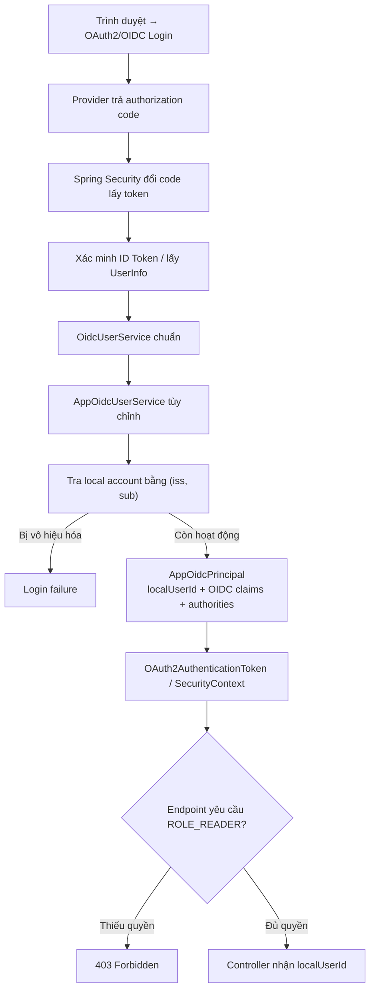

# Principal tùy chỉnh trong ứng dụng OAuth2 và OIDC

> **Chương:** Đăng nhập OAuth2 và OIDC  
> **Module:** `SPRING_SECURITY_TESTING`  
> **Mục tiêu:** Thiết kế và kiểm chứng principal chứa danh tính nội bộ sau OAuth2/OIDC login, đồng thời giữ các thông tin chuẩn của nhà cung cấp danh tính. Bài học dùng `spring-security-test`, `MockMvc`, `WebTestClient` và các phép thử được phép/bị từ chối; phân biệt kiểm thử bằng `SecurityContext` giả lập với kiểm thử ánh xạ người dùng thực.

Một ứng dụng nhận đăng nhập qua Google, Microsoft Entra ID hoặc một OpenID Provider có thể biết người dùng qua `sub`, tên, email và các claim khác. Nhưng nghiệp vụ của ứng dụng cần thêm `localUserId`, trạng thái tài khoản, vai trò nội bộ, tổ chức/tenant hoặc quyền theo dữ liệu của chính ứng dụng. Đó là lúc cần **principal tùy chỉnh**: một đối tượng mô tả người dùng đã xác thực, đủ để controller và cơ chế phân quyền sử dụng, nhưng không làm mất ngữ nghĩa của OAuth2/OIDC.

Sai lầm phổ biến là viết bài test `@WithMockUser(username = "alice", roles = "ADMIN")`, thấy endpoint trả `200` rồi kết luận việc tạo principal sau OIDC login đã đúng. Bài test ấy cung cấp sẵn một principal kiểu Spring Security `User`; nó không chạy `OidcUserService`, không nối người dùng với bảng tài khoản nội bộ và không kiểm tra danh tính của nhà cung cấp. Muốn kiểm chứng đầy đủ cần tách mục tiêu rõ ràng.

## 1. Principal nào xuất hiện sau đăng nhập?

Các luồng dưới đây có kiểu principal và điểm tích hợp khác nhau:

| Cơ chế xác thực | `Authentication` phổ biến | Principal / dữ liệu quan trọng | Điểm tạo/chỉnh sửa |
| --- | --- | --- | --- |
| Username/password | `UsernamePasswordAuthenticationToken` | `UserDetails` | `UserDetailsService`, `AuthenticationProvider` |
| OAuth2 Login (không OIDC) | `OAuth2AuthenticationToken` | `OAuth2User`, attributes từ UserInfo endpoint | `OAuth2UserService<OAuth2UserRequest, OAuth2User>` |
| OIDC Login | `OAuth2AuthenticationToken` | `OidcUser` với ID Token và có thể có UserInfo | `OAuth2UserService<OidcUserRequest, OidcUser>` |
| Resource Server nhận Bearer JWT | `JwtAuthenticationToken` | `Jwt`, claims và authorities | `JwtDecoder`, `JwtAuthenticationConverter` |
| Test với `@WithMockUser` | Thường là `UsernamePasswordAuthenticationToken` | `User` của Spring Security Test | Test listener tạo `SecurityContext` |

**OIDC là lớp nhận dạng (identity) trên OAuth2.** Với OIDC login, `OidcUser` có phương thức như `getIdToken()`, `getUserInfo()`, `getClaims()` và `getAuthorities()`. Một `OAuth2User` thông thường không bảo đảm có ID Token hoặc claim `sub` theo quy tắc OIDC.

Trong các ứng dụng chỉ xác thực Bearer JWT, callback `oauth2Login().userInfoEndpoint(...)` không được chạy. Nếu muốn custom principal/authority cho Resource Server, cần thiết kế ở `JwtAuthenticationConverter` hoặc cơ chế tương ứng, không trộn hai luồng.

### 1.1. Ví dụ yêu cầu nghiệp vụ

Ứng dụng quản lý đơn hàng có endpoint `GET /api/me` và `GET /api/orders`:

- IdP xác thực người dùng và trả `iss = https://idp.example.test/tenant-a`, `sub = oidc-42`.
- Kho tài khoản nội bộ ánh xạ cặp `(iss, sub)` thành `localUserId = member-17`.
- Tài khoản nội bộ có vai trò `READER` và còn hoạt động.
- Controller `/api/me` trả `localUserId`; `/api/orders` yêu cầu `ROLE_READER`.
- Nếu tài khoản bị khóa hoặc không có vai trò, hệ thống phải từ chối đúng ở tầng tương ứng.

Không dùng email làm khóa định danh chính: email có thể đổi, chưa được xác minh, bị tái sử dụng hoặc trùng giữa các nhà cung cấp. Với OIDC, **cặp issuer + subject** là nền tảng an toàn hơn để liên kết danh tính. Với OAuth2 không OIDC, dùng định danh người dùng ổn định do provider quy định kèm định danh provider/registration; phải hiểu đặc tả từng provider.

### 1.2. Luồng dữ liệu



Lưu ý rằng với ứng dụng web sử dụng `oauth2Login()`, request chưa đăng nhập thường **được chuyển hướng tới trang đăng nhập (302)**, thay vì mặc định trả `401` như Resource Server Bearer. Kết quả thực tế phụ thuộc entry point và cách cấu hình từng endpoint.

## 2. Những quy tắc khi xây dựng principal nội bộ

Một principal tốt có các thuộc tính sau:

1. **Giữ nguyên dữ liệu nhận dạng đã xác thực.** OIDC principal phải bảo toàn ID Token, UserInfo và khả năng truy xuất claims. Nếu thay `OidcUser` bằng POJO không tương thích, các phần khác của Spring Security hoặc code đang dùng OIDC API có thể hỏng.
2. **Thêm danh tính nội bộ tách biệt.** `localUserId` là khóa nghiệp vụ của ứng dụng; `sub` là định danh trong phạm vi issuer. Chúng không nhất thiết giống nhau.
3. **Chỉ tạo authority đáng tin cậy.** Quyền `ROLE_READER`, `ROLE_ADMIN` nên xuất phát từ chính sách nội bộ hoặc nguồn đã được xác minh và ánh xạ rõ. Không tin một claim tự đặt là `role=ADMIN` chỉ vì xuất hiện trong JSON.
4. **Không dùng email/display name để xác thực liên kết tài khoản.** Đọc tên/email để hiển thị; liên kết account bằng khóa nhà cung cấp đáng tin cậy.
5. **Giữ principal đủ gọn cho session.** Tránh nhét entity JPA, kết nối HTTP, secret hoặc các object nặng. Không serialize/log raw ID Token, access token hoặc principal nguyên khối ra API.
6. **Xem xét cập nhật quyền.** Quyền được chụp tại thời điểm đăng nhập có thể cũ khi admin đổi vai trò. Nếu yêu cầu thu hồi ngay, cần cơ chế làm mới session/authorities hoặc kiểm tra quyền tại thời điểm request.

Đặc biệt, `getName()` của `DefaultOidcUser` thường được chọn từ `sub`. Có thể lưu `localUserId` riêng và để `getName()` giữ ý nghĩa OIDC. Đừng đổi ngữ nghĩa `getName()` ở một nơi rồi ngầm giả định cả ứng dụng đều dùng cùng một khóa.

## 3. Xây dựng principal OIDC tùy chỉnh

### 3.1. Mô hình tài khoản nội bộ

Giả sử bảng liên kết danh tính có khóa duy nhất `(issuer, subject)`, trỏ đến tài khoản nội bộ:

```java
public record LocalAccount(
        String id,
        Set<String> roles,
        boolean enabled) {}

public interface LocalAccountService {
    LocalAccount resolveOidc(String issuer, String subject);
    LocalAccount resolveOAuth2(String provider, String providerUserId);
}
```

Hợp đồng `resolveOidc` có thể tra cứu hoặc đăng ký lần đầu theo chính sách riêng. Nếu ứng dụng tự tạo tài khoản, phải làm rõ thời điểm được phép tạo, tenant, email verification và chống liên kết nhầm. Trạng thái `enabled=false` nghĩa là hệ thống từ chối đăng nhập dù IdP đã xác thực thành công.

### 3.2. Mở rộng `DefaultOidcUser` để giữ OIDC API

`DefaultOidcUser` đã triển khai `OidcUser`. Trong trường hợp chỉ bổ sung local ID, kế thừa là một cách gọn:

```java
public final class AppOidcPrincipal extends DefaultOidcUser {
    private final String localUserId;

    public AppOidcPrincipal(
            Collection<? extends GrantedAuthority> authorities,
            OidcIdToken idToken,
            OidcUserInfo userInfo,
            String localUserId) {
        super(authorities, idToken, userInfo, "sub");
        this.localUserId = Objects.requireNonNull(localUserId);
    }

    public String getLocalUserId() {
        return localUserId;
    }
}
```

`super(..., "sub")` nói rằng tên principal được lấy từ claim `sub`. `userInfo` có thể không được nhà cung cấp trả về nếu không gọi UserInfo endpoint; code dùng principal phải chấp nhận trường hợp này. Dùng `getLocalUserId()` khi cần tài khoản trong cơ sở dữ liệu.

Các kiểu nằm trong `org.springframework.security.oauth2.core.oidc` và `org.springframework.security.oauth2.core.oidc.user`, cùng `GrantedAuthority` của Spring Security Core. Nếu ứng dụng cần nhiều thuộc tính nội bộ, cân nhắc một cấu trúc bất biến hoặc lớp composition triển khai đầy đủ `OidcUser` thay vì tạo vô số subclass. Dù chọn cách nào, những accessor OIDC chuẩn phải giữ được hành vi.

Không trả trực tiếp `AppOidcPrincipal` thành JSON từ controller: đối tượng kế thừa còn chứa `idToken` và nhiều claims. Nên chuyển sang DTO chỉ gồm các trường ứng dụng cho phép công khai.

### 3.3. Ánh xạ kết quả xác thực với tài khoản nội bộ

Thay vì tự làm lại việc nhận token và giải mã claims, **ủy quyền bước lấy người dùng OIDC cho `OidcUserService` chuẩn**, sau đó kết hợp dữ liệu nội bộ:

```java
public final class AppOidcUserService
        implements OAuth2UserService<OidcUserRequest, OidcUser> {

    private final OAuth2UserService<OidcUserRequest, OidcUser> delegate;
    private final LocalAccountService accounts;

    public AppOidcUserService(
            OAuth2UserService<OidcUserRequest, OidcUser> delegate,
            LocalAccountService accounts) {
        this.delegate = delegate;
        this.accounts = accounts;
    }

    @Override
    public OidcUser loadUser(OidcUserRequest request)
            throws OAuth2AuthenticationException {

        OidcUser providerUser = delegate.loadUser(request);
        String issuer = providerUser.getIdToken().getClaimAsString("iss");
        String subject = providerUser.getSubject();

        LocalAccount local = accounts.resolveOidc(issuer, subject);
        if (local == null || !local.enabled()) {
            throw new OAuth2AuthenticationException(
                new OAuth2Error("local_account_disabled"));
        }

        Set<GrantedAuthority> authorities = new LinkedHashSet<>();
        authorities.addAll(providerUser.getAuthorities());

        for (String role : local.roles()) {
            // roles nội bộ lưu dạng READER, ADMIN, không có ROLE_
            authorities.add(
                new SimpleGrantedAuthority("ROLE_" + role));
        }

        return new AppOidcPrincipal(
            authorities,
            providerUser.getIdToken(),
            providerUser.getUserInfo(),
            local.id());
    }
}
```

Mã trên có chủ đích giữ authorities được Spring Security cung cấp (ví dụ `OIDC_USER` và scope authorities), sau đó thêm vai trò nội bộ. Trong hệ thống thực tế, cần giới hạn giá trị `role` theo danh mục cho phép, kiểm soát dữ liệu từ bảng vai trò và tránh ghép prefix trùng `ROLE_ROLE_ADMIN`. Nếu chính sách yêu cầu chỉ dùng authority nội bộ, hãy chọn lọc thay vì luôn hợp nhất mọi authority từ IdP.

Không truy cập claims **trước** khi `delegate.loadUser(request)` hoàn thành. Bước chuẩn còn thực hiện những kiểm tra và tương tác UserInfo cần thiết. Việc tự viết lại OIDC user loading dễ bỏ sót tương thích claim và kiểm tra UserInfo.

### 3.4. Đăng ký trong `SecurityFilterChain`

```java
@Configuration
@EnableMethodSecurity
class SecurityConfig {
    @Bean
    OAuth2UserService<OidcUserRequest, OidcUser> appOidcUserService(
            LocalAccountService accounts) {
        return new AppOidcUserService(
            new OidcUserService(), accounts);
    }

    @Bean
    SecurityFilterChain security(
            HttpSecurity http,
            OAuth2UserService<OidcUserRequest, OidcUser> appOidcUserService)
            throws Exception {
        return http
            .authorizeHttpRequests(auth -> auth
                .requestMatchers("/public/**").permitAll()
                .requestMatchers("/api/orders").hasRole("READER")
                .anyRequest().authenticated())
            .oauth2Login(oauth2 -> oauth2.userInfoEndpoint(
                info -> info.oidcUserService(appOidcUserService)))
            .build();
    }
}
```

Ví dụ dùng `oauth2Login()` cho ứng dụng web Servlet với một OIDC `ClientRegistration` đã được cấu hình (client ID, client secret nếu cần, redirect URI, authorization/token/JWK/UserInfo endpoints). Không sao chép client secret thật vào fixture test. Với API stateful dùng session, hãy để chính sách CSRF mặc định hoặc cấu hình có chủ đích; không cần tắt CSRF để thử `GET`.

Lệnh `userInfoEndpoint().oidcUserService(...)` chỉ tác động tới OIDC. Đối với OAuth2 login không có OIDC, dùng `userService(...)` riêng; đừng mong `AppOidcUserService` được gọi cho tài khoản social login không dùng OpenID Connect.

## 4. Lấy custom principal trong controller và method security

Sau đăng nhập thành công, Spring Security đặt `OAuth2AuthenticationToken` trong `SecurityContext`; `getPrincipal()` là `AppOidcPrincipal` do service trả về.

```java
public record MeResponse(String localUserId, String providerSubject) {}

@RestController
class MeController {

    @GetMapping("/api/me")
    MeResponse me(@AuthenticationPrincipal AppOidcPrincipal principal) {
        return new MeResponse(
            principal.getLocalUserId(),
            principal.getName());
    }

    @GetMapping("/api/orders")
    @PreAuthorize("hasRole('READER')")
    List<String> orders() {
        return List.of("order-001");
    }
}
```

Ở đây, `@AuthenticationPrincipal` lấy principal đã xác thực, thay vì tự đọc session hoặc tự gọi IdP. DTO chỉ chứa local ID và subject trong bối cảnh minh họa; trong sản phẩm thật cần cân nhắc có công khai subject hay không.

`hasRole("READER")` sẽ kiểm tra `ROLE_READER`. Nếu dùng `@EnableMethodSecurity`, `@PreAuthorize` có hiệu lực bên cạnh quy tắc tại HTTP filter chain. Nếu không bật method security, annotation ấy không tự kích hoạt.

Trường hợp một request được xác thực qua đường khác (ví dụ JWT Resource Server), principal có thể là `Jwt` thay vì `AppOidcPrincipal`. Endpoint hỗ trợ nhiều kiểu xác thực cần một abstraction thích hợp hoặc chuyển đổi riêng; không ép kiểu principal mà không kiểm soát cơ chế xác thực.

## 5. Kiểm thử ánh xạ principal bằng unit test

Đây là phép thử **thực sự chạy `AppOidcUserService.loadUser`**: mock phụ thuộc IdP ở ranh giới `delegate`, mock kho tài khoản nội bộ, còn logic ánh xạ principal chạy thật.

Tạo một ID Token chỉ dành cho unit test:

```java
static OidcIdToken fakeIdToken() {
    Instant now = Instant.now();
    return new OidcIdToken(
        "id-token-for-unit-test",
        now,
        now.plusSeconds(600),
        Map.of(
            "iss", "https://idp.example.test/tenant-a",
            "sub", "oidc-42",
            "aud", List.of("test-client"),
            "iat", now.getEpochSecond(),
            "exp", now.plusSeconds(600).getEpochSecond()));
}
```

Trong test unit, giá trị `id-token-for-unit-test` chỉ là fixture; nó **không có chữ ký hợp lệ**. Ta đang kiểm tra logic ánh xạ sau khi `delegate` trả người dùng, không tuyên bố đã kiểm tra JWT hoặc OIDC callback.

```java
@Test
void mapsIssuerAndSubjectToLocalAccount() {
    OidcIdToken idToken = fakeIdToken();
    OidcUser fromProvider = new DefaultOidcUser(
        Set.of(new OidcUserAuthority(idToken)), idToken, "sub");

    OAuth2UserService<OidcUserRequest, OidcUser> delegate =
        request -> fromProvider;
    LocalAccountService accounts = mock(LocalAccountService.class);

    when(accounts.resolveOidc(
            "https://idp.example.test/tenant-a", "oidc-42"))
        .thenReturn(new LocalAccount(
            "member-17", Set.of("READER"), true));

    AppOidcUserService service =
        new AppOidcUserService(delegate, accounts);
    OidcUserRequest request = mock(OidcUserRequest.class);

    OidcUser result = service.loadUser(request);

    assertInstanceOf(AppOidcPrincipal.class, result);
    AppOidcPrincipal principal = (AppOidcPrincipal) result;
    assertEquals("member-17", principal.getLocalUserId());
    assertEquals("oidc-42", principal.getName());
    assertEquals(idToken, principal.getIdToken());
    assertTrue(principal.getAuthorities().stream()
        .anyMatch(a -> a.getAuthority().equals("ROLE_READER")));
    verify(accounts).resolveOidc(
        "https://idp.example.test/tenant-a", "oidc-42");
}
```

Các import quan trọng: `OidcIdToken`, `OidcUser`, `DefaultOidcUser`, `OidcUserAuthority`, `OAuth2UserService`, `OidcUserRequest`, `LocalAccountService`, Mockito `mock/when/verify` và JUnit `assertInstanceOf/assertEquals/assertTrue`. Với code production, `fakeIdToken()` chỉ nên tồn tại trong test.

Kiểm thử đường bị từ chối tại chính lớp mapper:

```java
@Test
void rejectsDisabledLocalAccount() {
    OidcIdToken token = fakeIdToken();
    OidcUser fromProvider = new DefaultOidcUser(
        Set.of(new OidcUserAuthority(token)),
        token, "sub");
    LocalAccountService accounts = mock(LocalAccountService.class);

    when(accounts.resolveOidc(
            "https://idp.example.test/tenant-a", "oidc-42"))
        .thenReturn(new LocalAccount("member-17", Set.of(), false));

    var service = new AppOidcUserService(
        request -> fromProvider, accounts);

    assertThrows(OAuth2AuthenticationException.class,
        () -> service.loadUser(mock(OidcUserRequest.class)));
}
```

Trong bộ test production, có thể thêm assertion về error code `local_account_disabled`, kiểm tra `resolveOidc` chỉ gọi một lần và xác nhận không tạo principal khi tài khoản bị khóa.

Những ca unit test bổ sung nên có: không tìm thấy local account, vai trò rỗng, hai issuer có cùng `sub`, thay đổi email không thay đổi mapping, cấp sai vai trò bị từ chối, và delegation giữ nguyên ID Token/UserInfo. Nếu policy cho phép tự đăng ký, kiểm tra giao dịch tạo tài khoản và ràng buộc unique `(issuer, subject)` để không tạo trùng khi callback đồng thời.

## 6. MockMvc: kiểm thử endpoint nhận custom principal

Trong bài test web, ta muốn xác nhận `@AuthenticationPrincipal AppOidcPrincipal` hoạt động và filter chain áp dụng quyền nội bộ. Không cần dựng giả OIDC authorization code callback cho mục tiêu này; dùng `oidcLogin().oidcUser(...)` của `spring-security-test`.

Helper tạo principal dành riêng cho test:

```java
static AppOidcPrincipal testPrincipal(boolean reader) {
    OidcIdToken token = fakeIdToken();
    Set<GrantedAuthority> authorities = new LinkedHashSet<>();
    authorities.add(new OidcUserAuthority(token));
    if (reader) {
        authorities.add(new SimpleGrantedAuthority("ROLE_READER"));
    }
    return new AppOidcPrincipal(
        authorities, token, null, "member-17");
}
```

Với ứng dụng có `SecurityFilterChain` và một OIDC client registration test hợp lệ:

```java
@SpringBootTest
@AutoConfigureMockMvc(addFilters = true)
class CustomOidcPrincipalMvcIT {
    @Autowired MockMvc mvc;

    @Test
    void meEndpointReadsLocalUserId() throws Exception {
        mvc.perform(get("/api/me")
                .with(oidcLogin().oidcUser(testPrincipal(true))))
            .andExpect(status().isOk())
            .andExpect(jsonPath("$.localUserId")
                .value("member-17"))
            .andExpect(jsonPath("$.providerSubject")
                .value("oidc-42"));
    }

    @Test
    void readerCanOpenOrders() throws Exception {
        mvc.perform(get("/api/orders")
                .with(oidcLogin().oidcUser(testPrincipal(true))))
            .andExpect(status().isOk());
    }

    @Test
    void missingReaderRoleIsForbidden() throws Exception {
        mvc.perform(get("/api/orders")
                .with(oidcLogin().oidcUser(testPrincipal(false))))
            .andExpect(status().isForbidden());
    }
}
```

Các static import thường dùng:

```java
import static org.springframework.security.test.web.servlet.request.SecurityMockMvcRequestPostProcessors.oidcLogin;
import static org.springframework.test.web.servlet.request.MockMvcRequestBuilders.get;
import static org.springframework.test.web.servlet.result.MockMvcResultMatchers.*;
```

Các bài test này có ý nghĩa:

- `oidcLogin().oidcUser(principal)` đưa vào test một OIDC principal xác thực sẵn. Điều này giúp kiểm tra **kiểu principal, nội dung local ID, 200/403 và authorization**.
- `@AutoConfigureMockMvc(addFilters = true)` giữ các Servlet filter của ứng dụng. Request vẫn bị kiểm tra quyền và các bảo vệ HTTP phù hợp.
- Các test trên **không gọi `AppOidcUserService.loadUser()`**, không đi qua redirect sang IdP, không đổi authorization code lấy token và không xác minh ID Token thật.

Nếu dùng `@WithMockUser` cho `GET /api/me`, principal mặc định là `User` chứ không phải `AppOidcPrincipal`. Với `@AuthenticationPrincipal AppOidcPrincipal`, Spring có thể trả `null` khi kiểu không phù hợp (hoặc gây lỗi nếu bật kiểm tra kiểu nghiêm ngặt). Vì vậy, test custom principal phải cung cấp **đúng kiểu**.

### 6.1. `@WithSecurityContext` khi cần tái sử dụng fixture

Nhiều bài kiểm thử muốn có annotation riêng, chẳng hạn `@WithAppOidcUser(localUserId = "member-17")`. Có thể xây dựng `@WithSecurityContext(factory = ...)` để tạo `OAuth2AuthenticationToken` chứa `AppOidcPrincipal` trong `SecurityContext`.

Ví dụ ý tưởng của factory:

```java
SecurityContext context = SecurityContextHolder.createEmptyContext();
AppOidcPrincipal principal = testPrincipal(true);

OAuth2AuthenticationToken authentication =
    new OAuth2AuthenticationToken(
        principal,
        principal.getAuthorities(),
        "test-oidc");

context.setAuthentication(authentication);
return context;
```

Đoạn trên là phần thân trọng tâm của `WithSecurityContextFactory.createSecurityContext(...)`, **không phải một lớp factory hoàn chỉnh**. Khi triển khai, khai báo annotation, factory class và các trường cấu hình tương ứng. Kiểm tra `registrationId` có khớp với test client registration mà endpoint cần nếu code còn sử dụng authorized client.

Fixture annotation làm test đọc nhanh nhưng vẫn là **authenticated principal giả lập**. Nó không thay được unit test mapper hoặc integration test callback.

## 7. WebTestClient trên WebFlux

Trong ứng dụng Reactive, WebFlux dùng `SecurityWebFilterChain` và principal OIDC cũng có thể được truy cập trong handler sau OAuth2/OIDC login. Với test bind trực tiếp vào application context, áp dụng Spring Security test configurer:

```java
WebTestClient client = WebTestClient
    .bindToApplicationContext(applicationContext)
    .apply(SecurityMockServerConfigurers.springSecurity())
    .configureClient()
    .build();
```

Sau đó cung cấp đúng custom principal cho request:

```java
client.mutateWith(
        SecurityMockServerConfigurers.mockOidcLogin()
            .oidcUser(testPrincipal(true)))
    .get()
    .uri("/api/me")
    .exchange()
    .expectStatus().isOk()
    .expectBody()
    .jsonPath("$.localUserId").isEqualTo("member-17");

client.mutateWith(
        SecurityMockServerConfigurers.mockOidcLogin()
            .oidcUser(testPrincipal(false)))
    .get()
    .uri("/api/orders")
    .exchange()
    .expectStatus().isForbidden();
```

Đoạn minh họa giả định ứng dụng có handler `/api/me` và `/api/orders` tương đương Servlet, với luật yêu cầu `ROLE_READER` và WebFlux security được nạp từ context. Nếu dùng `WebTestClient.bindToServer()` đến một server đang chạy thật, không thể tự mang principal giả lập từ bộ test sang server thông qua `mutateWith(mockOidcLogin())`; phải thực hiện đăng nhập qua HTTP hoặc dùng một cơ chế test được server hỗ trợ có kiểm soát.

Tương tự Servlet, `mockOidcLogin()` tạo trạng thái đã xác thực để kiểm thử endpoint. **Nó không thực hiện authorization-code flow, token exchange, xác minh chữ ký ID Token hay ánh xạ `OidcUserService`.** Muốn test các phần đó cần tạo môi trường IdP mô phỏng ở tầng HTTP.

## 8. Trường hợp OAuth2 login không phải OIDC

Không phải provider nào cũng hỗ trợ OIDC. Với OAuth2 login thuần, Spring Security dùng `OAuth2User` và `DefaultOAuth2UserService`. Ta có thể dùng một principal dạng composition để giữ attributes từ provider:

```java
public final class AppOAuth2Principal implements OAuth2User {
    private final OAuth2User delegate;
    private final String localUserId;
    private final Set<GrantedAuthority> authorities;

    public AppOAuth2Principal(
            OAuth2User delegate,
            String localUserId,
            Set<GrantedAuthority> authorities) {
        this.delegate = delegate;
        this.localUserId = localUserId;
        this.authorities = Set.copyOf(authorities);
    }

    public String getLocalUserId() {
        return localUserId;
    }

    @Override
    public String getName() {
        return delegate.getName();
    }

    @Override
    public Map<String, Object> getAttributes() {
        return delegate.getAttributes();
    }

    @Override
    public Collection<? extends GrantedAuthority> getAuthorities() {
        return authorities;
    }
}
```

Kết nối vào `OAuth2UserService`:

```java
@Bean
OAuth2UserService<OAuth2UserRequest, OAuth2User> appOAuth2UserService(
        LocalAccountService accounts) {
    DefaultOAuth2UserService delegate = new DefaultOAuth2UserService();

    return request -> {
        OAuth2User remote = delegate.loadUser(request);
        String provider = request.getClientRegistration()
            .getRegistrationId();
        String providerUserId = remote.getName();

        // Liên kết bằng provider và user ID ổn định, không bằng email.
        LocalAccount local =
            accounts.resolveOAuth2(provider, providerUserId);
        if (local == null || !local.enabled()) {
            throw new OAuth2AuthenticationException(
                new OAuth2Error("local_account_disabled"));
        }

        Set<GrantedAuthority> roles = new LinkedHashSet<>();
        roles.addAll(remote.getAuthorities());
        local.roles().forEach(role -> roles.add(
            new SimpleGrantedAuthority("ROLE_" + role)));

        return new AppOAuth2Principal(remote, local.id(), roles);
    };
}
```

Phương thức `resolveOAuth2(String provider, String providerUserId)` được khai báo trong `LocalAccountService` ở mục 3. `remote.getName()` chỉ ổn định nếu `ClientRegistration`/`userNameAttributeName` và mapping provider được cấu hình đúng; không mặc định rằng tên người dùng hiển thị là khóa vĩnh viễn.

Đăng ký service này trong DSL:

```java
.oauth2Login(oauth2 -> oauth2.userInfoEndpoint(info -> info
    .userService(appOAuth2UserService)
    .oidcUserService(appOidcUserService)))
```

Hai service cùng thuộc phần cấu hình user info nhưng hoạt động cho **hai luồng khác nhau**. Với OAuth2 thuần, test endpoint bằng `oauth2Login().oauth2User(customOAuth2Principal)` của MockMvc; với OIDC, dùng `oidcLogin().oidcUser(customOidcPrincipal)`. Không tự ép `OAuth2User` thành `OidcUser`.

## 9. Kiểm thử đăng nhập OAuth2/OIDC thực khác gì test principal?

Các test dùng `oidcLogin()` hoặc `mockOidcLogin()` vượt qua nhiều bước giao thức theo chủ đích. Nếu sản phẩm có yêu cầu xác minh **callback end-to-end**, cần mô phỏng OpenID Provider theo đúng tầng HTTP:

1. Cấu hình test `ClientRegistration` trỏ authorization endpoint, token endpoint, JWKS endpoint và UserInfo endpoint của mock IdP.
2. Bắt đầu từ `/oauth2/authorization/{registrationId}` và giữ session cùng state phát sinh.
3. Gửi callback tới `/login/oauth2/code/{registrationId}` với `code` và `state` hợp lệ; mock IdP trả access token và ID Token ký bằng test key.
4. Kiểm tra client xác minh các điều kiện liên quan, gồm `state`, `nonce` (trong OIDC), issuer, audience, signature và thời hạn khi áp dụng.
5. Cho `AppOidcUserService` chạy thật; có thể mock **kho tài khoản nội bộ** để kiểm soát dữ liệu và kiểm chứng đã tra cứu đúng cặp `(iss, sub)`.
6. Sau callback, dùng cùng phiên đăng nhập để gọi `/api/me` và `/api/orders`; kiểm chứng local ID, authority và trạng thái bị từ chối.

Đây là bài tích hợp giao thức, tốn thiết lập hơn test controller. Không cố gắng thay thế nó bằng cách tạo `SecurityContext` trực tiếp. Ngược lại, khi chỉ muốn kiểm tra một nhánh phân quyền, không cần khởi động IdP mock và thực hiện toàn bộ callback.

Có thể dùng HTTP stub như WireMock/MockWebServer cho các điểm gọi bên ngoài. Khi mock ở tầng HTTP, các bộ xác minh ID Token/UserInfo và `OidcUserService` của ứng dụng vẫn chạy; cần cấu hình phù hợp với phiên bản Spring Security cụ thể.

### Ma trận kiểm thử gợi ý

| Mục tiêu | Công cụ | Bằng chứng cần có |
| --- | --- | --- |
| Ánh xạ `iss + sub → localUserId` | Unit test `AppOidcUserService` với delegate và repository mock | Gọi đúng lookup, trả principal đúng kiểu/ID |
| Không cấp quyền cho tài khoản vô hiệu hóa | Unit test mapper | Ném `OAuth2AuthenticationException` phù hợp |
| Controller đọc custom principal | `MockMvc.with(oidcLogin().oidcUser(...))` | `@AuthenticationPrincipal`, DTO đúng |
| Role nội bộ bảo vệ endpoint | MockMvc hoặc WebTestClient với custom principal | Vai trò đủ → `200`; thiếu → `403` |
| Session giữ principal sau callback | Integration test browser session | Request tiếp theo dùng cùng principal |
| OIDC callback xử lý token và UserInfo thật | HTTP stub IdP + OAuth2 client thật | Giao thức, token validation và mapper cùng chạy |
| Bearer JWT dùng custom authority | Resource Server test với `JwtAuthenticationConverter` | Quyền của JWT được ánh xạ đúng, không phụ thuộc `OidcUserService` |

## 10. Bẫy thường gặp và cách chẩn đoán

| Hiện tượng | Nguyên nhân có thể | Cách sửa |
| --- | --- | --- |
| `@AuthenticationPrincipal AppOidcPrincipal` là `null` | Dùng `@WithMockUser` hoặc đăng nhập theo flow khác | Cấp đúng kiểu `OidcUser` trong test; phân nhánh principal cho các cơ chế khác |
| Login qua IdP thành công nhưng `/api/orders` trả `403` | Principal thiếu `ROLE_READER` hoặc prefix role sai | Kiểm tra local role mapping, `hasRole` và danh sách authorities |
| Test controller xanh nhưng production thiếu local ID | Test dùng `oidcLogin().oidcUser(...)`, bỏ qua mapper | Thêm unit test mapper và integration callback |
| Một người có hai tài khoản nội bộ | Liên kết theo email hoặc chỉ theo `sub`, thiếu issuer | Dùng khóa liên kết đủ provider/issuer và subject, unique constraint |
| OIDC UserInfo mất sau khi custom | Thay `OidcUser` bằng POJO, hoặc không truyền UserInfo khi tạo wrapper | Giữ `OidcUser` API và `getUserInfo()` |
| API trả ID Token/claims nhạy cảm | Trả trực tiếp principal từ controller | Dùng response DTO giới hạn trường công khai |
| Role trong session không cập nhật | Authorities lấy một lần khi login | Thiết kế lại session refresh/validation khi thay quyền |
| Test chờ `401` nhưng nhận `302` | `oauth2Login` kích hoạt redirect tới login | Assert đúng login entry point và cơ chế xác thực của ứng dụng |
| `AppOidcUserService` không được gọi | Chỉ test mock principal; hoặc dùng OAuth2 thuần / Resource Server | Kiểm tra flow thực và điểm đăng ký `oidcUserService` |
| Đã mock principal nhưng authorization không chạy | Test dựng `MockMvc` không áp dụng security hoặc tắt filters | Dùng `@AutoConfigureMockMvc(addFilters=true)` / `springSecurity()` |

Khi điều tra, xem principal runtime bằng assertion có kiểm soát, chẳng hạn `assertInstanceOf(AppOidcPrincipal.class, authentication.getPrincipal())`. Tránh log `toString()` của toàn bộ ID Token, access token hay attributes từ nhà cung cấp. Các thử nghiệm liên quan đến mật khẩu, token hoặc callback nên dùng tài khoản và khóa chỉ dành cho test.

## 11. Bài thực hành

Xây dựng hai endpoint `GET /api/me` và `GET /api/orders`. Cấu hình OAuth2/OIDC login trong ứng dụng Servlet; sau đăng nhập, principal giữ `OidcIdToken`, `OidcUserInfo` và thêm `localUserId` theo cặp `(issuer, subject)`. Role `READER` lấy từ kho nội bộ và bảo vệ `/api/orders`.

Thực hiện các phép thử:

1. Unit test mapper với hai issuer khác nhau nhưng cùng `sub`, xác nhận chúng không bị liên kết nhầm.
2. Unit test tài khoản nội bộ bị khóa, không tồn tại hoặc không có role phù hợp.
3. MockMvc test custom principal trả đúng DTO và endpoint `/api/orders` cho `200` khi có `ROLE_READER`, `403` khi thiếu.
4. Chạy phiên bản tương đương với WebTestClient ở ứng dụng Reactive, dùng `mockOidcLogin().oidcUser(...)` để cung cấp đúng principal.
5. Viết ít nhất một integration test callback OIDC có IdP stub, để kiểm tra `AppOidcUserService` thật sự được gọi sau xác thực của provider.
6. So sánh `@WithMockUser`, `oidcLogin()` và callback thực để giải thích chính xác mỗi test đã kiểm chứng điều gì.

**Tiêu chí đạt:** Người học phân biệt được danh tính OIDC với tài khoản nội bộ, không dựa vào email để liên kết tài khoản, bảo toàn OIDC API trong principal tùy chỉnh, kiểm tra role đúng bằng Spring Security Test và không đánh đồng principal giả lập với xác thực OAuth2/OIDC thực.

**Ghi nhớ:** Principal tùy chỉnh là **kết quả của xác thực kết hợp với ánh xạ tài khoản trong ứng dụng**. Test `@WithMockUser` và `oidcLogin()` rất hữu ích để xác nhận controller và quyền truy cập; test `OidcUserService` mới chứng minh quy tắc liên kết tài khoản, còn test callback/IdP stub mới kiểm chứng đầy đủ đường đăng nhập thực.
