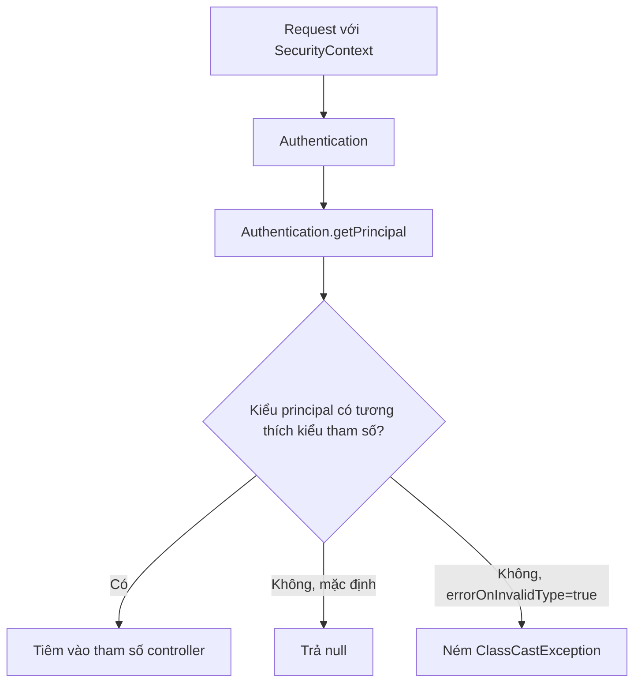

# Kiểm tra `@AuthenticationPrincipal` với đúng kiểu người dùng

Trong ứng dụng Spring MVC có đăng nhập OAuth 2.0 hoặc OpenID Connect (OIDC), cùng một annotation `@AuthenticationPrincipal` có thể nhận các kiểu đối tượng khác nhau. Controller cần thông tin từ OIDC ID Token thì phải nhận **`OidcUser`**; controller chỉ cần thuộc tính của người dùng OAuth 2.0 có thể nhận **`OAuth2User`**. Nếu bài kiểm thử chỉ dùng `@WithMockUser` hay tự gán username, lời gọi controller có thể không nhận được loại principal mà chức năng thực tế đang yêu cầu.

Bài học này thuộc chương **Đăng nhập OAuth2 và OIDC** của module **SPRING_SECURITY_TESTING**, nơi người học sử dụng `spring-security-test`, MockMvc, WebTestClient, SecurityContext, các principal giả lập và ca kiểm thử được phép/bị từ chối để kiểm chứng cơ chế bảo mật HTTP. Trọng tâm của bài là kiểm tra **kiểu đối tượng** và **dữ liệu principal** được ánh xạ vào tham số controller, đồng thời nhận diện giới hạn của các postprocessor `oauth2Login()` và `oidcLogin()`.

## 1. `@AuthenticationPrincipal` thực sự lấy đối tượng nào?

Trên Servlet stack, khi Spring Security đã xác thực request, `SecurityContextHolder` chứa một `Authentication`. `AuthenticationPrincipalArgumentResolver` dùng `Authentication.getPrincipal()` để điền vào tham số có annotation `@AuthenticationPrincipal`.



Annotation **không tự chuyển** `UserDetails` thành `OAuth2User`, cũng không tự tạo `OidcUser` từ một `Jwt`. Nó lấy đối tượng principal đã có trong authentication và kiểm tra kiểu.

| Cách tạo authentication | `Authentication` thường gặp | Kiểu `principal` | Trường hợp dùng |
| --- | --- | --- | --- |
| Đăng nhập OAuth2 thông thường | `OAuth2AuthenticationToken` | `OAuth2User`, thường là `DefaultOAuth2User` | Đọc attributes do nhà cung cấp gửi |
| Đăng nhập OIDC | `OAuth2AuthenticationToken` | `OidcUser`, thường là `DefaultOidcUser` | Đọc ID Token, UserInfo và claims |
| `@WithMockUser` | `UsernamePasswordAuthenticationToken` | `UserDetails` (Spring Security `User`) | Kiểm tra quyền của người dùng mô phỏng |
| Resource Server dùng JWT bearer | `JwtAuthenticationToken` | `Jwt` | Đọc JWT access token của request API |
| `anonymous()` | `AnonymousAuthenticationToken` | Thường là chuỗi `anonymousUser` | Request ẩn danh |

**Quan hệ kiểu quan trọng:** `OidcUser` *mở rộng* `OAuth2User`. Vì vậy controller nhận `@AuthenticationPrincipal OAuth2User` có thể làm việc với cả principal OIDC. Ngược lại, controller yêu cầu `@AuthenticationPrincipal OidcUser` sẽ **không** nhận được một `DefaultOAuth2User` thuần OAuth2.

Ví dụ:

```java
@GetMapping("/api/account/oidc")
String oidc(@AuthenticationPrincipal OidcUser user) {
    return user.getIdToken().getSubject();
}

@GetMapping("/api/account/oauth2")
String oauth2(@AuthenticationPrincipal OAuth2User user) {
    return user.getName();
}
```

Ở endpoint thứ nhất, `OidcUser.getIdToken()` là API chuyên biệt OIDC; `OAuth2User` nói chung không cung cấp ID Token. Một đối tượng `OAuth2User` có attribute tên `sub` cũng chưa chứng minh request là đăng nhập OIDC hợp lệ.

## 2. Phân biệt dữ liệu attributes, ID Token và UserInfo

OAuth 2.0 là khuôn khổ ủy quyền; OIDC bổ sung lớp xác thực danh tính, trong đó có **ID Token**. Trong Spring Security:

- `OAuth2User.getAttributes()` trả về tập thuộc tính người dùng của OAuth2 login. Tên khóa và cấu trúc có thể khác nhau giữa các provider.
- `OAuth2User.getName()` trả về tên principal theo `nameAttributeKey` được cấu hình, **không nhất thiết là email**.
- `OidcUser.getIdToken()` trả về `OidcIdToken`, chứa các claim như `sub`, `iss`, `aud`, `iat` và `exp`.
- `OidcUser.getUserInfo()` có thể có thêm thuộc tính từ UserInfo endpoint. Không nên mặc định mọi provider đều trả cùng claim trong UserInfo.
- `OidcUser.getAttributes()` cho phép truy cập các thuộc tính của người dùng OIDC; khi cần chứng minh nguồn chính xác của một claim, hãy đọc `getIdToken().getClaims()` hoặc `getUserInfo()` tương ứng.

Ví dụ dữ liệu minh họa:

```json
{
  "sub": "oidc-user-42",
  "preferred_username": "minh",
  "email": "minh@example.test"
}
```

Giá trị `sub` là định danh ổn định **trong phạm vi issuer** theo quy tắc OIDC; nếu ứng dụng hỗ trợ nhiều issuer, nên liên kết tài khoản với cặp **issuer + subject**, tránh coi `sub` đơn lẻ là duy nhất toàn cầu. Email có thể đổi hoặc chưa được xác minh; không suy đoán rằng email luôn là định danh chính.

## 3. Controller mẫu: yêu cầu đúng kiểu theo từng endpoint

Tạo một controller cho bài học. Chúng ta cố ý có endpoint chuyên OIDC, endpoint nhận OAuth2User tổng quát, và một endpoint chẩn đoán dùng để xem hành vi khi kiểu principal không tương thích.

```java
import java.util.Map;
import org.springframework.security.core.annotation.AuthenticationPrincipal;
import org.springframework.security.oauth2.core.oidc.user.OidcUser;
import org.springframework.security.oauth2.core.user.OAuth2User;
import org.springframework.web.bind.annotation.GetMapping;
import org.springframework.web.bind.annotation.RequestMapping;
import org.springframework.web.bind.annotation.RestController;

@RestController
@RequestMapping("/api/profile")
class PrincipalProfileController {

    @GetMapping("/oauth2")
    Map<String, String> oauth2(@AuthenticationPrincipal OAuth2User user) {
        Object subject = user.getAttribute("sub");
        return Map.of(
            "name", user.getName(),
            "sub", subject == null ? "(missing)" : subject.toString()
        );
    }

    @GetMapping("/oidc")
    Map<String, String> oidc(@AuthenticationPrincipal OidcUser user) {
        return Map.of(
            "name", user.getName(),
            "subject", user.getIdToken().getSubject()
        );
    }

    // Chỉ để quan sát hành vi resolver trong bài thực hành.
    @GetMapping("/oidc-probe")
    Map<String, Boolean> oidcProbe(
            @AuthenticationPrincipal OidcUser user) {
        return Map.of("resolved", user != null);
    }

    @GetMapping("/private")
    String privateProfile(@AuthenticationPrincipal OAuth2User user) {
        return user.getName();
    }
}
```

Controller chỉ lấy principal đã được xác thực, không trực tiếp tải thông tin người dùng từ nhà cung cấp. Vì vậy phần chính của ví dụ chỉ cần `OAuth2User`, `OidcUser` và `@AuthenticationPrincipal`.

Ở endpoint `/oidc`, sử dụng `getIdToken().getSubject()` xác nhận controller thực sự cần API của OIDC. Endpoint `/oidc-probe` cho phép kiểm tra trực tiếp sự khác biệt về kiểu mà không phụ thuộc cơ chế xử lý exception của từng dự án. Endpoint này chỉ phục vụ học tập; **không dùng giá trị `user == null` như chính sách phân quyền** trong ứng dụng thật.

## 4. Cấu hình bảo vệ HTTP tối thiểu cho kiểm thử principal

Để cô lập mục tiêu kiểm thử, chỉ cần một `SecurityFilterChain` có kiểm tra quyền và áp dụng Spring Security filters vào `MockMvc`. Ví dụ dùng basic challenge cho request chưa xác thực, còn `oauth2Login()`/`oidcLogin()` tạo `Authentication` mô phỏng cho request kiểm thử.

```java
import org.springframework.context.annotation.Bean;
import org.springframework.boot.test.context.TestConfiguration;
import org.springframework.security.config.Customizer;
import org.springframework.security.config.annotation.web.builders.HttpSecurity;
import org.springframework.security.web.SecurityFilterChain;

@TestConfiguration(proxyBeanMethods = false)
class PrincipalTestSecurity {

    @Bean
    SecurityFilterChain testSecurityFilterChain(HttpSecurity http)
            throws Exception {
        return http
            .authorizeHttpRequests(auth -> auth
                .requestMatchers("/api/profile/private")
                    .hasAuthority("SCOPE_profile.read")
                .requestMatchers("/api/profile/**").authenticated()
                .anyRequest().denyAll()
            )
            .httpBasic(Customizer.withDefaults())
            .build();
    }
}
```

Vì đây là **kiểm thử việc ánh xạ principal vào controller**, cấu hình mẫu không kích hoạt flow redirect OAuth2 login thực. Với ứng dụng production, `oauth2Login()` cần client registration, authorization endpoint, redirect callback, bộ xử lý token và cấu hình provider thích hợp. Việc `oauth2Login()` postprocessor trong MockMvc hoạt động **không phụ thuộc vào việc test đã đi qua những bước OAuth2/OIDC đó**.

Nếu tạo `MockMvc` thủ công qua `MockMvcBuilders`, phải áp dụng `springSecurity()` để nối security filter và context. Với Spring Boot `@WebMvcTest` hoặc `@SpringBootTest + @AutoConfigureMockMvc`, kiểm tra rằng filter chain mong muốn thực sự được dùng, đặc biệt nếu ứng dụng có nhiều `SecurityFilterChain`.

## 5. MockMvc: `oauth2Login()` tạo `OAuth2User` đúng loại

Kiểm thử sau tập trung vào thuộc tính `sub`. `oauth2Login()` của `spring-security-test` chuẩn bị một `OAuth2AuthenticationToken` với principal dạng `OAuth2User`; `attributes(...)` giúp chỉ định dữ liệu controller sẽ đọc.

```java
import org.junit.jupiter.api.Test;
import org.springframework.beans.factory.annotation.Autowired;
import org.springframework.boot.test.autoconfigure.web.servlet.WebMvcTest;
import org.springframework.context.annotation.Import;
import org.springframework.test.web.servlet.MockMvc;

import static org.springframework.security.test.web.servlet.request.SecurityMockMvcRequestPostProcessors.oauth2Login;
import static org.springframework.security.test.web.servlet.request.SecurityMockMvcRequestPostProcessors.oidcLogin;
import static org.springframework.test.web.servlet.request.MockMvcRequestBuilders.get;
import static org.springframework.test.web.servlet.result.MockMvcResultMatchers.jsonPath;
import static org.springframework.test.web.servlet.result.MockMvcResultMatchers.status;

@WebMvcTest(controllers = PrincipalProfileController.class)
@Import(PrincipalTestSecurity.class)
class PrincipalProfileControllerTest {

    @Autowired
    MockMvc mvc;

    @Test
    void oauth2PrincipalIsInjectedIntoOAuth2UserParameter()
            throws Exception {
        mvc.perform(get("/api/profile/oauth2")
                .with(oauth2Login()
                    .attributes(attrs ->
                        attrs.put("sub", "oauth2-user-42"))))
            .andExpect(status().isOk())
            .andExpect(jsonPath("$.name").value("oauth2-user-42"))
            .andExpect(jsonPath("$.sub").value("oauth2-user-42"));
    }
}
```

Kết quả mong đợi là **HTTP 200**, `name` và `sub` đều bằng `oauth2-user-42`. Bài test đã xác nhận Spring MVC nhận đúng một `OAuth2User` từ principal mô phỏng và đọc được attribute mà ta cung cấp.

Lưu ý trong trường hợp provider sử dụng tên khác `sub` (ví dụ `id` hay `login`): cần khởi tạo `DefaultOAuth2User` với `nameAttributeKey` thích hợp; nếu cứ để test dùng `sub` mặc định thì có thể bỏ sót sai lệch giữa cấu hình provider và controller.

## 6. MockMvc: `oidcLogin()` tạo `OidcUser` có ID Token

Với endpoint cần `OidcUser.getIdToken()`, hãy sử dụng `oidcLogin()`. Postprocessor cung cấp một `OidcUser` mô phỏng cùng ID Token, UserInfo và authorities; có thể sửa claim của ID Token bằng `idToken(...)`.

Thêm ca sau vào lớp `PrincipalProfileControllerTest`:

```java
@Test
void oidcPrincipalExposesIdTokenSubject() throws Exception {
    mvc.perform(get("/api/profile/oidc")
            .with(oidcLogin()
                .idToken(token ->
                    token.claim("sub", "oidc-user-77"))))
        .andExpect(status().isOk())
        .andExpect(jsonPath("$.name").value("oidc-user-77"))
        .andExpect(jsonPath("$.subject").value("oidc-user-77"));
}
```

Vì `OidcUser` cũng triển khai `OAuth2User`, request dùng OIDC vẫn có thể gọi endpoint yêu cầu `OAuth2User`:

```java
@Test
void oidcPrincipalAlsoSatisfiesOAuth2UserParameter()
        throws Exception {
    mvc.perform(get("/api/profile/oauth2")
            .with(oidcLogin()
                .idToken(token ->
                    token.claim("sub", "oidc-user-77"))))
        .andExpect(status().isOk())
        .andExpect(jsonPath("$.sub").value("oidc-user-77"));
}
```

Hai ca trên xác nhận cả **đặc tính riêng** của OIDC và **tính tương thích** với `OAuth2User`. Không suy diễn chiều ngược lại: một `OAuth2User` thuần OAuth 2.0 không có nghĩa nó là `OidcUser`.

## 7. Ca sai kiểu: resolver trả `null` hoặc ném exception

Mặc định, khi đối tượng `Authentication.getPrincipal()` không gán được cho kiểu tham số, `@AuthenticationPrincipal` trả **`null`**. Chẳng hạn `oauth2Login()` tạo `DefaultOAuth2User` nên không thể điền vào `OidcUser`.

Thêm ca thử:

```java
@Test
void plainOAuth2PrincipalCannotSatisfyOidcUserParameter()
        throws Exception {
    mvc.perform(get("/api/profile/oidc-probe")
            .with(oauth2Login()))
        .andExpect(status().isOk())
        .andExpect(jsonPath("$.resolved").value(false));
}

@Test
void oidcPrincipalSatisfiesOidcUserParameter()
        throws Exception {
    mvc.perform(get("/api/profile/oidc-probe")
            .with(oidcLogin()))
        .andExpect(status().isOk())
        .andExpect(jsonPath("$.resolved").value(true));
}
```

Đây là **test chẩn đoán kiểu**, không phải bài test cho phép truy cập của ứng dụng thực. Cả hai request đều đã có `Authentication` mô phỏng nên đều qua rule `.authenticated()`; điểm khác nhau nằm ở giá trị được `AuthenticationPrincipalArgumentResolver` đưa vào controller.

Nếu controller trực tiếp gọi `user.getIdToken()` khi `user == null`, mã ứng dụng sẽ gặp `NullPointerException`. Trong MockMvc, exception có thể được ném ra cho test thay vì tự động có một HTTP status ổn định; đừng mặc nhiên assert `401`, `403` hoặc `500` cho trường hợp này.

Có thể yêu cầu resolver báo lỗi ngay khi kiểu sai:

```java
@GetMapping("/strict-oidc")
String strictOidc(
        @AuthenticationPrincipal(errorOnInvalidType = true)
        OidcUser user) {
    return user.getIdToken().getSubject();
}
```

Khi truyền một `DefaultOAuth2User` vào endpoint này, resolver ném **`ClassCastException`** vì principal không tương thích; trong một bài test MockMvc, exception có thể được framework bao bọc trước khi nổi lên. `errorOnInvalidType = true` là cơ chế báo lỗi lập trình sai kiểu, **không thay thế** các rule phân quyền HTTP. Chính sách truy cập vẫn phải nằm ở security chain hoặc method security.

## 8. Phát hiện `@WithMockUser` không phù hợp cho endpoint OIDC

Một lỗi phổ biến là viết:

```java
@Test
@WithMockUser(username = "oidc-user-77")
void controllerWorks() {
    // ...
}
```

`@WithMockUser` khởi tạo `UsernamePasswordAuthenticationToken` với principal kiểu `UserDetails`, không cung cấp `OidcIdToken` hay `OidcUserInfo`. Vì vậy, một controller yêu cầu `OidcUser` sẽ không nhận đúng principal chỉ nhờ username trùng với `sub`.

Ví dụ test minh họa:

```java
import org.springframework.security.test.context.support.WithMockUser;

@Test
@WithMockUser(username = "oidc-user-77")
void withMockUserDoesNotSupplyOidcUser() throws Exception {
    mvc.perform(get("/api/profile/oidc-probe"))
        .andExpect(status().isOk())
        .andExpect(jsonPath("$.resolved").value(false));
}
```

Với mục tiêu kiểm tra **phân quyền thuần túy** (`hasRole`, `hasAuthority`) mà code không cần biết kiểu principal, `@WithMockUser` vẫn rất hữu ích. Nhưng khi controller dùng `OidcUser.getIdToken()`, `OAuth2User.getAttributes()` hoặc `@RegisteredOAuth2AuthorizedClient`, cần dùng công cụ mô phỏng đúng cơ chế đăng nhập tương ứng.

`jwt()` của MockMvc cũng không thay thế `oidcLogin()`: nó dùng `JwtAuthenticationToken` với principal là `Jwt` trong **OAuth2 Resource Server**, còn OIDC login dùng **`OAuth2AuthenticationToken` với `OidcUser`**. Một JWT access token và một OIDC ID Token có vai trò khác nhau dù cả hai có thể được mã hóa dưới dạng JWT.

## 9. Thêm kiểm thử được phép/bị từ chối theo authority

Kiểu principal đúng chưa đủ để khẳng định endpoint được cấp quyền. Chính sách `/api/profile/private` trong cấu hình ví dụ yêu cầu `SCOPE_profile.read`. Postprocessor có thể cấp authority cụ thể cho mỗi request.

```java
import org.springframework.security.core.authority.SimpleGrantedAuthority;
import static org.springframework.test.web.servlet.result.MockMvcResultMatchers.content;

@Test
void oauth2UserWithoutRequiredScopeIsForbidden() throws Exception {
    mvc.perform(get("/api/profile/private")
            .with(oauth2Login()))
        .andExpect(status().isForbidden());
}

@Test
void oauth2UserWithRequiredScopeCanAccess() throws Exception {
    mvc.perform(get("/api/profile/private")
            .with(oauth2Login().authorities(
                new SimpleGrantedAuthority("SCOPE_profile.read"))))
        .andExpect(status().isOk());
}

@Test
void oidcUserWithRequiredScopeCanAccess() throws Exception {
    mvc.perform(get("/api/profile/private")
            .with(oidcLogin().authorities(
                new SimpleGrantedAuthority("SCOPE_profile.read"))))
        .andExpect(status().isOk());
}

@Test
void unauthenticatedRequestIsRejected() throws Exception {
    mvc.perform(get("/api/profile/private"))
        .andExpect(status().isUnauthorized());
}
```

Ở đây các request dùng `oauth2Login()` và `oidcLogin()` mặc định không có `SCOPE_profile.read`, nên bị `403`. Khi cấp đúng authority, chúng qua kiểm tra quyền và tới controller. Request không xác thực nhận `401` vì cấu hình mẫu đã bật HTTP Basic challenge. Nếu thay bằng `oauth2Login()` production, request chưa đăng nhập có thể nhận **302 redirect** tới trang bắt đầu login; cần assert theo cấu hình thật của ứng dụng.

Phân biệt rõ:

- **Authentication**: request có danh tính và principal nào?
- **Principal binding**: `@AuthenticationPrincipal` có nhận đúng Java type không?
- **Authorization**: danh tính đó có authorities đúng để truy cập endpoint không?

Một test có `status().isOk()` không tự chứng minh principal đã thuộc kiểu mong muốn nếu endpoint không thực sự sử dụng tham số. Vì vậy các endpoint demo phản hồi giá trị `name`, `subject` hoặc cờ `resolved` được lấy trực tiếp từ principal.

## 10. Tùy biến principal và thuộc tính định danh

Một số provider dùng claim `preferred_username` làm tên hiển thị, trong khi `sub` vẫn là định danh kỹ thuật. Có thể tạo `OidcUser` riêng trong test để xác nhận ứng dụng xử lý chính xác:

```java
import java.time.Instant;
import org.springframework.security.core.authority.AuthorityUtils;
import org.springframework.security.oauth2.core.oidc.OidcIdToken;
import org.springframework.security.oauth2.core.oidc.user.DefaultOidcUser;
import org.springframework.security.oauth2.core.oidc.user.OidcUser;

OidcIdToken idToken = OidcIdToken.withTokenValue("test-id-token")
    .issuedAt(Instant.now())
    .expiresAt(Instant.now().plusSeconds(600))
    .claim("sub", "oidc-100")
    .claim("preferred_username", "lan")
    .build();

OidcUser oidcUser = new DefaultOidcUser(
    AuthorityUtils.createAuthorityList("SCOPE_profile.read"),
    idToken,
    "preferred_username"
);

mvc.perform(get("/api/profile/oidc")
        .with(oidcLogin().oidcUser(oidcUser)))
    .andExpect(status().isOk())
    .andExpect(jsonPath("$.name").value("lan"))
    .andExpect(jsonPath("$.subject").value("oidc-100"));
```

Ví dụ này kiểm tra `getName()` và `getIdToken().getSubject()` có thể khác nhau; dùng `name` để hiển thị nhưng cần cân nhắc `iss` + `sub` để liên kết tài khoản bền vững.

Tương tự, với `DefaultOAuth2User` có thể chỉ định `nameAttributeKey` phù hợp với provider:

```java
import java.util.Map;
import org.springframework.security.oauth2.core.user.DefaultOAuth2User;
import org.springframework.security.oauth2.core.user.OAuth2User;

OAuth2User user = new DefaultOAuth2User(
    AuthorityUtils.createAuthorityList("SCOPE_profile.read"),
    Map.of("id", "account-88", "display_name", "Mai"),
    "id"
);

mvc.perform(get("/api/profile/oauth2")
        .with(oauth2Login().oauth2User(user)))
    .andExpect(status().isOk())
    .andExpect(jsonPath("$.name").value("account-88"));
```

Trong controller `/oauth2` ví dụ, `sub` của principal này không tồn tại nên response nhận `"(missing)"` theo nhánh xử lý giá trị thiếu. Đó là dấu hiệu phải thiết kế lại việc ánh xạ định danh nếu provider dùng `id`, không phải lỗi của `oauth2Login()`. Mã ứng dụng thực tế nên dùng cấu hình provider rõ ràng hoặc một lớp chuyển đổi thống nhất.

### Dùng biểu thức của `@AuthenticationPrincipal`

Annotation hỗ trợ biểu thức SpEL trên principal. Ví dụ:

```java
@GetMapping("/api/profile/email")
String email(
        @AuthenticationPrincipal(expression = "attributes['email']")
        String email) {
    return email;
}
```

Biểu thức này thích hợp nếu cả principal và cấu trúc attributes đã được bảo đảm. Với provider thiếu `email`, giá trị có thể là `null`. Đừng coi attribute `email` đồng nghĩa email đã được xác minh; nếu nghiệp vụ cần điều đó, phải xử lý claim/trạng thái xác minh theo chính sách OIDC.

## 11. Giới hạn của `oidcLogin()` và `oauth2Login()` trong MockMvc

Các postprocessor giúp dựng SecurityContext và một `OAuth2AuthorizedClient` phục vụ kiểm thử MVC. **Chúng không tự thực hiện** đầy đủ luồng Authorization Code, trao đổi code lấy token, xác thực ID Token chữ ký/issuer/audience/nonce, hoặc gọi provider qua mạng.

| Mục đích | Cách kiểm thử thích hợp |
| --- | --- |
| Controller nhận `OAuth2User` và đọc attributes | `oauth2Login().attributes(...)` hoặc `oauth2Login().oauth2User(...)` |
| Controller nhận `OidcUser` và đọc ID Token | `oidcLogin().idToken(...)` hoặc `oidcLogin().oidcUser(...)` |
| Kiểm tra principal kiểu sai | Endpoint quan sát `null`, hoặc `errorOnInvalidType = true` trong unit test có kiểm soát |
| Kiểm tra policy theo authorities | `oauth2Login().authorities(...)` / `oidcLogin().authorities(...)` |
| Kiểm tra redirect, callback, `state`, `nonce`, token exchange và provider metadata | Integration test với OAuth2/OIDC authorization server giả lập thích hợp |
| Kiểm tra JWT bearer của resource server | `jwt()` cho security context giả lập; bearer request với decoder thật khi cần kiểm chứng xác thực token |

Đừng viết một test `oidcLogin()` rồi kết luận OIDC ID Token đã được kiểm tra chữ ký. Khi cần chứng minh cấu hình OAuth2 login thực, dùng integration test cho callback và một authorization server thử nghiệm (không sử dụng thông tin đăng nhập thật).

## 12. Liên hệ với WebFlux và WebTestClient

Với ứng dụng Reactive, cùng nguyên tắc kiểu principal vẫn áp dụng: login OIDC tạo `OidcUser`, login OAuth2 thông thường tạo `OAuth2User`. Spring Security cung cấp `mockOidcLogin()` và `mockOAuth2Login()` cho `WebTestClient` được bind vào ứng dụng WebFlux.

```java
import static org.springframework.security.test.web.reactive.server.SecurityMockServerConfigurers.mockOidcLogin;
import static org.springframework.security.test.web.reactive.server.SecurityMockServerConfigurers.mockOAuth2Login;

webTestClient.mutateWith(mockOidcLogin())
    .get().uri("/api/profile/oidc")
    .exchange()
    .expectStatus().isOk();

webTestClient.mutateWith(mockOAuth2Login())
    .get().uri("/api/profile/oauth2")
    .exchange()
    .expectStatus().isOk();
```

Cấu hình Reactive phải có `SecurityWebFilterChain` và bộ tích hợp authentication cho WebFlux; không dùng `MockMvc` hay `HttpSecurity` của Servlet để kiểm thử WebFlux. Hai lệnh trên cũng mô phỏng login và principal, không thay cho integration test OIDC provider thực.

## 13. Bài thực hành và tiêu chí hoàn thành

Hãy thêm endpoint `GET /api/profile/display-name` trả về tên hiển thị của người đã đăng nhập. Với OAuth2 provider A, tên nằm ở attribute `display_name`; với OIDC provider B, tên nằm ở `preferred_username` nhưng subject dùng để định danh là `sub`.

1. Viết một ca `oauth2Login().oauth2User(...)` dùng `DefaultOAuth2User` với tên định danh `id` và thuộc tính `display_name`.
2. Viết một ca `oidcLogin().oidcUser(...)` dùng `DefaultOidcUser` và kiểm tra cả tên hiển thị lẫn `getIdToken().getSubject()`.
3. Viết một ca dùng `oauth2Login()` gửi vào endpoint chuyên `OidcUser`; giải thích vì sao tham số là `null` theo mặc định.
4. Viết một ca `@WithMockUser` để chứng minh `UserDetails` không phải `OidcUser`, kể cả khi username giống claim `sub`.
5. Bảo vệ endpoint bằng `SCOPE_profile.read`; kiểm tra thiếu authority nhận `403`, có authority nhận `200`, không xác thực bị từ chối theo entry point được cấu hình.

**Tiêu chí đạt:** phân biệt được `OAuth2User`, `OidcUser`, `UserDetails` và `Jwt`; giải thích được quan hệ `OidcUser extends OAuth2User`; lựa chọn `oauth2Login()` hay `oidcLogin()` tương ứng với tham số `@AuthenticationPrincipal`; kiểm thử đúng thuộc tính/claim thay vì chỉ assert HTTP 200; và phân biệt được kiểm thử binding của controller với kiểm thử toàn bộ OAuth2/OIDC authorization flow.

### Tài liệu tham khảo

- [Spring Security — Testing OAuth 2.0 with MockMvc](https://docs.spring.io/spring-security/reference/servlet/test/mockmvc/oauth2.html): `oauth2Login()`, `oidcLogin()`, chỉnh attributes, ID Token và principal tùy biến.
- [Spring Security — Spring MVC Integration](https://docs.spring.io/spring-security/reference/servlet/integrations/mvc.html): cách `@AuthenticationPrincipal` giải quyết principal từ SecurityContext.
- [Spring Security — Testing OAuth 2.0 for Reactive](https://docs.spring.io/spring-security/reference/reactive/test/web/oauth2.html): `mockOAuth2Login()` và `mockOidcLogin()` với WebTestClient.
