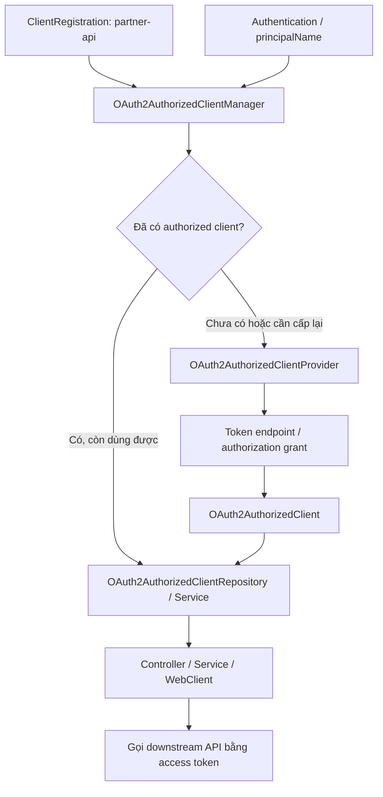

# Vai trò của `OAuth2AuthorizedClient` được chuẩn bị trong kiểm thử

Khi người dùng đăng nhập qua OAuth2 Login hoặc OpenID Connect (OIDC), ứng dụng Spring Security thường cần **hai loại dữ liệu liên quan nhưng khác nhau**:

1. **Danh tính hiện tại**: đối tượng `Authentication` trong `SecurityContext`, chẳng hạn `OAuth2AuthenticationToken` với principal `OAuth2User` hoặc `OidcUser`. Nó cho biết ai đang đăng nhập và có thể truy cập endpoint nào.
2. **OAuth2 client đã được cấp quyền**: đối tượng `OAuth2AuthorizedClient` kết hợp thông tin cấu hình client, tên principal, **access token** và refresh token tùy trường hợp. Nó giúp ứng dụng lấy token đã cấp để gọi API khác thay mặt người dùng hoặc theo grant được cấu hình.

Hai đối tượng này thường cùng xuất hiện sau OAuth2/OIDC Login, nhưng không đồng nhất. Controller có thể nhận đúng một `OidcUser` mà vẫn thiếu authorized client cho API cần gọi; ngược lại, một ứng dụng dùng `client_credentials` có thể có authorized client để gọi API máy chủ mà không có người dùng tương tác.

Trong module **`SPRING_SECURITY_TESTING`**, mục tiêu là kiểm chứng xác thực, phân quyền và bảo vệ HTTP với `spring-security-test` trên Servlet và Reactive. Bài này tập trung vào **cách chuẩn bị `OAuth2AuthorizedClient` trong test**, dùng `MockMvc` và `WebTestClient` để kiểm tra controller đọc đúng client registration, access token và scopes. Chúng ta cũng đối chiếu `oauth2Login()`, `oidcLogin()`, `@WithMockUser` và `SecurityContext` để biết mỗi helper đang mô phỏng phần nào.

> Phạm vi: các ví dụ dùng OAuth2/OIDC **client** của Spring Security, tức ứng dụng muốn đăng nhập người dùng hoặc gọi API bên ngoài. Chúng không kiểm chứng chữ ký JWT cho Resource Server, cũng không thực hiện authorization code exchange với Identity Provider thật.

## 1. `OAuth2AuthorizedClient` thực sự chứa gì?

Trong Spring Security, `OAuth2AuthorizedClient` thường có cấu trúc:

```text
OAuth2AuthorizedClient
 ├─ ClientRegistration
 │   ├─ registrationId ("partner-api")
 │   ├─ clientId
 │   ├─ clientSecret (chỉ thuộc cấu hình, không trả cho client HTTP)
 │   ├─ authorizationGrantType
 │   ├─ scopes và endpoint metadata
 │   └─ các giá trị cấu hình khác
 ├─ principalName ("alice" hoặc tên principal kỹ thuật)
 ├─ OAuth2AccessToken
 │   ├─ tokenType (Bearer)
 │   ├─ tokenValue (bí mật, không log/trả về response)
 │   ├─ issuedAt / expiresAt
 │   └─ scopes
 └─ OAuth2RefreshToken (có thể null)
```

Ba khái niệm thường bị nhầm:

| Khái niệm | Dữ liệu trả lời câu hỏi nào? | Ví dụ sử dụng |
| --- | --- | --- |
| `ClientRegistration` | Client được đăng ký với provider nào, dùng grant gì, thông tin kết nối ra sao? | `findByRegistrationId("partner-api")` |
| `OAuth2AuthenticationToken` / `OidcUser` | Ai đã được xác thực ở request hiện tại? | `@AuthenticationPrincipal OidcUser user` |
| `OAuth2AuthorizedClient` | Client registration này đã có token gì cho principal tương ứng? | `authorizedClient.getAccessToken()` |

`ClientRegistration.getScopes()` là các scopes được cấu hình/yêu cầu; `OAuth2AccessToken.getScopes()` là tập scopes gắn với **access token đã được cấp**. Hai tập có thể khác nhau: nhà cung cấp có thể cấp ít quyền hơn yêu cầu. Trong test kiểm tra quyền **của token để gọi downstream API**, hãy dùng `authorizedClient.getAccessToken().getScopes()`.

`principalName` giúp định danh chủ thể mà authorized client gắn với trong kho lưu trữ. Với authorization-code flow đó thường là tên người dùng; với client-credentials flow đó có thể là định danh kỹ thuật. Không mặc định mọi authorized client đều đại diện cho một tài khoản đăng nhập ở trình duyệt.

**Access token khác ID token:** OIDC `OidcIdToken` mô tả thông tin xác thực người dùng; `OAuth2AccessToken` trong authorized client phục vụ việc truy cập tài nguyên được ủy quyền. Không sử dụng ID token như access token của API trừ khi có hợp đồng riêng hợp lệ với hệ thống đó.

## 2. Authorized client được lưu và tra cứu ra sao?

Sau khi một OAuth2 client được cấp quyền thành công, Spring Security có thể lưu kết quả trong `OAuth2AuthorizedClientRepository`, `OAuth2AuthorizedClientService` hoặc một cơ chế lưu trữ phù hợp với ứng dụng. `OAuth2AuthorizedClientManager` điều phối việc lấy client đã được cấp quyền, cấp quyền mới hoặc tái cấp quyền tùy provider/grant và trạng thái hiện tại.

Đối với Servlet, dòng dữ liệu thường gặp:



Đối với controller, Spring Security hỗ trợ:

```java
@GetMapping("/client/summary")
Map<String, Object> summary(
        @RegisteredOAuth2AuthorizedClient("partner-api")
        OAuth2AuthorizedClient authorizedClient) {
    OAuth2AccessToken token = authorizedClient.getAccessToken();
    return Map.of(
            "registrationId",
            authorizedClient.getClientRegistration().getRegistrationId(),
            "principalName", authorizedClient.getPrincipalName(),
            "scopes", token.getScopes()
    );
}
```

Annotation `@RegisteredOAuth2AuthorizedClient` được xử lý bởi cơ chế argument resolution của Spring Security OAuth2 Client. Nó chọn authorized client dựa trên `registrationId` và ngữ cảnh request. Khi test một controller như vậy, cần **có authorized client được chuẩn bị phù hợp**, nếu không code có thể cố thực hiện OAuth2 authorization hoặc không tìm được client để truyền vào method.

**Không phải lúc nào cũng cần đăng nhập người dùng:** cùng API có thể dùng cho client credentials, khi token cấp cho chính ứng dụng. Trong ví dụ kiểm tra metadata phía dưới, endpoint được mở cho phép gọi trong test và dùng authorized client đã chuẩn bị; các endpoint dùng người dùng đăng nhập sẽ có các assertion xác thực riêng.

## 3. `spring-security-test` chuẩn bị authorized client bằng cách nào?

Trong **Servlet / MockMvc**, helper chuyên biệt là:

```java
import static org.springframework.security.test.web.servlet.request
        .SecurityMockMvcRequestPostProcessors.oauth2Client;

mockMvc.perform(get("/client/summary")
        .with(oauth2Client("partner-api")));
```

`oauth2Client("partner-api")` tạo một `OAuth2AuthorizedClient` thử nghiệm chứa:

- Một `ClientRegistration` đơn giản có `registrationId` theo đối số.
- `OAuth2AccessToken` giả lập, mặc định có scope `read`.
- Một `principalName` mặc định (thường là `user`).
- Cơ chế đặt client đó vào **mock `OAuth2AuthorizedClientRepository`** để request có thể tra cứu.

Với controller dùng `@RegisteredOAuth2AuthorizedClient("partner-api")`, resolver có thể lấy client đã chuẩn bị thay vì gọi authorization server. Client registration/access token này chỉ dùng cho test, không được chứng thực bởi nhà cung cấp OAuth2 thật. Spring Security công bố cả các tùy biến `accessToken(...)`, `principalName(...)` và `clientRegistration(...)` để mô phỏng dữ liệu cần kiểm tra.

### Vì sao không chỉ dùng `@WithMockUser`?

`@WithMockUser` tạo một `Authentication` giả trong `SecurityContext`, thích hợp kiểm tra rule `authenticated()`, `hasRole()` hoặc `hasAuthority()`. Nó **không cung cấp `OAuth2AuthorizedClient`** có access token cho downstream API. Nếu controller đòi tham số `OAuth2AuthorizedClient`, mock user không giải quyết phần phụ thuộc này.

Ngược lại, `oauth2Client()` chuẩn bị authorized client nhưng **không tự biến request thành người dùng đã đăng nhập**. Nếu endpoint yêu cầu authenticated user, test phải chuẩn bị cả Authentication tương ứng, chẳng hạn qua `oauth2Login()`, `oidcLogin()` hoặc setup `SecurityContext` thích hợp.

## 4. Ví dụ Servlet: controller đọc authorized client

Ta dựng ứng dụng mẫu Java 17+, Spring Boot 3.x, Spring Security 6.x. Dependency cần có:

```text
spring-boot-starter-web
spring-boot-starter-security
spring-boot-starter-oauth2-client
spring-boot-starter-test          (test)
spring-security-test             (test)
```

Ở Spring Boot bản khác, package/API và cách đăng ký bean có thể thay đổi; các đoạn Java dưới đây có thể đặt vào các tệp riêng cùng package của ứng dụng.

### 4.1. Tạo `ClientRegistrationRepository` cho test

Để controller có một registration có tên `partner-api`, khai báo dữ liệu kỹ thuật **trong ứng dụng demo hoặc cấu hình test**. URL dùng tên miền giả `example.test`, không có HTTP request nào được gửi trong các test mô phỏng.

```java
import org.springframework.context.annotation.Bean;
import org.springframework.context.annotation.Configuration;
import org.springframework.security.oauth2.client.registration
        .ClientRegistration;
import org.springframework.security.oauth2.client.registration
        .ClientRegistrationRepository;
import org.springframework.security.oauth2.client.registration
        .InMemoryClientRegistrationRepository;
import org.springframework.security.oauth2.core.AuthorizationGrantType;

@Configuration
class OAuth2ClientRegistrationConfig {

    @Bean
    ClientRegistrationRepository clientRegistrationRepository() {
        ClientRegistration partner = ClientRegistration
                .withRegistrationId("partner-api")
                .clientId("client-for-tests")
                .clientSecret("secret-for-tests")
                .authorizationGrantType(
                        AuthorizationGrantType.CLIENT_CREDENTIALS)
                .tokenUri("https://id.example.test/oauth2/token")
                .scope("invoices.read", "invoices.write")
                .clientName("Partner API")
                .build();

        return new InMemoryClientRegistrationRepository(partner);
    }
}
```

Grant `client_credentials` trong ví dụ thể hiện authorized client có thể được dùng để gọi một API ứng dụng khác mà không cần mô phỏng browser login. Ta vẫn mô phỏng client **đã có access token**; test này không gọi `tokenUri` hay kiểm tra client secret. Với registration dùng `authorization_code`, cấu hình còn cần authorization URI, redirect URI và metadata liên quan.

### 4.2. Bật OAuth2 Client trong Servlet SecurityFilterChain

```java
import org.springframework.context.annotation.Bean;
import org.springframework.context.annotation.Configuration;
import org.springframework.security.config.Customizer;
import org.springframework.security.config.annotation.web.builders.HttpSecurity;
import org.springframework.security.web.SecurityFilterChain;

@Configuration
class OAuth2ClientSecurityConfig {
    @Bean
    SecurityFilterChain securityFilterChain(HttpSecurity http)
            throws Exception {
        return http
                .authorizeHttpRequests(auth -> auth
                        // Chỉ mở endpoint quan sát thông tin mô phỏng.
                        .requestMatchers("/client/summary").permitAll()
                        .anyRequest().authenticated())
                .oauth2Client(Customizer.withDefaults())
                .build();
    }
}
```

Cấu hình này tập trung kiểm thử OAuth2 Client. Để kiểm thử một application hỗ trợ **đăng nhập OAuth2/OIDC**, ứng dụng còn cần cấu hình `oauth2Login(...)` cùng client registrations phù hợp; ví dụ ở phần sau mô tả rõ phần khác biệt ấy.

### 4.3. Controller trả thông tin không nhạy cảm

```java
import java.util.Map;
import org.springframework.security.oauth2.client.OAuth2AuthorizedClient;
import org.springframework.security.oauth2.client.annotation
        .RegisteredOAuth2AuthorizedClient;
import org.springframework.security.oauth2.core.OAuth2AccessToken;
import org.springframework.web.bind.annotation.GetMapping;
import org.springframework.web.bind.annotation.RestController;

@RestController
class OAuth2ClientSummaryController {

    @GetMapping("/client/summary")
    Map<String, Object> summary(
            @RegisteredOAuth2AuthorizedClient("partner-api")
            OAuth2AuthorizedClient client) {
        OAuth2AccessToken token = client.getAccessToken();
        return Map.of(
                "registrationId",
                client.getClientRegistration().getRegistrationId(),
                "clientId", client.getClientRegistration().getClientId(),
                "principalName", client.getPrincipalName(),
                "scopes", token.getScopes(),
                "tokenType", token.getTokenType().getValue()
        );
    }
}
```

Controller **không trả `token.getTokenValue()`**, refresh token hoặc client secret. Trong sản phẩm thật, không nên tạo endpoint công khai tiết lộ metadata client không cần thiết; endpoint mẫu chỉ phục vụ quan sát nội dung đã chuẩn bị trong test.

### 4.4. Test `oauth2Client()` với access token tự chọn

```java
import java.time.Instant;
import java.util.Set;
import org.junit.jupiter.api.Test;
import org.springframework.beans.factory.annotation.Autowired;
import org.springframework.boot.test.autoconfigure.web.servlet
        .AutoConfigureMockMvc;
import org.springframework.boot.test.context.SpringBootTest;
import org.springframework.security.oauth2.client.registration
        .ClientRegistrationRepository;
import org.springframework.security.oauth2.core.OAuth2AccessToken;
import org.springframework.test.web.servlet.MockMvc;

import static org.hamcrest.Matchers.hasItem;
import static org.springframework.security.test.web.servlet.request
        .SecurityMockMvcRequestPostProcessors.oauth2Client;
import static org.springframework.test.web.servlet.request
        .MockMvcRequestBuilders.get;
import static org.springframework.test.web.servlet.result
        .MockMvcResultMatchers.jsonPath;
import static org.springframework.test.web.servlet.result
        .MockMvcResultMatchers.status;

@SpringBootTest
@AutoConfigureMockMvc
class PreparedOAuth2ClientMvcTest {

    @Autowired
    MockMvc mvc;

    @Autowired
    ClientRegistrationRepository registrations;

    @Test
    void preparedClient_isResolvedWithItsScopes() throws Exception {
        OAuth2AccessToken accessToken = new OAuth2AccessToken(
                OAuth2AccessToken.TokenType.BEARER,
                "test-access-token-value",
                Instant.now().minusSeconds(20),
                Instant.now().plusSeconds(300),
                Set.of("invoices.read")
        );

        mvc.perform(get("/client/summary")
                .with(oauth2Client("partner-api")
                        .clientRegistration(registrations
                                .findByRegistrationId("partner-api"))
                        .principalName("alice")
                        .accessToken(accessToken)))
                .andExpect(status().isOk())
                .andExpect(jsonPath("$.registrationId")
                        .value("partner-api"))
                .andExpect(jsonPath("$.clientId")
                        .value("client-for-tests"))
                .andExpect(jsonPath("$.principalName")
                        .value("alice"))
                .andExpect(jsonPath("$.scopes",
                        hasItem("invoices.read")))
                .andExpect(jsonPath("$.tokenType")
                        .value("Bearer"));
    }

    @Test
    void defaultPreparedClient_hasDefaultScopeRead() throws Exception {
        mvc.perform(get("/client/summary")
                .with(oauth2Client("partner-api")
                        .clientRegistration(registrations
                                .findByRegistrationId("partner-api"))))
                .andExpect(status().isOk())
                .andExpect(jsonPath("$.principalName")
                        .value("user"))
                .andExpect(jsonPath("$.scopes",
                        hasItem("read")));
    }
}
```

Lớp test giả định một Spring Boot application có `@SpringBootApplication` quét các lớp config/controller ở trên. Đối với application thật, dùng lại configuration của chính ứng dụng và **không tạo thêm `ClientRegistrationRepository` có registration ID trùng** nếu nó đã được cấu hình trong dự án.

Hai ca kiểm chứng:

- `oauth2Client("partner-api")` đặt client vào repository giả lập cho request, để resolver của `@RegisteredOAuth2AuthorizedClient` cung cấp đúng client.
- `clientRegistration(...)` bảo đảm dùng dữ liệu registration cụ thể từ repository; nếu không cần kiểm tra registration thật, helper có thể tự tạo một registration test đơn giản.
- `principalName("alice")` kiểm tra danh tính gắn với authorized client. Đây là thuộc tính của authorized client, **không phải cách đăng nhập người dùng alice**.
- `accessToken(...)` cho phép đặt access token có scope `invoices.read`. Controller đọc các scopes của token; không thực hiện call tới token endpoint.
- Test thứ hai xác nhận dữ liệu mặc định của helper, trong đó scope thường là `read`; không nên mặc định scope từ `ClientRegistration` sẽ tự trở thành scopes của access token mô phỏng.

Nếu test chạy trong project có rule method security bổ sung, custom argument resolver hoặc một `OAuth2AuthorizedClientManager` đặc biệt, phải điều chỉnh cấu hình để request test được giải quyết qua repository/manager tương ứng.

## 5. `oauth2Login()` / `oidcLogin()` cũng chuẩn bị authorized client

`spring-security-test` cung cấp các post-processor khác cho **danh tính đã đăng nhập**:

```java
import static org.springframework.security.test.web.servlet.request
        .SecurityMockMvcRequestPostProcessors.oauth2Login;
import static org.springframework.security.test.web.servlet.request
        .SecurityMockMvcRequestPostProcessors.oidcLogin;

// Principal OAuth2User đã đăng nhập, không thực hiện redirect/callback thật.
mvc.perform(get("/account")
        .with(oauth2Login()
                .attributes(attrs -> attrs.put("user_id", "u-101"))));

// Principal OidcUser có ID token claim tùy chỉnh.
mvc.perform(get("/account")
        .with(oidcLogin()
                .idToken(token -> token.claim("email",
                        "alice@example.test"))));
```

Hai helper này tạo `OAuth2AuthenticationToken` và principal tương ứng trong security context của request. Chúng cũng **liên kết một `OAuth2AuthorizedClient` thử nghiệm** với principal rồi đặt nó vào mock `OAuth2AuthorizedClientRepository`. Vì vậy chúng hữu ích khi controller vừa cần `@AuthenticationPrincipal` vừa cần `@RegisteredOAuth2AuthorizedClient` sau login.

Để test có ý nghĩa chính xác, cần chú ý **registration ID**. Authorized client có thể truy xuất bằng `@RegisteredOAuth2AuthorizedClient("login-provider")` chỉ khi registration tương ứng được chuẩn bị. Với hệ thống có nhiều client registrations (ví dụ một client đăng nhập và một client khác dành cho billing API), cần bảo đảm chính xác registration nào được sử dụng.

Ví dụ bộ xử lý có cả principal và authorized client:

```java
import java.util.Map;
import org.springframework.security.core.annotation
        .AuthenticationPrincipal;
import org.springframework.security.oauth2.client.OAuth2AuthorizedClient;
import org.springframework.security.oauth2.client.annotation
        .RegisteredOAuth2AuthorizedClient;
import org.springframework.security.oauth2.core.oidc.user.OidcUser;
import org.springframework.web.bind.annotation.GetMapping;
import org.springframework.web.bind.annotation.RestController;

@RestController
class OidcAccountController {
    @GetMapping("/account")
    Map<String, Object> account(
            @AuthenticationPrincipal OidcUser user,
            @RegisteredOAuth2AuthorizedClient("login-provider")
            OAuth2AuthorizedClient client) {
        return Map.of(
                "userSub", user.getIdToken().getSubject(),
                "authorizedRegistration",
                client.getClientRegistration().getRegistrationId(),
                "accessTokenScopes",
                client.getAccessToken().getScopes()
        );
    }
}
```

Để viết test chính xác cho controller này, hãy truyền vào `oidcLogin().clientRegistration(loginRegistration)`, với `loginRegistration.getRegistrationId()` bằng `login-provider`, và cấu hình ứng dụng có `oauth2Login(...)` / OAuth2 Client tương ứng. Nếu muốn biết chính xác scope, truyền registration/principal có dữ liệu thích hợp và đọc authorized client mà helper tạo.

```java
ClientRegistration loginRegistration =
        registrationRepository.findByRegistrationId("login-provider");

mvc.perform(get("/account")
        .with(oidcLogin()
                .clientRegistration(loginRegistration)
                .idToken(token -> token.claim("sub", "alice"))))
    .andExpect(status().isOk())
    .andExpect(jsonPath("$.userSub").value("alice"))
    .andExpect(jsonPath("$.authorizedRegistration")
            .value("login-provider"));
```

Đoạn trên là **mẫu test cho cấu hình OIDC Login**, độc lập với ví dụ `client_credentials` ở mục 4: để chạy được cần registration `login-provider` loại `authorization_code` và ứng dụng đã bật `oauth2Login()`. Không lấy registration `partner-api` loại `client_credentials` trong mục trước thay cho `login-provider`; hai grant phục vụ hai tình huống khác nhau.

### Authorized client của login khác principal ở điểm nào?

Trong OIDC Login:

| Đối tượng | Nguồn và nhiệm vụ | Cách assert phù hợp |
| --- | --- | --- |
| `OidcUser` | Danh tính đăng nhập, claims từ ID token và có thể UserInfo | `user.getIdToken().getSubject()` |
| `OAuth2AuthenticationToken` | `Authentication` hiện tại, tên principal, authorities | `authenticated()`, principal/role |
| `OAuth2AuthorizedClient` | Registration, access token, refresh token (nếu có) của client | `@RegisteredOAuth2AuthorizedClient`, token scopes, registration ID |

Một request `.with(oidcLogin())` không chứng minh authorization code được đổi thành token thật, state/nonce được kiểm tra hoặc ID token được xác thực chữ ký. Nó chỉ mô phỏng **kết quả sau khi đăng nhập**. Muốn kiểm thử bảo vệ OAuth2/OIDC login callback thật, cần test tích hợp với Authorization Server giả lập hoặc một môi trường định danh thử nghiệm.

## 6. Kết hợp login authentication với client cho API khác

Một ứng dụng có thể dùng client `login-provider` cho đăng nhập, rồi `partner-api` để đọc hóa đơn. Đó là hai authorized clients **khác registration**, dù chúng có thể liên quan đến cùng một người dùng.

Trong MockMvc, ta có thể chuẩn bị từng phần:

```java
// 1. Tạo danh tính đăng nhập: thường qua oauth2Login()/oidcLogin().
var loggedIn = oidcLogin()
        .idToken(token -> token.claim("sub", "alice"))
        .clientRegistration(loginRegistration);

// 2. Tạo authorized client riêng dùng để gọi partner API.
var partnerClient = oauth2Client("partner-api")
        .clientRegistration(partnerRegistration)
        .principalName("alice")
        .accessToken(partnerAccessToken);

// Hai post-processor được áp dụng lên cùng request khi test
// endpoint cần đồng thời Authentication và OAuth2AuthorizedClient.
mvc.perform(get("/account/billing")
        .with(loggedIn)
        .with(partnerClient))
    .andExpect(status().isOk());
```

Đây là mẫu phối hợp dữ liệu cho một **endpoint `/account/billing` do ứng dụng tự định nghĩa**. Cần bảo đảm registration ID mà controller yêu cầu khớp với `partner-api`, tên principal nhất quán với security context và cấu hình repo/manager có thể tra cứu cả hai client. Nếu project có nhiều post-processors cùng ghi mock repository, hãy kiểm tra kết quả resolution trực tiếp bằng assertion thay vì giả định mọi cách kết hợp đều tương đương.

**Điểm dễ sai:** chỉ gọi `.with(oidcLogin())` rồi giả định mọi `@RegisteredOAuth2AuthorizedClient("partner-api")` đều có token. OIDC Login chỉ tạo authorized client liên quan đến registration đã chọn cho chính login đó; client dành cho dịch vụ khác cần được chuẩn bị/cấp quyền riêng.

**Phân biệt scope và authority:** token của `partner-api` có scope `invoices.read` để gọi API downstream không tự cấp `ROLE_ADMIN` hay `SCOPE_invoices.read` cho `Authentication` của browser user. Kiểm thử phân quyền endpoint của ứng dụng phải dựa trên authorities của user; kiểm thử khả năng gọi downstream phải dựa trên authorized client's access token và scopes.

## 7. Dùng authorized client khi gọi WebClient

Trong ứng dụng Servlet có OAuth2 Client, một `WebClient` được cấu hình OAuth2 có thể nhận authorized client làm thuộc tính request để sử dụng access token khi gửi HTTP ra ngoài.

```java
import org.springframework.security.oauth2.client.OAuth2AuthorizedClient;
import reactor.core.publisher.Mono;
import org.springframework.web.reactive.function.client.WebClient;

import static org.springframework.security.oauth2.client.web
        .reactive.function.client.ServletOAuth2AuthorizedClientExchangeFilterFunction
        .oauth2AuthorizedClient;

class PartnerInvoiceGateway {
    private final WebClient webClient;

    PartnerInvoiceGateway(WebClient webClient) {
        this.webClient = webClient;
    }

    Mono<String> readInvoice(
            OAuth2AuthorizedClient authorizedClient) {
        return webClient.get()
                .uri("/invoices/current")
                .attributes(oauth2AuthorizedClient(authorizedClient))
                .retrieve()
                .bodyToMono(String.class);
    }
}
```

Đoạn code giả định `webClient` có `ServletOAuth2AuthorizedClientExchangeFilterFunction` được cấu hình trong filter chain và có base URL thích hợp. Nếu chỉ tạo `WebClient.builder().build()` không có OAuth2 filter, việc đặt attribute sẽ **không tự thêm Bearer header**.

Test controller với `oauth2Client()` chỉ chứng minh **authorized client đã được giải quyết và truyền vào code của bạn**. Để khẳng định HTTP outbound mang đúng `Authorization: Bearer ...`, cần thêm test của gateway/WebClient dùng `ExchangeFunction` hoặc HTTP mock server rồi xác minh request đi ra. Không gọi API thật trong unit/integration test thông thường.

Khi hệ thống dùng `RestClient` và cấu hình OAuth2 tương ứng, nguyên tắc tương tự: chuẩn bị đúng authorized client, xác minh cơ chế chuyển token ra request và kiểm tra lỗi downstream bằng test riêng theo API/version của Spring đang sử dụng.

## 8. WebTestClient: `mockOAuth2Client()` trên Reactive

Với Spring WebFlux, server-side OAuth2 Client dùng `ServerOAuth2AuthorizedClientRepository` và các cơ chế reactive. Spring Security Test cung cấp:

```java
import static org.springframework.security.test.web.reactive.server
        .SecurityMockServerConfigurers.mockOAuth2Client;

webTestClient
        .mutateWith(mockOAuth2Client("partner-api"))
        .get()
        .uri("/client/summary")
        .exchange()
        .expectStatus().isOk();
```

`mockOAuth2Client("partner-api")` đưa một `OAuth2AuthorizedClient` giả lập vào repository test phía Reactive, để controller reactive có thể dùng `@RegisteredOAuth2AuthorizedClient`. Dữ liệu mặc định cũng có client registration, access token và principalName; có thể tùy biến bằng `.accessToken(...)`, `.principalName(...)`, `.clientRegistration(...)`.

Ví dụ tự chọn scope:

```java
OAuth2AccessToken token = new OAuth2AccessToken(
        OAuth2AccessToken.TokenType.BEARER,
        "reactive-access-test",
        Instant.now().minusSeconds(10),
        Instant.now().plusSeconds(300),
        Set.of("invoices.read")
);

webTestClient
        .mutateWith(mockOAuth2Client("partner-api")
                .principalName("alice")
                .accessToken(token))
        .get()
        .uri("/client/summary")
        .exchange()
        .expectStatus().isOk()
        .expectBody()
        .jsonPath("$.registrationId").isEqualTo("partner-api")
        .jsonPath("$.principalName").isEqualTo("alice");
```

Đoạn WebTestClient giả định controller, security chain và cơ chế resolution **Reactive** đã được cấu hình và `WebTestClient` đã áp dụng `SecurityMockServerConfigurers.springSecurity()` khi bind vào application context. Không trộn `OAuth2AuthorizedClientRepository` Servlet với `ServerOAuth2AuthorizedClientRepository` Reactive trong cùng một test.

Nếu test Reactive cần giả danh tính login đã xác thực, sử dụng `mockOAuth2Login()` hoặc `mockOidcLogin()`:

```java
import static org.springframework.security.test.web.reactive.server
        .SecurityMockServerConfigurers.mockOidcLogin;

webTestClient
        .mutateWith(mockOidcLogin()
                .idToken(idToken -> idToken.claim("sub", "alice")))
        .get()
        .uri("/account")
        .exchange()
        .expectStatus().isOk();
```

Giống MockMvc, helper OIDC tạo danh tính giả lập và authorized client liên quan đến login; nếu API còn cần registration thứ hai, phải chuẩn bị client thứ hai riêng. Trong Reactive, request cũng cần kiểm chứng rằng `@RegisteredOAuth2AuthorizedClient` đang chọn đúng registration/principal được đặt vào repository test.

| Servlet / MockMvc | Reactive / WebTestClient | Mục đích |
| --- | --- | --- |
| `oauth2Client("id")` | `mockOAuth2Client("id")` | Chuẩn bị `OAuth2AuthorizedClient` |
| `oauth2Login()` | `mockOAuth2Login()` | Giả lập `OAuth2User` đã đăng nhập |
| `oidcLogin()` | `mockOidcLogin()` | Giả lập `OidcUser` đã đăng nhập |
| `OAuth2AuthorizedClientRepository` | `ServerOAuth2AuthorizedClientRepository` | Lưu/tra cứu authorized client theo request |
| `@RegisteredOAuth2AuthorizedClient` | `@RegisteredOAuth2AuthorizedClient` | Đưa authorized client vào controller method |

## 9. Các tình huống kiểm thử nên có

Khi ứng dụng chỉ dùng authorized client để gọi downstream API, ưu tiên những ca có thể quan sát rõ:

| Ca kiểm thử | Dữ liệu đã chuẩn bị | Kết quả cần assert |
| --- | --- | --- |
| Đúng client registration | `oauth2Client("partner-api")` | Controller nhận đúng `registrationId` |
| Đúng client ID từ cấu hình | `.clientRegistration(realOrTestRegistration)` | `getClientRegistration().getClientId()` khớp |
| Token có scope cần dùng | `.accessToken(tokenWithInvoicesRead)` | `getAccessToken().getScopes()` chứa `invoices.read` |
| Tên chủ thể chính xác | `.principalName("alice")` | `getPrincipalName()` bằng `alice` |
| Login và client của cùng registration | `oidcLogin().clientRegistration(loginRegistration)` | `OidcUser` và authorized client đều được giải quyết |
| Login và client cho dịch vụ khác | OIDC login + `oauth2Client("partner-api")` | Registration của client downstream đúng, user authentication đúng |
| Gửi bearer ra downstream | Gateway/WebClient OAuth2 + HTTP mock server | Outbound request thực sự có Bearer header mong đợi |
| Trường hợp thiếu/expired token | Không chuẩn bị client hoặc dùng test provider/manager riêng | Hành vi re-authorize/refresh/error theo contract, không gọi IdP thật |

Các ca **thiếu authorized client** hoặc **token hết hạn** cần chú ý: `OAuth2AuthorizedClientManager` có thể thử cấp quyền mới, lấy token bằng grant hoặc refresh token. Nếu test sử dụng config thật với một token endpoint, việc “chờ null/401” không phải luôn là hợp đồng chính xác. Với test như vậy, nên mock authorized client manager/provider thích hợp hoặc HTTP server token endpoint để quan sát rõ nhánh xử lý mà ứng dụng định nghĩa.

### Test phản ví dụ: authentication đúng nhưng client không đúng

Giả sử controller nhận:

```java
@RegisteredOAuth2AuthorizedClient("partner-api")
OAuth2AuthorizedClient partnerClient
```

Nếu test chỉ dựng:

```java
mvc.perform(get("/account/billing")
        .with(oidcLogin().clientRegistration(loginRegistration)));
```

thì yêu cầu đã mô phỏng **OIDC Login**, nhưng chưa bảo đảm repository có authorized client `partner-api`. Trường hợp ứng dụng tự động authorize client khác, nó có thể cố gọi token endpoint. Cách sửa là chuẩn bị `partner-api` riêng hoặc mock manager theo mục tiêu test.

Ngược lại, dùng:

```java
mvc.perform(get("/account/billing")
        .with(oauth2Client("partner-api")));
```

chỉ bảo đảm có authorized client. Nếu `/account/billing` yêu cầu người dùng đã xác thực qua login, request vẫn cần Authentication phù hợp. **Cả hai điều kiện phải được kiểm tra độc lập** khi code sử dụng đồng thời hai nguồn dữ liệu.

## 10. Sai lầm thường gặp và cách xử lý

**Nhầm `OAuth2AuthorizedClient` với `OAuth2AuthenticationToken`.** Authorized client mang token phục vụ truy cập tài nguyên và cấu hình registration; authentication mang danh tính/quyền của request. Kiểm tra nơi controller lấy từng loại dữ liệu trước khi chọn test helper.

**Dùng `@WithMockUser` để test access token.** User mock không đi kèm authorized client. Dùng `oauth2Client()` để chuẩn bị token, hoặc `oidcLogin()/oauth2Login()` nếu cần client liên quan đến login.

**Dùng `oauth2Client()` để tuyên bố đã kiểm tra OIDC login.** Helper không thực hiện OIDC nonce, state, redirect, token exchange hay ID token validation. Để mô phỏng principal OIDC sau login, sử dụng `oidcLogin()`; để kiểm tra quy trình thật, dùng test tích hợp phù hợp.

**Nhầm registration ID và client ID.** `registrationId` là tên định danh trong cấu hình Spring (ví dụ `partner-api`); `clientId` là mã ứng dụng do provider cấp (ví dụ `client-for-tests`). `@RegisteredOAuth2AuthorizedClient("partner-api")` chọn theo **registration ID**, không theo `clientId`.

**Chỉ đặt scope lên `ClientRegistration`.** Khi code đọc `getAccessToken().getScopes()`, cần tùy biến `.accessToken(...)`. Scope mong muốn và scope thực cấp có thể khác.

**Không khớp `principalName`.** Authorized client có thể được tra cứu theo registration và principal. Nếu dùng login tên `alice` nhưng client gắn `bob`, test có thể không đại diện cho luồng dữ liệu của người dùng thật. Chọn principalName nhất quán với mục đích test.

**Không kiểm soát cách lưu trong repository.** Post-processor ghi dữ liệu thử nghiệm vào mock repository theo request/test. Khi cần kiểm chứng lưu trữ qua nhiều requests, session, người dùng, refresh token hoặc persistence thực, hãy dùng integration test riêng cho repository/manager.

**Dùng token giả để khẳng định refresh token hoạt động.** Chuẩn bị một access token qua `oauth2Client().accessToken(...)` không thực hiện OAuth2 refresh flow. Muốn test refresh, kiểm tra `OAuth2AuthorizedClientManager`/provider và token endpoint giả lập hoặc mock rõ hành vi tái cấp quyền.

**Làm rò rỉ access token.** Ví dụ test có thể dùng giá trị `test-access-token-value`, nhưng ứng dụng không nên đưa `getTokenValue()`, refresh token hoặc client secret vào response, log hay assertion failure thông thường. Kiểm tra scopes, principal và bearer header tại test gateway thay vì log secret thật.

**Nhầm access token client với bearer token request đến API.** Ở Resource Server, `Authorization: Bearer ...` là chứng thực của **request đi vào** và thường được `JwtDecoder`/`OpaqueTokenIntrospector` xử lý. Trong OAuth2 Client, `OAuth2AuthorizedClient` mô tả access token ứng dụng **có thể gửi ra ngoài**. Một ứng dụng có thể vừa là client vừa là resource server nhưng hai pipeline phải được kiểm thử riêng.

## 11. Bài tập và checklist tự đánh giá

1. **Test mặc định**: dùng `oauth2Client("partner-api")` để gọi controller có `@RegisteredOAuth2AuthorizedClient("partner-api")`. Assert registration ID, principalName mặc định và scope `read`.
2. **Test scope thực cấp**: tạo `OAuth2AccessToken` chỉ có `invoices.read`, dù registration yêu cầu cả `invoices.read` và `invoices.write`. Assert controller đọc đúng scopes của access token.
3. **Test login OIDC**: dùng `oidcLogin().clientRegistration(loginRegistration)` và assert `OidcUser.getIdToken().getSubject()` khác trách nhiệm với `OAuth2AuthorizedClient.getAccessToken().getScopes()`.
4. **Test hai registrations**: kết hợp danh tính login bằng `login-provider` với authorized client `partner-api` để xác nhận endpoint không sử dụng nhầm token của ứng dụng đăng nhập.
5. **Test outbound**: dùng WebClient đã gắn OAuth2 filter và mock HTTP downstream để xác nhận header Bearer thực sự sử dụng access token đã chuẩn bị.
6. **Test Reactive**: chuyển ca scope sang `mockOAuth2Client("partner-api")` cùng `WebTestClient`, kiểm tra controller nhận đúng registration và principal.

Khi đánh giá một test, hãy đặt ba câu hỏi: **Ai đã đăng nhập?** (`Authentication`), **client registration nào đã được cấp token?** (`OAuth2AuthorizedClient`), và **token có thực sự được gửi/kiểm tra ở nơi cần thiết không?** (integration test với downstream hoặc provider). Nếu mỗi câu hỏi có assertion riêng, test sẽ tránh nhầm danh tính, token và cơ chế ủy quyền.

### Tài liệu tham khảo

- [Spring Security — Testing OAuth 2.0 with MockMvc](https://docs.spring.io/spring-security/reference/servlet/test/mockmvc/oauth2.html), mục *Testing OAuth 2.0 Clients*.
- [Spring Security — OAuth2 Client Authorized Client Features](https://docs.spring.io/spring-security/reference/servlet/oauth2/client/authorized-clients.html).
- [Spring Security — OAuth2 Client Core Interfaces and Classes](https://docs.spring.io/spring-security/reference/servlet/oauth2/client/core.html).
- [Spring Security — Testing OAuth 2.0 with WebTestClient](https://docs.spring.io/spring-security/reference/reactive/test/web/oauth2.html).

`OAuth2AuthorizedClient` được chuẩn bị trong test là một **đầu vào có kiểm soát** cho phần code sử dụng token OAuth2. `oauth2Client()` và `mockOAuth2Client()` giúp tách logic ứng dụng khỏi mạng và Authorization Server; `oauth2Login()` và `oidcLogin()` cung cấp danh tính sau login cùng một authorized client liên quan. Chọn đúng helper cho đúng trách nhiệm giúp phép thử xác định được sự khác biệt giữa **đã đăng nhập**, **đã có access token cho một client** và **đã thực sự hoàn thành toàn bộ OAuth2/OIDC flow**.
