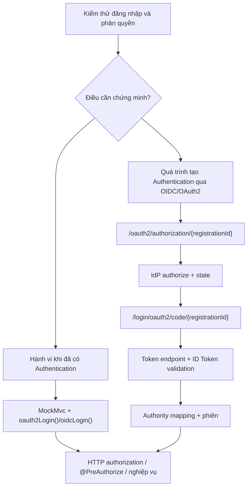

# Tách kiểm thử phân quyền sau đăng nhập khỏi kiểm thử giao thức đăng nhập

Khi ứng dụng Spring Security cho phép đăng nhập qua OAuth2 hoặc OpenID Connect (OIDC), một ca kiểm thử thường được viết rất gọn bằng `spring-security-test`: `MockMvc` gắn người dùng giả lập qua `oauth2Login()` hoặc `oidcLogin()`, rồi kiểm tra endpoint trả 200 hay 403. Cách làm này phù hợp để chứng minh **người dùng đã đăng nhập có được phép thực hiện hành động hay không**. Tuy nhiên, nó **không chứng minh** ứng dụng đã thực hiện đúng quá trình đăng nhập bằng Authorization Code, kiểm tra `state`/`nonce`, đổi authorization code lấy token, xác minh chữ ký ID Token hoặc thiết lập phiên sau callback.

Bài học thuộc chương **Đăng nhập OAuth2 và OIDC** của module `SPRING_SECURITY_TESTING`, tập trung vào ranh giới giữa hai loại kiểm thử: **phân quyền sau đăng nhập** và **giao thức đăng nhập**. Phương pháp sẽ dùng `MockMvc`, `@WithMockUser`, `oauth2Login()`, `oidcLogin()`, `SecurityContext` và các bài kiểm thử được phép/bị từ chối trên ứng dụng Servlet. Phần cuối giải thích cách chuyển tư duy sang `WebTestClient` cho Reactive.

## 1. Hai câu hỏi độc lập

Giả sử một ứng dụng báo cáo doanh thu sử dụng OIDC để đăng nhập nhân viên. Sau khi đăng nhập, nhân viên có authority `REPORT_READ` được đọc `GET /reports/{id}`; người dùng khác nhận 403.

Có **hai điều khác nhau** cần xác minh:

1. **Phân quyền sau đăng nhập:** Nếu `SecurityContext` chứa một người dùng đã được xác thực với authority `REPORT_READ` thì endpoint cho phép; nếu không có authority thì từ chối và nghiệp vụ không chạy.
2. **Giao thức đăng nhập:** Ứng dụng có tạo authorization request đúng với IdP không? Có đối chiếu `state` và, với OIDC, kiểm tra `nonce`? Có đổi `code` tại token endpoint, xác minh ID Token (`iss`, `aud`, chữ ký, thời gian...), lấy thông tin người dùng theo cấu hình, rồi tạo `Authentication`/phiên phù hợp hay không?

Một test có thể PASS ở câu 1 dù câu 2 bị hỏng. Nếu `OidcUserService` bị cấu hình sai, redirect URI sai hoặc bộ xác minh ID Token chấp nhận token của issuer khác, các test chỉ dùng `.with(oidcLogin())` vẫn có thể xanh vì không đi qua các bước này.



Nhánh **C** chủ động tạo sẵn `Authentication`. Nhánh **D** kiểm tra ứng dụng tạo `Authentication` đúng qua giao thức. Chúng có thể được kiểm thử riêng rồi kết hợp trong một số ca tích hợp.

## 2. So sánh các công cụ giả lập đăng nhập

| Công cụ | Principal/Authentication trong test | Đo được điều gì? | Điều không được kiểm chứng tự động |
|---|---|---|---|
| `@WithMockUser` | Thường là `UsernamePasswordAuthenticationToken` với principal của Spring Security | Luật URL/method dựa vào authorities, username | OAuth2/OIDC principal, code flow, token exchange, claim mapping |
| `.with(oauth2Login())` | OAuth2 user và `OAuth2AuthenticationToken` giả lập | Endpoint cần OAuth2 principal, phân quyền sau OAuth2 login | Redirect đến IdP, `state`, callback, gọi token/userinfo endpoint |
| `.with(oidcLogin())` | OIDC user (`OidcUser`) và `OAuth2AuthenticationToken` giả lập | Endpoint dùng ID Token claims/OIDC principal, luật phân quyền | Chữ ký ID Token, `nonce`, `iss`/`aud` từ IdP, token exchange, session login thật |
| `.with(jwt())` | `JwtAuthenticationToken` giả lập cho Resource Server | Phân quyền API đã có JWT authentication | OIDC browser login hay xác minh JWT ký thật |
| Authorization Code callback với IdP giả lập | Authentication được tạo bởi các filter/service của ứng dụng | Redirect, code exchange, ID Token validation và tích hợp đăng nhập | Không tự chứng minh IdP production luôn sẵn sàng hoặc cấu hình hạ tầng thật |

**Không đồng nhất** `oauth2Login()` (đăng nhập người dùng vào ứng dụng) với `oauth2ResourceServer().jwt()` (xác thực bearer token cho API). Đối với OIDC, **ID Token** dùng để chứng minh phiên đăng nhập của người dùng đối với client; **Access Token** được dùng để truy cập resource theo quy tắc OAuth2. Chúng có mục đích, audience và quá trình kiểm chứng khác nhau.

## 3. Ứng dụng mẫu: quyền đọc báo cáo sau OIDC login

Ta dùng Spring Boot Servlet với các dependencies `spring-boot-starter-web`, `spring-boot-starter-security`, `spring-boot-starter-oauth2-client`, `spring-boot-starter-test` và `spring-security-test`.

### Cấu hình OAuth2 client và HTTP authorization

Ví dụ tạo một `ClientRegistration` thử nghiệm để Spring Security có dữ liệu cấu hình. Các URL `idp.example.test` là giá trị minh họa, không phải dịch vụ dùng trong test post-processor.

```java
import org.springframework.context.annotation.Bean;
import org.springframework.context.annotation.Configuration;
import org.springframework.security.config.annotation.web.builders.HttpSecurity;
import org.springframework.security.config.Customizer;
import org.springframework.security.oauth2.client.registration.ClientRegistration;
import org.springframework.security.oauth2.client.registration.ClientRegistrationRepository;
import org.springframework.security.oauth2.client.registration.InMemoryClientRegistrationRepository;
import org.springframework.security.oauth2.core.AuthorizationGrantType;
import org.springframework.security.oauth2.core.oidc.IdTokenClaimNames;
import org.springframework.security.web.SecurityFilterChain;

@Configuration
class WebSecurityConfig {

    @Bean
    ClientRegistrationRepository clientRegistrationRepository() {
        ClientRegistration demo = ClientRegistration.withRegistrationId("demo")
                .clientId("report-client")
                .clientSecret("test-secret")
                .authorizationGrantType(AuthorizationGrantType.AUTHORIZATION_CODE)
                .redirectUri("{baseUrl}/login/oauth2/code/{registrationId}")
                .scope("openid", "profile")
                .authorizationUri("https://idp.example.test/authorize")
                .tokenUri("https://idp.example.test/token")
                .jwkSetUri("https://idp.example.test/jwks")
                .issuerUri("https://idp.example.test")
                .userInfoUri("https://idp.example.test/userinfo")
                .userNameAttributeName(IdTokenClaimNames.SUB)
                .clientName("Demo OIDC")
                .build();

        return new InMemoryClientRegistrationRepository(demo);
    }

    @Bean
    SecurityFilterChain securityFilterChain(HttpSecurity http) throws Exception {
        return http
                .authorizeHttpRequests(auth -> auth
                        .requestMatchers("/reports/**")
                        .hasAuthority("REPORT_READ")
                        .anyRequest().authenticated())
                .oauth2Login(Customizer.withDefaults())
                .build();
    }
}
```

Trong ứng dụng thật, nên lấy client ID, client secret và endpoints từ cấu hình an toàn hoặc discovery của IdP. Để kiểm thử **phân quyền sau login**, ta không cần gọi những endpoints đó vì đã giả lập người dùng. Khi kiểm thử **giao thức**, phải thay chúng bằng endpoints của IdP test server và giữ nguyên filter chain cần kiểm chứng.

### Controller và nghiệp vụ quan sát được

```java
import org.springframework.stereotype.Service;
import org.springframework.web.bind.annotation.GetMapping;
import org.springframework.web.bind.annotation.PathVariable;
import org.springframework.web.bind.annotation.RequestMapping;
import org.springframework.web.bind.annotation.RestController;

@Service
class ReportService {
    public String read(String id) {
        return "Report " + id;
    }
}

@RestController
@RequestMapping("/reports")
class ReportController {
    private final ReportService reportService;

    ReportController(ReportService reportService) {
        this.reportService = reportService;
    }

    @GetMapping("/{id}")
    String read(@PathVariable String id) {
        return reportService.read(id);
    }
}
```

Trong ví dụ này, kiểm tra `REPORT_READ` nằm ở **HTTP authorization**. Vì vậy, có thể mock `ReportService` để kiểm tra endpoint thực sự gọi nghiệp vụ khi được phép và **không gọi** khi bị từ chối. Nếu chuyển quyền vào `@PreAuthorize` trên `ReportService`, phải để service được Spring quản lý thật rồi chỉ mock những dependency phía sau, tránh bỏ qua method-security proxy.

## 4. Kiểm thử sau đăng nhập bằng MockMvc

Lớp test sau sử dụng `@SpringBootTest` và `@AutoConfigureMockMvc` để giữ SecurityFilterChain thật. Với Spring Framework 6.2+/Spring Boot 3.4+, `@MockitoBean` thay dependency nghiệp vụ để quan sát tương tác; ở phiên bản cũ dùng cơ chế mock bean tương ứng.

```java
import org.junit.jupiter.api.Test;
import org.springframework.beans.factory.annotation.Autowired;
import org.springframework.boot.test.autoconfigure.web.servlet.AutoConfigureMockMvc;
import org.springframework.boot.test.context.SpringBootTest;
import org.springframework.security.core.authority.SimpleGrantedAuthority;
import org.springframework.test.context.bean.override.mockito.MockitoBean;
import org.springframework.test.web.servlet.MockMvc;

import static org.mockito.Mockito.verify;
import static org.mockito.Mockito.verifyNoInteractions;
import static org.mockito.Mockito.when;
import static org.springframework.security.test.web.servlet.request
        .SecurityMockMvcRequestPostProcessors.oauth2Login;
import static org.springframework.security.test.web.servlet.request
        .SecurityMockMvcRequestPostProcessors.oidcLogin;
import static org.springframework.test.web.servlet.request.MockMvcRequestBuilders.get;
import static org.springframework.test.web.servlet.result
        .MockMvcResultMatchers.content;
import static org.springframework.test.web.servlet.result
        .MockMvcResultMatchers.status;

@SpringBootTest
@AutoConfigureMockMvc
class ReportAuthorizationAfterLoginTest {
    @Autowired
    MockMvc mockMvc;

    @MockitoBean
    ReportService reportService;

    @Test
    void oidcUserWithReportAuthority_canRead() throws Exception {
        when(reportService.read("q4")).thenReturn("ready");

        mockMvc.perform(get("/reports/q4")
                        .with(oidcLogin().authorities(
                                new SimpleGrantedAuthority("REPORT_READ"))))
                .andExpect(status().isOk())
                .andExpect(content().string("ready"));

        verify(reportService).read("q4");
    }

    @Test
    void oidcUserWithoutReportAuthority_isForbidden() throws Exception {
        mockMvc.perform(get("/reports/q4")
                        .with(oidcLogin().authorities(
                                new SimpleGrantedAuthority("ROLE_VIEWER"))))
                .andExpect(status().isForbidden());

        verifyNoInteractions(reportService);
    }

    @Test
    void oauth2UserWithReportAuthority_canRead() throws Exception {
        when(reportService.read("q4")).thenReturn("ready");

        mockMvc.perform(get("/reports/q4")
                        .with(oauth2Login().authorities(
                                new SimpleGrantedAuthority("REPORT_READ"))))
                .andExpect(status().isOk());

        verify(reportService).read("q4");
    }
}
```

Ba test trên kiểm tra **hành vi phân quyền sau khi có Authentication**:

- Người dùng OIDC có `REPORT_READ`: 200 và gọi `ReportService.read("q4")`.
- Người dùng OIDC không có `REPORT_READ`: 403 và **không** gọi service.
- Người dùng OAuth2 có `REPORT_READ`: 200, dù principal là `OAuth2User` thay vì `OidcUser`.

`@WithMockUser(authorities = "REPORT_READ")` cũng dùng được để thử URL authorization thuần túy. Tuy nhiên, nếu controller sử dụng `@AuthenticationPrincipal OidcUser`, đọc ID Token claims hoặc cần thuộc tính `OAuth2AuthenticationToken`, hãy chọn `oidcLogin()`/`oauth2Login()` để kiểm tra đúng loại principal mà controller kỳ vọng.

### Người dùng chưa đăng nhập

Với ứng dụng web dùng `oauth2Login()`, request chưa xác thực có thể được chuyển đến trang đăng nhập thay vì luôn trả 401. Ví dụ kiểm tra hành vi browser:

```java
import org.springframework.http.MediaType;

@Test
void anonymousBrowser_isRedirectedToLogin() throws Exception {
    mockMvc.perform(get("/reports/q4")
                    .accept(MediaType.TEXT_HTML))
            .andExpect(status().is3xxRedirection());

    verifyNoInteractions(reportService);
}
```

Đây là ca **bổ sung** trong lớp test trên. Nếu ứng dụng cấu hình authentication entry point cho API trả 401, cần thay kỳ vọng tương ứng. Không mặc định “chưa đăng nhập = 403”; 403 thường phản ánh người dùng đã xác thực nhưng thiếu quyền, còn hành vi của người chưa xác thực phụ thuộc entry point.

## 5. Mô phỏng OIDC principal và claims đúng mục đích

`oidcLogin()` cho phép tạo ID Token claims giả lập, hữu ích khi ứng dụng hiển thị tên, email hoặc dữ liệu định danh sau khi đăng nhập:

```java
mockMvc.perform(get("/account/profile")
                .with(oidcLogin()
                        .idToken(token -> token
                                .claim("sub", "employee-42")
                                .claim("email", "learner@example.test")
                                .claim("name", "Lan"))
                        .authorities(
                                new SimpleGrantedAuthority("REPORT_READ"))))
        .andExpect(status().isOk());
```

Ví dụ chỉ áp dụng nếu ứng dụng có endpoint `/account/profile` và endpoint ấy chấp nhận OIDC principal. Nó **không** xác minh claim `email` có thật từ IdP, không kiểm tra chữ ký ID Token và cũng không chứng minh `email_verified` đúng.

Tương tự, `oauth2Login().attributes(...)` có thể giả lập các thuộc tính OAuth2 User:

```java
mockMvc.perform(get("/account/profile")
                .with(oauth2Login()
                        .attributes(attrs -> {
                            attrs.put("id", "employee-42");
                            attrs.put("name", "Lan");
                        })))
        .andExpect(status().isOk());
```

Khi controller dùng các thuộc tính tùy biến, cần bảo đảm cấu hình principal name attribute của `ClientRegistration` hoặc `OAuth2UserService` khớp fixture. Đừng giả định mọi nhà cung cấp dùng `sub` và `id` tương đương.

> Một lần gọi `.with(oidcLogin())` **không** mô phỏng browser đã gửi request đến IdP, nhận cookie, đi qua callback rồi lưu SecurityContext vào HTTP session. Nó cung cấp SecurityContext cần thiết **cho request đang kiểm thử**.

## 6. Bẫy ánh xạ quyền: test xanh vì tự cấp REPORT_READ

Nhiều ứng dụng không nhận sẵn `REPORT_READ` từ IdP. Chúng nhận group/role, chẳng hạn ID Token chứa `groups: ["report-readers"]`, sau đó `GrantedAuthoritiesMapper` hoặc `OidcUserService` ánh xạ sang `REPORT_READ`.

Test sau **không kiểm chứng mapping thật**:

```java
mockMvc.perform(get("/reports/q4")
                .with(oidcLogin()
                        .idToken(token ->
                                token.claim("groups", java.util.List.of(
                                        "report-readers")))
                        .authorities(
                                new SimpleGrantedAuthority("REPORT_READ"))))
        .andExpect(status().isOk());
```

Vì test đã **cấp sẵn** `REPORT_READ`, nó vẫn có thể PASS ngay cả khi `GrantedAuthoritiesMapper` production đọc nhầm claim `roles` thay vì `groups`. Cũng vậy, việc gọi `oidcLogin().idToken(token -> token.claim("groups", ...))` mà không cấp authorities rõ ràng **không đảm bảo** mapper cấu hình trong `oauth2Login()` được gọi. Post-processor dựng Authentication giả lập, không đi qua login success pipeline.

Muốn kiểm chứng mapping, hãy thử trực tiếp bean ánh xạ và thêm ít nhất một bài tích hợp đi qua callback thật.

Ví dụ mapper từ group OIDC sang authority:

```java
import java.util.HashSet;
import java.util.Set;
import org.springframework.context.annotation.Bean;
import org.springframework.security.core.GrantedAuthority;
import org.springframework.security.core.authority.SimpleGrantedAuthority;
import org.springframework.security.core.authority.mapping.GrantedAuthoritiesMapper;
import org.springframework.security.oauth2.core.oidc.user.OidcUserAuthority;

@Bean
GrantedAuthoritiesMapper oidcAuthoritiesMapper() {
    return input -> {
        Set<GrantedAuthority> mapped = new HashSet<>(input);

        for (GrantedAuthority authority : input) {
            if (authority instanceof OidcUserAuthority oidc) {
                var groups =
                        oidc.getIdToken().getClaimAsStringList("groups");
                if (groups != null && groups.contains("report-readers")) {
                    mapped.add(
                            new SimpleGrantedAuthority("REPORT_READ"));
                }
            }
        }
        return mapped;
    };
}
```

Trong cấu hình OAuth2 Login thật, mapper phải được **nối vào** `userInfoEndpoint`:

```java
// Trong SecurityFilterChain; inject bean oidcAuthoritiesMapper vào method.
.oauth2Login(oauth2 -> oauth2
        .userInfoEndpoint(userInfo -> userInfo
                .userAuthoritiesMapper(oidcAuthoritiesMapper)))
```

Đoạn này là **phần thay thế** `.oauth2Login(Customizer.withDefaults())` ở cấu hình trước, không viết hai cấu hình oauth2Login song song. `GrantedAuthoritiesMapper` sẽ được dùng trong quá trình tạo Authentication khi login thật; `oidcLogin()` vẫn không tự động đi qua bean này.

Unit test mapper có thể dựng `OidcIdToken` rồi kiểm tra authority được sinh:

```java
import java.time.Instant;
import java.util.List;
import java.util.Map;
import org.springframework.security.oauth2.core.oidc.OidcIdToken;
import org.springframework.security.oauth2.core.oidc.user.OidcUserAuthority;

@Test
void oidcGroup_isMappedToReportAuthority() {
    Instant now = Instant.now();
    OidcIdToken idToken = new OidcIdToken(
            "fixture-id-token",
            now,
            now.plusSeconds(300),
            Map.of(
                    "sub", "employee-42",
                    "groups", List.of("report-readers"),
                    "iss", "https://idp.example.test",
                    "aud", List.of("report-client")));

    var mapped = oidcAuthoritiesMapper.mapAuthorities(
            List.of(new OidcUserAuthority(idToken)));

    assertThat(mapped)
            .extracting(GrantedAuthority::getAuthority)
            .contains("REPORT_READ");
}
```

Trong ví dụ, `oidcAuthoritiesMapper` là bean được inject vào test và `assertThat` là AssertJ. Với ca âm tính, cho `groups` trống hoặc `["other-group"]` rồi assert không có `REPORT_READ`. Unit test xác nhận **logic mapper**; integration test xác nhận **wiring mapper vào login**.

## 7. Kiểm thử giao thức đăng nhập: những phần phải đi qua filter thật

Để kiểm tra Authorization Code/OIDC, không gọi `.with(oauth2Login())` hay `.with(oidcLogin())` khi muốn đo chính đường đi giao thức. Thay vào đó, gửi các request tới những endpoint do Spring Security cấu hình và đặt một **IdP test server** tại các authorization/token/JWKS/userinfo URI.

### Bước 1: Khởi tạo Authorization Code flow

Browser gọi:

```http
GET /oauth2/authorization/demo HTTP/1.1
Host: localhost:8080
```

`OAuth2AuthorizationRequestRedirectFilter` tạo authorization request, lưu trạng thái theo cấu hình (thường trong session) rồi trả redirect 302 đến authorization endpoint của IdP. Link chuyển hướng thường có `client_id`, `response_type=code`, `redirect_uri`, `scope`, `state`; có thêm `nonce` trong OIDC và các tham số PKCE nếu client đã cấu hình PKCE.

Tại test, cần kiểm tra:

- Redirect hướng tới IdP test server đúng host/path và `client_id`, `redirect_uri`, `scope`.
- `state` là giá trị không rỗng, gắn với authorization request đang lưu; không so sánh với chuỗi hardcode.
- Các tham số `nonce`/PKCE được kiểm tra **theo cấu hình và flow** đang dùng. Đừng mặc định mọi OAuth2 client đều dùng OIDC nonce hay mọi phiên bản dùng PKCE cùng một cách.
- Giữ nguyên session/cookie cần thiết để callback có thể đối chiếu trạng thái.

Một đoạn khung `MockMvc`:

```java
MvcResult start = mockMvc.perform(
                get("/oauth2/authorization/demo"))
        .andExpect(status().is3xxRedirection())
        .andReturn();

String location = start.getResponse().getRedirectedUrl();
MockHttpSession session =
        (MockHttpSession) start.getRequest().getSession(false);

assertThat(location).startsWith(
        "https://idp.example.test/authorize");
assertThat(location).contains("state=");
assertThat(session).isNotNull();
```

Đây là **khung minh họa** cần imports JUnit/MockMvc/AssertJ tương ứng. Khi xác minh URL chính xác, nên parse query thành các tham số (đặc biệt `state`/`nonce`) thay vì chỉ dùng `contains`; cách làm này giúp tránh kiểm tra nhầm chuỗi con.

### Bước 2: Giả lập authorization code callback

Sau khi người dùng xác thực tại IdP, browser quay về:

```http
GET /login/oauth2/code/demo?code=fixture-code&state=<state-da-luu> HTTP/1.1
Cookie: JSESSIONID=<session-ban-dau>
```

`OAuth2LoginAuthenticationFilter` và các thành phần OAuth2 client cần xử lý code. Server kiểm thử có thể dùng WireMock hoặc MockWebServer để trả response token endpoint chứa Access Token và, với OIDC, ID Token **được ký bằng khóa riêng của fixture**. JWKS endpoint phải công bố khóa công khai tương ứng, đồng thời token có các claims hợp lệ với cấu hình client.

Test cần giữ **cùng session** từ bước 1 đến bước 2. Không tự dựng `OAuth2AuthenticationToken` trong bước callback; nếu làm vậy sẽ bỏ qua những điều cần kiểm chứng.

### Bước 3: Xác minh ID Token và principal/phiên

Trong OIDC, các điểm đáng kiểm tra bao gồm:

| Điều kiện | Kỳ vọng |
|---|---|
| `state` bị thay đổi hoặc không khớp session | Callback thất bại; không thiết lập phiên đăng nhập hợp lệ. |
| ID Token sai chữ ký hoặc `kid` không có khóa công khai tin cậy | Đăng nhập thất bại. |
| `iss` khác issuer được cấu hình | Đăng nhập thất bại. |
| `aud` không chứa client ID hợp lệ hoặc các điều kiện audience liên quan không đạt | Đăng nhập thất bại. |
| ID Token hết hạn | Đăng nhập thất bại. |
| `nonce` không khớp authorization request khi flow yêu cầu nonce | Đăng nhập thất bại. |
| Code/token endpoint từ chối hoặc timeout | Không tạo phiên thành công; lỗi được xử lý theo cấu hình. |
| ID Token hợp lệ, mapping group hợp lệ | Có `OidcUser` và authority mong đợi; yêu cầu tiếp theo được phân quyền chính xác. |

Nếu có UserInfo endpoint, kiểm tra đường gọi và xử lý claims/subject theo quy tắc OIDC. Không mặc định mọi OIDC client phải gọi UserInfo trong mọi lần đăng nhập.

### Bước 4: Kiểm chứng phiên sau callback

Sau callback thành công, dùng session/cookie tương ứng gửi request mới đến `/reports/q4` **không gắn `.with(oidcLogin())`**. Đảm bảo request sử dụng `Authentication` được tạo từ flow trước, và quyền `REPORT_READ` có/không có như IdP đã cấp. Đây mới là phép nối kiểm chứng giữa **protocol login → authority mapping → post-login authorization**.

Nếu test chỉ gọi endpoint callback mà không gửi request tiếp theo, nó có thể bỏ sót lỗi lưu SecurityContext/session hoặc lỗi mapper chỉ xuất hiện sau login. Ngược lại, nếu test chỉ gắn `oidcLogin()` cho request tiếp theo, nó không chứng minh session thật đã được thiết lập.

## 8. Xây dựng hai tầng test và một tầng tích hợp

Một chiến lược hiệu quả chia trách nhiệm:

| Tầng kiểm thử | Mục tiêu | Dữ liệu chuẩn bị | Assertion chính |
|---|---|---|---|
| A. Phân quyền sau đăng nhập | Các rule HTTP/`@PreAuthorize` đúng | `oauth2Login()`/`oidcLogin()` hoặc `@WithMockUser` với authorities rõ ràng | 200/403; nghiệp vụ có/không chạy; principal/claims nếu endpoint đọc chúng. |
| B. Logic chuyển claims thành authorities | Quy tắc group/role được ánh xạ đúng | `OidcIdToken`/`OAuth2UserAuthority` đầu vào giả lập; gọi mapper/service thật | Authorities chính xác; không tự cấp thêm quyền khi thiếu claim. |
| C. Giao thức login và wiring | Authorization Code/OIDC tạo Authentication đúng | Mock IdP HTTP, token/JWKS ký thật, session và callback | Redirect, state, nonce, token exchange, validator, mapping, session và request sau login. |

Các test tầng A thường nhanh và rất phù hợp với nhiều tình huống phân quyền. Tầng B giúp giải thích chính xác lỗi ánh xạ. Tầng C thường nặng hơn và nên tập trung vào các trường hợp có giá trị bảo mật: flow thành công, state sai, ID Token không hợp lệ, lỗi token endpoint, mapping sai hoặc không lưu được phiên.

### Mức độ tương đương cần nói rõ

**Đạt A** không suy ra **đạt B/C**. **Đạt B** không chứng minh mapper đã được nối vào flow. **Đạt C** cho thấy một đường đăng nhập hoạt động trong môi trường kiểm thử, nhưng không khẳng định nhà cung cấp production luôn sẵn sàng hoặc toàn bộ trình duyệt, cookie, reverse proxy, TLS/cross-site behavior giống môi trường thử.

Đối với Web Application có cookie và redirect thực, có thể bổ sung kiểm thử browser end-to-end về SameSite, Secure, session fixation và logout. Đây là lớp bổ sung, không phải yêu cầu mọi lần kiểm tra quyền bằng MockMvc đều phải chạy browser.

## 9. Những lỗi thường làm test báo xanh giả

1. **Dùng `oidcLogin()` rồi kết luận login protocol an toàn:** Post-processor đã tạo sẵn Authentication nên không đo `state`, `nonce`, token exchange, chữ ký ID Token.
2. **Tự cấp `REPORT_READ` rồi kết luận group mapping đúng:** Test bỏ qua mapper production. Kiểm tra mapper riêng và có ca callback thật.
3. **Dùng `@WithMockUser` cho controller cần `OidcUser`:** Principal có thể sai kiểu so với production, khiến test kiểm tra không đúng đường code hoặc thất bại vì `ClassCastException`.
4. **Dùng `jwt()` thay `oidcLogin()`:** Đây là tình huống Resource Server, không phải browser login bằng Authorization Code/OIDC.
5. **Cho rằng 401/302/403 luôn giống nhau:** Chưa đăng nhập có thể redirect sang login; thiếu quyền sau login thường là 403. Entry point và Accept header làm thay đổi kết quả.
6. **Test callback bằng session mới:** `state` không còn đối chiếu được; nếu code vẫn thành công cần điều tra lỗ hổng hoặc cách repository được thay thế trong test.
7. **Không kiểm tra nhánh từ chối:** Chỉ test thành công có thể bỏ sót trường hợp mọi người dùng đều được cấp quá nhiều quyền.
8. **Mock luôn bean được bảo vệ bởi `@PreAuthorize`:** Sẽ bỏ qua interceptor; khi test method security nên giữ bean thật và mock dependency gây tác dụng phụ.
9. **Kiểm tra ID Token chỉ bằng parse JSON:** JWT payload có thể đọc được mà chưa xác minh chữ ký, issuer, audience, hạn dùng; cần validator thật trong test giao thức.
10. **Quên CSRF trên request ghi dữ liệu:** Khi test endpoint sau login bằng `POST`/`PUT`/`DELETE`, bổ sung `.with(csrf())` theo cấu hình. Nếu không, 403 do CSRF có thể che lỗi phân quyền.
11. **Nhầm login thành công với được phép mọi API:** Authentication chỉ xác nhận danh tính; authorization vẫn phải kiểm tra authorities/scope theo từng tài nguyên.

## 10. Reactive và WebTestClient

Với Spring WebFlux, `WebTestClient` có các test configurers tương ứng để dựng người dùng OAuth2/OIDC đã xác thực, chẳng hạn `SecurityMockServerConfigurers.mockOAuth2Login()` và `mockOidcLogin()`. Ví dụ kiểm tra phân quyền sau login:

```java
import static org.springframework.security.test.web.reactive.server
        .SecurityMockServerConfigurers.mockOidcLogin;
import org.springframework.security.core.authority.SimpleGrantedAuthority;

webTestClient
        .mutateWith(mockOidcLogin()
                .authorities(new SimpleGrantedAuthority("REPORT_READ")))
        .get()
        .uri("/reports/q4")
        .exchange()
        .expectStatus().isOk();
```

Tương tự `oidcLogin()` của Servlet, `mockOidcLogin()` kiểm tra request với người dùng OIDC **đã được giả lập**; nó không tự kiểm tra authorization redirect, code exchange, chữ ký ID Token hoặc phiên đăng nhập thực. Nếu mục tiêu là kiểm thử giao thức WebFlux, phải gửi các request qua flow Reactive OAuth2 Login với IdP test server và giữ WebSession đúng cách. Không lấy kết quả MockMvc Servlet để suy ra cơ chế WebSession của Reactive.

## 11. Checklist chọn đúng kiểu kiểm thử

- [ ] Đã nêu rõ mục tiêu là **phân quyền sau login**, **mapping quyền**, hay **login protocol**, và assertion tương ứng.
- [ ] Test phân quyền dùng đúng principal `OAuth2User`/`OidcUser` khi ứng dụng cần kiểu đó; kiểm tra 200 và 403, kèm tác dụng phụ nghiệp vụ.
- [ ] Nếu kiểm tra group/claim mapping, không cấp trực tiếp authority đầu ra như thể mapper đã chạy.
- [ ] Nếu kiểm tra protocol, request đi qua `/oauth2/authorization/{registrationId}` và `/login/oauth2/code/{registrationId}` với IdP test server.
- [ ] Callback dùng cùng session; test kiểm chứng `state` và `nonce` theo flow, token exchange, chữ ký/claims ID Token và phản hồi lỗi.
- [ ] Sau callback thành công, dùng session đã tạo gửi request mới **không** dùng `oidcLogin()`; xác minh principal và authorization.
- [ ] Phân biệt OAuth2/OIDC browser login với xác thực bearer JWT của Resource Server.
- [ ] Với HTTP mutation, xét CSRF và xác định lỗi 401/302/403 xuất phát từ tầng nào.

**Thông điệp chính:** `oauth2Login()` và `oidcLogin()` là công cụ rất tốt để kiểm thử hệ thống **sau khi đã có người dùng đăng nhập**. Để khẳng định **giao thức đăng nhập** hoạt động đúng và an toàn, bài test cần đi qua redirect, callback, token endpoint, validator, authority mapping và thiết lập phiên bằng các thành phần thật của Spring Security.
