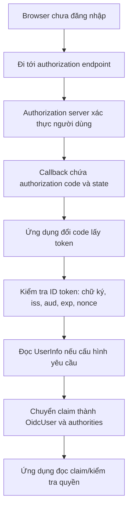

# Không dùng `@WithMockUser` thay cho `OidcUser` khi mã ứng dụng cần claim OIDC

Trong chương **Đăng nhập OAuth2 và OIDC** của module **SPRING_SECURITY_TESTING**, một lỗi phổ biến là dùng `@WithMockUser` để kiểm thử endpoint vốn đang đọc `OidcUser`, sau đó kết luận mã xử lý claim OpenID Connect (OIDC) đã đúng. `@WithMockUser` tạo ra một người dùng Spring Security giả theo cơ chế username/password; nó **không tạo `OidcUser`, ID token, UserInfo hay principal OIDC**. Nếu controller, service hoặc policy đang phụ thuộc `sub`, `email`, `email_verified`, `preferred_username`, `iss`, `aud` hay các claim tùy chỉnh từ OIDC, test phải cung cấp **đúng kiểu principal và claim**.

Mục tiêu của bài là viết kiểm thử xác thực, phân quyền và bảo vệ HTTP bằng `spring-security-test` trên **Servlet/MockMvc** và **Reactive/WebTestClient**: chọn `oidcLogin()` hoặc `mockOidcLogin()` khi cần `OidcUser`, giữ `@WithMockUser` cho kịch bản chỉ cần user/role, và phân biệt kiểm thử *sau đăng nhập* với kiểm thử *quy trình OIDC thực tế*.

## 1. `@WithMockUser` khác `OidcUser` ở điểm nào?

Spring Security quản lý trạng thái đăng nhập qua `SecurityContext`, trong đó `Authentication` chứa principal và authorities. Tuy nhiên, không phải mọi `Authentication` đều đại diện cho cùng một cơ chế xác thực:

| Cách tạo danh tính trong test | `Authentication` điển hình | Principal điển hình | Có claim và ID token OIDC? |
| --- | --- | --- | --- |
| `@WithMockUser` | `UsernamePasswordAuthenticationToken` | `org.springframework.security.core.userdetails.User` | **Không** |
| MockMvc `.with(user("...")...)` | `UsernamePasswordAuthenticationToken` | `UserDetails` | **Không** |
| MockMvc `.with(oauth2Login())` | `OAuth2AuthenticationToken` | `OAuth2User`, thường là `DefaultOAuth2User` | **Không mặc định là `OidcUser`** |
| MockMvc `.with(oidcLogin())` | `OAuth2AuthenticationToken` | `OidcUser`, thường là `DefaultOidcUser` | **Có; dữ liệu giả do test cung cấp** |
| WebTestClient `.mutateWith(mockOidcLogin())` | Trạng thái xác thực OAuth2/OIDC tương ứng | `OidcUser` | **Có; dữ liệu giả do test cung cấp** |
| Resource server `.with(jwt())` / `.mutateWith(mockJwt())` | `JwtAuthenticationToken` | Thường là `Jwt` | Có claim JWT, nhưng **không phải principal `OidcUser` của OAuth2 Login** |

Đây là khác biệt **về kiểu đối tượng và ngữ nghĩa**. Một `UserDetails` có tên đăng nhập `alice` không tự có `idToken.getSubject()`, `getUserInfo()` hoặc `getClaims()` theo chuẩn OIDC. Tương tự, việc thêm role `ADMIN` không làm Spring Security chuyển `UsernamePasswordAuthenticationToken` thành `OAuth2AuthenticationToken`.

### Hệ quả đối với `@AuthenticationPrincipal`

Giả sử endpoint nhận trực tiếp `OidcUser`:

```java
@GetMapping("/api/me")
ProfileView profile(@AuthenticationPrincipal OidcUser oidcUser) {
    return new ProfileView(
        oidcUser.getSubject(),
        oidcUser.getEmail(),
        oidcUser.getEmailVerified()
    );
}
```

Nếu request được tạo bằng `@WithMockUser`, principal trong context có kiểu `User`, không tương thích `OidcUser`. Với `@AuthenticationPrincipal` mặc định, Spring Security có thể đưa giá trị `null` vào tham số khi sai kiểu; đoạn mã dereference `oidcUser` có thể phát sinh `NullPointerException`. Nếu đặt `@AuthenticationPrincipal(errorOnInvalidType = true)`, resolver sẽ báo lỗi kiểu rõ ràng hơn. **Cả hai đều không chứng minh logic OIDC hoạt động.**

Không nên sửa test bằng cách ép kiểu `User` thành `OidcUser`, ép controller chỉ đọc `getName()`, hay bổ sung dữ liệu claim trong một map không bao giờ được principal OIDC sử dụng. Hãy tạo đúng `OidcUser` cho đúng ca kiểm thử.

## 2. Những dữ liệu thực sự nằm trong một `OidcUser`

OIDC là lớp nhận dạng xây trên OAuth2. Trong luồng OAuth2/OIDC Login, ứng dụng client nhận thông tin định danh người dùng từ **ID token** và đôi khi từ **UserInfo endpoint**. Ở Spring Security:

- `OidcUser.getIdToken()` trả về `OidcIdToken` chứa các claim của ID token, chẳng hạn `sub`, `iss`, `aud`, `iat`, `exp` và claim profile được issuer cung cấp.
- `OidcUser.getUserInfo()` trả về `OidcUserInfo` **khi có dữ liệu UserInfo**; không mặc định đối tượng này luôn tồn tại.
- `OidcUser.getClaims()` biểu diễn các thuộc tính được tổng hợp cho `OidcUser`; nguồn và quy tắc phối hợp claim phụ thuộc cách principal được xây dựng.
- `OidcUser.getAuthorities()` chứa các quyền mà Spring Security dùng cho phân quyền; **không được mặc định suy ra role quản trị từ `email` hoặc `sub`**.
- `OidcUser.getName()` dựa vào name attribute key của implementation; tên này không nhất thiết bằng email hoặc `preferred_username`.

Ví dụ tập claim giả cho một bài test:

```json
{
  "iss": "https://issuer.test.invalid",
  "sub": "fixture-sub-042",
  "aud": ["fixture-client"],
  "email": "reader@example.test",
  "email_verified": true,
  "preferred_username": "fixture-reader",
  "tenant_id": "tenant-a"
}
```

Đây là dữ liệu *fixture*, không phải ID token đã được ký. Trong thực tế, `sub` là định danh của subject trong phạm vi issuer và thường là khóa định danh ổn định hơn email. Nếu lưu danh tính nhiều issuer, ứng dụng cần cân nhắc cặp `(iss, sub)`, thay vì mặc định mỗi `sub` trên toàn thế giới là duy nhất. `email_verified` thể hiện thuộc tính xác minh email do issuer báo; việc có quyền truy cập nghiệp vụ vẫn phải dựa vào chính sách của ứng dụng.

**ID token không phải access token.** ID token phục vụ danh tính đăng nhập cho OAuth2 client; access token dùng để gọi tài nguyên được ủy quyền. Vì vậy một test resource server dùng `jwt()` có thể đúng cho API nhận bearer JWT, nhưng **không thay thế** bài test controller nhận `OidcUser` trong phiên OAuth2/OIDC Login.

## 3. Servlet: dùng `oidcLogin()` với MockMvc

Ví dụ ứng dụng hiển thị hồ sơ sau khi đăng nhập OIDC và yêu cầu claim `tenant_id`. DTO và controller đơn giản như sau:

```java
record ProfileView(
    String subject,
    String email,
    Boolean emailVerified,
    String tenantId
) {}

@RestController
class ProfileController {

    @GetMapping("/api/me")
    ProfileView me(@AuthenticationPrincipal(errorOnInvalidType = true)
                   OidcUser user) {
        Object rawTenant = user.getClaims().get("tenant_id");
        if (!(rawTenant instanceof String tenantId) || tenantId.isBlank()) {
            throw new ResponseStatusException(
                HttpStatus.FORBIDDEN, "Missing or invalid tenant_id");
        }
        return new ProfileView(
            user.getSubject(),
            user.getEmail(),
            user.getEmailVerified(),
            tenantId
        );
    }
}
```

Ở đây endpoint kỳ vọng người gọi đã đăng nhập theo cơ chế OIDC và có `tenant_id` là chuỗi không rỗng. Nếu thiếu/sai claim, controller minh họa trả **403** qua `ResponseStatusException` (cần import `HttpStatus` và `ResponseStatusException`); đây là policy mẫu của ứng dụng, không phải quy tắc tự động của mọi OIDC client. Phần security của ứng dụng phải có filter chain và cơ chế OAuth2 Login tương ứng, ví dụ:

```java
@Bean
SecurityFilterChain securityFilterChain(HttpSecurity http) throws Exception {
    return http
        .authorizeHttpRequests(auth -> auth
            .requestMatchers("/api/me").authenticated()
            .anyRequest().permitAll())
        .oauth2Login(Customizer.withDefaults())
        .build();
}
```

Khi dựng một lớp test `@WebMvcTest(ProfileController.class)` hoặc `@SpringBootTest` kết hợp `@AutoConfigureMockMvc`, cần nạp cấu hình security phù hợp và cung cấp `ClientRegistrationRepository` test nếu cấu hình `oauth2Login()` yêu cầu. Các method test bên dưới giả định lớp test đã có `MockMvc mvc`, controller, filter chain và các static import `get`, `oidcLogin`, `status`, `jsonPath`.

```java
@Test
void profileReadsClaimsFromOidcPrincipal() throws Exception {
    mvc.perform(get("/api/me")
            .with(oidcLogin()
                .idToken(token -> token
                    .subject("fixture-sub-042")
                    .claim("email", "reader@example.test")
                    .claim("email_verified", true)
                    .claim("tenant_id", "tenant-a"))))
        .andExpect(status().isOk())
        .andExpect(jsonPath("$.subject").value("fixture-sub-042"))
        .andExpect(jsonPath("$.email").value("reader@example.test"))
        .andExpect(jsonPath("$.emailVerified").value(true))
        .andExpect(jsonPath("$.tenantId").value("tenant-a"));
}
```

`oidcLogin()` thuộc `SecurityMockMvcRequestPostProcessors`. Nó xây principal OIDC giả cùng các thành phần cần cho trạng thái đã đăng nhập, giúp controller nhận được `OidcUser` đúng kiểu. **Nó không thực hiện một lần đăng nhập OIDC qua mạng**, không truy cập UserInfo/Token endpoint và không kiểm tra chữ ký ID token.

Một anti-pattern thường gặp:

```java
@Test
@WithMockUser(username = "fixture-sub-042", roles = "USER")
void profileShouldUseOidcClaims_butThisIsIncorrect() throws Exception {
    mvc.perform(get("/api/me"))
        .andExpect(status().isOk()); // Không có OidcUser; kỳ vọng này sai.
}
```

Trong ví dụ trên, việc đặt `username` giống `sub` không làm principal có ID token. Với `errorOnInvalidType = true`, request thường sẽ thất bại ở bước resolve tham số. Nếu không có cờ này, `OidcUser` có thể là `null`. Đừng bắt test chạy xanh bằng cách bỏ hẳn kiểm tra principal/claim khỏi controller.

### Kiểm thử claim thiếu hoặc claim sai kiểu

Không nên chỉ có một ca “happy path”. Nếu logic ứng dụng cần `tenant_id`, hãy thêm dữ liệu thiếu hoặc sai kiểu và xác định hành vi mong đợi:

```java
@Test
void missingTenantClaimIsVisibleToPolicy() throws Exception {
    mvc.perform(get("/api/me")
            .with(oidcLogin().idToken(token -> token
                .subject("fixture-sub-042")
                .claim("email", "reader@example.test"))))
        .andExpect(status().isForbidden());
}
```

Test này chứng minh **policy của controller minh họa**: thiếu `tenant_id` dẫn tới 403, không trả hồ sơ thuộc một tenant chưa được xác định. Ứng dụng khác có thể định nghĩa 400 hoặc một cách ánh xạ lỗi riêng; assertion phải theo **contract nghiệp vụ** của ứng dụng. Không coi thiếu tenant nhưng status 200 là an toàn mặc định.

Nếu claim có giá trị số hoặc object nhưng code ép `(String)`, việc ném `ClassCastException` cũng không phải một chính sách bảo mật rõ ràng. Nên kiểm tra kiểu và giá trị trước khi dùng claim làm khóa truy vấn, quyết định tenant hoặc quyền truy cập.

## 4. Khi cần cả ID token và UserInfo

Một số claim xuất hiện trong ID token, một số chỉ được cung cấp qua UserInfo. Mã ứng dụng có thể dùng `OidcUser.getUserInfo()` để lấy dữ liệu bổ sung:

```java
@GetMapping("/api/display-name")
String displayName(@AuthenticationPrincipal OidcUser user) {
    OidcUserInfo userInfo = user.getUserInfo();
    if (userInfo == null) {
        return user.getSubject();
    }
    String nickname = userInfo.getPreferredUsername();
    return nickname != null ? nickname : user.getSubject();
}
```

Với `oidcLogin()`, có thể cung cấp UserInfo fixture khi phương thức được phiên bản `spring-security-test` hỗ trợ:

```java
mvc.perform(get("/api/display-name")
        .with(oidcLogin()
            .idToken(token -> token.subject("fixture-sub-042"))
            .userInfoToken(info -> info
                .claim("sub", "fixture-sub-042")
                .claim("preferred_username", "fixture-nickname"))))
    .andExpect(status().isOk())
    .andExpect(content().string("fixture-nickname"));
```

Nếu muốn kiểm soát chính xác loại principal hoặc tổ hợp claim, có thể xây `OidcUser` thủ công rồi đưa vào `oidcLogin().oidcUser(customUser)`:

```java
Instant issuedAt = Instant.parse("2026-01-01T00:00:00Z");
Instant expiresAt = issuedAt.plusSeconds(3600);

OidcIdToken idToken = new OidcIdToken(
    "synthetic-id-token-for-tests",
    issuedAt,
    expiresAt,
    Map.of(
        "iss", "https://issuer.test.invalid",
        "sub", "fixture-sub-042",
        "aud", List.of("fixture-client"),
        "email", "reader@example.test"));

OidcUserInfo userInfo = new OidcUserInfo(Map.of(
    "sub", "fixture-sub-042",
    "preferred_username", "fixture-nickname"));

OidcUser customUser = new DefaultOidcUser(
    List.of(new SimpleGrantedAuthority("ROLE_READER")),
    idToken,
    userInfo,
    "sub");

mvc.perform(get("/api/display-name")
        .with(oidcLogin().oidcUser(customUser)))
    .andExpect(status().isOk())
    .andExpect(content().string("fixture-nickname"));
```

Đoạn trên là một fixture nằm trong lớp test và dùng `Instant`, `Map`, `List` của Java; `OidcIdToken`, `OidcUserInfo`, `DefaultOidcUser` của Spring Security OAuth2 Core. `synthetic-id-token-for-tests` chỉ là chuỗi trong bộ nhớ, **không phải ID token đã ký hợp lệ để gửi tới provider**. Một khi dùng `customUser`, toàn bộ authorities, ID token và UserInfo phải được fixture xây đủ cho chính sách cần kiểm tra.

## 5. Quyền truy cập và claim là hai kiểm tra khác nhau

Một `OidcUser` có `email_verified: true` chưa chắc được phép xem hóa đơn quản trị. Và một principal có `ROLE_ADMIN` chưa chắc thuộc đúng tenant. Hãy tách rõ:

1. **Authentication:** request có danh tính hợp lệ trong `SecurityContext` hay chưa?
2. **Authorization:** authorities hoặc chính sách cấp quyền cho endpoint có phù hợp không?
3. **Claim-dependent business rules:** `sub`, tenant, email verification hoặc thuộc tính hồ sơ có giá trị đúng, đủ và được phép dùng cho hành động yêu cầu không?

Ví dụ rule của `SecurityFilterChain` yêu cầu `ROLE_ADMIN` cho `/api/admin/audit`:

```java
@Test
void oidcUserWithoutAdminRoleGets403() throws Exception {
    mvc.perform(get("/api/admin/audit")
            .with(oidcLogin().authorities(
                new SimpleGrantedAuthority("ROLE_READER"))))
        .andExpect(status().isForbidden());
}

@Test
void oidcUserWithAdminRoleCanProceed() throws Exception {
    mvc.perform(get("/api/admin/audit")
            .with(oidcLogin().authorities(
                new SimpleGrantedAuthority("ROLE_ADMIN"))))
        .andExpect(status().isOk());
}
```

Để hai test đúng, security config phải có rule `hasRole("ADMIN")` và endpoint được khai báo. Tùy policy, request anonymous có thể dẫn tới **302 chuyển hướng sang trang login** (OAuth2 Login trên trình duyệt), thay vì 401 thường thấy ở HTTP Basic/Bearer API. Không hard-code kỳ vọng 401 cho mọi endpoint OAuth2 client. Đối với user đã xác thực nhưng thiếu quyền, 403 là kỳ vọng thường gặp.

**Đặc biệt:** `.authorities(...)` trong `oidcLogin()` gắn quyền **trực tiếp** cho principal giả. Nó không chứng minh ứng dụng đã chuyển claim `groups` hoặc `roles` từ IdP thành `GrantedAuthority` đúng. Nếu hệ thống có `OidcUserService`, `GrantedAuthoritiesMapper` hoặc converter tùy chỉnh, cần unit test riêng cho logic mapping và test tích hợp qua luồng thích hợp. Đừng viết fixture `ROLE_ADMIN` rồi tuyên bố đã kiểm thử thuật toán mapping role từ claim.

## 6. Reactive: dùng `mockOidcLogin()` với WebTestClient

Trong ứng dụng WebFlux, cần một principal OIDC tương đương để controller có thể nhận `OidcUser` hoặc để lấy principal từ reactive security context. `spring-security-test` cung cấp `SecurityMockServerConfigurers.mockOidcLogin()` cho `WebTestClient`:

```java
@Test
void reactiveProfileReadsOidcClaims() {
    webTestClient.mutateWith(mockOidcLogin()
            .idToken(token -> token
                .subject("fixture-reactive-sub")
                .claim("email", "reactive@example.test")
                .claim("email_verified", true)
                .claim("tenant_id", "tenant-reactive")))
        .get().uri("/api/me")
        .exchange()
        .expectStatus().isOk()
        .expectBody()
        .jsonPath("$.subject").isEqualTo("fixture-reactive-sub")
        .jsonPath("$.tenantId").isEqualTo("tenant-reactive");
}
```

Đoạn code giả định WebFlux controller có contract JSON giống mục 3, `webTestClient` đã bind vào application context có `SecurityWebFilterChain` và được cấu hình tích hợp Spring Security. Nếu dựng client thủ công từ context, áp dụng `WebTestClient.bindToApplicationContext(context).apply(springSecurity()).build()` để filter chain tham gia request. Dùng `mockOidcLogin()` cho **OAuth2/OIDC Login**; dùng `mockJwt()` cho **OAuth2 Resource Server** cần bearer JWT authentication.

Ở tầng service reactive, principal thường có thể lấy từ `ReactiveSecurityContextHolder`, hoặc được truyền vào handler theo cơ chế Spring Security/WebFlux. Khi cần kiểm chứng `OidcUser` có claim, `mockOidcLogin()` bảo đảm principal có đúng hình dạng; một `mockUser()` hoặc `@WithMockUser` chỉ tạo danh tính username/authorities thông thường.

### Ca thiếu claim trong Reactive

Test thêm `tenant_id` thiếu, `email_verified=false` hoặc `sub` khác tenant đang sở hữu tài nguyên. Đặc biệt với API đa tenant, kiểm thử cả hai chiều: đúng principal/tenant được phép và principal/tenant khác bị từ chối. Nếu policy được thực thi ở method security (`@PreAuthorize`), test phải bật phương thức bảo mật reactive tương ứng và bảo đảm lời gọi đi qua proxy bảo mật; nếu không, status 200 có thể chỉ phản ánh controller hoạt động, chưa chứng minh kiểm tra quyền.

## 7. `SecurityContext` và cách xác nhận principal trong test

Một hướng sai thường gặp là kiểm tra `SecurityContextHolder.getContext()` **sau khi** `mvc.perform(...)` kết thúc và mong còn nguyên OAuth2 principal. Filter chain có thể dọn context sau request; kết quả lúc đó không nhất thiết phản ánh principal được nhìn thấy **bên trong request**. Cách đáng tin hơn:

- Kiểm tra giá trị do controller trả ra dựa trên `@AuthenticationPrincipal OidcUser`, như test JSON ở mục 3.
- Với service phụ thuộc `Authentication`, mock/spy service test và xác nhận đúng principal được truyền vào trong lúc xử lý request.
- Với unit test controller/service thuần Java, xây `DefaultOidcUser` rồi truyền trực tiếp; không cần dựng HTTP test nếu mục tiêu chỉ là xử lý claim.
- Với method security, chạy qua proxy đã bật `@EnableMethodSecurity` hoặc `@EnableReactiveMethodSecurity` để thật sự kiểm tra quyền.

Nếu rất nhiều test cần cùng principal, có thể xây annotation riêng bằng `@WithSecurityContext` và `WithSecurityContextFactory`, thay vì dùng sai `@WithMockUser`:

```java
@Retention(RetentionPolicy.RUNTIME)
@WithSecurityContext(factory = WithFixtureOidcUserFactory.class)
@interface WithFixtureOidcUser {
    String subject() default "fixture-sub-042";
}

final class WithFixtureOidcUserFactory
        implements WithSecurityContextFactory<WithFixtureOidcUser> {

    @Override
    public SecurityContext createSecurityContext(WithFixtureOidcUser config) {
        Instant now = Instant.parse("2026-01-01T00:00:00Z");
        OidcIdToken idToken = new OidcIdToken(
            "fixture-id-token", now, now.plusSeconds(3600),
            Map.of(
                "iss", "https://issuer.test.invalid",
                "sub", config.subject(),
                "aud", List.of("fixture-client"),
                "email", "reader@example.test"));

        OidcUser oidcUser = new DefaultOidcUser(
            List.of(new SimpleGrantedAuthority("ROLE_READER")),
            idToken,
            "sub");

        Authentication authentication = new OAuth2AuthenticationToken(
            oidcUser,
            oidcUser.getAuthorities(),
            "fixture-client");

        SecurityContext context = SecurityContextHolder.createEmptyContext();
        context.setAuthentication(authentication);
        return context;
    }
}
```

Sau đó test có thể dùng `@WithFixtureOidcUser(subject = "fixture-sub-017")`. Đây là mẫu minh họa cho **bộ test Spring Security với listener phù hợp**; package/import và phạm vi truy cập của annotation/factory cần được tổ chức theo dự án. Factory phải bảo đảm fixture có những claim và authorities mà từng test thực sự cần; annotation này **không tự tải UserInfo hoặc chạy Authorization Code flow**.

Trong các test HTTP, `oidcLogin()`/`mockOidcLogin()` theo request thường ngắn và dễ đọc hơn. Factory riêng có ích khi lặp lại cùng một tập claim ở nhiều method test hoặc muốn điều khiển tham số fixture theo annotation.

## 8. Không dùng OIDC mock để chứng minh toàn bộ quy trình đăng nhập thật

`oidcLogin()` và `mockOidcLogin()` kiểm tra code khi người dùng **đã được xác thực** bằng một principal OIDC giả. Chúng cố ý bỏ qua nhiều bước quan trọng của một luồng đăng nhập OIDC thực tế:



Mock OIDC principal chủ yếu kiểm chứng phần **I**, và trong một số test có thể kiểm chứng những logic được gọi trực tiếp sau khi principal đã có. Các bước `state`, PKCE, callback, token exchange, validate chữ ký, issuer/audience/nonce và ánh xạ principal từ provider **không được bảo đảm** chỉ bởi `.with(oidcLogin())`.

Muốn kiểm chứng những bước đó, dùng kiểm thử tích hợp với **stub OIDC provider** hoặc sandbox được cấp riêng cho test. Cấu hình `ClientRegistration`, authorization endpoint, token endpoint, JWK Set URI và UserInfo endpoint trong môi trường cô lập. Không dùng client secret, ID token, access token hoặc phiên đăng nhập lấy từ production/staging đang triển khai. Các token được ký bằng khóa test nếu cần kiểm tra chữ ký; không truyền chuỗi `fixture-id-token` của mock principal vào decoder thật rồi coi nó là JWT hợp lệ.

### Phân biệt `oauth2Login()` và `oidcLogin()`

`oauth2Login()` đủ cho ứng dụng chỉ cần `OAuth2User.getAttributes()` của OAuth2 Login thông thường. Khi controller thật sự cần `OidcUser.getIdToken()`, `getUserInfo()` hoặc getter claim chuẩn OIDC, **chọn `oidcLogin()`**. Không nên chỉ thêm key `sub` vào `OAuth2User` rồi coi nó tự trở thành OIDC principal.

## 9. Ma trận kiểm thử cần có

| Kịch bản | Fixture thích hợp | Điều phải khẳng định |
| --- | --- | --- |
| Endpoint chỉ yêu cầu user có role thông thường | `@WithMockUser(roles = "USER")` | Luật truy cập cơ bản; không kết luận về claim OIDC |
| Endpoint đọc subject từ ID token | MockMvc `oidcLogin().idToken(...)` | `OidcUser` đúng kiểu, `sub` được đọc đúng |
| Endpoint dùng email và `email_verified` | `oidcLogin()`/`mockOidcLogin()` với claim tường minh | Phân nhánh có email xác minh, chưa xác minh hoặc thiếu claim theo policy |
| Endpoint dùng `preferred_username` từ UserInfo | `oidcLogin().userInfoToken(...)` hoặc custom `OidcUser` | Có UserInfo đọc đúng; thiếu UserInfo có fallback hoặc báo lỗi theo contract |
| Endpoint yêu cầu role/authority | `oidcLogin().authorities(...)` | 403 khi thiếu quyền, 2xx khi đủ quyền; không kết luận về mapper claim-to-role |
| Ứng dụng đa tenant | `OidcUser` có `tenant_id` và tài nguyên fixture thuộc tenant khác | Không truy cập chéo tenant theo policy |
| Handler WebFlux đọc OIDC principal | `mockOidcLogin()` | Claim trong reactive request có mặt và đúng kiểu |
| Luồng OAuth2/OIDC callback, state, nonce, chữ ký | Stub provider và OAuth2 client cấu hình test | Test đi qua quy trình thật cần kiểm chứng, không dùng post-processor thay thế |
| API resource server nhận bearer JWT | `jwt()`/`mockJwt()` để kiểm tra role, hoặc JWT ký test với decoder thật | Đúng mô hình `JwtAuthenticationToken`; không nhầm với phiên OAuth2/OIDC Login |

Một bộ test tốt có cả kịch bản **được phép** và **bị từ chối**. Nếu toàn bộ test chỉ kiểm tra 200, việc bỏ mất security filter hoặc policy không hoạt động có thể khiến test vẫn xanh. Khi dùng MockMvc, cần bảo đảm filter chain được áp dụng (ví dụ `@AutoConfigureMockMvc` với filters bật hoặc tự `.apply(springSecurity())`); với WebTestClient, cần gắn Spring Security configurer tương ứng.

## 10. Bài thực hành: sửa một bộ test dùng sai principal

Cho ứng dụng có hai endpoint: `GET /api/me` trả `sub`, `email`, `email_verified`, `tenant_id` từ `OidcUser`; `GET /api/admin/audit` chỉ cho phép `ROLE_ADMIN` và yêu cầu người dùng thuộc tenant cho phép. Viết hai bộ test Servlet và Reactive tương ứng.

1. Bắt đầu từ một test `@WithMockUser(username = "fixture-user")` đang gọi `/api/me`. Chỉ ra kiểu `Authentication` và principal do annotation tạo ra; giải thích vì sao không thể dùng làm bằng chứng kiểm tra OIDC claim.
2. Thay fixture của `/api/me` bằng `oidcLogin().idToken(...)` trên MockMvc và `mockOidcLogin().idToken(...)` trên WebTestClient. Khẳng định đủ bốn trường JSON, bao gồm `sub` và `email_verified`.
3. Thêm trường hợp `tenant_id` thiếu, sai kiểu hoặc thuộc tenant không được phép. Áp dụng policy rõ ràng ở controller/service và kiểm tra phản hồi theo contract đã định nghĩa.
4. Kiểm thử `/api/admin/audit` với authorities không có `ROLE_ADMIN` rồi có `ROLE_ADMIN`; kiểm tra 403 và 2xx. Nếu quyền được mapping từ claim của IdP, test thuật toán mapping riêng.
5. Kiểm thử một endpoint cần `getUserInfo()` với và không có UserInfo fixture. Chứng minh ứng dụng có fallback hoặc lỗi đúng hợp đồng, không `NullPointerException` ngoài ý muốn.
6. Thêm một test tích hợp riêng với OIDC provider stub nếu muốn kiểm tra callback, state/nonce, UserInfo retrieval hoặc chữ ký token. Xác minh test dùng toàn bộ credential và token test, không có secret thật của môi trường triển khai.

### Tiêu chí hoàn thành

- Test OIDC thực sự tạo và sử dụng `OidcUser`, không chỉ đặt tên giống `sub` trong `@WithMockUser`.
- Mỗi claim được assertions đúng về **giá trị và kiểu**; thiếu/sai claim được xử lý theo policy có chủ đích.
- Bộ test phân biệt việc đọc claim và kiểm tra role/authority; có ít nhất một ca từ chối quyền.
- Cả MockMvc và WebTestClient thực sự đi qua security configuration cần kiểm thử.
- Người học giải thích được giới hạn của `oidcLogin()`/`mockOidcLogin()` và chỉ dùng stub provider khi cần kiểm chứng bản thân luồng OIDC.

## Ghi nhớ

`@WithMockUser` là công cụ đúng khi chỉ cần kiểm thử user/role của Spring Security; nó **không phải cách tạo `OidcUser`**. Khi ứng dụng cần claim OIDC, ID token hoặc UserInfo, dùng `oidcLogin()` với MockMvc, `mockOidcLogin()` với WebTestClient, hoặc fixture `DefaultOidcUser`/`@WithSecurityContext` tương ứng. Hãy kiểm tra cả claim, authorities và kịch bản bị từ chối, đồng thời nhớ rằng principal giả lập không thay thế việc xác minh Authorization Code flow, ID token và cấu hình nhà cung cấp danh tính ở bài test tích hợp.
