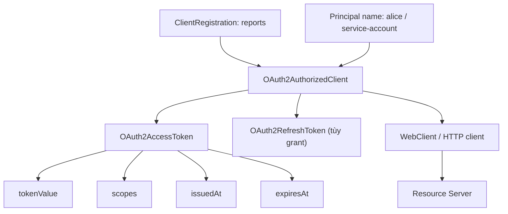
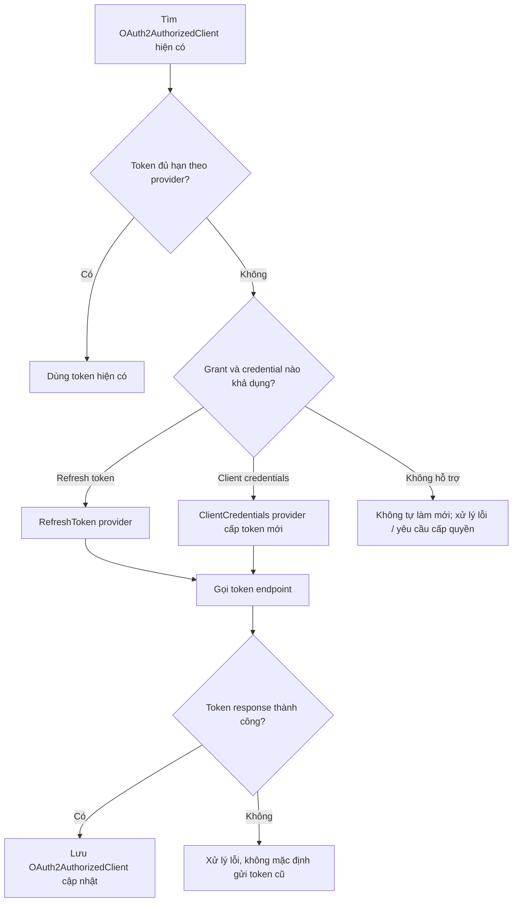

# Access token, scope và thời điểm hết hạn trong dữ liệu giả lập

Trong kiểm thử **OAuth2 Client**, một access token giả lập không chỉ là chuỗi `"fake-token"`. Dữ liệu token còn bao gồm **loại token**, **tập quyền được cấp (scope)**, **thời điểm phát hành (`issuedAt`)** và **thời điểm hết hạn (`expiresAt`)**. Những thuộc tính đó quyết định cách ứng dụng kiểm tra token trước khi gọi API bên ngoài, cách Spring Security quản lý `OAuth2AuthorizedClient`, và cách ta phân biệt các ca sử dụng được phép với ca thiếu quyền hoặc cần cấp lại token.

Bài học thuộc chương **Ứng dụng khách OAuth2** của module **SPRING_SECURITY_TESTING**. Mục tiêu là kiểm thử xác thực, phân quyền và bảo vệ HTTP thực tế bằng `spring-security-test` trong ứng dụng Servlet lẫn Reactive, sử dụng `MockMvc`, `WebTestClient`, `@WithMockUser`, `SecurityContext` và các dữ liệu OAuth2/OIDC giả lập. Trọng tâm ở đây là **làm chủ nội dung của `OAuth2AccessToken` trong fixture**, xác nhận scope và thời hạn được ứng dụng sử dụng đúng ý nghĩa, đồng thời hiểu rõ phần nào vẫn cần bài test tích hợp với `OAuth2AuthorizedClientManager` hoặc authorization server giả lập.

> **Nguyên tắc:** Có token trong test chưa đồng nghĩa token đó hợp lệ hoặc còn hạn trong hệ thống thực. Công cụ `oauth2Client()` giúp chuẩn bị một `OAuth2AuthorizedClient`; nó không tự chứng minh rằng authorization server đã cấp token, refresh token đã chạy hoặc resource server đã chấp nhận các scope ấy.

## 1. OAuth2 Client lưu token ở đâu?

Trong Spring Security OAuth2 Client, ba kiểu dữ liệu thường xuất hiện cùng nhau:

- `ClientRegistration`: định danh một ứng dụng khách được đăng ký với authorization server, gồm `registrationId`, `clientId`, grant type, token endpoint và các scope **được cấu hình/yêu cầu**.
- `OAuth2AccessToken`: một access token cụ thể, gồm `tokenValue`, `tokenType`, `issuedAt`, `expiresAt` và các scope **thực tế gắn với token**.
- `OAuth2AuthorizedClient`: gắn `ClientRegistration` với một principal name, access token và, nếu có, refresh token. Đây là dữ liệu mà repository/service và authorized-client manager sử dụng.



Ví dụ một cấu hình client xin `reports.read` và `reports.write` chưa bảo đảm token được cấp có đủ hai scope: authorization server có thể chỉ cấp `reports.read`.

| Thuộc tính | Vị trí | Ý nghĩa | Điều cần assert |
|---|---|---|---|
| `registrationId` | `ClientRegistration` | Tên định danh client trong Spring | Đúng client được chọn cho request |
| `getScopes()` của registration | `ClientRegistration` | Scope cấu hình để yêu cầu | Đúng cấu hình phía client |
| `getScopes()` của access token | `OAuth2AccessToken` | Scope mà token đại diện | Đúng quyền thực sự dùng khi gọi API |
| `tokenValue` | `OAuth2AccessToken` | Chuỗi bearer credential gửi tới resource server | Header Bearer chính xác; không ghi token vào response/log |
| `issuedAt` | `OAuth2AccessToken` | Mốc token được phát hành | Mốc có ý nghĩa, không nằm sau `expiresAt` |
| `expiresAt` | `OAuth2AccessToken` | Mốc token hết hạn | Ca chưa hết hạn, gần hết hạn và đã hết hạn |
| `principalName` | `OAuth2AuthorizedClient` | Danh tính liên kết authorized client | Không trộn token giữa các principal/registration |
| `refreshToken` | `OAuth2AuthorizedClient` | Credential có thể dùng để xin token mới ở grant phù hợp | Có hay không có refresh token theo flow |

**Hai khái niệm scope khác nhau:** `ClientRegistration.getScopes()` trả về phạm vi đăng ký/yêu cầu; `OAuth2AuthorizedClient.getAccessToken().getScopes()` trả về phạm vi nằm trên access token hiện được lưu. Khi kiểm tra hành vi theo scope được cấp, dùng tập scope trên **access token**, không lấy tập scope cấu hình làm bằng chứng.

## 2. Một fixture token có đầy đủ metadata

Spring Security biểu diễn bearer token bằng `OAuth2AccessToken`, không yêu cầu token giả lập phải là JWT đúng cú pháp khi bài test chỉ đọc metadata. Constructor nhận các tham số:

```java
new OAuth2AccessToken(
        OAuth2AccessToken.TokenType.BEARER,
        "access-test-001",
        issuedAt,
        expiresAt,
        Set.of("reports.read"));
```

Các import chính:

```java
import java.time.Instant;
import java.util.Set;
import org.springframework.security.oauth2.core.OAuth2AccessToken;
import static org.springframework.security.oauth2.core.OAuth2AccessToken.TokenType.BEARER;
```

Ví dụ fixture dùng thời điểm cố định để minh họa:

```java
Instant issuedAt =
        Instant.parse("2030-05-10T09:00:00Z");
Instant expiresAt =
        Instant.parse("2030-05-10T10:00:00Z");

OAuth2AccessToken token = new OAuth2AccessToken(
        BEARER,
        "not-a-real-jwt",
        issuedAt,
        expiresAt,
        Set.of("reports.read", "reports.export"));
```

Ở thời điểm 09:20 UTC theo đồng hồ giả lập, token chưa đến `expiresAt`; tại 10:10 UTC, token đã quá hạn. **Chuỗi `not-a-real-jwt` vẫn là fixture hợp lệ cho lớp kiểm thử chỉ đọc `OAuth2AccessToken` metadata**. Nhưng không thể gửi chuỗi này đến một resource server thật rồi kỳ vọng decoder JWT xác minh thành công.

Các assertion cơ bản:

```java
assertThat(token.getTokenType()).isEqualTo(BEARER);
assertThat(token.getTokenValue()).isEqualTo("not-a-real-jwt");
assertThat(token.getScopes())
        .containsExactlyInAnyOrder(
                "reports.read", "reports.export");
assertThat(token.getIssuedAt()).isEqualTo(issuedAt);
assertThat(token.getExpiresAt()).isEqualTo(expiresAt);
```

Nếu cần nhiều trường hợp, nên tạo factory có tham số rõ ràng thay vì lặp chuỗi thời gian ở nhiều test.

### 2.1. Factory fixture nhỏ, dễ đọc và tái sử dụng

```java
final class AccessTokenFixtures {

    private AccessTokenFixtures() {}

    static OAuth2AccessToken token(
            String value,
            Instant issuedAt,
            Instant expiresAt,
            String... scopes) {

        return new OAuth2AccessToken(
                OAuth2AccessToken.TokenType.BEARER,
                value,
                issuedAt,
                expiresAt,
                Set.of(scopes));
    }

    static OAuth2AccessToken validAt(
            Instant now, String... scopes) {
        return token(
                "access-valid",
                now.minusSeconds(60),
                now.plusSeconds(1800),
                scopes);
    }

    static OAuth2AccessToken expiredAt(
            Instant now, String... scopes) {
        return token(
                "access-expired",
                now.minusSeconds(3600),
                now.minusSeconds(300),
                scopes);
    }

    static OAuth2AccessToken expiringSoon(
            Instant now, String... scopes) {
        return token(
                "access-near-expiry",
                now.minusSeconds(600),
                now.plusSeconds(15),
                scopes);
    }
}
```

Trong code thật, có thể đặt lớp này ở `src/test/java` để tránh fixture test đi vào production. Đây là helper **dữ liệu**, không phải nơi quyết định token hợp lệ hay bị làm mới. Quy tắc làm mới thuộc về client provider/manager và cấu hình clock skew tương ứng.

## 3. Dùng `oauth2Client()` để nạp authorized client trong MockMvc

Spring Security Test cung cấp request post-processor:

```java
import static org.springframework.security.test.web.servlet.request
        .SecurityMockMvcRequestPostProcessors.oauth2Client;
```

Ví dụ:

```java
mockMvc.perform(get("/demo/client-info")
        .with(oauth2Client("reports")));
```

Kỹ thuật này chuẩn bị một `OAuth2AuthorizedClient` trong repository giả lập của request để các thành phần như `@RegisteredOAuth2AuthorizedClient` có thể lấy nó. Cách dùng phù hợp khi endpoint đang được kiểm tra **phụ thuộc vào authorized client**, không cần thực hiện toàn bộ authorization-code redirect, token endpoint hoặc client-credentials grant.

Giá trị mặc định của `oauth2Client("reports")` phục vụ ví dụ cơ bản: client registration giản lược, principal mặc định, access token với scope mặc định `read`. **Khi chủ đề test là scope hoặc hết hạn, phải chủ động truyền token của mình**; không để mặc định che đi nhánh nghiệp vụ cần kiểm chứng.

### 3.1. Controller minh họa chỉ trả metadata an toàn

Ứng dụng dùng OAuth2 Client có thể inject authorized client vào controller:

```java
@RestController
@RequestMapping("/demo")
class ClientInfoController {

    @GetMapping("/client-info")
    Map<String, Object> clientInfo(
            @RegisteredOAuth2AuthorizedClient("reports")
            OAuth2AuthorizedClient client) {

        OAuth2AccessToken token = client.getAccessToken();

        return Map.of(
                "registrationId",
                    client.getClientRegistration().getRegistrationId(),
                "principalName",
                    client.getPrincipalName(),
                "scopes",
                    token.getScopes().stream().sorted().toList(),
                "canReadReport",
                    token.getScopes().contains("reports.read"),
                "issuedAt",
                    token.getIssuedAt().toString(),
                "expiresAt",
                    token.getExpiresAt().toString());
    }
}
```

Các import:

```java
import java.util.Map;
import org.springframework.security.oauth2.client.OAuth2AuthorizedClient;
import org.springframework.security.oauth2.client.annotation.RegisteredOAuth2AuthorizedClient;
import org.springframework.security.oauth2.core.OAuth2AccessToken;
import org.springframework.web.bind.annotation.GetMapping;
import org.springframework.web.bind.annotation.RequestMapping;
import org.springframework.web.bind.annotation.RestController;
```

Endpoint này tồn tại để trình diễn cách đọc metadata, **không trả `tokenValue`**. Khi xây dựng API production, cũng cần xem xét metadata nào nên được công khai; việc nhận thấy scope trong một token không tự thay thế kiểm tra quyền tại resource server.

### 3.2. MockMvc test một token chưa hết hạn, có scope đọc

Ví dụ sau giả định dự án Spring Boot Servlet đã bật `spring-boot-starter-oauth2-client`, cấu hình OAuth2 Client và Security phù hợp, còn `/demo/client-info` cho phép principal của test truy cập:

```groovy
dependencies {
    implementation 'org.springframework.boot:spring-boot-starter-web'
    implementation 'org.springframework.boot:spring-boot-starter-security'
    implementation 'org.springframework.boot:spring-boot-starter-oauth2-client'

    testImplementation 'org.springframework.boot:spring-boot-starter-test'
    testImplementation 'org.springframework.security:spring-security-test'
}
```

Test:

```java
@SpringBootTest
@AutoConfigureMockMvc
class OAuth2ClientMetadataIT {

    @Autowired
    MockMvc mockMvc;

    @Test
    void mockClientCarriesGrantedScopesAndExpiry()
            throws Exception {

        Instant issuedAt =
                Instant.parse("2035-01-15T08:00:00Z");
        Instant expiresAt =
                Instant.parse("2035-01-15T09:00:00Z");

        OAuth2AccessToken accessToken =
                new OAuth2AccessToken(
                        OAuth2AccessToken.TokenType.BEARER,
                        "token-metadata-only",
                        issuedAt,
                        expiresAt,
                        Set.of("reports.read", "reports.export"));

        mockMvc.perform(get("/demo/client-info")
                    .with(user("alice"))
                    .with(oauth2Client("reports")
                            .principalName("alice")
                            .accessToken(accessToken)))
                .andExpect(status().isOk())
                .andExpect(jsonPath("$.registrationId")
                        .value("reports"))
                .andExpect(jsonPath("$.principalName")
                        .value("alice"))
                .andExpect(jsonPath("$.canReadReport")
                        .value(true))
                .andExpect(jsonPath("$.scopes",
                        containsInAnyOrder(
                                "reports.read", "reports.export")))
                .andExpect(jsonPath("$.issuedAt")
                        .value(issuedAt.toString()))
                .andExpect(jsonPath("$.expiresAt")
                        .value(expiresAt.toString()));
    }
}
```

Static import cho ví dụ:

```java
import static org.hamcrest.Matchers.containsInAnyOrder;
import static org.springframework.security.test.web.servlet.request
        .SecurityMockMvcRequestPostProcessors.oauth2Client;
import static org.springframework.security.test.web.servlet.request
        .SecurityMockMvcRequestPostProcessors.user;
import static org.springframework.test.web.servlet.request.MockMvcRequestBuilders.get;
import static org.springframework.test.web.servlet.result.MockMvcResultMatchers.*;
```

Các import khác đến từ JUnit Jupiter, AssertJ, Spring Boot Test, `java.time.Instant`, `java.util.Set` và `org.springframework.security.oauth2.core.OAuth2AccessToken`.

Fixture có mốc 2035 chỉ để minh họa metadata ổn định, **không dùng giá trị cố định đó để khẳng định token còn hạn tại ngày CI thực thi**. Khi test qua cơ chế tự làm mới thật, phải dùng đồng hồ test tương ứng hoặc tạo các mốc tương đối với thời gian kiểm soát được. Tùy cấu hình ứng dụng, `@RegisteredOAuth2AuthorizedClient` có thể đi qua authorized-client manager; để quan sát metadata thuần túy, bảo đảm provider không vô tình làm mới fixture.

### 3.3. Tạo token với scope thiếu

Có thể thay fixture bằng:

```java
OAuth2AccessToken accessToken = AccessTokenFixtures.validAt(
        Instant.now(), "reports.export");
```

Sau đó:

```java
mockMvc.perform(get("/demo/client-info")
            .with(user("alice"))
            .with(oauth2Client("reports")
                    .principalName("alice")
                    .accessToken(accessToken)))
        .andExpect(status().isOk())
        .andExpect(jsonPath("$.canReadReport")
                .value(false))
        .andExpect(jsonPath("$.scopes",
                containsInAnyOrder("reports.export")));
```

`200 OK` ở đây là **kết quả hợp lệ của endpoint xem metadata**; field `canReadReport=false` cho thấy token không có scope đọc. Nếu endpoint nghiệp vụ của client chọn từ chối yêu cầu khi thiếu scope, phải viết riêng test cho nhánh trả `403`/lỗi nghiệp vụ. **Đừng tự suy luận rằng Spring OAuth2 Client sẽ tự động từ chối mọi request HTTP của người dùng chỉ vì access token dùng để gọi API ngoài thiếu một scope**.

## 4. Phân biệt ba “bộ quyền” thường bị trộn trong test

Có ba nơi liên quan đến quyền nhưng không đồng nhất:

1. **`ClientRegistration.getScopes()`**: danh sách scope ứng dụng khách dự định yêu cầu khi xin token.
2. **`OAuth2AccessToken.getScopes()`**: scope gắn với token đã cấp cho client.
3. **`Authentication.getAuthorities()`**: authorities của principal đang có trong `SecurityContext`, thường do đăng nhập/method security/resource server xây dựng.

Ví dụ:

```java
mockMvc.perform(get("/demo/client-info")
        .with(user("alice")
                .authorities(new SimpleGrantedAuthority(
                        "ROLE_USER")))
        .with(oauth2Client("reports")
                .principalName("alice")
                .accessToken(
                        AccessTokenFixtures.validAt(
                                Instant.now(), "reports.read"))));
```

Trong request này:

- `Authentication` của Alice có `ROLE_USER`.
- `OAuth2AuthorizedClient` có token với `reports.read`.
- Token scope **không tự biến thành** `SCOPE_reports.read` trong `Authentication` của Alice.
- `hasAuthority("SCOPE_reports.read")` ở inbound `SecurityFilterChain` không tự thành công chỉ vì outbound client token chứa `reports.read`.
- Resource server nhận **outbound Bearer token** mới có trách nhiệm áp dụng chính sách scope trên API được gọi.

| Kiểm tra | Nguồn dữ liệu đúng |
|---|---|
| Người dùng đang truy cập endpoint của ứng dụng có role `USER`? | `SecurityContext` / `Authentication` |
| Ứng dụng khách `reports` xin những scope gì? | `ClientRegistration.getScopes()` |
| Token đã cấp cho `reports` có `reports.read` không? | `OAuth2AuthorizedClient.getAccessToken().getScopes()` |
| API báo cáo có chấp nhận token và quyền đọc không? | Resource server xác minh token và authorization |
| Client có cần token mới không? | `OAuth2AuthorizedClientManager`/provider theo thời hạn và cấu hình |

Ví dụ lỗi thường gặp:

```java
// SAI nếu muốn kiểm tra scope của access token outbound:
boolean canCallReportApi =
        authentication.getAuthorities().stream()
                .anyMatch(a ->
                        a.getAuthority()
                                .equals("SCOPE_reports.read"));
```

Nếu ứng dụng thực muốn biết token dùng để gọi API ngoài có scope đọc, cần kiểm tra token tương ứng:

```java
boolean canCallReportApi =
        authorizedClient.getAccessToken()
                .getScopes().contains("reports.read");
```

Đây là phép **kiểm tra sơ bộ tại client**. Không dùng nó như bằng chứng cuối cùng của quyền truy cập tài nguyên: phía resource server còn phải xác minh Bearer token, issuer, audience, thời hạn và chính sách truy cập tài nguyên.

## 5. Thời hạn access token: issuedAt, expiresAt và clock skew

`OAuth2AccessToken` mang hai mốc kiểu `Instant`:

- `issuedAt`: thời điểm token được cấp.
- `expiresAt`: thời điểm token hết hạn.

Ví dụ:

```text
09:00 UTC                09:59:30 UTC       10:00 UTC
|--- token đang dùng ---------|-- vùng skew --| hết hạn
     issuedAt                  30 giây trước    expiresAt
```

Hệ thống quản lý authorized client có thể coi token **cần làm mới sớm** dựa trên `clockSkew`. Ví dụ provider có skew 30 giây có thể coi token gần hạn là cần xin lại, kể cả tại thời điểm `now` vẫn nhỏ hơn `expiresAt`. Vì vậy, test chỉ kiểm tra `expiresAt.isAfter(Instant.now())` chưa mô phỏng hết chính sách làm mới token của Spring Security.

Đừng trộn lẫn:

- `accessToken.getExpiresAt()`: **metadata được lưu**.
- `Clock` và `clockSkew` của provider: cách provider **diễn giải** metadata tại thời điểm authorize/re-authorize.
- `exp` trong JWT: claim của token (nếu token là JWT). Với OAuth2 Client test giả lập, chuỗi token có thể không phải JWT; test metadata không cần parse `exp` từ chuỗi.

### 5.1. Bảng ca kiểm thử thời hạn

| Fixture | `issuedAt` | `expiresAt` so với đồng hồ test | Mục tiêu |
|---|---|---|---|
| Còn hạn xa | `now - 1 phút` | `now + 30 phút` | Provider giữ token hiện có nếu không cần authorize lại |
| Gần hết hạn | `now - 1 giờ` | `now + 15 giây` | Với skew 30 giây, provider chủ động refresh/renew |
| Hết hạn | `now - 1 giờ` | `now - 5 phút` | Provider không tiếp tục coi token là còn hạn |
| Chưa có token | Không có | Không có | Provider áp dụng grant phù hợp để xin token lần đầu |
| Hết hạn, có refresh token | Trong quá khứ | Trong quá khứ | Refresh-token provider có thể xin token mới |
| Hết hạn, không có refresh token | Trong quá khứ | Trong quá khứ | Refresh-token provider riêng không thể refresh; client-credentials provider có thể cấp mới tùy grant |
| Token hết hạn và token endpoint từ chối | Trong quá khứ | Trong quá khứ | Quản lý lỗi cấp lại; không âm thầm coi token cũ hợp lệ |

**Quy tắc fixture:** Đặt `issuedAt` trước `expiresAt`, dùng `Instant`/UTC và chọn khoảng cách thời gian đủ xa ranh giới khi chỉ thử trường hợp hết hạn hay chưa hết hạn. Dùng `Clock.fixed` nếu đang kiểm chứng hành vi nhạy với thời gian.

### 5.2. Unit test thuần metadata

Không cần tạo ApplicationContext để kiểm tra factory:

```java
@Test
void expiredFixtureKeepsExplicitTimeAndScope() {
    Instant now =
            Instant.parse("2030-05-10T10:00:00Z");

    OAuth2AccessToken token =
            AccessTokenFixtures.expiredAt(
                    now, "reports.read");

    assertThat(token.getIssuedAt())
            .isEqualTo(now.minusSeconds(3600));
    assertThat(token.getExpiresAt())
            .isEqualTo(now.minusSeconds(300));
    assertThat(token.getExpiresAt())
            .isBefore(now);
    assertThat(token.getScopes())
            .containsExactly("reports.read");
}
```

Test này chứng minh **fixture có dữ liệu đúng**, không chứng minh Spring tự refresh token. Để kiểm tra hành vi làm mới, phải gọi provider/manager thực sự.

## 6. `OAuth2AuthorizedClientManager` quyết định việc cấp lại token

Trong ứng dụng Servlet, `OAuth2AuthorizedClientManager` quản lý việc authorize và re-authorize thông qua một hoặc nhiều `OAuth2AuthorizedClientProvider`. Provider có thể hỗ trợ `authorization_code`, `refresh_token`, `client_credentials` hoặc các grant khác theo cấu hình.

Ví dụ luồng:



Sơ đồ là mô hình hành vi; `OAuth2AuthorizedClientProvider` cụ thể có thể trả `null` nếu không thể/không cần authorize lại. `OAuth2AuthorizedClientManager` quyết định cách lấy/lưu authorized client và xử lý kết quả. Không suy luận rằng chỉ cần đặt `expiresAt` trong `oauth2Client()` thì Spring sẽ luôn gọi token endpoint.

### 6.1. Đúng vai trò của `oauth2Client()`

Post-processor:

```java
.with(oauth2Client("reports")
        .accessToken(expiredAccessToken))
```

**chỉ cung cấp dữ liệu đã được tạo**. Nó không phải một bản mô phỏng đầy đủ của token endpoint/refresh provider. Muốn biết hệ thống sẽ làm gì khi token hết hạn, test phải nạp `OAuth2AuthorizedClientManager`/provider thật và có token-response client giả lập để quan sát việc cấp lại.

Điều này đặc biệt quan trọng khi `@RegisteredOAuth2AuthorizedClient` hoặc `WebClient` có tích hợp manager: một số đường đi có thể gọi manager, còn một số đường đi chỉ chuyển tiếp chính authorized client được cung cấp. Kết quả phải được assert theo đường gọi **thực sự** của hệ thống.

## 7. Kiểm thử refresh bằng provider thật, token endpoint giả lập

Đây là ví dụ unit/integration nhỏ dùng **provider thật** và `OAuth2AccessTokenResponseClient` giả lập. Nó cho phép kiểm tra hết hạn, scope của token mới và số lần gọi cổng phát token mà không cần authorization server ngoài mạng.

Giả sử client sử dụng grant `authorization_code`, trước đó đã có `OAuth2RefreshToken`. Dùng một `ClientRegistration` phù hợp:

```java
ClientRegistration registration =
        ClientRegistration.withRegistrationId("reports")
                .clientId("reports-client-test")
                .clientSecret("secret-test-only")
                .authorizationGrantType(
                        AuthorizationGrantType.AUTHORIZATION_CODE)
                .authorizationUri(
                        "https://id.example.invalid/authorize")
                .tokenUri(
                        "https://id.example.invalid/token")
                .redirectUri(
                        "{baseUrl}/login/oauth2/code/{registrationId}")
                .scope("reports.read", "reports.export")
                .build();
```

Không có yêu cầu gọi HTTP thật tới domain `.invalid`; đó chỉ là metadata của `ClientRegistration` trong test provider. Token-response client sẽ được stub.

### 7.1. Test token đã hết hạn được làm mới

```java
@Test
void expiredTokenWithRefreshTokenGetsReauthorized() {
    Instant now = Instant.now();
    Clock clock = Clock.fixed(now, ZoneOffset.UTC);

    OAuth2AccessToken oldAccess =
            new OAuth2AccessToken(
                    OAuth2AccessToken.TokenType.BEARER,
                    "old-access",
                    now.minusSeconds(3600),
                    now.minusSeconds(300),
                    Set.of("reports.read"));

    OAuth2RefreshToken refreshToken =
            new OAuth2RefreshToken(
                    "refresh-test-only",
                    now.minusSeconds(3600));

    OAuth2AuthorizedClient previous =
            new OAuth2AuthorizedClient(
                    registration,
                    "alice",
                    oldAccess,
                    refreshToken);

    AtomicInteger tokenEndpointCalls =
            new AtomicInteger();

    OAuth2AccessTokenResponseClient<OAuth2RefreshTokenGrantRequest>
            fakeTokenEndpoint = grantRequest -> {

        assertThat(grantRequest.getRefreshToken().getTokenValue())
                .isEqualTo("refresh-test-only");

        tokenEndpointCalls.incrementAndGet();

        return OAuth2AccessTokenResponse
                .withToken("new-access")
                .tokenType(OAuth2AccessToken.TokenType.BEARER)
                .scopes(Set.of(
                        "reports.read", "reports.export"))
                .expiresIn(3600)
                .build();
    };

    OAuth2AuthorizedClientProvider provider =
            OAuth2AuthorizedClientProviderBuilder.builder()
                    .refreshToken(refresh -> refresh
                            .clock(clock)
                            .clockSkew(Duration.ofSeconds(30))
                            .accessTokenResponseClient(
                                    fakeTokenEndpoint))
                    .build();

    Authentication principal =
            new TestingAuthenticationToken(
                    "alice", "ignored", "ROLE_USER");

    OAuth2AuthorizationContext context =
            OAuth2AuthorizationContext
                    .withAuthorizedClient(previous)
                    .principal(principal)
                    .build();

    OAuth2AuthorizedClient updated =
            provider.authorize(context);

    assertThat(updated).isNotNull();
    assertThat(updated.getAccessToken().getTokenValue())
            .isEqualTo("new-access");
    assertThat(updated.getAccessToken().getScopes())
            .containsExactlyInAnyOrder(
                    "reports.read", "reports.export");
    assertThat(tokenEndpointCalls.get()).isEqualTo(1);
}
```

Import chính:

```java
import java.time.Clock;
import java.time.Duration;
import java.time.Instant;
import java.time.ZoneOffset;
import java.util.Set;
import java.util.concurrent.atomic.AtomicInteger;

import org.springframework.security.authentication.TestingAuthenticationToken;
import org.springframework.security.core.Authentication;
import org.springframework.security.oauth2.client.OAuth2AuthorizedClient;
import org.springframework.security.oauth2.client.OAuth2AuthorizedClientProvider;
import org.springframework.security.oauth2.client.OAuth2AuthorizedClientProviderBuilder;
import org.springframework.security.oauth2.client.OAuth2AuthorizationContext;
import org.springframework.security.oauth2.client.registration.ClientRegistration;
import org.springframework.security.oauth2.core.AuthorizationGrantType;
import org.springframework.security.oauth2.core.OAuth2AccessToken;
import org.springframework.security.oauth2.core.OAuth2RefreshToken;
import org.springframework.security.oauth2.core.endpoint.OAuth2AccessTokenResponse;
import org.springframework.security.oauth2.client.endpoint.OAuth2AccessTokenResponseClient;
import org.springframework.security.oauth2.client.endpoint.OAuth2RefreshTokenGrantRequest;
```

`registration` trong test cần được dựng trước từ đoạn trên hoặc nằm trong một factory fixture. Spring Security cung cấp `OAuth2AuthorizedClientProviderBuilder` và phần lớn các provider hỗ trợ clock/clock skew để test hành vi thời gian có kiểm soát; kiểm tra API theo phiên bản thư viện mà dự án đang dùng.

**Ý nghĩa của test:**

1. Access token cũ đã hết hạn rõ ràng.
2. Authorized client có refresh token.
3. Provider thật nhìn thấy thời điểm hết hạn theo `clock` được cố định.
4. Fake token endpoint chỉ đóng vai trò phản hồi một token mới, không thay logic quyết định refresh.
5. Assertion chứng minh token đã đổi và scope mới được lưu trong kết quả, đồng thời cổng phát token được gọi đúng một lần.

Nếu muốn kiểm tra **manager lưu lại** token vừa cấp trong `OAuth2AuthorizedClientRepository` hoặc `OAuth2AuthorizedClientService`, bổ sung test ở mức `OAuth2AuthorizedClientManager` với repository/service test thật hoặc spy và đọc lại dữ liệu lưu. Test provider ở trên chưa tự chứng minh persistence.

### 7.2. Token còn hạn: không gọi refresh endpoint

Với cùng registration, principal, clock và fake endpoint, thay `oldAccess` bằng:

```java
OAuth2AccessToken stillValid =
        new OAuth2AccessToken(
                OAuth2AccessToken.TokenType.BEARER,
                "valid-access",
                now.minusSeconds(60),
                now.plusSeconds(1800),
                Set.of("reports.read"));
```

Tạo authorized client và `OAuth2AuthorizationContext` từ token mới. Khi chỉ dùng refresh-token provider, token còn hạn xa thì `provider.authorize(context)` không tạo bản cấp lại và `tokenEndpointCalls` phải giữ `0`:

```java
assertThat(provider.authorize(context)).isNull();
assertThat(tokenEndpointCalls.get()).isZero();
```

`null` ở đây biểu thị provider **không thực hiện re-authorization**; không được hiểu là access token hiện có đã biến mất. Khi dùng `OAuth2AuthorizedClientManager`, manager còn xử lý authorized client hiện tại và persistence theo contract của nó.

### 7.3. Gần hết hạn: kiểm chứng clock skew

Giả sử `clockSkew=30 giây`, còn `expiresAt=now + 15 giây`. Khi provider đánh giá token, nó có thể xem token là cần refresh **trước thời điểm hết hạn tuyệt đối**. Fixture:

```java
OAuth2AccessToken almostExpired =
        AccessTokenFixtures.expiringSoon(
                now, "reports.read");
```

Dựng lại authorized client/context với token này và refresh token hợp lệ, sau đó assert fake endpoint được gọi để lấy token mới. Không khẳng định một con số skew mặc định cho mọi Spring Security version; test luôn đặt skew tường minh nếu muốn kiểm tra ranh giới.

### 7.4. Không có refresh token thì sao?

Nếu grant là `authorization_code` nhưng authorized client không có refresh token, chỉ riêng `RefreshTokenOAuth2AuthorizedClientProvider` sẽ không thể thực hiện refresh. Khi test trong điều kiện ấy, đừng tự nhận rằng Spring sẽ tự động có token mới. Ứng dụng có thể cần khởi động lại authorization flow hoặc có cơ chế khác.

Với grant `client_credentials`, thông thường không có refresh token; khi access token hết hạn, `ClientCredentialsOAuth2AuthorizedClientProvider` có thể **xin access token mới** bằng client credentials, nếu được cấu hình. Hai cơ chế **refresh token** và **client credentials cấp mới** không giống nhau. Hãy tạo fixture/response client phù hợp cho từng grant và kiểm tra request đến đúng token endpoint.

## 8. Thử nghiệm scope tối thiểu và từ chối đúng nguyên nhân

Giả sử ứng dụng cần gọi API báo cáo yêu cầu `reports.read`. Bốn tình huống nên được tách biệt:

| Tình huống | Dữ liệu token giả lập | Kỳ vọng ở client | Kỳ vọng ở resource server |
|---|---|---|---|
| Có scope đọc, còn hạn | `reports.read`, `expiresAt` tương lai | Chuẩn bị/gửi token theo policy | Nếu token thực hợp lệ và đủ quyền: cho phép |
| Thiếu scope đọc, còn hạn | Chỉ `reports.export` | Nhánh kiểm tra scope tại client (nếu có) không cho gọi; hoặc gửi và nhận lỗi từ API ngoài | Bị từ chối vì thiếu quyền |
| Có scope đọc nhưng hết hạn | `reports.read`, `expiresAt` quá khứ | Manager cấp lại nếu provider/grant hỗ trợ | Không chấp nhận token hết hạn |
| Token mới đã làm mới nhưng scope thu hẹp | Chỉ `reports.export` | Đọc lại scope **của token mới**, không giữ kết luận từ token cũ | Từ chối thao tác đọc |

**Scope của access token mới có thể khác scope cũ**. Đừng viết helper chỉ sao chép `oldAccessToken.getScopes()` vào token mới rồi kết luận hệ thống đã xử lý kết quả cấp lại đúng. Trong test refresh, scope phải đến từ fake token response để đo hành vi thực của provider.

### 8.1. Mã trạng thái ở hai HTTP boundary khác nhau

Có hai request cần phân biệt:

1. **Inbound:** Trình duyệt/người dùng gọi controller của ứng dụng OAuth2 Client.
2. **Outbound:** OAuth2 Client gửi Bearer token đến resource server ngoài.

Một test `MockMvc` trả `200` cho controller metadata **không chứng minh** resource server sẽ chấp nhận token. Tương tự, việc client thiếu scope outbound không tự có nghĩa inbound controller phải trả `403`: chính sách nội bộ có thể chọn trả lỗi nghiệp vụ khác, hiển thị trạng thái bị hạn chế hoặc chuyển lỗi downstream thành response phù hợp.

Khi cần chứng minh resource server từ chối scope thiếu, hãy test resource server với token/`Authentication` phù hợp, hoặc dựng một stub HTTP cho outbound call và assert response xử lý đúng. Nếu test cả hai ứng dụng, phải làm rõ status thuộc boundary nào.

## 9. Kiểm thử `WebClient` gửi Bearer token nào

OAuth2 Client thường gọi dịch vụ ngoài bằng `WebClient`. Trên Servlet, Spring Security hỗ trợ `ServletOAuth2AuthorizedClientExchangeFilterFunction`; trên Reactive có `ServerOAuth2AuthorizedClientExchangeFilterFunction`.

Ví dụ cấu hình Servlet:

```java
@Bean
WebClient reportsWebClient(
        OAuth2AuthorizedClientManager authorizedClientManager) {

    ServletOAuth2AuthorizedClientExchangeFilterFunction oauth2 =
            new ServletOAuth2AuthorizedClientExchangeFilterFunction(
                    authorizedClientManager);

    return WebClient.builder()
            .apply(oauth2.oauth2Configuration())
            .build();
}
```

Khi service có authorized client và muốn dùng nó cho một outbound request:

```java
String response = reportsWebClient.get()
        .uri("https://reports.example.invalid/api/summary")
        .attributes(
                ServletOAuth2AuthorizedClientExchangeFilterFunction
                        .oauth2AuthorizedClient(authorizedClient))
        .retrieve()
        .bodyToMono(String.class)
        .block();
```

Domain trong ví dụ là placeholder, không phải endpoint cần gọi trong test. Khi viết integration test, thay URL downstream bằng **HTTP stub cục bộ**, rồi xác nhận request nhận được:

```http
GET /api/summary HTTP/1.1
Authorization: Bearer access-valid
```

Trong bài test, nên đặt các kỳ vọng:

- Header Bearer chứa đúng **tokenValue** của authorized client được chọn.
- Khi đổi `registrationId`/principal, không vô tình gửi token của client khác.
- Nếu token hết hạn và luồng dùng manager để re-authorize, phải xác minh token **sau khi được cấp mới** mới được gửi theo chính sách.
- Lỗi cấp token/refresh không được âm thầm dùng lại token đã hết hạn nếu chính sách yêu cầu token mới.
- Không in nguyên Bearer token vào log test hoặc response HTTP của ứng dụng.

**Cảnh báo ranh giới:** Truyền một `OAuth2AuthorizedClient` trực tiếp qua thuộc tính request có thể làm khác đường manager tự lựa chọn/re-authorize so với trường hợp chỉ cung cấp `clientRegistrationId`. Nếu mục tiêu là kiểm tra tự làm mới, hãy dùng đúng cách cấu hình/đường gọi của ứng dụng và assert token-response client lẫn HTTP downstream; đừng chỉ assert metadata của object do test tự tạo.

## 10. `mockOAuth2Client()` trên WebFlux và WebTestClient

Ứng dụng Reactive có thể dùng một `OAuth2AuthorizedClient` giống về kiểu dữ liệu, nhưng repository/manager và cách gắn dữ liệu test phù hợp với WebFlux:

```java
import static org.springframework.security.test.web.reactive.server
        .SecurityMockServerConfigurers.mockOAuth2Client;
```

Giả sử có controller Reactive:

```java
@RestController
@RequestMapping("/demo")
class ReactiveClientInfoController {

    @GetMapping("/reactive-client-info")
    Mono<Map<String, Object>> inspect(
            @RegisteredOAuth2AuthorizedClient("reports")
            OAuth2AuthorizedClient client) {

        OAuth2AccessToken token = client.getAccessToken();

        return Mono.just(Map.of(
                "registrationId",
                    client.getClientRegistration().getRegistrationId(),
                "canReadReport",
                    token.getScopes().contains("reports.read"),
                "scopes",
                    token.getScopes().stream().sorted().toList(),
                "expiresAt",
                    token.getExpiresAt().toString()));
    }
}
```

Ví dụ kiểm thử:

```java
@SpringBootTest
@AutoConfigureWebTestClient
class ReactiveClientInfoIT {

    @Autowired
    WebTestClient client;

    @Test
    void reactiveMockClientContainsExpectedAccessToken() {
        Instant now = Instant.now();

        OAuth2AccessToken accessToken =
                AccessTokenFixtures.validAt(
                        now, "reports.read");

        client.mutateWith(
                    mockOAuth2Client("reports")
                            .principalName("alice")
                            .accessToken(accessToken))
                .get()
                .uri("/demo/reactive-client-info")
                .exchange()
                .expectStatus().isOk()
                .expectBody()
                .jsonPath("$.canReadReport").isEqualTo(true)
                .jsonPath("$.scopes[0]")
                        .isEqualTo("reports.read");
    }
}
```

Ví dụ giả định test bind vào ứng dụng WebFlux đã tích hợp Spring Security Test và cấu hình OAuth2 Client phù hợp; có thể cần áp dụng `springSecurity()` khi tự xây dựng `WebTestClient` bằng `bindToController`. Trong integration test đi qua server chạy cổng ngẫu nhiên, việc gắn mock security context từ client ngoài mạng không có tác dụng như cùng một mock server; khi đó cần gửi credentials thực trên HTTP.

`mockOAuth2Client()` tạo authorized client trong **mock server-side repository**. Nó không thực hiện token endpoint, không kiểm tra chữ ký JWT và không bảo đảm refresh token tự chạy. Để thử renewal trên Reactive, dùng `ReactiveOAuth2AuthorizedClientManager`/`ReactiveOAuth2AuthorizedClientProvider` thực, một token-response client reactive giả lập và `StepVerifier` với clock được kiểm soát.

### 10.1. Đồng hồ và refresh provider trong Reactive

API Reactive cung cấp `ReactiveOAuth2AuthorizedClientProviderBuilder`/provider chuyên biệt với cấu hình `clock` và `clockSkew` trên những phiên bản hỗ trợ. Khi thiết kế test:

1. Dựng `OAuth2AuthorizedClient` có thời hạn cụ thể.
2. Tạo `ReactiveOAuth2AuthorizedClientProvider` tương ứng grant.
3. Cấp một response client Reactive giả lập trả token mới.
4. Gọi `authorize(context)` và quan sát `Mono`.
5. Assert token/scopes mới và số lần gọi cổng cấp token; dùng `StepVerifier` khi cần kiểm chứng hoàn tất/lỗi.

Đừng dùng `Thread.sleep()` để chờ token hết hạn. Chọn mốc `Instant` với `Clock.fixed` hoặc sử dụng một test clock có thể điều khiển để test ổn định và nhanh.

## 11. Ma trận test có thể áp dụng ngay

Một bộ test có ý nghĩa nên chủ động thay từng thuộc tính độc lập thay vì cố gắng gộp hết vào một case:

| Case | `scopes` token | Thời hạn | Refresh token | Điều cần quan sát |
|---|---|---|---|---|
| C1 — có quyền đọc | `reports.read` | Còn hạn | Không quan trọng cho ca này | Client đọc đúng scope, gửi token đúng |
| C2 — thiếu quyền đọc | `reports.export` | Còn hạn | Không quan trọng | Nhánh thiếu scope/response downstream đúng |
| C3 — nhiều quyền | `reports.read`, `reports.export` | Còn hạn | Không quan trọng | Không mất hoặc thêm scope khi qua repository |
| C4 — không có scope | `[]` | Còn hạn | Không quan trọng | Không tự gán `read` từ defaults/config |
| C5 — đã hết hạn | `reports.read` | `expiresAt` đã qua | Có | Có hành vi refresh khi provider hỗ trợ |
| C6 — gần hết hạn | `reports.read` | Còn 15 giây | Có | Hành vi theo skew được cấu hình |
| C7 — chưa hết hạn | `reports.read` | Còn 30 phút | Có | Không gọi token endpoint vô ích |
| C8 — hết hạn, không thể refresh | `reports.read` | Đã qua | Không | Không ngầm dùng token lỗi thời |
| C9 — cấp lại đổi scope | `reports.read` → `reports.export` | Token mới còn hạn | Có | Hành vi xét scope **mới** |
| C10 — hai principal | Cùng scope | Còn hạn | Có thể có | Không lấy nhầm authorized client của principal khác |
| C11 — hai registration | Cùng scope | Còn hạn | Có thể có | Chọn đúng token theo `registrationId` |
| C12 — lỗi token endpoint | Scope cũ | Đã hết hạn | Có | Lỗi được xử lý, không rò rỉ credential |

Dùng **đối chứng dương** cho ca âm tính: nếu test thiếu scope trả `403`, cũng phải có test scope đúng trả thành công. Nếu test hết hạn bị lỗi cấp lại, cũng nên có test còn hạn không cần gọi token endpoint. Các đối chứng này giúp phân biệt nguyên nhân thay vì chỉ nhìn status.

## 12. Lỗi thường gặp khi thiết kế fixture OAuth2 Client

| Dấu hiệu | Nguyên nhân / rủi ro | Cách sửa |
|---|---|---|
| Chỉ để mặc định `.with(oauth2Client())` | Default scope `read` che tình huống thiếu scope | Tự tạo `OAuth2AccessToken` có scope theo kịch bản |
| Dùng `ClientRegistration.getScopes()` để kết luận token đã được cấp quyền | Trộn scope cấu hình với scope được cấp | Assert `authorizedClient.getAccessToken().getScopes()` |
| Dùng `@WithMockUser(authorities = ...)` để mô phỏng quyền token outbound | Trộn principal inbound với authorized client outbound | Gắn token qua `oauth2Client().accessToken(...)` |
| Dùng `"fake-token"` nhưng tuyên bố JWT đã được xác minh | Fixture metadata không phải chữ ký JWT thật | Tách bài test Resource Server với Bearer JWT ký thật |
| Token hết hạn nhưng test vẫn chỉ đọc `getExpiresAt()` | Không chạy logic reauthorization | Test provider/manager với response client giả lập |
| Token hết hạn nhưng không có refresh token, test lại mong refresh | Fixture không khớp grant | Chọn đúng grant và refresh token nếu cần |
| Test chỉ đo `expiresAt > now` | Bỏ qua clock skew | Test provider với `Clock`/skew tường minh |
| Dùng timestamp cố định trong quá khứ rồi kỳ vọng còn hạn | Test phụ thuộc ngày chạy CI | Chọn thời điểm từ clock test |
| Gộp sai scope, sai principal, hết hạn cùng một fixture | Không biết lý do từ chối | Mỗi case thay một điều kiện |
| Tự sao chép scope cũ vào token mới | Che lỗi làm mới token bị thu hẹp quyền | Lấy scope từ token response giả lập |
| Mock trọn `OAuth2AuthorizedClientManager` khi muốn kiểm tra refresh | Logic làm mới đã bị loại khỏi test | Giữ provider/manager thật; mock token-response client |
| Ghi `tokenValue` ra controller/log | Lộ Bearer credential | Test bằng marker và assert header, tránh công khai token |
| `WebTestClient` chạy qua mạng nhưng dùng `mockOAuth2Client()` | Mock context không được gửi sang server thật | Dùng server-bound test hoặc credentials qua HTTP |
| Chỉ assert HTTP status từ controller client | Không xác minh API downstream thực sự nhận Bearer token | Dùng HTTP stub và kiểm tra `Authorization` header |

### 12.1. Cẩn trọng với dữ liệu token nhạy cảm

Ngay cả trong test, Bearer token đại diện cho credential. Dùng chuỗi vô hại, không dùng token cấp từ tenant production hoặc copy token thật từ browser/network panel vào fixture. Tránh ghi `Authorization` đầy đủ vào log CI. Khi cần xác nhận request outbound, có thể dùng token thử nghiệm cố định chỉ trong test và xóa/che thông tin trước khi lưu bản ghi thử nghiệm.

### 12.2. Cẩn trọng với tên principal

`OAuth2AuthorizedClient` được liên kết với `registrationId` và `principalName`. Principal có thể là **người dùng** trong authorization-code flow hoặc là một danh tính **ứng dụng/service** trong client-credentials flow. Không mặc định `principalName` luôn là `sub` của JWT hoặc username đang đăng nhập; hãy tạo fixture khớp cơ chế mà `OAuth2AuthorizedClientManager`/repository của ứng dụng dùng. Nếu test phân quyền theo chủ thể thực, thêm hai principal khác nhau và assert client không trộn token.

## 13. Bài thực hành tổng hợp

Giả sử ứng dụng quản lý báo cáo sử dụng OAuth2 Client registration `reports`. Người dùng Alice đăng nhập vào ứng dụng, còn ứng dụng phải dùng một access token để đọc API báo cáo từ server khác.

**Yêu cầu thực hành:**

1. Tạo `OAuth2AccessToken` có `issuedAt=now-1 phút`, `expiresAt=now+30 phút`, `scopes=["reports.read"]`.
2. Dùng `MockMvc` với `.with(user("alice"))` và `.with(oauth2Client("reports").principalName("alice").accessToken(token))` để gọi endpoint đọc metadata.
3. Assert `registrationId`, principal, scope, `issuedAt` và `expiresAt`; endpoint không được trả `tokenValue`.
4. Thay scope token thành `reports.export`: kiểm tra ứng dụng không tự biến nó thành `reports.read` và đường kiểm tra quyền đọc trả kết quả thiếu quyền.
5. Thay thời hạn thành `expiresAt=now-5 phút`: kiểm tra **fixture** và sau đó dùng provider/manager thật để kiểm tra re-authorization. Không dùng riêng status của MockMvc làm bằng chứng refresh.
6. Tạo refresh token và fake token-response client: xác nhận provider gọi một lần, trả token mới và đọc đúng scope mới.
7. Tạo token còn hạn xa: xác nhận provider không gọi token endpoint.
8. Lặp lại phần nạp authorized client bằng `mockOAuth2Client()` nếu ứng dụng dùng WebFlux; dùng `WebTestClient` có tích hợp Spring Security Test.
9. Khi có outbound WebClient, sử dụng HTTP stub để kiểm tra header Bearer và lỗi từ downstream; không kết luận từ metadata nếu chưa kiểm chứng request được gửi.

Câu hỏi tự kiểm tra: Nếu `ClientRegistration` xin `reports.read` nhưng `OAuth2AccessToken.getScopes()` chỉ có `reports.export`, ứng dụng nên dùng scope nào để quyết định token hiện được cấp có quyền đọc? **Scope trên access token**. Nếu `expiresAt` còn 15 giây nhưng provider có `clockSkew=30 giây`, có thể provider xử lý ra sao? **Coi token là cần làm mới sớm**. Nếu `@WithMockUser(roles="ADMIN")` nhưng access token outbound không có scope đọc, resource server có tự cấp quyền đọc không? **Không**; role inbound của người dùng và scope outbound của token là hai lớp quyền riêng biệt.

## 14. Tài liệu tham khảo

- [Spring Security — Testing OAuth 2.0 với MockMvc, bao gồm OAuth2 Client](https://docs.spring.io/spring-security/reference/servlet/test/mockmvc/oauth2.html)
- [Spring Security — OAuth2 Client Core Interfaces and Classes](https://docs.spring.io/spring-security/reference/servlet/oauth2/client/core.html)
- [Spring Security — Authorized Client Features (Servlet)](https://docs.spring.io/spring-security/reference/servlet/oauth2/client/authorized-clients.html)
- [Spring Security — Testing OAuth 2.0 với WebTestClient](https://docs.spring.io/spring-security/reference/reactive/test/web/oauth2.html)
- [Spring Security — Reactive Authorized Client Features](https://docs.spring.io/spring-security/reference/reactive/oauth2/client/authorized-clients.html)

Khi tự tạo `OAuth2AccessToken` trong test, hãy đặt **scope được cấp** và **thời hạn** một cách có chủ đích. `oauth2Client()`/`mockOAuth2Client()` giúp nạp đúng dữ liệu giả lập để kiểm tra request và controller; khi cần chứng minh quyết định làm mới, hãy chạy provider/manager thật với clock và cổng trả token kiểm soát được. Như vậy, các bài test vừa nhanh, vừa có bằng chứng rõ về quyền của token hiện tại, thời điểm nó còn dùng được và hành vi của hệ thống khi token hết hạn.
