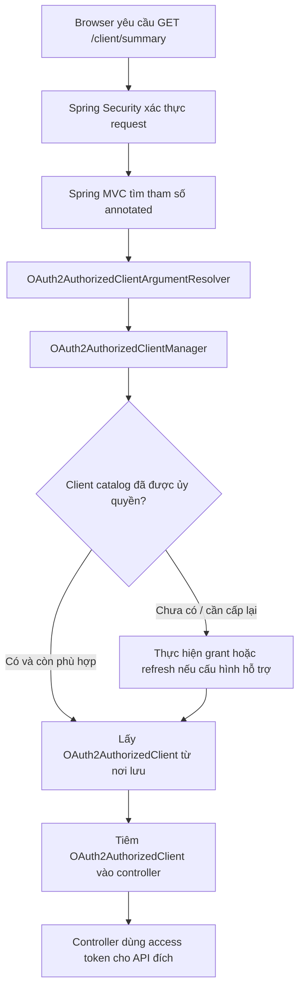

# @RegisteredOAuth2AuthorizedClient trong controller

Trong ứng dụng Spring Security hỗ trợ **OAuth2 Client**, controller đôi khi cần sử dụng access token mà ứng dụng đã nhận từ Authorization Server để gọi một API khác. Annotation `@RegisteredOAuth2AuthorizedClient` cho phép Spring MVC **tiêm một `OAuth2AuthorizedClient` trực tiếp vào tham số phương thức controller**, thay vì tự tìm token trong session, tự tra cứu repository hoặc viết lại luồng cấp token.

Bài này thuộc chương **Ứng dụng khách OAuth2** của module **SPRING_SECURITY_TESTING**. Chúng ta sẽ hiểu annotation hoạt động ra sao, cấu hình ứng dụng Servlet, viết kiểm thử bằng **MockMvc và spring-security-test** với `oauth2Client()`, phân biệt nó với `oauth2Login()`/`oidcLogin()`, và nhận diện các tình huống đăng ký client sai, thiếu scope, thiếu authorized client. Cuối bài có phần liên hệ với **WebTestClient** trên Reactive và với **JWT/OAuth2/OIDC**.

## 1. Nhận diện đúng ba khái niệm

Khi một ứng dụng vừa cho người dùng đăng nhập, vừa gọi API thay mặt họ, có ít nhất ba đối tượng dễ bị nhầm:

| Khái niệm | Vai trò | Ví dụ |
| --- | --- | --- |
| `Authentication` / `OAuth2AuthenticationToken` | Danh tính **người dùng đã đăng nhập vào ứng dụng hiện tại** | Alice đăng nhập bằng OAuth2 Login |
| `ClientRegistration` | Cấu hình ứng dụng khách OAuth2: registration ID, client ID, grant type, authorization/token URI, scope yêu cầu | Registration ID là `catalog` |
| `OAuth2AuthorizedClient` | Liên kết một `ClientRegistration`, tên principal và access token đã được cấp; có thể chứa refresh token | Access token để ứng dụng gọi Catalog API thay mặt Alice |

Annotation thực chất có dạng:

```java
@GetMapping("/client/summary")
ClientSummary summary(
        @RegisteredOAuth2AuthorizedClient("catalog")
        OAuth2AuthorizedClient authorizedClient) {
    // ...
}
```

**`"catalog"` là `registrationId`**, tức tên cấu hình trong ứng dụng Spring, không phải access token, client ID do nhà cung cấp OAuth2 phát hành hay issuer của JWT. Spring Security xử lý tham số này qua `OAuth2AuthorizedClientArgumentResolver`, tích hợp với `OAuth2AuthorizedClientManager` để tìm hoặc ủy quyền lại client khi phù hợp.

Một authorized client có thể mang các thông tin:

```java
String registrationId =
    authorizedClient.getClientRegistration().getRegistrationId();

String principalName = authorizedClient.getPrincipalName();

OAuth2AccessToken accessToken = authorizedClient.getAccessToken();

Set<String> scopes = accessToken.getScopes();
Instant expiresAt = accessToken.getExpiresAt();

OAuth2RefreshToken refreshToken = authorizedClient.getRefreshToken();
// refreshToken có thể null, tùy grant type và token response.
```

Các dữ liệu trên **không nên được trả nguyên vẹn cho browser**. Đặc biệt, không ghi `accessToken.getTokenValue()`, refresh token hoặc client secret vào response, log, exception message và telemetry.

### Annotation không đồng nghĩa với đăng nhập

- `oauth2Login()` xác thực người dùng dựa trên OAuth2 Authorization Code flow và thường gắn một authorized client với phiên đăng nhập.
- `oauth2Client()` bật khả năng ứng dụng quản lý client/token để gọi tài nguyên bên ngoài; ví dụ một client dùng `client_credentials` có thể không đại diện cho người dùng cuối.
- `@RegisteredOAuth2AuthorizedClient("catalog")` là cách **truy xuất authorized client trong controller**; annotation không tự xác nhận người dùng có đủ quyền đối với endpoint, không tự làm access token có mọi scope và không chứng minh token thật được cấp trong test giả lập.
- `@AuthenticationPrincipal` lấy principal của authentication hiện tại; `@RegisteredOAuth2AuthorizedClient` lấy một authorized client với access token dành cho API khác. Hai annotation phục vụ nhu cầu khác nhau.

## 2. Luồng xử lý trên Servlet

Giả sử Alice đăng nhập vào một ứng dụng web và sau đó truy cập trang dùng Catalog API:



Luồng ở trên là sơ đồ khái niệm. `OAuth2AuthorizedClientManager` phối hợp với `OAuth2AuthorizedClientProvider` và `OAuth2AuthorizedClientRepository` hoặc `OAuth2AuthorizedClientService`. Hành vi khi chưa có token phụ thuộc grant type, principal hiện tại, cấu hình manager và cách xử lý lỗi. Không nên mặc định rằng mọi trường hợp thiếu client đều trả `null`, 401 hoặc 302 giống nhau.

Với `authorization_code`, nếu chưa hoàn tất việc ủy quyền, ứng dụng có thể cần chuyển hướng trình duyệt qua Authorization Server. Với `client_credentials`, manager có thể lấy token cho ứng dụng mà không có người dùng cuối tham gia. Với refresh token và provider phù hợp, token hết hạn có thể được làm mới.

**Điểm kiểm thử quan trọng:** nếu test chỉ đưa vào một authorized client giả lập, ta kiểm chứng **controller nhận và sử dụng đối tượng đó thế nào**. Ta chưa kiểm chứng redirect OAuth2 Authorization Code, trao đổi mã lấy token, xác minh token thật hay refresh token với Authorization Server.

## 3. Cấu hình dự án Spring Boot Servlet

Ví dụ minh họa sử dụng Java 17+, Spring Boot 3.x và Spring Security 6.x, có ứng dụng `@SpringBootApplication` với MVC và các dependency:

```gradle
dependencies {
    implementation("org.springframework.boot:spring-boot-starter-web")
    implementation("org.springframework.boot:spring-boot-starter-security")
    implementation("org.springframework.boot:spring-boot-starter-oauth2-client")

    testImplementation("org.springframework.boot:spring-boot-starter-test")
    testImplementation("org.springframework.security:spring-security-test")
}
```

Khai báo một registration có tên `catalog`:

```yaml
spring:
  security:
    oauth2:
      client:
        registration:
          catalog:
            provider: catalog-idp
            client-id: web-catalog-client
            client-secret: ${CATALOG_CLIENT_SECRET}
            authorization-grant-type: authorization_code
            redirect-uri: "{baseUrl}/login/oauth2/code/{registrationId}"
            scope: catalog:read,profile
        provider:
          catalog-idp:
            authorization-uri: https://identity.example.test/oauth2/authorize
            token-uri: https://identity.example.test/oauth2/token
            user-info-uri: https://identity.example.test/oauth2/userinfo
            user-name-attribute: sub
```

Các URL có đuôi `.example.test` chỉ là minh họa. Để đăng nhập OAuth2 thật, chúng phải được thay bằng các endpoint hợp lệ của nhà cung cấp; client secret phải được cấu hình an toàn. Việc khởi động một test sử dụng `oauth2Client()` sẽ **không cần gọi** các endpoint minh họa đó.

Khai báo chuỗi bảo mật:

```java
import org.springframework.context.annotation.Bean;
import org.springframework.context.annotation.Configuration;
import org.springframework.security.config.Customizer;
import org.springframework.security.config.annotation.web.builders.HttpSecurity;
import org.springframework.security.web.SecurityFilterChain;

@Configuration
class ClientSecurityConfig {

    @Bean
    SecurityFilterChain securityFilterChain(HttpSecurity http)
            throws Exception {
        return http
            .authorizeHttpRequests(auth -> auth
                .requestMatchers("/client/**").authenticated()
                .anyRequest().denyAll())
            .oauth2Login(Customizer.withDefaults())
            .oauth2Client(Customizer.withDefaults())
            .build();
    }
}
```

Ở ví dụ này, request `/client/**` cần có `Authentication` được chấp nhận. Cấu hình `oauth2Login` hỗ trợ đăng nhập tương tác. Cấu hình `oauth2Client` hỗ trợ quản lý authorized client. Trong một ứng dụng chỉ dùng `client_credentials`, bạn có thể thiết kế cách xác thực request và cách quản lý client riêng, không nhất thiết cần OAuth2 Login.

## 4. Controller nhận authorized client và chỉ trả thông tin an toàn

Đây là controller minh họa đầy đủ; trả registration ID, principal và scope để dễ quan sát trong test, **không trả token value**:

```java
import java.time.Instant;
import java.util.Set;

import org.springframework.http.HttpStatus;
import org.springframework.http.ResponseEntity;
import org.springframework.security.oauth2.client.OAuth2AuthorizedClient;
import org.springframework.security.oauth2.client.annotation.RegisteredOAuth2AuthorizedClient;
import org.springframework.security.oauth2.core.OAuth2AccessToken;
import org.springframework.web.bind.annotation.GetMapping;
import org.springframework.web.bind.annotation.RestController;

@RestController
class CatalogClientController {

    @GetMapping("/client/summary")
    ClientSummary summary(
            @RegisteredOAuth2AuthorizedClient("catalog")
            OAuth2AuthorizedClient client) {

        OAuth2AccessToken token = client.getAccessToken();

        return new ClientSummary(
            client.getClientRegistration().getRegistrationId(),
            client.getPrincipalName(),
            token.getScopes(),
            token.getExpiresAt());
    }

    @GetMapping("/client/can-read")
    ResponseEntity<String> canRead(
            @RegisteredOAuth2AuthorizedClient("catalog")
            OAuth2AuthorizedClient client) {

        if (!client.getAccessToken().getScopes().contains("catalog:read")) {
            // Đây là quy tắc của controller cho outgoing client.
            return ResponseEntity.status(HttpStatus.FORBIDDEN)
                .body("missing catalog:read");
        }
        return ResponseEntity.ok("can-call-catalog");
    }
}

record ClientSummary(
    String registrationId,
    String principalName,
    Set<String> scopes,
    Instant expiresAt) {}
```

Hai phương thức cho thấy hai kiểu sử dụng:

1. `summary()` cho thấy annotation đã resolve **đúng registration ID và principal**. Token được đọc để lấy metadata, không đưa chuỗi bearer ra ngoài.
2. `canRead()` kiểm tra token **có scope mà API đích yêu cầu hay không**. 403 tại đây là phản hồi **do controller chủ động thiết kế**, khác với 403 do `SecurityFilterChain` từ chối một authentication thiếu authority.

Với một REST API thực tế, nên kiểm tra scope gần đoạn gọi API hoặc dùng cơ chế OAuth2 HTTP client tự quản lý access token. Resource Server đích vẫn phải tự xác minh và phân quyền; kiểm tra scope trong controller **không thay thế** bảo vệ tại API đích.

### Registration ID và principal phải khớp

Nếu ứng dụng có:

```yaml
spring.security.oauth2.client.registration:
  catalog: { ... }
  billing: { ... }
```

thì annotation `@RegisteredOAuth2AuthorizedClient("catalog")` chỉ định client `catalog`. Authorized client được lưu và tra cứu theo thông tin gắn với registration và principal thích hợp. Một client của `billing` không thể tự động được coi là `catalog`; tương tự, client được cấp cho Alice không mặc nhiên là access token của Bob.

Hãy ưu tiên giá trị registration ID cố định theo cấu hình. Không cho người dùng gửi tùy ý registration ID để lựa chọn client nhạy cảm mà chưa kiểm tra mục đích và quyền của request.

## 5. MockMvc: kiểm thử chính annotation bằng oauth2Client()

Spring Security Test cung cấp request postprocessor `oauth2Client("catalog")`. Công cụ này tạo một `OAuth2AuthorizedClient` giả lập với `ClientRegistration`, `OAuth2AccessToken` và tên principal, rồi gắn nó vào mock authorized-client repository cho request. Nhờ vậy, resolver trong controller có thể tìm được client mà không cần Authorization Server chạy thật.

Trong lớp test bên dưới, ta dùng đồng thời:

- `user("alice")` để tạo authentication hợp lệ cho endpoint `authenticated()`;
- `oauth2Client("catalog").principalName("alice")` để gắn authorized client vào **cùng principal**;
- `accessToken(...)` để kiểm soát access-token scopes và hạn sử dụng.

```java
import java.time.Instant;
import java.util.Set;

import org.junit.jupiter.api.Test;
import org.springframework.beans.factory.annotation.Autowired;
import org.springframework.boot.test.autoconfigure.web.servlet.AutoConfigureMockMvc;
import org.springframework.boot.test.context.SpringBootTest;
import org.springframework.security.oauth2.core.OAuth2AccessToken;
import org.springframework.test.web.servlet.MockMvc;

import static org.hamcrest.Matchers.hasItem;
import static org.springframework.security.test.web.servlet.request.SecurityMockMvcRequestPostProcessors.oauth2Client;
import static org.springframework.security.test.web.servlet.request.SecurityMockMvcRequestPostProcessors.user;
import static org.springframework.test.web.servlet.request.MockMvcRequestBuilders.get;
import static org.springframework.test.web.servlet.result.MockMvcResultMatchers.content;
import static org.springframework.test.web.servlet.result.MockMvcResultMatchers.jsonPath;
import static org.springframework.test.web.servlet.result.MockMvcResultMatchers.status;

@SpringBootTest
@AutoConfigureMockMvc
class CatalogClientControllerTests {

    @Autowired
    MockMvc mvc;

    @Test
    void controllerReceivesCatalogClientForAlice() throws Exception {
        mvc.perform(get("/client/summary")
                .with(user("alice"))
                .with(oauth2Client("catalog")
                    .principalName("alice")
                    .accessToken(token(Set.of("catalog:read", "profile")))))
            .andExpect(status().isOk())
            .andExpect(jsonPath("$.registrationId").value("catalog"))
            .andExpect(jsonPath("$.principalName").value("alice"))
            .andExpect(jsonPath("$.scopes",
                hasItem("catalog:read")));
    }

    @Test
    void scopeGrantedToAuthorizedClientAllowsCatalogCall()
            throws Exception {
        mvc.perform(get("/client/can-read")
                .with(user("alice"))
                .with(oauth2Client("catalog")
                    .principalName("alice")
                    .accessToken(token(Set.of("catalog:read")))))
            .andExpect(status().isOk())
            .andExpect(content().string("can-call-catalog"));
    }

    @Test
    void missingOutboundScopeIsRejectedByControllerRule()
            throws Exception {
        mvc.perform(get("/client/can-read")
                .with(user("alice"))
                .with(oauth2Client("catalog")
                    .principalName("alice")
                    .accessToken(token(Set.of("profile")))))
            .andExpect(status().isForbidden())
            .andExpect(content().string("missing catalog:read"));
    }

    @Test
    void anonymousRequestCannotEnterProtectedController()
            throws Exception {
        mvc.perform(get("/client/summary"))
            .andExpect(status().is3xxRedirection());
    }

    private static OAuth2AccessToken token(Set<String> scopes) {
        Instant now = Instant.now();

        return new OAuth2AccessToken(
            OAuth2AccessToken.TokenType.BEARER,
            "test-access-token",
            now.minusSeconds(15),
            now.plusSeconds(600),
            scopes);
    }
}
```

Trong ví dụ bảo mật có OAuth2 Login và `/client/**.authenticated()`, request ẩn danh thường được chuyển hướng đến điểm đăng nhập. Nếu hệ thống thay authentication entry point bằng HTTP Basic hoặc Bearer, status dành cho request không xác thực có thể khác, ví dụ 401. Khi ấy phải điều chỉnh assertion theo cấu hình thực tế.

Các test này chứng minh gì?

| Test | Điều kiện | Kỳ vọng | Ý nghĩa |
| --- | --- | --- | --- |
| `controllerReceivesCatalogClientForAlice` | Client `catalog`, principal Alice, token có scope đọc | 200, JSON đúng registration/principal/scope | Resolver cung cấp client cho controller |
| `scopeGrantedToAuthorizedClientAllowsCatalogCall` | Có `catalog:read` | 200 | Quy tắc scope trong controller cho phép |
| `missingOutboundScopeIsRejectedByControllerRule` | Chỉ có `profile` | 403 | Controller từ chối vì token được cấp thiếu scope |
| `anonymousRequestCannotEnterProtectedController` | Không có authentication | Redirect tới login trong cấu hình mẫu | Bộ lọc bảo vệ endpoint trước controller |

**Phân biệt quan trọng:** 403 ở test thiếu scope xảy ra vì phương thức `canRead()` đã kiểm tra `client.getAccessToken().getScopes()`. Nó **không chứng minh** `oauth2Client()` tự chuyển các scope đó thành `GrantedAuthority` của người dùng hiện tại. Nếu yêu cầu là kiểm tra quyền truy cập inbound của Alice, ta phải kiểm tra `SecurityContext` và quy tắc `hasAuthority/hasRole` riêng.

### Tại sao gắn cùng principal?

Ví dụ dùng `user("alice")` và `principalName("alice")` nhất quán. Trong ứng dụng thật, authorized client được tra cứu dựa trên registration và principal phù hợp; nếu vô tình test `user("alice")` nhưng authorized client có principal `user` mặc định, bạn có thể đang kiểm tra một ngữ cảnh khác dự định.

Cần ghi rõ rằng `principalName` là **tên gắn với authorized client**, không phải access token value, token subject JWT hay OAuth2 client ID.

## 6. So sánh oauth2Client(), oauth2Login(), oidcLogin() và @WithMockUser

Các helper được dùng cho những mục đích khác nhau:

| Helper | Giả lập chính | Khi nào phù hợp |
| --- | --- | --- |
| `oauth2Client("catalog")` | `OAuth2AuthorizedClient` trong repository giả | Controller nhận `@RegisteredOAuth2AuthorizedClient("catalog")`; đọc token/scope/registration |
| `oauth2Login()` | Người dùng `OAuth2User` đã login, kèm authorized client giả | Controller vừa cần login OAuth2, vừa đọc authorized client của lần login |
| `oidcLogin()` | `OidcUser` đã login với ID token/user info giả, kèm authorized client giả | Controller cần OIDC claims, `@AuthenticationPrincipal OidcUser` và authorized client |
| `user("alice")` / `@WithMockUser` | Authentication giả của Alice | Kiểm tra role/authority và endpoint cần đăng nhập; **không tự tạo authorized client OAuth2** |
| `jwt()` / `opaqueToken()` | Authentication giả cho request Bearer inbound | Resource Server kiểm tra phân quyền; không tự tạo authorized client outbound đúng registration |

Nếu đang test một controller chỉ nhận `@RegisteredOAuth2AuthorizedClient("catalog")`, cách diễn đạt ý định rõ nhất là `oauth2Client("catalog")`. Nếu test một controller dùng `@AuthenticationPrincipal OidcUser` **và** authorized client từ phiên login, `oidcLogin()` thường tiện hơn. Khi dùng helper login, cần cấu hình `ClientRegistration` có **registration ID khớp annotation**.

Ví dụ phác thảo cho một test OAuth2 Login có registration `catalog` đã chuẩn bị:

```java
ClientRegistration catalogRegistration =
    clientRegistrationRepository.findByRegistrationId("catalog");

mvc.perform(get("/client/summary")
        .with(oauth2Login()
            .clientRegistration(catalogRegistration)))
    .andExpect(status().isOk())
    .andExpect(jsonPath("$.registrationId").value("catalog"));
```

Trong ví dụ này, `clientRegistrationRepository` phải là một `ClientRegistrationRepository` đã được tiêm vào test. `oauth2Login()` dựng người dùng đăng nhập giả cùng authorized client, **không thực thi redirect và trao đổi authorization code thật**.

## 7. Gọi API ngoài từ authorized client: chỉ chuyển token đến đúng nơi

Annotation hữu ích khi controller cần gọi API được bảo vệ bằng token đã cấp. Sau đây là ví dụ ngắn với `RestClient` trên Servlet. Ở đây, `RestClient` được tạo trước và endpoint đích là nơi đáng tin cậy đã cấu hình:

```java
@RestController
class CatalogProxyController {

    private final RestClient catalogRestClient;

    CatalogProxyController(RestClient.Builder builder) {
        this.catalogRestClient = builder
            .baseUrl("https://catalog-api.example.test")
            .build();
    }

    @GetMapping("/client/items")
    String items(
            @RegisteredOAuth2AuthorizedClient("catalog")
            OAuth2AuthorizedClient client) {

        return catalogRestClient.get()
            .uri("/items")
            .headers(headers -> headers.setBearerAuth(
                client.getAccessToken().getTokenValue()))
            .retrieve()
            .body(String.class);
    }
}
```

Ví dụ trên minh họa đường đi của access token; token **chỉ xuất hiện trong Authorization header của request server-to-server**, không nằm trong response controller. Với ứng dụng thật, cần kiểm soát API đích, timeout, lỗi 401/403, cơ chế làm mới hoặc gỡ bỏ token đã bị từ chối, và tuyệt đối tránh logging Authorization header.

Trong các ứng dụng Spring Security hiện đại, có thể dùng cơ chế tích hợp OAuth2 của `RestClient` thông qua `OAuth2ClientHttpRequestInterceptor` và `OAuth2AuthorizedClientManager`. Cách này giúp tập trung việc cấp/cập nhật access token thay vì mỗi controller tự thao tác token. Với `WebClient` trên Servlet, `ServletOAuth2AuthorizedClientExchangeFilterFunction` cũng hỗ trợ chuyển một `OAuth2AuthorizedClient` cụ thể sang request ngoài.

Kiểm thử controller proxy nên **giả lập server/API đích hoặc HTTP client** để kiểm tra header và response, không gọi Internet trong unit/integration test. Nếu HTTP client có cấu hình tự refresh token, bổ sung một test riêng cho refresh hoặc lỗi token hết hạn; `oauth2Client()` đơn thuần không chứng minh refresh token thật hoạt động.

## 8. Thiếu client, sai registration ID và các tình huống dễ hiểu nhầm

| Tình huống | Vấn đề cần phân biệt | Phép kiểm tra phù hợp |
| --- | --- | --- |
| `@WithMockUser` nhưng không có authorized client | Có authentication chưa có nghĩa repository chứa access token | Dùng `oauth2Client()` hoặc mock login phù hợp |
| Annotation yêu cầu `catalog`, test cấp `billing` | Registration không khớp | Xác minh registration ID và cấu hình resolver/manager |
| Principal đã xác thực là Alice, client gắn cho Bob | Authorized client thuộc ngữ cảnh principal khác | Kiểm tra tên principal, không tái sử dụng client sai người |
| Token có `profile` nhưng không có `catalog:read` | Client được ủy quyền nhưng không đủ scope cho API đích | Kiểm thử chính sách scope và phản hồi API đích |
| Access token đã hết hạn | Cần reauthorize/refresh theo provider cấu hình | Mock manager/token endpoint để kiểm tra refresh riêng |
| Test gọi `oauth2Client()` rồi mong authorization-code redirect | Helper đã tạo sẵn authorized client giả | Viết test luồng redirect/token exchange riêng |
| Controller trả chuỗi token để dễ assert | Lộ bearer credential tới client ngoài ý muốn | Chỉ assert metadata an toàn hoặc kiểm tra outbound request ở mock server |
| Client `client_credentials` dùng trong job nền | Không có request/principal người dùng như MVC | Dùng `OAuth2AuthorizedClientManager` phù hợp service context thay vì phụ thuộc annotation controller |
| Spring MVC không cấu hình OAuth2 Client argument resolver | Annotation không được xử lý đúng | Bật OAuth2 Client support và dùng đúng MVC + Spring Security filter chain |

Trường hợp authorized client **không tồn tại** có thể đưa đến nhiều hành vi: manager tìm cách ủy quyền lại, bắt đầu luồng authorization code, trả lỗi hoặc không giải quyết được tham số. Kết quả phụ thuộc grant type và cấu hình ứng dụng; đừng viết assertion cứng kiểu “không có client luôn 401” mà chưa quan sát contract HTTP.

Đối với `client_credentials`, token thường đại diện cho ứng dụng hơn là từng user. Cơ chế lưu token có thể cần một principal logic ổn định ở cấp ứng dụng để tránh tạo nhiều authorized client theo từng người dùng. Với controller phụ thuộc request, hãy cân nhắc liệu đó có đúng tầng quản lý token cho trường hợp này hay không.

## 9. Liên hệ Reactive: WebTestClient

Trong Spring WebFlux, annotation cũng có thể được giải quyết từ `ReactiveOAuth2AuthorizedClientManager`, nhưng HTTP stack sử dụng `SecurityWebFilterChain`, repository reactive và các helper test tương ứng. Với WebTestClient, Spring Security Test hỗ trợ `mockOAuth2Client("catalog")`:

```java
import static org.springframework.security.test.web.reactive.server.SecurityMockServerConfigurers.mockOAuth2Client;
import static org.springframework.security.test.web.reactive.server.SecurityMockServerConfigurers.mockOAuth2Login;

// WebTestClient đã được cấu hình cho ứng dụng WebFlux:
webTestClient
    .mutateWith(mockOAuth2Login())
    .mutateWith(mockOAuth2Client("catalog"))
    .get()
    .uri("/client/summary")
    .exchange()
    .expectStatus().isOk();
```

Đây là minh họa kiểm thử **authorized client resolution** trong ứng dụng Reactive. Cần bảo đảm `mockOAuth2Login()` và `mockOAuth2Client("catalog")` gắn principal tương thích với nhau, đồng thời cấu hình đúng route và resolver. Nếu chỉ cần kiểm thử client được resolve trong một route công khai, có thể chỉ cần `mockOAuth2Client("catalog")` với security setup thích hợp.

Khi WebFlux gọi API ngoài qua `WebClient`, `ServerOAuth2AuthorizedClientExchangeFilterFunction` có thể nhận authorized client làm request attribute:

```java
// Dùng WebClient đã cấu hình ServerOAuth2AuthorizedClientExchangeFilterFunction:
return webClient.get()
    .uri("https://catalog-api.example.test/items")
    .attributes(
        ServerOAuth2AuthorizedClientExchangeFilterFunction
            .oauth2AuthorizedClient(authorizedClient))
    .retrieve()
    .bodyToMono(String.class);
```

Không trộn `SecurityMockMvcRequestPostProcessors.oauth2Client()` (Servlet) với `SecurityMockServerConfigurers.mockOAuth2Client()` (Reactive); chúng phục vụ hai hệ thống HTTP/test khác nhau.

## 10. Bài tập thực hành

1. Viết test MockMvc với `oauth2Client("catalog")` và `user("alice")`, kiểm tra `registrationId`, `principalName` và scope xuất hiện trong JSON `/client/summary`. Giải thích vì sao không cần Identity Provider chạy thật.
2. Chỉ thay scope token từ `catalog:read` thành `profile`. Giải thích vì sao request vẫn qua `authenticated()` nhưng `/client/can-read` trả 403 theo logic controller.
3. Thử test `@WithMockUser` mà không cấp authorized client. Quan sát lỗi/đường đi của cấu hình hiện tại thay vì mặc định kết quả. Bổ sung `oauth2Client("catalog")` để kiểm tra khác biệt.
4. Thay `registrationId` trong annotation thành `billing` nhưng vẫn gửi `oauth2Client("catalog")`. Xác định manager/repository tìm client nào và lý do kết quả thay đổi.
5. Sử dụng `oauth2Login().clientRegistration(catalogRegistration)` để mô phỏng OAuth2 Login. So sánh principal và authorized client được tạo với cách dùng `user()` cộng `oauth2Client()`.
6. Viết controller gọi API giả lập `/items` qua RestClient. Dùng mock HTTP server hoặc mock transport để xác minh request **outbound** có `Authorization: Bearer test-access-token` và response API không chứa token.
7. Mô phỏng token hết hạn. Kiểm chứng hành vi manager trong ứng dụng của bạn khi có/không có refresh token provider; không suy luận từ test `oauth2Client()` rằng refresh đã thành công.
8. Chuyển một trường hợp sang WebFlux và `WebTestClient`, thay `oauth2Client()` bằng `mockOAuth2Client()`; giải thích khác biệt giữa manager Servlet và manager Reactive.

## 11. Các điểm cần nhớ

- **`@RegisteredOAuth2AuthorizedClient("catalog")` giải quyết tham số `OAuth2AuthorizedClient` trong controller.** Chuỗi `catalog` là registration ID, không phải client ID hay access token.
- **Authorized client gắn với registration và principal.** Nó có access token, scope, thời hạn và có thể có refresh token; không phải cùng đối tượng với `Authentication` hoặc `OidcUser`.
- **`oauth2Client()` là công cụ kiểm thử trọng tâm** khi muốn kiểm tra việc tiêm client và logic xử lý trong controller. `oauth2Login()`/`oidcLogin()` hữu ích khi test cần danh tính đăng nhập OAuth2/OIDC.
- **Scope của authorized client không tự trở thành quyền của người dùng trong SecurityContext.** Cần phân biệt kiểm tra scope outbound với phân quyền inbound.
- **Không tiết lộ access token và client secret.** Chỉ chuyển bearer token tới API đích đáng tin cậy; dùng OAuth2 HTTP client integration khi cần quản lý token/refresh.
- **Mock client không chạy giao thức OAuth2 thực tế.** Test redirect, token exchange, refresh và xử lý token hết hạn cần những bài integration test tương ứng.

Trong **SPRING_SECURITY_TESTING**, một phép thử tốt cho annotation này phải trả lời được ba câu hỏi: **controller nhận đúng client registration nào, client đó thuộc principal nào, và controller sử dụng quyền trong access token ra sao?**

### Tài liệu tham khảo

- [Spring Security — Authorized Client Features (Servlet)](https://docs.spring.io/spring-security/reference/servlet/oauth2/client/authorized-clients.html)
- [Spring Security — Testing OAuth 2.0 với MockMvc](https://docs.spring.io/spring-security/reference/servlet/test/mockmvc/oauth2.html)
- [Spring Security — Authorized Client Features (Reactive)](https://docs.spring.io/spring-security/reference/reactive/oauth2/client/authorized-clients.html)
- [Spring Security — Testing OAuth 2.0 với WebTestClient](https://docs.spring.io/spring-security/reference/reactive/test/web/oauth2.html)

