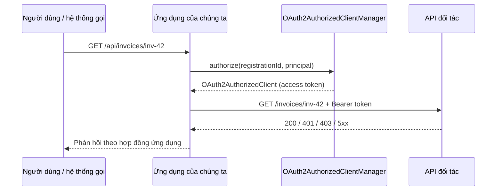

# Kiểm thử lớp gọi dịch vụ ngoài sử dụng authorized client

Trong chương **Ứng dụng khách OAuth2** của module **SPRING_SECURITY_TESTING**, chúng ta kiểm chứng xác thực, phân quyền và bảo vệ HTTP bằng `spring-security-test` trên cả Servlet và Reactive. Các công cụ như `MockMvc`, `WebTestClient`, `@WithMockUser`, `SecurityContext`, JWT/OAuth2/OIDC giả lập giúp kiểm tra yêu cầu được phép hoặc bị từ chối. Một tình huống thực tế khác rất dễ bị bỏ sót là **ứng dụng của chúng ta đóng vai trò OAuth2 Client khi gọi một API bên ngoài**.

Ví dụ: ứng dụng quản lý hóa đơn nhận yêu cầu từ nhân viên, sau đó gọi `GET https://partner.example.test/invoices/{id}`. API đối tác đòi hỏi access token trong header `Authorization: Bearer ...`. Token phải thuộc đúng client registration, đúng principal/ngữ cảnh được phép, có scope phù hợp và còn hiệu lực. Nếu test chỉ giả lập người dùng đã đăng nhập vào ứng dụng, chúng ta chưa chứng minh token được gắn đúng vào **request đi ra**.

Bài này tập trung vào cách kiểm thử lớp gọi dịch vụ ngoài dùng **`OAuth2AuthorizedClient`**: tạo dữ liệu authorized client có kiểm soát, giả lập `OAuth2AuthorizedClientManager`, bắt và xác minh outbound HTTP, kiểm tra nhánh không có client/token và xử lý lỗi. Đồng thời phân biệt các kiểm thử này với `oauth2Login()`, `oauth2Client()` trong MockMvc và với luồng Reactive.

## 1. Hai hướng HTTP và hai vai trò OAuth2 khác nhau

Giả sử có ba hệ thống:



Có hai chiều bảo mật cần phân biệt:

| Bước | Ứng dụng đóng vai trò | Cần kiểm tra |
| --- | --- | --- |
| Client gọi endpoint của chúng ta | OAuth2 Resource Server hoặc ứng dụng có login | Người gọi inbound đã xác thực, có quyền gọi API của ta hay chưa? |
| Ứng dụng gọi dịch vụ đối tác | OAuth2 Client | Đã chọn đúng client registration, lấy được authorized client và gửi **access token** đúng cho đối tác chưa? |
| Đối tác kiểm tra Bearer token | Resource Server của đối tác | Token đúng scope/audience và còn hiệu lực theo quy tắc phía đối tác hay không? |

Kết quả `200` ở endpoint inbound không đủ để khẳng định header gửi đi đúng. Ngược lại, một test HTTP outbound thành công không chứng minh request inbound đã được phân quyền chặt chẽ. Hai chiều cần được kiểm tra riêng hoặc kết hợp ở một integration test có chủ đích.

## 2. `OAuth2AuthorizedClient` là gì và nên giả lập phần nào?

Trong Spring Security OAuth2 Client:

- **`ClientRegistration`** mô tả một client được đăng ký, ví dụ `partner-api`, với client ID, grant type, token endpoint, scopes và các thiết lập cần thiết.
- **`OAuth2AuthorizedClient`** gắn `ClientRegistration` với tên principal và access token đã cấp; với một số grant còn có refresh token.
- **`OAuth2AuthorizedClientManager`** xử lý yêu cầu authorize, có thể lấy authorized client đang lưu, cấp token mới hoặc refresh tùy provider/grant được cấu hình. Phương thức `authorize(...)` có thể trả `null` khi không thể authorize theo hợp đồng của manager/provider, hoặc ném lỗi khi authorization thất bại.
- **`OAuth2AuthorizedClientRepository` / `OAuth2AuthorizedClientService`** lưu và tải authorized client theo ngữ cảnh request/principal tương ứng. Chúng không phải là một JWT decoder.

```java
OAuth2AuthorizeRequest request = OAuth2AuthorizeRequest
        .withClientRegistrationId("partner-api")
        .principal(authentication)
        .build();

OAuth2AuthorizedClient client = authorizedClientManager.authorize(request);
```

Kết quả của `authorize(...)` phụ thuộc vào cả registration ID, principal, grant type, nơi lưu token và cấu hình manager. Với **authorization code**, authorized client thường thuộc về một người dùng đã đăng nhập; với **client credentials**, token đại diện cho ứng dụng và manager thường được dùng trong tác vụ service/background. Không nên tự lấy token của người dùng A để gọi request thay cho người dùng B, hoặc dùng nhầm token của client registration khác.

Ở lớp gọi API, một test ổn định thường giả lập **manager** và giữ nguyên logic HTTP thật của lớp đang kiểm thử. Một nhóm test riêng có thể kiểm tra manager/provider thật, kho lưu token, refresh và quá trình gọi token endpoint khi những hành vi đó thuộc phạm vi cần bảo đảm.

## 3. Xác định hợp đồng kiểm thử trước khi viết code

Giả sử lớp `PartnerInvoiceClient` có trách nhiệm:

1. Yêu cầu authorized client với `clientRegistrationId = "partner-api"` và principal được cung cấp.
2. Nếu manager không cấp authorized client, dừng trước khi phát HTTP tới đối tác.
3. Lấy **access token** từ authorized client và đặt đúng header `Authorization: Bearer <token>`.
4. Gọi đúng phương thức, URL và tham số đối tác; đọc phản hồi JSON thành kiểu dữ liệu của ứng dụng.
5. Không in token vào log hoặc đưa token vào body, URL hay exception message.
6. Trả lỗi có kiểm soát khi đối tác báo 401/403/5xx; không giả định lỗi outbound đồng nghĩa với trạng thái HTTP phải trả cho người gọi inbound.

Với một lớp nhỏ, các test quan trọng nhất là **đường thành công**, **không có authorized client**, **đối tác từ chối Bearer token** và **đúng registration/principal**. Khi lớp dùng HTTP client tự động gắn token, cần kiểm thử thêm cấu hình token propagation và cách chọn authorized client.

## 4. Ví dụ Servlet: dùng manager để gọi REST API đối tác

Ví dụ sau dùng `RestClient` của Spring Framework 6.1+ (thường xuất hiện trong ứng dụng Spring Boot 3.2+). Nếu dự án dùng phiên bản cũ, có thể dùng `WebClient` hoặc `RestTemplate`; nguyên tắc kiểm thử và yêu cầu xác minh header không thay đổi.

```java
import org.springframework.security.core.Authentication;
import org.springframework.security.oauth2.client.OAuth2AuthorizeRequest;
import org.springframework.security.oauth2.client.OAuth2AuthorizedClient;
import org.springframework.security.oauth2.client.OAuth2AuthorizedClientManager;
import org.springframework.web.client.RestClient;

record Invoice(String id, long amount) {}

final class PartnerInvoiceClient {
    private static final String REGISTRATION_ID = "partner-api";

    private final OAuth2AuthorizedClientManager manager;
    private final RestClient http;

    PartnerInvoiceClient(
            OAuth2AuthorizedClientManager manager,
            RestClient http) {
        this.manager = manager;
        this.http = http;
    }

    Invoice fetchInvoice(String invoiceId, Authentication principal) {
        OAuth2AuthorizeRequest request = OAuth2AuthorizeRequest
                .withClientRegistrationId(REGISTRATION_ID)
                .principal(principal)
                .build();

        OAuth2AuthorizedClient authorizedClient = manager.authorize(request);
        if (authorizedClient == null) {
            throw new IllegalStateException(
                    "No authorized client for partner-api");
        }
        if (!REGISTRATION_ID.equals(
                authorizedClient.getClientRegistration().getRegistrationId())) {
            throw new IllegalStateException(
                    "Unexpected OAuth2 client registration");
        }

        String accessToken =
                authorizedClient.getAccessToken().getTokenValue();

        return http.get()
                .uri("/invoices/{id}", invoiceId)
                .headers(headers -> headers.setBearerAuth(accessToken))
                .retrieve()
                .body(Invoice.class);
    }
}
```

Lớp này **chủ động** lấy authorized client rồi gắn Bearer token bằng `HttpHeaders.setBearerAuth(...)`. Nó thuận tiện để kiểm tra chính xác giá trị gửi đi. Trong ứng dụng thật, có thể dùng một OAuth2 interceptor/filter của HTTP client để tự động cấp và gắn token; phần sau sẽ xét cách kiểm tra cơ chế đó.

Ví dụ giả định bean `RestClient` đã được tạo với base URL `https://partner.example.test`, và `OAuth2AuthorizedClientManager` đã được cấu hình để xử lý `partner-api`. Vì đây là ứng dụng Servlet gọi API ngoài, không cần tạo JWT giả lập bằng `jwt()` hoặc dùng `@WithMockUser` để biến token đối tác thành một access token thực.

## 5. Kiểm thử manager giả và HTTP outbound thật bằng `MockRestServiceServer`

Mục tiêu là **không gọi network**, nhưng vẫn chạy đầy đủ logic lớp `PartnerInvoiceClient` và để `RestClient` tạo HTTP request. `MockRestServiceServer` của `spring-test` chặn request rồi cho phép assert method, URL, header và body đáp ứng.

Ví dụ JUnit 5 + Mockito dưới đây là một bộ test độc lập. `manager` là test double; `RestClient` và code gửi header là thật.

```java
import static org.junit.jupiter.api.Assertions.assertEquals;
import static org.junit.jupiter.api.Assertions.assertThrows;
import static org.mockito.ArgumentMatchers.any;
import static org.mockito.Mockito.mock;
import static org.mockito.Mockito.verify;
import static org.mockito.Mockito.when;
import static org.springframework.test.web.client.match.MockRestRequestMatchers.header;
import static org.springframework.test.web.client.match.MockRestRequestMatchers.method;
import static org.springframework.test.web.client.match.MockRestRequestMatchers.requestTo;
import static org.springframework.test.web.client.response.MockRestResponseCreators.withStatus;
import static org.springframework.test.web.client.response.MockRestResponseCreators.withSuccess;

import java.time.Instant;
import java.util.Set;
import org.junit.jupiter.api.BeforeEach;
import org.junit.jupiter.api.Test;
import org.mockito.ArgumentCaptor;
import org.springframework.http.HttpHeaders;
import org.springframework.http.HttpMethod;
import org.springframework.http.HttpStatus;
import org.springframework.http.MediaType;
import org.springframework.security.authentication.TestingAuthenticationToken;
import org.springframework.security.core.Authentication;
import org.springframework.security.oauth2.client.OAuth2AuthorizeRequest;
import org.springframework.security.oauth2.client.OAuth2AuthorizedClient;
import org.springframework.security.oauth2.client.OAuth2AuthorizedClientManager;
import org.springframework.security.oauth2.client.registration.ClientRegistration;
import org.springframework.security.oauth2.core.AuthorizationGrantType;
import org.springframework.security.oauth2.core.OAuth2AccessToken;
import org.springframework.test.web.client.MockRestServiceServer;
import org.springframework.web.client.RestClient;
import org.springframework.web.client.RestClientResponseException;

class PartnerInvoiceClientTest {

    private OAuth2AuthorizedClientManager manager;
    private PartnerInvoiceClient client;
    private MockRestServiceServer server;

    private final Authentication caller =
            new TestingAuthenticationToken("service-worker", "test-only");

    @BeforeEach
    void setUp() {
        manager = mock(OAuth2AuthorizedClientManager.class);

        RestClient.Builder builder = RestClient.builder()
                .baseUrl("https://partner.example.test");
        server = MockRestServiceServer.bindTo(builder).build();
        client = new PartnerInvoiceClient(manager, builder.build());
    }

    private static OAuth2AuthorizedClient sampleAuthorizedClient() {
        return sampleAuthorizedClient("partner-api");
    }

    private static OAuth2AuthorizedClient sampleAuthorizedClient(
            String registrationId) {
        ClientRegistration registration = ClientRegistration
                .withRegistrationId(registrationId)
                .clientId("partner-client")
                .clientSecret("test-only-not-a-real-secret")
                .authorizationGrantType(AuthorizationGrantType.CLIENT_CREDENTIALS)
                .tokenUri("https://issuer.example.test/oauth/token")
                .build();

        OAuth2AccessToken token = new OAuth2AccessToken(
                OAuth2AccessToken.TokenType.BEARER,
                "token-from-manager",
                Instant.parse("2030-01-15T10:00:00Z"),
                Instant.parse("2030-01-15T11:00:00Z"),
                Set.of("invoices.read"));

        return new OAuth2AuthorizedClient(
                registration, "service-worker", token);
    }

    @Test
    void guiBearerTokenCuaAuthorizedClient() {
        when(manager.authorize(any(OAuth2AuthorizeRequest.class)))
                .thenReturn(sampleAuthorizedClient());

        server.expect(requestTo(
                        "https://partner.example.test/invoices/inv-42"))
                .andExpect(method(HttpMethod.GET))
                .andExpect(header(
                        HttpHeaders.AUTHORIZATION,
                        "Bearer token-from-manager"))
                .andRespond(withSuccess(
                        "{\"id\":\"inv-42\",\"amount\":900}",
                        MediaType.APPLICATION_JSON));

        Invoice result = client.fetchInvoice("inv-42", caller);

        assertEquals("inv-42", result.id());
        assertEquals(900L, result.amount());
        server.verify();

        ArgumentCaptor<OAuth2AuthorizeRequest> capture =
                ArgumentCaptor.forClass(OAuth2AuthorizeRequest.class);
        verify(manager).authorize(capture.capture());
        assertEquals(
                "partner-api", capture.getValue().getClientRegistrationId());
        assertEquals(
                "service-worker", capture.getValue().getPrincipal().getName());
    }

    @Test
    void khongCoAuthorizedClient_dungTruocKhiGoiHttp() {
        when(manager.authorize(any(OAuth2AuthorizeRequest.class)))
                .thenReturn(null);

        assertThrows(
                IllegalStateException.class,
                () -> client.fetchInvoice("inv-42", caller));

        // Không khai báo HTTP expectation: lớp không được phát request.
        server.verify();
    }

    @Test
    void saiClientRegistration_khongGuiToken() {
        when(manager.authorize(any(OAuth2AuthorizeRequest.class)))
                .thenReturn(sampleAuthorizedClient("other-api"));

        assertThrows(
                IllegalStateException.class,
                () -> client.fetchInvoice("inv-42", caller));
        server.verify();
    }

    @Test
    void doiTacTra401_khongDuocCoiLaThanhCong() {
        when(manager.authorize(any(OAuth2AuthorizeRequest.class)))
                .thenReturn(sampleAuthorizedClient());

        server.expect(requestTo(
                        "https://partner.example.test/invoices/inv-42"))
                .andExpect(header(
                        HttpHeaders.AUTHORIZATION,
                        "Bearer token-from-manager"))
                .andRespond(withStatus(HttpStatus.UNAUTHORIZED)
                        .contentType(MediaType.APPLICATION_JSON)
                        .body("{\"error\":\"invalid_token\"}"));

        RestClientResponseException error = assertThrows(
                RestClientResponseException.class,
                () -> client.fetchInvoice("inv-42", caller));

        assertEquals(401, error.getStatusCode().value());
        server.verify();
    }
}
```

Các thông tin kiểm thử được dựng hoàn toàn trong bộ test. `clientSecret` và token string là dữ liệu giả, không được sử dụng lại trong production. Các mốc thời gian cố định khiến test không phụ thuộc giờ chạy. `MockRestServiceServer` tạo phản hồi HTTP giả, không yêu cầu khởi động đối tác thật và không gọi token endpoint của issuer.

Test đầu có hai bằng chứng **độc lập**: manager được gọi với đúng `registrationId`/principal; request gửi ra đúng URL và Bearer token mà manager đã cấp. Test `saiClientRegistration_khongGuiToken` còn chứng minh client của registration khác bị từ chối trước khi phát request. Nếu chỉ assert `Invoice` trả về, test có thể bỏ qua lỗi không gửi token hoặc gửi nhầm token của registration khác.

## 6. Kiểm tra nhánh lỗi và phạm vi trách nhiệm của test

Khi `manager.authorize(...)` trả `null`, lớp ví dụ phải dừng trước khi gọi đối tác. Test cần chứng minh **không có outbound request**; việc chỉ assert exception mà không quan sát HTTP có thể bỏ sót side effect.

Khi manager ném `OAuth2AuthorizationException`, đó là lỗi trong quá trình lấy/cấp phép token, khác với việc đối tác trả `401` sau khi request được gửi. Có thể đặt kỳ vọng riêng:

```java
when(manager.authorize(any(OAuth2AuthorizeRequest.class)))
        .thenThrow(new OAuth2AuthorizationException(
                new OAuth2Error(
                        "invalid_client",
                        "Client authorization failed",
                        null)));

assertThrows(
        OAuth2AuthorizationException.class,
        () -> client.fetchInvoice("inv-42", caller));
```

Các import cần thiết cho ví dụ này là `org.springframework.security.oauth2.core.OAuth2AuthorizationException` và `org.springframework.security.oauth2.core.OAuth2Error`. Trong hệ thống thực tế, service có thể chuyển exception sang một lỗi miền nghiệp vụ thích hợp; test cần theo đúng hợp đồng đã thiết kế. Không trả nguyên access token, client secret hoặc nội dung nhạy cảm vào thông báo lỗi.

**Phân biệt lỗi:**

| Trường hợp | Điểm thất bại | Điều nên xác minh |
| --- | --- | --- |
| Không có authorized client | Trước request HTTP | Không có request tới đối tác, thông báo/exception đúng |
| Client authorization thất bại | Khi manager cấp/làm mới token | Không phát HTTP khi chưa có token hợp lệ |
| Đối tác trả `401` | Request outbound đã gửi | Token được gắn đúng; lỗi xác thực từ đối tác không bị nuốt |
| Đối tác trả `403` | Resource server đối tác từ chối quyền | Không tự đổi sang token quyền cao hơn hoặc retry tùy tiện |
| Đối tác trả `500`/timeout | Lỗi hệ thống từ đối tác | Quy tắc timeout/retry/circuit breaker nếu ứng dụng có |
| Dịch vụ trả JSON lỗi hoặc rỗng | Chuyển đổi response | Hành vi giải mã/ánh xạ lỗi theo hợp đồng service |

**Không khẳng định refresh token hoạt động từ một test mock manager.** Trong bộ test này, `manager.authorize(...)` đã được stub để trả một client sẵn có; nó không kiểm tra token đã hết hạn hay việc refresh. Nếu cần chứng minh tự động cấp lại token, hãy kiểm thử một `OAuth2AuthorizedClientManager` thật với `OAuth2AuthorizedClientProvider`, repository/service test và token endpoint giả, hoặc tạo test riêng quan sát hai lần authorize trước/sau thời hạn.

## 7. Khi dùng `WebClient` và OAuth2 filter tự gắn token

Trong ứng dụng Servlet dùng `WebClient`, Spring Security hỗ trợ `ServletOAuth2AuthorizedClientExchangeFilterFunction` để lựa chọn authorized client và thêm access token vào request. Ví dụ cấu hình ý tưởng:

```java
import org.springframework.security.oauth2.client.OAuth2AuthorizedClientManager;
import org.springframework.security.oauth2.client.web.reactive.function.client
        .ServletOAuth2AuthorizedClientExchangeFilterFunction;
import org.springframework.web.reactive.function.client.WebClient;

ServletOAuth2AuthorizedClientExchangeFilterFunction oauth =
        new ServletOAuth2AuthorizedClientExchangeFilterFunction(manager);

WebClient partnerClient = WebClient.builder()
        .apply(oauth.oauth2Configuration())
        .build();

// Một lời gọi cụ thể chỉ định registration dùng cho đối tác này.
partnerClient.get()
        .uri("https://partner.example.test/invoices/inv-42")
        .attributes(
                ServletOAuth2AuthorizedClientExchangeFilterFunction
                        .clientRegistrationId("partner-api"))
        .retrieve()
        .bodyToMono(String.class);
```

Khi test code sử dụng filter tự gắn token, **không nên thay toàn bộ `WebClient` bằng một mock trả sẵn DTO**, vì cách đó không chạy filter và không thể phát hiện Bearer header sai. Nên gắn một `ExchangeFunction` thử nghiệm hoặc HTTP mock server vào WebClient, giả lập manager trả authorized client rồi assert request outbound có:

- Header `Authorization: Bearer <access-token>` đúng và không bị lặp.
- Registration ID `partner-api` được chọn cho yêu cầu tới đúng đối tác.
- Principal/authorized client tương ứng với ngữ cảnh đang dùng.
- Không có token nào bị đính kèm vào request hướng tới host hoặc client registration không được phép.

Tránh bật tùy chọn tự dùng authorized client mặc định cho **mọi** request mà không đánh giá phạm vi của WebClient. Nếu một HTTP client dùng chung cho nhiều host, việc tự động phát tán token có thể khiến token của đối tác A bị gửi tới đối tác B. Chọn registration ID hoặc authorized client một cách tường minh theo từng lời gọi và viết test phân tách các đích.

Với background job không có HTTP servlet request, cần chọn loại manager phù hợp. `DefaultOAuth2AuthorizedClientManager` thường dùng với `OAuth2AuthorizedClientRepository` trong ngữ cảnh servlet request; `AuthorizedClientServiceOAuth2AuthorizedClientManager` phù hợp hơn cho tác vụ ngoài request và `OAuth2AuthorizedClientService`. Test phải tái hiện đúng ngữ cảnh của đường code đang chạy.

## 8. `oauth2Login()`, `oauth2Client()` và `@WithMockUser` trong MockMvc

Spring Security Test có các post-processor hỗ trợ OAuth2 Client:

```java
import static org.springframework.security.test.web.servlet.request
        .SecurityMockMvcRequestPostProcessors.oauth2Client;
import static org.springframework.security.test.web.servlet.request
        .SecurityMockMvcRequestPostProcessors.oauth2Login;
import static org.springframework.test.web.servlet.request.MockMvcRequestBuilders.get;
import static org.springframework.test.web.servlet.result.MockMvcResultMatchers.status;

mockMvc.perform(get("/api/proxy/invoices/inv-42")
        .with(oauth2Login())
        .with(oauth2Client("partner-api")))
    .andExpect(status().isOk());
```

Trong một context MVC đã cấu hình OAuth2 Client, `oauth2Login()` giả lập principal đăng nhập bằng OAuth2; `oauth2Client("partner-api")` cung cấp authorized client giả cho repository/ngữ cảnh request. Cách này hữu ích nếu controller nhận `@RegisteredOAuth2AuthorizedClient` hoặc đọc authorized client từ request. Các post-processor không mặc nhiên thực hiện authorization code flow, không gọi token endpoint và không chứng minh request outbound đã gửi đúng Bearer header.

Có thể gắn access token cụ thể cho authorized client giả lập:

```java
OAuth2AccessToken accessToken = new OAuth2AccessToken(
        OAuth2AccessToken.TokenType.BEARER,
        "mock-partner-token",
        Instant.parse("2030-01-15T10:00:00Z"),
        Instant.parse("2030-01-15T11:00:00Z"),
        Set.of("invoices.read"));

mockMvc.perform(get("/api/proxy/invoices/inv-42")
        .with(oauth2Login())
        .with(oauth2Client("partner-api").accessToken(accessToken)))
    .andExpect(status().isOk());
```

Đoạn này minh họa request fixture; để kiểm chứng logic outbound, vẫn phải quan sát `RestClient`/`WebClient` hoặc HTTP mock server. Ví dụ chỉ chạy thành công khi endpoint MVC, cấu hình security, authorized-client repository và các dependency test cần thiết đã có mặt. Nếu code production **chủ động gọi `OAuth2AuthorizedClientManager`** như mục 4, hãy kiểm tra manager bằng mock/spy hoặc test tích hợp manager; đừng suy ra `oauth2Client()` đã thay thế mọi cơ chế authorize.

`@WithMockUser` chỉ cung cấp một principal/`Authentication` giả cho SecurityContext. Nó **không tạo `OAuth2AuthorizedClient`** hay access token cho API ngoài. Tương tự, `jwt()` và `opaqueToken()` mô phỏng Resource Server nhận Bearer token, phục vụ bài toán khác so với OAuth2 Client đang lấy token để gọi đối tác.

## 9. Reactive: kiểm thử outbound không chặn luồng

Với WebFlux, dùng `ReactiveOAuth2AuthorizedClientManager` và `WebClient`. Phương thức `authorize(...)` trả `Mono<OAuth2AuthorizedClient>`; không gọi `block()` trên event loop. Ví dụ thiết kế lớp service:

```java
import org.springframework.security.core.Authentication;
import org.springframework.security.oauth2.client.OAuth2AuthorizeRequest;
import org.springframework.security.oauth2.client.ReactiveOAuth2AuthorizedClientManager;
import org.springframework.web.reactive.function.client.WebClient;
import reactor.core.publisher.Mono;

record PartnerInvoice(String id, long amount) {}

final class ReactivePartnerInvoiceClient {
    private final ReactiveOAuth2AuthorizedClientManager manager;
    private final WebClient http;

    ReactivePartnerInvoiceClient(
            ReactiveOAuth2AuthorizedClientManager manager,
            WebClient http) {
        this.manager = manager;
        this.http = http;
    }

    Mono<PartnerInvoice> fetch(String id, Authentication principal) {
        OAuth2AuthorizeRequest request = OAuth2AuthorizeRequest
                .withClientRegistrationId("partner-api")
                .principal(principal)
                .build();

        return manager.authorize(request)
                .switchIfEmpty(Mono.error(new IllegalStateException(
                        "No authorized client for partner-api")))
                .flatMap(client -> http.get()
                        .uri("/invoices/{id}", id)
                        .headers(headers -> headers.setBearerAuth(
                                client.getAccessToken().getTokenValue()))
                        .retrieve()
                        .bodyToMono(PartnerInvoice.class));
    }
}
```

Test đơn vị có thể giả lập manager trả `Mono.just(authorizedClient)` hoặc `Mono.empty()`, rồi cấp một `ExchangeFunction`/mock HTTP server cho WebClient và dùng `StepVerifier` để kiểm tra giá trị hoặc lỗi. Nếu muốn kiểm tra request inbound của một ứng dụng WebFlux, dùng `WebTestClient` cùng `SecurityWebFilterChain`, sau đó vẫn xác minh outbound request riêng.

Spring Security cũng có `ServerOAuth2AuthorizedClientExchangeFilterFunction` cho WebFlux để tự lấy authorized client và gắn token vào WebClient. Test cho filter này phải dùng **`ReactiveOAuth2AuthorizedClientManager`** và đúng Reactor/Security context, tránh dùng bean Servlet `OAuth2AuthorizedClientManager` như thể chúng có thể thay thế nhau.

## 10. Ma trận kiểm thử thực tế

Giả sử service gọi `partner-api` bằng token `invoices.read` và yêu cầu đầu ra đúng `/invoices/inv-42`:

| Tình huống | Giả lập ở đâu? | Assertion quan trọng |
| --- | --- | --- |
| Authorized client đúng registration, token hợp lệ | Manager trả client giả; HTTP đối tác giả trả 200 | Đúng principal/registration; header Bearer, URL, phương thức và response |
| Manager trả `null` | Manager | Không phát HTTP; lỗi đúng |
| Manager ném lỗi authorization | Manager | Không phát HTTP; không lộ token/secret |
| Trả token của registration khác | Manager/kiểm tra lớp service | Phát hiện sai registration hoặc chặn dùng nhầm token |
| Đối tác trả `401` | HTTP mock server | Lỗi outbound 401 được xử lý theo hợp đồng |
| Đối tác trả `403` | HTTP mock server | Không coi response là thành công, không tự nâng quyền |
| Đối tác trả `5xx` hoặc timeout | HTTP mock server | Timeout/retry nếu có, không gửi lặp ngoài chính sách |
| Token hết hạn hoặc cần refresh | Manager/provider thật với endpoint token giả | Client được lấy mới/refresh đúng chính sách |
| Người dùng A và B có authorized client riêng | Repository/service + manager | Không lấy nhầm token giữa principals |
| Client đăng ký A và B cùng tồn tại | Manager/HTTP client | Token chỉ gửi tới đúng host và đúng client registration |
| Servlet dùng `oauth2Client()` trong MockMvc | Inbound MVC request fixture | Controller đọc đúng authorized client trong request |
| WebFlux dùng Reactive manager | Reactive manager + WebClient mock | Không block, gửi đúng header, Mono lỗi đúng |

Khi test token hết hạn, dùng `Instant`/`Clock` cố định hoặc một provider test có kiểm soát; đừng đặt thời gian sống vài giây rồi `Thread.sleep(...)`. Tách bài kiểm tra refresh riêng khỏi test mapping HTTP để dễ xác định lỗi do manager hay do HTTP client.

## 11. Các lỗi hay gặp

**Nhầm OAuth2 Client với Resource Server.** `jwt()` hoặc `opaqueToken()` đưa principal giả vào request inbound; chúng không tự tạo access token cho outbound API. Dùng OAuth2 Client manager hoặc OAuth2 authorized-client request fixture đúng mục tiêu.

**Giả lập luôn phương thức gọi HTTP.** Nếu test mock `PartnerInvoiceClient.fetchInvoice(...)` để trả `Invoice`, token, header và URL đều không được kiểm tra. Nên mock HTTP ở ranh giới ngoài cùng, giữ code cần kiểm thử hoạt động thật.

**Chỉ assert dữ liệu JSON trả về.** Một HTTP mock server có thể trả body hợp lệ ngay cả khi request thiếu Authorization, nếu test không đặt expectation cho header. Hãy assert `Authorization` và phương thức/URI.

**Dùng nhầm client registration.** Token của `partner-api` và `analytics-api` có thể cùng là Bearer token nhưng khác audience/scope. Đừng chỉ kiểm tra "có Bearer"; phải kiểm tra ID đăng ký và đúng token thuộc authorized client dự kiến.

**Dùng sai principal.** Với authorization code, lưu client theo người dùng đăng nhập; dùng nhầm principal có thể trả token người khác hoặc không tìm thấy client. Với client credentials, chọn principal ổn định đại diện tác vụ/service theo chính sách ứng dụng.

**Đánh đồng token hết hạn với lỗi API 401.** Manager có thể tự refresh khi authorize; nếu đối tác vẫn trả `401`, nguyên nhân có thể là revoked token, scope/audience sai, sai host hoặc cấu hình đối tác. Không giả định cứ retry là giải quyết được.

**Tự động gắn token lên mọi WebClient request.** Một HTTP client dùng chung nhiều host có thể làm rò token. Chọn authorized client rõ ràng cho từng đối tác và kiểm tra request tới host khác không nhận token đó.

**Dùng test fixture OAuth2 để khẳng định flow authorization thật.** `oauth2Login()` và `oauth2Client()` giúp dựng trạng thái request test, không xác minh redirect, token endpoint, refresh hay consent. Những luồng đó cần test riêng với provider/endpoint giả phù hợp.

**Đưa client secret/access token vào log hoặc exception.** Token đối tác là credential, test chỉ cần so sánh giá trị đã biết trong môi trường giả lập; production phải tránh hiển thị token trong log, response, tracing và URL.

**Không kiểm tra nhánh thiếu client.** `authorize(...)` có thể không trả client; không nên tiếp tục gọi HTTP với header trống hoặc token mặc định.

## 12. Checklist trước khi hoàn tất

- Đã xác định rõ ứng dụng đang **gọi ra** bằng OAuth2 Client, và endpoint inbound có kiểm tra bảo mật riêng.
- Biết `clientRegistrationId`, grant type, principal và nơi lưu/tải authorized client của ứng dụng.
- Test lớp service xác minh request authorize chứa đúng registration ID và principal.
- Test outbound kiểm tra **header Authorization Bearer**, URL, phương thức và response thực tế được lớp HTTP client tạo ra.
- Có ca không có authorized client, lỗi manager, đối tác trả 401/403 và lỗi hệ thống theo hợp đồng.
- Token, secret, issuer URL sử dụng trong test là dữ liệu giả; không cần gọi máy chủ OAuth2 thật.
- Test refresh/expiry nếu yêu cầu, được thực hiện tại lớp manager/provider với đồng hồ và endpoint token giả.
- Nếu dùng `oauth2Login()`/`oauth2Client()` trong MockMvc, đã hiểu đó là request fixture và vẫn kiểm tra outbound HTTP.
- Nếu dùng Servlet `WebClient` filter, đã xác minh registration được chọn đúng và token không phát tán sang host khác.
- Nếu dùng Reactive, đã kiểm thử với `ReactiveOAuth2AuthorizedClientManager`, `WebClient` và publisher không bị block.

**Kết quả mong đợi:** khi có authorized client phù hợp, lớp gọi dịch vụ ngoài gửi chính xác access token được cấp cho đúng đối tác; khi không thể authorize hoặc khi đối tác từ chối token, hệ thống phản ứng theo hợp đồng mà không để lộ credential. Kết hợp manager giả với HTTP mock server giúp test nhanh và ổn định, đồng thời vẫn kiểm tra được hành vi bảo mật quyết định của request đi ra.
