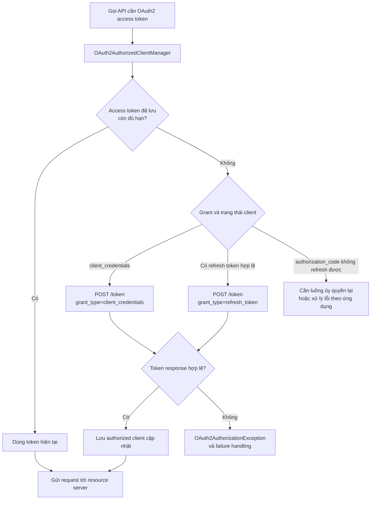
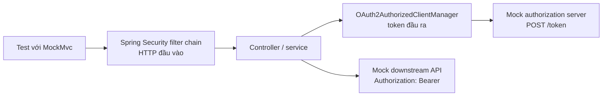

# Gia hạn, hết hạn và lỗi lấy token theo cơ chế đang dùng

> **Chương:** Ứng dụng khách OAuth2  
> **Module:** `SPRING_SECURITY_TESTING`  
> **Mục tiêu:** Kiểm chứng việc OAuth2 client dùng lại access token, lấy token mới hoặc refresh token, xử lý token hết hạn và phản ứng với lỗi từ authorization server/resource server. Các ví dụ sử dụng `spring-security-test` trong bối cảnh Servlet (`MockMvc`, `SecurityContext`) và Reactive (`WebTestClient`), đồng thời phân biệt test OAuth2 client thật với test dùng principal/token giả lập như `@WithMockUser`, `oauth2Login()`, `jwt()`.

OAuth2 client là thành phần **xin và sử dụng token để gọi một API khác**. Nó có thể chạy phía sau một ứng dụng web có người dùng đã đăng nhập, hoặc là một tác vụ nền giao tiếp giữa hai dịch vụ. Trong cả hai trường hợp, token có thời hạn; cách lấy token mới khác nhau theo authorization grant và dữ liệu đã được authorization server cấp.

Một bộ kiểm thử chỉ đưa sẵn `OAuth2AuthorizedClient` hoặc `@WithMockUser` vào `SecurityContext` có thể chứng minh controller hoạt động với một danh tính hợp lệ. Nhưng bộ test đó không chứng minh rằng OAuth2 client tự lấy token, dùng lại token còn hạn, refresh đúng lúc hoặc xử lý lỗi từ token endpoint. Muốn kiểm tra những hành vi này, cần **giữ `OAuth2AuthorizedClientManager` và các provider thật**, chỉ giả lập endpoint hoặc dịch vụ phụ thuộc ở ranh giới phù hợp.

## 1. Phân biệt bốn sự kiện thường bị gộp thành “refresh token”

| Sự kiện | Điều xảy ra | Có gửi request tới token endpoint? | Điều kiện quan trọng |
| --- | --- | --- | --- |
| **Dùng lại access token còn hiệu lực** | Lấy `OAuth2AuthorizedClient` đã lưu và dùng access token cũ | Thông thường không | Token còn đủ hạn theo chính sách clock skew và provider |
| **Xin access token mới bằng `client_credentials`** | Client tự xác thực bằng thông tin của ứng dụng để lấy token mới | Có, `grant_type=client_credentials` | Registration, client authentication và token endpoint hợp lệ |
| **Refresh access token** | Dùng refresh token đã được cấp để đổi lấy access token mới | Có, `grant_type=refresh_token` | Có refresh token, client/provider hỗ trợ refresh, refresh token còn được chấp nhận |
| **Đăng nhập hoặc ủy quyền lại** | Người dùng quay lại authorization server để làm authorization-code flow | Có nhiều HTTP bước; không chỉ token endpoint | Session/consent/chính sách IdP và redirect flow còn hoạt động |

**Không phải grant nào cũng có refresh token.** `client_credentials` thường nhận access token mà không có refresh token; khi hết hạn, client gọi lại token endpoint bằng thông tin của chính ứng dụng. Với `authorization_code`, authorization server *có thể* cấp refresh token. Việc cấp hay không còn tùy scope, consent, chính sách IdP và khả năng của client.

Theo OAuth2, cụm từ “gia hạn token” trong trao đổi nhóm có thể nói đến hai thao tác khác nhau: **refresh bằng refresh token** và **xin lại một access token mới bằng grant ban đầu**. Trong code và test, phải đặt đúng tên grant để tránh mô phỏng sai.

### 1.1. Hai tuyến xử lý phổ biến



Sơ đồ diễn tả mục đích nghiệp vụ; thứ tự chọn provider và hành vi trả về còn phụ thuộc `OAuth2AuthorizedClientProvider` được đăng ký. Không có provider hỗ trợ tương ứng thì manager **không tự tìm một cách khác** để lấy token.

## 2. Các thành phần Spring Security chịu trách nhiệm

| Thành phần | Vai trò |
| --- | --- |
| `ClientRegistration` | Cấu hình grant, client ID/secret, token URI, scope, cách xác thực client |
| `ClientRegistrationRepository` / `ReactiveClientRegistrationRepository` | Tra cứu registration bằng `registrationId` |
| `OAuth2AuthorizedClient` | Token đã được cấp cho một `ClientRegistration` và principal name; có access token, có thể có refresh token |
| `OAuth2AuthorizedClientService` / `ReactiveOAuth2AuthorizedClientService` | Lưu và đọc authorized client, phù hợp đặc biệt với tác vụ nền |
| `OAuth2AuthorizedClientRepository` / `ServerOAuth2AuthorizedClientRepository` | Lưu hoặc tra cứu authorized client theo ngữ cảnh web request |
| `OAuth2AuthorizedClientProvider` / `ReactiveOAuth2AuthorizedClientProvider` | Thực hiện logic cụ thể của grant: authorization code, refresh token, client credentials… |
| `OAuth2AuthorizedClientManager` / `ReactiveOAuth2AuthorizedClientManager` | Phối hợp tra cứu, ủy quyền lại, lưu kết quả và xử lý lỗi |
| `OAuth2AccessTokenResponseClient` / `ReactiveOAuth2AccessTokenResponseClient` | Gọi token endpoint và chuyển HTTP response thành token response |

Hai manager quan trọng phía Servlet:

- `DefaultOAuth2AuthorizedClientManager` gắn với `OAuth2AuthorizedClientRepository` và ngữ cảnh `HttpServletRequest`/`HttpServletResponse`, thường dùng trong luồng web có người dùng.
- `AuthorizedClientServiceOAuth2AuthorizedClientManager` gắn với `OAuth2AuthorizedClientService`, phù hợp tiến trình nền hoặc dịch vụ chạy ngoài servlet request.

Trong WebFlux, hai hướng tương ứng gồm `DefaultReactiveOAuth2AuthorizedClientManager` cho ngữ cảnh server request và `AuthorizedClientServiceReactiveOAuth2AuthorizedClientManager` cho tác vụ không có request.

### 2.1. Một token được “lưu theo ai”?

`OAuth2AuthorizedClient` liên kết với `registrationId` và `principalName`. Hai yêu cầu cùng client registration nhưng principal khác có thể có hai authorized client khác nhau.

Với `authorization_code`, principal thường là người dùng đang đăng nhập. **Không chia sẻ refresh token của người dùng A cho B.** Với `client_credentials`, một principal kỹ thuật ổn định (ví dụ `billing-batch-job`) giúp cache token nhất quán giữa các lần tác vụ chạy; thay đổi principal name ở mỗi request có thể gây cấp token lặp lại không cần thiết.

Lưu ý bảo mật: `OAuth2AuthorizedClient` chứa thông tin xác thực có giá trị. Chỉ dùng store đáng tin cậy, tránh log access/refresh token, giới hạn quyền đọc storage và quản lý hết hạn/thu hồi theo chính sách hệ thống.

### 2.2. Kiểm tra thời hạn không đơn thuần là so sánh bằng đúng giây hết hạn

Access token thường có `issuedAt` và `expiresAt`; token endpoint có thể công bố `expires_in` (số giây). Spring Security providers thường dùng **clock skew** để coi token gần hết hạn là cần thay mới, tránh token hết hạn trong lúc đang gọi downstream.

Ví dụ token hết hạn lúc 14:00, provider có skew 60 giây có thể chủ động thay token trước 14:00. Khi viết test, đừng mặc định `expiresAt > now` là đủ để provider sử dụng lại token. Cần kiểm tra cấu hình provider và clock skew cụ thể.

Một test ổn định nên tạo fixture đã hết hạn **cách hiện tại vài phút**, và token mới còn hạn **nhiều phút**. Với các ca ranh giới giây, hãy dùng clock điều khiển được nếu provider hỗ trợ hoặc test riêng chính sách thời gian; tránh phụ thuộc vào `Thread.sleep(...)`.

## 3. Cấu hình client credentials cho tác vụ nền Servlet

Giả sử một batch service gọi Billing API, dùng registration `billing-service`. Test sẽ mô phỏng token endpoint, còn Spring Security thực hiện client authentication, form request và parse token response.

Dependency cơ bản (Spring Boot 3.x / Spring Security 6.x):

```groovy
dependencies {
    implementation("org.springframework.boot:spring-boot-starter-oauth2-client")

    testImplementation("org.springframework.boot:spring-boot-starter-test")
    testImplementation("org.springframework.security:spring-security-test")
    testImplementation("com.squareup.okhttp3:mockwebserver:4.12.0")
}
```

Ví dụ bean manager chạy không phụ thuộc servlet request:

```java
@Configuration
class OAuth2ClientManagerConfig {

    @Bean
    OAuth2AuthorizedClientManager serviceClientManager(
            ClientRegistrationRepository registrations,
            OAuth2AuthorizedClientService authorizedClients) {

        OAuth2AuthorizedClientProvider provider =
            OAuth2AuthorizedClientProviderBuilder.builder()
                .clientCredentials()
                .refreshToken()
                .build();

        AuthorizedClientServiceOAuth2AuthorizedClientManager manager =
            new AuthorizedClientServiceOAuth2AuthorizedClientManager(
                registrations, authorizedClients);
        manager.setAuthorizedClientProvider(provider);
        return manager;
    }
}
```

Provider `clientCredentials()` xin token theo grant đó; provider `refreshToken()` chỉ hoạt động với authorized client có refresh token. Đăng ký cả hai không làm client credentials tự có refresh token.

Một tác vụ dùng manager:

```java
OAuth2AuthorizeRequest request = OAuth2AuthorizeRequest
    .withClientRegistrationId("billing-service")
    .principal("billing-batch-job")
    .build();

OAuth2AuthorizedClient client = manager.authorize(request);
if (client == null) {
    throw new IllegalStateException(
        "Không có provider xử lý registration billing-service");
}

String tokenValue = client.getAccessToken().getTokenValue();
// Gửi tokenValue dưới dạng Authorization: Bearer tới Billing API.
// Không log tokenValue hoặc trả token thô qua API của ứng dụng.
```

Không nên rải mã gọi manager và gắn header Bearer trên từng controller. Đặt nó trong tầng HTTP client hoặc service để đồng bộ chính sách lỗi, timeout và kiểm thử.

## 4. Kiểm thử cấp lại token `client_credentials` với MockWebServer

Ví dụ tiếp theo không mock `OAuth2AuthorizedClientManager`: ta chỉ fake HTTP token endpoint. Mọi thành phần `ClientCredentialsOAuth2AuthorizedClientProvider`, token-response client và authorized-client service đều chạy thật.

### 4.1. Test access token cũ hết hạn thì xin token mới

Các static import thường dùng gồm JUnit `assertEquals/assertNotNull`, Spring `AuthorizationGrantType.CLIENT_CREDENTIALS`, `ClientAuthenticationMethod.CLIENT_SECRET_BASIC`; các class chính nằm trong `org.springframework.security.oauth2.client.*` và `org.springframework.security.oauth2.core.*`.

```java
@Test
void expiredClientCredentialsTokenIsReacquired() throws Exception {
    MockWebServer tokenServer = new MockWebServer();
    tokenServer.enqueue(new MockResponse()
        .setResponseCode(200)
        .addHeader("Content-Type", "application/json")
        .setBody("""
            {
              "access_token": "access-v2",
              "token_type": "Bearer",
              "expires_in": 3600,
              "scope": "billing.read"
            }
            """));
    tokenServer.start();

    try {
        ClientRegistration registration =
            ClientRegistration.withRegistrationId("billing-service")
                .tokenUri(tokenServer.url("/token").toString())
                .clientId("test-client-id")
                .clientSecret("test-client-secret")
                .clientAuthenticationMethod(
                    ClientAuthenticationMethod.CLIENT_SECRET_BASIC)
                .authorizationGrantType(
                    AuthorizationGrantType.CLIENT_CREDENTIALS)
                .scope("billing.read")
                .build();

        var registrations =
            new InMemoryClientRegistrationRepository(registration);
        var service =
            new InMemoryOAuth2AuthorizedClientService(registrations);

        // Chuẩn bị authorized client cũ, đã hết hạn từ 5 phút trước.
        Instant now = Instant.now();
        OAuth2AccessToken expiredToken = new OAuth2AccessToken(
            OAuth2AccessToken.TokenType.BEARER,
            "access-v1-expired",
            now.minusSeconds(3600),
            now.minusSeconds(300));

        service.saveAuthorizedClient(
            new OAuth2AuthorizedClient(
                registration, "billing-batch-job", expiredToken),
            new UsernamePasswordAuthenticationToken(
                "billing-batch-job", "N/A", List.of()));

        var manager =
            new AuthorizedClientServiceOAuth2AuthorizedClientManager(
                registrations, service);
        manager.setAuthorizedClientProvider(
            OAuth2AuthorizedClientProviderBuilder.builder()
                .clientCredentials()
                .build());

        OAuth2AuthorizeRequest authorizeRequest =
            OAuth2AuthorizeRequest
                .withClientRegistrationId("billing-service")
                .principal("billing-batch-job")
                .build();

        OAuth2AuthorizedClient result =
            manager.authorize(authorizeRequest);
        assertNotNull(result);
        assertEquals("access-v2",
            result.getAccessToken().getTokenValue());
        assertEquals("access-v2",
            service.loadAuthorizedClient(
                "billing-service", "billing-batch-job")
                .getAccessToken().getTokenValue());

        RecordedRequest tokenRequest =
            tokenServer.takeRequest(2, TimeUnit.SECONDS);
        assertNotNull(tokenRequest);
        assertEquals("/token", tokenRequest.getPath());
        assertTrue(tokenRequest.getBody().readUtf8()
            .contains("grant_type=client_credentials"));
        assertTrue(tokenRequest.getHeader("Authorization")
            .startsWith("Basic "));
    } finally {
        tokenServer.shutdown();
    }
}
```

**Về mã test:** `OAuth2AuthorizedClientService.saveAuthorizedClient(...)` nhận thêm một `Authentication`, để lưu theo `authentication.getName()`. Dùng principal name cố định `billing-batch-job` cho cả bước seed và `authorize(...)`. Fixture dùng credential `"N/A"` cho authentication nội bộ của test; không phải password gửi tới token endpoint. Token endpoint nhận `test-client-id/test-client-secret` qua HTTP Basic theo `ClientRegistration`.

Để kiểm tra chắc chắn token còn hạn được **dùng lại** và không phát sinh request mới, có thể seed `OAuth2AccessToken` với `expiresAt = now.plusSeconds(3600)`, gọi manager và assert token value giữ nguyên; dùng `tokenServer.getRequestCount() == 0` khi mock server chưa được gọi. Nên tách test này ra khỏi ca token hết hạn để cache từ test trước không gây nhiễu.

Trong code thực, có thể dùng `OAuth2AuthorizedClientService` lưu bằng JDBC hoặc repository khác; test nên kiểm tra cả cơ chế lưu nếu đó là yêu cầu triển khai. MockWebServer được dùng vì nó giúp kiểm chứng đúng grant, HTTP method, header và cách parse response.

### 4.2. Token endpoint trả lỗi cấp token mới

Với grant client credentials, `invalid_client` có thể cho biết client ID/secret hoặc phương thức client authentication sai; `invalid_scope` cho biết scope request không được chấp nhận. Đây không phải lỗi do người dùng chưa đăng nhập vào ứng dụng.

```java
tokenServer.enqueue(new MockResponse()
    .setResponseCode(401)
    .addHeader("Content-Type", "application/json")
    .setBody("""
        {
          "error": "invalid_client",
          "error_description": "Test client authentication failed"
        }
        """));

OAuth2AuthorizationException failure = assertThrows(
    OAuth2AuthorizationException.class,
    () -> manager.authorize(authorizeRequest));

assertEquals("invalid_client",
    failure.getError().getErrorCode());
```

Đoạn trên là một mảnh test **đặt trong cùng fixture** với `tokenServer`, `manager` và `authorizeRequest` vừa trình bày. Tùy phiên bản hoặc HTTP response converter, exception có thể được bọc/ánh xạ với mã lỗi khác; kiểm tra mã lỗi thực nhận và chính sách lớp service. Điều bắt buộc trong bài test là: **không sử dụng token cũ đã hết hạn để tiếp tục gọi downstream** và không báo thành công giả.

Không tự retry vô hạn khi `invalid_client` hoặc `invalid_scope`: đây thường là lỗi cấu hình/quyền. Với timeout, `server_error`, `temporarily_unavailable` hoặc HTTP `429`, có thể retry có giới hạn kèm backoff theo chính sách; đồng thời phân biệt lỗi cấp token với lỗi của API đích.

## 5. Refresh token của authorization code: đường đi và ca kiểm thử

Đối với ứng dụng web dùng `oauth2Login()` hoặc authorization code, `OAuth2AuthorizedClient` có thể chứa refresh token. Provider `refreshToken()` gửi:

```http
POST /token HTTP/1.1
Content-Type: application/x-www-form-urlencoded
Authorization: Basic <client credentials>

grant_type=refresh_token&refresh_token=refresh-v1
```

Đây là ví dụ hình thức; client authentication và các tham số khác tùy registration/authorization server. Refresh token không phải lúc nào cũng được cấp, không được gửi trong header Bearer tới resource server và không nên in ra log.

### 5.1. Cấu hình cho client có refresh token

Ở Servlet web app có request/session:

```java
@Bean
OAuth2AuthorizedClientManager userAuthorizedClientManager(
        ClientRegistrationRepository registrations,
        OAuth2AuthorizedClientRepository authorizedClients) {

    DefaultOAuth2AuthorizedClientManager manager =
        new DefaultOAuth2AuthorizedClientManager(
            registrations, authorizedClients);
    manager.setAuthorizedClientProvider(
        OAuth2AuthorizedClientProviderBuilder.builder()
            .authorizationCode()
            .refreshToken()
            .build());
    return manager;
}
```

`DefaultOAuth2AuthorizedClientManager` dành cho request web; khi test trực tiếp ngoài request, sử dụng service-based manager và seed authorized client như ví dụ bên dưới. Điều quan trọng là **provider chain có `refreshToken()`**, không phải chỉ có `authorizationCode()`.

### 5.2. Seed token hết hạn và refresh token thật trong fixture

Kịch bản: người dùng `alice` đã hoàn tất OAuth2 login và authorized client có refresh token `refresh-v1`. Không cần chạy trình duyệt hay redirect để test logic refresh; seed đúng state ở `OAuth2AuthorizedClientService`, sau đó gọi manager thật và stub token endpoint.

```java
@Test
void expiredUserAccessTokenIsRefreshed() throws Exception {
    MockWebServer tokenServer = new MockWebServer();
    tokenServer.enqueue(new MockResponse()
        .setResponseCode(200)
        .addHeader("Content-Type", "application/json")
        .setBody("""
            {
              "access_token": "access-v2",
              "token_type": "Bearer",
              "expires_in": 3600,
              "refresh_token": "refresh-v2",
              "scope": "profile"
            }
            """));
    tokenServer.start();

    try {
        ClientRegistration registration =
            ClientRegistration.withRegistrationId("user-portal")
                .clientId("portal-client")
                .clientSecret("portal-test-secret")
                .clientAuthenticationMethod(
                    ClientAuthenticationMethod.CLIENT_SECRET_BASIC)
                .authorizationGrantType(
                    AuthorizationGrantType.AUTHORIZATION_CODE)
                .authorizationUri("https://idp.example.test/authorize")
                .tokenUri(tokenServer.url("/token").toString())
                .redirectUri(
                    "{baseUrl}/login/oauth2/code/{registrationId}")
                .scope("profile")
                .build();

        var registrations =
            new InMemoryClientRegistrationRepository(registration);
        var service =
            new InMemoryOAuth2AuthorizedClientService(registrations);

        Instant now = Instant.now();
        OAuth2AccessToken expired = new OAuth2AccessToken(
            OAuth2AccessToken.TokenType.BEARER,
            "access-v1-expired",
            now.minusSeconds(3600),
            now.minusSeconds(300));
        OAuth2RefreshToken refresh = new OAuth2RefreshToken(
            "refresh-v1", now.minusSeconds(3600));

        service.saveAuthorizedClient(
            new OAuth2AuthorizedClient(
                registration, "alice", expired, refresh),
            new UsernamePasswordAuthenticationToken(
                "alice", "N/A", List.of()));

        var manager =
            new AuthorizedClientServiceOAuth2AuthorizedClientManager(
                registrations, service);
        manager.setAuthorizedClientProvider(
            OAuth2AuthorizedClientProviderBuilder.builder()
                .refreshToken()
                .build());

        OAuth2AuthorizeRequest request = OAuth2AuthorizeRequest
            .withClientRegistrationId("user-portal")
            .principal("alice")
            .build();

        OAuth2AuthorizedClient renewed = manager.authorize(request);
        assertNotNull(renewed);
        assertEquals("access-v2",
            renewed.getAccessToken().getTokenValue());
        assertEquals("refresh-v2",
            renewed.getRefreshToken().getTokenValue());

        RecordedRequest sent =
            tokenServer.takeRequest(2, TimeUnit.SECONDS);
        assertNotNull(sent);
        String body = sent.getBody().readUtf8();
        assertTrue(body.contains("grant_type=refresh_token"));
        assertTrue(body.contains("refresh_token=refresh-v1"));
    } finally {
        tokenServer.shutdown();
    }
}
```

Test này không tự thực hiện authorization-code redirect, nhưng chứng minh provider refresh được sử dụng, refresh token được gửi đúng và authorized client nhận access/refresh token mới. Khi IdP triển khai **refresh-token rotation**, cần xác minh token mới được lưu và token cũ không được tái sử dụng trong lần refresh tiếp theo.

**Trường hợp token response không có `refresh_token`:** không mặc định đó là lỗi. Một số authorization server chỉ phát access token mới và giữ refresh token cũ; hành vi lưu/giữ refresh token phụ thuộc Spring Security provider và hợp đồng IdP. Hãy kiểm tra chính xác token được lưu sau refresh. Nếu IdP yêu cầu rotation nhưng client vẫn giữ token cũ, cần sửa luồng lưu authorized client.

### 5.3. Không có refresh token thì sao?

Với `authorization_code` mà IdP không cấp refresh token, provider `refreshToken()` không thể refresh. Trong một ứng dụng web tương tác, cần đưa người dùng qua authorization flow lại khi chính sách đòi hỏi một token mới; có thể là redirect/re-auth, không phải một request refresh tự tạo từ client.

Với `client_credentials`, chỉ cần cấu hình provider `clientCredentials()` để xin token mới khi access token hết hạn. Không nên cố tạo một `OAuth2RefreshToken` giả cho grant vốn không được cấp refresh token.

## 6. Những lỗi phải phân biệt: token endpoint, refresh token, downstream API

| Nguồn lỗi | Dấu hiệu thường gặp | Hành vi nên kiểm thử |
| --- | --- | --- |
| Token endpoint: `invalid_client` | Client ID, secret hoặc authentication method không được chấp nhận | Ghi nhận lỗi cấu hình; không dùng token cũ, không retry vô hạn |
| Token endpoint: `invalid_scope` / `unauthorized_client` | Scope/grant không được phép | Từ chối thao tác và báo đúng nguyên nhân theo chính sách |
| Token endpoint: `invalid_grant` khi refresh | Refresh token hết hạn, bị thu hồi hoặc không hợp lệ | Không lặp lại refresh với token cũ; xử lý xóa/invalidating authorized client và yêu cầu ủy quyền lại nếu cần |
| Token endpoint: `server_error`, `temporarily_unavailable` | IdP tạm thời lỗi | Retry giới hạn/backoff có điều kiện; giữ log/metrics phù hợp |
| Token endpoint: timeout, mất kết nối, HTTP 5xx/429, JSON hỏng | Không lấy được token response hợp lệ | Bảo đảm fail rõ ràng; tránh gửi downstream bằng token hết hạn |
| Resource server: `401 invalid_token` | Token đã bị thu hồi hoặc không được API đích chấp nhận | Xử lý thông báo/làm mới authorized client theo failure handler; cân nhắc retry có giới hạn |
| Resource server: `403 insufficient_scope` | Token có thể hợp lệ nhưng không đủ quyền | Không tự coi refresh là cách cấp thêm quyền; cần scope/consent/policy phù hợp |
| Resource server: timeout/5xx | Lỗi API đích sau khi đã lấy token | Xử lý như lỗi downstream riêng, không quy kết thành lỗi OAuth2 token endpoint |

### 6.1. `invalid_grant` không giống `invalid_client`

Với refresh, lỗi `invalid_grant` thường có ý nghĩa **refresh token không còn sử dụng được**. Cách phục hồi điển hình trong app web là loại bỏ authorized client không còn hợp lệ và đưa người dùng qua authorization flow phù hợp. Với client credentials, `invalid_client` liên quan cấu hình ứng dụng, sửa secret/cert hoặc grant permission mới là hướng xử lý.

Spring Security có các `OAuth2AuthorizationFailureHandler` và implementation hỗ trợ xóa authorized client khi cần. Hành vi mặc định có thể khác nhau theo manager, cách tích hợp WebClient và version. Đừng chỉ tin rằng cứ bị `invalid_grant` thì token chắc chắn biến mất trong mọi store. **Kiểm tra state trước/sau lỗi** và xác định failure handler thực sự được cấu hình.

Ví dụ kiểm thử mức service:

```java
// Pseudocode mô tả assertion; dùng fixture refresh ở mục 5.
tokenEndpointReplies("invalid_grant", 400);

assertThrows(OAuth2AuthorizationException.class,
    () -> manager.authorize(request));

// Nếu chính sách yêu cầu xóa authorized client, kiểm tra
// loadAuthorizedClient("user-portal", "alice") là null,
// hoặc kiểm tra failure handler đã được gọi để xóa nó.
```

`tokenEndpointReplies(...)` là **helper minh họa**, không phải API của Spring Security. Bài test thực cần xây HTTP response của MockWebServer và cấu hình failure handler theo quy tắc của ứng dụng.

### 6.2. Lỗi `401` khi gọi API đích có phải refresh ngay?

Không phải lúc nào cũng vậy. Resource server có thể từ chối vì token đã bị thu hồi trước hạn, issuer/audience không hợp lệ hoặc sử dụng token sai đích. Exchange filter có thể được cấu hình để báo thất bại cho authorized-client manager và xóa client đã lưu; ở lần gọi sau, manager xin token mới theo grant thích hợp.

Ở Servlet, `ServletOAuth2AuthorizedClientExchangeFilterFunction` có cơ chế tích hợp failure handler; ở Reactive là `ServerOAuth2AuthorizedClientExchangeFilterFunction`. Tùy cách khởi tạo filter function (bằng repository hay bằng manager), failure handler mặc định có thể khác nhau; cần xác nhận cấu hình hiện dùng.

Đừng bật retry vô hạn kiểu “API trả 401 → refresh → gọi lại → 401 → refresh…”. Cần giới hạn số lần, bảo vệ request có side effect và phân biệt nguyên nhân `invalid_token` với `insufficient_scope`. Trả `403` do thiếu quyền không có nghĩa refresh token sẽ tự tạo thêm scope.

## 7. MockMvc: giữ bảo mật HTTP đầu vào và kiểm tra OAuth2 client đầu ra

Một ứng dụng vừa có HTTP login, vừa gọi dịch vụ bằng access token, thực chất có **hai đường bảo mật**:



Các helper từ `spring-security-test` có mục tiêu khác nhau:

| Test helper / kỹ thuật | Kiểm chứng được | Không tự kiểm chứng |
| --- | --- | --- |
| `@WithMockUser` | Authorization của request đi vào với principal đã tạo sẵn | OAuth2 login, token endpoint, refresh token |
| `oauth2Login()` / `oidcLogin()` | Principal và authorities của request sau login giả lập | Authorization-code flow thật, token exchange, refresh |
| `oauth2Client()` | Hành vi code khi đã có `OAuth2AuthorizedClient` được đưa vào test | Tự động xin/refresh token qua HTTP |
| Bearer JWT thật + `MockMvc` | Resource Server xác minh token đầu vào nếu decoder/filter thật được giữ | OAuth2 client lấy token để gọi API khác |
| Manager thật + token endpoint HTTP stub | Hành vi cấp token mới/refresh/parse lỗi/authorized-client persistence | Bản thân login callback với IdP thật |
| Manager thật + token endpoint stub + downstream stub | Token được gắn vào request outbound, xử lý lỗi bên ngoài | Kết nối IdP production |

Ví dụ kiểm thử controller sau khi người dùng đã đăng nhập bằng OAuth2:

```java
@SpringBootTest
@AutoConfigureMockMvc(addFilters = true)
class BillingEndpointIT {
    @Autowired MockMvc mvc;

    @Test
    void authenticatedUserCanInvokeBillingAction() throws Exception {
        mvc.perform(get("/api/billing")
                .with(oauth2Login()
                    .authorities(new SimpleGrantedAuthority("ROLE_USER"))))
            .andExpect(status().isOk());
    }
}
```

Test này giả định `GET /api/billing` tồn tại và yêu cầu `ROLE_USER`. Nó kiểm tra security filter, controller và nội dung trả về nếu có assertion bổ sung. **Nó không chứng minh token được lấy hay refresh**. Để kiểm chứng việc đó, request controller cần thật sự gọi service có manager thật, trong khi token endpoint và downstream API được stub; kiểm tra request count, grant type và header `Authorization` của API đích.

Nếu endpoint HTTP đầu vào không cho anonymous, hãy có test `401` hoặc `302` (chuyển tới đăng nhập OAuth2) theo cấu hình entry point; nếu user thiếu role, assert `403`. Đừng lẫn mã trả về **đầu vào ứng dụng** với `401/403` mà downstream API trả cho OAuth2 client của ứng dụng.

### 7.1. Vì sao `oauth2Client()` làm test refresh xanh giả?

`oauth2Client("user-portal")` của MockMvc tạo/cài sẵn `OAuth2AuthorizedClient` cho request. Đây là lựa chọn tốt khi mục tiêu là xử lý token đã có, nhưng nếu test không đi qua manager và token endpoint thì việc đổi thời hạn fixture chưa chắc kích hoạt refresh. Một ca được phép khi đã có token **không đủ chứng cứ** cho cơ chế đổi token.

Khi muốn test refresh, nên có ít nhất một assertion trực tiếp về `grant_type=refresh_token` ở token stub, token mới được lưu, và request downstream dùng token mới. Với client credentials tương ứng là `grant_type=client_credentials`.

## 8. Reactive: quản lý token không chặn luồng bằng WebTestClient

WebFlux dùng `ReactiveOAuth2AuthorizedClientManager` và các provider trả `Mono<OAuth2AuthorizedClient>`. Với một worker không có HTTP server request:

```java
@Bean
ReactiveOAuth2AuthorizedClientManager reactiveServiceManager(
        ReactiveClientRegistrationRepository registrations,
        ReactiveOAuth2AuthorizedClientService authorizedClients) {

    AuthorizedClientServiceReactiveOAuth2AuthorizedClientManager manager =
        new AuthorizedClientServiceReactiveOAuth2AuthorizedClientManager(
            registrations, authorizedClients);

    manager.setAuthorizedClientProvider(
        ReactiveOAuth2AuthorizedClientProviderBuilder.builder()
            .clientCredentials()
            .refreshToken()
            .build());
    return manager;
}
```

Ví dụ thực thi:

```java
OAuth2AuthorizeRequest request =
    OAuth2AuthorizeRequest.withClientRegistrationId("billing-service")
        .principal("billing-batch-job")
        .build();

Mono<OAuth2AuthorizedClient> clientMono =
    reactiveManager.authorize(request);

return clientMono.switchIfEmpty(Mono.error(
    new IllegalStateException("Không có authorized client phù hợp")))
    .flatMap(client -> webClient.get()
        .uri("https://billing.example.test/api/invoices")
        .headers(h -> h.setBearerAuth(
            client.getAccessToken().getTokenValue()))
        .retrieve()
        .bodyToMono(String.class));
```

Đây là mảnh mã bên trong một method trả `Mono<String>`, với `reactiveManager` và `webClient` được inject. Trong WebFlux, không gọi `block()` trên event-loop để đợi refresh, tránh làm nghẽn luồng xử lý.

### 8.1. Kiểm thử Reactive provider

Có thể dùng WebTestClient cho HTTP đầu vào và `StepVerifier` cho manager, tùy phạm vi cần kiểm chứng:

```java
StepVerifier.create(reactiveManager.authorize(request))
    .assertNext(client -> {
        assertEquals("access-v2",
            client.getAccessToken().getTokenValue());
    })
    .verifyComplete();
```

Fixture cần một `ReactiveOAuth2AuthorizedClientService` chứa access token đã hết hạn, `ReactiveClientRegistrationRepository` và token endpoint stub phát token mới. Đừng mock `ReactiveOAuth2AuthorizedClientManager` nếu mục tiêu là kiểm tra refresh. Với luồng thông thường, `Mono.empty()` có thể biểu thị provider không thể ủy quyền theo cấu hình hiện tại; xử lý rõ như ví dụ ở trên.

Với API WebFlux dùng OIDC/OAuth2 login, `WebTestClient.bindToApplicationContext(applicationContext).apply(SecurityMockServerConfigurers.springSecurity())` cho phép giữ các WebFilter trong test. `mockOAuth2Login()` và `mockOAuth2Client()` (nếu hỗ trợ trong phiên bản đang dùng) cài đặt trạng thái OAuth2 cho test, nhưng không thay thế token endpoint stub và provider thật.

Nếu dùng `WebClient` gắn `ServerOAuth2AuthorizedClientExchangeFilterFunction`, cần kiểm tra cách client registration được chọn và failure handler xử lý lỗi `401/403` từ downstream. Không mặc định rằng cứ gọi `retrieve()` là token được refresh một lần và request tự retry; chính sách retry phải được thiết kế và kiểm thử riêng.

## 9. Kịch bản tích hợp hai đầu: cấp token rồi gọi resource server

Một bài tích hợp đủ sâu nên chạy tối thiểu các bước:

1. Token endpoint stub trả `access-v1` còn hạn. Gọi service lần đầu: assert `POST /token` đúng grant và downstream nhận `Bearer access-v1`.
2. Gọi lại cùng `registrationId/principalName` khi token còn hạn: assert manager dùng token đã lưu và không cần token request mới.
3. Seed hoặc làm token hết hạn với thời gian kiểm soát. Lần gọi tiếp theo nhận `access-v2` từ token endpoint: assert downstream nhận token mới, không dùng `access-v1`.
4. Với authorization code, chuẩn bị refresh token cũ; token endpoint phản hồi `refresh-v2`. Assert authorized-client storage giữ đúng token mới.
5. Token endpoint trả `invalid_grant`: assert request downstream không bị gọi bằng access token hết hạn; state của authorized client được xử lý đúng theo failure handler.
6. Downstream trả `401 invalid_token` rồi `403 insufficient_scope` trong hai test khác nhau: assert cơ chế xử lý lỗi, eviction/retry hoặc thông báo đúng với từng trường hợp.

Ở tất cả bước, thử nghiệm nên tách endpoint mock thành hai server hoặc hai route khác nhau. Dùng URL trên loopback và port ngẫu nhiên, không gọi dịch vụ OAuth2 production. Mỗi test nên có kho authorized client/clock/fixture độc lập để không phụ thuộc thứ tự chạy.

### 9.1. Bảng ma trận cần bao phủ

| Grant / trạng thái | Cấu hình test | Kết quả mong đợi |
| --- | --- | --- |
| `client_credentials`, chưa có token | Stub token endpoint trả 200 | Xin token mới, lưu token, downstream nhận Bearer |
| `client_credentials`, token còn hạn | Seed token còn hạn | Dùng token cũ, không gọi token endpoint |
| `client_credentials`, token hết hạn | Seed token quá hạn | Xin token mới bằng `client_credentials` |
| `authorization_code`, token hết hạn có refresh token | Seed refresh token, stub 200 | Gọi `refresh_token`, lưu access token mới |
| `authorization_code`, token hết hạn không có refresh token | Không seed refresh token | Không tự refresh thành công; xử lý reauthorization theo ứng dụng |
| Refresh token bị thu hồi | Stub `invalid_grant` | Thất bại rõ ràng; chính sách xóa authorized client/đăng nhập lại |
| Sai secret hoặc grant permission | Stub `invalid_client`/`unauthorized_client` | Không retry vô hạn; báo lỗi cấu hình |
| Token endpoint tạm thời lỗi | Timeout/5xx/429 | Lỗi được phân loại; retry giới hạn nếu được cấu hình |
| Downstream từ chối token | `401 invalid_token` | Failure handler/reacquire có kiểm soát, không dùng token cũ mãi |
| Downstream không đủ scope | `403 insufficient_scope` | Không kỳ vọng refresh tự nâng quyền |
| Concurrent requests cùng token hết hạn | Nhiều luồng cùng principal/registration | Đo khả năng phát sinh nhiều token requests; cân nhắc single-flight/locking nếu cần |

### 9.2. Kiểm tra việc cấp token đồng thời

Nếu nhiều request cùng lúc thấy token đã hết hạn, một số hệ thống sẽ gửi nhiều request tới token endpoint trước khi token mới được lưu. Spring Security manager không nên bị mặc định xem là cơ chế “single-flight” cho mọi store và tình huống. Với tải lớn, cần đo thật số token requests và cân nhắc cache/synchronization ở lớp thích hợp.

Thử nghiệm concurrency nên có barrier cho nhiều task cùng bắt đầu, token endpoint stub đếm request, và assertion phù hợp với hợp đồng mong muốn. Không khóa toàn bộ thread bằng `synchronized` một cách tùy tiện trong Reactive code; điều phối bất đồng bộ và storage phân tán cần thiết kế riêng.

## 10. Lỗi thường gặp khi viết bài kiểm thử OAuth2 client

| Biểu hiện | Nguyên nhân khả dĩ | Hướng kiểm tra |
| --- | --- | --- |
| Access token không được refresh dù đã hết hạn | Thiếu provider `refreshToken()`; refresh token không có; manager không được gọi | Xem grant, provider chain, authorized client và request path |
| `client_credentials` cố gửi `refresh_token` | Test/implementation giả định mọi grant có refresh token | Thay bằng xin token mới với grant `client_credentials` |
| Token endpoint bị gọi lặp lại liên tục | Principal name thay đổi, storage không lưu, token mới rất ngắn hạn, skew quá lớn | Kiểm tra principal name, token expiry và sự kiện save |
| Token còn hạn nhưng test vẫn gọi lại token endpoint | Token gần hạn trong vùng clock skew | Dùng fixture xa ranh giới hết hạn hoặc cấu hình clock rõ |
| Refresh thành công nhưng lần sau dùng refresh token cũ | Storage chưa cập nhật hoặc refresh rotation không được lưu | Assert token mới trong authorized-client service/repository |
| Test `@WithMockUser` xanh nhưng production lỗi lấy token | Test chỉ dựng principal, không chạy OAuth2 client manager | Thêm test manager thật + HTTP token stub |
| Downstream `401` nhưng token vẫn tiếp tục được dùng | Chưa kết nối authorization failure handler, eviction policy không khớp | Kiểm tra WebClient exchange filter và store |
| Downstream `403` được xử lý như token hết hạn | Nhầm `insufficient_scope` với `invalid_token` | Tách authentication, authorization và quyền scope |
| Reactive code bị treo | Dùng HTTP client blocking hoặc `block()` trên event-loop | Sử dụng reactive manager/WebClient, kiểm thử timeout bất đồng bộ |
| Test phụ thuộc thứ tự | Dùng chung authorized-client store và token stub state | Cô lập fixture hoặc reset store đúng cách |
| Secret/token lộ trong CI logs | Log toàn bộ request/token | Giới hạn log, che header, không ghi refresh token thật |

## 11. Bài thực hành

Xây dựng một service gọi `Billing API` bằng OAuth2 client có registration `billing-service`, dùng `client_credentials`. Dựng HTTP stub token endpoint và stub Billing API. Viết test cho token chưa có, còn hạn, hết hạn, sai secret và timeout. Sau đó thêm registration `user-portal` theo `authorization_code`; seed authorized client có refresh token và viết các ca refresh thành công, refresh token bị thu hồi, phản hồi có/không có refresh token mới.

Tiếp theo, đặt service phía sau một endpoint Servlet bảo vệ bởi Spring Security. Dùng `MockMvc` + `oauth2Login()` để kiểm tra authorization HTTP đầu vào; trong cùng test hoặc test service riêng, kiểm tra token manager thật xử lý phần outbound. Làm bản tương đương trên WebFlux với `WebTestClient` và reactive manager.

**Một bài làm đạt yêu cầu khi chứng minh được:**

1. Access token còn hạn được dùng lại theo chính sách expiry/skew thực sự của manager.
2. `client_credentials` hết hạn sẽ xin token mới bằng đúng grant; `authorization_code` chỉ refresh được khi có refresh token phù hợp.
3. Token response mới được lưu đúng theo `registrationId + principalName`; refresh-token rotation không khiến client tiếp tục dùng token đã bị thay.
4. Lỗi token endpoint và lỗi downstream được phân biệt; không retry vô hạn và không gửi token hết hạn như thể hợp lệ.
5. Test xác định rõ phần nào được giả lập (principal, authorized client, token endpoint hoặc downstream) và phần nào thật sự được kiểm chứng (filter chain, manager/provider, lưu token, HTTP request).

**Ghi nhớ:** Trong `SPRING_SECURITY_TESTING`, `@WithMockUser`, `oauth2Login()` và `oauth2Client()` là công cụ đúng khi kiểm tra hành vi của ứng dụng với trạng thái xác thực đã có. Để chứng minh **gia hạn, hết hạn và lỗi lấy token**, phải chạy đúng OAuth2 authorized-client manager/provider cho grant đang dùng và quan sát tương tác với token endpoint giả lập cùng trạng thái token được lưu.
