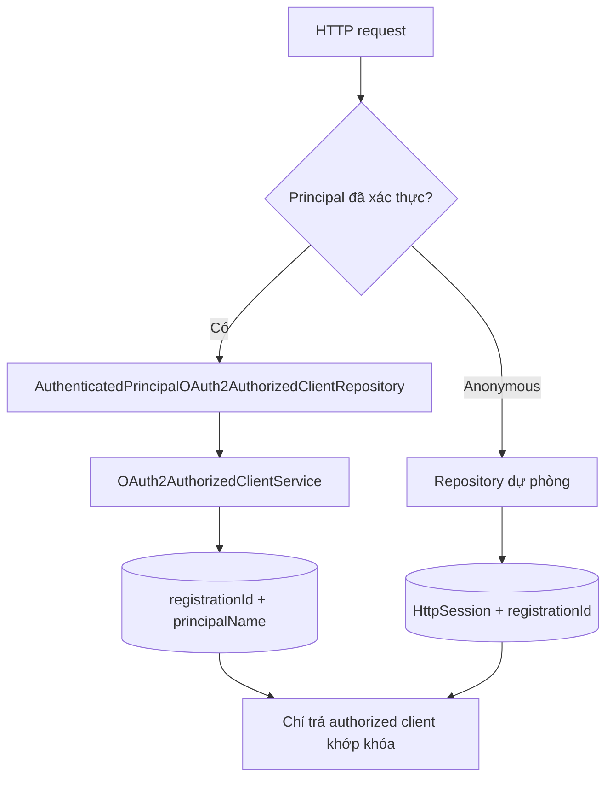

# Tách biệt dữ liệu authorized client giữa người dùng hoặc phiên

Khi một ứng dụng sử dụng OAuth 2.0 Client để gọi API của nhà cung cấp thay mặt người dùng, Spring Security thường giữ lại thông tin **authorized client** để các request sau có thể tiếp tục sử dụng access token mà không bắt người dùng cấp quyền lại. Nếu phép lưu/tra cứu không đặt đúng ranh giới, access token của **Alice** có thể bị dùng trong request của **Bob**, hoặc token của một phiên cũ tiếp tục được dùng sau khi người dùng đã đổi tài khoản.

Bài này thuộc chương **Ứng dụng khách OAuth2** trong module **SPRING_SECURITY_TESTING**: kiểm chứng xác thực, phân quyền và bảo vệ HTTP bằng `spring-security-test`, MockMvc, WebTestClient, SecurityContext cùng các principal và token giả lập. Chúng ta tập trung vào việc **tách biệt authorized client giữa người dùng và phiên**, bằng các kiểm thử đơn vị với `OAuth2AuthorizedClientService`, `OAuth2AuthorizedClientRepository` và kiểm thử HTTP bằng MockMvc. Trọng tâm là xác minh **không đọc được token của chủ thể hoặc phiên khác**, thay vì chỉ chứng minh rằng một token đã được lưu.

## 1. `OAuth2AuthorizedClient` là gì và vì sao phải cô lập?

Một `OAuth2AuthorizedClient` liên kết ba yếu tố:

- **`ClientRegistration`**: thông tin ứng dụng khách OAuth2, nhận diện bởi `registrationId` (ví dụ `reports` hoặc `calendar`).
- **Principal/resource owner**: chủ thể sở hữu lần cấp quyền, biểu diễn qua `principalName` như `alice` hoặc `bob`. Với client credentials, đây có thể là tên principal kỹ thuật do ứng dụng lựa chọn.
- **Token đã được cấp**: `OAuth2AccessToken`, có thể kèm `OAuth2RefreshToken`. Đây là credential nhạy cảm để ứng dụng gọi tài nguyên được bảo vệ.

Ví dụ cùng một client registration `reports` nhưng hai người dùng khác nhau:

| `registrationId` | `principalName` | Access token minh họa | Chủ thể được phép sử dụng |
| --- | --- | --- | --- |
| `reports` | `alice` | `alice-access-demo` | Alice |
| `reports` | `bob` | `bob-access-demo` | Bob |
| `calendar` | `alice` | `alice-calendar-demo` | Alice qua registration khác |

Các chuỗi token trong bảng chỉ là **fixture không có giá trị sử dụng thật**. Trong hệ thống thật, tuyệt đối không trả token cho trình duyệt chỉ để kiểm tra dữ liệu đang được lưu, không đưa refresh token vào log hay thông báo lỗi.

Tránh nhầm giữa các khái niệm:

| Khái niệm | Ý nghĩa | Có tự phân tách token người dùng không? |
| --- | --- | --- |
| `ClientRegistrationRepository` | Lưu cấu hình client (client ID, grant type, endpoint, scopes) | **Không**; cùng cấu hình có thể dùng cho nhiều người |
| `OAuth2AuthorizedClient` | Chứa registration, principalName và token đã cấp | Mang thông tin sở hữu nhưng không phải kho lưu |
| `OAuth2AuthorizedClientService` | Lưu/đọc authorized client bằng `registrationId` và `principalName` | **Có**, khi gọi đúng principal |
| `HttpSessionOAuth2AuthorizedClientRepository` | Lưu authorized client trong `HttpSession` | Tách theo **session**, không tự bảo đảm mỗi người dùng có session riêng |
| `AuthenticatedPrincipalOAuth2AuthorizedClientRepository` | Khi principal đã xác thực, ủy quyền cho `OAuth2AuthorizedClientService`; khi anonymous dùng repository khác (mặc định session) | Phụ thuộc nhánh được dùng |

Điểm rất quan trọng: **“theo người dùng” và “theo phiên” là hai chính sách khác nhau**. Một service lưu theo `principalName` có thể cho cùng Alice lấy lại authorized client trên nhiều phiên. Một repository lưu theo session có thể làm hai request trong cùng session nhìn thấy cùng dữ liệu, ngay cả khi tên principal truyền vào khác nhau. Cần chọn mô hình phù hợp với cách ứng dụng quản lý đăng nhập, đăng xuất và đổi tài khoản.

## 2. Tình huống cần kiểm thử

Giả sử ứng dụng có chức năng lấy báo cáo từ một OAuth2 provider:

1. Alice đăng nhập, cấp quyền cho client `reports`, ứng dụng lưu access token của Alice.
2. Bob đăng nhập, cũng cấp quyền cho `reports`, ứng dụng lưu token **khác**.
3. Alice gọi `GET /api/reports`: hệ thống phải dùng token của Alice.
4. Bob gọi cùng endpoint: hệ thống phải dùng token của Bob.
5. Nếu Bob chưa từng cấp quyền, hệ thống phải trả về trạng thái “chưa có authorized client” hoặc bắt đầu một luồng cấp quyền phù hợp; **không được dùng token của Alice**.
6. Nếu tài khoản thay đổi trong cùng một browser session, ứng dụng phải ngăn dữ liệu cấp quyền từ danh tính cũ rơi sang danh tính mới.

Mô hình lưu trữ có thể minh họa như sau:



Ví dụ dùng `AuthenticatedPrincipalOAuth2AuthorizedClientRepository` cho principal đã xác thực; phần lưu trong session được minh họa để so sánh, chứ không có nghĩa cứ dùng OAuth2 Client là luôn lưu cả hai nơi.

## 3. Dựng fixture kiểm thử với nhiều chủ thể và registration

Để không cần liên hệ với authorization server thật, hãy tạo `ClientRegistration`, `Authentication` và `OAuth2AuthorizedClient` trực tiếp. Phần này dùng API Servlet/Spring Security 6.x, Java 17+ và JUnit 5. Các đoạn mã phía sau dùng chung các factory trong lớp `ClientFixtures`.

```java
import java.time.Instant;
import java.util.List;
import java.util.Set;
import org.springframework.security.authentication.UsernamePasswordAuthenticationToken;
import org.springframework.security.core.Authentication;
import org.springframework.security.core.authority.SimpleGrantedAuthority;
import org.springframework.security.oauth2.client.OAuth2AuthorizedClient;
import org.springframework.security.oauth2.client.registration.ClientRegistration;
import org.springframework.security.oauth2.core.AuthorizationGrantType;
import org.springframework.security.oauth2.core.OAuth2AccessToken;

final class ClientFixtures {
    private ClientFixtures() {}

    static ClientRegistration registration(String registrationId) {
        return ClientRegistration.withRegistrationId(registrationId)
            .clientId("client-" + registrationId)
            .clientSecret("fake-secret")
            .authorizationGrantType(AuthorizationGrantType.AUTHORIZATION_CODE)
            .redirectUri("{baseUrl}/login/oauth2/code/{registrationId}")
            .authorizationUri("https://idp.example.test/oauth2/authorize")
            .tokenUri("https://idp.example.test/oauth2/token")
            .scope("reports.read")
            .build();
    }

    static Authentication principal(String name) {
        return UsernamePasswordAuthenticationToken.authenticated(
            name, "not-used",
            List.of(new SimpleGrantedAuthority("ROLE_USER")));
    }

    static OAuth2AuthorizedClient client(
            ClientRegistration registration, String name, String tokenValue) {
        Instant now = Instant.now();
        OAuth2AccessToken token = new OAuth2AccessToken(
            OAuth2AccessToken.TokenType.BEARER,
            tokenValue,
            now.minusSeconds(5),
            now.plusSeconds(600),
            Set.of("reports.read")
        );
        return new OAuth2AuthorizedClient(registration, name, token);
    }
}
```

`username` trong `UsernamePasswordAuthenticationToken` ở đây đóng vai trò **tên principal giả lập** để kiểm thử kho lưu. Không có đăng nhập bằng username/password thật, không có token endpoint thật. Giá trị `clientSecret` và access token chỉ dành cho fixture.

## 4. Kiểm thử tách biệt theo `principalName` bằng AuthorizedClientService

`InMemoryOAuth2AuthorizedClientService` phù hợp cho unit test vì không cần database. Trong production, ứng dụng có thể dùng `JdbcOAuth2AuthorizedClientService` hoặc một implementation khác, nhưng hợp đồng tra cứu quan trọng vẫn là `loadAuthorizedClient(registrationId, principalName)`.

```java
import org.junit.jupiter.api.Test;
import org.springframework.security.oauth2.client.InMemoryOAuth2AuthorizedClientService;
import org.springframework.security.oauth2.client.OAuth2AuthorizedClient;
import org.springframework.security.oauth2.client.OAuth2AuthorizedClientService;
import org.springframework.security.oauth2.client.registration.ClientRegistration;
import org.springframework.security.oauth2.client.registration.InMemoryClientRegistrationRepository;

import static org.junit.jupiter.api.Assertions.assertEquals;
import static org.junit.jupiter.api.Assertions.assertNotNull;
import static org.junit.jupiter.api.Assertions.assertNull;

class AuthorizedClientServiceIsolationTest {
    private final ClientRegistration reports =
        ClientFixtures.registration("reports");
    private final ClientRegistration calendar =
        ClientFixtures.registration("calendar");

    private final OAuth2AuthorizedClientService store =
        new InMemoryOAuth2AuthorizedClientService(
            new InMemoryClientRegistrationRepository(reports, calendar));

    @Test
    void sameRegistrationSeparatesAliceAndBob() {
        store.saveAuthorizedClient(
            ClientFixtures.client(reports, "alice", "alice-access-demo"),
            ClientFixtures.principal("alice"));
        store.saveAuthorizedClient(
            ClientFixtures.client(reports, "bob", "bob-access-demo"),
            ClientFixtures.principal("bob"));

        OAuth2AuthorizedClient alice =
            store.loadAuthorizedClient("reports", "alice");
        OAuth2AuthorizedClient bob =
            store.loadAuthorizedClient("reports", "bob");

        assertNotNull(alice);
        assertNotNull(bob);
        assertEquals("alice-access-demo",
            alice.getAccessToken().getTokenValue());
        assertEquals("bob-access-demo",
            bob.getAccessToken().getTokenValue());
        assertEquals("alice", alice.getPrincipalName());
        assertEquals("bob", bob.getPrincipalName());
        assertNull(store.loadAuthorizedClient("reports", "charlie"));
    }

    @Test
    void sameUserHasDifferentClientsForDifferentRegistrations() {
        store.saveAuthorizedClient(
            ClientFixtures.client(reports, "alice", "alice-reports"),
            ClientFixtures.principal("alice"));
        store.saveAuthorizedClient(
            ClientFixtures.client(calendar, "alice", "alice-calendar"),
            ClientFixtures.principal("alice"));

        assertEquals("alice-reports",
            store.<OAuth2AuthorizedClient>loadAuthorizedClient(
                    "reports", "alice")
                .getAccessToken().getTokenValue());
        assertEquals("alice-calendar",
            store.<OAuth2AuthorizedClient>loadAuthorizedClient(
                    "calendar", "alice")
                .getAccessToken().getTokenValue());
        assertNull(store.loadAuthorizedClient("calendar", "bob"));
    }

    @Test
    void removingAliceDoesNotRemoveBob() {
        store.saveAuthorizedClient(
            ClientFixtures.client(reports, "alice", "alice-access"),
            ClientFixtures.principal("alice"));
        store.saveAuthorizedClient(
            ClientFixtures.client(reports, "bob", "bob-access"),
            ClientFixtures.principal("bob"));

        store.removeAuthorizedClient("reports", "alice");

        assertNull(store.loadAuthorizedClient("reports", "alice"));
        assertEquals("bob-access",
            store.<OAuth2AuthorizedClient>loadAuthorizedClient(
                    "reports", "bob")
                .getAccessToken().getTokenValue());
    }
}
```

Ba ca thử này chứng minh:

1. **Cùng registration, khác principal:** lưu của Alice không ghi đè hoặc lộ sang Bob.
2. **Cùng principal, khác registration:** token dùng cho `calendar` không bị trả về khi tra `reports`.
3. **Xóa theo cặp khóa:** xóa `(reports, alice)` không ảnh hưởng `(reports, bob)`.

Các lệnh `getTokenValue()` chỉ dùng **trong assertion của test**. Không viết endpoint production trả token để xác nhận hiện trạng. Một biến thể đáng thử là đăng nhập Alice ở hai session khác nhau: với service này, nếu vẫn dùng cùng `principalName` và `registrationId`, **cả hai phiên có thể đọc cùng một authorized client**. Đây là tính chất của cơ chế lưu *theo người dùng*, không phải lỗi của test.

## 5. Kiểm thử phân tách theo HttpSession

`HttpSessionOAuth2AuthorizedClientRepository` lưu client trong session của request. Nó hữu ích khi cần giữ authorized client trong phạm vi một phiên, nhưng cần kiểm tra cả **hai session khác nhau** và **đổi principal trong cùng session**.

```java
import org.junit.jupiter.api.Test;
import org.springframework.mock.web.MockHttpServletRequest;
import org.springframework.mock.web.MockHttpServletResponse;
import org.springframework.mock.web.MockHttpSession;
import org.springframework.security.oauth2.client.OAuth2AuthorizedClient;
import org.springframework.security.oauth2.client.registration.ClientRegistration;
import org.springframework.security.oauth2.client.web.HttpSessionOAuth2AuthorizedClientRepository;

import static org.junit.jupiter.api.Assertions.assertEquals;
import static org.junit.jupiter.api.Assertions.assertNotNull;
import static org.junit.jupiter.api.Assertions.assertNull;

class SessionRepositoryIsolationTest {
    private final ClientRegistration reports =
        ClientFixtures.registration("reports");
    private final HttpSessionOAuth2AuthorizedClientRepository repository =
        new HttpSessionOAuth2AuthorizedClientRepository();

    @Test
    void separateSessionsDoNotSeeEachOthersAuthorizedClients() {
        MockHttpServletRequest requestAlice = new MockHttpServletRequest();
        MockHttpServletRequest requestBob = new MockHttpServletRequest();

        repository.saveAuthorizedClient(
            ClientFixtures.client(reports, "alice", "alice-session-token"),
            ClientFixtures.principal("alice"),
            requestAlice, new MockHttpServletResponse());

        assertNotNull(repository.loadAuthorizedClient(
            "reports", ClientFixtures.principal("alice"), requestAlice));
        assertNull(repository.loadAuthorizedClient(
            "reports", ClientFixtures.principal("bob"), requestBob));

        repository.saveAuthorizedClient(
            ClientFixtures.client(reports, "bob", "bob-session-token"),
            ClientFixtures.principal("bob"),
            requestBob, new MockHttpServletResponse());

        assertEquals("alice-session-token",
            repository.<OAuth2AuthorizedClient>loadAuthorizedClient(
                    "reports", ClientFixtures.principal("alice"),
                    requestAlice)
                .getAccessToken().getTokenValue());
        assertEquals("bob-session-token",
            repository.<OAuth2AuthorizedClient>loadAuthorizedClient(
                    "reports", ClientFixtures.principal("bob"), requestBob)
                .getAccessToken().getTokenValue());
    }

    @Test
    void sameSessionRetainsAuthorizedClientAcrossRequests() {
        MockHttpServletRequest first = new MockHttpServletRequest();
        repository.saveAuthorizedClient(
            ClientFixtures.client(reports, "alice", "alice-session-token"),
            ClientFixtures.principal("alice"),
            first, new MockHttpServletResponse());

        MockHttpSession session = (MockHttpSession) first.getSession(false);
        assertNotNull(session);

        MockHttpServletRequest next = new MockHttpServletRequest();
        next.setSession(session);

        OAuth2AuthorizedClient loaded = repository.loadAuthorizedClient(
            "reports", ClientFixtures.principal("alice"), next);
        assertNotNull(loaded);
        assertEquals("alice-session-token",
            loaded.getAccessToken().getTokenValue());
    }
}
```

Để mô phỏng **hai HTTP request độc lập trong cùng một phiên**, tạo request mới và gán cùng `MockHttpSession`. Nếu luôn dùng một đối tượng request thì test có thể không phát hiện sai sót khi khôi phục dữ liệu session ở request tiếp theo.

### Bẫy quan trọng: cùng session nhưng đổi tài khoản

`HttpSessionOAuth2AuthorizedClientRepository` tập trung lưu theo session và `registrationId`. Nó **không tự thực thi quy tắc “principalName trong client phải trùng principal hiện tại”** tại thời điểm đọc. Vì vậy, với một session đã chứa authorized client của Alice, nếu request tiếp theo dùng chính session đó nhưng principal Bob, việc đọc theo cùng `registrationId` có nguy cơ nhận lại client cũ.

Trong môi trường test có thể chứng minh thuộc tính này:

```java
// Sau khi lưu authorized client Alice vào request 'first':
MockHttpSession shared = (MockHttpSession) first.getSession(false);
MockHttpServletRequest switchedUserRequest = new MockHttpServletRequest();
switchedUserRequest.setSession(shared);

OAuth2AuthorizedClient found = repository.loadAuthorizedClient(
    "reports", ClientFixtures.principal("bob"), switchedUserRequest);

// Đây là điều cần phát hiện, KHÔNG phải một chính sách an toàn:
assertEquals("alice", found.getPrincipalName());
```

Đoạn minh họa thuộc tính của repository theo session; nó **không phải kỳ vọng an toàn của ứng dụng**. Giữ session được gắn với một danh tính, xoay vòng/invalidate session khi phù hợp, xóa dữ liệu OAuth2 cũ khi chuyển tài khoản và/hoặc dùng repository tự kiểm tra owner. Không lấy `HttpSession` làm bằng chứng duy nhất rằng người dùng hiện tại là người sở hữu access token.

## 6. Phân nhánh theo chủ thể đã xác thực: AuthenticatedPrincipal repository

Khi ứng dụng cần **cô lập authorized client theo principal**, một lựa chọn có sẵn là `AuthenticatedPrincipalOAuth2AuthorizedClientRepository`. Với request đã xác thực, nó ủy quyền cho `OAuth2AuthorizedClientService` để tra theo `(registrationId, principalName)`. Với request anonymous, nó có repository dự phòng, mặc định là `HttpSessionOAuth2AuthorizedClientRepository`.

```java
import org.junit.jupiter.api.Test;
import org.springframework.mock.web.MockHttpServletRequest;
import org.springframework.mock.web.MockHttpServletResponse;
import org.springframework.security.oauth2.client.InMemoryOAuth2AuthorizedClientService;
import org.springframework.security.oauth2.client.OAuth2AuthorizedClient;
import org.springframework.security.oauth2.client.OAuth2AuthorizedClientService;
import org.springframework.security.oauth2.client.registration.ClientRegistration;
import org.springframework.security.oauth2.client.registration.InMemoryClientRegistrationRepository;
import org.springframework.security.oauth2.client.web.AuthenticatedPrincipalOAuth2AuthorizedClientRepository;

import static org.junit.jupiter.api.Assertions.assertEquals;
import static org.junit.jupiter.api.Assertions.assertNotNull;
import static org.junit.jupiter.api.Assertions.assertNull;

class AuthenticatedPrincipalRepositoryTest {
    private final ClientRegistration reports =
        ClientFixtures.registration("reports");
    private final OAuth2AuthorizedClientService store =
        new InMemoryOAuth2AuthorizedClientService(
            new InMemoryClientRegistrationRepository(reports));
    private final AuthenticatedPrincipalOAuth2AuthorizedClientRepository repository =
        new AuthenticatedPrincipalOAuth2AuthorizedClientRepository(store);

    @Test
    void bobCannotLoadAlicesAuthorizedClientEvenWithSameSession() {
        MockHttpServletRequest sameSession = new MockHttpServletRequest();
        MockHttpServletResponse response = new MockHttpServletResponse();

        repository.saveAuthorizedClient(
            ClientFixtures.client(reports, "alice", "alice-access-demo"),
            ClientFixtures.principal("alice"), sameSession, response);

        assertNotNull(repository.loadAuthorizedClient(
            "reports", ClientFixtures.principal("alice"), sameSession));
        assertNull(repository.loadAuthorizedClient(
            "reports", ClientFixtures.principal("bob"), sameSession));

        repository.saveAuthorizedClient(
            ClientFixtures.client(reports, "bob", "bob-access-demo"),
            ClientFixtures.principal("bob"), sameSession, response);

        OAuth2AuthorizedClient bob = repository.loadAuthorizedClient(
            "reports", ClientFixtures.principal("bob"), sameSession);
        assertEquals("bob-access-demo", bob.getAccessToken().getTokenValue());
    }
}
```

Điểm cần xác nhận là **Bob ban đầu nhận `null`**, dù request truyền vào cùng session. Đây mới là phép kiểm tra trực tiếp chính sách phân tách theo principal. Sau khi Bob được cấp quyền riêng, mới có authorized client cho Bob.

Không suy diễn rằng anonymous và authenticated luôn dùng chung một kho: nhánh anonymous của repository này đi qua cơ chế session. Khi chuyển từ anonymous sang authenticated, hoặc khi logout/login lại thành người khác, cần kiểm tra logic dọn dẹp và hành vi quản lý session của ứng dụng.

## 7. Kiểm chứng qua MockMvc: hai principal cùng đi qua HTTP

Unit test của repository chưa xác nhận rằng controller thực sự lấy authorized client theo `Authentication` hiện tại. Để kiểm tra đường đi HTTP, xây một endpoint chỉ trả thông tin không nhạy cảm về authorized client và dùng `MockMvc` gửi request với principal khác nhau.

Controller demo:

```java
import java.util.Map;
import jakarta.servlet.http.HttpServletRequest;
import org.springframework.http.ResponseEntity;
import org.springframework.security.core.Authentication;
import org.springframework.security.oauth2.client.OAuth2AuthorizedClient;
import org.springframework.security.oauth2.client.web.OAuth2AuthorizedClientRepository;
import org.springframework.web.bind.annotation.GetMapping;
import org.springframework.web.bind.annotation.RestController;

@RestController
class ClientStatusController {
    private final OAuth2AuthorizedClientRepository authorizedClients;

    ClientStatusController(OAuth2AuthorizedClientRepository authorizedClients) {
        this.authorizedClients = authorizedClients;
    }

    @GetMapping("/api/client-status")
    ResponseEntity<Map<String, String>> status(
            Authentication authentication, HttpServletRequest request) {

        OAuth2AuthorizedClient client = authorizedClients.loadAuthorizedClient(
            "reports", authentication, request);
        if (client == null) {
            return ResponseEntity.notFound().build();
        }
        return ResponseEntity.ok(Map.of(
            "registration", client.getClientRegistration().getRegistrationId(),
            "owner", client.getPrincipalName()
        ));
    }
}
```

Endpoint này chỉ dùng cho bài thực hành và **không trả access/refresh token**. Mỗi lần gọi lấy `Authentication` hiện tại rồi đưa vào repository. Nếu ứng dụng thay bằng một `principalName` cố định hoặc vô tình tái sử dụng authorized client của lần gọi trước, bài kiểm thử Alice/Bob phải phát hiện được.

Cấu hình một `@TestConfiguration` cho slice test:

```java
import org.springframework.boot.test.context.TestConfiguration;
import org.springframework.context.annotation.Bean;
import org.springframework.security.config.Customizer;
import org.springframework.security.config.annotation.web.builders.HttpSecurity;
import org.springframework.security.oauth2.client.OAuth2AuthorizedClientService;
import org.springframework.security.oauth2.client.InMemoryOAuth2AuthorizedClientService;
import org.springframework.security.oauth2.client.registration.ClientRegistrationRepository;
import org.springframework.security.oauth2.client.registration.InMemoryClientRegistrationRepository;
import org.springframework.security.oauth2.client.web.AuthenticatedPrincipalOAuth2AuthorizedClientRepository;
import org.springframework.security.oauth2.client.web.OAuth2AuthorizedClientRepository;
import org.springframework.security.web.SecurityFilterChain;

@TestConfiguration(proxyBeanMethods = false)
class ClientStatusTestConfig {
    @Bean
    ClientRegistrationRepository clientRegistrationRepository() {
        return new InMemoryClientRegistrationRepository(
            ClientFixtures.registration("reports"));
    }

    @Bean
    OAuth2AuthorizedClientService authorizedClientService(
            ClientRegistrationRepository registrations) {
        return new InMemoryOAuth2AuthorizedClientService(registrations);
    }

    @Bean
    OAuth2AuthorizedClientRepository authorizedClientRepository(
            OAuth2AuthorizedClientService store) {
        return new AuthenticatedPrincipalOAuth2AuthorizedClientRepository(store);
    }

    @Bean
    SecurityFilterChain filterChain(HttpSecurity http) throws Exception {
        return http
            .authorizeHttpRequests(auth -> auth
                .requestMatchers("/api/client-status").authenticated()
                .anyRequest().denyAll())
            .httpBasic(Customizer.withDefaults())
            .build();
    }
}
```

Test HTTP dùng `user(...)` của `spring-security-test` để giả lập principal đã xác thực và bảo đảm filter chain hoạt động. `user(...)` chỉ tạo danh tính kiểm thử; chính repository thật mới quyết định có authorized client hay không:

```java
import org.junit.jupiter.api.Test;
import org.springframework.beans.factory.annotation.Autowired;
import org.springframework.boot.test.autoconfigure.web.servlet.WebMvcTest;
import org.springframework.context.annotation.Import;
import org.springframework.mock.web.MockHttpServletRequest;
import org.springframework.mock.web.MockHttpServletResponse;
import org.springframework.mock.web.MockHttpSession;
import org.springframework.security.oauth2.client.registration.ClientRegistrationRepository;
import org.springframework.security.oauth2.client.web.OAuth2AuthorizedClientRepository;
import org.springframework.test.web.servlet.MockMvc;

import static org.springframework.security.test.web.servlet.request.SecurityMockMvcRequestPostProcessors.user;
import static org.springframework.test.web.servlet.request.MockMvcRequestBuilders.get;
import static org.springframework.test.web.servlet.result.MockMvcResultMatchers.jsonPath;
import static org.springframework.test.web.servlet.result.MockMvcResultMatchers.status;

@WebMvcTest(ClientStatusController.class)
@Import(ClientStatusTestConfig.class)
class ClientStatusMockMvcTest {

    @Autowired MockMvc mvc;
    @Autowired OAuth2AuthorizedClientRepository repository;
    @Autowired ClientRegistrationRepository registrations;

    @Test
    void sameHttpSessionStillSeparatesAliceFromBob() throws Exception {
        MockHttpSession session = new MockHttpSession();
        MockHttpServletRequest setup = new MockHttpServletRequest();
        setup.setSession(session);

        repository.saveAuthorizedClient(
            ClientFixtures.client(
                registrations.findByRegistrationId("reports"),
                "alice", "alice-access-demo"),
            ClientFixtures.principal("alice"),
            setup, new MockHttpServletResponse());

        mvc.perform(get("/api/client-status")
                .session(session).with(user("alice")))
            .andExpect(status().isOk())
            .andExpect(jsonPath("$.owner").value("alice"));

        mvc.perform(get("/api/client-status")
                .session(session).with(user("bob")))
            .andExpect(status().isNotFound());
    }

    @Test
    void anonymousUserCannotReachStatusEndpoint() throws Exception {
        mvc.perform(get("/api/client-status"))
            .andExpect(status().isUnauthorized());
    }
}
```

Với cấu hình mẫu `httpBasic()`, anonymous request nhận `401`. Còn Bob đã xác thực nhưng chưa có authorized client nên nhận `404` **theo contract tự chọn của controller demo**; một ứng dụng thật có thể thay bằng redirect khởi động OAuth2 authorization flow, `403` hoặc phản hồi nghiệp vụ khác. Phải phân biệt **“không có token cho Bob”** với **“Bob chưa được xác thực”**.

Để kiểm tra các session tách biệt qua MockMvc, tạo hai `MockHttpSession` khác nhau và không tái sử dụng giữa Alice/Bob. Để phát hiện lỗi dùng cùng danh tính của request trước, hãy cố tình gửi Alice rồi Bob trong cùng một session như test trên. Chỉ assert `200` của Alice sẽ bỏ sót lỗi lộ dữ liệu.

## 8. `oauth2Client()`, `oauth2Login()` và giới hạn của postprocessor

`spring-security-test` cung cấp hai công cụ tiện lợi nhưng phục vụ hai bài toán:

- `oauth2Login()` tạo `OAuth2AuthenticationToken` cùng `OAuth2User` giả lập; phù hợp để kiểm tra controller sau đăng nhập OAuth2.
- `oauth2Client("reports")` tạo `OAuth2AuthorizedClient` giả lập gắn vào mock repository của request; phù hợp cho endpoint dùng `@RegisteredOAuth2AuthorizedClient`.

Ví dụ đơn giản theo tài liệu Spring Security:

```java
import static org.springframework.security.test.web.servlet.request.SecurityMockMvcRequestPostProcessors.oauth2Client;

mvc.perform(get("/api/report-preview").with(oauth2Client("reports")))
    .andExpect(status().isOk());
```

Đoạn này **chưa chứng minh tách biệt authorized client qua hai request, hai người dùng hay hai phiên**. Postprocessor có thể cung cấp token test đúng cho một request ngay cả khi repository production có lỗi khóa lưu hoặc dùng sai principal. Để chứng minh dữ liệu bền vững và được cô lập, phải kết hợp test `saveAuthorizedClient` / `loadAuthorizedClient` của repository thật như các mục trước, hoặc integration test dùng session và kho lưu thật.

`@WithMockUser` cũng không tự tạo `OAuth2AuthorizedClient`; nó chỉ tạo `Authentication`. Đối với bài kiểm tra nơi controller phụ thuộc `@RegisteredOAuth2AuthorizedClient`, phải cung cấp authorized client hoặc làm đầy đủ flow có quản lý token. Đừng dùng một access token giả lập để kết luận authorization code/token refresh đã được xử lý thực.

## 9. Ma trận kiểm thử các ranh giới

| Kịch bản | Khóa lưu/ranh giới | Kỳ vọng |
| --- | --- | --- |
| Alice và Bob, cùng `reports`, service theo principal | Khác `principalName` | Mỗi người lấy đúng token của mình |
| Alice có `reports` và `calendar` | Khác `registrationId` | Không dùng lẫn token hai provider |
| Bob chưa cấp quyền `reports` | Không tồn tại `(reports, bob)` | Trả `null` hoặc đường đi cấp quyền, không dùng token Alice |
| Hai HTTP session khác nhau, repository theo session | Khác session | Không nhìn thấy dữ liệu của phiên kia |
| Cùng session, đổi Alice → Bob, repository theo session | Session không đổi | Có nguy cơ thấy client Alice; phải có cơ chế phòng ngừa |
| Cùng session, đổi Alice → Bob, repository theo principal | Khác principal | Bob không đọc được token của Alice |
| Alice qua hai session, service theo principal | `principalName` giống nhau | Có thể dùng chung authorized client theo thiết kế |
| Xóa authorized client của Alice | `(reports, alice)` | Bob vẫn giữ client của mình |
| Request ẩn danh vào API bắt đăng nhập | Không có authentication hợp lệ | Trả `401`/redirect theo entry point |

Ngoài `load`, hãy kiểm thử cả **`save`**, **`remove`**, token bị thay mới/refresh và thao tác sau logout. Một test chỉ kiểm tra một lần `load` có thể bỏ sót sự cố lưu nhầm user, ghi đè hoặc không thu hồi token.

## 10. Những lỗi dễ dẫn tới lộ authorized client

### Dùng khóa cache chỉ có registrationId

Ví dụ sai về mặt phạm vi dữ liệu:

```java
Map<String, OAuth2AuthorizedClient> cache = new HashMap<>();
cache.put(client.getClientRegistration().getRegistrationId(), client);
```

Nếu cache được dùng chung cho tất cả tài khoản, token Alice sẽ bị Bob ghi đè hoặc đọc nhầm. Khi cần lưu theo principal, khóa phải chứa **cả registration ID và chủ thể sở hữu**; khi cần lưu theo session, khóa phải nằm trong phiên đúng và có chính sách xử lý đổi tài khoản.

### Dùng principal kỹ thuật chung cho grant của người dùng

Trong luồng authorization code được cấp *cho từng người dùng*, nếu luôn lưu với `principalName="system"`, mọi người có thể cùng nhìn thấy một mục lưu. Ngược lại, với **client credentials** không gắn với người dùng cuối, principal kỹ thuật chung có thể là chủ đích, vì token đại diện cho ứng dụng. Cần phân biệt **token của ứng dụng** và **token được cấp thay mặt người dùng** trước khi chọn khóa lưu.

### Hiểu sai logout

Logout có thể xóa `SecurityContext` và vô hiệu hóa session, nhưng không mặc nhiên có nghĩa mọi access/refresh token từng lưu trong `OAuth2AuthorizedClientService` đều đã bị xóa hoặc bị nhà phát hành thu hồi. Nếu yêu cầu sản phẩm là “đăng xuất thì không tái sử dụng token của người dùng”, cần thiết kế cleanup bằng `removeAuthorizedClient` phù hợp và cân nhắc cơ chế token revocation của provider. Sau đó viết test xác nhận `loadAuthorizedClient` không còn trả dữ liệu đã xóa.

### Quên ranh giới giữa các tenant

Nếu ứng dụng đa tenant và có thể có cùng `principalName` ở hai tenant, `(registrationId, principalName)` chưa chắc đủ để tách biệt dữ liệu nghiệp vụ. Cần một định danh đã được chuẩn hóa, duy nhất trong phạm vi hệ thống, chẳng hạn tổ hợp tenant + issuer + subject theo thiết kế xác thực của ứng dụng. Không suy luận danh tính duy nhất toàn hệ thống chỉ từ email hoặc tên hiển thị.

### Truyền nhầm token trong WebClient

Khi dùng OAuth2-enabled WebClient, hãy kiểm tra request đang lấy authorized client của **principal hiện tại**. Đặc biệt tránh cấu hình mặc định gắn một authorized client của người dùng cho mọi outgoing request nếu code có thể chạy dưới nhiều tài khoản. Khi test outbound HTTP, dùng fake downstream server hoặc mock exchange để xác nhận token chọn cho Alice/Bob khác nhau, và **không ghi token thật** vào log.

## 11. Ứng dụng tương tự với Reactive WebFlux

Trong WebFlux, các loại tương ứng gồm `ReactiveOAuth2AuthorizedClientService`, `ServerOAuth2AuthorizedClientRepository`, `AuthenticatedPrincipalServerOAuth2AuthorizedClientRepository` và `WebSessionServerOAuth2AuthorizedClientRepository`. Nguyên tắc giống Servlet: service tra theo principal, còn session repository giữ authorized client theo web session.

Ví dụ kiểm thử Reactive service:

```java
import org.springframework.security.oauth2.client.InMemoryReactiveOAuth2AuthorizedClientService;
import org.springframework.security.oauth2.client.OAuth2AuthorizedClient;
import org.springframework.security.oauth2.client.registration.ReactiveClientRegistrationRepository;
import org.springframework.security.oauth2.client.registration.InMemoryReactiveClientRegistrationRepository;
import reactor.test.StepVerifier;

ReactiveClientRegistrationRepository registrations =
    new InMemoryReactiveClientRegistrationRepository(
        ClientFixtures.registration("reports"));

InMemoryReactiveOAuth2AuthorizedClientService store =
    new InMemoryReactiveOAuth2AuthorizedClientService(registrations);

store.saveAuthorizedClient(
        ClientFixtures.client(ClientFixtures.registration("reports"),
            "alice", "alice-reactive-token"),
        ClientFixtures.principal("alice"))
    .block();

StepVerifier.create(
        store.loadAuthorizedClient("reports", "bob"))
    .verifyComplete(); // Không phát ra authorized client của Alice.

StepVerifier.create(
        store.<OAuth2AuthorizedClient>loadAuthorizedClient(
            "reports", "alice"))
    .expectNextMatches(client ->
        "alice-reactive-token".equals(
            client.getAccessToken().getTokenValue()))
    .verifyComplete();
```

Đoạn code dùng `StepVerifier` nên cần `reactor-test` trong test dependencies. Với `WebTestClient`, hãy dựng hai `WebSession` tách biệt và thử tải client qua HTTP theo principal tương ứng. Công cụ `mockOAuth2Login()` giúp giả lập danh tính, nhưng cũng không tự xác nhận repository đã lưu/tách biệt các token qua nhiều request.

## 12. Bài thực hành tự kiểm chứng

Hãy xây API `GET /api/drive/files` dùng client `drive`, sau đó:

1. Lưu authorized client `drive` cho Alice và Bob với hai access token fixture khác nhau; kiểm tra mỗi người chỉ đọc được token của mình.
2. Tạo thêm client `calendar` cho Alice; kiểm tra truy vấn `drive` không trả nhầm `calendar`.
3. Dùng hai `MockHttpSession` riêng và `HttpSessionOAuth2AuthorizedClientRepository`; xác nhận dữ liệu trong phiên A không xuất hiện trong phiên B.
4. Cố tình dùng chung session nhưng đổi principal từ Alice sang Bob; quan sát kết quả, giải thích tại sao cần xác thực owner hoặc đổi/loại bỏ session khi đổi tài khoản.
5. Lặp lại tình huống bằng `AuthenticatedPrincipalOAuth2AuthorizedClientRepository`, xác nhận Bob không thấy client của Alice.
6. Sau logout hoặc thu hồi quyền, gọi `removeAuthorizedClient` đúng chủ thể; đọc lại phải trả `null` cho Alice nhưng không ảnh hưởng Bob.
7. Thêm một ca MockMvc qua endpoint HTTP: Alice lấy được trạng thái authorized client của chính mình; Bob nhận trạng thái chưa có client; request ẩn danh bị chặn.

**Tiêu chí đạt:** phân biệt rõ `ClientRegistration`, `OAuth2AuthorizedClient`, `OAuth2AuthorizedClientService` và `OAuth2AuthorizedClientRepository`; biết khi nào dữ liệu được khóa theo `principalName` hay `HttpSession`; chứng minh bằng kiểm thử rằng token không bị dùng chéo giữa người dùng, registration hoặc phiên; và xác định được hành vi đúng khi token không tồn tại, khi đổi tài khoản và khi thu hồi quyền.

### Tài liệu tham khảo

- [Spring Security — OAuth2 Client Core](https://docs.spring.io/spring-security/reference/servlet/oauth2/client/core.html): `ClientRegistration`, `OAuth2AuthorizedClient` và các kho lưu.
- [Spring Security — Testing OAuth2 Clients với MockMvc](https://docs.spring.io/spring-security/reference/servlet/test/mockmvc/oauth2.html): `oauth2Client()`, `oauth2Login()` và authorized client mô phỏng.
- [OAuth2AuthorizedClientService Javadoc](https://docs.spring.io/spring-security/reference/api/java/org/springframework/security/oauth2/client/OAuth2AuthorizedClientService.html): các phép lưu, tải, xóa theo `registrationId` và `principalName`.
- [AuthenticatedPrincipalOAuth2AuthorizedClientRepository Javadoc](https://docs.spring.io/spring-security/reference/api/java/org/springframework/security/oauth2/client/web/AuthenticatedPrincipalOAuth2AuthorizedClientRepository.html): cách chọn kho lưu cho principal xác thực và anonymous.
- [HttpSessionOAuth2AuthorizedClientRepository Javadoc](https://docs.spring.io/spring-security/reference/api/java/org/springframework/security/oauth2/client/web/HttpSessionOAuth2AuthorizedClientRepository.html): cơ chế lưu authorized client trong session.
