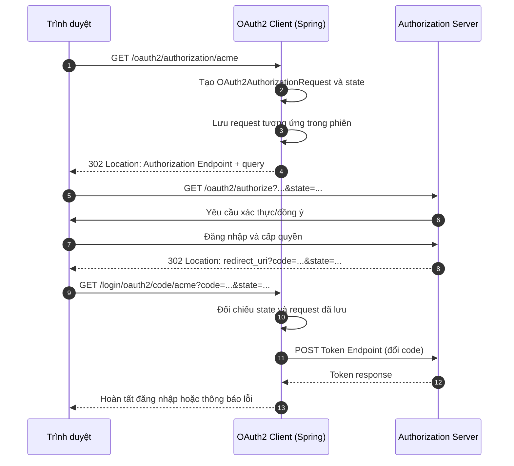

# Kiểm tra yêu cầu chuyển hướng với client_id, redirect_uri, scope và state

## 1. Bài toán: ứng dụng đã chuyển hướng đến đúng Authorization Server chưa?

Trong một ứng dụng web đăng nhập bằng OAuth 2.0 / OpenID Connect (OIDC), khi người dùng muốn đăng nhập, Spring Security chuyển trình duyệt tới **Authorization Endpoint** của nhà cung cấp định danh. Trên đường chuyển hướng, ứng dụng phải đưa các tham số phù hợp:

```http
HTTP/1.1 302 Found
Location: https://id.example.test/oauth2/authorize?response_type=code&client_id=web-client&redirect_uri=https%3A%2F%2Fapp.example.test%2Flogin%2Foauth2%2Fcode%2Facme&scope=openid%20profile%20email&state=RANDOM_PER_REQUEST
```

URL trên là ví dụ minh họa; giá trị `state` là placeholder, không phải token có thể dùng lại. Một lỗi cấu hình `client_id`, `redirect_uri` hoặc `scope` có thể khiến nhà cung cấp từ chối đăng nhập. Một lỗi xử lý `state` có thể làm suy yếu khả năng ràng buộc phản hồi callback với yêu cầu đăng nhập đã khởi tạo.

Bài thuộc chương **Luồng OAuth2 thực** của module **SPRING_SECURITY_TESTING**. Ta sẽ kiểm thử **phản hồi HTTP 302 và header `Location` của yêu cầu OAuth2 authorization thực sự được tạo bởi Spring Security**, sử dụng `MockMvc` trong ứng dụng Servlet và `WebTestClient` trong ứng dụng Reactive. Ta cũng kiểm tra quan hệ giữa `state` và phiên đăng nhập, đồng thời phân biệt kiểm thử luồng HTTP này với các post-processor giả lập như `oauth2Login()`, `oidcLogin()` và `@WithMockUser`.

Sau bài học, bạn có thể:

- Giải thích vai trò, nguồn gốc và tiêu chí kiểm tra của `client_id`, `redirect_uri`, `scope` và `state`.
- Tạo fixture OAuth2 Client dùng URL thử nghiệm để kiểm tra redirect mà không phải gọi Authorization Server thực.
- Đọc và giải mã query parameters từ `Location` một cách chính xác; không so sánh cứng toàn bộ URL.
- Xác nhận `state` được sinh cho từng yêu cầu, được lưu và đối chiếu với yêu cầu đăng nhập trong phiên khi dùng repository mặc định.
- Phát hiện lỗi chuyển hướng sai host, callback URI hoặc scope, và hiểu giới hạn của assertion redirect so với tích hợp trọn vẹn authorization-code flow.
- Phân biệt kết quả 302 bắt đầu OAuth2, lỗi callback, 401 chưa xác thực và 403 thiếu quyền.

## 2. Hiểu đúng chiều chuyển hướng và ý nghĩa của từng tham số



Hai lần redirect có ý nghĩa khác nhau:

- **Client → Authorization Server:** đưa `client_id`, `redirect_uri`, `scope`, `state`, thường kèm `response_type=code`; đây là trọng tâm bài.
- **Authorization Server → Client callback:** trả `code` và `state` về `redirect_uri` đã được đăng ký; chỉ sau đó client mới thực hiện token exchange.

Đừng nhầm `redirect_uri` trong *query của yêu cầu authorization* với `Location` của response đầu tiên. `Location` của response đầu tiên trỏ đến **Authorization Endpoint**. Tham số `redirect_uri` bên trong URL đó lại trỏ đến **callback endpoint của ứng dụng**.

| Tham số | Do đâu xác định? | Ý nghĩa | Điều nên kiểm tra |
|---|---|---|---|
| `response_type=code` | Authorization Code Flow | Yêu cầu Authorization Server trả authorization code | Giá trị là `code` cho flow được dùng |
| `client_id` | `ClientRegistration.clientId` | Định danh OAuth2 client được đăng ký với nhà cung cấp | Khớp client đã cấu hình, không do người gọi tự thay |
| `redirect_uri` | `ClientRegistration.redirectUri` và các placeholder hợp lệ | Nơi Authorization Server chuyển browser về sau khi xác thực | Khớp callback URI mong đợi, scheme/host/path phù hợp |
| `scope` | `ClientRegistration.scopes` và chính sách yêu cầu quyền | Quyền/phạm vi thông tin client đề nghị | Có đúng tập scope bắt buộc; so sánh dạng tập, không dựa thứ tự |
| `state` | Authorization-request resolver | Giá trị ngẫu nhiên ràng buộc callback với request đã khởi tạo | Không rỗng, được lưu trong phiên/repository, callback phải khớp |
| `code_challenge`, `code_challenge_method` | PKCE khi được cấu hình | Liên kết authorization code với token request và `code_verifier` | Kiểm tra khi flow yêu cầu PKCE |
| `nonce` | OIDC khi cần | Ràng buộc ID Token với yêu cầu xác thực OIDC | Kiểm tra theo cấu hình/flow, không đồng nhất với `state` |

### 2.1. Vì sao cần so sánh scope như một tập?

Query `scope` thường biểu diễn các giá trị bằng một chuỗi cách nhau bởi dấu cách, ví dụ:

```text
scope=openid%20profile%20email
```

Theo OAuth 2.0, khoảng trắng phân tách các scope token. Thứ tự các scope thường **không mang ý nghĩa cấp quyền**. Vì vậy, một test ổn định sẽ giải mã query rồi so sánh tập `{openid, profile, email}` thay vì khóa vào thứ tự từ cấu hình hoặc encoder.

Không tự động cho rằng mọi nhà cung cấp chấp nhận một tên scope tùy ý: `openid` đánh dấu yêu cầu OIDC, còn `profile` và `email` liên quan đến các claim hồ sơ theo chính sách nhà cung cấp. Việc có scope `email` trong authorization request **không đảm bảo** ID Token hoặc UserInfo sẽ chứa email.

### 2.2. Vì sao `state` không phải một giá trị test cố định?

`state` giúp bảo vệ ràng buộc giữa authorization response và authorization request, thường là một biện pháp chống login CSRF. Mỗi lần tạo authorization request nên có state khó đoán và được lưu tại client để kiểm tra ở callback.

Test **không** nên viết:

```java
.andExpect(header().string(
    "Location",
    containsString("state=known-fixed-value")
));
```

Điều đó khóa test vào một giá trị không đáng cố định và có thể che lấp một thiết kế state yếu. Thay vào đó, hãy kiểm tra state tồn tại, không rỗng, tương ứng với authorization request đã lưu và **bị từ chối khi không khớp**. Thấy hai state khác nhau trong hai yêu cầu là kiểm tra hữu ích, nhưng **chưa chứng minh được tính khó đoán theo tiêu chuẩn mật mã**.

## 3. Cấu hình mẫu để test URL redirect mà không kết nối mạng

Ví dụ sử dụng Spring Boot 3 / Spring Security 6, Java 17+, ứng dụng web Servlet và OAuth2 Client với registration id `acme`. Mục tiêu chỉ là **yêu cầu tạo redirect**, chưa gọi nhà cung cấp thật hoặc đổi code lấy token.

Các dependency liên quan:

```kotlin
// build.gradle.kts (phần phụ thuộc minh họa)
dependencies {
    implementation("org.springframework.boot:spring-boot-starter-web")
    implementation("org.springframework.boot:spring-boot-starter-oauth2-client")

    testImplementation("org.springframework.boot:spring-boot-starter-test")
    testImplementation("org.springframework.security:spring-security-test")
}
```

### 3.1. Registration dưới test profile

Đặt cấu hình minh họa dưới test profile, ví dụ `application-test.yml`:

```yaml
spring:
  security:
    oauth2:
      client:
        registration:
          acme:
            client-id: web-client
            client-secret: dummy-secret-for-tests
            authorization-grant-type: authorization_code
            redirect-uri: "{baseUrl}/login/oauth2/code/{registrationId}"
            scope:
              - openid
              - profile
              - email
            client-name: Acme Test
        provider:
          acme:
            authorization-uri: https://id.example.test/oauth2/authorize
            token-uri: https://id.example.test/oauth2/token
            jwk-set-uri: https://id.example.test/.well-known/jwks.json
            user-info-uri: https://id.example.test/userinfo
            user-name-attribute: sub
```

Ở đây:

- Registration id `acme` gắn URL khởi tạo `/oauth2/authorization/acme` với đúng cấu hình `ClientRegistration`.
- `client-id` chính là giá trị được gửi trong authorization URL.
- `redirect-uri` có các placeholder mà Spring Security mở rộng theo base URL của request và registration id; ví dụ đích mong muốn là `https://app.example.test/login/oauth2/code/acme`.
- `provider.acme.authorization-uri` chỉ định nơi trình duyệt sẽ được chuyển đến.
- `token-uri`, `jwk-set-uri` và `user-info-uri` dùng cho các bước sau; **kiểm thử redirect đầu tiên không cần gọi các endpoint đó**.
- Không cấu hình `issuer-uri` trong fixture này để tránh yêu cầu metadata discovery ngay khi dựng client registration.

`dummy-secret-for-tests` chỉ là giá trị thử nghiệm. Không sử dụng client secret hay authorization code thật từ production để viết bài test.

### 3.2. SecurityFilterChain tối thiểu

```java
@Configuration
@EnableWebSecurity
class OAuth2BrowserSecurity {

    @Bean
    SecurityFilterChain browser(HttpSecurity http) throws Exception {
        return http
            .authorizeHttpRequests(auth -> auth
                .requestMatchers("/public/**", "/error").permitAll()
                .anyRequest().authenticated()
            )
            .oauth2Login(Customizer.withDefaults())
            .build();
    }
}
```

Những import chính: `@Configuration`, `@Bean`, `@EnableWebSecurity`, `HttpSecurity`, `SecurityFilterChain`, `Customizer`.

Với cấu hình OAuth2 Login thông thường:

- Spring Security cung cấp authorization request endpoint `/oauth2/authorization/{registrationId}`, xử lý bởi `OAuth2AuthorizationRequestRedirectFilter`.
- Khi truy cập endpoint đó, framework tạo `OAuth2AuthorizationRequest`, lưu trạng thái tương ứng và trả 302.
- Callback mặc định cho authorization code login có dạng `/login/oauth2/code/{registrationId}`.
- `OAuth2LoginAuthenticationFilter` xử lý callback; các bước token/ID Token/UserInfo chỉ thực sự diễn ra sau khi callback hợp lệ.

Đường dẫn trên là **mặc định**, có thể thay đổi khi ứng dụng cấu hình `authorizationEndpoint().baseUri(...)` hoặc `redirectionEndpoint().baseUri(...)`. Khi thay đổi phải đồng bộ registration, provider và test.

## 4. Kiểm thử MockMvc: quan sát redirect thực tế của Spring Security

`MockMvc` chạy request qua servlet security filter chain trong test context, giúp kiểm tra trực tiếp status và `Location` mà không dùng trình duyệt thật.

### 4.1. Đọc query parameters đúng cách

Một số giá trị như `redirect_uri` chứa dấu `:`, `/` và ký tự đặc biệt nên được percent-encode khi đưa vào authorization URL. Không kiểm tra bằng cách tìm chuỗi `redirect_uri=https://...` trong toàn bộ header vì biểu diễn trên dây có thể khác nhau.

Để phân tích một cách có kiểm soát và phát hiện tham số lặp, có thể dùng helper:

```java
private static MultiValueMap<String, String> decodeQuery(URI uri) {
    String rawQuery = uri.getRawQuery();
    assertThat(rawQuery).isNotNull();

    MultiValueMap<String, String> query = new LinkedMultiValueMap<>();
    for (String part : rawQuery.split("&")) {
        String[] keyValue = part.split("=", 2);

        String key = URLDecoder.decode(
            keyValue[0], StandardCharsets.UTF_8
        );
        String value = URLDecoder.decode(
            keyValue.length > 1 ? keyValue[1] : "",
            StandardCharsets.UTF_8
        );

        query.add(key, value);
    }
    return query;
}
```

Import: `java.net.URI`, `java.net.URLDecoder`, `java.nio.charset.StandardCharsets`, `org.springframework.util.MultiValueMap` và `LinkedMultiValueMap`. Đây là helper test, giả định URL đã chứa query và không chứa kiểu tham số bất thường do hệ thống khác tự thêm vào. `URLDecoder` xử lý cả percent-encoding và dấu `+` theo quy ước form encoding; nhờ dùng `MultiValueMap`, test có thể xác nhận **mỗi tham số xuất hiện đúng một lần** thay vì bỏ qua duplicate keys.

### 4.2. Test đủ client_id, redirect_uri, scope và state

```java
@SpringBootTest
@AutoConfigureMockMvc
@ActiveProfiles("test")
class OAuth2AuthorizationRedirectMvcTest {

    @Autowired
    MockMvc mvc;

    @Test
    void createsCorrectAuthorizationRedirect() throws Exception {
        MvcResult result = mvc.perform(
                get("/oauth2/authorization/acme")
                    .with(request -> {
                        // Mô phỏng ứng dụng công khai dưới HTTPS.
                        request.setScheme("https");
                        request.setServerName("app.example.test");
                        request.setServerPort(443);
                        request.setSecure(true);
                        return request;
                    })
            )
            .andExpect(status().is3xxRedirection())
            .andExpect(header().exists(HttpHeaders.LOCATION))
            .andReturn();

        String location = result.getResponse().getHeader(
            HttpHeaders.LOCATION);
        assertThat(location).isNotBlank();

        URI uri = URI.create(location);
        assertThat(uri.getScheme()).isEqualTo("https");
        assertThat(uri.getHost()).isEqualTo("id.example.test");
        assertThat(uri.getPath()).isEqualTo("/oauth2/authorize");

        MultiValueMap<String, String> query = decodeQuery(uri);
        assertThat(query.get("response_type"))
            .containsExactly("code");
        assertThat(query.get("client_id"))
            .containsExactly("web-client");
        assertThat(query.get("redirect_uri"))
            .containsExactly(
                "https://app.example.test/login/oauth2/code/acme"
            );

        // Scope không phụ thuộc thứ tự khai báo.
        assertThat(query.get("scope")).hasSize(1);
        String rawScope = query.getFirst("scope");
        assertThat(rawScope).isNotBlank();
        assertThat(Set.of(rawScope.trim().split("\\s+")))
            .containsExactlyInAnyOrder(
                "openid", "profile", "email"
            );

        // State phải là một giá trị có mặt trong authorization request.
        assertThat(query.get("state")).hasSize(1);
        String state = query.getFirst("state");
        assertThat(state).isNotBlank();

        // Repository mặc định lưu authorization request vào session.
        HttpSession session = result.getRequest().getSession(false);
        assertThat(session).isNotNull();
    }

    // Đặt decodeQuery(URI) ở mục 4.1 trong cùng lớp test.
}
```

Các import của test: `@SpringBootTest`, `@AutoConfigureMockMvc`, `@ActiveProfiles`, `@Autowired`, `@Test`, `MockMvc`, `MvcResult`, `HttpHeaders`, `HttpSession` (Jakarta Servlet trên Spring Boot 3), `Set`, `URI`, `MultiValueMap`. Static imports: `MockMvcRequestBuilders.get`, `MockMvcResultMatchers.status/header`, `org.assertj.core.api.Assertions.assertThat`.

Đây là **integration test của phần tạo authorization request**: request đi qua `OAuth2AuthorizationRequestRedirectFilter` thật và lấy header `Location` thực. Không có việc giả lập một `OAuth2AuthenticationToken` trước request đầu tiên.

**Tại sao đặt scheme, host và port trong MockMvc?** Giá trị `{baseUrl}` phụ thuộc host/scheme/port mà Servlet request nhìn thấy. Nếu để mặc định `localhost` hoặc `http`, `redirect_uri` mở rộng ra giá trị khác với URL production. Test đặt base URL được kỳ vọng để phát hiện cấu hình callback sai. Sau khi chạy sau reverse proxy, cần kiểm tra riêng cách Spring xử lý các forwarded headers đã được tin cậy.

**Vì sao không assert toàn bộ Location?** Header có thể được encode khác nhau ở một số phiên bản thư viện, `state` thay đổi qua từng lần tạo request, OIDC có thể thêm `nonce`, và cấu hình PKCE có thể thêm `code_challenge`. Kiểm tra host/path và những tham số bắt buộc bằng cách parse là ít giòn hơn.

### 4.3. Biến thể test không thể dựa vào scope order

Nếu provider thêm scope hoặc ứng dụng yêu cầu thêm phạm vi theo policy, test cần thể hiện **hợp đồng thực tế**, ví dụ bắt buộc có các scope cốt lõi nhưng cho phép scope tùy chọn:

```java
Set<String> requestedScopes =
    Set.of(query.getFirst("scope").trim().split("\\s+"));

assertThat(requestedScopes).contains(
    "openid", "profile", "email"
);
```

Khi mục tiêu là **phát hiện scope thừa không được phê duyệt**, hãy dùng `containsExactlyInAnyOrder(...)` như ở test chính. Đừng dùng `contains(...)` nếu chính sách chỉ cho đúng ba scope, vì test đó sẽ bỏ sót một quyền thừa.

## 5. Kiểm tra state đã lưu và khớp với phiên

Chỉ assert `state` không rỗng chưa đủ. Theo mặc định, Spring Security Servlet lưu authorization request trong HTTP session qua `HttpSessionOAuth2AuthorizationRequestRepository`. Repository giữ thông tin đủ để đối chiếu state khi callback đến.

Ta có thể kiểm tra repository bằng một request mô phỏng callback **dùng đúng session đã tạo redirect**:

```java
@Test
void issuedStateMustMatchSavedAuthorizationRequest()
        throws Exception {
    MvcResult issued = mvc.perform(
            get("/oauth2/authorization/acme"))
        .andExpect(status().is3xxRedirection())
        .andReturn();

    String location = issued.getResponse()
        .getHeader(HttpHeaders.LOCATION);
    assertThat(location).isNotNull();

    String state = decodeQuery(URI.create(location))
        .getFirst("state");
    assertThat(state).isNotBlank();

    MockHttpSession sameSession =
        (MockHttpSession) issued.getRequest().getSession(false);
    assertThat(sameSession).isNotNull();

    MockHttpServletRequest callback = new MockHttpServletRequest(
        "GET", "/login/oauth2/code/acme");
    callback.setSession(sameSession);
    callback.setParameter("state", state);

    HttpSessionOAuth2AuthorizationRequestRepository repository =
        new HttpSessionOAuth2AuthorizationRequestRepository();

    OAuth2AuthorizationRequest saved =
        repository.loadAuthorizationRequest(callback);
    assertThat(saved).isNotNull();
    assertThat(saved.getState()).isEqualTo(state);
    assertThat(saved.getClientId()).isEqualTo("web-client");

    // Khi callback dùng state không khớp, không lấy lại request.
    callback.setParameter("state", "attacker-chosen-state");
    assertThat(repository.loadAuthorizationRequest(callback))
        .isNull();
}
```

Các import đặc trưng: `MockHttpSession`, `MockHttpServletRequest`, `HttpSessionOAuth2AuthorizationRequestRepository` và `OAuth2AuthorizationRequest`. Mẫu này giả định ứng dụng giữ **repository mặc định**. Nếu ứng dụng sử dụng cookie repository hoặc kho phân tán, hãy kiểm tra repository được cấu hình thực tế thay vì tự khởi tạo loại mặc định.

Test xác minh **cơ chế lưu và đối chiếu request**, không tự thực hiện một callback OAuth2 thành công. `loadAuthorizationRequest` là phép đọc; một luồng callback thật còn phải xử lý code, token exchange, xác thực user và phản hồi lỗi. Khi state mismatch tại callback thật, ứng dụng phải từ chối việc sử dụng code đó; status, Location báo lỗi cụ thể phụ thuộc failure handler và entry point.

### 5.1. Cần giữ session/cookie khi kiểm thử callback

Dòng chảy state phụ thuộc vào tương quan giữa yêu cầu bắt đầu đăng nhập và callback:

```text
GET /oauth2/authorization/acme  (Session A)
  -> state = X, lưu authorization request trong Session A

GET /login/oauth2/code/acme?code=...&state=X  (Session A)
  -> tìm được request, tiếp tục kiểm tra và đổi code

GET /login/oauth2/code/acme?code=...&state=X  (Session B)
  -> không có request tương ứng, phải từ chối

GET /login/oauth2/code/acme?code=...&state=Y  (Session A)
  -> state không khớp, phải từ chối
```

Nếu test vô tình bỏ cookie hoặc thay session, nó có thể báo lỗi `authorization_request_not_found` dù state trong URL đúng. Điều này không đồng nghĩa issuer cấp state sai.

Với nhiều tab đăng nhập song song trong cùng phiên, cần hiểu cách repository lưu request (implementation mặc định có thể chỉ giữ một yêu cầu đang chờ). Nếu ứng dụng hỗ trợ nhiều luồng concurrent, phải xác định chính sách lưu nhiều state và test riêng.

### 5.2. Hai lần yêu cầu mới nên có state khác nhau

Test gợi ý cho thuộc tính không tái sử dụng giá trị:

```java
private String issueState() throws Exception {
    MvcResult result = mvc.perform(
            get("/oauth2/authorization/acme"))
        .andExpect(status().is3xxRedirection())
        .andReturn();
    return decodeQuery(URI.create(
        result.getResponse().getHeader(HttpHeaders.LOCATION)
    )).getFirst("state");
}

@Test
void generatesFreshState() throws Exception {
    String first = issueState();
    String second = issueState();

    assertThat(first).isNotBlank();
    assertThat(second).isNotBlank();
    assertThat(second).isNotEqualTo(first);
}
```

Đây chỉ là smoke test chống việc vô tình dùng state hằng. Hai giá trị khác nhau **không chứng minh entropy hay khả năng chống đoán**. Đặc điểm sinh state an toàn cần dựa trên implementation và chính sách bảo mật đã được kiểm chứng, không dựa vào xác suất của một test duy nhất.

## 6. Chặn khả năng request đầu vào tự thay các tham số quan trọng

Một số ứng dụng bổ sung query từ trang đăng nhập vào authorization endpoint. Hãy tách rõ **tham số do server quyết định** và **tham số client/browser cung cấp**. Với resolver mặc định, `client_id`, `redirect_uri`, `scope` và `state` của authorization request đến từ cấu hình và bộ tạo state, không được tin ngay một tham số tương tự do browser tự gửi.

Một phép thử bảo vệ cấu hình mặc định:

```java
@Test
void ignoresUntrustedOverridesOfRegistrationValues()
        throws Exception {
    MvcResult result = mvc.perform(
            get("/oauth2/authorization/acme")
                .param("client_id", "attacker-client")
                .param("redirect_uri",
                    "https://attacker.example/callback")
                .param("scope", "admin")
                .param("state", "predictable"))
        .andExpect(status().is3xxRedirection())
        .andReturn();

    URI authorizationUrl = URI.create(
        result.getResponse().getHeader(HttpHeaders.LOCATION)
    );
    MultiValueMap<String, String> query =
        decodeQuery(authorizationUrl);

    assertThat(query.get("client_id"))
        .containsExactly("web-client");
    assertThat(query.get("redirect_uri"))
        .doesNotContain("https://attacker.example/callback");
    assertThat(query.getFirst("scope"))
        .doesNotContain("admin");
    assertThat(query.getFirst("state"))
        .isNotEqualTo("predictable");
}
```

Kết quả kỳ vọng áp dụng cho **resolver mặc định và cấu hình mẫu**. Nếu ứng dụng tự viết `OAuth2AuthorizationRequestResolver`, cung cấp tham số động, hoặc cho phép người dùng chọn scope, test phải phản ánh một allowlist và policy cụ thể. Không lấy nguyên `redirect_uri` hoặc `state` của một request không đáng tin để ghi vào authorization request.

**Chú ý hai lớp redirect security:**

- `redirect_uri` phải được nhà cung cấp kiểm tra theo các URI đã đăng ký, đúng quy tắc của provider.
- Ứng dụng không được tạo `{baseUrl}` dựa trên header `Host` / `X-Forwarded-Host` không đáng tin. Khi chạy sau reverse proxy, chỉ xử lý forwarded headers từ proxy được kiểm soát; nếu cấu hình sai, callback có thể mang host không mong muốn.

Để tránh open redirect, ứng dụng cũng phải kiểm soát mọi URL “returnTo” hay “next” tự triển khai sau đăng nhập. Đây là vấn đề khác với callback `redirect_uri`.

## 7. OAuth2 Login, OIDC và PKCE: các tham số bổ sung

Các tham số chính của bài vẫn là `client_id`, `redirect_uri`, `scope`, `state`. Tuy nhiên một authorization request thực tế có thể có thêm tham số:

| Tham số | Khi nào thường xuất hiện? | Lưu ý kiểm thử |
|---|---|---|
| `nonce` | OIDC login khi client/flow áp dụng nonce | Không thay `state`; liên quan xác minh ID Token |
| `code_challenge` | Khi sử dụng PKCE | Phải liên kết với `code_verifier` tại token exchange |
| `code_challenge_method=S256` | PKCE với SHA-256 | Kiểm tra policy yêu cầu S256 |
| `prompt`, `login_hint`, `max_age` | Các tùy chọn của Authorization Server/OIDC | Chỉ assert khi ứng dụng cấu hình chúng |
| `response_mode` | Khi client chọn phương thức trả authorization response | Có thể không xuất hiện; mặc định phụ thuộc flow |
| `resource`, `audience` | Một số nhà cung cấp hoặc phần mở rộng OAuth2 | Không tự coi là tham số chuẩn bắt buộc trong mọi hệ thống |

Đặc biệt:

- **`state`** nhằm ràng buộc authorization response với authorization request.
- **`nonce`** ràng buộc ID Token trong OIDC với authentication request khi áp dụng.
- **PKCE** ràng buộc authorization code với bên sở hữu `code_verifier`; nó không thay thế hoàn toàn yêu cầu kiểm tra state/CSRF trong mọi thiết kế.

Với PKCE, nếu client được cấu hình bắt buộc S256, nên test:

```java
MultiValueMap<String, String> query = decodeQuery(uri);
assertThat(query.getFirst("code_challenge")).isNotBlank();
assertThat(query.getFirst("code_challenge_method"))
    .isEqualTo("S256");
```

Đây là test **có điều kiện**: không bắt buộc `code_challenge` luôn có trong mọi OAuth2 Client registration. Cách bật PKCE và điều kiện mặc định có thể khác theo phiên bản Spring Security, loại client (public/confidential) và các tùy chỉnh resolver.

## 8. Reactive: kiểm chứng authorization redirect qua WebTestClient

Spring WebFlux dùng `SecurityWebFilterChain` và `ReactiveClientRegistrationRepository`, thay vì servlet `SecurityFilterChain` và `ClientRegistrationRepository`. Nhưng kết quả HTTP cần kiểm chứng vẫn là **302 + Location** tới Authorization Endpoint.

Một cấu hình Reactive tương đương:

```java
@Configuration
@EnableWebFluxSecurity
class ReactiveOAuth2BrowserSecurity {

    @Bean
    SecurityWebFilterChain browser(ServerHttpSecurity http) {
        return http
            .authorizeExchange(auth -> auth
                .pathMatchers("/public/**", "/error").permitAll()
                .anyExchange().authenticated()
            )
            .oauth2Login(Customizer.withDefaults())
            .build();
    }
}
```

Để test URL redirect, dùng một ứng dụng WebFlux có client registration `acme` cùng các giá trị như fixture ở mục 3. Với Spring Boot test context:

```java
@SpringBootTest
@AutoConfigureWebTestClient
@ActiveProfiles("test")
class OAuth2AuthorizationRedirectWebFluxTest {

    @Autowired
    WebTestClient client;

    @Test
    void createsAuthorizationRedirectWithRequiredParameters() {
        EntityExchangeResult<Void> result = client.get()
            .uri("/oauth2/authorization/acme")
            .exchange()
            .expectStatus().is3xxRedirection()
            .returnResult(Void.class);

        URI location = result.getResponseHeaders().getLocation();
        assertThat(location).isNotNull();
        assertThat(location.getHost()).isEqualTo("id.example.test");
        assertThat(location.getPath())
            .isEqualTo("/oauth2/authorize");

        MultiValueMap<String, String> query = decodeQuery(location);
        assertThat(query.get("response_type"))
            .containsExactly("code");
        assertThat(query.get("client_id"))
            .containsExactly("web-client");

        // Host base URL ở đây phụ thuộc URI của test request.
        String callback = query.getFirst("redirect_uri");
        assertThat(callback).isNotBlank();
        assertThat(URI.create(callback).getPath())
            .isEqualTo("/login/oauth2/code/acme");

        String scope = query.getFirst("scope");
        assertThat(scope).isNotBlank();
        assertThat(Set.of(scope.trim().split("\\s+")))
            .containsExactlyInAnyOrder(
                "openid", "profile", "email"
            );

        assertThat(query.get("state")).hasSize(1);
        assertThat(query.getFirst("state")).isNotBlank();
    }
}
```

Có thể dùng lại helper `decodeQuery(URI)` của mục 4.1. Các import đặc trưng: `WebTestClient`, `EntityExchangeResult`, `@AutoConfigureWebTestClient`, `URI`, `Set` và `MultiValueMap`.

Với WebTestClient mock-context, hostname mặc định thường là `localhost`; khi cần kiểm tra chính xác scheme/host của `redirect_uri`, hãy cấu hình URI đầu vào hoặc base URL của test để phản ánh địa chỉ public thực tế. Không khẳng định `https://app.example.test` nếu test chưa dựng request với host đó.

**Về state trong Reactive:** cấu hình mặc định có thể dùng `WebSessionOAuth2ServerAuthorizationRequestRepository`. Để kiểm tra state tồn tại trong phiên và bị từ chối khi callback không khớp, cần giữ **cookie WebSession** giữa request authorization và callback, đồng thời kiểm chứng repository/flow được cấu hình thật. Nếu chỉ gọi mỗi test GET phía trên, ta mới khẳng định được state xuất hiện trên authorization redirect, **chưa khẳng định được callback đã đối chiếu state**.

Khi tự tạo `WebTestClient` từ application context, cần áp dụng cấu hình Spring Security thích hợp. Mock helper `mockOAuth2Login()` hoặc `mockOidcLogin()` được dùng cho bài test authorization với principal có sẵn; nó không tạo chuỗi redirect Authorization Code Flow.

## 9. Vì sao oauth2Login(), oidcLogin() và @WithMockUser không thay thế test này?

`spring-security-test` hỗ trợ nhiều cách gắn sẵn authentication:

```java
// Servlet: giả lập đã đăng nhập OAuth2.
mvc.perform(get("/private").with(oauth2Login()))
    .andExpect(status().isOk());

// Servlet: giả lập đã đăng nhập OIDC.
mvc.perform(get("/private").with(oidcLogin()))
    .andExpect(status().isOk());

// Servlet: giả lập một user và role.
mvc.perform(get("/private")
        .with(user("alice").roles("MEMBER")))
    .andExpect(status().isOk());
```

Các test trên hợp lý khi cần kiểm tra controller, `SecurityContext`, principal hoặc rule `hasRole`. Nhưng chúng không chạy bước sinh authorization request rồi chuyển trình duyệt đến OP. Do đó **chúng không chứng minh rằng `client_id`, `redirect_uri`, `scope` và `state` được gửi đúng**.

| Test | Có kiểm chứng authorization redirect không? | Có kiểm chứng login/token exchange thật không? |
|---|---|---|
| Anonymous GET `/oauth2/authorization/acme` và đọc `Location` | **Có** | Chưa |
| `with(oauth2Login())` / `with(oidcLogin())` | Không | Không |
| `@WithMockUser`, `SecurityContext` giả lập | Không | Không |
| Reactive `mockOAuth2Login()` / `mockOidcLogin()` | Không | Không |
| Chạy OAuth2 code callback với OP giả lập, session, JWKS/token endpoint | Có thể kiểm tra đầy đủ nếu test bao gồm request ban đầu | **Có, trong phạm vi OP và cấu hình giả lập** |

Một request anonymous đến tài nguyên `/private` có thể nhận 302 đến trang login hoặc chuyển thẳng đến OP tùy entry point. Test trực tiếp `/oauth2/authorization/acme` được chọn ở đây để luôn tập trung vào **authorization request redirect**. Không suy rằng “GET /private trả 302” chứng minh các tham số OAuth2 đã đúng.

## 10. Kiểm thử callback đầy đủ là bước riêng

Kiểm tra `Location` chỉ là bước đầu của authorization-code flow. Muốn chứng minh toàn bộ quy trình, cần một nhà cung cấp OAuth2/OIDC giả lập hoặc môi trường tích hợp kiểm soát được token endpoint và metadata.

Một kịch bản integration test đầy đủ:

1. Client phát sinh authorization request, kiểm tra `client_id`, `redirect_uri`, `scope`, `state` và tùy chọn PKCE/nonce.
2. Browser/test giữ session hoặc cookie chứa authorization request và state được lưu.
3. OP giả lập trả về callback tới `redirect_uri` cùng authorization `code` và **đúng state**.
4. Client đối chiếu state, sau đó gửi token request phù hợp, có `redirect_uri` và `code_verifier` nếu PKCE được dùng.
5. Token endpoint giả lập trả token hợp lệ; nếu là OIDC, ID Token phải có chữ ký, issuer, audience, thời gian và nonce phù hợp.
6. Client tạo authentication, duy trì session, và truy cập tài nguyên bảo vệ thành công khi đủ quyền.
7. Lặp lại với **state sai hoặc không có request đã lưu**: client phải từ chối trước khi chấp nhận code.
8. Kiểm tra lỗi access denied sau khi xác thực (403) riêng với lỗi chưa xác thực hoặc callback thất bại.

Các mã HTTP phụ thuộc giai đoạn và cấu hình:

| Tình huống | Kết quả mong đợi theo mặc định thường gặp |
|---|---|
| GET authorization endpoint hợp lệ | **302** tới Authorization Server |
| Anonymous vào protected browser page | **302** tới login/OP tùy entry point |
| Anonymous vào API Bearer stateless | **401** nếu dùng bearer entry point |
| Callback sai state | Đăng nhập thất bại; có thể chuyển tới login error URL hoặc trả lỗi khác theo failure handler |
| Đăng nhập thành công nhưng thiếu quyền | **403** khi truy cập endpoint yêu cầu quyền |
| Đăng nhập thành công và đủ quyền | **200** nếu endpoint xử lý thành công |

Đừng cố ép callback sai state phải luôn trả `401` hoặc `400`; với form/OAuth2 login browser, failure handler có thể trả **302** tới `/login?error`. Điều cần kiểm tra là **không chấp nhận callback không tương ứng với authorization request đang chờ**, không tạo authentication hợp lệ từ phản hồi đó, và không thực hiện các hành động ngoài ý muốn.

## 11. Các lỗi thực tế và hướng chẩn đoán

| Triệu chứng | Nguyên nhân có thể | Cách kiểm chứng |
|---|---|---|
| Không có redirect tới OP | Sai registration id, chain không chứa OAuth2 Login, base URI bị đổi | GET đúng authorization endpoint và xác minh security filter chain |
| `client_id` sai | App dùng nhầm registration hoặc profile | So sánh query với `ClientRegistration` được nạp |
| `redirect_uri` có `localhost` hoặc `http` | Test/request hoặc reverse proxy báo sai base URL | Mô phỏng scheme, host, port chính xác; kiểm tra cấu hình forwarded headers tin cậy |
| Provider từ chối redirect URI | Địa chỉ không trùng URI đã đăng ký | So sánh URI đã giải mã, scheme/host/port/path và đăng ký provider |
| `scope` thiếu `openid` | Không phải OIDC registration hoặc cấu hình scope sai | Đọc chuỗi scope và so sánh tập bắt buộc |
| Test thất bại do đổi thứ tự scope | Assertion so sánh nguyên URL | Decode và so sánh tập scope |
| `state` rỗng/cố định | Resolver tùy chỉnh hoặc test fixture sai | Kiểm tra repository/generator và test nhiều request |
| Callback báo không tìm thấy request | Mất session/cookie, state mismatch hoặc request bị ghi đè | Giữ đúng browser session; đối chiếu repository |
| URL chứa duplicate query parameters | Custom resolver nối tham số sai | Parse thành `MultiValueMap` và assert đúng một giá trị |
| Đã mock OAuth2 user nên không thấy redirect | Test bỏ qua flow login | Test request anonymous qua `/oauth2/authorization/...` |
| OAuth2 redirect pass, token exchange fail | Test redirect không gọi Token Endpoint | Bổ sung integration test với OP giả lập |
| Spring Security tạo thêm nonce/PKCE | Flow OIDC/PKCE được bật | Chỉ assert tham số bổ sung theo policy thực tế |

Khi debug, có thể bật log security ở môi trường test và ghi metadata an toàn như registration id, Authorization Server host và kết quả kiểm tra claim. Không ghi authorization code, access token, ID Token, client secret, cookie session hoặc state trong log production. `state` không phải mật khẩu, nhưng là dữ liệu nhạy cảm theo ngữ cảnh phiên và không nên phát tán qua báo cáo lỗi.

## 12. Bài thực hành: kiểm tra một authorization redirect từ đầu đến cuối

Dùng cấu hình `acme` ở mục 3 và viết bộ test gồm:

1. **Đúng Authorization Server:** GET `/oauth2/authorization/acme` trả 302; `Location` có scheme HTTPS, host `id.example.test` và path `/oauth2/authorize`.
2. **Đúng client:** `client_id` chính xác là `web-client` và chỉ xuất hiện một lần.
3. **Đúng callback:** `redirect_uri` sau khi URL-decode là `https://app.example.test/login/oauth2/code/acme` với môi trường giả lập host tương ứng.
4. **Đúng scope:** có chính xác `openid`, `profile`, `email`, không dựa vào thứ tự.
5. **State hợp lệ về quan hệ:** có giá trị không rỗng, repository mặc định tìm lại được với đúng session/state.
6. **State sai:** repository không trả authorization request khi truyền một state khác; test callback tích hợp không cho đăng nhập thành công với state sai.
7. **Không nhận override từ browser:** `client_id`, `redirect_uri`, `scope`, `state` không bị các query không đáng tin tùy ý ghi đè.
8. **Request mới:** hai lần khởi tạo cho state khác nhau; ghi rõ đây chỉ là smoke test, không thay cho đánh giá chất lượng randomness.
9. **Reactive:** dùng `WebTestClient` xác nhận authorization URL và scope/state, bổ sung kiểm tra cookie/session nếu muốn chứng minh callback.
10. **Flow đầy đủ:** OP giả lập nhận request, trả callback đúng state và code; client hoàn tất token exchange rồi tạo authentication; kiểm tra riêng callback sai state.

**Tiêu chí hoàn thành:** Test phải chứng minh được phản hồi **302 thực sự được phát bởi Spring Security OAuth2 Client**, với các trường **`client_id`, `redirect_uri`, `scope`, `state` đúng hợp đồng**, và việc state được đối chiếu với yêu cầu lưu theo session/repository. Phép thử chỉ dùng `@WithMockUser`, `oauth2Login()` hoặc `oidcLogin()` không đủ để kết luận authorization redirect hoạt động đúng; ngược lại, phép thử redirect thành công cũng chưa chứng minh token exchange, chữ ký ID Token hoặc toàn bộ quy trình đăng nhập đã hoàn tất.
