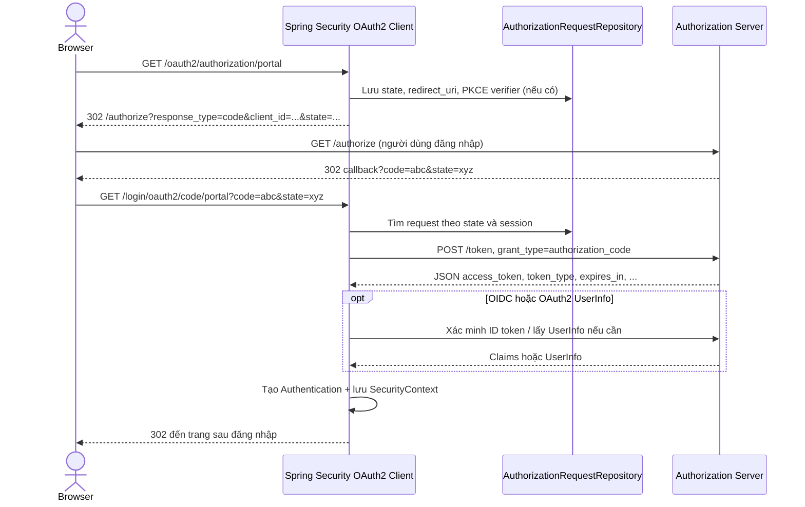
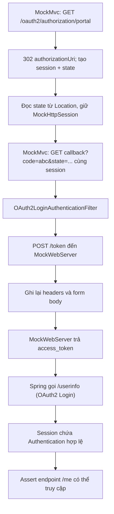
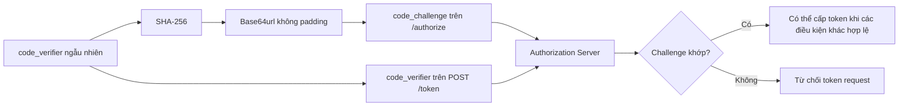

# Đổi authorization code lấy token và kiểm tra yêu cầu gửi đến token endpoint

Một bài kiểm thử đăng nhập OAuth2 có thể trả về `302` ở endpoint `/oauth2/authorization/{registrationId}` nhưng vẫn chưa chứng minh ứng dụng **đã đổi authorization code lấy access token đúng cách**. Chuyển hướng sang Authorization Server mới chỉ là giai đoạn khởi tạo. Phần quan trọng tiếp theo diễn ra giữa backend và **token endpoint**: ứng dụng gửi HTTP POST chứa `grant_type=authorization_code`, authorization code, redirect URI và thông tin xác thực client phù hợp; nếu dùng PKCE còn phải có `code_verifier`. Authorization Server xác minh những giá trị này rồi mới trả token.

Bài thuộc chương **Luồng OAuth2 thực** của **SPRING_SECURITY_TESTING**. Trong module này, người học dùng `spring-security-test` để kiểm chứng xác thực, phân quyền và bảo vệ HTTP thật trên cả **Servlet** với `MockMvc` và **Reactive** với `WebTestClient`. Ta cũng sử dụng `SecurityContext`, `@WithMockUser`, OAuth2/OIDC/JWT giả lập để kiểm tra quyền. Tuy nhiên, khi yêu cầu là **kiểm tra request thật gửi đến token endpoint**, phải cho Spring Security thực sự thực hiện Authorization Code flow trong một môi trường thử nghiệm có Authorization Server giả lập.

## 1. Authorization Code flow có những giai đoạn nào?

OAuth2 Authorization Code là luồng cho phép OAuth2 Client nhận token sau khi người dùng được chuyển sang Authorization Server để xác thực và chấp thuận quyền. Trong ứng dụng Spring Security đóng vai trò OAuth2 Client:



Điểm cần phân biệt:

- **Authorization endpoint**: browser gửi request, mang `response_type=code`, `client_id`, `redirect_uri`, `scope`, `state` và có thể `code_challenge`.
- **Callback của ứng dụng**: browser chuyển `code` và `state` về URL đã đăng ký. Việc có code trên URL chưa chứng minh code hợp lệ.
- **Token endpoint**: **backend** gửi POST để đổi code lấy token. Đây là request riêng, không phải browser tự gửi đến token endpoint.
- **Resource endpoint**: ứng dụng mới dùng access token để gọi API hoặc chuyển nó cho authorized-client service; chỉ khi xác thực/đăng nhập thành công mới tạo SecurityContext thích hợp.

Trong OIDC Login, token response còn có **ID token** và ứng dụng phải xác minh issuer, audience, thời hạn, nonce/chữ ký theo cấu hình. Trong OAuth2 Login không dùng OIDC, ứng dụng thường cần UserInfo endpoint và mapping `OAuth2User` để có danh tính người dùng. Hai cách này không thay đổi yêu cầu cốt lõi của Authorization Code token request.

## 2. HTTP POST đến token endpoint có hình dạng gì?

Với một **confidential client** sử dụng `client_secret_basic`, request thường có dạng:

```http
POST /oauth2/token HTTP/1.1
Host: id.example.test
Content-Type: application/x-www-form-urlencoded
Authorization: Basic <base64-of-client-credentials>

grant_type=authorization_code&code=code-123&redirect_uri=https%3A%2F%2Fapp.example.test%2Flogin%2Foauth2%2Fcode%2Fportal
```

Đây là mẫu minh họa. Giá trị trong header `Authorization` phải được tạo đúng theo quy tắc **HTTP Basic cho OAuth2 client authentication**, không chép một chuỗi Base64 giả làm thông tin xác thực.

| Thành phần | Ý nghĩa | Kiểm tra nên viết |
|---|---|---|
| HTTP method `POST` | Token exchange là yêu cầu backend-to-backend | Assert method đúng `POST` |
| Đường dẫn/token URL | Nơi client đã đăng ký để đổi code | Assert endpoint được gọi đúng |
| `Content-Type: application/x-www-form-urlencoded` | Các tham số nằm trong request body theo form encoding | Assert media type và parse form body |
| `grant_type=authorization_code` | Phân biệt với client credentials/refresh token/password grant | Assert bằng nhau |
| `code` | Authorization code trả về từ callback | Assert code đúng giá trị test và chỉ dùng trong bước này |
| `redirect_uri` | Phải nhất quán với redirect URI đã dùng khi xin code, khi được yêu cầu | Assert giá trị đã giải mã, gồm scheme/host/path |
| Client authentication | Chứng minh client được phép đổi code; cách truyền tùy registration | Assert Basic/form/mTLS theo method |
| `code_verifier` | Bằng chứng PKCE ràng buộc authorization request với token request | Assert khi flow sử dụng PKCE |

**Không mặc định rằng `client_id` và `client_secret` luôn có trong body.** Khi dùng `client_secret_basic`, thông tin client thường đi trong Basic header. Với `client_secret_post`, credential nằm trong form body. Với public client dùng `none`, không có client secret, và `client_id` thường được gửi trong body. Với `private_key_jwt` hoặc mTLS, phương thức xác thực lại khác.

Token response thành công thường có:

```http
HTTP/1.1 200 OK
Content-Type: application/json
Cache-Control: no-store
Pragma: no-cache

{
  "access_token": "test-access-token",
  "token_type": "Bearer",
  "expires_in": 300,
  "scope": "profile"
}
```

Trong response HTTP thực, phần JSON trên cần là body JSON hợp lệ. Những field không phải lúc nào cũng xuất hiện: `refresh_token` phụ thuộc policy/grant, `id_token` xuất hiện trong OIDC khi đúng ngữ cảnh, và scope có thể được lược bớt khi giống scope yêu cầu. **Không log hoặc phát tán access token thật**; giá trị trên chỉ dành cho bài test.

## 3. ClientRegistration quyết định request được tạo như thế nào

Giả sử ứng dụng Servlet cần đăng nhập qua client `portal`:

```java
ClientRegistration registration =
        ClientRegistration.withRegistrationId("portal")
                .clientId("portal-client")
                .clientSecret("local-secret")
                .clientAuthenticationMethod(
                        ClientAuthenticationMethod.CLIENT_SECRET_BASIC)
                .authorizationGrantType(
                        AuthorizationGrantType.AUTHORIZATION_CODE)
                .redirectUri(
                        "{baseUrl}/login/oauth2/code/{registrationId}")
                .scope("profile")
                .authorizationUri("http://localhost:9999/authorize")
                .tokenUri("http://localhost:9999/token")
                .userInfoUri("http://localhost:9999/userinfo")
                .userNameAttributeName("sub")
                .clientName("Local OAuth2 Client")
                .build();
```

Đây là ví dụ **OAuth2 Login không yêu cầu OIDC** vì scope không có `openid`. Ta dùng cấu hình này để tập trung vào body POST token endpoint, tránh phải dựng ID token ký RSA, JWKS, issuer và nonce ngay từ bài kiểm thử đầu tiên. Đường dẫn `localhost`/HTTP chỉ dùng trong test cục bộ; production phải dùng TLS cho giao tiếp đến token endpoint.

Các thuộc tính liên quan trực tiếp:

- `tokenUri` quyết định URL nhận POST đổi code.
- `clientAuthenticationMethod` quyết định header/body chứa thông tin xác thực client.
- `clientId` và `clientSecret` được dùng theo phương thức xác thực đã chọn.
- `redirectUri` thường được expand thành callback URI; token exchange phải dùng URI nhất quán với authorization request ban đầu.
- `scope` được yêu cầu ở bước authorization, **không phải mặc nhiên gửi lại trong form POST đổi code**.

`registrationId` xác định client trong Spring Security; nó không phải giá trị bắt buộc của trường `client_id` bên token endpoint. Sai callback hoặc dùng nhầm registration có thể khiến Authorization Server trả `invalid_grant` hoặc `invalid_client` dù authorization redirect trước đó trông đúng.

## 4. Vì sao @WithMockUser, oauth2Login() và oidcLogin() không đủ?

Spring Security Test cung cấp các shortcut để kiểm tra controller và authorization:

```java
mockMvc.perform(get("/me")
        .with(oauth2Login()))
        .andExpect(status().isOk());

mockMvc.perform(get("/me")
        .with(oidcLogin()))
        .andExpect(status().isOk());
```

Hai post-processor này **đưa Authentication giả lập vào request**. Chúng hữu ích khi kiểm tra vai trò, claims và `SecurityContext`, nhưng **không khởi tạo authorization redirect, không có authorization code thật, không gọi token endpoint**. `@WithMockUser` cũng có giới hạn tương tự: tạo principal giả, không thực hiện Authorization Code flow.

| Kiểu kiểm thử | Kiểm chứng chính | Có HTTP POST đến token endpoint? |
|---|---|---|
| `@WithMockUser` | Role/authority của user giả | Không |
| `oauth2Login()` / `oidcLogin()` | Controller và policy với OAuth2/OIDC principal giả | Không |
| `GET /oauth2/authorization/portal` | Spring chọn registration, tạo state và redirect sang AS | Chưa |
| Callback qua filter chain cùng session + mock AS | Tra authorization request, đổi code, xử lý token/UserInfo | **Có**, khi flow đi tới bước đổi code |
| Test HTTP đầy đủ với IdP thử nghiệm | Tương tác đầu cuối của browser/backend/provider | Có, kèm behavior của IdP thật hoặc test IdP |

Mục tiêu bài này là hàng thứ tư: gửi callback qua Spring Security OAuth2 Login **thật** nhưng thay Authorization Server bằng HTTP mock server để có thể quan sát và kiểm soát token request.

## 5. Chiến lược kiểm thử: AS giả lập, client thật

Một test đáng tin cần điều khiển ba đối tượng:

1. **Spring Security filter chain thật**: `OAuth2AuthorizationRequestRedirectFilter` xử lý login start; `OAuth2LoginAuthenticationFilter` xử lý callback; token response client thực sự gửi HTTP.
2. **Phiên của browser**: bước khởi tạo lưu authorization request chứa `state`, redirect URI và nếu có thì PKCE verifier. Callback phải trở lại **cùng phiên**.
3. **HTTP mock server**: trả token response và UserInfo/ID token theo test; ghi lại HTTP method, URL, headers và raw body của request gửi đến token endpoint.



**Không cần gọi authorization endpoint của IdP thật trong test này.** Bước đầu được thực hiện qua filter Spring Security để tạo authorization request và state; ta giả lập việc provider trả lại `code` ở callback. Bài test vẫn kiểm chứng **đường backend đổi code lấy token và lưu security context**, còn tính hợp lệ/one-time của code tại Authorization Server được kiểm chứng riêng ở AS hoặc bằng mock có logic tương ứng.

## 6. Dependency và lớp test Servlet

Một ứng dụng Spring Boot Servlet dùng OAuth2 Client và MockMvc cần các dependency tương ứng:

```kotlin
dependencies {
    implementation("org.springframework.boot:spring-boot-starter-web")
    implementation("org.springframework.boot:spring-boot-starter-oauth2-client")
    testImplementation("org.springframework.boot:spring-boot-starter-test")
    testImplementation("org.springframework.security:spring-security-test")
    testImplementation("com.squareup.okhttp3:mockwebserver:<compatible-version>")
}
```

Thay `<compatible-version>` bằng phiên bản MockWebServer tương thích với OkHttp/BOM của dự án; ví dụ sử dụng package `okhttp3.mockwebserver`. JUnit 5 và AssertJ thường có sẵn từ `spring-boot-starter-test`.

Dưới đây là cấu trúc một **integration test tự chứa**. Nó tạo một application context Servlet tối giản dành cho thử nghiệm; `MockWebServer` được khởi động trước khi bean repository cần địa chỉ endpoint. Ta sử dụng cả token endpoint và UserInfo endpoint trên cùng server:

```java
import java.io.IOException;
import java.net.URLDecoder;
import java.nio.charset.StandardCharsets;
import java.util.Arrays;
import java.util.Base64;
import java.util.LinkedHashMap;
import java.util.Map;
import java.util.concurrent.TimeUnit;

import okhttp3.mockwebserver.MockResponse;
import okhttp3.mockwebserver.MockWebServer;
import okhttp3.mockwebserver.RecordedRequest;

import org.junit.jupiter.api.AfterAll;
import org.junit.jupiter.api.Test;
import org.springframework.beans.factory.annotation.Autowired;
import org.springframework.boot.SpringBootConfiguration;
import org.springframework.boot.autoconfigure.EnableAutoConfiguration;
import org.springframework.boot.test.autoconfigure.web.servlet.AutoConfigureMockMvc;
import org.springframework.boot.test.context.SpringBootTest;
import org.springframework.context.annotation.Bean;
import org.springframework.http.HttpHeaders;
import org.springframework.http.MediaType;
import org.springframework.mock.web.MockHttpSession;
import org.springframework.security.core.Authentication;
import org.springframework.security.config.Customizer;
import org.springframework.security.config.annotation.web.builders.HttpSecurity;
import org.springframework.security.oauth2.client.registration.ClientRegistration;
import org.springframework.security.oauth2.client.registration.ClientRegistrationRepository;
import org.springframework.security.oauth2.client.registration.InMemoryClientRegistrationRepository;
import org.springframework.security.oauth2.core.AuthorizationGrantType;
import org.springframework.security.oauth2.core.ClientAuthenticationMethod;
import org.springframework.security.web.SecurityFilterChain;
import org.springframework.test.web.servlet.MockMvc;
import org.springframework.test.web.servlet.MvcResult;
import org.springframework.web.bind.annotation.GetMapping;
import org.springframework.web.bind.annotation.RestController;
import org.springframework.web.util.UriComponentsBuilder;

import static org.assertj.core.api.Assertions.assertThat;
import static org.springframework.test.web.servlet.request.MockMvcRequestBuilders.get;
import static org.springframework.test.web.servlet.result.MockMvcResultMatchers.status;

@SpringBootTest(classes = OAuth2CodeExchangeMvcTest.TestApp.class)
@AutoConfigureMockMvc
class OAuth2CodeExchangeMvcTest {

    private static final MockWebServer IDP = startIdp();

    private static MockWebServer startIdp() {
        try {
            var server = new MockWebServer();
            server.start();
            return server;
        } catch (IOException ex) {
            throw new ExceptionInInitializerError(ex);
        }
    }

    @AfterAll
    static void stopIdp() throws IOException {
        IDP.shutdown();
    }

    @Autowired MockMvc mvc;

    @SpringBootConfiguration
    @EnableAutoConfiguration
    static class TestApp {
        @Bean
        ClientRegistrationRepository registrations() {
            var registration =
                    ClientRegistration.withRegistrationId("portal")
                            .clientId("portal-client")
                            .clientSecret("local-secret")
                            .clientAuthenticationMethod(
                                ClientAuthenticationMethod.CLIENT_SECRET_BASIC)
                            .authorizationGrantType(
                                AuthorizationGrantType.AUTHORIZATION_CODE)
                            .redirectUri(
                                "{baseUrl}/login/oauth2/code/{registrationId}")
                            .scope("profile")
                            .authorizationUri(
                                IDP.url("/authorize").toString())
                            .tokenUri(IDP.url("/token").toString())
                            .userInfoUri(IDP.url("/userinfo").toString())
                            .userNameAttributeName("sub")
                            .build();

            return new InMemoryClientRegistrationRepository(registration);
        }

        @Bean
        SecurityFilterChain chain(HttpSecurity http) throws Exception {
            http.authorizeHttpRequests(auth -> auth
                    .anyRequest().authenticated());
            http.oauth2Login(Customizer.withDefaults());
            return http.build();
        }

        @Bean
        ProfileController profileController() {
            return new ProfileController();
        }
    }

    @RestController
    static class ProfileController {
        @GetMapping("/me")
        String me(Authentication authentication) {
            return authentication.getName();
        }
    }

    // Test methods ở phần tiếp theo.
}
```

Với nhiều test chạy song song, không dùng chung hàng đợi của một `MockWebServer` nếu các response có thể bị tiêu thụ nhầm. Ví dụ tối giản này phù hợp để chạy tuần tự; khi mở rộng, nên tạo server/context riêng cho từng fixture hoặc dùng dispatcher phân tuyến theo request để chủ động xử lý nhiều kịch bản.

Trong code thực tế có sẵn `@SpringBootApplication`, thay vì sao chép `TestApp`, có thể cấu hình `@TestConfiguration` và `@Import` để thêm registration/IdP dành cho test. Phải bảo đảm ứng dụng không còn một `ClientRegistrationRepository` hoặc `SecurityFilterChain` khác ghi đè hành vi đang kiểm chứng.

## 7. Test thành công: kiểm tra HTTP token request bằng RecordedRequest

Thêm method sau **bên trong class `OAuth2CodeExchangeMvcTest`**:

```java
@Test
void exchangesAuthorizationCodeAtTheConfiguredTokenEndpoint()
        throws Exception {
    // Browser không trực tiếp gọi token endpoint.
    // Callback sẽ khiến backend gọi /token, rồi /userinfo.
    IDP.enqueue(new MockResponse()
            .setResponseCode(200)
            .setHeader("Content-Type", "application/json")
            .setBody("""
                    {
                      "access_token": "local-access-token",
                      "token_type": "Bearer",
                      "expires_in": 300,
                      "scope": "profile"
                    }
                    """));

    IDP.enqueue(new MockResponse()
            .setResponseCode(200)
            .setHeader("Content-Type", "application/json")
            .setBody("""
                    {
                      "sub": "user-42",
                      "name": "Lan"
                    }
                    """));

    // Giai đoạn 1: Spring tạo state và lưu authorization request.
    MvcResult start = mvc.perform(
                    get("/oauth2/authorization/portal"))
            .andExpect(status().is3xxRedirection())
            .andReturn();

    String redirectToIdp = start.getResponse().getRedirectedUrl();
    assertThat(redirectToIdp).isNotNull();
    assertThat(redirectToIdp)
            .startsWith(IDP.url("/authorize").toString());

    String state = UriComponentsBuilder
            .fromUriString(redirectToIdp)
            .build()
            .getQueryParams()
            .getFirst("state");
    assertThat(state).isNotBlank();

    MockHttpSession session =
            (MockHttpSession) start.getRequest().getSession(false);
    assertThat(session).isNotNull();

    // Giai đoạn 2: giả lập browser quay lại với một code và state đúng.
    mvc.perform(get("/login/oauth2/code/portal")
                    .param("code", "code-123")
                    .param("state", state)
                    .session(session))
            .andExpect(status().is3xxRedirection());

    // Kiểm tra request backend thật đã gửi đến token endpoint.
    RecordedRequest tokenRequest =
            IDP.takeRequest(3, TimeUnit.SECONDS);
    assertThat(tokenRequest).isNotNull();
    assertThat(tokenRequest.getMethod()).isEqualTo("POST");
    assertThat(tokenRequest.getPath()).isEqualTo("/token");
    assertThat(tokenRequest.getHeader("Content-Type"))
            .startsWith("application/x-www-form-urlencoded");

    Map<String, String> form =
            parseForm(tokenRequest.getBody().readUtf8());
    assertThat(form).containsEntry(
            "grant_type", "authorization_code");
    assertThat(form).containsEntry("code", "code-123");
    assertThat(form).containsEntry(
            "redirect_uri",
            "http://localhost/login/oauth2/code/portal");

    String basicCredentials = Base64.getEncoder()
            .encodeToString(
                "portal-client:local-secret".getBytes(
                    StandardCharsets.UTF_8));
    assertThat(tokenRequest.getHeader("Authorization"))
            .isEqualTo("Basic " + basicCredentials);

    // Không dừng ở việc có token: chứng minh user service lấy thông tin user.
    RecordedRequest userInfoRequest =
            IDP.takeRequest(3, TimeUnit.SECONDS);
    assertThat(userInfoRequest).isNotNull();
    assertThat(userInfoRequest.getMethod()).isEqualTo("GET");
    assertThat(userInfoRequest.getPath()).isEqualTo("/userinfo");
    assertThat(userInfoRequest.getHeader("Authorization"))
            .isEqualTo("Bearer local-access-token");

    // Cùng session đã được login nên endpoint bảo vệ có thể truy cập.
    mvc.perform(get("/me").session(session))
            .andExpect(status().isOk());
}

private static Map<String, String> parseForm(String raw) {
    Map<String, String> fields = new LinkedHashMap<>();
    for (String pair : raw.split("&")) {
        String[] parts = pair.split("=", 2);
        String name = URLDecoder.decode(
                parts[0], StandardCharsets.UTF_8);
        String value = URLDecoder.decode(
                parts.length > 1 ? parts[1] : "",
                StandardCharsets.UTF_8);
        fields.put(name, value);
    }
    return fields;
}
```

`parseForm` minh họa việc đọc **form đã được percent-encode** để assertion không phụ thuộc thứ tự tham số. Đây là parser cho các field duy nhất trong test; nếu muốn phát hiện các field trùng tên, dùng cấu trúc `MultiValueMap` hoặc parser giữ toàn bộ giá trị thay vì `Map` ghi đè.

### Tại sao test này có giá trị?

- `GET /oauth2/authorization/portal` đã đi qua filter chain thật và tạo authorization request có `state`.
- Callback gửi **cùng session**, nên Spring Security có thể xác minh nó tương ứng với lần bắt đầu đăng nhập.
- `RecordedRequest` chứng minh phía client đã thực sự gửi **POST đến `/token`**, không chỉ tạo một authentication giả.
- Request body kiểm tra `authorization_code`, code và redirect URI; header kiểm tra đúng phương thức xác thực client.
- `/userinfo` chứng minh kết quả token được dùng tiếp trong OAuth2 Login.
- Request tiếp theo đến `/me` có thể đi qua policy nhờ SecurityContext đã được tạo trong phiên.

Trong môi trường production, không assert trực tiếp một secret trong log. Ở test cô lập, `local-secret` là giá trị giả có thể kiểm chứng; **không in toàn bộ header Authorization hoặc raw token request vào console CI**.

## 8. Kiểm tra đúng điều gì trong redirect trước token exchange?

Giữa authorization redirect và token request phải có quan hệ chặt chẽ. Ngoài `state`, test nên phân tích các query parameter từ `Location` ban đầu:

| Trường trong authorization request | Giá trị cần kiểm |
|---|---|
| `response_type` | `code` |
| `client_id` | Đúng `ClientRegistration.clientId` |
| `redirect_uri` | Đúng callback URI mà token request sẽ sử dụng |
| `scope` | Bao gồm những scope mà login yêu cầu |
| `state` | Không rỗng, khớp state gửi về callback |
| `code_challenge`/`code_challenge_method` | Có khi PKCE được bật |
| `nonce` | Cần kiểm tra khi dùng OIDC theo cấu hình/phương thức flow |

Ví dụ lưu redirect URI để so với form token request:

```java
var authorizationParams = UriComponentsBuilder
        .fromUriString(redirectToIdp)
        .build()
        .getQueryParams();

assertThat(authorizationParams.getFirst("response_type"))
        .isEqualTo("code");
assertThat(authorizationParams.getFirst("client_id"))
        .isEqualTo("portal-client");
assertThat(authorizationParams.getFirst("state"))
        .isEqualTo(state);

// Nếu các giá trị đang percent-encoded, giải mã trước khi so sánh.
String authorizationRedirectUri = URLDecoder.decode(
        authorizationParams.getFirst("redirect_uri"),
        StandardCharsets.UTF_8);
assertThat(form.get("redirect_uri"))
        .isEqualTo(authorizationRedirectUri);
```

Đoạn này nối vào test ở mục 7 khi đã có `redirectToIdp`, `state` và `form`. Tùy cách parser xử lý query encoded, phải tránh **giải mã hai lần**. Ví dụ với ký tự `+` hoặc percent encoding, nên chọn một parser thống nhất và so sánh URL chuẩn hóa theo hợp đồng. Không chỉ assert `redirect_uri` “chứa callback” vì token endpoint có thể từ chối sai scheme, host, port hoặc path.

## 9. PKCE: code_verifier chỉ xuất hiện ở token request

PKCE (Proof Key for Code Exchange) ngăn một kẻ chỉ đánh cắp được authorization code sử dụng code đó nếu không sở hữu `code_verifier` gốc. Khi khởi tạo:

1. Client tạo `code_verifier` ngẫu nhiên đủ độ mạnh và lưu an toàn cùng authorization request.
2. Client tạo `code_challenge`, thường bằng SHA-256 rồi Base64url không padding (phương thức `S256`).
3. Authorization request mang `code_challenge` và `code_challenge_method=S256`; **không mang `code_verifier`**.
4. Token request gửi `code_verifier`, để Authorization Server tính lại challenge và đối chiếu.



Trên Servlet, một cách bật PKCE qua authorization request resolver là:

```java
DefaultOAuth2AuthorizationRequestResolver resolver =
        new DefaultOAuth2AuthorizationRequestResolver(
                registrations, "/oauth2/authorization");

resolver.setAuthorizationRequestCustomizer(
        OAuth2AuthorizationRequestCustomizers.withPkce());

http.oauth2Login(login -> login
        .authorizationEndpoint(endpoint ->
                endpoint.authorizationRequestResolver(resolver)));
```

Đây là đoạn **cấu hình bổ sung** trong security configuration có biến `registrations` và `http` phù hợp. Sử dụng import `DefaultOAuth2AuthorizationRequestResolver`/`OAuth2AuthorizationRequestCustomizers` của Spring Security OAuth2 Client tương ứng. Tùy phiên bản và loại client, Spring Security có thể đã tự áp dụng PKCE; xác minh behavior thực tế trước khi thêm config mới.

Khi PKCE được bật, mở rộng test ở mục 7:

```java
String challenge = authorizationParams.getFirst("code_challenge");
assertThat(challenge).isNotBlank();
assertThat(authorizationParams.getFirst("code_challenge_method"))
        .isEqualTo("S256");

String verifier = form.get("code_verifier");
assertThat(verifier).isNotBlank();

byte[] digest = MessageDigest.getInstance("SHA-256")
        .digest(verifier.getBytes(StandardCharsets.US_ASCII));
String recalculated = Base64.getUrlEncoder()
        .withoutPadding()
        .encodeToString(digest);

assertThat(recalculated).isEqualTo(challenge);
```

Thêm imports `java.security.MessageDigest` và `java.nio.charset.StandardCharsets`. Cần parse đúng các query fields có encode trước khi so sánh. Không dùng `code_challenge` làm `code_verifier`: chúng có vai trò khác nhau. Trong flow này, client secret (nếu là confidential client) và PKCE có thể **cùng tồn tại**, mỗi cơ chế giải quyết một rủi ro khác nhau.

### Kiểm thử PKCE thất bại

Để chứng minh Authorization Server thực sự áp dụng PKCE, mock server không thể luôn trả `200` bất kể `code_verifier`. Cần cho mock token endpoint lưu challenge theo code rồi tự kiểm tra verifier hoặc dùng Authorization Server thử nghiệm có hỗ trợ PKCE; khi verifier sai/thiếu phải trả lỗi, chẳng hạn `invalid_grant` theo policy. Nếu mock chỉ ghi nhận request và trả response cố định, test xác nhận **client đã gửi verifier** nhưng chưa xác nhận **AS đã thực sự từ chối verifier sai**.

## 10. Client authentication: Basic, POST và public client

Token endpoint thường phân biệt **xác thực client** với **xác thực người dùng**. Client secret dùng để chứng minh danh tính confidential client; authorization code gắn với ủy quyền của người dùng; PKCE ràng buộc code với request gốc.

| Client configuration | Header/body điển hình | Test cần khẳng định |
|---|---|---|
| `CLIENT_SECRET_BASIC` | `Authorization: Basic ...`; form gồm grant/code/redirect | Basic đúng client ID + secret test, form không phụ thuộc vào credential body |
| `CLIENT_SECRET_POST` | Form có `client_id` và `client_secret` | Field có giá trị test, tránh xuất hiện ngoài kênh an toàn |
| `NONE` (public client) | Không có client secret; form thường gồm `client_id`, code, redirect và PKCE verifier | Không gửi secret/Basic; kiểm tra `code_verifier` |
| `private_key_jwt` hoặc mTLS | Client assertion hoặc chứng chỉ TLS | Kiểm chứng theo chính xác phương thức IdP yêu cầu |

Với HTTP Basic theo OAuth2, tên/secret chứa ký tự đặc biệt phải được mã hóa phù hợp trước khi ghép Base64. Test ở mục 7 dùng chuỗi ASCII đơn giản `portal-client:local-secret` để kết quả dễ quan sát, không phải triển khai lại quy tắc encoding cho mọi secret. Nên để Spring Security xử lý header trong code thực.

Đổi `ClientAuthenticationMethod.CLIENT_SECRET_BASIC` sang `CLIENT_SECRET_POST` trong fixture sẽ làm **hình dạng token request thay đổi**. Nếu test vẫn cố assert Basic header, đó là lỗi test expectation. Không dùng cả Basic và body secret đồng thời trừ khi đặc tả/phương thức auth cụ thể yêu cầu, vì gửi nhiều phương thức có thể bị Authorization Server từ chối.

## 11. Thử lỗi token endpoint một cách có kiểm soát

Một kịch bản thành công chưa đủ. Cần biết Spring Security làm gì khi AS trả lỗi tiêu chuẩn:

```http
HTTP/1.1 400 Bad Request
Content-Type: application/json
Cache-Control: no-store

{
  "error": "invalid_grant",
  "error_description": "Authorization code expired or already used"
}
```

Các mã cần phân biệt:

| Mã OAuth2 | Tình huống điển hình | Điều cần kiểm tra |
|---|---|---|
| `invalid_grant` | Code hết hạn, đã dùng, không được cấp cho client, redirect URI không khớp, hoặc PKCE verifier không hợp lệ | Không tạo authentication; code/redirect/verifier từ request có đúng không? |
| `invalid_client` | Client authentication thất bại: secret sai, Basic sai, client ID sai | Client method/credential thực tế đã gửi |
| `unauthorized_client` | Client không được phép dùng grant này | Grant type và policy đăng ký client |
| `unsupported_grant_type` | AS không hỗ trợ grant_type được gửi | `grant_type` trong form và cấu hình AS |
| `invalid_request` | Thiếu field bắt buộc hoặc field không hợp lệ | Form encoding và field từng request |

Theo OAuth2, `invalid_client` có thể dẫn tới HTTP `401` (đặc biệt khi dùng HTTP Authorization header), trong khi nhiều lỗi khác dùng HTTP `400`. **Không mặc định mọi lỗi token endpoint đều là HTTP 400.** Mặt khác, HTTP status từ IdP không nhất thiết được trả nguyên vẹn ra browser: Spring Security thường chuyển lỗi đăng nhập sang một failure handler, ví dụ redirect đến trang login lỗi.

### Test kịch bản invalid_grant

Tái sử dụng phần bắt đầu login của mục 7 để lấy `state` và `session`, nhưng thay response đầu tiên từ mock server:

```java
IDP.enqueue(new MockResponse()
        .setResponseCode(400)
        .setHeader("Content-Type", "application/json")
        .setBody("""
                {
                  "error": "invalid_grant",
                  "error_description": "Code rejected by test provider"
                }
                """));

MvcResult callback = mvc.perform(
        get("/login/oauth2/code/portal")
                .param("code", "rejected-code")
                .param("state", state)
                .session(session))
        .andExpect(status().is3xxRedirection())
        .andReturn();

RecordedRequest request = IDP.takeRequest(3, TimeUnit.SECONDS);
assertThat(request).isNotNull();
assertThat(request.getPath()).isEqualTo("/token");
assertThat(parseForm(request.getBody().readUtf8()))
        .containsEntry("code", "rejected-code");

// Theo cấu hình login thất bại mặc định, handler thường redirect sang login?error.
assertThat(callback.getResponse().getRedirectedUrl())
        .contains("error");

// Cùng session không được truy cập tài nguyên bảo vệ như người đã đăng nhập.
mvc.perform(get("/me").session(session))
        .andExpect(status().is3xxRedirection());
```

Đây là **phần tiếp nối trong một test riêng**: cần tạo state/session mới theo mục 7 trước khi dùng, và chưa queue response thành công từ test khác. Assert redirect `error` đúng cho cấu hình failure handler mặc định của fixture; nếu ứng dụng dùng custom handler, phải assert hợp đồng riêng. Không kết luận “AS có chống replay” chỉ vì mock server trả body lỗi cố định: để kiểm tra code một lần sử dụng, token endpoint giả lập phải **ghi nhớ code đã đổi** hoặc dùng AS test thật.

### State sai phải bị chặn trước token exchange

Khi client không tìm thấy authorization request phù hợp trong session, không nên gửi code tới AS:

```java
MvcResult start = mvc.perform(
        get("/oauth2/authorization/portal"))
        .andExpect(status().is3xxRedirection())
        .andReturn();

MockHttpSession session =
        (MockHttpSession) start.getRequest().getSession(false);

mvc.perform(get("/login/oauth2/code/portal")
                .param("code", "code-123")
                .param("state", "tampered-state")
                .session(session))
        .andExpect(status().is3xxRedirection());

// Chỉ dùng assert không có request khi hàng đợi request đã được làm sạch,
// test chạy độc lập và mock server không có traffic song song.
assertThat(IDP.takeRequest(200, TimeUnit.MILLISECONDS)).isNull();
```

Nếu nhận request token ở test này, hãy điều tra cơ chế lưu authorization request và xác minh state. Với nhiều test dùng chung mock server, phải đảm bảo những request cũ đã được đọc hết trước khi khẳng định `takeRequest() == null`. Mã `302` của callback sai chỉ phản ánh failure handler; điều cần chứng minh là **không tạo authenticated session và không thực hiện token exchange**.

## 12. HTTP request có thể khác theo PKCE, OIDC và version Spring Security

Một số yếu tố làm form/header thay đổi hợp lệ:

- **PKCE**: thêm `code_verifier` vào form.
- **Public client**: không gửi `client_secret`; cách đưa `client_id` phụ thuộc authentication method và đặc tả.
- **OIDC Authorization Code**: token response có `id_token` và app kiểm tra OIDC ID token, issuer, audience, nonce, thời gian, chữ ký; token request vẫn sử dụng grant `authorization_code`.
- **Provider-specific extensions**: IdP có thể yêu cầu tham số bổ sung được định nghĩa trong profile/extensions; không tùy tiện đưa chúng vào mọi provider.
- **Thư viện HTTP và phiên bản Spring Security**: có thể thay thứ tự field, casing header, cách encoding và thông điệp exception.

**Cách assert tốt** là parse form body rồi kiểm tra các field có ý nghĩa, parse `Location` thay vì so nguyên chuỗi query, và kiểm header theo chuẩn của từng authentication method. Không cố định thứ tự `code`, `redirect_uri` và `grant_type`; thứ tự không có ý nghĩa giao thức.

Đối với `OAuth2AccessTokenResponseClient<OAuth2AuthorizationCodeGrantRequest>`, Spring Security cho phép tùy chỉnh client gửi token request theo những API của phiên bản đang dùng. Khi thay HTTP client hoặc interceptor, viết lại test ghi nhận request để phát hiện:

1. Token URL bị thay đổi ngoài ý muốn.
2. Thiếu `redirect_uri` hoặc gửi URI khác với authorization request.
3. Quên `code_verifier` khi PKCE đã bật.
4. Secret đi sai chỗ hoặc bị đưa vào URL/query.
5. Header `Content-Type` hay form encoding không đúng.

Không tạo token response client giả luôn trả access token nếu mục tiêu chính là kiểm chứng request HTTP. Fake response client có thể hữu ích ở unit test, nhưng nó **bỏ qua hoàn toàn đường gửi POST mà bài này cần quan sát**.

## 13. Kiểm thử tương đương trên WebFlux bằng WebTestClient

Trong **Reactive**, Spring Security dùng `ReactiveClientRegistrationRepository` và luồng `SecurityWebFilterChain`. Đường khởi tạo/callback OAuth2 Login về mặt ý tưởng giống Servlet, nhưng session là **`WebSession`**, token exchange là reactive và test client khác.

Cấu hình tối thiểu:

```java
@Bean
ReactiveClientRegistrationRepository reactiveRegistrations() {
    return new InMemoryReactiveClientRegistrationRepository(
            clientRegistrationForLocalIdp());
}

@Bean
SecurityWebFilterChain webFluxSecurity(ServerHttpSecurity http) {
    return http.authorizeExchange(ex -> ex
            .anyExchange().authenticated())
        .oauth2Login(Customizer.withDefaults())
        .build();
}
```

`clientRegistrationForLocalIdp()` là helper dựng `ClientRegistration` như ở mục 3 nhưng trỏ endpoint tới mock server cục bộ. Đây là cấu hình **WebFlux thay thế Servlet**, không ghép cả hai loại security chain vào một context.

Với `WebTestClient` được bind đến WebFlux application context **đã áp dụng Spring Security**, kiểm tra redirect khởi tạo:

```java
var start = webTestClient.get()
        .uri("/oauth2/authorization/portal")
        .exchange()
        .expectStatus().is3xxRedirection()
        .returnResult(Void.class);

String authorizationLocation =
        start.getResponseHeaders().getLocation().toString();
String state = UriComponentsBuilder
        .fromUriString(authorizationLocation).build()
        .getQueryParams().getFirst("state");

ResponseCookie webSession =
        start.getResponseCookies().getFirst("SESSION");
assertThat(webSession).isNotNull();

webTestClient.get()
        .uri(uriBuilder -> uriBuilder
                .path("/login/oauth2/code/portal")
                .queryParam("code", "reactive-code-123")
                .queryParam("state", state)
                .build())
        .cookie(webSession.getName(), webSession.getValue())
        .exchange()
        .expectStatus().is3xxRedirection();

RecordedRequest tokenRequest =
        mockIdp.takeRequest(3, TimeUnit.SECONDS);
assertThat(tokenRequest).isNotNull();
assertThat(tokenRequest.getMethod()).isEqualTo("POST");
assertThat(tokenRequest.getPath()).isEqualTo("/token");
assertThat(parseForm(tokenRequest.getBody().readUtf8()))
        .containsEntry("grant_type", "authorization_code")
        .containsEntry("code", "reactive-code-123");
```

Đây là **đoạn ghép vào test WebFlux có fixture**: trước callback phải queue token/UserInfo responses trên `mockIdp`, cung cấp bean registration và controller tương ứng, và import `ResponseCookie`/`RecordedRequest`/AssertJ. Tên cookie phiên thường là `SESSION` trong WebFlux mặc định; nếu ứng dụng dùng cookie khác, lấy đúng tên từ response thay vì hardcode. Client có thể dùng cookie jar tùy setup; cần bảo đảm callback về **cùng WebSession**.

Tương tự Servlet, `mockOAuth2Login()`/`mockOidcLogin()` được dùng để kiểm tra authorization với principal giả; chúng **không khiến WebTestClient gửi token request**. Muốn xác minh HTTP POST, phải đi qua callback filter và dùng token response client thật (hoặc test riêng chính implementation của nó) với mock server.

Trong một số môi trường, test phản ứng có thể cần cấu hình bổ sung để `WebTestClient` gắn đúng filter chain hoặc live server. Một test 200 không có security filters không chứng minh OAuth2 Login hoạt động.

## 14. Các dấu hiệu dễ gây chẩn đoán sai

| Triệu chứng | Có thể do | Phép kiểm chứng cần làm |
|---|---|---|
| Authorization redirect đúng nhưng không có request `POST /token` | Callback không chạy filter; state/session sai; callback URL/registration ID sai | Check cùng session, URL callback và failure handler |
| Token request có `code` nhưng AS trả `invalid_grant` | Code hết hạn/dùng lại, redirect URI khác, PKCE verifier sai | Assert form và challenge/verifier, đối chiếu AS |
| Token endpoint trả `invalid_client` | Secret, Basic encoding, method xác thực client hoặc client ID sai | Assert `Authorization`/form theo registration |
| Server trả access token nhưng OAuth2 Login vẫn fail | Thiếu UserInfo, field `sub`/username attribute sai, token response lỗi format | Quan sát tiếp `/userinfo`, response JSON và exception |
| OIDC callback fail dù token endpoint 200 | ID token thiếu/không hợp lệ; issuer/audience/nonce/JWKS sai | Test OIDC validators và JWKS riêng |
| `oauth2Login()` mock pass nhưng token exchange test fail | Post-processor tạo Authentication giả, không gọi AS | Bắt HTTP request thật bằng mock server |
| Header đúng nhưng redirect URI khác dự kiến | Base URL/proxy/forwarded headers cấu hình sai | So `redirect_uri` ở authorization và token request |
| Test token lỗi vẫn được đăng nhập | Response queue lẫn nhau, session cũ có SecurityContext, mock token client bị bypass | Tạo session/context mới, kiểm request log và filter thật |
| Code gọi được hai lần trong mock test | Mock luôn trả token cho mọi code | Dùng stateful mock AS hoặc test AS có quản lý one-time code |

Riêng phản hồi `401`/`403` của **token endpoint** không đồng nghĩa `401`/`403` của **API ứng dụng**. Token endpoint từ chối client/token exchange ở phía server-to-server; ứng dụng có thể hiển thị lỗi login hoặc redirect browser. Cần log và assert hai lớp phản hồi độc lập.

## 15. Bảo vệ bí mật và ranh giới an toàn

- **Không dùng authorization code thật trong log.** Code là credential ngắn hạn, có thể bị lộ qua URL callback, browser history, reverse proxy logs hoặc trace.
- **Không gửi client secret ở query string.** Dùng authentication method đúng, truyền qua TLS, bảo vệ secret trong config và CI.
- **Luôn kiểm tra `state` và lưu authorization request theo phiên.** Không dùng một code bất kỳ gửi tới callback rồi bỏ qua state/session chỉ để test pass.
- **Sử dụng PKCE khi phù hợp**, đặc biệt với public clients, và xác minh code verifier/challenge đi đúng hai giai đoạn.
- **Không tái sử dụng code.** Trong AS thật, authorization code phải có vòng đời ngắn và bị tiêu thụ một lần; mock trả response cố định không tự mô phỏng ràng buộc này.
- **Xác minh `redirect_uri` chính xác**, bao gồm public scheme/host/path sau reverse proxy, và đăng ký allowlist chặt tại AS.
- **Kiểm soát các request phụ của login.** OAuth2 UserInfo/OIDC JWKS có thể dùng cùng mock server hoặc server khác; phải ghi nhận và stub đúng các endpoint client thật sẽ gọi.
- **Phân biệt Authentication và Authorization.** Có access token thành công không đồng nghĩa có quyền truy cập mọi endpoint. Sau login, test tiếp quyền được phép/bị từ chối bằng SecurityContext/authorities.

## 16. Bài thực hành và tiêu chí đánh giá

Cho ứng dụng Spring Boot OAuth2 Client có registration `billing`. Người dùng bắt đầu đăng nhập qua `/oauth2/authorization/billing`, callback ở `/login/oauth2/code/billing`, token endpoint đặt tại một mock HTTP server.

Hãy xây dựng các test độc lập:

1. Khởi tạo login bằng `MockMvc`, lấy `state` và `MockHttpSession`, xác nhận authorization redirect chứa `response_type=code`, `client_id`, `redirect_uri` và scope.
2. Gửi callback có `code=auth-code-42` và đúng `state`, giữ nguyên session. Stub token response thành công rồi dùng `RecordedRequest` khẳng định **POST**, `Content-Type`, `grant_type=authorization_code`, `code` và `redirect_uri`.
3. Kiểm tra client authentication cho `client_secret_basic`. Đổi riêng fixture sang `client_secret_post` rồi xác minh sự thay đổi header/body.
4. Bật PKCE. Assert redirect có `code_challenge_method=S256` và token request có `code_verifier` sinh ra đúng challenge.
5. Mock token endpoint trả `invalid_grant`. Xác nhận login thất bại và request tiếp theo đến endpoint bảo vệ vẫn không được phép.
6. Gửi callback với state sai. Chứng minh không có token request mới đến AS.
7. Mock AS yêu cầu authorization code chỉ được sử dụng một lần; thử dùng code lại và xác minh AS từ chối.
8. Nếu ứng dụng WebFlux, viết lại bằng `WebTestClient`, giữ cookie WebSession và kiểm tra `POST /token` tương tự.
9. Nếu chuyển sang OIDC, thêm ID token/JWKS test với issuer, audience và nonce đúng/sai; phân biệt lỗi đổi code với lỗi xác minh ID token.

**Tiêu chí hoàn thành:** Bài test có bằng chứng ở **cả hai giai đoạn**: authorization request được tạo đúng trên browser redirect và backend thực sự gửi token request đúng giao thức. Thành công của `oauth2Login()` hoặc `@WithMockUser` chỉ chứng minh principal giả; thành công của `GET /oauth2/authorization/...` chỉ chứng minh redirect. Muốn kết luận **Authorization Code exchange hoạt động**, phải quan sát request POST đến token endpoint, response được xử lý và SecurityContext sau đăng nhập.
