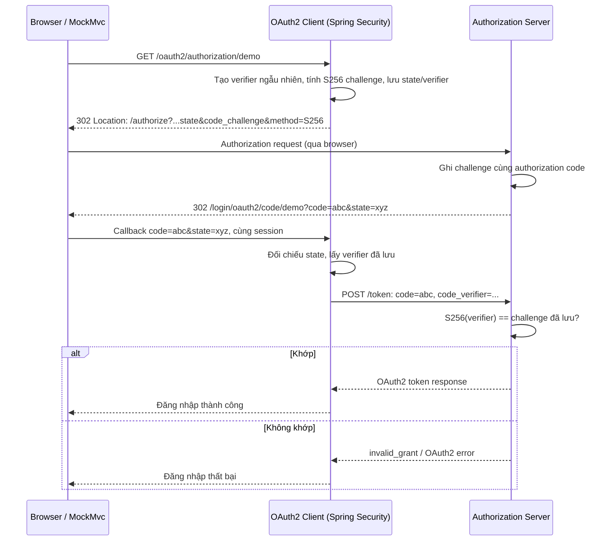

# PKCE khi luồng của ứng dụng yêu cầu

Trong một luồng OAuth 2.0 Authorization Code, ứng dụng chuyển browser tới **authorization endpoint** của nhà cung cấp danh tính (Authorization Server), nhận một **authorization code**, rồi đổi code lấy token tại **token endpoint**. Nếu kẻ tấn công lấy được code trong lúc nó đi qua browser hoặc ứng dụng trung gian, một luồng thiếu biện pháp bảo vệ thích hợp có thể tạo cơ hội để dùng lại code.

**Proof Key for Code Exchange (PKCE, RFC 7636)** bổ sung bằng chứng rằng bên đổi authorization code chính là bên đã khởi tạo authorization request. Ứng dụng tạo một chuỗi bí mật tạm thời gọi là `code_verifier`, gửi giá trị dẫn xuất `code_challenge` ở bước authorization, rồi gửi **chính verifier đó** khi đổi code lấy token. Authorization Server phải kiểm tra sự khớp nhau trước khi phát hành token.

Trong module `SPRING_SECURITY_TESTING`, chương **Luồng OAuth2 thực** tập trung vào kiểm chứng những hành vi bảo vệ xảy ra qua HTTP và security filter chain. Bài này đi sâu vào câu hỏi: **Khi ứng dụng hoặc nhà cung cấp yêu cầu PKCE, làm sao kiểm tra cả authorization redirect và token exchange bằng Spring Security Test?** Các ví dụ dùng Servlet, `MockMvc` và một HTTP stub cục bộ cho Authorization Server; cuối bài nêu cách chuyển tư duy sang ứng dụng Reactive.

## 1. Hiểu đúng khi nào ứng dụng cần PKCE

PKCE đặc biệt quan trọng với các **public clients**: ứng dụng native, SPA dùng Authorization Code Flow, hoặc client khác không thể giữ bí mật client secret một cách đáng tin cậy. Với **confidential clients** (ví dụ backend có thể bảo vệ client secret), PKCE vẫn là một lớp bảo vệ nên dùng và có thể là yêu cầu bắt buộc của Authorization Server hoặc chính sách bảo mật.

Khi viết test, cần đọc chính sách của luồng ứng dụng đang triển khai:

- Nếu ClientRegistration là public client với `ClientAuthenticationMethod.NONE`, những phiên bản Spring Security OAuth2 Client hiện hành có hỗ trợ tự áp dụng PKCE. Không nên giả định điều này ở mọi phiên bản hoặc mọi resolver tùy biến; cần quan sát authorization request thực tế.
- Nếu Authorization Server yêu cầu PKCE cho cả confidential client, ứng dụng phải tạo challenge/verifier phù hợp, chẳng hạn cấu hình `OAuth2AuthorizationRequestCustomizers.withPkce()` cho `DefaultOAuth2AuthorizationRequestResolver`.
- Nếu luồng hiện tại chưa bật PKCE và chưa có chính sách yêu cầu, một test cố đòi `code_challenge` sẽ phản ánh **yêu cầu chưa được cấu hình**. Cần làm rõ chính sách trước khi coi đó là lỗi ứng dụng.
- Nếu đã chọn PKCE, nên dùng phương thức `S256`. Phương thức `plain` không đem lại mức bảo vệ tương đương trước việc lộ authorization request.

**PKCE không thay thế `state`, `nonce` hay client authentication.** `state` liên kết callback với authorization request ban đầu và hỗ trợ chống CSRF trong login flow; `nonce` là ràng buộc riêng của OIDC khi dùng ID token; client secret (nếu có) vẫn phục vụ xác thực confidential client. PKCE có mục tiêu riêng: ràng buộc authorization code với `code_verifier` do client khởi tạo.

### Mục tiêu sau bài học

Bạn sẽ có thể:

1. Nhận ra `code_challenge` và `code_challenge_method=S256` trên redirect đến Authorization Server.
2. Giữ đúng HTTP session và `state` giữa bước bắt đầu login và callback trong `MockMvc`.
3. Kiểm tra HTTP POST đến token endpoint chứa `code_verifier`, cùng `grant_type=authorization_code` và authorization code nhận được.
4. Tính lại challenge từ verifier để chứng minh hai bước được liên kết bởi đúng một giá trị PKCE.
5. Thiết kế test âm tính khi verifier sai, thiếu hoặc thuộc authorization request khác.
6. Phân biệt test bằng `oauth2Login()`/`oidcLogin()` với một test chạy thật luồng Authorization Code + PKCE.

## 2. Cơ chế PKCE: verifier, challenge và so khớp

Một PKCE flow dùng phương thức S256 có hai bước cốt lõi.

**Bước A — bắt đầu authorization:** Client tạo `code_verifier` đủ ngẫu nhiên, tính:

\[
\text{code\_challenge} =
\operatorname{BASE64URL\_NO\_PADDING}\bigl(
\operatorname{SHA256}(\operatorname{ASCII}(\text{code\_verifier}))
\bigr)
\]

Rồi chuyển browser đến authorization endpoint với tham số `code_challenge` và `code_challenge_method=S256`. **Không đưa `code_verifier` vào URL redirect.**

**Bước B — đổi code lấy token:** Sau callback hợp lệ, client gửi `code_verifier` trong HTTP POST đến token endpoint. Authorization Server tự tính lại challenge từ verifier và so sánh với challenge đã gắn với authorization code.



### Các giá trị cần hiểu chính xác

| Thành phần | Tạo và sử dụng ở đâu? | Có thể xuất hiện trên URL browser? |
| --- | --- | --- |
| `code_verifier` | Client tạo và giữ qua thời gian thực hiện flow; gửi khi gọi token endpoint | **Không** nên xuất hiện trên authorization redirect |
| `code_challenge` | Client dẫn xuất từ verifier; Authorization Server gắn với code | **Có**, là tham số authorization request |
| `code_challenge_method` | Chọn phép dẫn xuất, thông thường `S256` | **Có** |
| `state` | Client tạo, lưu và so khớp callback | **Có**, trên authorization request và callback |
| `code` | Authorization Server phát hành sau authorization | **Có**, trên callback; sử dụng một lần |
| `client_secret` | Confidential client xác thực với token endpoint khi áp dụng | **Không** được lộ trên browser redirect |

`code_verifier` theo RFC 7636 là chuỗi **43 đến 128 ký tự** trong tập unreserved: chữ cái, chữ số, dấu `-`, `.`, `_` và `~`. Verifier phải có entropy phù hợp từ bộ sinh ngẫu nhiên mật mã, không được cố định hoặc đoán được. Với `S256`, challenge thường là chuỗi Base64URL dài 43 ký tự không có dấu padding `=`.

PKCE chống việc dùng lại **code mà không có verifier đúng**. Nó không ngăn mọi hình thức đánh cắp token sau khi token đã phát hành; cũng không tự xác minh chữ ký ID token hay chứng minh Authorization Server thực sự có khả năng kiểm tra PKCE nếu test chỉ dựng mock ở phía Client.

## 3. Ví dụ cấu hình OAuth2 Client cho Spring Boot Servlet

Các dependency thường cần:

```groovy
dependencies {
    implementation 'org.springframework.boot:spring-boot-starter-web'
    implementation 'org.springframework.boot:spring-boot-starter-security'
    implementation 'org.springframework.boot:spring-boot-starter-oauth2-client'

    testImplementation 'org.springframework.boot:spring-boot-starter-test'
    testImplementation 'org.springframework.security:spring-security-test'
}
```

Để kiểm tra HTTP token endpoint trong các ví dụ sâu hơn, ta có thể bổ sung một thư viện HTTP stub như MockWebServer hoặc WireMock. Hãy dùng phiên bản phù hợp với dependency management của dự án.

### 3.1. Bảo vệ endpoint và bật OAuth2 login

```java
import org.springframework.context.annotation.Bean;
import org.springframework.context.annotation.Configuration;
import org.springframework.security.config.Customizer;
import org.springframework.security.config.annotation.web.builders.HttpSecurity;
import org.springframework.security.web.SecurityFilterChain;

@Configuration
class BrowserSecurityConfig {

    @Bean
    SecurityFilterChain securityFilterChain(HttpSecurity http)
            throws Exception {
        http
            .authorizeHttpRequests(auth -> auth
                .requestMatchers("/app/**").authenticated()
                .anyRequest().permitAll()
            )
            .oauth2Login(login -> login
                .defaultSuccessUrl("/app/home", true)
            );
        return http.build();
    }
}
```

Với cấu hình này, URL khởi động đăng nhập mặc định cho registrationId `demo` là:

Để các ví dụ về request sau đăng nhập có endpoint xác định, thêm một controller đơn giản vào cùng ứng dụng:

```java
import org.springframework.security.core.Authentication;
import org.springframework.web.bind.annotation.GetMapping;
import org.springframework.web.bind.annotation.RestController;

@RestController
class PkceDemoController {

    @GetMapping("/app/home")
    String home() {
        return "home";
    }

    @GetMapping("/app/me")
    String me(Authentication authentication) {
        return authentication.getName();
    }
}
```

Controller này chỉ đọc authentication sau khi filter chain đã xử lý, không thực hiện PKCE thay cho OAuth2 Client.

```http
GET /oauth2/authorization/demo HTTP/1.1
```

Callback mặc định nhận authorization code:

```http
GET /login/oauth2/code/demo?code=test-code&state=some-state HTTP/1.1
```

Cả hai URL có thể được tùy biến qua cấu hình. Test phải dùng đường dẫn thực của ứng dụng.

### 3.2. Ví dụ ClientRegistration public client

Một `ClientRegistration` minh họa có thể được tạo bằng Java:

```java
import org.springframework.context.annotation.Bean;
import org.springframework.security.oauth2.client.registration.ClientRegistration;
import org.springframework.security.oauth2.client.registration.ClientRegistrationRepository;
import org.springframework.security.oauth2.client.registration.InMemoryClientRegistrationRepository;
import org.springframework.security.oauth2.core.AuthorizationGrantType;
import org.springframework.security.oauth2.core.ClientAuthenticationMethod;

@Bean
ClientRegistrationRepository clientRegistrationRepository() {
    ClientRegistration client = ClientRegistration
        .withRegistrationId("demo")
        .clientId("public-browser-client")
        .clientAuthenticationMethod(ClientAuthenticationMethod.NONE)
        .authorizationGrantType(AuthorizationGrantType.AUTHORIZATION_CODE)
        .authorizationUri("https://idp.example.test/authorize")
        .tokenUri("https://idp.example.test/token")
        .redirectUri("{baseUrl}/login/oauth2/code/{registrationId}")
        .scope("profile")
        .userInfoUri("https://idp.example.test/userinfo")
        .userNameAttributeName("sub")
        .clientName("Demo Public Client")
        .build();

    return new InMemoryClientRegistrationRepository(client);
}
```

Hãy đặt method `@Bean` trong một class `@Configuration` thực tế. Các URL `example.test` chỉ để minh họa; chúng không phải Authorization Server đang chạy. Khi viết HTTP integration test, thay các URI đó bằng địa chỉ của **local stub server**.

Với public client, `ClientAuthenticationMethod.NONE` thể hiện rằng client không gửi client secret để xác thực ở token endpoint. Điều này càng làm PKCE quan trọng. Dù vậy, **việc có `NONE` không đủ để khẳng định PKCE hoạt động**: cần quan sát URL bắt đầu login và request token exchange trong phiên bản/cấu hình Spring Security đang dùng.

### 3.3. Yêu cầu PKCE tường minh với authorization request resolver

Nếu ứng dụng cần bật PKCE cho những registration mà mặc định chưa bật (ví dụ confidential client theo chính sách IdP), có thể sử dụng authorization request customizer:

```java
import org.springframework.security.config.annotation.web.builders.HttpSecurity;
import org.springframework.security.oauth2.client.registration.ClientRegistrationRepository;
import org.springframework.security.oauth2.client.web.DefaultOAuth2AuthorizationRequestResolver;
import org.springframework.security.oauth2.client.web.OAuth2AuthorizationRequestCustomizers;

// Đặt trong cấu hình SecurityFilterChain, với registrations đã có.
DefaultOAuth2AuthorizationRequestResolver resolver =
    new DefaultOAuth2AuthorizationRequestResolver(
        registrations, "/oauth2/authorization"
    );

resolver.setAuthorizationRequestCustomizer(
    OAuth2AuthorizationRequestCustomizers.withPkce()
);

http.oauth2Login(oauth -> oauth
    .authorizationEndpoint(endpoint ->
        endpoint.authorizationRequestResolver(resolver))
);
```

Đoạn trên là cấu hình thành phần để lắp vào một SecurityFilterChain, **không** phải đoạn `@Bean` độc lập có thể dán bên ngoài class. `registrations` là `ClientRegistrationRepository` của ứng dụng, được inject vào nơi tạo chain. Nếu đã sử dụng custom resolver khác, cần tích hợp PKCE vào resolver đó và giữ các customizations hợp lệ hiện có. Không khai báo hai SecurityFilterChain cạnh tranh cho cùng URL chỉ để thêm PKCE.

Các phiên bản Spring Security có cơ chế kích hoạt PKCE mặc định khác nhau theo client và cách cấu hình. Kết quả cuối cùng trên HTTP redirect/token request mới là điều test cần xác minh.

## 4. Kiểm tra bước đầu: redirect có code_challenge=S256

Không cần gọi Authorization Server để kiểm tra **ứng dụng có tạo authorization request đúng hay không**. Chỉ cần gửi `GET /oauth2/authorization/demo` qua `MockMvc`, quan sát 302 và trích các query parameters từ header `Location`.

```java
import java.net.URI;

import org.junit.jupiter.api.Test;
import org.springframework.beans.factory.annotation.Autowired;
import org.springframework.boot.test.autoconfigure.web.servlet.AutoConfigureMockMvc;
import org.springframework.boot.test.context.SpringBootTest;
import org.springframework.mock.web.MockHttpSession;
import org.springframework.test.web.servlet.MockMvc;
import org.springframework.test.web.servlet.MvcResult;
import org.springframework.web.util.UriComponentsBuilder;

import static org.assertj.core.api.Assertions.assertThat;
import static org.springframework.test.web.servlet.request
    .MockMvcRequestBuilders.get;
import static org.springframework.test.web.servlet.result
    .MockMvcResultMatchers.status;

@SpringBootTest
@AutoConfigureMockMvc
class PkceAuthorizationRedirectTest {

    @Autowired
    MockMvc mockMvc;

    @Test
    void authorizationRedirectUsesS256Challenge() throws Exception {
        MvcResult start = mockMvc.perform(
                get("/oauth2/authorization/demo"))
            .andExpect(status().is3xxRedirection())
            .andReturn();

        String location = start.getResponse().getRedirectedUrl();
        assertThat(location).isNotBlank();

        var query = UriComponentsBuilder
            .fromUri(URI.create(location))
            .build()
            .getQueryParams();

        assertThat(query.getFirst("response_type")).isEqualTo("code");
        assertThat(query.getFirst("client_id"))
            .isEqualTo("public-browser-client");
        assertThat(query.getFirst("state")).isNotBlank();
        assertThat(query.getFirst("code_challenge")).isNotBlank();
        assertThat(query.getFirst("code_challenge_method"))
            .isEqualTo("S256");
        assertThat(query.getFirst("code_verifier")).isNull();

        MockHttpSession session =
            (MockHttpSession) start.getRequest().getSession(false);
        assertThat(session).isNotNull();
    }
}
```

**Phạm vi chứng minh:** Spring Security đã đi qua `OAuth2AuthorizationRequestRedirectFilter` và tạo redirect có PKCE challenge phù hợp. Test cũng kiểm tra `state` và session tồn tại, là hai điều cần thiết để nối bước callback.

**Phạm vi chưa chứng minh:** Đây chưa phải bằng chứng client sẽ gửi `code_verifier` khi đổi code, cũng chưa chứng minh Authorization Server kiểm tra challenge. `MockMvc` không tự mở URL `Location` hoặc tương tác với IdP.

Nếu `code_challenge` vắng mặt, hãy kiểm tra `ClientAuthenticationMethod`, phiên bản/config mặc định, resolver tùy biến và đường dẫn request đã khớp đúng filter chain hay chưa. Đừng “sửa” test bằng cách nhét trực tiếp một `code_challenge` cố định vào expected URL.

### 4.1. Không hardcode state, challenge hay verifier

Các giá trị này nên khác nhau giữa các lần khởi tạo độc lập. Test tốt không so sánh với một literal cố định. Thay vào đó, nó kiểm tra:

- `state` và `code_challenge` có mặt và không rỗng.
- `code_challenge_method` đúng bằng `S256` khi đó là chính sách.
- `code_verifier` không bị lộ trong redirect.
- Một authorization request mới tạo ra challenge mới với xác suất áp đảo.

Việc so sánh hai challenge khác nhau trong hai lượt gọi có thể là một phép thử hỗ trợ, nhưng **không thay thế** kiểm tra độ ngẫu nhiên bằng thiết kế và không phải là phương pháp chứng minh mật mã. Điểm quan trọng của bài là mối liên hệ giữa challenge và verifier được sử dụng ở bước token exchange.

## 5. Giữ state và session cho callback thực

Authorization request thường được Spring Security lưu trong `AuthorizationRequestRepository`, mặc định phổ biến là `HttpSessionOAuth2AuthorizationRequestRepository`. Khi Authorization Server trả browser về callback, Spring Security tìm request đã lưu và kiểm tra `state` trước khi tiến hành code exchange.

Khi dùng `MockMvc`, **hai lần gọi `perform()` không tự động chia sẻ một browser session**. Cần truyền lại session nhận từ request bắt đầu login:

```java
MvcResult start = mockMvc.perform(
        get("/oauth2/authorization/demo"))
    .andExpect(status().is3xxRedirection())
    .andReturn();

MockHttpSession session =
    (MockHttpSession) start.getRequest().getSession(false);

String location = start.getResponse().getRedirectedUrl();
String state = UriComponentsBuilder
    .fromUriString(location)
    .build()
    .getQueryParams()
    .getFirst("state");

// Authorization Server đã đồng ý, callback tới ứng dụng.
mockMvc.perform(get("/login/oauth2/code/demo")
        .param("code", "authorization-code-from-test-idp")
        .param("state", state)
        .session(session));
```

Đây mới là **khung callback**, chưa phải test thành công: callback sẽ cần một token endpoint trả response phù hợp, và có thể còn user-info endpoint hoặc OIDC ID token tùy ClientRegistration. Nếu không dựng HTTP stub, request có thể thử gọi đến URI không hoạt động.

Không được bỏ kiểm tra state, tái sử dụng sai session hoặc dựng authorization request giả một cách tùy tiện chỉ để lấy được status thành công. PKCE bảo vệ code exchange, còn state bảo vệ mối liên hệ callback với bước bắt đầu login.

### 5.1. Kiểm tra state sai

Một ca âm tính quan trọng là callback có `state` không khớp với request đã lưu:

```java
MvcResult start = mockMvc.perform(
        get("/oauth2/authorization/demo"))
    .andReturn();

MockHttpSession session =
    (MockHttpSession) start.getRequest().getSession(false);

mockMvc.perform(get("/login/oauth2/code/demo")
        .param("code", "test-code")
        .param("state", "wrong-state")
        .session(session))
    .andExpect(status().is3xxRedirection());
```

Với failure handler mặc định, login thường chuyển về trang lỗi. Muốn chắc chắn request đã bị từ chối, cần assert URL failure, xác nhận session không có authentication hợp lệ và **token endpoint không nhận POST**. Chỉ assert `302` là yếu: login thành công cũng có thể trả `302`.

Việc xử lý state sai xảy ra **trước** bước đối chiếu PKCE ở Authorization Server. Nếu callback bị chặn vì state, không được mô tả kết quả như “Authorization Server từ chối code_verifier”.

## 6. Kiểm tra token request chứa verifier khớp challenge

Test ở mức HTTP cần một **introspection/token/authorization server stub** phù hợp; với PKCE, trọng tâm chính xác là **token endpoint** (không phải opaque-token introspection endpoint). Ta sẽ dùng local HTTP stub cho `/token` và `/userinfo`, còn redirect `/authorize` chỉ được quan sát qua `Location` chứ không cần browser mở thật.

Giả sử OAuth2 Client có registrationId `demo`, `ClientAuthenticationMethod.NONE` và scope `profile` (không có `openid` để ví dụ tách riêng khỏi xác minh OIDC ID token). Với Spring Boot, các URI có thể được cung cấp bằng properties:

```yaml
spring:
  security:
    oauth2:
      client:
        registration:
          demo:
            client-id: public-browser-client
            client-authentication-method: none
            authorization-grant-type: authorization_code
            redirect-uri: "{baseUrl}/login/oauth2/code/{registrationId}"
            scope: profile
            provider: demo
        provider:
          demo:
            authorization-uri: http://localhost:18080/authorize
            token-uri: http://localhost:18080/token
            user-info-uri: http://localhost:18080/userinfo
            user-name-attribute: sub
```

Port `18080` chỉ mang tính minh họa. Test chạy song song hoặc CI nên dùng **port động** và truyền URI vào Spring context trước khi khởi tạo ClientRegistration.

### 6.1. Thiết kế một integration test có thể quan sát HTTP

Ví dụ sau dùng `okhttp3.mockwebserver.MockWebServer` (cần thêm `testImplementation` cho MockWebServer tương thích vào dependency test của dự án). Để đoạn mã gọn, nó giả định cấu hình `SecurityFilterChain` ở mục 3.1 và controller `GET /app/me` trả `Authentication.getName()`.

Spring Boot tạo `ClientRegistrationRepository` từ các properties trong `@DynamicPropertySource`; không đồng thời đăng ký thêm bean `ClientRegistrationRepository` minh họa ở mục 3.2 trong cùng context.

```java
import java.io.IOException;
import java.io.UncheckedIOException;
import java.net.URI;
import java.net.URLDecoder;
import java.nio.charset.StandardCharsets;
import java.security.MessageDigest;
import java.util.Arrays;
import java.util.Base64;
import java.util.Map;
import java.util.concurrent.TimeUnit;
import java.util.stream.Collectors;

import okhttp3.mockwebserver.MockResponse;
import okhttp3.mockwebserver.MockWebServer;
import okhttp3.mockwebserver.RecordedRequest;

import org.junit.jupiter.api.AfterAll;
import org.junit.jupiter.api.Test;
import org.springframework.beans.factory.annotation.Autowired;
import org.springframework.boot.test.autoconfigure.web.servlet.AutoConfigureMockMvc;
import org.springframework.boot.test.context.DynamicPropertyRegistry;
import org.springframework.boot.test.context.DynamicPropertySource;
import org.springframework.boot.test.context.SpringBootTest;
import org.springframework.mock.web.MockHttpSession;
import org.springframework.test.web.servlet.MockMvc;
import org.springframework.test.web.servlet.MvcResult;
import org.springframework.web.util.UriComponentsBuilder;

import static org.assertj.core.api.Assertions.assertThat;
import static org.springframework.test.web.servlet.request
    .MockMvcRequestBuilders.get;
import static org.springframework.test.web.servlet.result
    .MockMvcResultMatchers.redirectedUrl;
import static org.springframework.test.web.servlet.result
    .MockMvcResultMatchers.status;

@SpringBootTest
@AutoConfigureMockMvc
class OAuth2PkceHttpFlowTest {

    private static final MockWebServer idp = startIdp();

    @Autowired
    MockMvc mockMvc;

    private static MockWebServer startIdp() {
        MockWebServer server = new MockWebServer();
        try {
            server.start();
        } catch (IOException ex) {
            throw new UncheckedIOException(ex);
        }
        return server;
    }

    @DynamicPropertySource
    static void properties(DynamicPropertyRegistry registry) {
        String prefix = "spring.security.oauth2.client.";

        registry.add(prefix + "registration.demo.client-id",
            () -> "public-browser-client");
        registry.add(
            prefix + "registration.demo.client-authentication-method",
            () -> "none");
        registry.add(
            prefix + "registration.demo.authorization-grant-type",
            () -> "authorization_code");
        registry.add(prefix + "registration.demo.redirect-uri",
            () -> "{baseUrl}/login/oauth2/code/{registrationId}");
        registry.add(prefix + "registration.demo.scope",
            () -> "profile");
        registry.add(prefix + "registration.demo.provider",
            () -> "demo");

        registry.add(prefix + "provider.demo.authorization-uri",
            () -> idp.url("/authorize").toString());
        registry.add(prefix + "provider.demo.token-uri",
            () -> idp.url("/token").toString());
        registry.add(prefix + "provider.demo.user-info-uri",
            () -> idp.url("/userinfo").toString());
        registry.add(prefix + "provider.demo.user-name-attribute",
            () -> "sub");
    }

    @AfterAll
    static void closeIdp() throws IOException {
        idp.shutdown();
    }

    @Test
    void tokenRequestContainsVerifierMatchingRedirectChallenge()
            throws Exception {

        // 1. Bắt đầu login: Spring Security tạo redirect PKCE.
        MvcResult start = mockMvc.perform(
                get("/oauth2/authorization/demo"))
            .andExpect(status().is3xxRedirection())
            .andReturn();

        String location = start.getResponse().getRedirectedUrl();
        var query = UriComponentsBuilder
            .fromUri(URI.create(location))
            .build()
            .getQueryParams();

        assertThat(query.getFirst("code_challenge_method"))
            .isEqualTo("S256");

        String challenge = query.getFirst("code_challenge");
        String state = query.getFirst("state");

        assertThat(challenge).isNotBlank();
        assertThat(state).isNotBlank();
        assertThat(query.getFirst("code_verifier")).isNull();

        MockHttpSession session =
            (MockHttpSession) start.getRequest().getSession(false);
        assertThat(session).isNotNull();

        // 2. Xếp responses từ local token + user-info endpoints.
        idp.enqueue(new MockResponse()
            .setHeader("Content-Type", "application/json")
            .setBody("""
                {
                  "access_token": "access-token-from-stub",
                  "token_type": "Bearer",
                  "expires_in": 3600
                }
                """));

        idp.enqueue(new MockResponse()
            .setHeader("Content-Type", "application/json")
            .setBody("{\"sub\":\"alice\"}"));

        // 3. Callback với code và state đúng của chính session.
        mockMvc.perform(get("/login/oauth2/code/demo")
                .param("code", "code-abc")
                .param("state", state)
                .session(session))
            .andExpect(status().is3xxRedirection())
            .andExpect(redirectedUrl("/app/home"));

        // 4. Quan sát token endpoint nhận HTTP POST thực.
        RecordedRequest tokenRequest =
            idp.takeRequest(5, TimeUnit.SECONDS);
        assertThat(tokenRequest).isNotNull();
        assertThat(tokenRequest.getMethod()).isEqualTo("POST");
        assertThat(tokenRequest.getPath()).isEqualTo("/token");

        Map<String, String> form =
            parseForm(tokenRequest.getBody().readUtf8());

        assertThat(form).containsEntry(
            "grant_type", "authorization_code");
        assertThat(form).containsEntry("code", "code-abc");
        assertThat(form.get("redirect_uri"))
            .endsWith("/login/oauth2/code/demo");

        String verifier = form.get("code_verifier");
        assertThat(verifier).isNotBlank();
        assertThat(verifier)
            .matches("[A-Za-z0-9._~-]{43,128}");

        // Quan trọng: kiểm tra quan hệ S256 giữa hai request.
        assertThat(s256Challenge(verifier)).isEqualTo(challenge);

        // 5. Client dùng access token để lấy user info.
        RecordedRequest userInfoRequest =
            idp.takeRequest(5, TimeUnit.SECONDS);
        assertThat(userInfoRequest).isNotNull();
        assertThat(userInfoRequest.getPath())
            .isEqualTo("/userinfo");
        assertThat(userInfoRequest.getHeader("Authorization"))
            .isEqualTo("Bearer access-token-from-stub");
    }

    private static Map<String, String> parseForm(String encoded) {
        return Arrays.stream(encoded.split("&"))
            .map(field -> field.split("=", 2))
            .collect(Collectors.toMap(
                pair -> URLDecoder.decode(
                    pair[0], StandardCharsets.UTF_8),
                pair -> URLDecoder.decode(
                    pair.length == 2 ? pair[1] : "",
                    StandardCharsets.UTF_8)
            ));
    }

    private static String s256Challenge(String verifier)
            throws Exception {
        byte[] digest = MessageDigest.getInstance("SHA-256")
            .digest(verifier.getBytes(StandardCharsets.US_ASCII));

        return Base64.getUrlEncoder()
            .withoutPadding()
            .encodeToString(digest);
    }
}
```

**Cần để ý khi sử dụng ví dụ:**

- `@DynamicPropertySource` ghi đè các URI trước khi ứng dụng tạo ClientRegistration; server stub phải được khởi động sẵn. Ví dụ dùng static server cho một class test độc lập; dự án có chạy nhiều context song song cần quản lý lifecycle cẩn thận.
- Vì request không đi tới browser/IdP thật, test chủ động tạo callback `code-abc`. Đây là cách kiểm tra **Client gửi gì khi đổi code**; nó không mô phỏng người dùng thật vừa đăng nhập tại IdP.
- Token endpoint stub ở đây **trả token mà không tự kiểm tra verifier**. Assertion `s256Challenge(verifier) == challenge` do test thực hiện chứng minh OAuth2 Client sinh và gửi đúng cặp giá trị. Muốn chứng minh phía Authorization Server thực thi PKCE, cần stub có logic kiểm tra hoặc tích hợp với server thực có quy tắc PKCE.
- Response `/userinfo` dùng để hoàn tất OAuth2 login với principal `alice`. Khi sử dụng OIDC (scope `openid`), token response còn cần ID token phù hợp và một bộ xác minh ID token riêng.
- `@AfterAll` dừng stub; không phụ thuộc Internet hay IdP production. Trong một bộ test có nhiều phương thức, nên đặt mỗi test trong context/fixture độc lập hoặc dọn queue/recorded requests theo cách rõ ràng để tránh phụ thuộc thứ tự chạy.

### 6.2. Kết quả test trên chứng minh điều gì?

Chứng cứ gồm hai mảnh liên kết:

| Từ authorization redirect | Từ token request |
| --- | --- |
| `code_challenge=C` | `code_verifier=V` |
| `code_challenge_method=S256` | `SHA256(V) → Base64URL = C` |
| `state=S` được tạo lúc bắt đầu login | Callback dùng đúng `S` và cùng session |
| `code_verifier` không có trên URL | `code_verifier` có trong POST đến `/token` |

Đây là bằng chứng client triển khai đúng phần việc PKCE trong một luồng Authorization Code. Để chứng minh Authorization Server buộc tuân thủ PKCE, phải kiểm tra thêm hành vi từ chối của server khi verifier sai/thiếu.

## 7. Kiểm tra âm tính: sai verifier, thiếu verifier và token code bị đánh cắp

Một Authorization Server triển khai PKCE phải **ràng buộc challenge với authorization code** và từ chối token request nếu verifier không khớp. Các ca kiểm thử âm tính hữu ích gồm:

| Tình huống | Request token endpoint | Kỳ vọng Authorization Server |
| --- | --- | --- |
| Đúng verifier | `code=abc, code_verifier=V` | Cấp token nếu các điều kiện khác hợp lệ |
| Thiếu verifier | `code=abc` nhưng không có `code_verifier` khi PKCE được áp dụng | Từ chối token exchange |
| Verifier sai một ký tự | `code=abc, code_verifier=V2`, `V2≠V` | Từ chối |
| Verifier của flow khác | `code=abc, code_verifier=V_other` | Từ chối |
| Code đã dùng rồi | Gửi lại `code=abc` dù verifier đúng | Từ chối vì code chỉ dùng một lần |
| Redirect URI không khớp | `code=abc` nhưng `redirect_uri` sai | Từ chối theo quy tắc binding |

Ở token endpoint, lỗi OAuth2 phù hợp thường có dạng:

```http
HTTP/1.1 400 Bad Request
Content-Type: application/json

{"error":"invalid_grant"}
```

Một integration test tập trung vào **authorization server** cần gửi các cặp code/verifier như bảng trên rồi kiểm tra kết quả. Đối với ứng dụng Spring Security Client, có thể cấu hình stub trả `invalid_grant` và xác minh callback **không tạo phiên đăng nhập thành công**. Nhưng lưu ý: stub chỉ trả lỗi được lập trình sẵn không chứng minh server thật thực sự kiểm tra PKCE. Cần mô phỏng logic đối chiếu hoặc dùng Authorization Server thử nghiệm.

### 7.1. Cách thiết kế HTTP stub có kiểm tra PKCE

Nếu muốn kiểm thử cả hai phía trong môi trường cục bộ, stub cần ghi nhận code và challenge:

1. Khi bắt đầu authorization, stub lấy `code_challenge` và method `S256`, tạo một authorization code ngẫu nhiên và lưu record `code -> challenge, client_id, redirect_uri`.
2. Khi nhận `POST /token`, stub lấy `code_verifier` và tính lại `S256(verifier)`.
3. Nếu challenge khớp với record của code, client/redirect URI đúng và code chưa dùng, stub cấp token rồi đánh dấu code đã sử dụng.
4. Nếu thiếu/sai verifier hoặc code đã dùng, stub trả lỗi `invalid_grant`, không cấp token.
5. Test trên Spring Security Client gửi callback bằng code do stub phát hành, ghi nhận request và kiểm tra kết quả.

Nếu mục tiêu là xác minh bảo vệ PKCE ở Authorization Server thực sự triển khai, dùng một test server hỗ trợ OAuth2/OIDC hoặc môi trường IdP test là lựa chọn thích hợp hơn tự viết stub. Stub chỉ nên được xem là mô phỏng contract đã được xác định.

## 8. PKCE, state, nonce và client authentication không trùng nhau

Một số test báo “PKCE PASS” khi thực tế chỉ kiểm tra `state`. Hãy tách mục tiêu:

| Cơ chế | Dữ liệu chính | Phép kiểm tra | Chống/giảm rủi ro chính |
| --- | --- | --- | --- |
| `state` | Authorization request và callback | State callback khớp request đã lưu | Login CSRF, callback không thuộc phiên mở đầu |
| PKCE S256 | Challenge ở authorization request, verifier ở token request | S256(verifier) khớp challenge đã gắn với code | Dùng lại authorization code bị đánh cắp khi không biết verifier |
| OIDC `nonce` | Authorization request và ID token | Nonce ID token khớp nonce của flow | Một số kiểu replay/mix-up liên quan ID token |
| Client authentication | Token endpoint | Client chứng minh danh tính bằng phương thức đã đăng ký | Giới hạn token exchange với client được xác thực |
| Redirect URI binding | Authorization/token request | URI khớp registration và record | Ngăn đổi code trong ngữ cảnh redirect không hợp lệ |

PKCE bổ sung bảo vệ cho Authorization Code Flow ngay cả khi đã có client authentication. Ngược lại, chỉ dùng PKCE không có nghĩa có thể bỏ qua bảo vệ state/callback, validation của ID token hoặc kiểm tra redirect URI.

### 8.1. PKCE trong OIDC

Khi dùng OIDC Authorization Code Flow, authorization request thường thêm scope `openid`, và token response chứa `id_token`. PKCE vẫn là ràng buộc code/verifier; ngoài ra ứng dụng phải xác thực chữ ký, issuer, audience, thời hạn và nonce của ID token theo chính sách.

Đối với OIDC, có thể tách hai nhóm test:

- **PKCE test:** kiểm tra challenge trên authorization redirect và verifier trong token request. Nó vẫn có giá trị nếu token response được stub.
- **OIDC validation test:** dùng ID token ký bằng test key/JWK và decoder/validator thật để kiểm tra ID token; không suy ra chữ ký hợp lệ chỉ vì challenge/verifier đã khớp.

Cả hai có thể cùng tồn tại trong một end-to-end test, nhưng assertion cần chỉ rõ thành phần nào được kiểm chứng.

## 9. Vì sao oauth2Login() và oidcLogin() không kiểm tra PKCE?

Spring Security Test có các helper:

```java
import static org.springframework.security.test.web.servlet.request
    .SecurityMockMvcRequestPostProcessors.oauth2Login;
import static org.springframework.security.test.web.servlet.request
    .SecurityMockMvcRequestPostProcessors.oidcLogin;

mockMvc.perform(get("/app/home").with(oauth2Login()))
    .andExpect(status().isOk());

mockMvc.perform(get("/app/home").with(oidcLogin()))
    .andExpect(status().isOk());
```

Chúng cung cấp authentication đã được tạo sẵn cho request kiểm thử. Request không bắt đầu ở `/oauth2/authorization/demo`, không đi qua redirect filter, không tạo authorization code và không gửi token request. Do đó:

- Không thể khẳng định `code_challenge` đã được sinh.
- Không thể khẳng định session giữ `code_verifier`.
- Không thể khẳng định token request gửi verifier đúng.
- Không thể khẳng định Authorization Server đã từ chối code không có verifier.

Những helper này vẫn rất hữu ích để kiểm tra controller và authorization: ví dụ người dùng có scope được phép vào `/app/orders`, người dùng thiếu scope bị 403. Khi bài test yêu cầu **PKCE**, điểm khởi đầu phải là authorization request thực của OAuth2 Client hoặc một test trực tiếp cho thành phần tạo authorization request và token exchange.

## 10. Các lỗi hay gặp khiến test PKCE thiếu giá trị

### 10.1. Chỉ assert có code_challenge, bỏ qua token request

Có challenge không đảm bảo client còn giữ đúng verifier để gửi khi đổi code. Nếu repository session bị mất hoặc code flow dùng custom token client không gửi `code_verifier`, token exchange có thể thất bại. Hãy kiểm tra hai bước bằng cùng state/session và công thức S256.

### 10.2. Hardcode verifier để test dễ đoán

`code_verifier` là bí mật tạm thời của từng authorization request, phải được sinh đủ ngẫu nhiên. Hardcode một verifier như `my-verifier` rồi chèn cùng challenge vào test có thể kiểm tra công thức, nhưng không kiểm tra cơ chế sinh và quản lý PKCE của Spring Security. Test redirect thực nên đọc verifier/challenge được ứng dụng sinh và kiểm tra quan hệ với token POST.

### 10.3. Dùng callback không có session

Nếu không mang session lưu authorization request sang callback, Spring Security có thể không tìm được `state` và verifier. Kết quả là thất bại trước token exchange; không thể dùng lỗi đó để kết luận Authorization Server từ chối PKCE.

### 10.4. So sánh challenge với Base64 của verifier

Với `S256`, công thức đúng là **SHA-256 của ASCII verifier rồi Base64URL không padding**, không phải Base64 của chính verifier. Cũng không dùng Base64 chuẩn chứa `+`/`/` và `=` padding nếu đang kiểm tra S256 challenge.

### 10.5. Không kiểm tra code_challenge_method

Một request có `code_challenge` nhưng khai báo `plain` không đáp ứng chính sách bắt buộc S256. Test phải kiểm tra cả giá trị challenge và method.

### 10.6. Nhầm HTTP 302 với login thành công

Bắt đầu login trả 302; login thành công cũng thường trả 302; login thất bại có thể trả 302 về `/login?error`. Do đó nên kiểm tra redirect đích, HTTP stub nhận token request, session authentication và quyền truy cập tài nguyên sau callback nếu mục tiêu là login thành công.

### 10.7. Tắt Spring Security filter chain trong MockMvc

Nếu dùng `MockMvcBuilders.standaloneSetup(controller)` đơn thuần hoặc `@AutoConfigureMockMvc(addFilters = false)`, request có thể không đi qua `OAuth2AuthorizationRequestRedirectFilter`/`OAuth2LoginAuthenticationFilter`. Với setup thủ công từ `WebApplicationContext`, cần:

```java
import static org.springframework.security.test.web.servlet.setup
    .SecurityMockMvcConfigurers.springSecurity;

MockMvc securedMvc = MockMvcBuilders
    .webAppContextSetup(webApplicationContext)
    .apply(springSecurity())
    .build();
```

Trong Spring Boot, `@SpringBootTest` + `@AutoConfigureMockMvc` thông thường tích hợp filters. Nếu hệ thống có nhiều `SecurityFilterChain`, URL test phải khớp chain có `oauth2Login()` và resolver PKCE mong muốn.

### 10.8. Nhầm token endpoint với introspection endpoint

PKCE được xác minh **khi Authorization Server xử lý token request đổi authorization code**. Opaque-token introspection endpoint dùng để hỏi trạng thái access token đã có, không phải nơi so sánh `code_verifier` của PKCE. Test đi tới `/introspect` không thay thế test `POST /token`.

### 10.9. Tiết lộ verifier trong URL, log hoặc test output

`code_verifier` phải được lưu đủ để dùng ở token exchange nhưng không được đưa ra browser redirect, browser storage thiếu bảo vệ hoặc log production. Test có thể đọc verifier trong HTTP POST tới local stub để kiểm chứng, song phải tránh in giá trị đó ra báo cáo CI không cần thiết. Nếu ứng dụng đang ghi full token request body, hãy cân nhắc quy tắc che thông tin nhạy cảm trong logging.

## 11. Reactive WebFlux có cùng nguyên tắc kiểm thử

Trong ứng dụng Reactive, WebTestClient và Spring Security Test có thể tạo principal OAuth2 giả lập bằng configurer như `mockOAuth2Login()` hoặc `mockOidcLogin()`. Các configurer đó cũng **không tự chạy Authorization Code + PKCE**.

Để kiểm chứng PKCE trên WebFlux, cần chạy qua các reactive security web filters, quan sát authorization redirect và callback, giữ trạng thái/cookie/session thích hợp, đồng thời kiểm tra token request gửi tới local HTTP stub. Các API lưu authorization request và token response client của Reactive khác Servlet; không được dán nguyên code `MockMvc` vào `WebTestClient`.

Nguyên tắc chung vẫn là: **mock principal để kiểm tra quyền; chạy HTTP OAuth2 flow thật để kiểm tra redirect, state, code exchange và PKCE**.

## 12. Ma trận kiểm thử PKCE nên có

| Ca kiểm thử | Tầng thực hiện | Assertion cốt lõi |
| --- | --- | --- |
| PKCE được bật theo chính sách | `MockMvc GET /oauth2/authorization/demo` | `code_challenge` hiện diện, method `S256` |
| Không lộ verifier | Redirect HTTP | `code_verifier` không xuất hiện trên URL |
| Callback dùng đúng state/session | MockMvc start + callback | Callback thuộc authorization request đã lưu |
| Code exchange gửi verifier | MockMvc + HTTP token endpoint stub | `POST /token` có `code_verifier` |
| Verifier khớp challenge | Cùng một test hai chặng | `BASE64URL(SHA256(verifier)) == challenge` |
| Code exchange có đủ dữ liệu | HTTP token request | `grant_type=authorization_code`, code, redirect URI |
| Thiếu/sai verifier bị từ chối | Authorization Server test hoặc stub có logic PKCE | Không cấp token, OAuth2 error |
| State sai bị từ chối | OAuth2 login filter | Không nhận token/sinh session đã xác thực |
| Token endpoint lỗi | Callback + stub | Không đăng nhập thành công |
| Authorization theo user đã login | `oauth2Login()`/`oidcLogin()` | 200/403 theo authorities; **không kết luận PKCE** |
| OIDC ID token bị sửa chữ ký | Decoder/validator thật + callback | Từ chối ID token (mục tiêu khác PKCE) |

### Bài thực hành

Hãy chọn registration của ứng dụng đang yêu cầu PKCE và hoàn thành ba phép kiểm chứng:

1. **Authorization request:** Dùng `MockMvc` gọi URL khởi động OAuth2 login, lấy `state` và `code_challenge` trên redirect; xác nhận method `S256`, không có `code_verifier` trên URL và session đã được tạo.
2. **Token exchange:** Tạo callback với authorization code kiểm thử, cùng `state` và session; dùng token endpoint HTTP stub để ghi lại `code_verifier`. Tính lại `S256(verifier)` và so với challenge ở bước trước. Kiểm tra có token request và callback không rơi vào failure handler.
3. **Âm tính:** Cho stub hoặc Authorization Server test từ chối request có verifier sai/thiếu; xác nhận không có phiên đăng nhập thành công. Thử callback có state sai và kiểm tra request bị từ chối **trước khi** gọi token endpoint.

**Tiêu chí hoàn thành:** Bạn phân biệt được việc **Spring Security Client tạo challenge**, **Client gửi đúng verifier khi đổi code**, và **Authorization Server thực thi quy tắc đối chiếu verifier**. Một test chỉ thấy `302 Location` có challenge mới chứng minh bước đầu; một test dùng `with(oauth2Login())` trả 200 thì không chứng minh PKCE; và một integration test quan sát cả redirect lẫn token POST mới cung cấp bằng chứng đầy đủ về phần PKCE do Client chịu trách nhiệm.

