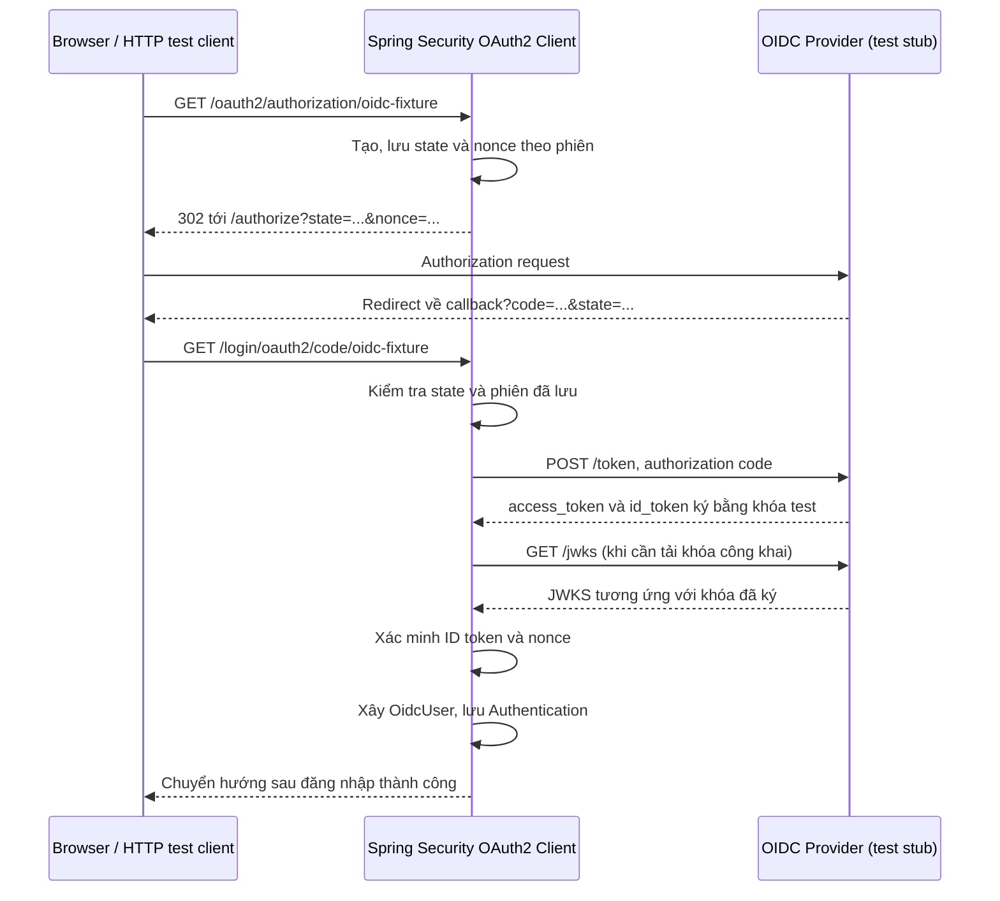

# OIDC `nonce`, `issuer` và kiểm tra ID token theo cấu hình thật

Trong chương **Luồng OAuth2 thực** của module **SPRING_SECURITY_TESTING**, mục tiêu không dừng ở việc tạo một `OidcUser` giả để kiểm tra phân quyền. Khi ứng dụng sử dụng **OpenID Connect (OIDC) Login**, nó phải đảm bảo ID token được nhận từ đúng nhà cung cấp danh tính, dành cho đúng OAuth2 client, còn hiệu lực và gắn với **đúng lượt đăng nhập đã khởi tạo**. Ba phần đặc biệt quan trọng là `nonce`, `iss` (*issuer*) và quá trình xác minh ID token bằng cấu hình của chính ứng dụng.

Ở đây, “luồng thực” nghĩa là kiểm thử đi qua các thành phần OAuth2/OIDC Login của Spring Security: tạo authorization request, lưu `state`/`nonce`, nhận callback, trao đổi authorization code, giải mã và kiểm tra ID token, tạo `OidcUser` và đưa xác thực vào `SecurityContext`. Ta vẫn sử dụng **nhà cung cấp OIDC giả lập trong test** với endpoint HTTP, khóa ký và tài khoản test riêng, thay vì sử dụng token hoặc client secret của môi trường triển khai.

Nội dung áp dụng cho Spring Security trên cả **Servlet với MockMvc** và **Reactive với WebTestClient**. Các tiện ích `@WithMockUser`, `oidcLogin()`, `mockOidcLogin()` và `mockJwt()` vẫn rất hữu ích cho các bài kiểm thử quyền, nhưng chúng không tự xác minh được các bước bảo mật của một lượt OIDC Login thật.

## 1. Điều gì được kiểm tra trong OIDC Authorization Code flow?

Luồng thông thường có thể hình dung như sau:



Đây là sơ đồ logic: bước tải JWKS có thể xảy ra trước callback, được cache hoặc dùng cấu hình sẵn; UserInfo chỉ được gọi khi cấu hình/điều kiện yêu cầu. Một bài test hoàn chỉnh không nhất thiết cần dựng trang đăng nhập và trình duyệt thật của provider; có thể cho HTTP stub mô phỏng authorization code, token response, discovery và JWKS, còn ứng dụng vẫn chạy **bộ lọc, client và validator thật**.

| Thành phần | Vai trò | Test phải chứng minh gì? |
| --- | --- | --- |
| `state` | Liên kết authorization response với request/phiên đã khởi tạo, bảo vệ callback khỏi CSRF | Callback với `state` sai, thiếu hoặc không khớp phiên bị từ chối |
| `nonce` | Gắn ID token với lượt xác thực OIDC đã khởi tạo, giảm nguy cơ phát lại/nhầm ID token | ID token mang `nonce` không phù hợp bị từ chối khi client đã phát nonce |
| `iss` | Danh tính chính xác của OpenID Provider phát hành ID token | Giá trị issuer trong token phải khớp provider đã cấu hình |
| `aud` | Định danh audience của ID token, thường gồm OAuth2 `client_id` | ID token dành cho client khác không được chấp nhận |
| `exp`, `iat` | Giới hạn thời gian hợp lệ và thời điểm phát hành | Token hết hạn hoặc vi phạm chính sách thời gian bị từ chối |
| JWS signature, `kid`, JWKS | Bảo đảm ID token được ký bằng khóa tin cậy tương ứng | Chữ ký sai, khóa không tin cậy hoặc thuật toán không được chấp nhận bị từ chối |
| `azp` và claim bổ sung | Các điều kiện OIDC/ứng dụng tùy ngữ cảnh | Bổ sung validator khi contract/provider yêu cầu; không mặc định mọi thư viện có cùng chính sách |

**`state` và `nonce` không thay thế nhau.** `state` chủ yếu xác nhận callback thuộc authorization request trước đó; `nonce` là giá trị ràng buộc nằm trong ID token, được kiểm tra khi client xử lý ID token. Một luồng có `state` hợp lệ vẫn có thể phải bị từ chối vì ID token mang sai `nonce`.

## 2. `nonce`: ràng buộc ID token với đúng lần đăng nhập

Khi dùng OIDC Login, client đưa `nonce` vào authorization request và giữ thông tin cần thiết để kiểm tra sau callback. Nhà cung cấp OIDC đưa giá trị `nonce` tương ứng vào claim của **ID token**. Mục tiêu là ngăn một ID token lấy từ lượt xác thực khác được dùng như kết quả của lượt hiện tại.

Trong Spring Security, cách tạo, lưu và đối chiếu `nonce` có thể bao gồm các bước xử lý hoặc băm giá trị nội bộ tùy phiên bản/cấu hình. Khi viết test, **lấy giá trị `nonce` mà ứng dụng thực sự gửi trong authorization URL**, rồi yêu cầu provider stub tạo ID token với claim `nonce` phù hợp theo hợp đồng. Không tự suy đoán rằng một chuỗi tùy ý trong session sẽ được so sánh trực tiếp với cùng chuỗi trong token.

Ví dụ authorization request minh họa:

```text
GET /authorize?
  response_type=code&
  client_id=fixture-client&
  scope=openid%20profile&
  redirect_uri=http%3A%2F%2Flocalhost%2Flogin%2Foauth2%2Fcode%2Foidc-fixture&
  state=state-generated-for-this-login&
  nonce=nonce-sent-for-this-login
```

Một ID token hợp lệ trong *chính lượt test đó* chứa:

```json
{
  "iss": "http://127.0.0.1:12345",
  "sub": "fixture-sub-007",
  "aud": ["fixture-client"],
  "exp": 1893456300,
  "iat": 1893456000,
  "nonce": "nonce-sent-for-this-login"
}
```

Địa chỉ, epoch và chuỗi trên chỉ minh họa cấu trúc. Trong test thực tế, `iss` phải khớp **chính xác** issuer của stub đang chạy, thời gian phải được tạo theo `Instant.now(clock)` và `nonce` phải lấy từ authorization request của lần kiểm thử hiện tại.

### Các ca âm tính về `nonce`

- **Nonce đúng:** authorization request chứa `nonce=N1`, ID token phản hồi mang nonce hợp lệ tương ứng với `N1` → có thể đăng nhập thành công nếu mọi kiểm tra khác cũng đạt.
- **Nonce sai:** request dùng `N1`, provider trả ID token có `nonce=N2` → đăng nhập phải thất bại; không tạo phiên đã xác thực.
- **Nonce thiếu:** client đã yêu cầu nonce nhưng ID token không có claim phù hợp → phải xác minh Spring Security từ chối theo hợp đồng OIDC và cấu hình đang chạy.
- **Tái sử dụng ID token:** lấy ID token có nonce của lần đăng nhập A đưa vào token response cho lần B → lần B phải bị từ chối, ngay cả khi chữ ký, issuer và audience hợp lệ.

Để cô lập nguyên nhân, giữ nguyên `iss`, `aud`, khóa ký, thời hạn và subject ở các ca trên; chỉ thay `nonce`. Nếu vừa đổi nonce vừa ký bằng khóa sai thì lỗi chữ ký có thể che khuất việc kiểm tra nonce.

## 3. `issuer`: cấu hình tin cậy và claim `iss` phải khớp

Trong OIDC, `iss` xác định **nhà cung cấp danh tính phát hành token**. Nó không phải là host bất kỳ trên Internet mà ứng dụng có thể chấp nhận. Ứng dụng có một `ClientRegistration` chỉ tới issuer/provider đã đăng ký; ID token phải thuộc issuer đó.

Với cấu hình dựa trên discovery, client có thể đọc metadata ở endpoint dạng `/.well-known/openid-configuration` để tìm authorization endpoint, token endpoint, `jwks_uri` và các khả năng của provider. Metadata cũng có trường `issuer`; tất cả phải nhất quán với issuer đã được tin cậy trong cấu hình. Một số hệ thống dùng URI/JWKS cấu hình trực tiếp thay cho discovery; nguyên tắc kiểm tra issuer của ID token vẫn giữ nguyên.

Ví dụ khai báo **chỉ dành cho profile test** trong Spring Boot:

```yaml
spring:
  security:
    oauth2:
      client:
        registration:
          oidc-fixture:
            provider: oidc-fixture
            client-id: fixture-client
            client-secret: fixture-secret-only
            authorization-grant-type: authorization_code
            redirect-uri: "{baseUrl}/login/oauth2/code/{registrationId}"
            scope: openid,profile
        provider:
          oidc-fixture:
            issuer-uri: "${OIDC_TEST_ISSUER}"
```

`OIDC_TEST_ISSUER` phải được gán thành URI của **OIDC stub cô lập**, không trỏ tới IdP của môi trường triển khai. Ví dụ nếu stub chạy tại `http://127.0.0.1:12345`, metadata sẽ công bố cùng giá trị issuer; ID token do stub ký cũng dùng chính issuer này. Với provider yêu cầu HTTPS, test có thể dùng TLS local/CA test tương ứng.

Những điểm dễ sai:

1. `iss = https://id.example.test/realm-a` khác `https://id.example.test/realm-b` và có thể khác cả biến thể thêm/bỏ dấu `/` cuối theo quy tắc so sánh của thư viện. **Không normalize bằng cách bỏ tùy tiện phần path.**
2. Một token của provider đáng tin khác chưa chắc hợp lệ cho registration hiện tại: issuer phải đúng registration được dùng trong luồng login này.
3. `issuer-uri` phục vụ discovery không đồng nghĩa ID token đã qua xác minh. Test cần cho callback nhận ID token do stub ký và để decoder/validator của Spring Security chạy.
4. Nếu test dùng một `OidcUser` giả đưa thẳng vào `SecurityContext`, nó sẽ **không kiểm tra** issuer dù map claim có trường `iss`.
5. Khi cấu hình `ClientRegistration` trực tiếp không có metadata discovery, vẫn phải bảo đảm nguồn khóa JWK và chính sách issuer được thiết lập đầy đủ, không vô tình vô hiệu hóa validator.

## 4. Các kiểm tra ID token phải diễn ra trên token đã ký

**ID token** thường là JWS/JWT do OIDC Provider phát hành cho OAuth2 client. Spring Security cần kiểm tra chữ ký và các claim theo registration/provider trước khi biến dữ liệu thành `OidcUser`.

| Kiểm tra | Dữ liệu test hợp lệ | Dữ liệu test bị từ chối |
| --- | --- | --- |
| Chữ ký | JWT ký bằng private key của stub; JWKS chứa public key tương ứng | Ký bằng khóa lạ, sửa payload sau khi ký hoặc `kid` không trỏ tới khóa tin cậy |
| Thuật toán | JWS `alg` thuộc danh sách được cấu hình chấp nhận | Thuật toán bị cấm, đổi thuật toán không khớp chính sách |
| Issuer `iss` | Bằng issuer của OIDC Provider test | Issuer khác registration hiện tại |
| Audience `aud` | Có `client_id` của registration | Chỉ dành cho client khác |
| Thời gian `exp`/`iat` | Thời gian phù hợp chính sách và độ lệch đồng hồ đã cấu hình | Hết hạn hoặc vi phạm chính sách thời gian |
| Nonce | Khớp với lần đăng nhập đã khởi tạo | Thiếu, sai hoặc lấy từ lượt đăng nhập khác |
| Subject `sub` | Danh tính test được phát hành bởi issuer | Thiếu subject bắt buộc hoặc vi phạm contract provider |

`azp` (*authorized party*) cần được xét theo ngữ cảnh OIDC, chẳng hạn ID token có nhiều audience. **Không mặc định `azp` luôn được Spring Security kiểm tra theo mọi yêu cầu nghiệp vụ**; nếu ứng dụng có điều kiện riêng, cấu hình validator và test riêng cho điều kiện đó.

Không dùng access token thay ID token. Access token dành cho resource server, có thể là opaque token hoặc JWT với audience khác. Một `JwtDecoder` cho **OAuth2 Resource Server** và decoder dùng trong **OAuth2/OIDC Login** là hai vị trí xử lý khác nhau. Test `jwt()`/`mockJwt()` thường gắn `JwtAuthenticationToken` đã xác thực, trong khi OIDC Login xây `OAuth2AuthenticationToken` với principal `OidcUser`.

### Tạo ID token ký bằng khóa test

Với thư viện Nimbus JOSE + JWT, có thể tạo cặp khóa RSA dùng riêng trong test và xuất public JWK cho endpoint JWKS:

```java
RSAKey rsaKey = new RSAKeyGenerator(2048)
    .keyID("oidc-fixture-key")
    .generate();

String jwksJson = new JWKSet(rsaKey.toPublicJWK()).toString();

Instant now = Instant.now();
JWTClaimsSet claims = new JWTClaimsSet.Builder()
    .issuer(testIssuer)
    .subject("fixture-sub-007")
    .audience("fixture-client")
    .issueTime(Date.from(now))
    .expirationTime(Date.from(now.plusSeconds(300)))
    .claim("nonce", nonceFromAuthorizationRequest)
    .build();

SignedJWT idToken = new SignedJWT(
    new JWSHeader.Builder(JWSAlgorithm.RS256)
        .type(JOSEObjectType.JWT)
        .keyID(rsaKey.getKeyID())
        .build(),
    claims);
idToken.sign(new RSASSASigner(rsaKey.toPrivateKey()));

String compactIdToken = idToken.serialize();
```

Đây là **đoạn fixture**, không phải lớp Java hoàn chỉnh. Các kiểu chính đến từ `com.nimbusds.jose.*`, `com.nimbusds.jose.jwk.*`, `com.nimbusds.jose.jwk.gen.RSAKeyGenerator`, `com.nimbusds.jwt.*`, `java.time.*` và `java.util.Date`. Phương thức ký có thể khai báo `JOSEException`; hãy xử lý trong test. Dùng cùng cặp khóa cho chữ ký và JWKS **trong từng ca test**, tránh rò rỉ hay giữ khóa triển khai trong repository.

Đặt `nonceFromAuthorizationRequest` bằng giá trị ứng dụng đã gửi qua authorization redirect trong **cùng lần đăng nhập**. Vì test tạo JWT thật, khác với `OidcIdToken` giả trong `oidcLogin()`, kết quả callback sẽ chạy qua các lớp giải mã/validator cần kiểm chứng.

Để thử các trường hợp âm tính, mỗi test chỉ thay một yếu tố: `issuer("https://other-issuer.test.invalid")`, audience khác `fixture-client`, `nonce` sai, expiration time trong quá khứ, hoặc ký bằng private key khác public key JWKS đã công bố. **Không cần token của người dùng hay IdP thật.**

## 5. Dựng OIDC Provider stub đúng hợp đồng

Provider stub có thể dùng WireMock, MockWebServer hoặc một HTTP server test cục bộ. Các endpoint tối thiểu cần mô phỏng khi client sử dụng discovery:

| Endpoint | Phản hồi fixture | Mục đích |
| --- | --- | --- |
| `GET /.well-known/openid-configuration` | JSON discovery với `issuer`, `authorization_endpoint`, `token_endpoint`, `jwks_uri`, thuật toán và response types | Cung cấp metadata cho `ClientRegistration`/OIDC client |
| `GET /jwks` | JWK Set chứa RSA public key từ cặp khóa test | Cho decoder kiểm tra chữ ký ID token |
| `POST /token` | Token response có `access_token`, `token_type`, `expires_in`, `id_token` | Cho client trao authorization code lấy ID token đã ký |
| `GET /userinfo` (nếu dùng) | JSON user profile giả với `sub` nhất quán | Kiểm thử logic lấy UserInfo khi client được cấu hình yêu cầu |
| `GET /authorize` (tùy phạm vi) | Redirect về callback với `code` và `state` gốc | Mô phỏng giao diện/authorization server khi muốn đi qua bước redirect ngoài ứng dụng |

Ví dụ discovery response, thay tất cả URI bằng **địa chỉ thực của stub hiện tại**:

```json
{
  "issuer": "http://127.0.0.1:12345",
  "authorization_endpoint": "http://127.0.0.1:12345/authorize",
  "token_endpoint": "http://127.0.0.1:12345/token",
  "jwks_uri": "http://127.0.0.1:12345/jwks",
  "response_types_supported": ["code"],
  "subject_types_supported": ["public"],
  "id_token_signing_alg_values_supported": ["RS256"]
}
```

Ví dụ response `/token`:

```json
{
  "access_token": "fixture-access-token-no-real-permissions",
  "token_type": "Bearer",
  "expires_in": 300,
  "scope": "openid profile",
  "id_token": "<compact-JWS-created-by-test>"
}
```

Trong code test thực tế, đặt chuỗi `compactIdToken` đã tạo ở mục 4 vào field `id_token`; chuỗi trong dấu `<...>` chỉ là chỗ giữ chỗ và **không phải JWS hợp lệ**. Stub phải trả `Content-Type: application/json`. Nếu test có `UserInfo`, trả subject đồng nhất với `sub` của ID token; tùy implementation, client có thể kiểm tra việc hai subject trùng nhau.

Để kiểm chứng luồng Authorization Code chính xác hơn, HTTP stub nên kiểm tra request `/token` dùng `grant_type=authorization_code`, đúng `code`, `redirect_uri`, xác thực client theo cách registration đã cấu hình và `code_verifier` nếu bật PKCE. **PKCE và `state` cũng là bảo vệ quan trọng**, dù bài này tập trung vào `nonce`, `issuer` và ID token.

### Vòng đời stub và cấu hình động

Đừng cố định port `12345` trong test chạy song song. Hãy cho stub bind tới một cổng trống, rồi truyền issuer URI đó vào `ClientRegistration` bằng cơ chế test của Spring Boot (chẳng hạn property động) hoặc cấu hình bean test. Nếu dùng `issuer-uri`, discovery **có thể diễn ra khi ApplicationContext được tạo**, nên stub phải khởi động và công bố metadata trước khi context/client registration được khởi tạo. Điều này giúp test không vô tình gọi URL của provider môi trường triển khai.

Nếu dùng `@SpringBootTest`, `@DynamicPropertySource` hoặc initializer, hãy kiểm tra kỹ thứ tự tạo stub và đăng ký property. Trong test context được cache, không đổi issuer/port sau khi Spring đã tạo `ClientRegistrationRepository` trừ khi bạn thực sự tạo context mới.

## 6. Servlet/MockMvc: đi qua authorization redirect và callback thật

Đối với một ứng dụng Servlet dùng `SecurityFilterChain` với `oauth2Login()`, entry point mặc định cho registration thường là:

```text
GET /oauth2/authorization/{registrationId}
```

Callback mặc định thường ở:

```text
GET /login/oauth2/code/{registrationId}?code=...&state=...
```

Phần `registrationId` trong ví dụ là `oidc-fixture`. Một test tích hợp có thể chạy theo các bước sau:

1. Dùng `MockMvc` gọi `/oauth2/authorization/oidc-fixture`, xác minh `302` và đọc header `Location` để lấy `state`, `nonce`, `client_id`, `redirect_uri`, `scope` mà **ứng dụng thật đã sinh**.
2. Giữ nguyên `MockHttpSession` được tạo ở bước 1. Nếu làm mất session, `state` lưu trong `OAuth2AuthorizationRequestRepository` sẽ không khớp dù giá trị query đúng.
3. Dùng provider stub chuẩn bị response `/token` chứa ID token ký bằng khóa test, có `iss`, `aud`, thời hạn và nonce phù hợp với authorization request ở bước 1.
4. Gọi callback `/login/oauth2/code/oidc-fixture` với cùng session, `code` giả và `state` ban đầu. Spring Security phải thực hiện đổi code qua HTTP client thật tới stub, tải/đọc khóa public và kiểm tra ID token.
5. Với login hợp lệ, giữ session sau callback và gọi một endpoint yêu cầu đăng nhập OIDC, xác minh principal/claim và quyền. Với login thất bại, xác minh **không có phiên đã xác thực** và endpoint bảo vệ vẫn bị chặn.

Khung test minh họa dưới đây cho thấy **cách giữ `state` và session**. Hai hàm `prepareTokenResponse(...)` và `assertOidcLoginOutcome(...)` là helper mà bộ test phải cài đặt để cấu hình HTTP stub và kiểm tra hành vi ứng dụng; chúng không phải API Spring Security:

```java
MvcResult authorization = mockMvc.perform(
        get("/oauth2/authorization/oidc-fixture"))
    .andExpect(status().is3xxRedirection())
    .andReturn();

MockHttpSession session = (MockHttpSession)
    authorization.getRequest().getSession(false);

URI redirect = URI.create(authorization.getResponse().getRedirectedUrl());
MultiValueMap<String, String> params = UriComponentsBuilder
    .fromUri(redirect).build().getQueryParams();

String state = params.getFirst("state");
String nonce = params.getFirst("nonce");

assertNotNull(session);
assertNotNull(state);
assertNotNull(nonce);

prepareTokenResponse(nonce); // Stub trả id_token ký bằng khóa test.

MvcResult callback = mockMvc.perform(
        get("/login/oauth2/code/oidc-fixture")
            .session(session)
            .param("code", "fixture-authorization-code")
            .param("state", state))
    .andReturn();

assertOidcLoginOutcome(callback, session);
```

`MockMvc` không phải trình duyệt hoàn chỉnh: nó không tự theo chuyển hướng sang IdP. Bài test ở trên **cố ý mô phỏng phần provider cấp authorization code**, sau đó đưa callback về ứng dụng; các bước tạo request, xác nhận `state`, trao code, kiểm tra ID token và lưu authentication vẫn chạy bằng Spring Security. Nếu mục tiêu bao gồm toàn bộ hành vi `/authorize` hoặc UI đăng nhập của provider, cần thêm stub/bộ kiểm thử trình duyệt phù hợp.

Với callback thành công, có thể gọi `GET /api/me` dùng cùng session và kiểm tra `OidcUser.getSubject()` trong endpoint; tránh đọc `SecurityContextHolder` sau khi `mvc.perform(...)` hoàn tất rồi kết luận không có authentication, vì filter chain có thể đã dọn thread-local context. Kết quả callback thành công thường là redirect, **không phải HTTP 200 trực tiếp từ endpoint callback**.

### Kiểm thử thất bại OIDC trong MockMvc

Sử dụng cùng fixture hợp lệ làm baseline, rồi thay đúng một yếu tố trong ID token của stub cho từng ca:

| Ca kiểm thử | Thay đổi duy nhất | Điều cần khẳng định |
| --- | --- | --- |
| Happy path | `nonce`, `iss`, `aud`, chữ ký, thời gian đều hợp lệ | Callback đăng nhập thành công; request sau đăng nhập có `OidcUser` đúng subject |
| Nonce mismatch | Claim `nonce` khác giá trị ở authorization request | Callback thất bại; không có phiên xác thực mới |
| Nonce missing | Bỏ `nonce` khi request đã phát nonce | Callback thất bại theo cơ chế xác thực đang cấu hình |
| Issuer mismatch | `iss` thay bằng URI khác | ID token bị từ chối |
| Wrong audience | `aud` không chứa `fixture-client` | ID token bị từ chối |
| Expired ID token | `exp` ở quá khứ vượt clock skew cho phép | ID token bị từ chối |
| Invalid signature | Ký bằng khóa không nằm trong JWKS tin cậy | ID token bị từ chối |
| Unknown `kid` | Header JWT trỏ tới khóa không được tin cậy | Không giải mã/xác minh được ID token |
| State mismatch | Callback dùng `state` khác giá trị đã lưu | Từ chối callback trước khi chấp nhận authorization response |
| Session mismatch | Callback không có session chứa authorization request | Từ chối callback; không tự ghép state vào session mới |

Đối với thất bại OAuth2 Login, Spring Security thường xử lý qua **authentication failure handler** và chuyển hướng tới trang báo lỗi, chẳng hạn `/login?error`. Mã HTTP/cấu trúc redirect chính xác có thể khác nếu ứng dụng tùy biến handler. **Đừng mặc định mọi lỗi login phải trả 401 trực tiếp ở callback** như một Bearer resource server. Khẳng định đáng tin nhất là *không tạo authentication thành công*, phiên không được nâng quyền và endpoint bảo vệ không thể truy cập.

## 7. Reactive/WebTestClient: cùng nguyên tắc nhưng dùng WebFlux security

Ở WebFlux, Spring Security sử dụng `SecurityWebFilterChain`, reactive OAuth2 client và cơ chế lưu authorization request/security context phù hợp với web session. Test cần giữ cookie phiên giữa các request; mất cookie có thể làm callback bị từ chối trước khi kiểm tra nonce hoặc chữ ký.

Để kiểm thử **luồng OIDC thực**, dùng `@SpringBootTest(webEnvironment = SpringBootTest.WebEnvironment.RANDOM_PORT)` với `WebTestClient` gắn với server đang chạy hoặc một cấu hình tích hợp thực sự gọi reactive security filter và HTTP client tới provider stub:

```java
WebTestClient.ResponseSpec begin = webTestClient.get()
    .uri("/oauth2/authorization/oidc-fixture")
    .exchange();

begin.expectStatus().is3xxRedirection();
begin.expectHeader().exists("Location");
```

Tiếp tục lấy header `Location`, các cookie phiên và `state`/`nonce` từ authorization request; cấu hình token endpoint/JWKS của stub rồi gửi callback với đúng cookie và `state`. Sau callback, gửi request tới endpoint yêu cầu `OidcUser` với cookie đã xác thực. Với ca âm tính, khẳng định phiên không có quyền truy cập. Trên WebFlux không dùng `ThreadLocal SecurityContextHolder` để xác minh security context đang chạy trong pipeline reactive; kiểm tra qua endpoint hoặc `ReactiveSecurityContextHolder` trong luồng xử lý thực tế.

`mockOidcLogin()` hữu ích khi kiểm tra authorization và claim **sau** OIDC login; nó không phát sinh request `/token`, không kiểm tra JWKS, `iss`, `aud` hay `nonce` của callback. `mockJwt()` cũng chỉ giả lập JWT principal của resource server. Vì vậy một test như sau **không chứng minh** ID token được xác minh:

```java
webTestClient.mutateWith(mockOidcLogin()
        .idToken(token -> token
            .claim("iss", "https://wrong-issuer.test.invalid")
            .claim("nonce", "wrong-nonce")))
    .get().uri("/api/me")
    .exchange()
    .expectStatus().isOk(); // Có thể 200 vì đã gắn principal giả.
```

Để test issuer/nonce thật, phải bỏ `.mutateWith(mockOidcLogin())` ở request callback và để client thực đi qua validation. Nếu test vừa tự gắn principal vừa gửi bearer/header OIDC khác, kết quả có thể phản ánh mock được ưu tiên, không phải decoder mà mình muốn kiểm tra.

## 8. Phân biệt lỗi xác thực, phân quyền và cấu hình OIDC

Ba loại sai sót dễ bị nhầm lẫn:

**Thất bại xác thực OIDC:** callback mang ID token sai chữ ký, sai issuer/audience/nonce, hết hạn, hoặc `state` không khớp. Không tạo đăng nhập thành công. Kết quả thường đi qua `failureHandler`/redirect hoặc error entry point của OAuth2 Login.

**Thất bại phân quyền:** người dùng đã đăng nhập OIDC hợp lệ, nhưng không có quyền `ROLE_ADMIN`, scope/authority yêu cầu hoặc không thuộc đúng tenant. Request tới tài nguyên bảo vệ thường bị 403 (hoặc mã khác theo contract ứng dụng), dù đăng nhập OIDC thành công.

**Lỗi phụ thuộc/cấu hình:** discovery endpoint không truy cập được, token endpoint trả 500, JWKS URI sai, provider stub trả JSON không hợp lệ, client secret không đúng hoặc URI redirect sai. Những lỗi này không chứng minh `nonce` hoặc chữ ký được kiểm tra đúng. Hãy có test baseline thành công và thay duy nhất một trường hợp âm tính; chẩn đoán log đã che thông tin nhạy cảm.

Ma trận kiểm thử nên có cả các ca:

- Bắt đầu một lượt login hợp lệ, dùng đúng `state` và `nonce`: thành công; endpoint đọc `OidcUser` nhận đúng `sub`.
- Callback có `state` sai: bị từ chối, không có token exchange được chấp nhận.
- `state` đúng nhưng `nonce` ID token sai: không xác thực thành công.
- `nonce` đúng nhưng `iss` khác issuer cấu hình: không xác thực thành công.
- `iss` đúng nhưng audience hoặc chữ ký sai: không xác thực thành công.
- Token hợp lệ nhưng principal thiếu authority: đăng nhập thành công, truy cập tài nguyên cần role bị từ chối.
- Chỉ dùng `oidcLogin()` hoặc `mockOidcLogin()` cho ca kiểm tra claim/role: test không tuyên bố đã xác minh callback, `nonce`, `iss`, chữ ký.

Nếu dự án dùng `OidcUserService`, `GrantedAuthoritiesMapper` hoặc `OidcIdTokenDecoderFactory` tùy biến, cần kiểm tra cả logic tùy biến. Không vô tình thay thế validator mặc định chỉ để làm fixture dễ hơn, đặc biệt khi cấu hình riêng `issuer`, audience hoặc thuật toán ký. Với nhiều issuer/registration, mỗi test phải chọn đúng registration và kiểm chứng token của issuer khác không thể được chấp nhận chéo.

## 9. Giữ test độc lập, có thể tái lập và an toàn

Một test OAuth2/OIDC thực vẫn phải không phụ thuộc thông tin xác thực của môi trường triển khai:

1. Dùng issuer/JWKS/token endpoint ở localhost hoặc sandbox cô lập; không đưa client secret, access token, ID token hay session cookie thật vào source code hoặc log.
2. Sinh khóa ký test (RSA/EC theo chính sách) và token test trong từng lần chạy hoặc theo fixture cô lập. Private key chỉ phục vụ test; JWKS chỉ công khai public key tương ứng.
3. Dùng thời gian tham chiếu rõ ràng. Test ID token hết hạn nên để `exp` đủ xa quá khứ so với clock skew, tránh flakiness gần ranh giới; nếu cần kiểm tra clock skew chính xác, dùng test validator với `Clock.fixed` ở lớp thích hợp.
4. Đảm bảo stub sẵn sàng trước khi Spring đọc metadata hoặc khởi tạo decoder. Đừng vô tình dùng `issuer-uri` của environment khác do profile/config override.
5. Với MockMvc, giữ cùng session authorization request và callback. Với WebTestClient, giữ cookie phiên. Đừng “sửa” lỗi `state` bằng cách bỏ bước lưu session.
6. Xác minh request `/token`, `/jwks` đi đến stub, không ra Internet. Nếu môi trường CI có thể truy cập mạng ngoài, cân nhắc giới hạn egress để phát hiện dependency không mong muốn.
7. Không log nguyên giá trị `code`, `state`, `nonce`, access token, ID token, client secret hoặc `Authorization` trong báo cáo test. Khi cần chẩn đoán, ghi loại lỗi, endpoint test và giá trị đã che.

## 10. Bài thực hành: bắt lỗi khi kiểm tra ID token bị bỏ qua

Cho một ứng dụng có `registrationId=oidc-fixture`, API `GET /api/me` chỉ trả thông tin khi người dùng đã đăng nhập OIDC và API `GET /api/admin/audit` yêu cầu `ROLE_ADMIN`.

**Bước 1 — baseline:** Dựng OIDC Provider stub công bố metadata, token endpoint và JWKS. Chạy một lượt authorization redirect rồi callback bằng `MockMvc`; ID token ký bằng khóa test có `iss` và `aud` đúng, `nonce` lấy từ authorization request. Kiểm tra phiên sau đăng nhập đọc được `OidcUser.getSubject()`.

**Bước 2 — ba thay đổi độc lập:** Giữ nguyên baseline, lần lượt (a) đổi `nonce`, (b) đổi `iss`, (c) ký ID token bằng khóa không có trong JWKS. Mỗi test phải chứng minh callback thất bại **và** `/api/me` không truy cập được như người dùng đã đăng nhập.

**Bước 3 — ranh giới giữa xác thực và quyền:** Với một ID token hoàn toàn hợp lệ nhưng principal thiếu `ROLE_ADMIN`, xác nhận đăng nhập OIDC thành công rồi truy cập `/api/admin/audit` bị từ chối. Đây là test authorization sau khi authentication thành công.

**Bước 4 — Reactive:** Lặp lại các ca baseline, nonce mismatch và issuer mismatch bằng `WebTestClient` cùng WebFlux security và provider stub; bảo toàn web session cookie qua redirect/callback.

**Bước 5 — giải thích giới hạn:** Viết riêng test dùng `oidcLogin()`/`mockOidcLogin()` để xác nhận giá trị claim/role ở controller, rồi giải thích tại sao test đó có thể thành công ngay cả với `iss`/`nonce` giả sai.

### Tiêu chí hoàn thành

| Tiêu chí | Bằng chứng cần có |
| --- | --- |
| Đăng nhập OIDC hợp lệ | Request khởi tạo, callback, token exchange và xác thực ID token hoàn tất bằng Spring Security |
| Chống nhầm lượt đăng nhập | `state` và `nonce` sai bị từ chối theo đúng vị trí kiểm tra |
| Tin cậy đúng issuer/client | `iss` và `aud` sai bị từ chối dù token ký hợp lệ |
| Xác minh chữ ký | Token ký bằng private key test tương ứng JWKS được chấp nhận; token ký sai bị từ chối |
| Phân quyền tách biệt | OIDC Login hợp lệ nhưng thiếu role vẫn không vào endpoint quản trị |
| Test có thể chạy trên CI | Không cần bí mật hay endpoint OIDC của môi trường triển khai, không lộ dữ liệu nhạy cảm |

## Ghi nhớ

`nonce` ràng buộc **ID token với lượt đăng nhập OIDC**, `state` ràng buộc **callback với authorization request**, còn `iss` cùng `aud` và chữ ký xác định **đúng nhà phát hành, đúng client và khóa tin cậy**. Muốn kiểm chứng những bảo vệ này trong **SPRING_SECURITY_TESTING**, phải chạy OAuth2/OIDC Login thực của Spring Security với provider stub và ID token ký bằng khóa test; `@WithMockUser`, `oidcLogin()` và `mockOidcLogin()` chỉ tạo trạng thái bảo mật giả lập phù hợp cho các test quyền và logic sau đăng nhập. Khi một trường kiểm tra không hợp lệ, hệ thống không được tạo phiên xác thực thành công.
