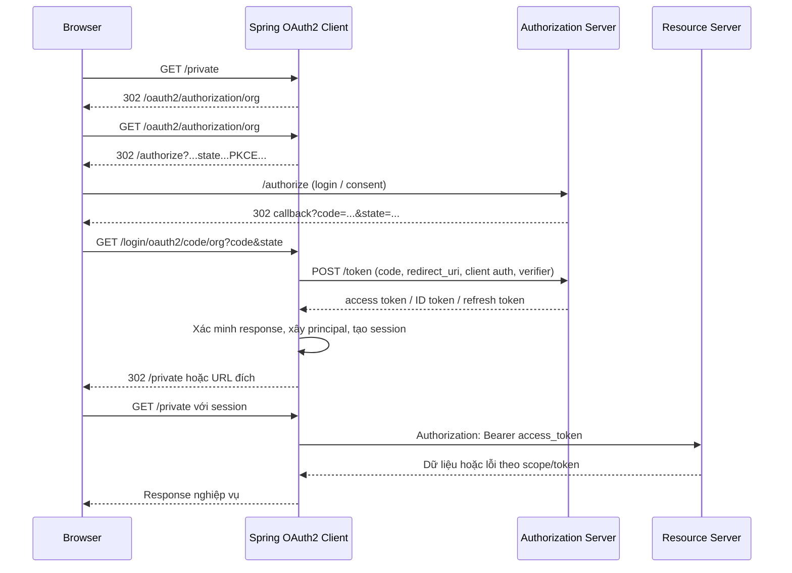

# Phân biệt kiểm thử ứng dụng OAuth2 với chứng nhận tuân thủ toàn bộ giao thức

Một bộ test OAuth2 có thể chạy xanh hàng nghìn ca mà ứng dụng vẫn xử lý sai một bước quan trọng trong luồng **Authorization Code + PKCE**. Ngược lại, một ứng dụng đã tích hợp thành công với một nhà cung cấp danh tính (Identity Provider, IdP) cũng chưa chắc đáp ứng mọi yêu cầu trong chuẩn OAuth 2.0, OpenID Connect hoặc một cấu hình bảo mật như FAPI 2.0. Hai loại bằng chứng này trả lời **những câu hỏi khác nhau**.

Trong chương **Luồng OAuth2 thực** của module **SPRING_SECURITY_TESTING**, người học kiểm chứng xác thực, phân quyền và bảo vệ HTTP trên ứng dụng Spring Security Servlet và Reactive bằng `spring-security-test`, `MockMvc`, `WebTestClient`, `@WithMockUser`, `SecurityContext` và các công cụ giả lập JWT/OAuth2/OIDC. Bài này hướng dẫn cách dùng đúng từng lớp kiểm thử, đọc chính xác ý nghĩa của kết quả `PASS`, thiết kế thử nghiệm luồng OAuth2 thật với authorization server có thể kiểm soát, và hiểu khi nào cần bộ kiểm thử conformance/chứng nhận độc lập.

> **Quy tắc quan trọng:** `oauth2Login()`/`oidcLogin()` trong test giúp tạo một người dùng đã đăng nhập để kiểm tra ứng dụng. Chúng **không thực hiện toàn bộ luồng OAuth2/OIDC**. Một bài test có redirect thật, trao đổi authorization code và xác minh token chứng minh được các nhánh mà bài đó đã chạy; nó **không tự tạo ra chứng nhận tuân thủ toàn bộ giao thức**.

## 1. Ba câu hỏi phải tách riêng trước khi viết test

Hãy xem một hệ thống báo cáo có nút **Đăng nhập bằng tổ chức**. Ứng dụng dùng Spring Security để chuyển người dùng tới authorization server, nhận `code`, lấy token, thiết lập session và gọi một resource server.

### Câu hỏi A — Logic ứng dụng có đúng không?

Các ví dụ:

- Khi principal có quyền `REPORT_VIEWER`, endpoint `/api/reports` trả dữ liệu đúng.
- Khi principal thiếu quyền, ứng dụng trả `403` và không sửa dữ liệu.
- Khi `OidcUser` có `sub=alice` và `email_verified=false`, ứng dụng không tự cấp quyền quản trị.
- Khi `OAuth2AuthorizedClient` có scope `reports.read`, service sử dụng đúng token tương ứng để gọi API; không trộn token giữa các principal.

Có thể kiểm chứng những điều này bằng test controller/service với `@WithMockUser`, `.with(oauth2Login())`, `.with(oidcLogin())`, `.with(oauth2Client())`, `.with(jwt())`, hoặc trên WebFlux bằng các biến thể `mock...()`.

Kết luận hợp lệ: *“Với security context và dữ liệu giả lập được thiết lập như trên, ứng dụng thực hiện chính sách A/B.”* Chưa có bằng chứng authorization server đã xác thực người dùng, cấp token hoặc kiểm PKCE.

### Câu hỏi B — Luồng tích hợp OAuth2/OIDC thực tế có chạy đúng không?

Các ví dụ:

- Browser được redirect đến authorization endpoint với `client_id`, `redirect_uri`, `response_type=code`, `scope`, `state` và PKCE khi cần.
- Callback sử dụng đúng transaction/session đã khởi tạo; `state` không hợp lệ bị từ chối.
- Authorization code được đổi ở token endpoint bằng client authentication và `code_verifier` phù hợp.
- JWT ID token/access token được kiểm tra bằng đúng issuer, audience, chữ ký, thời hạn và nonce khi áp dụng.
- Spring Security thiết lập session, principal, authorities và lưu `OAuth2AuthorizedClient` đúng với giao dịch thành công.
- Login lỗi, callback giả, code bị tái sử dụng, token lỗi hoặc thiếu quyền bị từ chối an toàn.

Muốn trả lời câu hỏi này, phải chạy request **qua các filter và client/provider thực**, dùng một authorization server test hoặc HTTP endpoint giả lập trả response như giao thức, đồng thời quan sát các request/response trên các ranh giới. Đây là **integration test hoặc E2E test cho ứng dụng**.

### Câu hỏi C — Một triển khai có tuân thủ một profile tiêu chuẩn và đủ điều kiện chứng nhận không?

Ví dụ: một **OpenID Connect Relying Party**, **OpenID Provider**, hoặc **OAuth2 Client/Authorization Server theo FAPI 2.0** muốn được đánh giá trên bộ ca tương ứng của profile được chọn.

Câu hỏi này đòi hỏi tiêu chí chính thức của profile, bộ kiểm thử conformance phù hợp với vai trò, phạm vi triển khai, những ca âm tính, quy trình xem xét và nộp kết quả nếu muốn được chứng nhận. Một tích hợp chạy với một IdP hoặc một bộ test tự viết không thay thế được việc đó.

| Cấp kiểm chứng | Đối tượng | Câu hỏi chính | Kết luận hợp lệ |
|---|---|---|---|
| Unit/component | Service, converter, controller | Xử lý principal, scope và quyền có đúng? | Logic ứng dụng đúng với fixture |
| Spring MVC/WebFlux security test | Endpoint + filter áp dụng với mock principal | HTTP authorization đúng khi đã có authentication? | Quy tắc request hoạt động trong cấu hình test |
| Integration test OAuth2 | Client/filter + authorization/token/JWKS/userinfo endpoints | Luồng được cấu hình có chạy đúng với provider test? | Luồng được thử và các bất biến đã assert là đúng |
| E2E với IdP mục tiêu | Browser + ứng dụng + IdP + resource server | Triển khai của hai bên tương tác đúng trong môi trường đã thử? | Tích hợp liên hệ thống chạy trong kịch bản được thử |
| Conformance test theo profile | Vai trò/protocol cụ thể được đánh giá bằng test suite có quy định | Các yêu cầu của **profile đã chọn** có được đáp ứng? | Kết quả conformance theo profile và phiên bản test |
| Chứng nhận chính thức | Triển khai được nộp và chấp thuận theo quy trình của tổ chức chứng nhận | Có đáp ứng điều kiện chứng nhận cụ thể không? | Chỉ tuyên bố certified khi đã hoàn tất quy trình |

Không tồn tại phép suy luận: `tất cả unit test PASS` ⇒ `OAuth2 compliant`; hoặc `IdP X login PASS` ⇒ `OIDC/FAPI certified`.

## 2. Hiểu đúng các vai trò của giao thức

Trong cùng một hệ thống, “ứng dụng OAuth2” có thể chỉ nhiều vai trò:

| Vai trò | Trách nhiệm tiêu biểu | Ranh giới cần test |
|---|---|---|
| **OAuth2 Client** | Khởi tạo authorization, gửi token request, quản lý access/refresh token | Redirect, code exchange, token storage, outbound Bearer |
| **Authorization Server (AS)** | Xác thực/grant authorization, cấp và quản lý token | PKCE, redirect URI, client binding, code reuse, token endpoint |
| **Resource Server (RS)** | Bảo vệ API và xác minh token/authority | Chữ ký hoặc introspection, issuer/audience, scope, resource ownership |
| **OpenID Connect Relying Party (RP)** | Đăng nhập người dùng dựa trên ID token/UserInfo | `sub`, `iss`, `aud`, nonce, session, identity mapping |
| **OpenID Provider (OP)** | Cung cấp chức năng danh tính theo OIDC | Discovery, ID token, UserInfo, xác thực người dùng và các profile hỗ trợ |

Một ứng dụng Spring Boot có thể đóng **nhiều vai trò**: làm OAuth2 Client đăng nhập bằng IdP, đồng thời là Resource Server cho API nội bộ. Kiểm thử client login không tự kiểm thử decoder của resource server; kiểm thử API JWT không tự chứng minh code exchange hoặc callback OIDC.

**Ví dụ:** `GET /api/private` với `.with(jwt().authorities(...))` chứng minh phép so khớp quyền trên API nhưng không chứng minh luồng đăng nhập bằng Google/Keycloak/IdP của tổ chức. Ngược lại, đăng nhập thành công bằng IdP chưa chứng minh mọi API của hệ thống đã phân quyền theo chủ sở hữu tài nguyên.

## 3. Nhận diện các công cụ `spring-security-test` và điểm dừng của chúng

Trong ứng dụng Servlet:

```java
// Giả lập principal có role.
mockMvc.perform(get("/api/reports")
        .with(user("alice").roles("REPORT_VIEWER")))
    .andExpect(status().isOk());

// Giả lập OAuth2 login đã hoàn tất.
mockMvc.perform(get("/api/me")
        .with(oauth2Login()
                .attributes(attrs ->
                        attrs.put("sub", "alice"))))
    .andExpect(status().isOk());

// Giả lập OIDC principal đã đăng nhập.
mockMvc.perform(get("/api/me/oidc")
        .with(oidcLogin()
                .idToken(idToken ->
                        idToken.claim("sub", "alice"))))
    .andExpect(status().isOk());

// Giả lập một JWT authentication của resource server.
mockMvc.perform(get("/api/reports")
        .with(jwt().authorities(
                new SimpleGrantedAuthority(
                        "SCOPE_reports.read"))))
    .andExpect(status().isOk());
```

Các static import tiêu biểu:

```java
import static org.springframework.security.test.web.servlet.request
        .SecurityMockMvcRequestPostProcessors.user;
import static org.springframework.security.test.web.servlet.request
        .SecurityMockMvcRequestPostProcessors.oauth2Login;
import static org.springframework.security.test.web.servlet.request
        .SecurityMockMvcRequestPostProcessors.oidcLogin;
import static org.springframework.security.test.web.servlet.request
        .SecurityMockMvcRequestPostProcessors.jwt;
import static org.springframework.test.web.servlet.request
        .MockMvcRequestBuilders.get;
import static org.springframework.test.web.servlet.result
        .MockMvcResultMatchers.status;
```

Ví dụ dùng `.with(...)` là các **request post-processors**. Chúng tạo authentication hoặc authorized client phục vụ test, bỏ qua một phần giao thức dùng để có được trạng thái ấy. Các endpoint minh họa phải tồn tại và chính sách quyền phải khớp fixture thì mới chạy được assertion.

Với WebFlux:

```java
client.mutateWith(mockOAuth2Login()
        .attributes(attrs -> attrs.put("sub", "alice")))
    .get()
    .uri("/api/me")
    .exchange()
    .expectStatus().isOk();

client.mutateWith(mockOidcLogin()
        .idToken(idToken -> idToken.claim("sub", "alice")))
    .get()
    .uri("/api/me/oidc")
    .exchange()
    .expectStatus().isOk();

client.mutateWith(mockJwt()
        .authorities(new SimpleGrantedAuthority(
                "SCOPE_reports.read")))
    .get()
    .uri("/api/reports")
    .exchange()
    .expectStatus().isOk();
```

Các static import tương ứng từ `SecurityMockServerConfigurers`: `mockOAuth2Login`, `mockOidcLogin` và `mockJwt`. Đây là ví dụ cho `WebTestClient` **được bind vào Spring Security test server/application context**; không tự áp một security context giả lập lên một remote server chạy ở máy khác.

### Điều được và chưa được chứng minh

| Lệnh test | Chứng minh được | Chưa chứng minh được |
|---|---|---|
| `@WithMockUser` | Rule với `Authentication` kiểu mock user | OAuth2 redirect, code exchange, token validation |
| `oauth2Login()` | Controller/filter nhận `OAuth2User` và ứng dụng xử lý attributes/authorities | Login ngoài mạng, IdP, PKCE, `state`, token endpoint |
| `oidcLogin()` | Controller/filter nhận `OidcUser`, app đọc ID token/UserInfo fixture | Chữ ký ID token thật, nonce, issuer, audience |
| `oauth2Client()` | App đọc `OAuth2AuthorizedClient` đã được chuẩn bị | Token endpoint thực sự cấp/refresh token |
| `jwt()` | Authorization khi có `JwtAuthenticationToken` dựng sẵn | JWT decoder, chữ ký, validator, issuer, audience |
| `mockOAuth2Login()`/`mockOidcLogin()` | Tương tự trong WebFlux test | Giao thức redirect/token validation thực |
| `mockJwt()` | Authorization ở Reactive | Token trên HTTP có hợp lệ hay không |

Các lớp test trên hoàn toàn hợp lệ và nên giữ trong CI. Điều cần sửa là **cách đặt tên test và kết luận**. Đặt tên `oidcUserWithUnverifiedEmailIsDenied` thay vì `allOidcSecurityIsCompliant` nếu test chỉ xử lý một claim.

## 4. Ví dụ ứng dụng: kiểm tra quyết định phân quyền khi đã đăng nhập

Giả sử ứng dụng có endpoint `/api/profile/subject` dùng claim `sub` của OIDC principal. Đây là mã minh họa nhỏ cho Spring MVC:

```java
@RestController
@RequestMapping("/api/profile")
class ProfileController {

    @GetMapping("/subject")
    Map<String, String> subject(
            @AuthenticationPrincipal OidcUser user) {
        return Map.of("subject", user.getSubject());
    }
}
```

Cấu hình yêu cầu authentication:

```java
@Bean
SecurityFilterChain securityFilterChain(HttpSecurity http)
        throws Exception {

    return http
        .authorizeHttpRequests(auth -> auth
            .requestMatchers("/api/profile/**")
                .authenticated()
            .anyRequest().denyAll())
        .oauth2Login(Customizer.withDefaults())
        .build();
}
```

Test MVC:

```java
@SpringBootTest
@AutoConfigureMockMvc
class ProfileAuthorizationIT {

    @Autowired
    MockMvc mockMvc;

    @Test
    void loggedInOidcUserSeesOwnSubject() throws Exception {
        mockMvc.perform(get("/api/profile/subject")
                    .with(oidcLogin()
                        .idToken(token ->
                            token.claim("sub", "alice"))))
                .andExpect(status().isOk())
                .andExpect(jsonPath("$.subject")
                        .value("alice"));
    }
}
```

Các import chính:

```java
import java.util.Map;
import org.junit.jupiter.api.Test;
import org.springframework.beans.factory.annotation.Autowired;
import org.springframework.boot.test.autoconfigure.web.servlet.AutoConfigureMockMvc;
import org.springframework.boot.test.context.SpringBootTest;
import org.springframework.security.core.annotation.AuthenticationPrincipal;
import org.springframework.security.oauth2.core.oidc.user.OidcUser;
import org.springframework.web.bind.annotation.GetMapping;
import org.springframework.web.bind.annotation.RequestMapping;
import org.springframework.web.bind.annotation.RestController;
import org.springframework.security.config.Customizer;
import org.springframework.security.web.SecurityFilterChain;
import org.springframework.security.config.annotation.web.builders.HttpSecurity;
import static org.springframework.security.test.web.servlet.request
        .SecurityMockMvcRequestPostProcessors.oidcLogin;
import static org.springframework.test.web.servlet.request
        .MockMvcRequestBuilders.get;
import static org.springframework.test.web.servlet.result
        .MockMvcResultMatchers.jsonPath;
import static org.springframework.test.web.servlet.result
        .MockMvcResultMatchers.status;
```

Cấu hình trên minh họa một ứng dụng đã có `ClientRegistration` tương ứng để khởi tạo OAuth2 login. Nếu chưa có `ClientRegistrationRepository`, cần cấu hình client test thích hợp; bài test `oidcLogin()` không thay thế yêu cầu nạp ApplicationContext.

Kết quả `200`, `{"subject":"alice"}` chứng minh controller đọc claim của **một principal giả lập**. Nó không chứng minh `alice` từng đăng nhập qua IdP, ID token có chữ ký đúng hay callback có `state`/`nonce` hợp lệ.

### Một ca âm tính ở tầng ứng dụng

Giả sử chính sách nghiệp vụ chỉ cho người có `email_verified=true` xem lịch sử thanh toán. Dịch vụ nên kiểm tra thuộc tính này và quyền đối tượng theo hợp đồng nội bộ:

```java
boolean allowed =
        Boolean.TRUE.equals(
                oidcUser.getIdToken()
                        .getClaim("email_verified"))
        && billingService.canView(
                oidcUser.getSubject(), invoiceId);
```

Dùng hai fixture OIDC:

```java
// Đầu vào giả lập email chưa xác minh.
.with(oidcLogin()
    .idToken(t -> t.claim("email_verified", false)))

// Đầu vào giả lập email đã xác minh.
.with(oidcLogin()
    .idToken(t -> t.claim("email_verified", true)))
```

Test phải assert kết quả nghiệp vụ được phép/bị cấm và trạng thái DB. Cả hai fixture **đều không chứng minh** IdP đã ký claim `email_verified` hoặc ứng dụng đã xác minh ID token ngoài đời.

## 5. Authorization Code + PKCE: những bước không xuất hiện trong mock login

Một luồng ứng dụng web OAuth2/OIDC thường gồm:



Không phải ứng dụng nào cũng gọi resource server ngay sau login; sơ đồ mô tả một trường hợp đầy đủ. Khi test OAuth2 Client, các nhánh quan trọng nằm ở **redirect**, **callback**, **token endpoint**, **user identity mapping**, **lưu token** và **gọi API ra ngoài**.

Nếu bài test bắt đầu bằng:

```java
mockMvc.perform(get("/private").with(oidcLogin()));
```

thì toàn bộ đoạn từ `/authorize` đến `/token` trong sơ đồ đã được **thay thế bằng fixture**. Đó là chủ đích tốt khi test business logic; đó cũng là lý do không được dùng test này để kết luận giao thức đã được triển khai đúng toàn bộ.

## 6. Kiểm thử điểm khởi tạo redirect với cấu hình Spring thật

Trước khi thử callback, có thể xác minh ứng dụng thực xây authorization request như thế nào.

```java
@SpringBootTest
@AutoConfigureMockMvc
class OAuth2RedirectIT {

    @Autowired
    MockMvc mockMvc;

    @Test
    void startsAuthorizationCodeFlow() throws Exception {
        MvcResult result =
                mockMvc.perform(
                        get("/oauth2/authorization/org"))
                    .andExpect(status().is3xxRedirection())
                    .andReturn();

        String location =
                result.getResponse().getRedirectedUrl();

        assertThat(location).isNotBlank();
        URI redirect = URI.create(location);

        assertThat(redirect.getScheme())
                .isEqualTo("https");
        assertThat(redirect.getRawQuery())
                .contains("response_type=code")
                .contains("client_id=")
                .contains("state=")
                .contains("redirect_uri=");
    }
}
```

Ví dụ giả định `registrationId=org`, endpoint này được xử lý bởi OAuth2 Authorization Request Redirect Filter và client registration hợp lệ đã cấu hình. Spring MVC có thể tạo redirect tới authorization endpoint của IdP mà **không thực hiện HTTP call đến IdP** trong chính bài test này. Khi dự án dùng scheme riêng cho IdP giả lập cục bộ, thay kỳ vọng `https` bằng scheme được định nghĩa hợp lệ trong môi trường test.

Các import bổ sung:

```java
import java.net.URI;
import org.springframework.test.web.servlet.MvcResult;
import static org.assertj.core.api.Assertions.assertThat;
import static org.springframework.test.web.servlet.request
        .MockMvcRequestBuilders.get;
import static org.springframework.test.web.servlet.result
        .MockMvcResultMatchers.status;
```

Test trên chứng minh **cấu hình redirect đầu vào**, chưa chứng minh server nhận request hay callback được xử lý. Để tăng giá trị của test:

- Parse query parameters thành cấu trúc để kiểm **giá trị** `client_id`, `redirect_uri`, `scope` và `response_type`, không chỉ kiểm sự có mặt.
- Lấy `state` của lần thứ nhất, khởi tạo lần thứ hai và xác minh tính khác nhau theo thiết kế; không hardcode giá trị `state`.
- Nếu ứng dụng áp dụng PKCE, xác minh có `code_challenge` và `code_challenge_method=S256`, đồng thời chứng minh `code_verifier` tương ứng chỉ xuất hiện ở token request. Không giả định mọi confidential client đều tự bật PKCE khi không cấu hình.
- Kiểm tra callback/redirect URI phải là URI đã đăng ký với IdP theo cấu hình; không được biến một tham số người dùng điều khiển thành open redirect.
- Nếu ứng dụng có nhiều IdP, xác minh mỗi registration dùng authorization/token endpoint và issuer tương ứng, không trộn giao dịch giữa hai nhà cung cấp.

Theo [OAuth 2.0 Security Best Current Practice, RFC 9700](https://www.rfc-editor.org/rfc/rfc9700.html), public clients phải sử dụng PKCE cho authorization code; confidential clients được khuyến nghị sử dụng PKCE, và authorization servers phải hỗ trợ PKCE. Cùng tài liệu nêu yêu cầu bảo vệ callback chống CSRF, so khớp redirect URI chính xác (với ngoại lệ được chỉ định) và phòng chống mix-up khi tương tác nhiều authorization server. **Một redirect có chứa tham số PKCE chưa chứng minh token endpoint đã kiểm chứng `code_verifier`.**

## 7. Kiểm thử callback và trao đổi code bằng authorization server test

Đây là cấp độ khác hẳn `.with(oauth2Login())`. Bạn cần mô phỏng **giao thức HTTP** ở ranh giới IdP, trong khi để code Spring Security làm việc thật. Có thể dùng một authorization server cục bộ hoặc HTTP stub/JWKS server ở loopback, phù hợp với các tính năng mà ứng dụng cần.

### 7.1. Luồng kiểm thử đề nghị

1. Nạp cấu hình `ClientRegistration` thật của ứng dụng với issuer/authorization/token/UserInfo/JWKS URL được trỏ tới các endpoint test.
2. Tạo HTTP session/browser giả lập còn lưu cookie và state xuyên các request.
3. Gọi `/oauth2/authorization/org`, bắt redirect, trích `state`, `redirect_uri`, PKCE challenge và các tham số khác.
4. Cho browser gửi authorization request tới authorization server test.
5. Server test cấp một authorization code **đúng giao dịch** và redirect browser về callback với `code` và `state`.
6. Gọi callback vào Spring Security với cùng session đã khởi tạo; theo dõi token request tới server test.
7. Server test xác minh code, client binding, redirect URI và PKCE theo chính sách rồi trả token response.
8. Nếu dùng OIDC, client tải JWKS/metadata hoặc dùng thông tin cấu hình đã có, xác minh ID token, nonce, issuer/audience, lấy UserInfo nếu ứng dụng yêu cầu.
9. Assert session/principal/authorities/authorized client được tạo; gọi một endpoint được bảo vệ để chứng minh login hoạt động sau callback.
10. Chạy các ca lỗi riêng biệt: state sai, code sai/hết hạn/tái sử dụng, token endpoint lỗi, ID token chữ ký sai/nonce sai, userinfo mâu thuẫn, quyền bị thu hẹp.

**Mục tiêu quan sát** là request và response đi qua đúng bộ lọc/filter, converter và manager của ứng dụng. Không tự dựng `OAuth2AuthenticationToken` cho bước cuối nếu đang muốn kiểm chứng code exchange thật, vì làm vậy loại bỏ chính phần cần thử.

### 7.2. HTTP stub là bằng chứng ở đâu?

Nếu sử dụng `MockWebServer`, WireMock hoặc một authorization server riêng trong container, có thể kiểm tra HTTP request tới token endpoint:

```text
POST /oauth2/token
Content-Type: application/x-www-form-urlencoded

grant_type=authorization_code
&code=code-for-current-session
&redirect_uri=https%3A%2F%2Fclient.example.invalid%2Flogin%2Foauth2%2Fcode%2Forg
&code_verifier=<verifier tương ứng nếu dùng PKCE>
```

Ở ví dụ, cách client authentication (HTTP Basic, `private_key_jwt`, mTLS...) phụ thuộc vào `ClientRegistration` và profile được chọn. Không ép gửi `client_secret` trong body nếu policy sử dụng phương thức khác.

Nếu stub chỉ trả token mới mà **không kiểm giá trị `code_verifier`**, test dương có thể chứng minh Spring gửi request chứa trường ấy, nhưng không chứng minh authorization server thực thi PKCE. Khi cần kiểm tra PKCE end-to-end, authorization server test phải từ chối verifier sai, hoặc một test conformance phù hợp phải đánh giá authorization server.

### 7.3. Những phản hồi lỗi tối thiểu cần kiểm tra

| Biến thể | Phía tạo lỗi | Kỳ vọng ở Spring Client | Điều có thể chứng minh |
|---|---|---|---|
| Callback sai `state` | Browser/test | Bị từ chối, không tạo session xác thực mới | Client kiểm liên kết state/giao dịch |
| Callback không có session khởi tạo | Browser/test | Không chấp nhận một code không thuộc transaction | Client không tin code độc lập |
| Token endpoint trả `invalid_grant` | AS test | Login không thành công; không lưu authorized client hợp lệ | Xử lý lỗi đổi code |
| Token endpoint timeout | AS test | Xử lý lỗi kiểm soát được; không coi login thành công | Xử lý lỗi mạng |
| ID token ký bằng khóa khác | OP test | OIDC login bị từ chối | Client xác minh chữ ký |
| ID token `iss`/`aud` sai | OP test | OIDC login bị từ chối | Client xác minh issuer/audience |
| ID token nonce sai, khi flow dùng nonce | OP test | OIDC login bị từ chối | Client kiểm nonce đúng transaction |
| UserInfo có `sub` không khớp ID token | OP test | Không liên kết sai người dùng | Client đối chiếu danh tính OIDC |
| Token response thiếu dữ liệu bắt buộc | AS test | Không chấp nhận response lỗi | Client xử lý cấu trúc response |

Không tuyên bố một test `state` sai chứng minh toàn bộ CSRF protection nếu chưa thử session binding, nhiều tab, replay và các nguồn callback khác. Tương tự, một test nonce sai chưa chứng minh toàn bộ kiểm tra OIDC ID token.

### 7.4. OAuth2 không đồng nhất với OIDC

**OAuth2** chủ yếu quy định ủy quyền cấp token cho client. **OIDC** bổ sung lớp xác thực danh tính người dùng với ID token và các yêu cầu như `sub`, validation ID token, nonce tùy luồng, UserInfo và discovery. Vì vậy:

- Test `.with(oauth2Login())` không tự kiểm chứng OIDC ID token.
- Test `.with(oidcLogin())` chỉ cung cấp `OidcUser` giả lập; không gọi issuer/JWKS thật.
- Một JWT access token hợp lệ không mặc định là **ID token** hợp lệ để đăng nhập.
- Một ID token hợp lệ không mặc định là **access token** được resource server chấp nhận.

Khi hệ thống dùng OIDC, thiết kế ca riêng cho việc **liên kết user theo `(issuer, subject)`**, tránh dùng email như định danh duy nhất khi policy không cho phép; email có thể thay đổi hoặc chưa xác minh.

## 8. Phân biệt kiểm thử ứng dụng Client với kiểm thử Authorization Server

Giả sử ứng dụng Spring OAuth2 Client gửi code verifier đúng và đã đăng nhập thành công với một authorization server test. Điều đó không chứng minh authorization server mục tiêu:

- luôn từ chối `redirect_uri` không khớp;
- gắn authorization code đúng client/redirect URI;
- chặn việc dùng lại authorization code;
- kiểm tra PKCE trên token endpoint cho mọi public client;
- bảo vệ refresh token và phát hiện rotation/reuse theo profile;
- thực thi đầy đủ consent và chính sách scope.

Những trách nhiệm đó nằm ở **AS**, không nằm ở controller của client.

Ví dụ test OAuth2 Client:

```java
// Chỉ kiểm rằng client gửi code_verifier trong request token.
// Chưa kiểm AS có thật sự từ chối verifier sai hay không.
assertThat(tokenRequestBody)
        .contains("grant_type=authorization_code")
        .contains("code_verifier=");
```

Một test dành cho Authorization Server phải tạo hai giao dịch với code challenge khác nhau, gửi verifier sai tới token endpoint và xác minh server **từ chối** theo giao thức; sau đó kiểm code không thể bị đổi trái phép. Đây là test cho **bên cấp token**, không thể thay bằng `.with(oauth2Login())`.

### Cùng lỗi, hai nơi chịu trách nhiệm

| Lỗ hổng | Test ở Client | Test ở Authorization Server |
|---|---|---|
| PKCE | Client phát challenge/verifier đúng transaction | Server kiểm verifier, chống downgrade và injection |
| `redirect_uri` | Client gửi URI đã đăng ký, không open redirect | Server đối chiếu URI theo chính sách |
| `state` | Client gắn callback vào transaction/user agent | AS trả state theo request; trách nhiệm CSRF client vẫn phải tự thực thi |
| Authorization code | Client đổi code một lần, xử lý lỗi/replay | AS ràng buộc code với client/redirect và chặn reuse |
| Client authentication | Client dùng đúng phương thức được đăng ký | AS từ chối client chưa xác thực/sai khóa |
| Scope | Client yêu cầu và xử lý scope được cấp | AS giới hạn cấp scope theo policy |
| Access token | Client lưu/gửi token đúng | RS/AS xác minh, thu hồi hoặc introspection theo kiến trúc |

Khi cần đánh giá **toàn bộ giao thức**, phải xác định chính xác sản phẩm đang là Client, AS, RS, OP hay RP; những profile nào được tuyên bố hỗ trợ; và bộ kiểm thử nào bao phủ từng bên.

## 9. Khi nào gọi là conformance test?

**Conformance** nghĩa là một triển khai được đánh giá trên **các yêu cầu xác định của một tiêu chuẩn/profile và vai trò cụ thể**, với tập ca kiểm thử phù hợp. Trong bối cảnh OAuth2/OIDC, yêu cầu có thể đến từ RFC nền tảng, OAuth Security Best Current Practice (BCP), OIDC Core/Discovery hoặc một security profile như FAPI.

Ví dụ:

- Một **OIDC Relying Party** cần test các chức năng của RP theo profile áp dụng.
- Một **OpenID Provider** cần test các yêu cầu của OP, bao gồm phát hành ID token và metadata nếu profile yêu cầu.
- Một **FAPI 2.0 OAuth Client** phải được đánh giá theo profile client tương ứng với các cơ chế bảo mật mà profile đó yêu cầu.
- Một **FAPI 2.0 Authorization Server** phải được đánh giá theo profile AS riêng; việc client hoạt động với AS không tự chứng minh AS đủ conformance.

**Không có một bộ “test OAuth2” duy nhất chứng nhận mọi vai trò, mọi grant, mọi extension và mọi môi trường**. Một profile có thể chỉ áp dụng một tập grant, client authentication, token type, endpoint và security feature nhất định.

### 9.1. OpenID Foundation có bộ công cụ và quy trình riêng

OpenID Foundation công bố bộ **conformance testing** và chương trình **certification** cho những profile được hỗ trợ. Bộ test này có thể giả lập OP/AS để đánh giá RP/Client, hoặc đóng vai client để đánh giá OP/AS, tùy vai trò. Người triển khai chọn test plan/profile, cấu hình endpoint, chạy toàn bộ test được yêu cầu, xem kết quả và thực hiện các bước nộp/xem xét theo chương trình chứng nhận nếu muốn sử dụng tuyên bố/nhãn chứng nhận.

Tài liệu tham khảo:

- [OpenID Foundation — Certification](https://openid.net/certification/)
- [OpenID Foundation — Testing OpenID Connect Relying Parties](https://openid.net/certification/connect_rp_testing/)
- [OpenID Foundation — Testing OpenID Connect Providers](https://openid.net/certification/connect_op_testing/)
- [OpenID Foundation — How to certify your implementation](https://openid.net/certification/how-to-certify-your-implementation/)

Việc **chạy thử một số ca** của conformance suite và việc **được chứng nhận** là hai trạng thái khác nhau. Chỉ tuyên bố “OpenID Certified” hoặc một chứng nhận FAPI tương ứng sau khi có kết quả và quy trình chấp thuận hợp lệ cho đúng **sản phẩm, phiên bản và profile**. Tài liệu/chi phí/quy trình có thể được tổ chức chứng nhận cập nhật, nên tham chiếu trang chính thức khi chuẩn bị nộp.

### 9.2. FAPI 2.0 không đồng nghĩa OAuth2 thông thường

[FAPI 2.0 Security Profile](https://openid.net/specs/fapi-security-profile-2_0-final.html) hướng đến các API đòi hỏi mức bảo mật cao, có những yêu cầu cụ thể như sender-constrained access token bằng DPoP hoặc mTLS, cơ chế client authentication phù hợp, ràng buộc chặt với metadata và các biện pháp chống tấn công theo profile.

Một ứng dụng đăng nhập bằng `oauth2Login()` và nhận `200` **không tự động đạt FAPI**. Cả một luồng Authorization Code + PKCE chạy thật cũng chưa đủ nếu profile đòi hỏi thêm sender-constrained token, PAR/JAR/JARM hoặc các cơ chế khác tùy profile đã chọn.

OpenID Foundation đã công bố bộ test/chứng nhận cho FAPI 2.0 Security Profile và Message Signing với phạm vi vai trò/profile rõ ràng. Khi có yêu cầu FAPI, cần xác định phiên bản final của profile và test plan tương ứng, không thêm nhãn “FAPI compliant” cho một bộ test Spring Security thông thường.

### 9.3. OAuth Security BCP là tiêu chuẩn thực hành an toàn, không phải giấy chứng nhận chung

[RFC 9700 — Best Current Practice for OAuth 2.0 Security](https://www.rfc-editor.org/rfc/rfc9700.html) là tài liệu BCP (cập nhật hướng dẫn bảo mật cho OAuth2). Nó nêu các ràng buộc và khuyến nghị như bảo vệ redirect, PKCE, tránh các grant kém an toàn, xử lý CSRF/mix-up và quản lý token.

Kiểm tra theo RFC/BCP rất có giá trị, nhưng kết quả của một bộ test nội bộ **không tự sinh ra “chứng nhận RFC 9700”**. Khi báo cáo, hãy nói chính xác các yêu cầu/điều khoản đã kiểm thử và giới hạn thử nghiệm.

## 10. Ma trận bằng chứng theo lớp bảo vệ

Để một báo cáo kiểm thử có ích, mỗi dòng nên ghi **cơ chế**, **vị trí kiểm**, **dữ liệu đầu vào**, **kỳ vọng** và **giới hạn**.

| Hành vi cần chứng minh | Test phù hợp | Dữ liệu/thao tác | Kết luận được phép |
|---|---|---|---|
| Endpoint chỉ cho `REPORT_VIEWER` | MockMvc với `@WithMockUser`/`oidcLogin()` | Authorities hợp lệ và thiếu quyền | Rule endpoint hoạt động |
| Chỉ đọc hồ sơ của chính mình | Service/MockMvc integration + DB test | Alice truy cập dữ liệu Bob | Không vượt quyền đối tượng trong ca thử |
| Controller đọc `sub` OIDC đúng | `oidcLogin()` / `mockOidcLogin()` | Claim `sub=alice` | Logic mapping principal đúng |
| Redirect có `response_type=code` | MockMvc với config OAuth2 Client thật | `/oauth2/authorization/org` | URL khởi tạo được xây đúng |
| PKCE challenge phát ra | Integration với authorization-request resolver thật | Bắt redirect và session | Client tạo challenge theo policy |
| PKCE verifier được gửi | Fake AS/token endpoint nhận HTTP | Ghi token request | Client gửi verifier cho code đúng transaction |
| AS từ chối verifier sai | Test trên AS/conformance | Code/challenge/verifier không khớp | AS thực thi kiểm PKCE trong ca thử |
| Client chặn callback state sai | Integration với cùng session | Thay `state` ở callback | Client không chấp nhận giao dịch sai |
| ID token issuer sai bị chặn | OIDC integration, OP test | JWT ký hợp lệ nhưng `iss` khác | Client validator issuer hoạt động |
| JWT access token sai chữ ký bị chặn | Resource Server integration | Bearer token ký bằng khóa lạ | Decoder/validator chặn chữ ký sai |
| Scope thiếu trên outbound token | OAuth2 Client + downstream stub | Token không có `reports.read` | Cách client/RS xử lý scope trong ca thử |
| Token hết hạn được cấp lại | Authorized-client manager + token stub | Token cũ hết hạn, refresh token hợp lệ | Logic re-authorization hoạt động |
| Login với IdP thật | Browser E2E với môi trường test | Toàn bộ redirect/callback | Tích hợp của hai bên hoạt động trong môi trường thử |
| Đạt profile OIDC RP | Conformance suite dành cho RP | Toàn bộ test plan hiện hành | Mức conformance đúng profile |
| Đạt chứng nhận OIDC RP | Quy trình chứng nhận chính thức | Kết quả hợp lệ được nộp/chấp thuận | Có chứng nhận cho profile/triển khai cụ thể |

Một test có thể thuộc **nhiều lớp**, nhưng không nên mở rộng kết luận vượt những quan sát thật. Ví dụ test JWT chữ ký thật ở resource server không chứng minh logout OIDC, dynamic registration hoặc việc AS chống authorization code reuse.

## 11. Thực hành thiết kế một tầng integration test “luồng thật”

Dùng một authorization server test có thể điều khiển giúp cân bằng tốc độ và độ tin cậy. Cấu trúc bài test nên minh bạch:

```text
src/test/java/.../oauth2/
    LoginPolicyTest.java           (principal giả lập)
    AuthorizationRedirectIT.java   (Spring redirect thật)
    AuthorizationCodeFlowIT.java   (callback + token endpoint giả lập)
    OidcTokenValidationIT.java     (ID token/JWKS/claims có chữ ký)
    ResourceServerJwtIT.java       (Bearer JWT thật)
    AuthorizedClientRefreshIT.java (refresh provider/manager thật)
    BrowserLoginE2E.java           (nếu cần browser/IdP test)
```

Đây là cấu trúc gợi ý về loại test, không phải yêu cầu tạo các file trong bài STEP 4.

### 11.1. Chuẩn bị test IdP đúng mục tiêu

- Nếu mục tiêu chỉ là đọc **request của client**, một HTTP stub có thể đủ.
- Nếu cần thử code binding/PKCE/replay như một giao thức, dùng một **authorization server test có logic thực thi** các kiểm tra ấy hoặc conformance suite có ca tương ứng.
- Nếu cần xác minh ID token/JWKS, server có thể trả token **ký thật bằng khóa test**, app giữ decoder/validators production.
- Nếu cần chứng minh tương tác người dùng, dùng browser test có cookie, redirect và session; `MockMvc` cũng có thể kiểm nhiều request nhưng phải giữ session/correlation tương ứng.
- Nếu cần đánh giá interoperability với nhà cung cấp mục tiêu, thêm một suite E2E trên tenant/sandbox của IdP với credential test có vòng đời riêng.

### 11.2. Tách ca lỗi theo nguyên nhân

Một ca xấu nên làm **sai đúng một điều kiện**. Ví dụ để kiểm nonce sai, dùng ID token với chữ ký đúng, issuer/audience đúng, chưa hết hạn, nhưng nonce sai; nếu cùng lúc chữ ký sai, kết quả từ chối chưa chứng minh nonce đã được kiểm tra.

Tương tự, để kiểm anti-CSRF ở callback, đừng gửi request không có session *và* code không hợp lệ *và* state sai rồi chỉ assert login thất bại. Hãy tạo nhiều ca, mỗi ca giữ nguyên các điều kiện còn lại để biết cơ chế nào đang hoạt động.

### 11.3. Kiểm chứng hậu điều kiện

Với đăng nhập/ủy quyền thất bại, assert thêm:

- Không có `Authentication` đáng tin cậy mới được gắn cho session.
- Không lưu `OAuth2AuthorizedClient` hợp lệ từ token response đã bị từ chối.
- Không tạo liên kết tài khoản mới giữa user nội bộ và `sub` sai.
- Không lộ `authorization_code`, access/refresh token hoặc ID token trong body, log, cookie không phù hợp hoặc redirect ngoài phạm vi cho phép.
- Không phát event nghiệp vụ đăng nhập thành công khi xác thực thất bại.
- Không gọi resource server bằng token bị coi là không hợp lệ.

Dùng database/repository test hoặc spy ở đúng cổng ngoài để quan sát. Một status `401`/`403`/redirect thất bại tự nó chưa chứng minh các hậu điều kiện này.

## 12. Khác biệt Servlet và Reactive

| Chủ đề | Servlet | Reactive |
|---|---|---|
| Công cụ HTTP test | `MockMvc` | `WebTestClient` |
| Mock người dùng | `@WithMockUser`, `user()` | `mockUser()` hoặc annotation tương ứng tùy cách bind |
| OAuth2 Login giả lập | `oauth2Login()` | `mockOAuth2Login()` |
| OIDC Login giả lập | `oidcLogin()` | `mockOidcLogin()` |
| Authorized client giả lập | `oauth2Client()` | `mockOAuth2Client()` |
| JWT Authentication giả lập | `jwt()` | `mockJwt()` |
| Security config | `SecurityFilterChain` | `SecurityWebFilterChain` |
| Nơi giữ security context | Servlet security context | Reactor context |
| Thành phần authorized client | `OAuth2AuthorizedClientManager` | `ReactiveOAuth2AuthorizedClientManager` |

**Cả hai kiểu mock đều bỏ qua flow thật**. Vì vậy, muốn thử giao thức ở WebFlux cũng phải gửi Bearer header/JWT ký thật hoặc chạy redirect/token HTTP với authorization server test và bảo đảm request đi qua `SecurityWebFilterChain`.

Ví dụ Reactive:

```java
// Chính sách ứng dụng với principal giả lập:
client.mutateWith(mockOidcLogin()
        .idToken(token ->
                token.claim("sub", "alice")))
    .get()
    .uri("/api/profile")
    .exchange()
    .expectStatus().isOk();

// Luồng thực cần dùng HTTP và token do endpoint test phát:
client.get()
    .uri("/api/reports")
    .header(HttpHeaders.AUTHORIZATION,
            "Bearer " + signedTestAccessToken)
    .exchange()
    .expectStatus().isOk();
```

Đoạn thứ hai chỉ thực sự kiểm JWT validation nếu server đích là resource server được cấu hình decoder/validator thật; test phải cấp một JWT đã ký hợp lệ qua đường HTTP và có JWKS/keys tương ứng. Nếu không, `200` có thể đến từ cấu hình bỏ qua bảo mật, nên phải bổ sung các ca JWT sai chữ ký/scope bị từ chối.

Khi `WebTestClient` gửi HTTP đến một server đang chạy qua mạng (kể cả localhost), các đột biến security context kiểu `mockOidcLogin()` trên mock client không tự chuyển thành đăng nhập tại server. Dùng các API mock khi test bind vào ứng dụng cùng runtime và đã tích hợp `springSecurity()` phù hợp.

## 13. Những tuyên bố cần tránh trong tài liệu kiểm thử

| Tuyên bố quá rộng | Vì sao không đúng | Cách viết có căn cứ |
|---|---|---|
| “App tuân thủ OAuth2 vì mọi `@WithMockUser` test đều PASS.” | Không thử token/redirect/callback | “Rule của các endpoint đã kiểm thử hoạt động với mock principal.” |
| “OIDC login chuẩn vì `oidcLogin()` trả `200`.” | Đã dựng sẵn OIDC principal | “Controller xử lý các claims OIDC giả lập theo yêu cầu.” |
| “PKCE an toàn vì redirect có `code_challenge`.” | Chưa thử verifier/binding ở AS | “Client tạo challenge; AS enforcement cần test riêng.” |
| “Token được xác thực vì `.with(jwt())` thành công.” | Không chạy decoder thật | “Authorization đúng khi `JwtAuthenticationToken` được dựng trước.” |
| “Tích hợp với một IdP thành công nên hỗ trợ mọi IdP.” | Khác metadata, claims, phương thức auth | “Interop PASS với IdP X và cấu hình Y.” |
| “PASS 10 test OIDC nghĩa là OpenID Certified.” | Chứng nhận có profile, toàn test plan và quy trình | “10 ca nội bộ PASS; chưa có chứng nhận chính thức.” |
| “Ứng dụng được chứng nhận toàn bộ OAuth2.” | Chứng nhận dựa trên vai trò/profile cụ thể | “Triển khai X đạt chứng nhận profile Y theo hồ sơ Z.” |
| “Test FAPI bằng DPoP token mẫu là đủ.” | FAPI yêu cầu nhiều hành vi và thử nghiệm âm tính | “Đã thử cơ chế DPoP trong tình huống A; cần conformance test theo FAPI profile.” |
| “Response `403` chứng minh đã chặn mọi tác động.” | Có thể đã ghi DB hoặc phát sự kiện | “Đã kiểm response và các hậu điều kiện X, Y, Z.” |

Cách dùng từ cũng thể hiện mức độ kiểm chứng. `Tested`, `verified for scenarios`, `interoperable with`, `conformant to profile X` và `certified for profile X` có ý nghĩa khác nhau; chỉ dùng mỗi cụm khi có bằng chứng tương ứng.

## 14. Checklist lựa chọn bộ test cho dự án thực tế

Trước khi bắt đầu, trả lời:

1. **Vai trò:** Ứng dụng là Client, RS, AS, RP hay OP? Có bao nhiêu vai trò trong cùng codebase?
2. **Flow được hỗ trợ:** Authorization Code + PKCE, Client Credentials, refresh token, logout, OIDC UserInfo/Discovery? Những flow nào **thật sự bật**?
3. **Mối đe dọa:** CSRF callback, code injection, mix-up, replay, open redirect, token leakage, sai issuer/audience, thiếu quyền đối tượng?
4. **Test mục tiêu:** Chỉ business rules, tương tác HTTP, flow tích hợp hay conformance một profile chính thức?
5. **Ranh giới giả lập:** Principal và token nào được dựng sẵn? Thành phần nào phải chạy nguyên bản?
6. **Dữ liệu quan sát:** Redirect URL, session/state/nonce, token request, JWKS, principal, authority, DB và event?
7. **Ca âm tính:** Mỗi điều kiện lỗi có test riêng với các điều kiện khác hợp lệ không?
8. **Ca đối chứng dương:** Cùng route/flow với dữ liệu hợp lệ có thành công không?
9. **Bằng chứng kết quả:** Có log test đã che credential, cấu hình/profile, môi trường, phiên bản code và tập assertion rõ ràng không?
10. **Nhu cầu chứng nhận:** Có cần một profile OIDC/FAPI chính thức và nộp conformance results hay chỉ cần QA nội bộ?

### Ví dụ phân phối thời gian kiểm thử

| Mục tiêu | Tầng được ưu tiên | Tần suất hợp lý |
|---|---|---|
| Nhiều tổ hợp role/claim, kiểm HTTP status/data | `spring-security-test` với mock | Mỗi commit/PR |
| Redirect URI, state/PKCE wiring, converter, validation | Spring integration + IdP/JWKS test | Mỗi PR liên quan bảo mật; thường xuyên trên CI |
| Refresh token, token endpoint và API outbound | Integration với stub có kiểm request | Trên CI hoặc build integration |
| Browser, callback, cookie, session và IdP sandbox | Browser E2E | Build phù hợp hoặc lịch kiểm thử |
| Conformance theo profile | Suite chính thức | Theo vòng phát hành/chứng nhận và khi profile/triển khai thay đổi |

Tần suất là ví dụ cho một quy trình kỹ thuật, không phải yêu cầu tiêu chuẩn. Sự phù hợp phụ thuộc rủi ro hệ thống và chi phí chạy test; **không được thay lớp test conformance bằng hàng nghìn test mock** chỉ vì chúng chạy nhanh.

## 15. Bài thực hành: hai kết luận từ cùng một ứng dụng

Giả sử có một Spring Boot app dùng OIDC đăng nhập qua registration `org` và API `/api/reports` yêu cầu `ROLE_REPORT_VIEWER`.

**Bài A — Kiểm thử chính sách ứng dụng:**

- Dùng `.with(oidcLogin().authorities(new SimpleGrantedAuthority("ROLE_REPORT_VIEWER")))` để gọi `/api/reports`.
- Gọi lại cùng endpoint với authority khác; assert yêu cầu bị từ chối.
- Tạo hai fixture `sub=alice` và `sub=bob`; kiểm tra phân quyền đối tượng theo dữ liệu DB.
- Kiểm tra request bị từ chối không làm thay đổi dữ liệu và không rò rỉ tài nguyên.
- **Kết luận:** “Ứng dụng xử lý đúng các danh tính/quyền giả lập đã kiểm.”

**Bài B — Kiểm thử tích hợp luồng OAuth2/OIDC:**

- Dùng cấu hình `ClientRegistration` thật trỏ tới IdP test.
- Bắt redirect `/oauth2/authorization/org`, xác minh `response_type=code`, `state`, callback URI và PKCE nếu được dùng.
- Gọi callback với state sai, cùng session; assert không tạo login.
- Gọi callback hợp lệ, kiểm tra token request đến IdP test.
- Trả ID token ký thật với các claims hợp lệ rồi assert login, principal và session.
- Thử ID token sai issuer hoặc nonce (trong flow có nonce) và xác minh bị chặn.
- **Kết luận:** “Những bước luồng cụ thể đã chạy thật qua Spring Security và qua các thử nghiệm đã định.”

**Bài C — Đánh giá conformance:**

- Xác định ứng dụng là OIDC RP đang hỗ trợ profile nào.
- Chọn đúng conformance plan của OpenID Foundation, cấu hình RP đối diện với conformance suite.
- Chạy đủ các ca theo plan và lưu kết quả/evidence; xử lý các ca thất bại.
- Nếu cần tuyên bố được chứng nhận, hoàn thành quy trình chứng nhận của tổ chức.
- **Kết luận:** Chỉ nêu `conformant/certified` trong phạm vi profile, vai trò, phiên bản và quy trình có chứng cứ.

### Câu hỏi tự đánh giá

**1.** Test `.with(oidcLogin())` trả `200`: có chứng minh ID token đã được xác minh chữ ký không? **Không.** Test đã cung cấp OIDC principal giả lập.

**2.** HTTP redirect có `code_challenge_method=S256`: có chứng minh authorization server từ chối verifier sai không? **Không.** Phải thử token endpoint của AS tương ứng.

**3.** Đăng nhập thành công với IdP sandbox: ứng dụng có được tự gọi là “OpenID Certified” không? **Không.** Tích hợp thành công là bằng chứng interoperability cho các ca đã thử.

**4.** Unit test resource server dùng `.with(jwt())` nhận `403` khi thiếu scope: có chứng minh JWT có `aud` sai bị chặn trước authorization không? **Không.** Cần test token ký thật qua decoder và validator.

**5.** Bộ test conformance dùng để thử RP có thể chứng nhận OP không? **Không.** Mỗi vai trò/profile có test plan và điều kiện riêng.

## 16. Tài liệu chuẩn để đối chiếu

- [Spring Security — Testing OAuth 2.0 với MockMvc (Servlet)](https://docs.spring.io/spring-security/reference/servlet/test/mockmvc/oauth2.html)
- [Spring Security — Testing OAuth 2.0 với WebTestClient (Reactive)](https://docs.spring.io/spring-security/reference/reactive/test/web/oauth2.html)
- [Spring Security — OAuth 2.0 Client (Servlet)](https://docs.spring.io/spring-security/reference/servlet/oauth2/client/index.html)
- [RFC 6749 — The OAuth 2.0 Authorization Framework](https://www.rfc-editor.org/rfc/rfc6749.html)
- [RFC 7636 — Proof Key for Code Exchange (PKCE)](https://www.rfc-editor.org/rfc/rfc7636.html)
- [RFC 9700 — Best Current Practice for OAuth 2.0 Security](https://www.rfc-editor.org/rfc/rfc9700.html)
- [RFC 8414 — OAuth 2.0 Authorization Server Metadata](https://www.rfc-editor.org/rfc/rfc8414.html)
- [OpenID Connect Core 1.0](https://openid.net/specs/openid-connect-core-1_0.html)
- [OpenID Foundation — Certification & Conformance Testing](https://openid.net/certification/)
- [FAPI 2.0 Security Profile — Final](https://openid.net/specs/fapi-security-profile-2_0-final.html)

Một bộ kiểm thử được thiết kế đúng sẽ dùng mock OAuth2/OIDC để kiểm **logic ứng dụng** một cách nhanh chóng, dùng các endpoint/token/JWKS thật hoặc giả lập ở ranh giới HTTP để kiểm **luồng tích hợp**, và chỉ dùng thuật ngữ **conformance/chứng nhận** khi đang đánh giá đúng profile với quy trình tương ứng. Phân biệt rõ phạm vi này làm cho mỗi lần test xanh có giá trị: người đọc biết chính xác cơ chế nào đã được kiểm chứng, cơ chế nào còn cần kiểm tra và mức kết luận nào có thể tin cậy.
