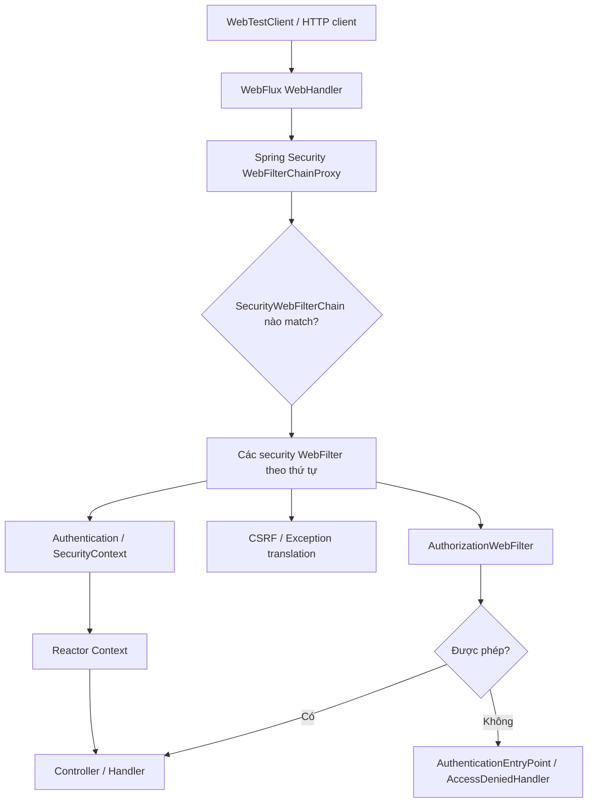
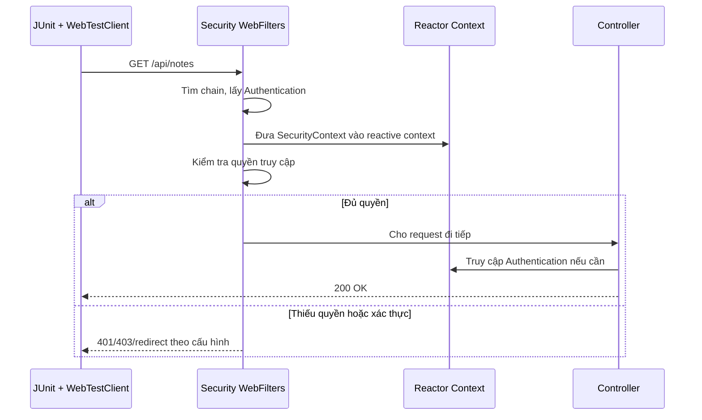

# SecurityWebFilterChain và hạ tầng bảo mật Reactive

## 1. Tại sao phải hiểu SecurityWebFilterChain khi thiết lập WebTestClient?

Hãy xét một ứng dụng WebFlux có các API sau:

- `GET /public/ping` dành cho mọi người.
- `GET /api/notes` dành cho người dùng đã đăng nhập.
- `GET /api/admin` chỉ dành cho vai trò `ADMIN`.
- `POST /api/notes` yêu cầu vai trò `WRITER` và CSRF token hợp lệ khi chính sách CSRF được bật.

Một test gọi controller trực tiếp có thể nhận HTTP 200 ở mọi endpoint, ngay cả khi ứng dụng production sẽ trả 401 hoặc 403. Nguyên nhân là controller chưa chắc đã được gọi qua **chuỗi WebFilter của Spring Security**. Muốn kiểm chứng lớp bảo mật HTTP thực tế, bài test phải gắn đúng `SecurityWebFilterChain` vào hạ tầng `WebTestClient`.

Bài học thuộc chương **Thiết lập WebTestClient** của module **SPRING_SECURITY_TESTING**: sử dụng `spring-security-test` để kiểm chứng xác thực, phân quyền và bảo vệ HTTP trong Servlet và Reactive. Phần này tập trung vào **Reactive/WebFlux**, dùng `SecurityWebFilterChain`, `ServerHttpSecurity`, `WebTestClient` và `SecurityMockServerConfigurers`. Các API Servlet như `HttpSecurity`, `SecurityFilterChain` hay `MockMvc` có cơ chế tương ứng nhưng không thể thay trực tiếp cho các lớp Reactive.

Sau bài học, bạn có thể:

1. Mô tả cách `WebFilterChainProxy` chọn `SecurityWebFilterChain` và thực thi các WebFilter bảo mật.
2. Cấu hình các quy tắc `permitAll`, `authenticated`, `hasRole`, cơ chế HTTP Basic và CSRF trong `ServerHttpSecurity`.
3. Gắn `springSecurity()` vào `WebTestClient.bindToApplicationContext(...)` để chạy HTTP test với bộ lọc thật.
4. Dùng `mockUser()` hoặc `@WithMockUser` kiểm tra 401, 403, truy cập được phép và ngữ cảnh bảo mật Reactive.
5. Phân biệt `bindToController`, `bindToApplicationContext` và `bindToServer`; tránh test ảo tưởng rằng SecurityFilterChain đã chạy.
6. Nhận biết khi nào cần `mockJwt()`, `mockOAuth2Login()`, `mockOidcLogin()` và test tích hợp với token/identity provider thật.

## 2. Kiến trúc bảo mật WebFlux: WebFilter, SecurityWebFilterChain và Reactor Context

Trong Servlet, Spring Security làm việc với các `Filter` và `HttpServletRequest`. Trong WebFlux, yêu cầu HTTP đi qua các `WebFilter` xử lý `ServerWebExchange` và những API không đồng bộ dựa trên `Mono`/`Flux`.



Những vai trò chính:

| Thành phần | Nhiệm vụ | Khi test cần chú ý |
| --- | --- | --- |
| `SecurityWebFilterChain` | Tập hợp security WebFilter cùng quy tắc áp dụng cho một nhóm exchange | Chọn đúng chain theo path/matcher; không chỉ kiểm tra controller |
| `WebFilterChainProxy` | Tìm chain phù hợp và thực hiện các bộ lọc bảo mật | Cần xuất hiện trong hạ tầng test đã gắn Spring Security |
| `ServerHttpSecurity` | DSL cấu hình authentication, authorization, CSRF, headers, OAuth2, v.v. | Dùng thay `HttpSecurity` của Servlet |
| `AuthenticationWebFilter` và bộ lọc liên quan | Đọc credential, xác thực, hình thành `Authentication` | Các mock test bỏ qua một số bước xác thực thật tùy mutator |
| `ServerSecurityContextRepository` | Tải/lưu `SecurityContext` khi có cấu hình phù hợp | Không mặc nhiên coi mọi request đều lưu session |
| `ReactiveSecurityContextHolder` | Truy cập `SecurityContext` theo Reactor Context | Không phụ thuộc `ThreadLocal` trên worker thread |
| `AuthorizationWebFilter` | Áp dụng các quy tắc bảo vệ HTTP | Kiểm tra cả trường hợp được phép và bị từ chối |
| `ServerAuthenticationEntryPoint` / `ServerAccessDeniedHandler` | Chuyển thất bại xác thực/phân quyền thành phản hồi HTTP | Tùy cơ chế mà trả 401, 403 hoặc redirect |

WebFlux thường xử lý một request qua nhiều thread trong đời sống reactive pipeline. Vì vậy **không nên đọc danh tính từ `SecurityContextHolder` kiểu ThreadLocal và giả định nó sẽ có mặt ở mọi thread**. Spring Security tích hợp `SecurityContext` trong **Reactor Context**, đọc qua `ReactiveSecurityContextHolder.getContext()`; đây là nền tảng của reactive method security.

### 2.1. Đường đi của request kiểm thử



Mục tiêu của bài test bảo mật là đi qua **W** ở sơ đồ trên. Nếu tạo `WebTestClient.bindToController(new Controller())` mà không gắn đầy đủ Spring Security, controller vẫn có thể hoạt động, nhưng test đó chưa chứng minh chính sách bảo mật HTTP.

## 3. Cấu hình thư viện và chọn phiên bản

Với Spring Boot 3.x, một ứng dụng WebFlux dùng Gradle thường cần:

```groovy
dependencies {
    implementation 'org.springframework.boot:spring-boot-starter-webflux'
    implementation 'org.springframework.boot:spring-boot-starter-security'

    testImplementation 'org.springframework.boot:spring-boot-starter-test'
    testImplementation 'org.springframework.security:spring-security-test'
}
```

Với Spring Boot 4.x, ngoài các dependency ứng dụng, có thể dùng các test starter đã tách theo chức năng:

```groovy
dependencies {
    implementation 'org.springframework.boot:spring-boot-starter-webflux'
    implementation 'org.springframework.boot:spring-boot-starter-security'

    testImplementation 'org.springframework.boot:spring-boot-starter-webflux-test'
    testImplementation 'org.springframework.security:spring-security-test'
}
```

Trong các ví dụ, dự án nên dùng **BOM và plugin quản lý phiên bản của Spring Boot** để các module Spring Framework, Spring Security và test tương thích nhau. Không trộn bừa nhiều major version. Chú ý sự khác biệt package annotation:

| Công cụ | Spring Boot 3.x | Spring Boot 4.x |
| --- | --- | --- |
| `@WebFluxTest` | `org.springframework.boot.test.autoconfigure.web.reactive.WebFluxTest` | `org.springframework.boot.webflux.test.autoconfigure.WebFluxTest` |
| `@AutoConfigureWebTestClient` | `org.springframework.boot.test.autoconfigure.web.reactive.AutoConfigureWebTestClient` | `org.springframework.boot.webtestclient.autoconfigure.AutoConfigureWebTestClient` |
| `WebTestClient` | `org.springframework.test.web.reactive.server.WebTestClient` | Cùng API phía Spring Framework |
| `springSecurity()`, `mockUser()` | `org.springframework.security.test.web.reactive.server.SecurityMockServerConfigurers` | Cùng nhóm API của spring-security-test |

Để phần code chính ít phụ thuộc package test của Boot, dưới đây ta dùng **Spring Test + JUnit Jupiter** với `@SpringJUnitConfig` và tạo WebTestClient tường minh từ `ApplicationContext`. Trong dự án Boot thật, bạn cũng có thể dùng `@SpringBootTest` hoặc `@WebFluxTest`, nhưng cần chắc chắn context thực sự nạp cấu hình bảo mật.

Nếu dự án thêm cả starter MVC và WebFlux, Spring Boot có thể ưu tiên ứng dụng Servlet theo cơ chế xác định web application type. Khi muốn test Reactive, hãy bảo đảm đang chạy **ReactiveApplicationContext** hoặc cấu hình `spring.main.web-application-type=reactive` trong context test tương ứng.

## 4. Xây dựng SecurityWebFilterChain mẫu

Đầu tiên, tạo cấu hình bảo mật Reactive chỉ dùng HTTP Basic để các kết quả 401/403 trong test rõ ràng. Đối với POST, **giữ CSRF protection** để kiểm tra đúng tác động của token.

```java
import org.springframework.context.annotation.Bean;
import org.springframework.context.annotation.Configuration;
import org.springframework.http.HttpMethod;
import org.springframework.security.config.Customizer;
import org.springframework.security.config.annotation.web.reactive.EnableWebFluxSecurity;
import org.springframework.security.config.web.server.ServerHttpSecurity;
import org.springframework.security.core.userdetails.User;
import org.springframework.security.core.userdetails.UserDetails;
import org.springframework.security.provisioning.MapReactiveUserDetailsService;
import org.springframework.security.web.server.SecurityWebFilterChain;

@Configuration
@EnableWebFluxSecurity
class ReactiveSecurityConfig {

    @Bean
    SecurityWebFilterChain securityWebFilterChain(ServerHttpSecurity http) {
        return http
            .authorizeExchange(exchanges -> exchanges
                .pathMatchers(HttpMethod.GET, "/public/ping")
                    .permitAll()
                .pathMatchers(HttpMethod.GET, "/api/admin")
                    .hasRole("ADMIN")
                .pathMatchers(HttpMethod.POST, "/api/notes")
                    .hasRole("WRITER")
                .pathMatchers("/api/**")
                    .authenticated()
                .anyExchange()
                    .denyAll())
            .httpBasic(Customizer.withDefaults())
            .formLogin(form -> form.disable())
            .csrf(Customizer.withDefaults())
            .build();
    }

    @Bean
    MapReactiveUserDetailsService users() {
        UserDetails reader = User.withUsername("alice")
            .password("{noop}secret")
            .roles("READER")
            .build();

        UserDetails writer = User.withUsername("bob")
            .password("{noop}secret")
            .roles("WRITER")
            .build();

        UserDetails admin = User.withUsername("root")
            .password("{noop}secret")
            .roles("ADMIN")
            .build();

        return new MapReactiveUserDetailsService(reader, writer, admin);
    }
}
```

**Giải thích cấu hình:**

- `@EnableWebFluxSecurity` kích hoạt hạ tầng web security cho Reactive.
- `ServerHttpSecurity` là DSL tạo `SecurityWebFilterChain`. `authorizeExchange` mô tả authorization của HTTP exchange theo đường dẫn và phương thức.
- Thứ tự matcher có ý nghĩa: quy tắc riêng `/api/admin` và POST `/api/notes` phải được xét trước `/api/**`.
- `hasRole("ADMIN")` mặc định tương đương kiểm tra authority `ROLE_ADMIN`; `mockUser().roles("ADMIN")` tạo authority này.
- `httpBasic` xác thực dựa trên header `Authorization: Basic ...` và cho phép minh họa 401 khi thiếu credential.
- `formLogin(form -> form.disable())` làm rõ rằng ví dụ API không dùng luồng redirect tới trang login.
- `csrf(Customizer.withDefaults())` giữ CSRF bật; POST không mang CSRF token hợp lệ sẽ bị từ chối.
- `anyExchange().denyAll()` đóng các đường dẫn không được khai báo trong ví dụ.

Các mật khẩu `{noop}` và người dùng in-memory chỉ dùng trong bài minh họa. Ứng dụng production phải lưu mật khẩu đã mã hóa phù hợp và đặt security policy theo kiến trúc xác thực thật.

### 4.1. Bảng quy tắc dự kiến

| Request | Caller | CSRF | Kết quả mong đợi |
| --- | --- | --- | --- |
| `GET /public/ping` | Anonymous | Không cần | 200 |
| `GET /api/notes` | Anonymous | Không cần | 401 theo HTTP Basic entry point |
| `GET /api/notes` | `ROLE_READER` | Không cần | 200 |
| `GET /api/admin` | `ROLE_READER` | Không cần | 403 |
| `GET /api/admin` | `ROLE_ADMIN` | Không cần | 200 |
| `POST /api/notes` | `ROLE_WRITER` | Thiếu | 403 do CSRF |
| `POST /api/notes` | `ROLE_WRITER` | Hợp lệ | 200 |
| `GET /unknown` | Bất kỳ | Không cần | 403 với request đã xác thực, hoặc phản hồi khác theo cơ chế entry point nếu anonymous |

Hãy kiểm tra từng kỳ vọng trong test. Riêng các endpoint chưa được định nghĩa, tầng routing có thể trả 404 sau khi đi qua lớp bảo mật; vì vậy chỉ nên assert status phản ánh **policy bạn đã cấu hình và endpoint thực sự tồn tại**.

## 5. Controller Reactive phục vụ kiểm thử

Controller đơn giản sau cung cấp nội dung và một endpoint đọc danh tính từ Reactor Context:

```java
import org.springframework.http.MediaType;
import org.springframework.security.core.context.ReactiveSecurityContextHolder;
import org.springframework.web.bind.annotation.GetMapping;
import org.springframework.web.bind.annotation.PostMapping;
import org.springframework.web.bind.annotation.RequestBody;
import org.springframework.web.bind.annotation.RestController;
import reactor.core.publisher.Mono;

@RestController
class NotesController {

    @GetMapping("/public/ping")
    Mono<String> ping() {
        return Mono.just("pong");
    }

    @GetMapping("/api/notes")
    Mono<String> notes() {
        return Mono.just("notes");
    }

    @GetMapping("/api/admin")
    Mono<String> admin() {
        return Mono.just("admin-only");
    }

    @PostMapping(path = "/api/notes", consumes = MediaType.TEXT_PLAIN_VALUE)
    Mono<String> addNote(@RequestBody String note) {
        return Mono.just("saved:" + note);
    }

    @GetMapping("/api/whoami")
    Mono<String> whoAmI() {
        return ReactiveSecurityContextHolder.getContext()
            .map(context -> context.getAuthentication().getName());
    }
}
```

`whoAmI()` lấy người dùng đã xác thực qua `ReactiveSecurityContextHolder` trong reactive pipeline. Nó là ca kiểm tra hữu ích để xác minh SecurityContext được gắn đúng vào Reactor Context; trong ví dụ đã bảo vệ `/api/whoami`, request anonymous không được vào controller.

## 6. Thiết lập WebTestClient để chạy SecurityWebFilterChain thật

Thêm WebFlux infrastructure và Spring test context:

```java
import org.springframework.context.annotation.Configuration;
import org.springframework.web.reactive.config.EnableWebFlux;

@Configuration
@EnableWebFlux
class WebFluxInfrastructureConfig {
}
```

Sau đó, tạo test class dùng JUnit 5:

```java
import org.junit.jupiter.api.BeforeEach;
import org.junit.jupiter.api.Test;
import org.springframework.beans.factory.annotation.Autowired;
import org.springframework.context.ApplicationContext;
import org.springframework.http.MediaType;
import org.springframework.test.context.junit.jupiter.SpringJUnitConfig;
import org.springframework.test.web.reactive.server.WebTestClient;

import static org.springframework.security.test.web.reactive.server
    .SecurityMockServerConfigurers.csrf;
import static org.springframework.security.test.web.reactive.server
    .SecurityMockServerConfigurers.mockUser;
import static org.springframework.security.test.web.reactive.server
    .SecurityMockServerConfigurers.springSecurity;

@SpringJUnitConfig(classes = {
    WebFluxInfrastructureConfig.class,
    ReactiveSecurityConfig.class,
    NotesController.class
})
class ReactiveSecurityWebTestClientTest {

    @Autowired
    ApplicationContext applicationContext;

    WebTestClient client;

    @BeforeEach
    void setUp() {
        client = WebTestClient.bindToApplicationContext(applicationContext)
            .apply(springSecurity())
            .configureClient()
            .build();
    }

    @Test
    void publicEndpointIsAccessibleToAnonymous() {
        client.get().uri("/public/ping")
            .exchange()
            .expectStatus().isOk()
            .expectBody(String.class).isEqualTo("pong");
    }

    @Test
    void protectedEndpointRejectsAnonymous() {
        client.get().uri("/api/notes")
            .exchange()
            .expectStatus().isUnauthorized();
    }

    @Test
    void mockReaderCanReadNotes() {
        client.mutateWith(mockUser("alice").roles("READER"))
            .get().uri("/api/notes")
            .exchange()
            .expectStatus().isOk()
            .expectBody(String.class).isEqualTo("notes");
    }

    @Test
    void readerCannotCallAdmin() {
        client.mutateWith(mockUser("alice").roles("READER"))
            .get().uri("/api/admin")
            .exchange()
            .expectStatus().isForbidden();
    }

    @Test
    void adminCanCallAdmin() {
        client.mutateWith(mockUser("root").roles("ADMIN"))
            .get().uri("/api/admin")
            .exchange()
            .expectStatus().isOk()
            .expectBody(String.class).isEqualTo("admin-only");
    }

    @Test
    void writerWithoutCsrfIsRejected() {
        client.mutateWith(mockUser("bob").roles("WRITER"))
            .post().uri("/api/notes")
            .contentType(MediaType.TEXT_PLAIN)
            .bodyValue("draft")
            .exchange()
            .expectStatus().isForbidden();
    }

    @Test
    void writerWithCsrfCanCreateNote() {
        client.mutateWith(mockUser("bob").roles("WRITER"))
            .mutateWith(csrf())
            .post().uri("/api/notes")
            .contentType(MediaType.TEXT_PLAIN)
            .bodyValue("draft")
            .exchange()
            .expectStatus().isOk()
            .expectBody(String.class).isEqualTo("saved:draft");
    }

    @Test
    void reactiveContextContainsMockPrincipal() {
        client.mutateWith(mockUser("alice").roles("READER"))
            .get().uri("/api/whoami")
            .exchange()
            .expectStatus().isOk()
            .expectBody(String.class).isEqualTo("alice");
    }
}
```

Điểm quan trọng trong setup:

```java
WebTestClient.bindToApplicationContext(applicationContext)
    .apply(springSecurity())
    .configureClient()
    .build();
```

`bindToApplicationContext` dùng WebFlux `ApplicationContext` thay vì chỉ khởi tạo controller đơn lẻ. `apply(springSecurity())` gắn hỗ trợ Spring Security Test để các WebFilter và mutator bảo mật tham gia request mô phỏng. `configureClient()` cho phép cấu hình các thuộc tính client tiếp theo như timeout, header mặc định, filter của client. Cách kết hợp này được mô tả trong tài liệu chính thức của `spring-security-test`.

**Vì sao test anonymous quan trọng?** Nếu bạn quên cài security chain, bài test `mockReaderCanReadNotes` vẫn có thể nhận 200 do endpoint không tự kiểm tra quyền. Nhưng `protectedEndpointRejectsAnonymous` sẽ thất bại nếu `GET /api/notes` bị truy cập công khai. Vì vậy, bộ test nên luôn có ít nhất một assertion **anonymous bị chặn**, một assertion **user đủ quyền được phép** và một assertion **user thiếu quyền bị từ chối**.

### 6.1. Test nào thực sự xác minh mật khẩu?

Các test `mutateWith(mockUser(...))` đặt Authentication giả trực tiếp vào request mô phỏng. Chúng **không** gọi `ReactiveAuthenticationManager` để kiểm tra password. Để xác minh cấu hình HTTP Basic với `MapReactiveUserDetailsService`, gửi credential theo HTTP:

```java
client.get().uri("/api/notes")
    .headers(headers -> headers.setBasicAuth("alice", "secret"))
    .exchange()
    .expectStatus().isOk()
    .expectBody(String.class).isEqualTo("notes");

client.get().uri("/api/notes")
    .headers(headers -> headers.setBasicAuth("alice", "wrong"))
    .exchange()
    .expectStatus().isUnauthorized();
```

Vì request đi qua `SecurityWebFilterChain` đã gắn `httpBasic`, hai ca này kiểm tra đường xử lý authentication từ header Basic tới `ReactiveUserDetailsService` trong context mẫu. Chỉ sử dụng credential giả và môi trường test; khi gửi HTTP Basic qua mạng thực phải dùng HTTPS.

## 7. Phân biệt authentication, authorization và CSRF bằng status

Ba khái niệm thường dẫn tới những lời giải thích sai nếu chỉ đọc HTTP status:

| Câu hỏi | Thành phần thường quyết định | Ví dụ |
| --- | --- | --- |
| Người gọi đã xác thực chưa? | Authentication filters + entry point | GET bảo vệ mà không có credential trả 401 ở Basic API |
| Người gọi có quyền truy cập không? | Authorization rules | Reader đã xác thực nhưng gọi admin trả 403 |
| Request thay đổi trạng thái có CSRF token hợp lệ không? | CSRF WebFilter | Writer có role nhưng POST thiếu token bị 403 |

Không thể kết luận **mọi 403 đều do thiếu role**. Trường hợp POST thiếu CSRF cũng thường trả 403, ngay cả khi `Authentication` đã có đủ quyền. Để cô lập nguyên nhân, tạo các test có cùng user và payload, chỉ thay đổi sự hiện diện của CSRF token.

Ngược lại, với application cấu hình form login, anonymous có thể bị redirect đến trang đăng nhập thay vì 401. Với resource server dùng Bearer token, request không được xác thực thường được xử lý bởi entry point của Bearer token, có thể kèm header `WWW-Authenticate`. **Kỳ vọng test phải xuất phát từ security policy thực của ứng dụng**.

### 7.1. Vì sao không nên tắt CSRF chỉ để test đỗ?

Spring Security Reactive có CSRF protection cho những request phù hợp chính sách. `csrf()` của `spring-security-test` thêm token hợp lệ vào request mô phỏng:

```java
client.mutateWith(mockUser("bob").roles("WRITER"))
    .mutateWith(csrf())
    .post().uri("/api/notes")
    .contentType(MediaType.TEXT_PLAIN)
    .bodyValue("new note")
    .exchange()
    .expectStatus().isOk();
```

Nếu API thật dùng bearer token trong header và không dùng credential tự động gửi từ browser, ứng dụng có thể thiết kế một chính sách CSRF khác. Tuy nhiên, lựa chọn tắt/giới hạn CSRF cần dựa trên mô hình xác thực và nguy cơ thực tế, **không nên chỉ thêm `csrf(csrf -> csrf.disable())` vì POST test đang trả 403**.

## 8. SecurityContext trong Reactor và reactive method security

Trong mã Reactive, các operator xử lý dữ liệu có thể chạy trên nhiều scheduler. Lấy danh tính bằng:

```java
Mono<String> currentUserName =
    ReactiveSecurityContextHolder.getContext()
        .map(context -> context.getAuthentication().getName());
```

Đoạn này chỉ có kết quả nếu Reactor Context tại thời điểm subscription chứa SecurityContext, ví dụ khi request đã được Spring Security xác thực, hoặc khi test đặt context tường minh. Không nên dùng `ThreadLocal` để truyền danh tính giữa các bước của pipeline rồi cho rằng mỗi operator sẽ nhìn thấy cùng một giá trị.

Một test thuần Reactor không cần HTTP cũng có thể minh họa cách gắn Authentication:

```java
import org.junit.jupiter.api.Test;
import org.springframework.security.authentication.TestingAuthenticationToken;
import org.springframework.security.core.Authentication;
import org.springframework.security.core.context.ReactiveSecurityContextHolder;
import reactor.core.publisher.Mono;
import reactor.test.StepVerifier;

class ReactiveContextTest {

    @Test
    void contextCarriesAuthentication() {
        Authentication auth = new TestingAuthenticationToken(
            "alice", "unused", "ROLE_READER");

        Mono<String> name = ReactiveSecurityContextHolder.getContext()
            .map(context -> context.getAuthentication().getName())
            .contextWrite(
                ReactiveSecurityContextHolder.withAuthentication(auth));

        StepVerifier.create(name)
            .expectNext("alice")
            .verifyComplete();
    }
}
```

Ví dụ sử dụng `StepVerifier` từ dependency test `io.projectreactor:reactor-test`. Nó chứng minh cách gắn/lấy context Reactive, **chưa phải là test chạy HTTP SecurityWebFilterChain**. Test `reactiveContextContainsMockPrincipal` ở mục 6 mới đặt logic đó trong đường đi request đã có WebFilter.

Nếu ứng dụng dùng `@PreAuthorize` hoặc `@PostAuthorize` trên service Reactive, bật `@EnableReactiveMethodSecurity` trong cấu hình thích hợp và viết test tới **bean đã được Spring tạo proxy**, chẳng hạn:

```java
@Service
class AuditService {
    @PreAuthorize("hasRole('AUDITOR')")
    Mono<String> readAudit() {
        return Mono.just("audit");
    }
}
```

Method security dựa vào Reactive SecurityContext; với phương thức trả về `Mono`/`Flux`, quyết định phân quyền được tích hợp với reactive pipeline. Một test chỉ gọi `new AuditService().readAudit()` sẽ đi vòng qua proxy và không chứng minh `@PreAuthorize` hoạt động. Cần nạp bean vào context có `@EnableReactiveMethodSecurity`, rồi chạy test với và không có `ROLE_AUDITOR`.

## 9. Ba cách thiết lập WebTestClient và phạm vi kiểm chứng

`WebTestClient` có thể kiểm thử WebFlux với server mô phỏng hoặc kết nối server thật. Chọn cách tạo client sẽ quyết định độ sâu của kiểm thử:

| Cách tạo | Hạ tầng tham gia | Có phù hợp test SecurityWebFilterChain? |
| --- | --- | --- |
| `bindToController(new NotesController())` | Controller được cấp và WebFlux infrastructure do test builder tạo | Không mặc nhiên có security chain của ứng dụng |
| `bindToApplicationContext(context).apply(springSecurity())` | Bean từ WebFlux context và security test support | **Có**, nếu context nạp đúng config/chain |
| `bindToServer().baseUrl("https://...")` | HTTP server thật đang chạy | **Có**, nếu server đang chạy với security config thực và client gửi credential thật |

### 9.1. Bind to controller: tốt cho logic handler, chưa đủ cho HTTP security

```java
WebTestClient controllerOnly =
    WebTestClient.bindToController(new NotesController()).build();

// Dễ nhận 200 ở /api/notes dù chưa đưa Spring Security vào hạ tầng.
controllerOnly.get().uri("/api/notes")
    .exchange()
    .expectStatus().isOk();
```

Đây là test controller hợp lệ, nhưng không phải bằng chứng rằng anonymous được phép truy cập `/api/notes` trên server thực. Muốn kiểm tra web security, nạp `SecurityWebFilterChain` và áp dụng `springSecurity()`, hoặc dùng server thực.

### 9.2. Bind to application context: lựa chọn chính cho security integration test nhanh

```java
WebTestClient secured = WebTestClient
    .bindToApplicationContext(applicationContext)
    .apply(springSecurity())
    .configureClient()
    .build();
```

Ở đây không cần mở TCP port; request và response được mô phỏng qua WebFlux stack. Hầu hết kiểm thử authentication/authorization của filter chain nên bắt đầu từ tầng này vì nhanh và không phụ thuộc mạng.

### 9.3. Bind to live server: dùng HTTP credential thật

```java
WebTestClient liveClient = WebTestClient
    .bindToServer()
    .baseUrl("https://localhost:8443")
    .build();

liveClient.get().uri("/api/notes")
    .headers(headers -> headers.setBasicAuth("alice", "secret"))
    .exchange()
    .expectStatus().isOk();
```

Khi kết nối server thực, **không coi `mutateWith(mockUser())` là cách gửi Authentication tới server từ xa**. Mutator của `spring-security-test` phục vụ hạ tầng mock server; live server không nhận Reactor SecurityContext giả của tiến trình test. Với live server, hãy gửi Basic credentials, bearer token hoặc cookie thật theo protocol đang dùng. Nếu TLS/certificate của test server cần cấu hình riêng, cấu hình client một cách an toàn thay vì tắt xác minh chứng chỉ vô điều kiện.

## 10. Spring Boot test slices và sự khác nhau giữa ứng dụng Reactive và Servlet

Trong dự án Spring Boot, hai kiểu test thường gặp là:

**Test toàn application context**:

```java
@SpringBootTest(
    webEnvironment = SpringBootTest.WebEnvironment.MOCK,
    properties = "spring.main.web-application-type=reactive")
@AutoConfigureWebTestClient
class FullReactiveSecurityTest {
    @Autowired WebTestClient client;
}
```

`@AutoConfigureWebTestClient` tạo WebTestClient cho WebFlux application mà không cần server mạng. Dự án phải có Spring Security và `SecurityWebFilterChain` thực được nạp vào context. Phần import annotation tùy Spring Boot 3 hay 4 theo bảng ở mục 3.

**Test slice dành cho WebFlux controller**:

```java
@WebFluxTest(controllers = NotesController.class)
@Import(ReactiveSecurityConfig.class)
class NotesControllerSliceTest {
    @Autowired WebTestClient client;
}
```

`@WebFluxTest` chỉ scan một tập bean cần thiết cho controller. Các `@Configuration`/`@Service` tùy chỉnh có thể không được tự quét. Đặc biệt, muốn kiểm thử **chuỗi security của ứng dụng**, phải import config chứa `SecurityWebFilterChain` hoặc dùng full application context. Nếu controller có phụ thuộc service, cần cung cấp bean thật hoặc mock phù hợp trong test.

**Phân biệt với Servlet:**

| Servlet (Spring MVC) | Reactive (Spring WebFlux) |
| --- | --- |
| `HttpSecurity` | `ServerHttpSecurity` |
| `SecurityFilterChain` | `SecurityWebFilterChain` |
| Servlet `FilterChainProxy` | Reactive `WebFilterChainProxy` |
| `HttpServletRequest` | `ServerWebExchange` |
| `SecurityContextHolder` kiểu thread-local phổ biến | `ReactiveSecurityContextHolder` với Reactor Context |
| `MockMvc` và `springSecurity()` dành cho MockMvc | `WebTestClient` và `SecurityMockServerConfigurers.springSecurity()` |
| `with(user("alice"))` | `mutateWith(mockUser("alice"))` |
| `with(csrf())` | `mutateWith(csrf())` |

`WebTestClient` cũng có khả năng kiểm thử một số ứng dụng Spring MVC, nhưng phần test support cho WebFlux Security ở đây dành cho **Reactive WebFilter chain**. Nếu ứng dụng thật là Servlet, cần xác minh bằng công cụ và chain tương ứng.

## 11. Nhiều SecurityWebFilterChain: matcher và thứ tự ưu tiên

Một ứng dụng có thể có nhiều chain: `/api/**` là bearer JWT, còn `/portal/**` là đăng nhập bằng biểu mẫu. Spring Security **chọn một chain phù hợp cho request** dựa trên `securityMatcher` và thứ tự `@Order`; các chain không tự động cộng dồn policy.

Ví dụ khung cấu hình:

```java
import org.springframework.core.annotation.Order;
import org.springframework.security.web.server.util.matcher
    .PathPatternParserServerWebExchangeMatcher;

@Bean
@Order(1)
SecurityWebFilterChain apiChain(ServerHttpSecurity http) {
    return http
        .securityMatcher(
            new PathPatternParserServerWebExchangeMatcher("/api/**"))
        .authorizeExchange(exchanges -> exchanges
            .anyExchange().authenticated())
        .httpBasic(Customizer.withDefaults())
        .build();
}

@Bean
@Order(2)
SecurityWebFilterChain fallbackChain(ServerHttpSecurity http) {
    return http
        .authorizeExchange(exchanges -> exchanges
            .anyExchange().denyAll())
        .build();
}
```

Đây là ví dụ độc lập để minh họa **matcher/order**; không thêm nguyên hai bean này vào cấu hình một chain ở mục 4 rồi kỳ vọng policy và route vẫn như cũ. Nếu có nhiều chain, hãy xác định:

1. Request `/api/items` khớp chain API ưu tiên 1.
2. Request `/portal/home` không khớp `/api/**`, nên rơi vào fallback.
3. Đường dẫn không khớp bất kỳ chain nào có thể không được bảo vệ bởi các chain đã khai báo; nên có catch-all chain với chính sách chủ ý.
4. Một chain không cấu hình đúng matcher và đặt quá sớm có thể vô tình bắt tất cả request, khiến các chain sau không bao giờ được dùng.
5. Tách test theo từng HTTP method/path thực sự tồn tại, không chỉ assert bean được tạo.

Khi nhiều chain dùng những authentication mechanism khác nhau, nên thêm assertion về status và `WWW-Authenticate` hoặc redirect tương ứng. Ví dụ, endpoint API sử dụng bearer resource server có thể cần 401 và Bearer challenge, trong khi portal dành cho trình duyệt có thể chuyển hướng tới login.

## 12. Dùng SecurityMockServerConfigurers đúng loại principal

`spring-security-test` hỗ trợ nhiều loại Authentication giả lập. Lựa chọn phụ thuộc vào code bảo vệ endpoint đang cần loại principal nào:

| Mutator / annotation | Mục đích kiểm thử | Giới hạn |
| --- | --- | --- |
| `mockUser()` | Username + authorities/roles cho HTTP authorization | Không xác minh password |
| `@WithMockUser` | Đặt user giả theo annotation trên test | Không chạy login thật |
| `mockJwt()` | JWT authentication giả cho resource server Reactive | Không xác minh JWT signature/JWKs/issuer |
| `mockOAuth2Login()` | Principal đăng nhập OAuth2 giả | Không chạy authorization code exchange |
| `mockOidcLogin()` | OIDC principal + ID Token/UserInfo giả | Không xác minh ID Token từ IdP |
| `mockOpaqueToken()` | Principal từ opaque bearer token giả | Không gọi introspection endpoint |
| `csrf()` | CSRF token giả hợp lệ trong mock request | Không thay test browser/session/CSRF integration |

Ví dụ endpoint cần bearer JWT với authority `SCOPE_docs.read` (giả sử đã cấu hình Reactive Resource Server):

```java
import static org.springframework.security.test.web.reactive.server
    .SecurityMockServerConfigurers.mockJwt;

client.mutateWith(mockJwt().authorities(
        new SimpleGrantedAuthority("SCOPE_docs.read")))
    .get().uri("/api/docs")
    .exchange()
    .expectStatus().isOk();
```

Đừng lấy ví dụ JWT này chạy nguyên vẹn với `NotesController`/`ReactiveSecurityConfig` sử dụng HTTP Basic ở mục 4: ví dụ JWT cần route, bean và resource-server policy riêng. Hơn nữa, việc đặt trực tiếp authorities vào mock chỉ kiểm tra **quyết định phân quyền với quyền đã được tạo**; để kiểm tra cách ứng dụng đổi claims thành authorities, cần test converter thực tế hoặc integration flow tương ứng.

Với OIDC, một controller có tham số `@AuthenticationPrincipal OidcUser` cần `mockOidcLogin()` hay principal loại OIDC. `@WithMockUser` chỉ tạo một principal kiểu username/password và sẽ không tự cung cấp `OidcIdToken`.

## 13. Kỹ thuật chẩn đoán khi test WebFlux Security thất bại

### 13.1. Test HTTP trả 200 dù anonymous phải bị chặn

Kiểm tra bạn có đang dùng `bindToController` hay không, context có nạp `SecurityWebFilterChain` và `@EnableWebFluxSecurity` chưa, đã gọi `apply(springSecurity())` trong setup thủ công chưa, và request có đúng path/matcher không. Nếu đang dùng `@WebFluxTest`, import custom security config vào slice.

### 13.2. 401 thay vì 403

401 thường xuất hiện khi server yêu cầu xác thực nhưng chưa có Authentication hợp lệ trong cơ chế HTTP Basic/Bearer. 403 thường là người dùng đã xác thực nhưng thiếu quyền, hoặc thiếu CSRF token. Với form-login entry point, có thể nhận redirect. Kiểm tra status cùng challenge header, redirect và loại Authentication theo policy.

### 13.3. POST bị 403 dù `mockUser()` có đủ role

Kiểm tra CSRF trước. Với POST, PUT, PATCH, DELETE, nếu app giữ CSRF protection, thêm `mutateWith(csrf())` trong test hợp lệ. Viết thêm test không có CSRF và phải bị từ chối.

### 13.4. `ReactiveSecurityContextHolder.getContext()` trả rỗng

Kiểm tra pipeline có đang được subscription đúng ngữ cảnh không; code có tách luồng thủ công bằng `subscribe()`, gọi blocking code hoặc tạo execution context mới không truyền Reactor Context không. Trong test HTTP, xác minh `springSecurity()` và `mockUser()` được áp dụng cùng WebTestClient.

### 13.5. `@PreAuthorize` không có tác dụng

Kiểm tra `@EnableReactiveMethodSecurity` và service có do Spring tạo bean/proxy không. Gọi trực tiếp bằng `new Service()` sẽ bỏ qua proxy. Đảm bảo test kiểm chứng phương thức Reactive trả `Mono`/`Flux`, thay vì chỉ xem HTTP filter rules.

### 13.6. Test chạy Servlet dù tưởng đang chạy WebFlux

Xem dependency và web application type. Nếu project có cả MVC và WebFlux, Boot có thể chọn Servlet app. `MockMvc` dùng Servlet security chain; `SecurityWebFilterChain` dùng WebFlux. Không sửa test một cách ngẫu nhiên bằng cách đổi tên client mà không xác định hạ tầng thực.

### 13.7. Quá nhiều matcher chồng nhau

Một rule `pathMatchers("/api/**").permitAll()` đặt trước `/api/admin` có thể làm admin không còn được bảo vệ như dự kiến. Tạo bảng route và test từng role/path; đặc biệt thử cả anonymous và user thiếu quyền.

### 13.8. Mock JWT/OIDC thành công nhưng login thật thất bại

Mock auth không xác minh chữ ký JWT, token endpoint, OIDC discovery, issuer, audience hay phiên của IdP. Cần integration test với authorization server giả/kiểm soát được hoặc môi trường tích hợp thật để kiểm chứng các bước này.

## 14. Bài thực hành và ma trận kiểm thử

### 14.1. Ma trận tối thiểu cần hoàn thành

| Test | Setup | Assertion chính |
| --- | --- | --- |
| Public | Anonymous GET `/public/ping` | 200, body `pong` |
| Anonymous bị từ chối | GET `/api/notes` không auth | 401 theo HTTP Basic config |
| Đủ quyền | `mockUser` reader GET notes | 200 |
| Thiếu quyền | `mockUser` reader GET admin | 403 |
| Admin đủ quyền | `mockUser` admin GET admin | 200 |
| Thiếu CSRF | Writer POST notes không CSRF | 403 |
| Có CSRF | Writer POST notes + `csrf()` | 200 và body đúng |
| Authentication thật bằng Basic | Credential đúng | 200 |
| Mật khẩu sai | Credential Basic sai | 401 |
| Reactor Context | Mock alice GET `/api/whoami` | Body là `alice` |
| Matcher/order | Hai chain + route thuộc mỗi chain | Đúng chain và policy theo URI |
| Method security | Service bean có `@PreAuthorize` | Đủ role được phép; thiếu role bị từ chối |

### 14.2. Bài tập

**Bài 1 — Dựng hạ tầng.** Tạo `@EnableWebFlux`, `@EnableWebFluxSecurity`, `SecurityWebFilterChain` và `NotesController`. Dùng `WebTestClient.bindToApplicationContext(...).apply(springSecurity())`. Đảm bảo test anonymous vào `/api/notes` không trả 200.

**Bài 2 — Kiểm tra authorization.** Dùng `mockUser("alice").roles("READER")` và `mockUser("root").roles("ADMIN")` kiểm tra quyền với `/api/notes` và `/api/admin`. Thêm test vai trò không đủ và dùng 403 làm bằng chứng.

**Bài 3 — Kiểm tra CSRF.** Dùng cùng một writer và payload POST. Test thứ nhất không có CSRF phải bị 403; test thứ hai dùng `mutateWith(csrf())` phải thành công.

**Bài 4 — Kiểm tra Reactive context.** Thêm endpoint truy cập `ReactiveSecurityContextHolder`. Assert đúng tên principal từ `mockUser`. Giải thích vì sao thread-local không phải nguồn context đáng tin cậy trong Reactive pipeline.

**Bài 5 — So sánh ba kiểu setup.** Chạy test controller-only với `bindToController`, rồi test bảo mật qua `bindToApplicationContext`. Ghi lại vì sao cùng một endpoint có thể trả 200 trong test controller-only nhưng bị 401 khi đi qua security chain.

**Bài 6 — Security nhiều chain.** Thêm một chain dành riêng cho `/api/**` và một fallback chain. Test thứ tự `@Order`, matcher, endpoint được phép và endpoint bị chặn; tránh để request ngoài matcher rơi vào vùng không bảo vệ.

**Bài 7 — Tích hợp token.** Với một application khác có cấu hình JWT/OIDC thực, dùng `mockJwt()` hoặc `mockOidcLogin()` để test HTTP authorization, sau đó viết thêm test integration với token/IdP giả kiểm soát được để chứng minh validate token thực sự chạy.

Một bài làm đạt yêu cầu khi có **SecurityWebFilterChain thật trong application context**, request được gửi qua `WebTestClient` có `springSecurity()`, và có bằng chứng rõ ràng cho **200, 401, 403, CSRF cùng Reactor SecurityContext**. Ghi rõ những điểm chỉ được mô phỏng bởi mock authentication và những bước cần một integration test với server thật.

## 15. Tài liệu tham khảo

- [Spring Security — WebFlux Security](https://docs.spring.io/spring-security/reference/reactive/configuration/webflux.html): `ServerHttpSecurity`, `SecurityWebFilterChain`, nhiều chains và matcher.
- [Spring Security — Authorize ServerHttpRequest](https://docs.spring.io/spring-security/reference/reactive/authorization/authorize-http-requests.html): `authorizeExchange` và các quy tắc phân quyền.
- [Spring Security — WebTestClient Security Setup](https://docs.spring.io/spring-security/reference/reactive/test/web/setup.html): `bindToApplicationContext` và `springSecurity()`.
- [Spring Security — Testing Authentication](https://docs.spring.io/spring-security/reference/reactive/test/web/authentication.html): `mockUser()` và `@WithMockUser`.
- [Spring Security — Testing with CSRF](https://docs.spring.io/spring-security/reference/reactive/test/web/csrf.html): `csrf()` trên WebTestClient.
- [Spring Security — EnableReactiveMethodSecurity](https://docs.spring.io/spring-security/reference/reactive/authorization/method.html): `ReactiveSecurityContextHolder` và `@PreAuthorize`.
- [Spring Framework — WebTestClient](https://docs.spring.io/spring-framework/reference/testing/webtestclient.html): cách bind tới controller, application context và server.
- [Spring Boot — Testing Spring Boot Applications](https://docs.spring.io/spring-boot/reference/testing/spring-boot-applications.html): `@WebFluxTest`, `@AutoConfigureWebTestClient` và giới hạn test slices.
