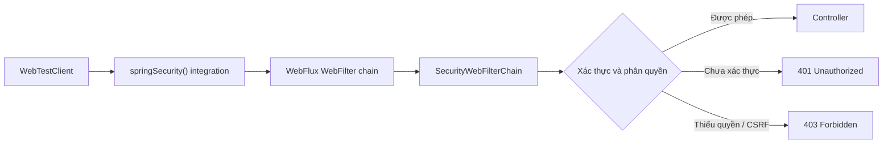

# `SecurityMockServerConfigurers.springSecurity` để gắn hỗ trợ kiểm thử

Trong chương **Thiết lập WebTestClient** của module **SPRING_SECURITY_TESTING**, chúng ta cần kiểm chứng hành vi xác thực, phân quyền và bảo vệ HTTP trên ứng dụng **Reactive (Spring WebFlux)**. Bộ công cụ `spring-security-test` cho phép dùng `WebTestClient` với danh tính giả lập, kiểm tra quyền truy cập, CSRF, OAuth2/JWT/OIDC và các tình huống được phép hoặc bị từ chối. Để các phép kiểm thử này có ý nghĩa, `WebTestClient` phải chạy qua đúng cấu hình Spring Security của ứng dụng.

Thành phần trung tâm của bài là:

```java
import static org.springframework.security.test.web.reactive.server
        .SecurityMockServerConfigurers.springSecurity;

WebTestClient client = WebTestClient.bindToApplicationContext(context)
        .apply(springSecurity())
        .configureClient()
        .build();
```

Lệnh `.apply(springSecurity())` tích hợp hỗ trợ kiểm thử Spring Security vào `WebTestClient` được **gắn trực tiếp với application context của WebFlux**. Khi kết hợp với các post-processor như `mockUser()`, `mockJwt()`, `mockOpaqueToken()` hay `csrf()`, ta có thể điều khiển danh tính hoặc request test nhưng vẫn quan sát được quyết định của security filter chain.

## 1. Vấn đề mà `springSecurity()` giải quyết

Giả sử ứng dụng có endpoint:

- `GET /api/public` cho phép mọi người truy cập.
- `GET /api/reports/{id}` chỉ cho phép người có vai trò `ANALYST`.
- `POST /api/reports` chỉ cho phép người có vai trò `ANALYST` và phải có CSRF token hợp lệ khi CSRF được bật.

Nếu test chỉ tạo controller và gọi handler, một request không có danh tính vẫn có thể trả `200` vì Spring Security chưa được đưa vào đường xử lý. Kết quả đó chứng minh logic controller, nhưng không chứng minh endpoint được bảo vệ.

Trong WebFlux, bảo mật HTTP hoạt động chủ yếu qua `SecurityWebFilterChain` và các `WebFilter`. Vì vậy, một bài test bảo mật đúng phải bảo đảm **các filter này được chạy cùng với controller**. `SecurityMockServerConfigurers.springSecurity()` là thành phần hỗ trợ cách gắn này trong kiểm thử với `WebTestClient`.



**Phân biệt:** `springSecurity()` không tự sinh tài khoản, role, access token hoặc policy. Nó kết nối cơ chế test với cấu hình Spring Security hiện hữu. Danh tính, authorities, điều kiện truy cập và kết quả HTTP vẫn phải được thiết lập, kiểm soát và assert rõ ràng.

## 2. Các thư viện và kiểu ứng dụng cần có

Trong dự án Spring Boot dùng WebFlux và Spring Security, tối thiểu cần các thành phần phù hợp:

```gradle
dependencies {
    implementation "org.springframework.boot:spring-boot-starter-webflux"
    implementation "org.springframework.boot:spring-boot-starter-security"

    testImplementation "org.springframework.boot:spring-boot-starter-test"
    testImplementation "org.springframework.security:spring-security-test"
}
```

Ví dụ dùng cú pháp Gradle Groovy; phiên bản dependency được quản lý theo Spring Boot BOM của dự án. Với Maven, sử dụng dependency tương đương trong phạm vi `test`.

| Thành phần | Vai trò |
| --- | --- |
| `WebTestClient` | Gửi yêu cầu HTTP mô phỏng, kiểm tra status/header/body theo lập trình reactive |
| `SecurityWebFilterChain` | Định nghĩa quy tắc xác thực, phân quyền và bảo vệ request của WebFlux |
| `SecurityMockServerConfigurers.springSecurity()` | Gắn hỗ trợ Spring Security Test vào client được bind với WebFlux context |
| `mockUser()`, `mockJwt()`, `mockOpaqueToken()` | Cung cấp danh tính/token giả lập cho request test |
| `csrf()` | Cung cấp CSRF token giả lập khi kiểm tra request cần CSRF |
| `@WebFluxTest`, `@SpringBootTest` | Tạo context kiểm thử tùy phạm vi controller slice hoặc tích hợp ứng dụng |

Đây là API thuộc **Reactive Spring Security Test**. Với ứng dụng Servlet dùng `MockMvc`, cấu hình tương ứng là `SecurityMockMvcConfigurers.springSecurity()` hoặc Spring Boot test hỗ trợ filter chain; không lấy `SecurityMockServerConfigurers` áp dụng cho Servlet.

## 3. Cấu hình tối thiểu: thứ tự gọi các phương thức

Giả sử test có `ApplicationContext` của WebFlux được Spring quản lý:

```java
import org.junit.jupiter.api.BeforeEach;
import org.springframework.beans.factory.annotation.Autowired;
import org.springframework.context.ApplicationContext;
import org.springframework.test.web.reactive.server.WebTestClient;

import static org.springframework.security.test.web.reactive.server
        .SecurityMockServerConfigurers.springSecurity;

class ReportSecurityTest {
    @Autowired
    ApplicationContext context;

    WebTestClient client;

    @BeforeEach
    void setUp() {
        client = WebTestClient
                .bindToApplicationContext(context)
                .apply(springSecurity())
                .configureClient()
                .build();
    }
}
```

Các bước được thực hiện theo thứ tự:

1. **`bindToApplicationContext(context)`** tạo môi trường request mô phỏng dựa trên các bean và handler trong WebFlux context.
2. **`apply(springSecurity())`** kết nối cơ chế kiểm thử Spring Security với WebFlux filter chain và khả năng gắn security context giả lập cho request.
3. **`configureClient()`** chuyển sang tùy biến thông số client, chẳng hạn base URL, header mặc định và thời gian timeout.
4. **`build()`** tạo client dùng trong các phép thử HTTP.

Ví dụ tùy biến client sau khi gắn hỗ trợ security:

```java
client = WebTestClient.bindToApplicationContext(context)
        .apply(springSecurity())
        .configureClient()
        .baseUrl("/api")
        .responseTimeout(Duration.ofSeconds(5))
        .build();
```

Với cấu hình `baseUrl("/api")`, request `.uri("/reports/42")` sẽ hướng tới `/api/reports/42`; cần nhất quán giữa base URL và đường dẫn trong test để tránh chẩn đoán nhầm lỗi `404` thành lỗi bảo mật.

## 4. Ví dụ đầy đủ với `@WebFluxTest`, role và CSRF

Bộ test dưới đây minh họa cùng một ứng dụng có endpoint công khai, endpoint chỉ cho `ANALYST` và thao tác ghi phải qua CSRF. Test dùng JUnit 5 và các post-processor của Spring Security Test.

```java
import static org.springframework.security.test.web.reactive.server
        .SecurityMockServerConfigurers.csrf;
import static org.springframework.security.test.web.reactive.server
        .SecurityMockServerConfigurers.mockUser;
import static org.springframework.security.test.web.reactive.server
        .SecurityMockServerConfigurers.springSecurity;

import org.junit.jupiter.api.BeforeEach;
import org.junit.jupiter.api.Test;
import org.springframework.beans.factory.annotation.Autowired;
import org.springframework.boot.test.autoconfigure.web.reactive.WebFluxTest;
import org.springframework.context.ApplicationContext;
import org.springframework.context.annotation.Bean;
import org.springframework.context.annotation.Configuration;
import org.springframework.context.annotation.Import;
import org.springframework.http.HttpStatus;
import org.springframework.http.ResponseEntity;
import org.springframework.security.config.Customizer;
import org.springframework.security.config.annotation.web.reactive.EnableWebFluxSecurity;
import org.springframework.security.config.web.server.ServerHttpSecurity;
import org.springframework.security.web.server.SecurityWebFilterChain;
import org.springframework.test.web.reactive.server.WebTestClient;
import org.springframework.web.bind.annotation.GetMapping;
import org.springframework.web.bind.annotation.PathVariable;
import org.springframework.web.bind.annotation.PostMapping;
import org.springframework.web.bind.annotation.RestController;

@WebFluxTest(
        controllers = WebSecuritySetupTest.ReportsController.class)
@Import(WebSecuritySetupTest.ApiSecurityConfig.class)
class WebSecuritySetupTest {

    @Autowired
    ApplicationContext context;

    WebTestClient client;

    @BeforeEach
    void setUp() {
        client = WebTestClient.bindToApplicationContext(context)
                .apply(springSecurity())
                .configureClient()
                .build();
    }

    @Test
    void publicEndpoint_khongCanDangNhap() {
        client.get()
                .uri("/api/public")
                .exchange()
                .expectStatus().isOk()
                .expectBody(String.class).isEqualTo("public");
    }

    @Test
    void reports_khongCoAuthentication_tra401() {
        client.get()
                .uri("/api/reports/42")
                .exchange()
                .expectStatus().isUnauthorized();
    }

    @Test
    void reports_coNguoiDungNhungThieuRole_tra403() {
        client.mutateWith(mockUser("viewer").roles("VIEWER"))
                .get()
                .uri("/api/reports/42")
                .exchange()
                .expectStatus().isForbidden();
    }

    @Test
    void reports_analystDuocPhep_tra200() {
        client.mutateWith(mockUser("alice").roles("ANALYST"))
                .get()
                .uri("/api/reports/42")
                .exchange()
                .expectStatus().isOk()
                .expectBody(String.class).isEqualTo("report:42");
    }

    @Test
    void create_thieuCsrf_tra403() {
        client.mutateWith(mockUser("alice").roles("ANALYST"))
                .post()
                .uri("/api/reports")
                .exchange()
                .expectStatus().isForbidden();
    }

    @Test
    void create_duRoleVaCsrf_tra201() {
        client.mutateWith(mockUser("alice").roles("ANALYST"))
                .mutateWith(csrf())
                .post()
                .uri("/api/reports")
                .exchange()
                .expectStatus().isCreated()
                .expectBody(String.class).isEqualTo("created");
    }

    @RestController
    static class ReportsController {

        @GetMapping("/api/public")
        String publicInfo() {
            return "public";
        }

        @GetMapping("/api/reports/{id}")
        String report(@PathVariable String id) {
            return "report:" + id;
        }

        @PostMapping("/api/reports")
        ResponseEntity<String> create() {
            return ResponseEntity
                    .status(HttpStatus.CREATED)
                    .body("created");
        }
    }

    @Configuration
    @EnableWebFluxSecurity
    static class ApiSecurityConfig {

        @Bean
        SecurityWebFilterChain securityWebFilterChain(
                ServerHttpSecurity http) {
            return http
                    .authorizeExchange(exchanges -> exchanges
                        .pathMatchers("/api/public").permitAll()
                        .pathMatchers(
                                "/api/reports", "/api/reports/**")
                        .hasRole("ANALYST")
                        .anyExchange().denyAll())
                    .httpBasic(Customizer.withDefaults())
                    .build();
        }
    }
}
```

Ở đây `@WebFluxTest` tạo một **slice** tập trung vào tầng WebFlux; `@Import` đưa cấu hình security của ví dụ vào context. `httpBasic(...)` cung cấp một cơ chế xác thực với entry point mặc định để request chưa đăng nhập tới endpoint được bảo vệ trả `401`. `SecurityWebFilterChain` vẫn bật CSRF theo mặc định, nên POST phải mang token CSRF hợp lệ.

Test này **không** xác minh mật khẩu của người dùng `alice`. `mockUser("alice")` tạo authentication giả cho một request; điều ta đang kiểm tra là các quy tắc HTTP và CSRF hoạt động đúng với principal có hoặc không có role.

## 5. Phân biệt `.apply(springSecurity())` và `.mutateWith(...)`

Hai lời gọi xuất hiện cạnh nhau nhưng phục vụ nhiệm vụ khác nhau:

| Cú pháp | Phạm vi | Ý nghĩa |
| --- | --- | --- |
| `.apply(springSecurity())` | Giai đoạn tạo client | Tích hợp Spring Security Test với WebFlux context và WebFilter chain |
| `client.mutateWith(mockUser("alice"))` | Trên client dùng cho một nhóm request/test | Tạo client biến thể có authentication giả lập |
| `client.mutateWith(mockJwt())` | Trên client dùng cho test JWT | Mô phỏng một `JwtAuthenticationToken` cho request |
| `client.mutateWith(csrf())` | Trên client dùng cho test CSRF | Gắn dữ liệu CSRF test phù hợp |

Nên tạo **base client** đã `.apply(springSecurity())`, rồi dùng `.mutateWith(...)` trong từng bài test:

```java
WebTestClient analyst = client.mutateWith(
        mockUser("alice").roles("ANALYST"));

analyst.get()
        .uri("/api/reports/42")
        .exchange()
        .expectStatus().isOk();
```

Cách này giúp test không vô tình giữ quyền admin trong tất cả request. Hạn chế mutate một client dùng chung rồi lưu trở lại vào field giữa các test, vì trạng thái mặc định có thể gây hiểu sai các ca “không có authentication”.

## 6. Kiểm thử JWT hoặc opaque token trên cùng nền tảng

Nếu ứng dụng WebFlux đóng vai trò **OAuth2 Resource Server**, có thể dùng `mockJwt()` hoặc `mockOpaqueToken()` sau khi đã tích hợp Spring Security Test. Ví dụ một endpoint yêu cầu authority `SCOPE_reports.read`:

```java
import static org.springframework.security.test.web.reactive.server
        .SecurityMockServerConfigurers.mockJwt;
import org.springframework.security.core.authority.SimpleGrantedAuthority;

client.mutateWith(mockJwt()
        .jwt(jwt -> jwt
                .subject("user-42")
                .claim("tenantId", "tenant-a"))
        .authorities(new SimpleGrantedAuthority(
                "SCOPE_reports.read")))
    .get()
    .uri("/api/reports/42")
    .exchange()
    .expectStatus().isOk();
```

Ví dụ trên **giả định** filter chain trong test đã được cấu hình để chấp nhận authentication và cho phép `SCOPE_reports.read` tại đường dẫn đó. Nếu đang dùng cấu hình của mục 4 yêu cầu `ROLE_ANALYST` thì request trên vẫn trả `403`, vì scope không tự biến thành role. Phải thay rule trong test context hoặc cung cấp đúng authority theo policy thực tế.

Tương tự, có thể kiểm tra principal từ opaque token:

```java
import static org.springframework.security.test.web.reactive.server
        .SecurityMockServerConfigurers.mockOpaqueToken;

client.mutateWith(mockOpaqueToken()
        .authorities(new SimpleGrantedAuthority(
                "SCOPE_reports.read")))
    .get()
    .uri("/api/reports/42")
    .exchange()
    .expectStatus().isOk();
```

Các post-processor này **không gửi JWT/opaque token thật qua Bearer header**, không chứng minh chữ ký được kiểm tra, token được decode/introspect, token hết hạn bị từ chối hay các claim được ánh xạ theo cấu hình production. Muốn kiểm thử đường Bearer thực, dùng header:

```java
client.get()
        .uri("/api/reports/42")
        .headers(headers -> headers.setBearerAuth(signedJwt))
        .exchange()
        .expectStatus().isOk();
```

Đoạn này yêu cầu WebFlux resource server có `ReactiveJwtDecoder` phù hợp để giải mã và xác minh `signedJwt`. Đừng trộn `mockJwt()` và header Bearer trong cùng test rồi kết luận decoder đã được kiểm tra.

## 7. Phân biệt 401, 403, 404 và lỗi của CSRF

Trong một bộ kiểm thử bảo mật, phải phân biệt lỗi từ filter chain với lỗi do controller không được gọi đúng:

| Hiện tượng | Nguyên nhân thường gặp | Kiểm tra tiếp |
| --- | --- | --- |
| `401 Unauthorized` | Chưa xác thực, entry point yêu cầu đăng nhập/Bearer | Có gắn `mockUser()`/`mockJwt()` đúng test chưa? |
| `403 Forbidden` | Đã xác thực nhưng thiếu authority | Role/authority có đúng policy không? |
| `403` trên POST/PUT/DELETE | CSRF bị bật nhưng request thiếu token | Thử `.mutateWith(csrf())` rồi so sánh |
| `404 Not Found` | URI không khớp handler hoặc base URL bị nối sai | Kiểm tra `@RequestMapping` và URI thực |
| `302 Found` hoặc redirect login | Context có form login/entry point khác | Xác nhận đúng security configuration |
| `200` khi đáng lẽ `401/403` | Security filter chain không được kết nối, hoặc test vô tình dùng danh tính mặc định | Đọc lại cách bind WebTestClient, import security và rule áp dụng |

**Không sửa kỳ vọng thành `403` chỉ vì test đang trả `403`.** Nếu muốn kiểm tra “thiếu role”, cần chắc chắn request đã được xác thực và không bị chặn sớm bởi CSRF. Nếu muốn kiểm tra “chưa đăng nhập”, nên dùng một HTTP method không yêu cầu CSRF (chẳng hạn GET) để cô lập nguyên nhân.

## 8. `bindToApplicationContext` khác `bindToController` và `bindToServer`

Lựa chọn cách dựng WebTestClient quyết định bạn đang kiểm thử những lớp nào:

| Cách tạo client | Đặc điểm | Phù hợp khi |
| --- | --- | --- |
| `bindToApplicationContext(context)` | Request mô phỏng chạy qua hạ tầng WebFlux từ Spring context; có thể `.apply(springSecurity())` | Kiểm thử WebFilter chain và controller mà không mở cổng mạng |
| `bindToController(controller)` | Tạo hạ tầng tối thiểu cho một hoặc vài controller; không tự có toàn bộ cấu hình production | Kiểm thử controller thuần hoặc đã chủ động thêm các filter cần thiết |
| `bindToServer()` | Gửi HTTP thật tới server đang chạy trên cổng mạng | Kiểm thử end-to-end, các filter của server phải được cấu hình tại phía server |
| WebTestClient do Spring Boot tự cấu hình | Có thể đã tích hợp WebFlux context và các filter theo phạm vi test | Kiểm thử `@SpringBootTest` hoặc `@WebFluxTest` theo cấu hình Boot |

### Với `bindToController(...)`

```java
WebTestClient controllerOnly = WebTestClient
        .bindToController(new ReportsController())
        .build();
```

Client này không tự mang toàn bộ Spring Security configuration của ứng dụng. Test có thể gọi handler thành công dù request chưa xác thực. Khi mục tiêu là kiểm chứng các quy tắc authorization production, nên dùng context có security chain hoặc chủ động gắn đầy đủ filter cần thiết theo cách phù hợp.

### Với `bindToServer()`

```java
WebTestClient networkClient = WebTestClient.bindToServer()
        .baseUrl("http://localhost:8080")
        .build();
```

Đây là HTTP thực. Server phải tự cấu hình Spring Security, và test cần dùng cookie/session hoặc Bearer token hợp lệ; **`mockUser()` không phải credential có thể truyền qua mạng tới server khác**. Không giả định rằng `springSecurity()` trên client làm thay đổi security filter chain của một tiến trình server đã chạy.

### Với client auto-configured

Trong Spring Boot test, một `WebTestClient` được inject sẵn có thể đã gắn các filter cần thiết. Không tự suy ra chỉ vì có bean `WebTestClient` là mọi rule và security test post-processor đều sẵn sàng; cần kiểm tra phạm vi annotation, test slice, filter chain và một cặp ca `401/200` để xác nhận. Nếu tự dựng bằng `bindToApplicationContext`, cú pháp `.apply(springSecurity())` là cách minh bạch và dễ kiểm tra nhất.

## 9. Dùng `@WithMockUser` cùng các test Reactive

`@WithMockUser` thường được dùng để tạo authentication cho test method:

```java
import org.springframework.security.test.context.support.WithMockUser;

@Test
@WithMockUser(username = "alice", roles = "ANALYST")
void analystCanReadReports() {
    client.get()
            .uri("/api/reports/42")
            .exchange()
            .expectStatus().isOk();
}
```

Với Spring test context và Security test listeners phù hợp, annotation này thiết lập mock authentication cho thời gian test. Tuy nhiên, WebFlux xử lý security context theo Reactor context, nên khi muốn nhìn rõ danh tính cho **từng request** hoặc chạy nhiều danh tính trong cùng test, `client.mutateWith(mockUser(...))` thường dễ đọc và ít phụ thuộc vào cách chuyển context của test.

Không trộn `@WithMockUser` với `mutateWith(mockUser(...))` rồi suy đoán cái nào được ưu tiên. Chọn một nguồn authentication rõ ràng cho mỗi ca; khi cần nhiều principal, tạo các client biến thể riêng.

## 10. Kiểm thử nhiều danh tính và điều kiện truy cập

Một ma trận cơ bản cho endpoint chỉ cho `ROLE_ANALYST`:

| Danh tính/request | Authority | CSRF khi POST | GET báo cáo | POST tạo báo cáo |
| --- | --- | --- | --- | --- |
| Anonymous | Không có | Không | `401` | Có thể `403` do CSRF chặn trước |
| `mockUser("viewer")` | `ROLE_VIEWER` | Không | `403` | `403` |
| `mockUser("alice")` | `ROLE_ANALYST` | Không | `200` | `403` |
| `mockUser("alice")` | `ROLE_ANALYST` | Có | `200` | `201` theo controller mẫu |

Khi muốn chứng minh nhánh từ chối do role, hãy dùng GET hoặc cung cấp CSRF token hợp lệ cho POST trước khi assert `403`. Khi muốn chứng minh nhánh CSRF, dùng một principal đã có đủ quyền để loại bỏ nguyên nhân role.

Test thêm các điều kiện khác tùy chính sách thực tế: tenant từ claim JWT, authority theo scope, authentication bị khóa, principal không có authority, và data access được giới hạn theo người dùng.

## 11. Các lỗi setup thường gặp

**Quên import tĩnh đúng package.** `SecurityMockServerConfigurers.springSecurity` nằm trong package `org.springframework.security.test.web.reactive.server`. Import cùng tên `springSecurity()` từ `SecurityMockMvcConfigurers` dành cho Servlet sẽ không phù hợp với `WebTestClient`.

**Bind sai ngữ cảnh.** `bindToController` tạo handler hẹp, còn `bindToApplicationContext` dùng các bean trong WebFlux context. Khi muốn kiểm thử filter chain, phải bind đúng context có `SecurityWebFilterChain`.

**Quên đưa cấu hình security vào test slice.** `@WebFluxTest` có thể không tải mọi thành phần ứng dụng. Nếu policy production nằm trong một class riêng không được slice nạp vào, cần `@Import` hoặc dùng integration test thích hợp, rồi xác minh không có chain mặc định thay thế.

**Chỉ có ca thành công.** Một test `200` với `mockUser()` không đủ chứng minh endpoint được bảo vệ. Luôn thêm ca anonymous `401` và người đã xác thực thiếu quyền `403` khi chính sách yêu cầu.

**Nhầm `ROLE_` và `SCOPE_`.** `.roles("ANALYST")` tạo authority `ROLE_ANALYST`. `hasRole("ANALYST")` tìm authority đó, trong khi `hasAuthority("SCOPE_reports.read")` yêu cầu scope cụ thể. Không coi hai giá trị tương đương.

**POST trả `403` không rõ nguyên nhân.** CSRF có thể chặn request trước khi kiểm tra quyền. Dùng `csrf()` cho bài test cần cô lập quyết định authorization.

**Tưởng rằng `mockJwt()` đã kiểm tra chữ ký JWT.** Nó cung cấp authentication giả để chạy security rule, không thực hiện decoder, xác minh issuer hoặc thời hạn token. Tách test token thật với Bearer header.

**Gắn mock identity vào client mạng thật.** `bindToServer` chạy HTTP ngoài process; danh tính giả của Reactor context test không tự trở thành cookie hoặc Bearer token được server chấp nhận.

**Dùng WebTestClient với ứng dụng MVC rồi mong có `SecurityWebFilterChain`.** Cơ chế `SecurityMockServerConfigurers` dành cho WebFlux. Với ứng dụng Servlet, dùng `MockMvc` và Spring Security Test cho Servlet (hoặc cầu nối được thiết kế rõ), tránh suy luận lẫn hai stack.

## 12. Checklist kiểm thử và kết quả mong đợi

- Context đã tải đúng `SecurityWebFilterChain` và đúng controller/WebFlux handler.
- WebTestClient được bind vào WebFlux application context và `.apply(springSecurity())` trước `.configureClient().build()` khi dựng client thủ công.
- Có test endpoint công khai, chưa xác thực (`401`), có xác thực nhưng thiếu quyền (`403`) và có đủ quyền (`200/201`).
- Test cấp mock principal bằng `mockUser()` hoặc mock token đúng lớp cần kiểm chứng; không ngầm định `@WithMockUser` đã tạo JWT hay OAuth2 client.
- Với request thay đổi dữ liệu, đã xét CSRF và dùng `csrf()` khi cần cô lập lỗi phân quyền.
- Các rule `ROLE_*`, `SCOPE_*`, claim tenant và HTTP status được assert theo đúng policy.
- Có test Bearer token thực riêng khi mục tiêu là decoder, introspection, signature, issuer/audience hoặc thời hạn JWT.
- Phân biệt cách bind `bindToApplicationContext`, `bindToController` và `bindToServer` để không khẳng định đã kiểm thử security khi filter chain thực tế chưa chạy.
- Không chia sẻ client đã mutate quyền giữa nhiều ca một cách gây rò rỉ trạng thái.

**Điểm cần ghi nhớ:** `SecurityMockServerConfigurers.springSecurity()` là bước tích hợp quan trọng khi tự tạo `WebTestClient` từ WebFlux application context. Sau khi gắn Spring Security, các test `mockUser()`, `mockJwt()` hoặc `csrf()` mới giúp ta mô phỏng request có danh tính/quyền khác nhau và kiểm tra quyết định của chuỗi lọc bảo mật. Mỗi bài test nên chứng minh chính xác một nhánh được phép hoặc bị từ chối, với nguyên nhân rõ ràng.
