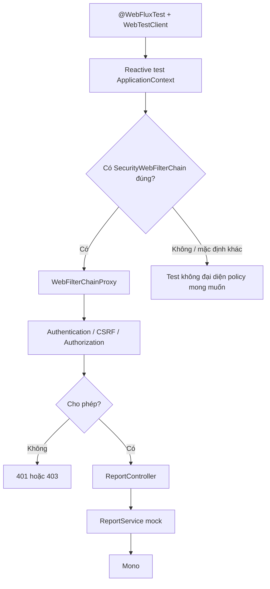

# @WebFluxTest và các bean bảo mật cần đưa vào lát cắt

`@WebFluxTest` giúp kiểm thử lớp HTTP của ứng dụng Spring WebFlux nhanh hơn việc khởi động toàn bộ ứng dụng. Tuy nhiên, **test slice chỉ nạp một phần Spring context**, nên một ca kiểm thử trả `200` hoặc `403` chưa chắc đang chạy với đúng cấu hình Spring Security của ứng dụng thật. Muốn kiểm chứng xác thực, phân quyền và bảo vệ HTTP, cần xác định **`SecurityWebFilterChain` và những bean bảo mật liên quan đã thực sự có mặt trong lát cắt hay chưa**.

Bài học thuộc module **SPRING_SECURITY_TESTING**, sử dụng `spring-security-test` để kiểm chứng ứng dụng Servlet và Reactive. Trọng tâm ở đây là **Reactive WebFlux**, `WebTestClient`, `@WebFluxTest`, `SecurityWebFilterChain` và các phụ thuộc như `ReactiveJwtDecoder`, `ReactiveOpaqueTokenIntrospector`, service và policy. Ví dụ minh họa các ca có quyền, thiếu quyền, chưa xác thực và thiếu CSRF; đồng thời làm rõ giới hạn của `@WithMockUser`, `mockUser()`, `mockJwt()` và cách chuyển sang integration test khi cần.

## 1. Lát cắt WebFlux là gì và vì sao bảo mật có thể khác production?

`@WebFluxTest` là một **test slice** của Spring Boot, tập trung vào thành phần web reactive như `@Controller`/`@RestController`, JSON codec, validation, converter, `@ControllerAdvice`, WebFlux configuration và những thành phần được auto-configuration hỗ trợ. Các tầng nghiệp vụ như `@Service`, `@Repository` và nhiều bean tùy biến khác thường **không được nạp chỉ vì chúng tồn tại trong dự án**.

`@WebFluxTest` thường cấu hình sẵn `WebTestClient` gắn với application context mô phỏng, nên request được xử lý trong tiến trình test. Không cần cổng HTTP thật hoặc khởi động toàn bộ embedded server.

Đối với Spring Security Reactive, request đi qua `WebFilterChainProxy` và một hay nhiều `SecurityWebFilterChain`:



Một test có thể **khởi động thành công nhưng đang dùng policy khác** vì:

- `@Configuration` chứa `SecurityWebFilterChain` thực tế không thuộc phạm vi quét của slice, trong khi Spring Boot có thể tạo cấu hình bảo mật mặc định.
- Controller cần service nhưng `@Service` không có trong slice, nên context lỗi do thiếu bean.
- Security chain dùng `ReactiveJwtDecoder` hoặc `ReactiveAuthenticationManager` nhưng các bean này bị loại khỏi slice.
- Test giả lập danh tính bằng `mockUser()`/`mockJwt()`; các helper đưa authentication vào test nhưng **không xác minh mật khẩu, chữ ký JWT hoặc kết nối Authorization Server thật**.
- Test mock nguyên cả service chứa `@PreAuthorize`, làm cho method security của service đó không được kiểm chứng.

**Quy tắc thiết lập:** trước khi khẳng định policy hoạt động, cần kiểm tra đúng bean, đúng filter chain và đúng loại xác thực mà ứng dụng sản xuất dùng.

## 2. Ba mức setup để lựa chọn

| Kiểu kiểm thử | Thiết lập điển hình | Mục đích phù hợp | Giới hạn |
| --- | --- | --- | --- |
| `@WebFluxTest` + `@Import` security configuration | Controller thật, chain thật, service mock | Mapping, JSON, HTTP authentication/authorization/CSRF trong lát cắt | Không chạy toàn bộ dependency, DB hoặc server ngoài |
| `@WebFluxTest` + test-only `SecurityWebFilterChain` | Controller thật, policy đơn giản của test | Cô lập hành vi controller và quy tắc thử nghiệm | **Không chứng minh chính sách production** nếu policy test khác policy thật |
| `@SpringBootTest` + `WebTestClient` | Full context, có thể chạy embedded server | Xác minh wiring đầy đủ, method security, filters, token integration | Chậm hơn; vẫn cần xác định có dùng mock authentication hay token thật |

Với bài kiểm thử chính sách HTTP, ưu tiên `@Import` **security configuration của ứng dụng** nếu nó có thể được dựng bằng các bean đã cho vào slice. Trường hợp phải tạo test-only policy để cô lập controller, ghi rõ rằng test đang chứng minh chính policy test ấy.

## 3. Mô hình ứng dụng Reactive tối thiểu

Ví dụ dùng Java 17+, Spring Boot 3.x, Spring WebFlux, Spring Security, Reactor và JUnit 5. Các đoạn code rời nhau được trình bày theo vai trò; bỏ `package` và `import` để dễ theo dõi.

Dependency Gradle:

```groovy
dependencies {
    implementation 'org.springframework.boot:spring-boot-starter-webflux'
    implementation 'org.springframework.boot:spring-boot-starter-security'

    testImplementation 'org.springframework.boot:spring-boot-starter-test'
    testImplementation 'org.springframework.security:spring-security-test'
}
```

**Đừng trộn ngẫu nhiên `spring-boot-starter-web` vào ví dụ này.** Khi Spring MVC và WebFlux cùng có trên classpath, Spring Boot thường ưu tiên loại ứng dụng Servlet. `@WebFluxTest` được thiết kế để kiểm thử reactive web stack; hãy bảo đảm dự án hoặc cấu hình test thực sự dùng WebFlux.

### 3.1. Controller và model

```java
record ReportDto(String id, String owner) {}

record CreateReportRequest(String title) {}

interface ReportService {
    Mono<ReportDto> findById(String id);
    Mono<ReportDto> create(CreateReportRequest request);
}

@RestController
@RequestMapping("/api/reports")
class ReportController {

    private final ReportService service;

    ReportController(ReportService service) {
        this.service = service;
    }

    @GetMapping("/{id}")
    Mono<ReportDto> find(@PathVariable String id) {
        return service.findById(id);
    }

    @PostMapping
    Mono<ReportDto> create(
            @RequestBody Mono<CreateReportRequest> request) {
        return request.flatMap(service::create);
    }
}
```

`ReportService` là hợp đồng nghiệp vụ. Trong ứng dụng thật sẽ có một implementation, nhưng trong `@WebFluxTest` ta dùng mock của `ReportService` để kiểm thử phần HTTP độc lập với repository hay database.

### 3.2. Cấu hình bảo mật cho ví dụ

Dùng scope để phân biệt quyền đọc và ghi:

```java
@Configuration(proxyBeanMethods = false)
@EnableWebFluxSecurity
class ReportSecurityConfig {

    @Bean
    SecurityWebFilterChain reportSecurity(ServerHttpSecurity http) {
        return http
            .authorizeExchange(exchanges -> exchanges
                .pathMatchers(HttpMethod.GET, "/api/reports/**")
                    .hasAuthority("SCOPE_reports.read")
                .pathMatchers(HttpMethod.POST, "/api/reports")
                    .hasAuthority("SCOPE_reports.write")
                .anyExchange().denyAll()
            )
            .httpBasic(Customizer.withDefaults())
            .build();
    }
}
```

Ví dụ dùng `httpBasic()` để xác định rõ entry point cho request chưa xác thực, nhờ đó kiểm thử `401 Unauthorized` ổn định. Các test bên dưới vẫn dùng `mockUser()` để giả lập user đã xác thực; không cần lưu hay kiểm tra mật khẩu thật.

Spring Security WebFlux thường bật **CSRF protection** theo mặc định. Với `POST /api/reports`, ngay cả user có authority `SCOPE_reports.write` cũng có thể nhận `403` nếu request thiếu CSRF token. Đây là hành vi cần kiểm tra riêng, tránh nhầm thành lỗi phân quyền.

**Phân biệt tên class:**

| Servlet | Reactive WebFlux |
| --- | --- |
| `HttpSecurity` | `ServerHttpSecurity` |
| `SecurityFilterChain` | `SecurityWebFilterChain` |
| `FilterChainProxy` | `WebFilterChainProxy` |
| `JwtDecoder` | `ReactiveJwtDecoder` |
| `OpaqueTokenIntrospector` | `ReactiveOpaqueTokenIntrospector` |
| `MockMvc` | `WebTestClient` |

Đừng tạo bean `SecurityFilterChain` dùng `HttpSecurity` rồi mong nó bảo vệ request của `WebTestClient` trong WebFlux slice.

## 4. @WebFluxTest: đưa SecurityWebFilterChain và mock service vào slice

`@WebFluxTest(controllers = ReportController.class)` giới hạn các controller cần kiểm thử. `@Import(ReportSecurityConfig.class)` nạp chính configuration chứa `SecurityWebFilterChain`. `@MockitoBean ReportService` cung cấp dependency của controller.

```java
@WebFluxTest(controllers = ReportController.class)
@Import(ReportSecurityConfig.class)
class ReportControllerSecuritySliceTest {

    @Autowired
    WebTestClient client;

    @MockitoBean
    ReportService service;

    @Test
    void authorizedReaderCanRead() {
        when(service.findById("r-1"))
            .thenReturn(Mono.just(new ReportDto("r-1", "alice")));

        client.mutateWith(mockUser("alice").authorities(
                new SimpleGrantedAuthority("SCOPE_reports.read")
            ))
            .get()
            .uri("/api/reports/r-1")
            .exchange()
            .expectStatus().isOk()
            .expectBody()
            .jsonPath("$.id").isEqualTo("r-1")
            .jsonPath("$.owner").isEqualTo("alice");

        verify(service).findById("r-1");
    }

    @Test
    void readerWithWrongScopeGets403() {
        client.mutateWith(mockUser("bob").authorities(
                new SimpleGrantedAuthority("SCOPE_inventory.read")
            ))
            .get()
            .uri("/api/reports/r-1")
            .exchange()
            .expectStatus().isForbidden();

        verifyNoInteractions(service);
    }

    @Test
    void anonymousRequestGets401() {
        client.get()
            .uri("/api/reports/r-1")
            .exchange()
            .expectStatus().isUnauthorized();

        verifyNoInteractions(service);
    }
}
```

`@MockitoBean` thuộc `org.springframework.test.context.bean.override.mockito.MockitoBean`, có trong Spring Framework 6.2+ (ví dụ Spring Boot 3.4+). Với phiên bản Spring Boot cũ hơn, sử dụng `@MockBean` tương thích phiên bản. Không cần tự chạy Mockito init khi Spring Test đã quản lý mock bean.

Các helper `mockUser` thuộc `org.springframework.security.test.web.reactive.server.SecurityMockServerConfigurers`. Với setup WebFlux test, `WebTestClient` phải được kết nối với security filters; `@WebFluxTest` và auto-configured WebTestClient theo Spring Boot thông thường sẽ bind tới application context. Nếu tự dựng client, hãy dùng cách ở mục 6.

Điều cần đọc từ ba test:

- `200` + JSON + `verify(service)` chứng minh request được phép đi tới controller và mock service trả đúng dữ liệu.
- `403` + `verifyNoInteractions(service)` chứng minh policy từ chối **trước khi controller gọi tầng nghiệp vụ**.
- `401` + `verifyNoInteractions(service)` chứng minh request anonymous bị entry point của chain chặn.

Trong test thứ hai, `mockUser("bob")` đã xác thực user nhưng cho authority không đúng. Nếu thay bằng anonymous, bạn sẽ kiểm tra **authentication failure** thay vì **authorization failure**; cần giữ hai ca tách biệt.

### Nếu bỏ @Import(ReportSecurityConfig.class) thì sao?

Test có thể chạy với cấu hình Spring Security mặc định do auto-configuration cung cấp, hoặc gặp lỗi thiếu bean tùy phiên bản và các dependency. Dù test trả `401` hay `403`, đó **không phải bằng chứng** rằng policy `SCOPE_reports.read` / `SCOPE_reports.write` trong `ReportSecurityConfig` đã được áp dụng.

Một cách kiểm tra rõ ràng là viết cả ca được phép với authority chính xác và ca bị từ chối với authority khác. Test với một request anonymous duy nhất không đủ để phân biệt policy production với cấu hình mặc định “mọi request phải đăng nhập”.

## 5. Kiểm tra CSRF riêng với WebTestClient

Spring Security WebFlux dùng CSRF token cho các phương thức HTTP thay đổi trạng thái theo mặc định. Với `POST`, lỗi `403` có thể xuất phát từ **thiếu CSRF token**, ngay cả khi người dùng có đủ scope.

Bổ sung hai test vào class ở mục 4:

```java
@Test
void writerWithoutCsrfGets403BeforeBusinessCall() {
    client.mutateWith(mockUser("alice").authorities(
            new SimpleGrantedAuthority("SCOPE_reports.write")
        ))
        .post()
        .uri("/api/reports")
        .contentType(MediaType.APPLICATION_JSON)
        .bodyValue(new CreateReportRequest("Q4 report"))
        .exchange()
        .expectStatus().isForbidden();

    verifyNoInteractions(service);
}

@Test
void writerWithCsrfCanCreate() {
    when(service.create(any(CreateReportRequest.class)))
        .thenReturn(Mono.just(new ReportDto("r-2", "alice")));

    client.mutateWith(mockUser("alice").authorities(
            new SimpleGrantedAuthority("SCOPE_reports.write")
        ))
        .mutateWith(csrf())
        .post()
        .uri("/api/reports")
        .contentType(MediaType.APPLICATION_JSON)
        .bodyValue(new CreateReportRequest("Q4 report"))
        .exchange()
        .expectStatus().isOk()
        .expectBody()
        .jsonPath("$.id").isEqualTo("r-2");

    verify(service).create(new CreateReportRequest("Q4 report"));
}
```

`csrf()` cũng thuộc `SecurityMockServerConfigurers`. Helper này chuẩn bị CSRF token cho request kiểm thử; nó **không thay thế việc kiểm tra nguồn gốc CSRF token thực tế** trong toàn bộ trình duyệt/session production.

Trường hợp API stateless dùng Bearer token có thể được cấu hình tắt CSRF theo chính sách dự án. Khi đó test `POST` phải phản ánh **cấu hình thật** của API, và việc loại bỏ CSRF không nên được thêm chỉ để làm test xanh. Nếu tắt CSRF trong production, không viết assertion “thiếu CSRF phải bị `403`” như một yêu cầu không còn tồn tại.

## 6. Khi phải tự dựng WebTestClient, hãy gắn đúng Spring Security

Trong nhiều dự án, `@WebFluxTest` tự cấu hình `WebTestClient` và bạn chỉ cần `@Autowired`. Khi muốn kiểm soát việc bind thủ công, phải gắn security test configurer vào reactive application context:

```java
@WebFluxTest(controllers = ReportController.class)
@Import(ReportSecurityConfig.class)
class ManualClientBindingTest {

    @Autowired
    ApplicationContext context;

    @MockitoBean
    ReportService service;

    private WebTestClient client;

    @BeforeEach
    void createClient() {
        client = WebTestClient
            .bindToApplicationContext(context)
            .apply(springSecurity())
            .configureClient()
            .responseTimeout(Duration.ofSeconds(5))
            .build();
    }

    @Test
    void forbiddenWithoutScope() {
        client.mutateWith(mockUser("bob").authorities(
                new SimpleGrantedAuthority("SCOPE_inventory.read")
            ))
            .get()
            .uri("/api/reports/r-1")
            .exchange()
            .expectStatus().isForbidden();
    }
}
```

`springSecurity()` ở đây là `SecurityMockServerConfigurers.springSecurity()`, dùng với WebTestClient. Nó gắn test client vào cấu trúc Spring Security Reactive trong application context, cho phép các post-processor như `mockUser()` hoạt động đúng ở lớp `WebFilter`.

**Tránh nhầm những cách bind:**

| Cách tạo client | Hệ thống được chạy | Có tự bao gồm security của application context? |
| --- | --- | --- |
| `@Autowired WebTestClient` trong `@WebFluxTest` | WebFlux slice, in-process | Có khi cấu hình slice/auto-config chuẩn và security chain được nạp |
| `bindToApplicationContext(ctx).apply(springSecurity())` | WebFlux application context, in-process | Có nếu context chứa security beans phù hợp |
| `bindToController(controller)` đơn thuần | Controller và phần web infrastructure tối thiểu | Không tự mang toàn bộ production security chain |
| `bindToServer().baseUrl(...)` | HTTP server chạy ở URL đã cho | Server tự quyết định bảo mật; các mock authentication post-processor in-process không thay thế login/token thật |

Nếu dùng `bindToController(...)` để kiểm tra JSON/validation, hãy mô tả nó là test controller rút gọn. Đừng khẳng định `401/403` hay method security đã được bảo vệ đúng trừ khi đã thiết lập, kiểm tra chính những web filters cần thiết.

## 7. Bean bảo mật nào cần đưa vào lát cắt?

Không có một danh sách bean bắt buộc áp dụng cho mọi ứng dụng. Quy tắc là **đưa vào những bean mà `SecurityWebFilterChain` và các thành phần được kiểm thử thực sự phụ thuộc**.

| Trường hợp | Bean cần xem xét | Cách đưa vào test slice |
| --- | --- | --- |
| HTTP rules với `authorizeExchange` | `SecurityWebFilterChain`, có thể là `ReactiveAuthorizationManager` tùy biến | `@Import` configuration thật; mock dependency không thuộc web slice nếu cần |
| Controller inject service | Interface/bean service | `@MockitoBean`, stub `Mono`/`Flux` phù hợp |
| HTTP Basic với username/password thực | `ReactiveUserDetailsService`, `PasswordEncoder` hoặc `ReactiveAuthenticationManager` | `@Import` bean xác thực test hoặc mock theo mục tiêu |
| Resource Server JWT | `SecurityWebFilterChain` với `oauth2ResourceServer().jwt()`, `ReactiveJwtDecoder` | `@Import` chain + `@MockitoBean ReactiveJwtDecoder` cho test mock Bearer |
| Resource Server opaque token | `ReactiveOpaqueTokenIntrospector` | `@MockitoBean` hoặc bean kiểm thử phù hợp |
| Custom role/scope/tenant policy | Bean policy, converter hoặc `ReactiveAuthorizationManager` | `@Import` logic thật + mock repository/nguồn policy |
| OAuth2 Client login / client registrations | `ReactiveClientRegistrationRepository`, authorized-client repository/service và các bean được chain yêu cầu | Import cấu hình cần thiết hoặc cung cấp fixture cho đúng luồng |
| Method Security | `@EnableReactiveMethodSecurity` cùng **service bean thật được AOP proxy** | Test riêng service hoặc full context; mock service không kiểm tra annotation trên service |

### 7.1. Không mock SecurityWebFilterChain khi mục tiêu là kiểm tra HTTP security

Nếu test muốn xác nhận policy, bean `SecurityWebFilterChain` phải có implementation xây dựng từ `ServerHttpSecurity` với các quy tắc thực tế. Mock chain bằng Mockito rồi chỉ kiểm tra `200` của controller sẽ bỏ qua điều cần chứng minh.

Nếu configuration production có các bean phụ thuộc như `tenantPermissionEvaluator`, hãy giữ code policy và mock **nguồn dữ liệu cần truy vấn** của nó (ví dụ repository) thay vì mock toàn bộ kết quả `hasAuthority`. Điều này giúp test thực sự kiểm tra policy bằng dữ liệu fixture.

### 7.2. Khi @Import kéo theo nhiều bean ngoài lát cắt

Ví dụ `ReportSecurityConfig` thực còn inject `ReactiveJwtDecoder`, `ReactiveAuthenticationManager` hoặc một custom `ReactiveAuthorizationManager`. Khi import vào slice, thiếu bean sẽ gây lỗi khởi động context, thường là `NoSuchBeanDefinitionException` hoặc `UnsatisfiedDependencyException`.

Hãy đọc dependency trong lỗi:

1. Bean được thiếu có thuộc policy bạn đang kiểm tra không?
2. Nếu thuộc policy, có thể `@Import` implementation thật và mock nguồn dữ liệu bên dưới không?
3. Nếu là client ngoài, identity provider hoặc repository, có thể dùng `@MockitoBean` hoặc fake bean đơn giản không?
4. Bean test đã tạo có đúng **reactive type** và đúng qualifier mà configuration thật yêu cầu không?

Đừng xử lý lỗi thiếu bean bằng cách loại bỏ toàn bộ security configuration khỏi `@Import`; cách đó làm test mất ý nghĩa đối với policy của ứng dụng.

## 8. Biến thể Resource Server JWT: mockJwt() và ReactiveJwtDecoder

Khi WebFlux API thực sự dùng Bearer JWT, cấu hình security phải chọn Resource Server JWT thay vì HTTP Basic:

```java
@Configuration(proxyBeanMethods = false)
@EnableWebFluxSecurity
class JwtApiSecurityConfig {

    @Bean
    SecurityWebFilterChain jwtSecurity(ServerHttpSecurity http) {
        return http
            .authorizeExchange(exchanges -> exchanges
                .pathMatchers("/api/reports/**")
                    .hasAuthority("SCOPE_reports.read")
                .anyExchange().denyAll()
            )
            .oauth2ResourceServer(oauth2 ->
                oauth2.jwt(Customizer.withDefaults())
            )
            .build();
    }
}
```

Test slice tương ứng:

```java
@WebFluxTest(controllers = ReportController.class)
@Import(JwtApiSecurityConfig.class)
class JwtApiSliceTest {

    @Autowired WebTestClient client;

    @MockitoBean ReportService service;

    // Cung cấp bean để chain khởi tạo mà không gọi JWKS/IdP thật.
    @MockitoBean ReactiveJwtDecoder decoder;

    @Test
    void simulatedJwtWithReadScopeCanRead() {
        when(service.findById("r-1"))
            .thenReturn(Mono.just(new ReportDto("r-1", "alice")));

        client.mutateWith(mockJwt()
                .jwt(jwt -> jwt.claim("sub", "alice"))
                .authorities(new SimpleGrantedAuthority("SCOPE_reports.read"))
            )
            .get()
            .uri("/api/reports/r-1")
            .exchange()
            .expectStatus().isOk();

        verifyNoInteractions(decoder);
    }
}
```

`mockJwt()` thuộc `SecurityMockServerConfigurers` của Spring Security Test. Nó tạo authentication giả trong security context reactive, nên **không gọi `ReactiveJwtDecoder` để xác minh chữ ký**. `@MockitoBean ReactiveJwtDecoder` ở đây giúp chain có bean decoder khi khởi tạo; `verifyNoInteractions(decoder)` minh họa rõ giới hạn kiểm thử.

Nếu muốn kiểm tra **đường HTTP Bearer và ánh xạ scope bởi Resource Server**, dùng header và mock decoder:

```java
@Test
void bearerHeaderUsesReactiveDecoder() {
    Instant now = Instant.now();

    Jwt jwt = Jwt.withTokenValue("fixture-token")
        .header("alg", "RS256")
        .claim("sub", "alice")
        .claim("scope", "reports.read")
        .issuedAt(now)
        .expiresAt(now.plusSeconds(300))
        .build();

    when(decoder.decode("fixture-token")).thenReturn(Mono.just(jwt));
    when(service.findById("r-1"))
        .thenReturn(Mono.just(new ReportDto("r-1", "alice")));

    client.get()
        .uri("/api/reports/r-1")
        .headers(headers -> headers.setBearerAuth("fixture-token"))
        .exchange()
        .expectStatus().isOk();

    verify(decoder).decode("fixture-token");
}
```

Lưu ý hai mức chứng minh:

- `mockJwt()` phù hợp với **authorization policy sau khi đã có authentication**.
- Bearer header + mock `ReactiveJwtDecoder` đi qua filter/decoder interface, nhưng **vẫn chưa xác minh mật mã**. Để kiểm thử chữ ký và các validators như issuer/audience/expiration, cần decoder thật với JWT được ký trong môi trường test.

Cùng quy tắc này áp dụng cho `mockOpaqueToken()` và `ReactiveOpaqueTokenIntrospector`: tạo principal giả không phải chứng cứ rằng introspection HTTP đã chạy.

## 9. @WithMockUser, Reactive SecurityContext và method security

`@WithMockUser` có thể dùng trong các test Spring Security để khai báo authentication giả theo annotation. Trong WebFlux, xác thực đi theo **Reactor Context** qua luồng reactive, không nên dựa vào `SecurityContextHolder` dạng ThreadLocal trong business code.

Trong các test WebTestClient ở mức HTTP, `.mutateWith(mockUser("alice"))` thể hiện rõ identity gắn với request, đồng thời dễ tạo ca đối chứng ngay trong cùng test class. Với `@WithMockUser`, cần bảo đảm Spring Security Test đã tích hợp các test execution listeners / Reactor context tương ứng theo setup và phiên bản đang dùng.

Nếu mã nghiệp vụ thực sự cần danh tính, hãy sử dụng `ReactiveSecurityContextHolder.getContext()` hoặc các API nhận `Principal`/`Authentication` phù hợp trong Reactor chain. Không nên dựa vào `ThreadLocal` giữa các thread hoặc sau `publishOn`, vì có thể gây kết quả test không phản ánh identity của request.

### 9.1. @PreAuthorize trên service không được kiểm tra khi service bị mock

Giả sử production service có:

```java
@Service
class ReportServiceImpl implements ReportService {

    @PreAuthorize("hasAuthority('SCOPE_reports.read')")
    public Mono<ReportDto> findById(String id) {
        return repository.findById(id)
            .map(entity -> new ReportDto(entity.id(), entity.owner()));
    }
}
```

Nếu trong `@WebFluxTest` bạn dùng:

```java
@MockitoBean ReportService service;
```

thì `@PreAuthorize` nằm trên implementation thật **không được thực thi**, vì bean đã được thay bằng mock. Test slice vẫn kiểm tra được quyền ở **`SecurityWebFilterChain`** nếu chain đúng. Muốn kiểm tra method security, nạp **service thật qua Spring proxy** cùng `@EnableReactiveMethodSecurity`, mock repository/nguồn dữ liệu, hoặc dùng full context test. Đặc biệt lưu ý self-invocation trong cùng bean có thể bỏ qua proxy AOP.

Nếu policy nằm **chỉ ở method security** mà HTTP chain chỉ yêu cầu `authenticated()`, một test slice mock service có thể trả `200` cho người thiếu quyền. Đó là giới hạn của phạm vi test, không nhất thiết là lỗi production.

## 10. Những lỗi thiết lập thường gặp

| Hiện tượng | Nguyên nhân cần kiểm tra | Cách xử lý |
| --- | --- | --- |
| Context không khởi động vì thiếu `ReportService` | `@WebFluxTest` không tự nạp service | `@MockitoBean ReportService` và stub `Mono` |
| Context thiếu `ReactiveJwtDecoder` | JWT resource-server chain được import nhưng decoder không có | Cung cấp bean/mock decoder phù hợp với test |
| Test `403` dù có scope đúng | Thiếu CSRF ở POST, authority sai hoặc chain khác | Phân biệt POST/GET, thêm `csrf()` nếu chính sách yêu cầu; kiểm tra chain |
| Test `401` mặc dù có `mockUser()` | Client chưa tích hợp security test configurer hoặc identity không áp dụng | Kiểm tra cách bind, `springSecurity()` và helper |
| Test `200` cho mọi user | Chain/policy không được nạp, route `permitAll` hoặc filter bị bỏ | `@Import` config thật và thêm negative tests |
| Test `401`/`403` pass nhưng policy thực khác | Đang dùng security auto-configuration mặc định | Nạp `SecurityWebFilterChain` thật, test quyền hợp lệ và không hợp lệ |
| Test JWT pass nhưng decoder không chạy | `mockJwt()` đã dựng authentication | Dùng Bearer header + decoder mock/thật tùy mục tiêu |
| Method security không từ chối | Service chứa annotation đã bị mock hoặc chưa bật reactive method security | Nạp service thật, `@EnableReactiveMethodSecurity` và proxy |
| Test “treo” vì Mono không hoàn tất | Service mock trả null hoặc publisher vô hạn | Stub `Mono.just`/`Mono.empty`/`Mono.error` phù hợp; xác định thời hạn |
| `WebTestClient` bind server không nhận `mockUser()` | Server ngoài không chia sẻ mock security context in-process | Dùng Basic/Bearer/session credentials thật cho HTTP integration |

### Phân biệt 401 và 403

Với một policy bảo vệ tài nguyên:

- **`401 Unauthorized`**: caller chưa được xác thực trong cơ chế entry point đang dùng.
- **`403 Forbidden`**: caller đã xác thực nhưng không có authority được yêu cầu, hoặc request bị cơ chế như CSRF từ chối.
- **`200 OK`**: request vượt qua lớp bảo mật đang cấu hình và controller trả response mong đợi.

Đây là kết quả điển hình theo ví dụ HTTP Basic ở trên. Một ứng dụng dùng form login có thể redirect thay cho `401`; custom exception handler/entry point cũng có thể đổi phản hồi. Kiểm thử phải dựa trên cấu hình thực tế.

## 11. Khi nào cần @SpringBootTest và server thật?

`@WebFluxTest` rất thích hợp cho các bài kiểm thử controller và security policy ở tầng HTTP. Tuy nhiên, hãy chuyển sang integration test khi mục tiêu đòi:

- Wiring đầy đủ của service/repository, transaction và method security.
- Bearer token thực với `ReactiveJwtDecoder` và kiểm tra chữ ký JWT hoặc introspection HTTP.
- OAuth2/OIDC login hoặc giao tiếp với Authorization Server trong môi trường thử nghiệm.
- Các filter/customizer được đăng ký qua nhiều auto-configuration mà slice không nạp.
- Hành vi transport thực như network, redirect, header forwarding, TLS hoặc tích hợp gateway.

Một khung integration test với WebFlux server:

```java
@SpringBootTest(
    webEnvironment = SpringBootTest.WebEnvironment.RANDOM_PORT
)
@AutoConfigureWebTestClient
class ReportHttpIntegrationTest {

    @Autowired WebTestClient client;

    @Test
    void requestWithoutCredentialsIsRejected() {
        client.get()
            .uri("/api/reports/r-1")
            .exchange()
            .expectStatus().isUnauthorized();
    }
}
```

Ở đây, `WebTestClient` gửi HTTP đến server thử nghiệm chạy thật. **Không dùng `mockUser()`/`mockJwt()` như bằng chứng đã xác thực server ngoài**, vì các helper dành cho mô phỏng security context trong test in-process. Muốn kiểm tra authentication qua network, hãy gửi credential thật của môi trường test bằng Basic, Bearer JWT, opaque token hoặc session cookie và kiểm tra server trả kết quả.

Nếu vẫn dùng `@SpringBootTest(webEnvironment = MOCK)`, bạn có thể bind `WebTestClient` trực tiếp vào `ApplicationContext` để có full context nhưng vẫn không mở cổng HTTP. Hai trục **full context/slice** và **in-process/real HTTP** cần được phân biệt khi đọc test.

## 12. Bài thực hành thiết lập và kiểm chứng

1. Tạo `ReportController`, `ReportService` và `ReportSecurityConfig` như mục 3.
2. Tạo test `@WebFluxTest(controllers = ReportController.class)`, `@Import(ReportSecurityConfig.class)`, `@MockitoBean ReportService`. Chạy test user có `SCOPE_reports.read` và kiểm tra `200` cùng JSON.
3. Dùng `mockUser("bob")` chỉ có `SCOPE_inventory.read`. Xác nhận `403` và `verifyNoInteractions(service)`.
4. Gửi request không có authentication. Xác nhận `401` theo cấu hình HTTP Basic.
5. Thêm endpoint `POST`, chạy một test thiếu CSRF và một test có `mutateWith(csrf())`. Tách rõ thiếu CSRF với thiếu scope.
6. Thử bỏ `@Import(ReportSecurityConfig.class)` trong một nhánh thử nghiệm; quan sát khác biệt và giải thích vì sao policy production chưa chắc đang được kiểm tra. Khôi phục import sau khi quan sát.
7. Đổi cấu hình sang JWT Resource Server, cung cấp `ReactiveJwtDecoder` mock, chạy `mockJwt()` cho policy và Bearer header cho decoder flow. Giải thích tại sao cả hai chưa phải test xác minh chữ ký.

Ma trận kiểm tra:

| Ca | Authentication | Scope | CSRF | Kết quả kỳ vọng ở ví dụ |
| --- | --- | --- | --- | --- |
| GET hợp lệ | User giả đã xác thực | `reports.read` | Không cần | `200`, gọi service |
| GET thiếu scope | User giả đã xác thực | `inventory.read` | Không cần | `403`, không gọi service |
| GET anonymous | Không có | Không | Không cần | `401`, không gọi service |
| POST có quyền nhưng thiếu CSRF | User giả đã xác thực | `reports.write` | Thiếu | `403`, không gọi service |
| POST có quyền và CSRF | User giả đã xác thực | `reports.write` | Có | `200`, gọi service |
| JWT helper có authority | `mockJwt()` | `reports.read` | Không cần với GET | `200`, decoder không được gọi |
| Bearer JWT + mock decoder | Raw Bearer header | Claim scope phù hợp | Không cần với GET | `200`, decoder mock được gọi |

**Tiêu chí hoàn thành:** bạn biết chính xác `@WebFluxTest` đã nạp những bean nào, hiểu `@Import` dùng để đưa security policy thực vào slice và `@MockitoBean` dùng để thay các dependency ngoài phạm vi. Một bộ test bảo mật có giá trị phải chứng minh đồng thời **đường được phép** và **đường bị từ chối**, đồng thời ghi rõ việc xác thực đang sử dụng helper giả hay token/credential thực.

## Tài liệu tham khảo

- [Spring Boot — Testing Spring WebFlux Applications](https://docs.spring.io/spring-boot/reference/testing/spring-boot-applications.html#testing.spring-boot-applications.with-mock-environment): `@WebFluxTest`, `WebTestClient` và phạm vi test.
- [Spring Security — WebFlux Security](https://docs.spring.io/spring-security/reference/reactive/configuration/webflux.html): `@EnableWebFluxSecurity`, `SecurityWebFilterChain`, `ServerHttpSecurity`.
- [Spring Security — Reactive Testing](https://docs.spring.io/spring-security/reference/reactive/test/index.html): thiết lập Spring Security Test với Reactor và WebTestClient.
- [Spring Security — WebTestClient Setup](https://docs.spring.io/spring-security/reference/reactive/test/web/setup.html): `WebTestClient.bindToApplicationContext(...).apply(springSecurity())`.
- [Spring Security — WebTestClient Authentication](https://docs.spring.io/spring-security/reference/reactive/test/web/authentication.html): `mockUser()`, `@WithMockUser` và các helper mô phỏng authentication.
- [Spring Security — WebTestClient CSRF](https://docs.spring.io/spring-security/reference/reactive/test/web/csrf.html): `csrf()` trong kiểm thử WebFlux.
- [Spring Security — WebTestClient OAuth2](https://docs.spring.io/spring-security/reference/reactive/test/web/oauth2.html): `mockJwt()` và `mockOpaqueToken()`.
