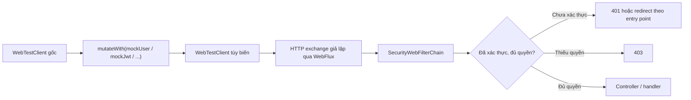

# mutateWith và cấu hình danh tính cho từng ca

## 1. Vì sao mỗi ca kiểm thử cần một danh tính riêng?

Giả sử một ứng dụng WebFlux có ba quy tắc bảo vệ HTTP:

- Người dùng bất kỳ đã đăng nhập được xem `GET /api/me`.
- Chỉ người dùng có quyền `ROLE_ADMIN` được xem `GET /admin`.
- Chỉ principal có authority `SCOPE_reports:read` được xem `GET /api/reports/42`.

Một lớp test cần lần lượt kiểm tra khách chưa xác thực, `alice` có quyền quản trị, `bob` thiếu quyền và một JWT giả lập có scope đọc báo cáo. Nếu gắn một danh tính mặc định cho toàn bộ lớp test, nhiều ca có thể vô tình sử dụng quyền của nhau hoặc không thể mô tả chính xác request thực tế.

`WebTestClient.mutateWith(...)` cho phép tạo một **WebTestClient tùy biến từ client hiện có**, áp dụng một bộ cấu hình kiểm thử như `mockUser(...)`, `mockJwt()`, `mockOAuth2Login()`, `mockOidcLogin()`, `mockAuthentication(...)` hoặc `csrf()`. Ta có thể dùng **client nền không gắn danh tính**, rồi chỉ tạo client có danh tính ở từng ca, giúp test rõ ràng và dễ bảo trì.

Bài học thuộc chương **Thiết lập WebTestClient** của module **SPRING_SECURITY_TESTING**. Mục tiêu lớn hơn là kiểm chứng xác thực, phân quyền và bảo vệ HTTP trên Servlet/Reactive bằng `spring-security-test`, `MockMvc`, `WebTestClient`, `@WithMockUser`, `SecurityContext` và JWT/OAuth2/OIDC giả lập. Chủ đề ở đây tập trung vào **Reactive WebFlux**: cách sử dụng `mutateWith` đúng ngữ cảnh, cách tránh rò rỉ authentication giữa các ca và cách hiểu giới hạn của test đã mock danh tính.

Sau bài, bạn có thể:

1. Cài đặt WebTestClient gắn với ứng dụng WebFlux và security filter chain thực.
2. Dùng `mutateWith(mockUser(...))` để thử các quyền và trạng thái 401/403/200 theo từng request.
3. Dùng `mockJwt()`, `mockOAuth2Login()`, `mockOidcLogin()` và `mockAuthentication(...)` đúng mục đích.
4. Kết hợp `mutateWith(csrf())` với authentication khi gửi HTTP POST.
5. Phân biệt client mock gắn trực tiếp `ApplicationContext` với client gửi HTTP tới server thật.
6. Tổ chức test để mỗi danh tính và bộ quyền được chỉ định một cách tường minh, không lệ thuộc thứ tự chạy.

## 2. mutateWith hoạt động trên phần nào của WebTestClient?

Trong test WebFlux có tích hợp Spring Security, luồng kiểm thử thường là:



`mutateWith(...)` nhận một `WebTestClientConfigurer` (bộ cấu hình cho test client). Các hàm như `mockUser` và `mockJwt` nằm trong `SecurityMockServerConfigurers` của `spring-security-test`. Với client kết nối trực tiếp đến `ApplicationContext` của WebFlux, chúng có thể đặt authentication vào **mock server exchange / reactive security context** mà Spring Security sử dụng khi kiểm tra authorization.

Điều quan trọng: `mutateWith(...)` **trả về một WebTestClient mới** được tùy biến. Ta không cần thay đổi cấu hình toàn cục, không cần đăng nhập thật qua endpoint và không nên giữ cùng một mock identity cho các test không liên quan.

```java
WebTestClient asAlice = baseClient.mutateWith(
    mockUser("alice").roles("ADMIN")
);

WebTestClient asBob = baseClient.mutateWith(
    mockUser("bob").roles("USER")
);

// Client gốc vẫn được dùng cho anonymous requests.
baseClient.get().uri("/admin").exchange()
    .expectStatus().isUnauthorized();

// Hai client phát sinh từ cùng một baseline,
// nhưng nhận hai danh tính khác nhau.
asAlice.get().uri("/admin").exchange()
    .expectStatus().isOk();

asBob.get().uri("/admin").exchange()
    .expectStatus().isForbidden();
```

Các status trên giả định một cấu hình sử dụng **HTTP Basic entry point** (anonymous nhận 401), quy tắc `hasRole("ADMIN")` cho `/admin` và controller trả thành công. Nếu ứng dụng dùng form/OAuth2 login, anonymous có thể nhận **302** đến trang đăng nhập; chỉ test với status phù hợp cấu hình thật.

### 2.1. Đừng nhầm mutateWith với việc sửa một HTTP header

`mockUser()` không đơn thuần thêm header `Authorization`. Nó cung cấp một principal và các authorities giả lập vào cơ chế test của Spring Security. Do đó:

- Không cần cung cấp mật khẩu của `alice`.
- Không đi qua password encoder, authentication manager hay API login thật.
- Không chứng minh rằng cookie/session, bearer token, OIDC callback hoặc JWT signature hợp lệ.
- Vẫn có thể kiểm tra quy tắc authorization trên `SecurityWebFilterChain` và hoạt động của controller với principal có sẵn.

Nếu mục tiêu là kiểm tra header Bearer được phân tích và JWT được xác minh, phải gửi token được ký thật qua `Authorization: Bearer ...` với `ReactiveJwtDecoder` thật trong test tích hợp. `mutateWith(mockJwt())` giải quyết một mục tiêu khác: **kiểm thử nhanh authorization với JWT authentication giả lập**.

### 2.2. So sánh các cách đặt authentication

| Công cụ | Phạm vi điển hình | Dữ liệu được dựng | Mục đích |
|---|---|---|---|
| `mutateWith(mockUser(...))` | Client tạo trong một ca / request cụ thể | User + roles/authorities | Quyền của user đã xác thực |
| `mutateWith(mockJwt())` | Client test WebFlux | JWT authentication giả lập | Rule scope/authority, principal JWT |
| `mutateWith(mockOAuth2Login())` | Client test WebFlux | OAuth2 login authentication giả lập | Logic sau OAuth2 login |
| `mutateWith(mockOidcLogin())` | Client test WebFlux | OIDC principal, ID Token/UserInfo giả lập | Logic sau OIDC login |
| `mutateWith(mockAuthentication(...))` | Client test WebFlux | `Authentication` do test tạo | Custom principal, custom authority |
| `mutateWith(csrf())` | Client test WebFlux | CSRF token hợp lệ giả lập | Kiểm tra POST/PUT/PATCH/DELETE có bảo vệ CSRF |
| `@WithMockUser` | Phương thức/lớp test chạy cùng Spring Test context | Mock security context do TestExecutionListener tạo | Ca có một danh tính mặc định |
| Servlet `MockMvc.with(user(...))` | Request Servlet | Mock authentication của Spring MVC | Tương đương về ý nghĩa, khác API |

Không gọi `MockMvc` post-processors như `with(user(...))` trực tiếp trên `WebTestClient`; hai họ helper có kiểu và cơ chế khác nhau. Không dùng `@WithMockUser` để thay thế `mockJwt()` nếu controller cần principal thật sự là `Jwt`.

## 3. Thiết lập WebTestClient đúng cho mock WebFlux security

Bộ kiểm thử cần Spring WebFlux, Spring Security và `spring-security-test` với phiên bản tương thích:

```kotlin
// build.gradle.kts - minh họa phụ thuộc trong ứng dụng Spring Boot
dependencies {
    implementation("org.springframework.boot:spring-boot-starter-webflux")
    implementation("org.springframework.boot:spring-boot-starter-security")
    // Cần khi ví dụ có các principal JWT, OAuth2 và OIDC.
    implementation("org.springframework.boot:spring-boot-starter-oauth2-client")
    implementation("org.springframework.boot:spring-boot-starter-oauth2-resource-server")

    testImplementation("org.springframework.boot:spring-boot-starter-test")
    testImplementation("org.springframework.security:spring-security-test")
}
```

### 3.1. WebTestClient gắn application context

Khi tự dựng WebTestClient để chạy qua mock server exchange, dùng:

```java
@Autowired
ApplicationContext applicationContext;

WebTestClient baseClient = WebTestClient
    .bindToApplicationContext(applicationContext)
    .apply(springSecurity())
    .build();
```

`springSecurity()` là static helper từ `SecurityMockServerConfigurers`. Nó cấu hình hạ tầng test để các bộ mock authentication hoạt động với Spring Security WebFlux. Client phải liên kết với **WebFlux application context thật có `SecurityWebFilterChain`**; nếu xây một client gắn vào controller đơn lẻ mà không nạp security chain, các assertion 401/403 có thể không kiểm tra filter như bạn nghĩ.

Nếu dùng Spring Boot:

```java
@SpringBootTest(
    webEnvironment = SpringBootTest.WebEnvironment.MOCK
)
@AutoConfigureWebTestClient
class MyWebFluxTest {

    @Autowired
    WebTestClient webTestClient;
}
```

Client do `@AutoConfigureWebTestClient` cung cấp thường đã liên kết với context kiểm thử. Hãy xác nhận đó là **ứng dụng Reactive**, đặc biệt nếu classpath cũng chứa Spring MVC: một số cấu hình Boot sẽ ưu tiên MVC khi có cả hai starter. Có thể đặt web application type là reactive ở test profile khi có chủ đích, và xác nhận security chain được nạp.

Với `@WebFluxTest`, test chỉ tải phần WebFlux được chọn; cần `@Import` các bean security, controller và dependency cần thiết để case thực sự đi qua chuỗi bảo vệ. Với cách tạo client thủ công bằng `bindToApplicationContext`, luôn `apply(springSecurity())` để bộ mock principal hoạt động đúng.

### 3.2. Những import hay dùng

```java
import org.junit.jupiter.api.Test;
import org.springframework.beans.factory.annotation.Autowired;
import org.springframework.boot.test.autoconfigure.web.reactive.AutoConfigureWebTestClient;
import org.springframework.boot.test.context.SpringBootTest;
import org.springframework.http.HttpMethod;
import org.springframework.security.core.Authentication;
import org.springframework.security.core.authority.SimpleGrantedAuthority;
import org.springframework.security.oauth2.core.oidc.user.OidcUser;
import org.springframework.security.oauth2.jwt.Jwt;
import org.springframework.test.web.reactive.server.WebTestClient;
import org.springframework.security.web.server.SecurityWebFilterChain;

import static org.springframework.security.test.web.reactive.server.SecurityMockServerConfigurers.springSecurity;
import static org.springframework.security.test.web.reactive.server.SecurityMockServerConfigurers.mockUser;
import static org.springframework.security.test.web.reactive.server.SecurityMockServerConfigurers.mockJwt;
import static org.springframework.security.test.web.reactive.server.SecurityMockServerConfigurers.mockOAuth2Login;
import static org.springframework.security.test.web.reactive.server.SecurityMockServerConfigurers.mockOidcLogin;
import static org.springframework.security.test.web.reactive.server.SecurityMockServerConfigurers.mockAuthentication;
import static org.springframework.security.test.web.reactive.server.SecurityMockServerConfigurers.csrf;
```

Nếu chỉ dùng một vài helper, chỉ import những helper cần thiết. Các import khác của `DemoSecurity` và `DemoController` có thể để IDE tự bổ sung.

## 4. Ví dụ chạy được: API mẫu có bốn quy tắc phân quyền

Để có các phép thử rõ ràng, xét một ứng dụng WebFlux dùng HTTP Basic cho request chưa xác thực. Security policy và controller minh họa:

```java
@Configuration
@EnableWebFluxSecurity
class DemoSecurity {

    @Bean
    SecurityWebFilterChain security(ServerHttpSecurity http) {
        return http
            .authorizeExchange(exchanges -> exchanges
                .pathMatchers(HttpMethod.GET, "/api/me")
                    .authenticated()
                .pathMatchers(HttpMethod.GET, "/api/oidc-email")
                    .authenticated()
                .pathMatchers(HttpMethod.GET, "/api/reports/**")
                    .hasAuthority("SCOPE_reports:read")
                .pathMatchers(HttpMethod.GET, "/admin")
                    .hasRole("ADMIN")
                .pathMatchers(HttpMethod.POST, "/api/notes")
                    .hasRole("EDITOR")
                .anyExchange().denyAll()
            )
            .httpBasic(Customizer.withDefaults())
            .formLogin(ServerHttpSecurity.FormLoginSpec::disable)
            .csrf(Customizer.withDefaults())
            .build();
    }
}
```

Với Java 17+, một controller tối giản trả về các giá trị dễ assert:

```java
@RestController
class DemoController {

    @GetMapping("/api/me")
    Mono<String> me(Mono<Principal> principal) {
        return principal.map(Principal::getName);
    }

    @GetMapping("/api/reports/42")
    Mono<String> report() {
        return Mono.just("report-42");
    }

    @GetMapping("/admin")
    Mono<String> admin() {
        return Mono.just("admin-dashboard");
    }

    @PostMapping("/api/notes")
    Mono<String> createNote() {
        return Mono.just("created");
    }

    @GetMapping("/api/oidc-email")
    Mono<String> idTokenEmail(
            @AuthenticationPrincipal OidcUser user) {
        if (user == null) {
            return Mono.error(
                new ResponseStatusException(
                    HttpStatus.UNAUTHORIZED));
        }
        return Mono.justOrEmpty(
            user.getIdToken().getClaimAsString("email"));
    }
}
```

Các import riêng gồm `@Configuration`, `@EnableWebFluxSecurity`, `@Bean`, `ServerHttpSecurity`, `SecurityWebFilterChain`, `HttpMethod`, `Customizer`, `@RestController`, `@GetMapping`, `@PostMapping`, `@AuthenticationPrincipal`, `Principal`, `Mono`, `OidcUser`, `ResponseStatusException` và `HttpStatus`.

Ứng dụng mẫu cố ý chỉ có **HTTP Basic và authorization rules**, chưa cấu hình Bearer JWT decoder, OAuth2 Client hay OIDC login thực. Điều đó vẫn đủ để các helper `mockJwt()` và `mockOidcLogin()` kiểm tra **authorization với authentication giả lập**; chúng không cần resource server hay OAuth2 client thực được bật. Để kiểm tra giao thức token thật, phải thêm cấu hình tương ứng và một lớp test tích hợp riêng.

Rule `hasRole("ADMIN")` thực tế cần authority `ROLE_ADMIN`; `hasAuthority("SCOPE_reports:read")` cần đúng chuỗi authority đó. Hai dạng kiểm tra không hoán đổi cho nhau: nếu đã có prefix `ROLE_`, đừng truyền `"ROLE_ADMIN"` trực tiếp vào `roles(...)` vì helper có quy tắc tự thêm prefix.

## 5. Test danh tính theo từng ca bằng mockUser

Đây là cách đơn giản nhất để diễn đạt rõ ai được phép làm gì.

```java
@SpringBootTest(
    webEnvironment = SpringBootTest.WebEnvironment.MOCK
)
@AutoConfigureWebTestClient
class PerCaseIdentityTest {

    @Autowired
    WebTestClient baseClient;

    @Test
    void anonymousCannotReadOwnProfile() {
        baseClient.get()
            .uri("/api/me")
            .exchange()
            .expectStatus().isUnauthorized();
    }

    @Test
    void aliceSeesHerOwnName() {
        baseClient
            .mutateWith(mockUser("alice").roles("USER"))
            .get()
            .uri("/api/me")
            .exchange()
            .expectStatus().isOk()
            .expectBody(String.class).isEqualTo("alice");
    }

    @Test
    void adminCanReadAdminPage() {
        baseClient
            .mutateWith(mockUser("alice").roles("ADMIN"))
            .get()
            .uri("/admin")
            .exchange()
            .expectStatus().isOk()
            .expectBody(String.class)
            .isEqualTo("admin-dashboard");
    }

    @Test
    void ordinaryUserIsForbiddenAtAdminPage() {
        baseClient
            .mutateWith(mockUser("bob").roles("USER"))
            .get()
            .uri("/admin")
            .exchange()
            .expectStatus().isForbidden();
    }
}
```

Những phép thử trên kiểm tra chính xác:

| Test | Danh tính | Quy tắc | Kết quả |
|---|---|---|---|
| Anonymous mở `/api/me` | Không có | `authenticated()` | 401 (HTTP Basic entry point) |
| Alice mở `/api/me` | `ROLE_USER` | `authenticated()` | 200, trả `alice` |
| Alice mở `/admin` | `ROLE_ADMIN` | `hasRole("ADMIN")` | 200 |
| Bob mở `/admin` | `ROLE_USER` | `hasRole("ADMIN")` | 403 |

Khi test `isForbidden()`, cần chắc chắn identity đã **được xác thực** nhưng thiếu quyền. Nếu không gắn `mockUser(...)`, một request anonymous thường đi qua authentication entry point và cho 401/302; điều đó chưa kiểm chứng authorization “đã xác thực nhưng thiếu quyền”.

### 5.1. Nên lấy một client nền rồi tạo client riêng

Một anti-pattern dễ gặp:

```java
// Dễ gây hiểu nhầm khi dùng chung field mutable cho các test.
private WebTestClient client;

@BeforeEach
void setup() {
    client = injectedClient.mutateWith(
        mockUser("admin").roles("ADMIN")
    );
}
```

Đoạn trên gắn admin mặc định cho toàn bộ ca trong lớp. Nếu một test quên cấu hình khác, nó sẽ chạy với quyền admin và có thể cho kết quả **200 giả** ở endpoint mà người dùng thường không được phép.

Cách rõ ràng hơn:

```java
@Autowired
WebTestClient baseClient;

@Test
void compareTwoRoles() {
    WebTestClient asAdmin = baseClient.mutateWith(
        mockUser("alice").roles("ADMIN")
    );
    WebTestClient asUser = baseClient.mutateWith(
        mockUser("bob").roles("USER")
    );

    asAdmin.get().uri("/admin")
        .exchange().expectStatus().isOk();

    asUser.get().uri("/admin")
        .exchange().expectStatus().isForbidden();
}
```

Điểm mấu chốt: `baseClient` không mang authentication mock nào; `asAdmin` và `asUser` được tạo từ cùng baseline. Không tái sử dụng `asAdmin` cho những request phải chạy bằng `bob`. Nếu muốn so sánh hai danh tính trong **cùng một test**, mỗi lần gọi `mutateWith(...)` cần xuất phát từ baseline đã biết.

### 5.2. roles và authorities khác nhau

`mockUser("alice").roles("ADMIN")` tạo authority `ROLE_ADMIN`. Nếu dùng `authorities(...)`, truyền chính xác tên authority:

```java
baseClient.mutateWith(
    mockUser("alice").authorities(
        new SimpleGrantedAuthority("ROLE_ADMIN")
    )
);
```

Cả hai cách có thể thỏa `hasRole("ADMIN")` trong cấu hình trên. Với rule `hasAuthority("SCOPE_reports:read")`, nên truyền authority scope:

```java
baseClient.mutateWith(
    mockUser("alice").authorities(
        new SimpleGrantedAuthority("SCOPE_reports:read")
    )
);
```

Dùng `roles("reports:read")` sẽ tạo `ROLE_reports:read`, **không** đồng nghĩa với `SCOPE_reports:read`. Test nên phản ánh converter thực tế của ứng dụng thay vì chọn chuỗi quyền chỉ để làm cho test PASS.

## 6. Test JWT authentication bằng mockJwt

Với Resource Server, `SecurityMockServerConfigurers.mockJwt()` tạo một authentication mang `Jwt` giả lập. Có thể chỉ định subject, claims và authorities để kiểm tra policy yêu cầu scope:

```java
@Test
void jwtWithReadScopeCanOpenReport() {
    baseClient
        .mutateWith(mockJwt()
            .jwt(jwt -> jwt
                .subject("alice")
                .claim("scope", "reports:read"))
            .authorities(
                new SimpleGrantedAuthority(
                    "SCOPE_reports:read")))
        .get()
        .uri("/api/reports/42")
        .exchange()
        .expectStatus().isOk()
        .expectBody(String.class)
        .isEqualTo("report-42");
}

@Test
void jwtWithoutReadScopeIsForbidden() {
    baseClient
        .mutateWith(mockJwt()
            .jwt(jwt -> jwt.subject("bob"))
            .authorities(
                new SimpleGrantedAuthority("SCOPE_profile")))
        .get()
        .uri("/api/reports/42")
        .exchange()
        .expectStatus().isForbidden();
}
```

Ở đây `.authorities(...)` được chỉ định **tường minh** để biết chính xác dữ liệu đi vào authorization rule. Với cấu hình ứng dụng thật có `JwtGrantedAuthoritiesConverter` riêng, test mock truyền authorities thủ công **không chứng minh claim `scope` đã được converter ánh xạ đúng**. Muốn test mapping cần kiểm tra converter riêng hoặc chạy bearer token thật qua `ReactiveJwtDecoder` + authentication converter trong integration test.

Hai kết quả trong ví dụ:

- Có `SCOPE_reports:read` → authorization cho phép → controller `200`.
- Có authentication `Jwt` nhưng không có authority đó → `403`.

Chúng không kiểm tra chữ ký JWT, issuer, audience, `exp`, `nbf`, phân tích header Bearer hoặc truy xuất JWKS. Một token có payload hợp lý vẫn có thể không hợp lệ ở production; vì vậy cần giữ test authentication thực riêng khi đánh giá bảo mật token.

### 6.1. Khi nào cần bearer token thật?

Nếu yêu cầu là “JWT thiếu claim bắt buộc phải nhận 401” hoặc “token hết hạn bị từ chối”, `mockJwt()` không phù hợp vì nó bỏ qua decoder. Khi đó phải:

1. Cấu hình resource server WebFlux với `ReactiveJwtDecoder` thực.
2. Tạo token ký bằng khóa thử nghiệm có các trường hợp đúng/sai.
3. Gửi header `Authorization: Bearer <token>` bằng `WebTestClient.headers(h -> h.setBearerAuth(token))`.
4. Xác nhận 401 với token không hợp lệ, 403 với token hợp lệ thiếu quyền và 200 với token hợp lệ đủ quyền.

Đối với mô hình hiện tại chỉ cấu hình HTTP Basic, các test `mockJwt()` là **authorization tests** trên authentication giả lập; không nên kết luận rằng API đã được cấu hình nhận JWT thật.

## 7. Mock OAuth2 Login và OIDC Login đúng kiểu principal

Ứng dụng có thể sử dụng OAuth2 Login hoặc OIDC Login để tạo phiên người dùng. Trong bài test controller, ta thường chỉ cần cung cấp principal đã xác thực.

### 7.1. OAuth2 Login giả lập

```java
@Test
void oauth2LoginCanAccessAuthenticatedEndpoint() {
    baseClient
        .mutateWith(mockOAuth2Login()
            .attributes(attrs -> {
                attrs.put("name", "Alice Demo");
                attrs.put("department", "engineering");
            }))
        .get()
        .uri("/api/me")
        .exchange()
        .expectStatus().isOk();
}
```

`mockOAuth2Login()` tạo OAuth2 authentication mà không chạy authorization-code redirect, không đổi code tại Token Endpoint và không gọi UserInfo endpoint thật. Đây là lựa chọn cho logic phụ thuộc `OAuth2User`. Nếu controller cần principal kiểu `OidcUser` và dữ liệu ID Token, nên dùng `mockOidcLogin()`.

### 7.2. OIDC Login giả lập, kiểm tra riêng claim ID Token

```java
@Test
void oidcPrincipalSuppliesIdTokenClaims() {
    baseClient
        .mutateWith(mockOidcLogin()
            .idToken(idToken -> idToken
                .claim("sub", "subject-123")
                .claim("email", "alice@example.test"))
            .userInfoToken(userInfo -> userInfo
                .claim("sub", "subject-123")
                .claim("email", "user-info@example.test")))
        .get()
        .uri("/api/oidc-email")
        .exchange()
        .expectStatus().isOk()
        .expectBody(String.class)
        .isEqualTo("alice@example.test");
}
```

Đoạn trên cố ý đặt email **khác nhau** giữa `OidcIdToken` và `OidcUserInfo`. Endpoint đã chọn đọc trực tiếp `OidcUser.getIdToken()`, nên kết quả phải là `alice@example.test`. Nếu lỡ dùng `OidcUser.getClaims().get("email")`, nguồn thực tế có thể bị ảnh hưởng bởi cách merge claims.

`mockOidcLogin()` có thể phù hợp để test quyền hoặc xử lý claim sau login, nhưng **không xác minh chữ ký ID Token, nonce, issuer, callback, state hoặc UserInfo từ network**. Đó là trách nhiệm của integration test OAuth2/OIDC Client với provider giả lập và kiểm soát được các endpoint cần thiết.

### 7.3. Tránh dùng sai principal type

| Nơi sử dụng | Mock phù hợp | Lưu ý |
|---|---|---|
| Endpoint đọc `Authentication.getName()` hoặc authority | `mockUser`, `mockAuthentication`, hoặc mock OAuth2/JWT phù hợp | Test chỉ cần principal đã xác thực |
| Endpoint cần `@AuthenticationPrincipal Jwt` | `mockJwt()` | `mockUser()` thường không cung cấp `Jwt` |
| Endpoint cần `@AuthenticationPrincipal OidcUser` | `mockOidcLogin()` | `mockOAuth2Login()` không mặc nhiên là OIDC |
| Endpoint cần OAuth2 attributes | `mockOAuth2Login()` | Test thuộc tính từ OAuth2User được dựng |
| Endpoint cần xác thực bearer thực | Gửi Authorization header + decoder | Post-processor mock không chứng minh token hợp lệ |

Một test gắn nhầm principal có thể trả 500 hoặc dữ liệu rỗng ngay cả khi rule authorization PASS. Test có giá trị phải chọn loại authentication khớp với **điểm dữ liệu controller thực sự đọc**.

## 8. Dùng mockAuthentication khi cần đối tượng Authentication tùy biến

Khi ứng dụng có principal từ hệ thống nội bộ hoặc authority tùy biến, `mockAuthentication(...)` đưa `Authentication` do test tạo vào Reactive SecurityContext:

```java
@Test
void customAuthenticationCanUseAdminEndpoint() {
    Authentication authentication =
        new UsernamePasswordAuthenticationToken(
            "service-user",
            "unused",
            List.of(
                new SimpleGrantedAuthority("ROLE_ADMIN")
            )
        );

    baseClient
        .mutateWith(mockAuthentication(authentication))
        .get()
        .uri("/admin")
        .exchange()
        .expectStatus().isOk();
}
```

Với constructor ba tham số trên, Spring Security tạo `UsernamePasswordAuthenticationToken` có danh sách authorities và trạng thái authenticated. Các import: `org.springframework.security.authentication.UsernamePasswordAuthenticationToken`, `org.springframework.security.core.Authentication`, `SimpleGrantedAuthority` và `java.util.List`.

Khi dùng `mockAuthentication`, hãy dựng đối tượng đúng contract của ứng dụng: `isAuthenticated()`, principal, authorities, details và các dữ liệu dự kiến. Đây vẫn là **danh tính giả lập**, nên test không chứng minh AuthenticationManager/AuthenticationProvider đã xử lý thông tin đăng nhập.

Nếu cần thêm custom authorities hoặc `SecurityContext` trong Servlet, dùng các helper tương ứng của `MockMvc` như `securityContext(...)`. Trong Reactive, `mockAuthentication(...)` phối hợp với `SecurityMockServerConfigurers` cho mock server exchange.

## 9. Kết hợp csrf() và danh tính cho HTTP POST

Bảo vệ CSRF là một vấn đề khác với quyền truy cập. Một request có authentication hợp lệ có thể vẫn nhận **403 Forbidden** khi thiếu CSRF token, ngay cả khi `hasRole("EDITOR")` thỏa mãn.

Với `DemoSecurity` có bật CSRF mặc định và endpoint `POST /api/notes` yêu cầu `ROLE_EDITOR`:

```java
@Test
void editorWithoutCsrfIsForbidden() {
    baseClient
        .mutateWith(mockUser("alice").roles("EDITOR"))
        .post()
        .uri("/api/notes")
        .exchange()
        .expectStatus().isForbidden();
}

@Test
void editorWithCsrfCanCreateNote() {
    baseClient
        .mutateWith(mockUser("alice").roles("EDITOR"))
        .mutateWith(csrf())
        .post()
        .uri("/api/notes")
        .exchange()
        .expectStatus().isOk()
        .expectBody(String.class)
        .isEqualTo("created");
}

@Test
void unauthorizedRoleWithCsrfIsStillForbidden() {
    baseClient
        .mutateWith(mockUser("bob").roles("USER"))
        .mutateWith(csrf())
        .post()
        .uri("/api/notes")
        .exchange()
        .expectStatus().isForbidden();
}
```

Ba trường hợp giúp tách bạch nguyên nhân:

| Authentication | CSRF | Authorization | Kết quả |
|---|---|---|---|
| `ROLE_EDITOR` | Thiếu | Đủ quyền nhưng CSRF thất bại | 403 |
| `ROLE_EDITOR` | Hợp lệ theo helper test | Đủ quyền | 200 với controller minh họa |
| `ROLE_USER` | Hợp lệ | Thiếu quyền | 403 |

Hai kiểu 403 có nguyên nhân khác nhau. Muốn biết ca nào đang kiểm tra CSRF, hãy chủ động đặt identity đủ quyền trước. `mutateWith(csrf())` là token CSRF **giả lập cho test**, không thực hiện luồng cấp token từ HTML form/cookie trên HTTP thực; muốn kiểm tra cơ chế phát hành/khôi phục CSRF token end-to-end, cần test thêm luồng HTTP tương ứng.

Với API bearer token stateless hoàn toàn không dùng session/cookie authentication, có thể vô hiệu hóa CSRF theo thiết kế đã được đánh giá. Nếu ứng dụng dùng cookie đăng nhập browser, không tắt CSRF chỉ để làm cho test POST pass.

## 10. Cô lập danh tính: một test, nhiều persona, nhiều request

Tính cô lập không chỉ là mỗi test có một tên người dùng, mà là đảm bảo **không có request nào nhận quyền nhầm** do dùng lại client đã mock.

### 10.1. Bắt đầu từ baseline không mock

Có thể đặt một fixture chung:

```java
@Autowired
WebTestClient baseClient;

private WebTestClient asAdmin() {
    return baseClient.mutateWith(
        mockUser("admin").roles("ADMIN"));
}

private WebTestClient asUser(String username) {
    return baseClient.mutateWith(
        mockUser(username).roles("USER"));
}
```

Sau đó:

```java
@Test
void checksAdminAndUserIndependently() {
    asAdmin().get().uri("/admin")
        .exchange().expectStatus().isOk();

    asUser("bob").get().uri("/admin")
        .exchange().expectStatus().isForbidden();

    baseClient.get().uri("/admin")
        .exchange().expectStatus().isUnauthorized();
}
```

Nên tránh gán lại `baseClient = baseClient.mutateWith(...)` trong `@BeforeEach`, đặc biệt khi có nhiều nguồn gọi helper. Mỗi helper phía trên **luôn xuất phát từ cùng baseline không mock**.

### 10.2. Một client đã mutate có thể được dùng nhiều request

`mutateWith(mockUser("alice"))` cấu hình identity cho **mọi exchange phát sinh từ WebTestClient trả về**, không chỉ một lệnh gọi `get()`. Điều này hữu ích khi các request trong cùng một ca đều là của Alice, nhưng dễ gây nhầm nếu request thứ hai phải là Bob.

```java
WebTestClient alice = baseClient.mutateWith(
    mockUser("alice").roles("ADMIN")
);

// Cả hai request này mô phỏng Alice.
alice.get().uri("/admin").exchange()
    .expectStatus().isOk();

alice.get().uri("/api/me").exchange()
    .expectBody(String.class).isEqualTo("alice");

// Nếu bước tiếp theo mô phỏng Bob, tạo từ baseClient.
WebTestClient bob = baseClient.mutateWith(
    mockUser("bob").roles("USER")
);
bob.get().uri("/admin").exchange()
    .expectStatus().isForbidden();
```

Client được tạo bằng mutation giúp cách viết dễ đọc hơn, nhưng không tự xóa cookie/session thật mà bạn có thể đã gắn vào client khác. Nếu phép thử kết hợp mock authentication và cookie thực, hãy xem lại cả client configuration và HTTP state.

### 10.3. Với @WithMockUser, phạm vi thường rộng hơn

`@WithMockUser` có thể đặt danh tính mặc định cho cả phương thức hoặc lớp test khi Spring Test và reactive security context được cấu hình đúng:

```java
@Test
@WithMockUser(username = "alice", roles = "ADMIN")
void adminUsingAnnotation() {
    baseClient.get().uri("/admin").exchange()
        .expectStatus().isOk();
}
```

Kiểu này ngắn gọn khi toàn bộ ca chỉ có một identity. Khi một ca cần chuyển giữa anonymous, admin và ordinary user, `mutateWith(...)` tại từng client dễ thể hiện ý định hơn. Không trộn `@WithMockUser` ở mức lớp với một test muốn anonymous mà không kiểm soát được default security context, vì kết quả anonymous có thể không thật sự là anonymous.

## 11. Chạy qua RANDOM_PORT: tại sao mock configurer không đi qua mạng?

`WebTestClient` có thể hoạt động theo ít nhất hai kiểu:

1. **Mock server exchange:** `bindToApplicationContext(...)` hoặc WebTestClient do Spring Boot cấu hình cho WebFlux test không khởi chạy server HTTP bên ngoài. Các configurer của `spring-security-test` có thể đưa authentication vào exchange được tạo trong tiến trình test.
2. **Live server HTTP:** `bindToServer()` hoặc `@SpringBootTest(webEnvironment = RANDOM_PORT)` gửi request qua TCP/HTTP đến server đang chạy. Mock `Authentication` tạo trong JVM test **không tự đi theo HTTP**.

Không viết phép thử kiểu này với giả định sai:

```java
// Không bảo đảm tạo danh tính trên remote/live HTTP server:
WebTestClient remoteClient = WebTestClient.bindToServer()
    .baseUrl("http://localhost:8080")
    .build();

// Đừng giả định mockUser() sẽ được server thật công nhận
// như credential của request qua TCP.
```

Ở live server, cần gửi **credential thực theo giao thức**, ví dụ HTTP Basic test account, cookie session sau login hoặc bearer token được ký theo cấu hình test server:

```java
// Mẫu live-server integration test khi server có HTTP Basic:
remoteClient.get()
    .uri("/api/me")
    .headers(headers -> headers.setBasicAuth(
        "alice", "test-password"))
    .exchange()
    .expectStatus().isOk();
```

Status 200 ở đây chỉ đúng nếu server có user `alice` với mật khẩu test phù hợp và rule cho phép truy cập. Nếu dùng Resource Server, truyền `headers.setBearerAuth(signedToken)` và kiểm chứng decoder/trust configuration của server.

Vì thế, **điểm quyết định là cách client được bind**. Không chỉ nhìn tên lớp `WebTestClient` hay thấy `mutateWith(...)` mà kết luận mock authentication đã tới server. Kết hợp hai loại test giúp vừa có test authorization nhanh, vừa có integration test xác thực thật.

## 12. Kết quả HTTP: khi nào là 401, 403, 302 hay 200?

| Trạng thái | Cấu hình web | Kết quả thường gặp | Diễn giải |
|---|---|---|---|
| Anonymous | HTTP Basic entry point | **401** | Cần xác thực |
| Anonymous | Form/OAuth2 login entry point | **302** | Chuyển sang luồng đăng nhập |
| Đã xác thực, không đủ role/scope | Authorize rule | **403** | Thiếu quyền |
| Đã xác thực, đủ quyền | Controller thành công | **200** | Được phép và handler trả thành công |
| POST authenticated, thiếu CSRF | CSRF filter đang bật | **403** | Chưa vượt qua CSRF |
| Mock JWT, đủ authority | Test exchange đã có JWT authentication | **200** nếu handler thành công | Không chứng minh token thật đã được xác minh |

Đừng gắn cứng `401` cho mọi endpoint anonymous. Với form/OAuth2 login, redirect 302 có thể là phản hồi chính xác. Đừng coi 403 luôn có nghĩa thiếu scope; CSRF hoặc method security cũng có thể gây 403.

### 12.1. Ca không mong muốn trả 200: kiểm tra gì trước?

Nếu test người dùng thường vào `/admin` mà nhận 200:

- Kiểm tra security matcher: `/admin` có thật được bảo vệ bởi `hasRole("ADMIN")` không?
- Kiểm tra authorities thật trong mock authentication: `ROLE_ADMIN` có bị gắn mặc định ở `@BeforeEach`, `@WithMockUser` cấp lớp hoặc client biến đổi dùng lại không?
- Kiểm tra WebTestClient có chạy qua `SecurityWebFilterChain` không; nếu chỉ bind controller, có thể request bỏ qua authorization.
- Kiểm tra annotation/method security có được bật (nếu rule nằm trong service) không.
- Kiểm tra code test đã gọi `exchange()` và assert status đúng endpoint hay chưa.

Nếu test JWT đúng scope vẫn trả 403, kiểm tra rule `hasAuthority(...)` và authority string chính xác. Có claim `scope` trong đối tượng JWT chưa bảo đảm authentication đã mang authority đúng, nhất là khi bạn tự cấu hình authorities cho helper.

## 13. Những lỗi thường gặp khi dùng mutateWith

| Triệu chứng | Nguyên nhân | Cách xử lý |
|---|---|---|
| `mockUser()` không có tác dụng | Client không gắn Spring Security mock exchange | Dùng `bindToApplicationContext(...).apply(springSecurity())` hoặc cấu hình test Boot phù hợp |
| Test cho người dùng thường vẫn PASS với quyền admin | Client gốc đã mutate thành admin hoặc `@WithMockUser` cấp lớp | Dùng baseline không mock; tạo client mới theo persona |
| `mockJwt()` PASS nhưng bearer JWT thật bị 401 | Mock bỏ qua decoder | Bổ sung test với header Bearer và `ReactiveJwtDecoder` |
| OIDC endpoint đọc `OidcUser` nhưng mockUser không có dữ liệu | Principal sai loại | Dùng `mockOidcLogin()` |
| GET trả 302 thay vì 401 | Form/OAuth2 entry point đang được bật | Assert đúng behavior hoặc tách API chain |
| POST trả 403 dù có `ROLE_EDITOR` | CSRF đang bật mà không có token | Bổ sung `mutateWith(csrf())`, test CSRF độc lập |
| POST trả 403 dù có CSRF | Thiếu role/authority | Kiểm tra `hasRole`/`hasAuthority` |
| Test RANDOM_PORT không nhận mockUser | Client gửi HTTP tới server thực | Cấp credential qua HTTP |
| `@WithMockUser` phản ánh sai persona trong test nhiều request | Annotation đặt identity chung | Dùng mutateWith theo client/persona, tránh annotation chung |
| Test không thực sự kiểm tra phân quyền | Controller được bind mà không có filter chain | Xác minh `SecurityWebFilterChain` thực sự được nạp |
| Scope claim khác authority | Converter không được test hoặc mock chỉ định authority thủ công | Test converter riêng và một luồng bearer JWT thật |

## 14. Bài thực hành có đáp án kỳ vọng

Dùng cấu hình `DemoSecurity` và `DemoController` ở mục 4, viết một bộ test không giả định thứ tự thực thi. Mỗi ca cần chỉ định danh tính trực tiếp từ `baseClient`:

| Ca | Công cụ | Request | Kỳ vọng |
|---|---|---|---|
| 1 | Client gốc | GET `/api/me` | 401 |
| 2 | `mutateWith(mockUser("alice"))` | GET `/api/me` | 200, body `alice` |
| 3 | `mutateWith(mockUser("alice").roles("ADMIN"))` | GET `/admin` | 200 |
| 4 | `mutateWith(mockUser("bob").roles("USER"))` | GET `/admin` | 403 |
| 5 | `mutateWith(mockJwt().authorities(SCOPE_reports:read))` | GET `/api/reports/42` | 200 |
| 6 | `mutateWith(mockJwt().authorities(SCOPE_profile))` | GET `/api/reports/42` | 403 |
| 7 | `mutateWith(mockUser(...).roles("EDITOR"))`, không CSRF | POST `/api/notes` | 403 |
| 8 | Thêm `mutateWith(csrf())` | POST `/api/notes` | 200 |
| 9 | `mutateWith(mockOidcLogin())`, email ID Token khác UserInfo | GET `/api/oidc-email` | 200, email từ ID Token |
| 10 | `mutateWith(mockAuthentication(...))`, `ROLE_ADMIN` | GET `/admin` | 200 |

Bài tập mở rộng: thực hiện liên tiếp hai request bằng hai client tạo từ cùng baseline, một admin và một user thường. Kiểm chứng request thứ hai vẫn bị 403 dù request trước đã được phép. Sau đó viết một test Resource Server riêng dùng bearer JWT đã ký thật để đối chiếu với hành vi của `mockJwt()`.

**Tiêu chí hoàn thành:** Test phải cho thấy **danh tính, loại principal, authority và CSRF token được lựa chọn riêng cho từng ca**; security filter chain thực được chạy trong mock WebFlux application context; kết quả được xác nhận qua HTTP 401/403/200 phù hợp. Bạn cũng cần giải thích vì sao `mutateWith(...)` rất hữu ích để test authorization nhưng **không tự kiểm chứng đăng nhập, chữ ký JWT hay giao thức OAuth2/OIDC**, và vì sao các helper mock không truyền authentication sang server chạy qua `RANDOM_PORT`.
