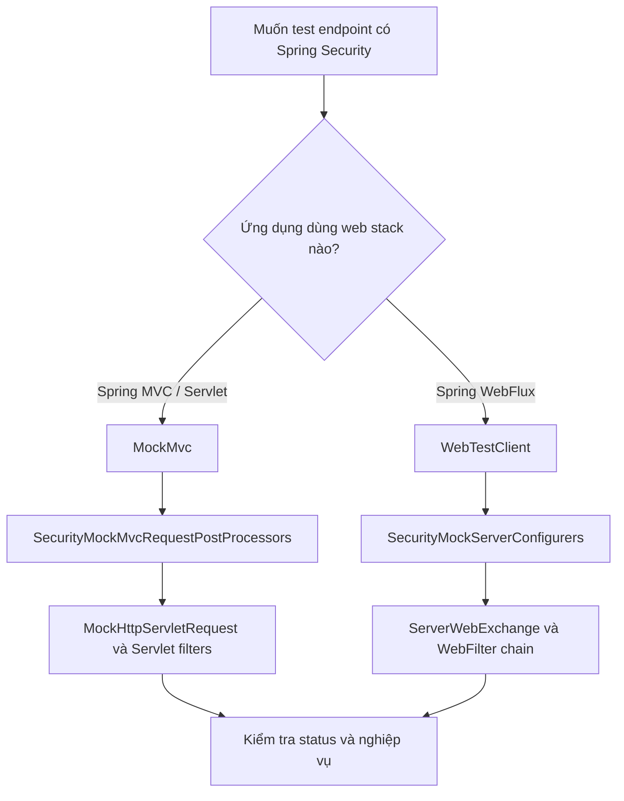

# Không dùng post-processor Servlet cho request WebFlux

Trong Spring Security, cả `MockMvc` và `WebTestClient` đều có thể kiểm tra HTTP endpoint với người dùng giả lập, CSRF token, JWT hoặc phiên OAuth2/OIDC. Tuy nhiên, **hai bộ công cụ gắn trạng thái bảo mật vào request bằng hai cơ chế khác nhau**. Một `RequestPostProcessor` dùng với `MockHttpServletRequest` của Servlet không thể đem gắn trực tiếp vào request Reactive của `WebTestClient`.

Bài học thuộc chương **Thiết lập WebTestClient** trong module `SPRING_SECURITY_TESTING`. Mục tiêu là chọn đúng công cụ của `spring-security-test` để kiểm chứng xác thực, phân quyền và bảo vệ HTTP trên **Spring WebFlux**: cấu hình `WebTestClient` với `springSecurity()`, giả lập principal bằng `mockUser()`, cấp CSRF bằng `csrf()`, kiểm thử JWT bằng `mockJwt()` và phân biệt OAuth2/OIDC login giả lập. Mỗi ví dụ sẽ làm rõ khi nào request được phép, khi nào trả 401/403 và vì sao test có thể báo sai khi trộn API của Servlet và Reactive.

## 1. Hai mô hình HTTP, hai bộ post-processor

`MockMvc` được xây trên Spring MVC, `DispatcherServlet` và `MockHttpServletRequest`. `WebTestClient` được xây trên WebFlux, `WebHandler` và `ServerWebExchange`. Dù đều có kiểu viết “gửi request rồi assert response”, các hàm tạo SecurityContext trong test không cùng kiểu dữ liệu.

| Mục đích | Servlet: MockMvc | Reactive: WebTestClient |
|---|---|---|
| Tích hợp Spring Security | `MockMvcBuilders...apply(SecurityMockMvcConfigurers.springSecurity())` | `WebTestClient.bindToApplicationContext(context).apply(SecurityMockServerConfigurers.springSecurity())` |
| Người dùng giả lập | `.with(user("lan"))` | `.mutateWith(mockUser("lan"))` |
| CSRF token | `.with(csrf())` từ `SecurityMockMvcRequestPostProcessors` | `.mutateWith(csrf())` từ `SecurityMockServerConfigurers` |
| JWT giả lập | `.with(jwt())` | `.mutateWith(mockJwt())` |
| OAuth2 login giả lập | `.with(oauth2Login())` | `.mutateWith(mockOAuth2Login())` |
| OIDC login giả lập | `.with(oidcLogin())` | `.mutateWith(mockOidcLogin())` |
| Đối tượng HTTP/Context | Servlet request và `SecurityContextHolder` | `ServerWebExchange` và Reactive `SecurityContext` trong Reactor context |

Tên hàm như `csrf()` xuất hiện ở cả hai bên, nhưng **static import thuộc lớp khác nhau**. Trộn import rất dễ dẫn đến lỗi kiểu ngay tại compile time hoặc sử dụng một cơ chế giả lập không phù hợp với tầng đang cần kiểm tra.



**Không suy luận web stack chỉ từ dependency `spring-security-test`.** Một ứng dụng có thể kéo cả thư viện MVC và WebFlux vào test classpath. Hãy xác định controller/server thực tế đang chạy và loại security chain đang được tạo: `SecurityFilterChain` cho Servlet, `SecurityWebFilterChain` cho Reactive.

## 2. Ví dụ sai: mang Servlet post-processor sang WebTestClient

Đoạn sau mô phỏng sai sót phổ biến khi sao chép từ bài test `MockMvc`:

```java
// SAI: user() ở đây thuộc SecurityMockMvcRequestPostProcessors.
import static org.springframework.security.test.web.servlet.request
        .SecurityMockMvcRequestPostProcessors.user;

// WebTestClient không có kiểu .with(user(...)) cho request này.
webTestClient.get()
        .uri("/api/orders/42")
        .with(user("lan")) // Không phù hợp với API WebFlux
        .exchange();
```

Tương tự, `SecurityMockMvcRequestPostProcessors.jwt()` và `csrf()` là **Servlet RequestPostProcessor**. Chúng được thiết kế cho `MockMvc.perform(...)`, không phải `WebTestClient`. Việc ép kiểu hoặc tự tạo Servlet mock request sẽ không biến chúng thành cơ chế gắn `ReactiveSecurityContextHolder`.

Một biến thể khác cũng sai mục đích là tạo `UsernamePasswordAuthenticationToken`, gọi `SecurityContextHolder.getContext().setAuthentication(...)` ở thread của test rồi mong WebFlux server tự thấy người dùng đó. Với Reactor, luồng xử lý có thể chuyển thread và dựa vào Reactor context; `SecurityContextHolder` kiểu ThreadLocal của Servlet **không phải cách đáng tin để truyền authentication cho request WebFlux**.

Hãy dùng các test configurer được thiết kế cho Reactor/WebFlux:

```java
import static org.springframework.security.test.web.reactive.server
        .SecurityMockServerConfigurers.mockUser;

webTestClient
        .mutateWith(mockUser("lan"))
        .get()
        .uri("/api/orders/42")
        .exchange()
        .expectStatus().isOk(); // Chỉ đúng khi endpoint cho phép USER mặc định.
```

`mockUser("lan")` cho người dùng giả lập đã xác thực nhưng **không tự cấp mọi quyền**. Mặc định công cụ cấp role thông dụng tương ứng `ROLE_USER`; nếu endpoint yêu cầu authority riêng như `ORDER_READ`, phải truyền authority đó tường minh.

## 3. Kết nối WebTestClient với Spring Security WebFlux

Trong test không chạy HTTP server ngoài, cấu hình quan trọng là bind `WebTestClient` vào **ApplicationContext** có `SecurityWebFilterChain` và áp dụng test configurer `springSecurity()`:

```java
import org.junit.jupiter.api.BeforeEach;
import org.springframework.beans.factory.annotation.Autowired;
import org.springframework.context.ApplicationContext;
import org.springframework.test.web.reactive.server.WebTestClient;

import static org.springframework.security.test.web.reactive.server
        .SecurityMockServerConfigurers.springSecurity;

class ReactiveSecurityTestSupport {
    @Autowired
    ApplicationContext context;

    WebTestClient webTestClient;

    @BeforeEach
    void configureClient() {
        webTestClient = WebTestClient
                .bindToApplicationContext(context)
                .apply(springSecurity())
                .configureClient()
                .build();
    }
}
```

Đây là phần **thiết lập bên trong một Spring test class**, không phải một bài test hoàn chỉnh độc lập: cần `@SpringBootTest` hoặc `@WebFluxTest` với các bean và security chain phù hợp. `springSecurity()` bảo đảm các kiểm thử giả lập bảo mật sử dụng đúng cơ chế Reactive của Spring Security khi chạy request.

Với `@SpringBootTest(webEnvironment = SpringBootTest.WebEnvironment.MOCK)` cho ứng dụng WebFlux, có thể dùng cấu hình trên. Với `@WebFluxTest(controllers = ...)`, cần `@Import` đúng security configuration nếu slice không nạp security chain cần kiểm chứng. Một test chỉ kiểm tra controller mà vô tình thiếu filter chain có thể báo 200 dù production phải trả 403.

### Phân biệt bind-to-context và bind-to-server

| Kiểu WebTestClient | Request chạy ở đâu? | `mutateWith(mockUser())` có phù hợp? |
|---|---|---|
| `bindToApplicationContext(context)` + `apply(springSecurity())` | WebFlux handler/filter chain trong cùng môi trường test | **Có**; đây là cách thiết lập điển hình. |
| `bindToController(controller)` | Controller được bind trực tiếp, không nhất thiết có security chain production | Chỉ khi đã cấu hình security filter/test configurer cần thiết; đừng kết luận từ mặc định. |
| `bindToServer().baseUrl(...)` hoặc client qua cổng HTTP thật | Request qua mạng tới server độc lập | **Không dùng mock principal kiểu nội bộ để giả định server đã xác thực**; gửi cookie, Basic/Bearer token hoặc thực hiện login phù hợp. |

Trên client bind-to-server, việc mutate một đối tượng client trong tiến trình test **không tự tiêm Authentication vào Reactor context phía server**. Nếu muốn kiểm thử quá trình xác thực thật từ bên ngoài, hãy gửi đúng HTTP credentials/token. Nếu muốn dùng `mockUser()` cho bảo vệ HTTP ở mức integration trong process, chọn bind-to-context và cài `springSecurity()`.

## 4. Ứng dụng Reactive mẫu: URL authorization và CSRF

Ví dụ dưới đây dùng Spring Boot WebFlux với `spring-boot-starter-webflux`, `spring-boot-starter-security`, `spring-boot-starter-test` và `spring-security-test`. Tập trung vào phân quyền ở `SecurityWebFilterChain` để có thể mock service nghiệp vụ trong test.

**Security configuration:**

```java
import org.springframework.context.annotation.Bean;
import org.springframework.context.annotation.Configuration;
import org.springframework.http.HttpMethod;
import org.springframework.security.config.Customizer;
import org.springframework.security.config.annotation.web.reactive
        .EnableWebFluxSecurity;
import org.springframework.security.config.web.server.ServerHttpSecurity;
import org.springframework.security.web.server.SecurityWebFilterChain;

@Configuration
@EnableWebFluxSecurity
class DemoReactiveSecurityConfig {
    @Bean
    SecurityWebFilterChain springSecurityFilterChain(ServerHttpSecurity http) {
        return http
                .authorizeExchange(exchanges -> exchanges
                        .pathMatchers(HttpMethod.GET, "/api/orders/**")
                        .hasAuthority("ORDER_READ")
                        .pathMatchers(HttpMethod.POST, "/api/orders/**")
                        .hasAuthority("ORDER_WRITE")
                        .anyExchange().authenticated())
                .httpBasic(Customizer.withDefaults())
                .build();
    }
}
```

Ở đây `httpBasic()` cung cấp entry point mặc định cho request chưa xác thực (thông thường là **401**). `hasAuthority("ORDER_READ")` và `hasAuthority("ORDER_WRITE")` so sánh chuỗi authority chính xác, **không** tự thêm `ROLE_`. `ServerHttpSecurity` vẫn bật CSRF theo mặc định; request `POST` phải kèm CSRF token hợp lệ để phân biệt lỗi CSRF và lỗi quyền.

**Controller và service Reactive:**

```java
import reactor.core.publisher.Mono;
import org.springframework.http.ResponseEntity;
import org.springframework.stereotype.Service;
import org.springframework.web.bind.annotation.GetMapping;
import org.springframework.web.bind.annotation.PathVariable;
import org.springframework.web.bind.annotation.PostMapping;
import org.springframework.web.bind.annotation.RequestMapping;
import org.springframework.web.bind.annotation.RestController;

interface OrderService {
    Mono<String> read(String id);
    Mono<Void> confirm(String id);
}

@Service
class DefaultOrderService implements OrderService {
    public Mono<String> read(String id) {
        return Mono.just("order-" + id);
    }

    public Mono<Void> confirm(String id) {
        return Mono.empty();
    }
}

@RestController
@RequestMapping("/api/orders")
class OrderController {
    private final OrderService service;

    OrderController(OrderService service) {
        this.service = service;
    }

    @GetMapping("/{id}")
    Mono<String> read(@PathVariable String id) {
        return service.read(id);
    }

    @PostMapping("/{id}/confirm")
    Mono<ResponseEntity<Void>> confirm(@PathVariable String id) {
        return service.confirm(id)
                .thenReturn(ResponseEntity.noContent().<Void>build());
    }
}
```

Ví dụ đơn giản hóa nghiệp vụ để làm nổi bật authorization. Khi dùng Mockito để mock `OrderService`, phải stub publisher được trả về (ví dụ `Mono.just(...)` hoặc `Mono.empty()`). Một Mockito mock trả về `null` thay vì `Mono` sẽ khiến request lỗi do Reactive pipeline, dễ che khuất mục đích kiểm thử bảo mật.

## 5. Bộ test WebTestClient cho phép, từ chối và CSRF

Ví dụ dùng Spring Framework 6.2+/Spring Boot 3.4+ để có `@MockitoBean`. Với phiên bản thấp hơn, thay bằng cơ chế mock bean phù hợp. Test giữ `SecurityWebFilterChain` thật và thay service vì **quy tắc phân quyền nằm ở HTTP layer**, không nằm trên service.

```java
import org.junit.jupiter.api.BeforeEach;
import org.junit.jupiter.api.Test;
import org.springframework.beans.factory.annotation.Autowired;
import org.springframework.boot.test.context.SpringBootTest;
import org.springframework.context.ApplicationContext;
import org.springframework.security.core.authority.SimpleGrantedAuthority;
import org.springframework.test.context.bean.override.mockito.MockitoBean;
import org.springframework.test.web.reactive.server.WebTestClient;
import reactor.core.publisher.Mono;

import static org.mockito.Mockito.verify;
import static org.mockito.Mockito.verifyNoInteractions;
import static org.mockito.Mockito.when;
import static org.springframework.security.test.web.reactive.server
        .SecurityMockServerConfigurers.csrf;
import static org.springframework.security.test.web.reactive.server
        .SecurityMockServerConfigurers.mockUser;
import static org.springframework.security.test.web.reactive.server
        .SecurityMockServerConfigurers.springSecurity;

@SpringBootTest(webEnvironment = SpringBootTest.WebEnvironment.MOCK)
class OrderWebFluxSecurityTest {
    @Autowired
    ApplicationContext context;

    @MockitoBean
    OrderService orderService;

    WebTestClient webTestClient;

    @BeforeEach
    void setUp() {
        webTestClient = WebTestClient
                .bindToApplicationContext(context)
                .apply(springSecurity())
                .configureClient()
                .build();
    }

    @Test
    void anonymousGet_isUnauthorized() {
        webTestClient.get()
                .uri("/api/orders/42")
                .exchange()
                .expectStatus().isUnauthorized();

        verifyNoInteractions(orderService);
    }

    @Test
    void readerWithCorrectAuthority_isAllowed() {
        when(orderService.read("42"))
                .thenReturn(Mono.just("order-42"));

        webTestClient
                .mutateWith(mockUser("lan").authorities(
                        new SimpleGrantedAuthority("ORDER_READ")))
                .get()
                .uri("/api/orders/42")
                .exchange()
                .expectStatus().isOk()
                .expectBody(String.class)
                .isEqualTo("order-42");

        verify(orderService).read("42");
    }

    @Test
    void loggedInButMissingAuthority_isForbidden() {
        webTestClient
                .mutateWith(mockUser("lan").authorities(
                        new SimpleGrantedAuthority("ORDER_WRITE")))
                .get()
                .uri("/api/orders/42")
                .exchange()
                .expectStatus().isForbidden();

        verifyNoInteractions(orderService);
    }

    @Test
    void writerWithCsrf_canConfirm() {
        when(orderService.confirm("42"))
                .thenReturn(Mono.empty());

        webTestClient
                .mutateWith(mockUser("editor").authorities(
                        new SimpleGrantedAuthority("ORDER_WRITE")))
                .mutateWith(csrf())
                .post()
                .uri("/api/orders/42/confirm")
                .exchange()
                .expectStatus().isNoContent();

        verify(orderService).confirm("42");
    }

    @Test
    void writerWithoutCsrf_isForbidden() {
        webTestClient
                .mutateWith(mockUser("editor").authorities(
                        new SimpleGrantedAuthority("ORDER_WRITE")))
                .post()
                .uri("/api/orders/42/confirm")
                .exchange()
                .expectStatus().isForbidden();

        verifyNoInteractions(orderService);
    }

    @Test
    void readerCannotConfirm_evenWithCsrf() {
        webTestClient
                .mutateWith(mockUser("reader").authorities(
                        new SimpleGrantedAuthority("ORDER_READ")))
                .mutateWith(csrf())
                .post()
                .uri("/api/orders/42/confirm")
                .exchange()
                .expectStatus().isForbidden();

        verifyNoInteractions(orderService);
    }
}
```

Các kỳ vọng trên chỉ đúng với cấu hình `DemoReactiveSecurityConfig` của bài. Nếu dự án tắt CSRF cho Bearer APIs hoặc dùng authentication entry point riêng, status khi thiếu CSRF hay chưa đăng nhập có thể khác. Người viết test phải chứng minh **nguyên nhân từ chối**, không chỉ assert một HTTP status ngẫu nhiên.

| Ca | Authentication | CSRF | HTTP kỳ vọng | Service |
|---|---|---|---|---|
| GET chưa đăng nhập | Không có | Không cần | 401 | Không gọi |
| GET đúng quyền | `ORDER_READ` | Không cần | 200 | Gọi `read("42")` |
| GET thiếu quyền | `ORDER_WRITE` | Không cần | 403 | Không gọi |
| POST đủ quyền | `ORDER_WRITE` | Có | 204 | Gọi `confirm("42")` |
| POST đủ quyền nhưng thiếu CSRF | `ORDER_WRITE` | Không | 403 | Không gọi |
| POST sai quyền dù có CSRF | `ORDER_READ` | Có | 403 | Không gọi |

Ca POST đủ quyền **và** CSRF thành công là đối chứng cần thiết: nếu mọi POST đều trả 403 do cấu hình CSRF sai, chỉ test nhánh từ chối có thể vẫn xanh mà không kiểm tra được authorization.

## 6. Static imports đúng bên và cách tổ chức test

Với `WebTestClient`, import các thành phần từ **cùng một lớp Reactive**:

```java
import static org.springframework.security.test.web.reactive.server
        .SecurityMockServerConfigurers.springSecurity;
import static org.springframework.security.test.web.reactive.server
        .SecurityMockServerConfigurers.mockUser;
import static org.springframework.security.test.web.reactive.server
        .SecurityMockServerConfigurers.csrf;
import static org.springframework.security.test.web.reactive.server
        .SecurityMockServerConfigurers.mockJwt;
import static org.springframework.security.test.web.reactive.server
        .SecurityMockServerConfigurers.mockOAuth2Login;
import static org.springframework.security.test.web.reactive.server
        .SecurityMockServerConfigurers.mockOidcLogin;
```

Trong khi đó, `MockMvc` sử dụng lớp:

```java
// Chỉ dành cho Servlet / MockMvc:
import static org.springframework.security.test.web.servlet.request
        .SecurityMockMvcRequestPostProcessors.user;
import static org.springframework.security.test.web.servlet.request
        .SecurityMockMvcRequestPostProcessors.csrf;
import static org.springframework.security.test.web.servlet.request
        .SecurityMockMvcRequestPostProcessors.jwt;
```

Đừng giữ cả hai `csrf` static import trong cùng file test nếu không có lý do rõ ràng: khi đó việc gọi không đủ ngữ cảnh rất dễ gây nhầm lẫn. Nếu một dự án cần kiểm thử cả Servlet và Reactive, nên tách thành các lớp test riêng với builder, configurer, security chain và imports tương ứng.

**Phân biệt API:** `.with(...)` của `MockMvcRequestBuilders` nhận `RequestPostProcessor` của Servlet; `.mutateWith(...)` của `WebTestClient` nhận `WebTestClientConfigurer` phù hợp với WebFlux. Việc chúng đều có thể “thêm người dùng vào request” không làm hai kiểu này tương thích.

## 7. JWT giả lập: dùng mockJwt, không mang jwt() của Servlet sang

Nếu ứng dụng là Reactive OAuth2 Resource Server, `mockJwt()` gắn một `JwtAuthenticationToken` giả lập vào request in-process:

```java
import org.springframework.security.core.authority.SimpleGrantedAuthority;
import static org.springframework.security.test.web.reactive.server
        .SecurityMockServerConfigurers.mockJwt;

webTestClient
        .mutateWith(mockJwt()
                .authorities(new SimpleGrantedAuthority(
                        "SCOPE_orders.read")))
        .get()
        .uri("/api/orders/42")
        .exchange()
        .expectStatus().isOk();
```

Đoạn này giả định Reactive SecurityWebFilterChain của **Resource Server** yêu cầu authority `SCOPE_orders.read` cho endpoint. Nó không dùng cấu hình `ORDER_READ` ở mục trước; nếu chạy nguyên đoạn trên cấu hình của mục 4, request sẽ bị 403. Đây là điểm quan trọng khi tái sử dụng snippets: test phải khớp **biểu thức phân quyền thật** của security chain mà nó chạy.

Tương tự `jwt()` của Servlet, `mockJwt()` **không kiểm tra chữ ký JWT, issuer, audience hay kết nối JWKS**. Nếu gọi `.authorities(...)`, test còn trực tiếp đặt kết quả chuyển claims thành authorities, nên không chứng minh `ReactiveJwtAuthenticationConverter` production đã hoạt động đúng. Muốn kiểm tra Resource Server thật, gửi Bearer JWT ký thật qua `WebTestClient` bind-to-server hoặc bind-to-context với decoder thật và JWKS test server được kiểm soát.

### JWT claims không đồng nghĩa authorities

Một JWT có claim `scope: "orders.read"` không tự bảo đảm ứng dụng sẽ sinh `SCOPE_orders.read` nếu converter tùy chỉnh đã thay cách ánh xạ. Khi muốn test converter, tạo unit test cho converter thực và một integration test đi qua `ReactiveJwtDecoder`/authentication converter thực. `mockJwt()` chỉ thích hợp để chứng minh HTTP/method authorization **sau khi** Authentication đã có.

## 8. OAuth2 và OIDC login giả lập trong WebFlux

Với WebFlux ứng dụng có browser login, dùng `mockOAuth2Login()` hoặc `mockOidcLogin()` để mô phỏng người dùng **đã đăng nhập**, sau đó kiểm tra endpoint bảo vệ:

```java
import org.springframework.security.core.authority.SimpleGrantedAuthority;
import static org.springframework.security.test.web.reactive.server
        .SecurityMockServerConfigurers.mockOidcLogin;

webTestClient
        .mutateWith(mockOidcLogin()
                .authorities(new SimpleGrantedAuthority(
                        "REPORT_READ")))
        .get()
        .uri("/reports/quarter-4")
        .exchange()
        .expectStatus().isOk();
```

Ví dụ cần một WebFlux endpoint `/reports/quarter-4` được cấu hình chấp nhận `REPORT_READ`. Với người dùng OAuth2 không dùng OIDC:

```java
import static org.springframework.security.test.web.reactive.server
        .SecurityMockServerConfigurers.mockOAuth2Login;

webTestClient
        .mutateWith(mockOAuth2Login()
                .authorities(new SimpleGrantedAuthority(
                        "REPORT_READ")))
        .get()
        .uri("/reports/quarter-4")
        .exchange()
        .expectStatus().isOk();
```

Hai test configurer này chỉ giả lập principal/Authentication để kiểm tra **sau đăng nhập**. Chúng không tự đi qua authorization redirect, callback, `state`/`nonce`, token exchange, ID Token signature validation hoặc WebSession thật. Khi mục tiêu là giao thức đăng nhập, hãy dùng một IdP test server, gửi các request thật qua Reactive OAuth2 Login filters và giữ cookie/WebSession giữa các bước.

## 9. Method security và Reactor context

WebFlux có thể bảo vệ phương thức bằng `@EnableReactiveMethodSecurity` và `@PreAuthorize`. Khi method trả về `Mono`/`Flux`, Spring Security sử dụng Authentication trong Reactive context để quyết định quyền. Không tự tạo instance service bằng `new` hoặc gọi nội bộ `this.protectedMethod()` rồi mong interceptor luôn được áp dụng: method security cần lời gọi đi qua Spring-managed proxy.

```java
import org.springframework.security.access.prepost.PreAuthorize;
import org.springframework.stereotype.Service;
import reactor.core.publisher.Mono;

@Service
class ReactiveApprovalService {
    private final ApprovalGateway gateway;

    ReactiveApprovalService(ApprovalGateway gateway) {
        this.gateway = gateway;
    }

    @PreAuthorize("hasAuthority('APPROVE_ORDER')")
    public Mono<Void> approve(String orderId) {
        return Mono.defer(() -> gateway.approve(orderId));
    }
}

interface ApprovalGateway {
    Mono<Void> approve(String orderId);
}
```

Một ca test phù hợp cần giữ `ReactiveApprovalService` là **bean thật**, mock `ApprovalGateway` và gửi request qua WebFlux controller tới bean đó:

```java
webTestClient
        .mutateWith(mockUser("reader").authorities(
                new SimpleGrantedAuthority("ORDER_READ")))
        .mutateWith(csrf())
        .post()
        .uri("/api/approve/42")
        .exchange()
        .expectStatus().isForbidden();

verifyNoInteractions(approvalGateway);
```

Ví dụ giả định controller có mapping `POST /api/approve/{id}` gọi `ReactiveApprovalService.approve(id)`, và SecurityWebFilterChain cho phép request tới method-security interceptor; nếu URL authorization đã chặn request từ trước, kết quả 403 không chứng minh `@PreAuthorize` có hiệu lực. Ca đủ quyền cũng phải thực thi publisher thành công và xác nhận gateway được gọi.

`Mono.defer` hoãn việc gọi dependency cho tới lúc subscribe. Điều này giúp việc kiểm tra không có tác dụng phụ dễ lý giải hơn. Nếu phương thức tạo side effect **eager** khi dựng Mono, cần phân tích lại thời điểm tác dụng phụ xảy ra và ranh giới proxy. Test mock dependency chỉ đo tương tác với mock đó, không thay thế kiểm tra trạng thái thật nếu hệ thống còn những đường ghi dữ liệu khác.

## 10. Chẩn đoán lỗi khi trộn Servlet và WebFlux

| Triệu chứng | Nguyên nhân hay gặp | Cách xác minh/sửa |
|---|---|---|
| `WebTestClient` không có `.with(user(...))` | Đang sao chép `RequestPostProcessor` của MockMvc. | Chuyển sang `.mutateWith(mockUser(...))` và Reactive imports. |
| Java báo sai kiểu cho `csrf()` hoặc `jwt()` | Static import từ `SecurityMockMvcRequestPostProcessors`. | Dùng `SecurityMockServerConfigurers.csrf()/mockJwt()`. |
| Đã dùng `mockUser()` nhưng vẫn bị 401 | Client chưa bind/apply đúng security test configurer, hoặc đang gọi server HTTP thật. | Với in-process dùng `bindToApplicationContext(...).apply(springSecurity())`; với server thật gửi credentials. |
| Đã xác thực nhưng bị 403 | Sai authority, thiếu CSRF, hoặc method security từ chối. | Thử GET cho vấn đề auth, thêm CSRF cho mutation, kiểm tra chuỗi authority chính xác. |
| Test trả 200 khi production phải trả 403 | SecurityWebFilterChain chưa được nạp trong slice test. | Import security config hoặc dùng application context phù hợp; test cả nhánh bị từ chối. |
| Test JWT xanh dù converter production hỏng | `mockJwt().authorities(...)` cấp quyền trực tiếp. | Kiểm thử converter riêng và bearer/JWKS integration test. |
| Test `@PreAuthorize` luôn cho qua | Service bị mock hoặc không đi qua proxy. | Giữ service thật, mock dependency, xác nhận controller gọi bean từ Spring. |
| `Mono` bị `NullPointerException` | Mockito mock Reactive method trả `null`. | Stub `Mono.just(...)`, `Mono.empty()` hoặc `Mono.error(...)` phù hợp. |
| `@WithMockUser` trong test không áp vào request như dự kiến | Thiếu cấu hình listener/context hoặc request chạy khác server context. | Ưu tiên `mockUser()` trên WebTestClient in-process và xác minh cấu hình test. |

Một cách kiểm tra nhanh là viết **hai ca đối chứng cho cùng endpoint**: không đủ quyền phải bị từ chối, đủ quyền phải được phép. Sau đó mới thêm CSRF, JWT/OAuth2 và kiểm tra tác dụng phụ. Đừng suy luận từ 403 đơn lẻ rằng mọi lớp bảo mật đều hoạt động đúng.

## 11. Checklist áp dụng cho dự án

- [ ] Đã xác định ứng dụng chạy Servlet MVC hay WebFlux, và security chain đang được kiểm thử là `SecurityFilterChain` hay `SecurityWebFilterChain`.
- [ ] WebFlux test dùng `WebTestClient` cùng `SecurityMockServerConfigurers`; không import `SecurityMockMvcRequestPostProcessors`.
- [ ] WebTestClient in-process đã bind tới ApplicationContext có chain thật và `apply(springSecurity())`.
- [ ] Khi bind-to-server qua HTTP, sử dụng login/credentials/token thật phù hợp thay cho giả lập Reactor context.
- [ ] `mockUser()` cấp đúng authorities; test có cả nhánh được phép và bị từ chối.
- [ ] Với mutation request, `csrf()` thuộc Reactive package và được áp dụng đúng chính sách CSRF hiện hành.
- [ ] `mockJwt()`/`mockOAuth2Login()`/`mockOidcLogin()` chỉ được dùng để giả lập Authentication ở tầng phù hợp; không dùng chúng làm bằng chứng cho giao thức xác thực thật.
- [ ] Nếu kiểm tra `@PreAuthorize`, service được bảo vệ là bean thật và side effects được kiểm tra trên dependency phía sau.
- [ ] Dependency Reactive dùng trong test trả publisher hợp lệ, và các ca bị từ chối xác minh nghiệp vụ không chạy.

**Ghi nhớ:** `MockMvc` và `WebTestClient` có mục tiêu kiểm thử HTTP tương tự nhưng **khác cơ chế tích hợp bảo mật**. Với WebFlux, hãy dùng `SecurityMockServerConfigurers`, cấu hình đúng `springSecurity()` và kiểm chứng cả quyền được phép lẫn quyền bị từ chối. Bộ post-processor Servlet không thể thay thế cho Reactive SecurityContext của request WebFlux.
