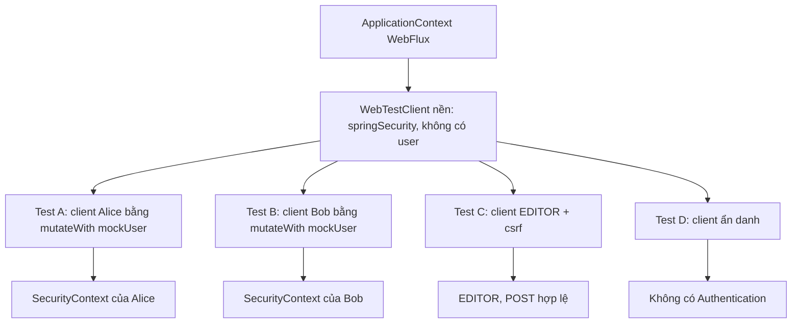

# Phân biệt client tùy biến cho một test với client dùng chung

Trong kiểm thử Spring WebFlux, `WebTestClient` là công cụ gửi yêu cầu HTTP vào ứng dụng hoặc máy chủ để quan sát phản hồi. Khi ứng dụng dùng Spring Security, client còn có thể được gắn một **danh tính kiểm thử**, CSRF token hoặc các cấu hình request khác. Nếu không quản lý phạm vi của những tùy biến này, test “người dùng thường không được tạo dữ liệu” có thể vô tình chạy với quyền quản trị đã được đặt từ test trước, dẫn đến kết luận sai về chính sách bảo mật.

Bài này thuộc chương **Thiết lập WebTestClient** trong module **SPRING_SECURITY_TESTING**, phục vụ mục tiêu kiểm chứng xác thực, phân quyền và bảo vệ HTTP bằng `spring-security-test` trên Servlet và Reactive. Nội dung tập trung vào Reactive WebFlux và ba việc: xây **client nền dùng chung**, tạo **client đã tùy biến chỉ cho một test**, rồi xác minh client nền không bị ảnh hưởng. Cùng nguyên tắc cô lập trạng thái này có thể áp dụng khi giả lập `SecurityContext`, JWT, OAuth2 hoặc OIDC, nhưng mỗi loại có công cụ và giới hạn riêng.

## 1. Client nền và client tùy biến giải quyết hai nhu cầu khác nhau

`WebTestClient` được tạo bằng một builder rồi dùng để thực hiện nhiều request. Có hai nhóm cấu hình:

| Cấu hình | Ví dụ | Phạm vi nên sử dụng |
| --- | --- | --- |
| Hạ tầng kết nối | `bindToApplicationContext(context)`, `springSecurity()`, `responseTimeout(...)` | Client nền cho cả lớp test |
| Mặc định ổn định của suite | Base URL, codec, header chung không mang danh tính | Client nền, nếu mọi test cùng cần |
| Danh tính của một kịch bản | `mockUser("alice")`, `mockJwt()`, `mockOidcLogin()` | Một client cục bộ trong đúng test |
| Chứng thực cho request cụ thể | Bearer header, cookie, CSRF token | Một request hoặc một client cục bộ |
| Biến thể giao tiếp | Một header thử nghiệm, codec/timeout riêng | Bản sao được tạo bằng `mutate()` |

**Client nền** là điểm khởi đầu có cấu hình nhất quán, lý tưởng là không được đăng nhập sẵn. **Client tùy biến** là một `WebTestClient` khác được tạo từ client nền để áp dụng thông tin cụ thể của một kịch bản.

Với `WebTestClient` của Spring Framework:

- `baseClient.mutate()` trả về **builder** khởi tạo từ cấu hình của client hiện tại. Cần gọi `build()` để nhận client mới.
- `baseClient.mutateWith(configurer)` trả về **client đã áp dụng configurer**. Với `spring-security-test`, configurer như `mockUser(...)` hoặc `csrf()` thường được dùng theo cách này.
- Việc tạo client mới **không thay đổi chính biến `baseClient`**; nhưng nếu gán ngược `baseClient = baseClient.mutateWith(...)`, chính code test đã thay reference dùng chung và có thể làm các test sau dùng sai danh tính.
- Tùy biến trên một client có hiệu lực với **mọi request được gửi qua instance đó**, không chỉ request đầu tiên. Vì vậy client mang danh tính nên được khai báo cục bộ và không tái sử dụng ngoài kịch bản của nó.



Đồ thị diễn tả sự kế thừa **cấu hình**; nó không khẳng định các request đã sử dụng cùng một HTTP session. Cần kiểm thử session/cookie riêng nếu ứng dụng sử dụng trạng thái đăng nhập lưu phía máy chủ.

## 2. Thiết lập ứng dụng WebFlux mẫu với các quyền khác nhau

Giả sử API có bốn đường dẫn:

| Endpoint | Chính sách | Kết quả thành công |
| --- | --- | --- |
| `GET /api/public` | Cho phép mọi người | `200`, body `public` |
| `GET /api/me` | Phải xác thực | `200`, body là principal name |
| `POST /api/notes` | Phải có `ROLE_EDITOR` và CSRF phù hợp | `200`, body `created` |
| `GET /api/echo-header` | Cho phép mọi người | `200`, trả header kiểm thử hoặc `none` |

Controller mẫu chỉ chứa logic tối thiểu để quan sát trạng thái:

```java
import java.security.Principal;
import org.springframework.web.bind.annotation.GetMapping;
import org.springframework.web.bind.annotation.PostMapping;
import org.springframework.web.bind.annotation.RequestHeader;
import org.springframework.web.bind.annotation.RestController;
import reactor.core.publisher.Mono;

@RestController
class DemoApiController {

    @GetMapping("/api/public")
    Mono<String> publicData() {
        return Mono.just("public");
    }

    @GetMapping("/api/me")
    Mono<String> me(Principal principal) {
        return Mono.just(principal.getName());
    }

    @PostMapping("/api/notes")
    Mono<String> createNote() {
        return Mono.just("created");
    }

    @GetMapping("/api/echo-header")
    Mono<String> echo(
            @RequestHeader(name = "X-Test-Correlation",
                           defaultValue = "none") String value) {
        return Mono.just(value);
    }
}
```

Security config sử dụng **Reactive** API, tức `SecurityWebFilterChain` và `ServerHttpSecurity`, thay cho `SecurityFilterChain` và `HttpSecurity` của Servlet:

```java
import org.springframework.context.annotation.Bean;
import org.springframework.context.annotation.Configuration;
import org.springframework.http.HttpMethod;
import org.springframework.security.config.Customizer;
import org.springframework.security.config.annotation.web.reactive.EnableWebFluxSecurity;
import org.springframework.security.config.web.server.ServerHttpSecurity;
import org.springframework.security.web.server.SecurityWebFilterChain;

@Configuration
@EnableWebFluxSecurity
class DemoApiSecurity {

    @Bean
    SecurityWebFilterChain securityWebFilterChain(ServerHttpSecurity http) {
        return http
            .authorizeExchange(exchanges -> exchanges
                .pathMatchers("/api/public", "/api/echo-header").permitAll()
                .pathMatchers(HttpMethod.POST, "/api/notes")
                    .hasRole("EDITOR")
                .pathMatchers("/api/me").authenticated()
                .anyExchange().denyAll()
            )
            .httpBasic(Customizer.withDefaults())
            .formLogin(ServerHttpSecurity.FormLoginSpec::disable)
            // Giữ CSRF mặc định để kiểm tra POST có/không token.
            .build();
    }
}
```

Trong cấu hình trên, `hasRole("EDITOR")` yêu cầu authority `ROLE_EDITOR`. Request ẩn danh tới `/api/me` thường nhận **401** nhờ HTTP Basic entry point và form login đã bị tắt trong ví dụ. Người dùng đã xác thực nhưng không có role phù hợp bị **403**. `POST` thiếu CSRF token cũng có thể bị **403**, ngay cả khi đã có `ROLE_EDITOR`. Do đó phải thiết kế test để phân biệt hai nguyên nhân bị từ chối.

Ứng dụng minh họa dùng `spring-boot-starter-webflux`, `spring-boot-starter-security` và test dependencies `spring-boot-starter-test`, `spring-security-test`; JUnit 5 là test runner. Controller và Security config cần nằm trong phạm vi component scan của ứng dụng thử nghiệm.

## 3. Tạo client nền với `bindToApplicationContext` và `springSecurity()`

Khi muốn kiểm tra `SecurityWebFilterChain` đang cấu hình trong ứng dụng **mà không mở cổng TCP thực**, hãy bind client vào Spring `ApplicationContext`:

```java
import java.time.Duration;
import org.junit.jupiter.api.BeforeEach;
import org.springframework.beans.factory.annotation.Autowired;
import org.springframework.context.ApplicationContext;
import org.springframework.security.test.web.reactive.server.SecurityMockServerConfigurers;
import org.springframework.test.web.reactive.server.WebTestClient;

class WebTestClientFixture {

    @Autowired
    ApplicationContext applicationContext;

    protected WebTestClient baseClient;

    @BeforeEach
    void initWebTestClient() {
        baseClient = WebTestClient
            .bindToApplicationContext(applicationContext)
            .apply(SecurityMockServerConfigurers.springSecurity())
            .configureClient()
            .responseTimeout(Duration.ofSeconds(5))
            .build();
    }
}
```

Ý nghĩa từng bước:

1. `bindToApplicationContext` dùng handler, controller, `WebFilter` và các bean WebFlux trong context đang kiểm thử.
2. `apply(springSecurity())` nối hỗ trợ Spring Security cho mock server và cho phép các `SecurityMockServerConfigurers` như `mockUser()`, `csrf()` làm việc với `WebTestClient`.
3. `configureClient()` chuyển sang builder dành cho cấu hình client (timeout, header mặc định, URI ...).
4. `build()` trả về instance nền, **chưa gắn user hay token mặc định**.
5. `@BeforeEach` bảo đảm biến `baseClient` được thiết lập sạch cho từng test. Nếu framework đã inject một WebTestClient chuẩn, có thể dùng instance đó làm nền, miễn là filter chain Security và hỗ trợ test security được cấu hình đúng.

Ví dụ này chỉ dùng các thành phần WebFlux trong context. Nếu ứng dụng chứa cả Spring MVC và WebFlux, hãy xác nhận test thực sự khởi tạo **Reactive application context**, tránh tình huống bạn định kiểm tra `SecurityWebFilterChain` nhưng test chạy servlet stack.

### Những cách bind khác nhau có cùng kiểm tra security không?

| Cách tạo | Môi trường gửi request | Phạm vi được kiểm chứng |
| --- | --- | --- |
| `bindToApplicationContext(context)` + `springSecurity()` | Mock WebFlux trong ứng dụng | Controller, web filters và `SecurityWebFilterChain` thuộc context |
| `bindToController(controller)` | Controller/mock server khai báo trực tiếp | Kiểm tra controller nhanh; **không tự tải đầy đủ security config production** |
| `bindToRouterFunction(router)` | RouterFunction gắn trực tiếp | Kiểm tra functional routes; phải cấu hình security rõ nếu cần |
| `bindToServer().baseUrl("http://...")` | HTTP thật đến server đang chạy | Full network stack và cấu hình server đang chạy |

Đối với `bindToServer()`, các mock configurer như `mockUser()` không thể “gắn SecurityContext” vào server từ xa. Muốn kiểm tra server thực phải gửi credential, cookie hoặc bearer token hợp lệ theo giao thức của hệ thống. Các ví dụ trong bài tiếp tục dùng mock WebFlux được bind vào application context.

## 4. Tạo client cục bộ với `mutateWith(mockUser(...))`

Một test có thể sử dụng principal Alice mà không biến mọi test sau thành Alice. Dùng instance mới, khai báo trong phương thức test:

```java
import org.junit.jupiter.api.Test;
import org.springframework.boot.test.context.SpringBootTest;
import org.springframework.test.web.reactive.server.WebTestClient;
import static org.springframework.security.test.web.reactive.server
    .SecurityMockServerConfigurers.mockUser;

@SpringBootTest(
    webEnvironment = SpringBootTest.WebEnvironment.MOCK,
    properties = "spring.main.web-application-type=reactive"
)
class SecurityClientIsolationTest extends WebTestClientFixture {

    @Test
    void aliceClientDoesNotModifyAnonymousBaseClient() {
        WebTestClient aliceClient =
            baseClient.mutateWith(mockUser("alice").roles("USER"));

        aliceClient.get().uri("/api/me")
            .exchange()
            .expectStatus().isOk()
            .expectBody(String.class).isEqualTo("alice");

        // Request từ client nền sau đó vẫn phải là anonymous.
        baseClient.get().uri("/api/me")
            .exchange()
            .expectStatus().isUnauthorized();
    }
}
```

Đoạn mã sử dụng `@SpringBootTest` để lấy đầy đủ security chain và controller đã khai báo. `mockUser("alice")` tạo `Authentication` phục vụ kiểm thử Reactive; đây **không phải quá trình đăng nhập HTTP thật**. Test kiểm tra principal và HTTP authorization khi request được đưa qua security chain.

Nếu dùng `@WebFluxTest(DemoApiController.class)`, phải import đúng security configuration liên quan để tránh test dùng chain mặc định hoặc không có chain mong muốn. Nếu dự án đã có cấu hình auto-inject `WebTestClient` qua `@AutoConfigureWebTestClient`, bạn có thể dùng client đó nhưng vẫn cần phân biệt nền và bản tùy biến.

### Vì sao không gán ngược client tùy biến vào field dùng chung?

Đây là một mẫu dễ gây rò rỉ trạng thái kiểm thử:

```java
// Tránh thực hiện trong phương thức test khi baseClient là biến dùng chung.
baseClient = baseClient.mutateWith(mockUser("admin").roles("ADMIN"));
```

Khi đó mọi request sau được gửi từ `baseClient` đều mang danh tính `admin`, cho đến khi field được thiết lập lại. Nếu các test dùng chung instance hoặc được chạy trong cấu hình lifecycle đặc biệt, ca thử ẩn danh có thể bị ảnh hưởng. Việc reset field trong `@BeforeEach` giảm nguy cơ, nhưng viết theo cách không gán ngược dễ hiểu và an toàn hơn:

```java
WebTestClient adminClient =
    baseClient.mutateWith(mockUser("admin").roles("ADMIN"));
```

Quy tắc rất đơn giản: **cấu hình nền được dùng chung; danh tính là dữ liệu của từng kịch bản**.

## 5. Kiểm thử hai người dùng độc lập và thứ tự gọi request

Nếu chỉ có một ca với Alice, lỗi sử dụng nhầm principal giữa các test khó bị phát hiện. Bổ sung Bob và kiểm tra lại anonymous:

```java
@Test
void twoLocallyCustomizedClientsHaveDifferentPrincipals() {
    WebTestClient alice =
        baseClient.mutateWith(mockUser("alice").roles("USER"));
    WebTestClient bob =
        baseClient.mutateWith(mockUser("bob").roles("USER"));

    alice.get().uri("/api/me")
        .exchange()
        .expectStatus().isOk()
        .expectBody(String.class).isEqualTo("alice");

    bob.get().uri("/api/me")
        .exchange()
        .expectStatus().isOk()
        .expectBody(String.class).isEqualTo("bob");

    // Lặp lại Alice sau khi đã gọi Bob để phát hiện việc dùng chung context.
    alice.get().uri("/api/me")
        .exchange()
        .expectStatus().isOk()
        .expectBody(String.class).isEqualTo("alice");

    baseClient.get().uri("/api/me")
        .exchange()
        .expectStatus().isUnauthorized();
}
```

Cách viết này cho thấy mỗi client tùy biến giữ **cấu hình mock authentication của chính nó**. Nó không tự kiểm tra dữ liệu session server hoặc kho OAuth2 authorized client vì các request ở đây không thực hiện login và không dùng session thật. Các bài kiểm thử session phải điều khiển `WebSession` hoặc cookie riêng và xác minh bên server.

Nếu test có nhiều luồng bất đồng bộ hoặc chạy song song, tránh dùng các field tĩnh/chung để lưu principal hoặc request mutator. Mỗi test nên tạo dữ liệu riêng để các trường hợp Alice, Bob và anonymous không phụ thuộc thứ tự thực thi.

## 6. Phối hợp `mockUser()` và `csrf()` trong cùng một test

Với endpoint `POST /api/notes`, phải phân biệt **đủ quyền** với **CSRF hợp lệ**. Trong môi trường mock WebFlux, `SecurityMockServerConfigurers.csrf()` thêm dữ liệu CSRF phù hợp cho request mà client tùy biến gửi đi.

```java
import static org.springframework.security.test.web.reactive.server
    .SecurityMockServerConfigurers.csrf;

@Test
void editorWithCsrfCanCreateNote() {
    WebTestClient editorClient = baseClient
        .mutateWith(mockUser("editor").roles("EDITOR"))
        .mutateWith(csrf());

    editorClient.post().uri("/api/notes")
        .exchange()
        .expectStatus().isOk()
        .expectBody(String.class).isEqualTo("created");
}

@Test
void editorWithoutCsrfIsForbidden() {
    WebTestClient editorClient =
        baseClient.mutateWith(mockUser("editor").roles("EDITOR"));

    editorClient.post().uri("/api/notes")
        .exchange()
        .expectStatus().isForbidden();
}

@Test
void nonEditorWithCsrfIsForbiddenByRoleRule() {
    WebTestClient viewerClient = baseClient
        .mutateWith(mockUser("viewer").roles("VIEWER"))
        .mutateWith(csrf());

    viewerClient.post().uri("/api/notes")
        .exchange()
        .expectStatus().isForbidden();
}
```

Trong ca thứ hai, `403` đến từ việc thiếu CSRF dù principal có `ROLE_EDITOR`. Trong ca thứ ba, CSRF đã được cung cấp nhưng người dùng không có `ROLE_EDITOR`, do đó `403` kiểm tra **quy tắc phân quyền**. Nếu không thêm `csrf()` vào ca thiếu role, test vẫn có thể nhận `403` mà chưa đi tới bước authorization mong muốn.

Khi CSRF được cấu hình tắt có chủ đích, kết quả ca thứ hai sẽ khác. Hãy theo cấu hình thật của ứng dụng thay vì mặc định mọi endpoint POST đều đòi cùng một CSRF policy.

## 7. Dùng `mutate()` để thử header chỉ trong một test

Các cấu hình khác như header mặc định, timeout hoặc codec cũng cần được cô lập. `mutate()` tạo một builder dựa trên client nền, cho phép chỉnh một biến thể rồi `build()` thành client mới.

```java
@Test
void defaultHeaderFromOneTestDoesNotAffectBaseClient() {
    WebTestClient headerClient = baseClient.mutate()
        .defaultHeader("X-Test-Correlation", "case-17")
        .build();

    headerClient.get().uri("/api/echo-header")
        .exchange()
        .expectStatus().isOk()
        .expectBody(String.class).isEqualTo("case-17");

    baseClient.get().uri("/api/echo-header")
        .exchange()
        .expectStatus().isOk()
        .expectBody(String.class).isEqualTo("none");
}
```

Đây là test hành vi trực tiếp: nếu bạn lỡ thay đổi header mặc định trên instance dùng chung, request thứ hai sẽ không nhận `none`. Về mặt thiết kế, các header như `Authorization`, `Cookie` và token CSRF không nên được đặt làm default trên client dùng chung của nhiều trường hợp kiểm thử quyền.

Khi chỉ một request cần header, còn ngắn gọn hơn:

```java
baseClient.get().uri("/api/echo-header")
    .header("X-Test-Correlation", "one-request")
    .exchange()
    .expectStatus().isOk()
    .expectBody(String.class).isEqualTo("one-request");
```

Header từ `.header(...)` thuộc request đang dựng; không biến thành default header của những request sau.

## 8. Các công cụ security nên đặt ở phạm vi nào?

Không phải lúc nào cũng cần biến riêng cho mọi thao tác. Hãy chọn phạm vi nhỏ nhất diễn đạt đúng một kịch bản:

| Công cụ | Tác dụng | Gợi ý phạm vi |
| --- | --- | --- |
| `springSecurity()` | Kết nối hỗ trợ Spring Security vào mock WebFlux | Lúc tạo client nền |
| `mockUser("alice")` | Đặt người dùng giả lập cho các request của client tùy biến | Client local cho test Alice |
| `mockJwt()` | Tạo JWT authentication giả lập cho Reactive Resource Server | Client local cho test endpoint JWT |
| `mockOAuth2Login()` | Giả lập người dùng đăng nhập OAuth2 | Client local cho test OAuth2 login |
| `mockOidcLogin()` | Giả lập principal OIDC | Client local cho test OIDC login |
| `csrf()` | Đưa dữ liệu CSRF hợp lệ vào yêu cầu test | Client local cho kịch bản POST/PUT/DELETE |
| `@WithMockUser` | Chuẩn bị SecurityContext cho một phương thức/lớp test | Hợp lý với ca đơn giản; client local rõ hơn khi đổi danh tính trong một test |
| Header `Authorization: Bearer ...` | Gửi credential dưới dạng HTTP | Một request hoặc client riêng khi kiểm tra bearer thực |

`mockJwt()`, `mockOAuth2Login()` và `mockOidcLogin()` giúp kiểm tra **authorization và controller behavior** với danh tính mô phỏng. Chúng **không thay thế** bài kiểm tra đầy đủ quá trình kiểm chữ ký JWT, trao đổi Authorization Code, xác thực ID Token hoặc kết nối nhà cung cấp danh tính thật. Nếu cần xác nhận những quy trình ấy, hãy dùng token kiểm thử và máy chủ thử nghiệm phù hợp.

Ví dụ nhanh cho endpoint Reactive được bảo vệ bằng scope JWT:

```java
import org.springframework.security.core.authority.SimpleGrantedAuthority;
import static org.springframework.security.test.web.reactive.server
    .SecurityMockServerConfigurers.mockJwt;

WebTestClient reportsClient = baseClient.mutateWith(
    mockJwt().authorities(
        new SimpleGrantedAuthority("SCOPE_reports.read")));

// Chỉ dùng reportsClient cho những request muốn mô phỏng authority này.
```

Trong một test khác cần chứng minh bị từ chối do thiếu quyền, hãy bắt đầu lại từ `baseClient`, không tái sử dụng `reportsClient` đã có sẵn authority.

## 9. Client nền dùng chung: những gì nên và không nên đưa vào

Một điểm khó là phân biệt **cấu hình cần thiết cho toàn bộ suite** với **trạng thái cần thay đổi giữa các test**.

Nên đưa vào client nền:

- Binding đến application context có `SecurityWebFilterChain` đúng phạm vi.
- `springSecurity()` ở giai đoạn thiết lập mock WebFlux.
- Timeout hợp lý, codec hay header mặc định chung nhưng không mang danh tính người dùng.
- Base URL chuẩn nếu mọi request cùng dùng, cùng quy tắc mã hóa dữ liệu.

Nên giữ ở test cụ thể:

- Danh tính hoặc vai trò Alice, Bob, EDITOR, VIEWER.
- JWT claims, OAuth2/OIDC login principal, CSRF token.
- Header bearer, cookie phiên, access token và các thông số thay đổi theo tình huống.
- Mọi mock response hoặc dữ liệu lưu có thể bị test khác ghi đè.

Nếu có test cần cấu hình đặc biệt cho một loạt request trong **cùng một phương thức test**, việc tạo client cục bộ một lần và gọi nhiều request từ đó là hợp lý. Phạm vi client cục bộ chính là **kịch bản**, không nhất thiết là một HTTP request duy nhất.

## 10. Kiểm thử sự cô lập bằng các ca đối chứng

Một suite chỉ có test thành công của Alice không thể chứng minh client không bị gắn danh tính sai khi đổi chủ thể. Ma trận tối thiểu sau giúp phát hiện việc tái sử dụng client không đúng:

| Test | Client xuất phát | Tùy biến local | Endpoint | Kỳ vọng |
| --- | --- | --- | --- | --- |
| Public | `baseClient` | Không | `GET /api/public` | `200` |
| Anonymous | `baseClient` | Không | `GET /api/me` | `401` |
| Alice | `baseClient` | `mockUser("alice")` | `GET /api/me` | `200`, body `alice` |
| Bob | `baseClient` | `mockUser("bob")` | `GET /api/me` | `200`, body `bob` |
| Anonymous lần hai | `baseClient` | Không | `GET /api/me` | Vẫn `401` |
| EDITOR hợp lệ | `baseClient` | `mockUser(EDITOR) + csrf()` | `POST /api/notes` | `200` |
| EDITOR thiếu CSRF | `baseClient` | Chỉ `mockUser(EDITOR)` | `POST /api/notes` | `403` |
| VIEWER có CSRF | `baseClient` | `mockUser(VIEWER) + csrf()` | `POST /api/notes` | `403` |
| Header riêng | `baseClient.mutate().build()` | `X-Test-Correlation` | `GET /api/echo-header` | Đúng giá trị riêng |
| Header nền | `baseClient` | Không | `GET /api/echo-header` | `none` |

Lưu ý: với ứng dụng đang bật `formLogin()` thay vì `httpBasic()`, người dùng ẩn danh có thể nhận `302` đến trang login. Vì vậy `401` trong bảng là kết quả **của chính cấu hình ví dụ**, không phải chân lý cho mọi ứng dụng.

## 11. Các sai sót thường gặp khi chạy nhiều test

### Gắn `mockUser()` vào biến dùng chung

Nếu trường `baseClient` bị gán lại sau khi đã biến thành client của quản trị viên, test anonymous có thể chạy với người dùng đã xác thực. Cách xử lý là giữ client nền bất biến về mặt tham chiếu, tạo `WebTestClient` cục bộ bằng `mutateWith` và thiết lập lại fixture trước mỗi test khi cần.

### Gọi `mutateWith` nhưng không dùng client trả về

Đoạn sau **không làm request trở thành Alice**:

```java
baseClient.mutateWith(mockUser("alice"));

baseClient.get().uri("/api/me")
    .exchange()
    .expectStatus().isUnauthorized();
```

Bạn đã bỏ qua instance được trả về. Đúng phải là `WebTestClient alice = baseClient.mutateWith(mockUser("alice"));`, rồi gửi request bằng `alice`. Tương tự, `baseClient.mutate().defaultHeader(...)` mới chỉ là builder; phải `build()` và dùng instance mới.

### Thiếu `springSecurity()` hoặc bind sai môi trường

Nếu bạn dùng `bindToController` cho một test độc lập rồi kỳ vọng policy của `SecurityWebFilterChain` production được áp dụng, test có thể không đi qua filter như mong muốn. Với kiểm thử security tích hợp ở mức mock WebFlux, dùng context có security chain và `apply(springSecurity())`. Nếu gửi qua network bằng `bindToServer`, hãy dùng credential HTTP thật và kiểm tra server thực.

### Dùng `403` để kết luận thiếu quyền khi chưa xét CSRF

Request POST có thể bị chặn bởi CSRF filter trước khi kiểm tra authority. Khi cần xác nhận role bị từ chối, gửi CSRF token hợp lệ và dùng một test riêng kiểm tra thiếu CSRF. Đừng dùng một test `403` chung chung cho hai yêu cầu bảo mật khác nhau.

### Chia sẻ cookie, session hoặc mock state ngoài ý muốn

`WebTestClient` nền không tự đóng vai trò kho tài khoản hay phiên. Nếu builder có default cookie/token hoặc test cố tình tái sử dụng session, các request có thể chia sẻ trạng thái ứng dụng. Trong test đăng nhập thực, hãy dùng cookie jar/session riêng cho từng luồng, reset trạng thái có tác dụng phụ và tránh đặt access token vào cấu hình mặc định của toàn suite. Với nhiều test chạy song song, dữ liệu dùng chung như DB, cache hoặc mock server cũng phải được cô lập phù hợp.

### Kiểm thử quyền nhưng quên assert principal hoặc nội dung

Chỉ `expectStatus().isOk()` không chứng minh endpoint nhận đúng Alice hay Bob. Hãy cho endpoint phản hồi một giá trị không nhạy cảm lấy từ principal, rồi assert nội dung đó. Nếu backend lưu dữ liệu theo chủ thể, bổ sung kiểm tra rằng dữ liệu Alice không được trả về khi request mang principal Bob.

## 12. Bài thực hành

Hãy xây một lớp test cho WebFlux Resource Server có `GET /api/reports` yêu cầu `SCOPE_reports.read`, rồi thực hiện:

1. Tạo client nền bằng `bindToApplicationContext(...).apply(springSecurity())`, chưa có JWT hoặc user giả lập.
2. Tạo client đọc báo cáo bằng `mutateWith(mockJwt().authorities(new SimpleGrantedAuthority("SCOPE_reports.read")))`, xác nhận nhận `200`.
3. Tạo client khác với `SCOPE_reports.write` nhưng không có `reports.read`, xác nhận `403`.
4. Gửi request bằng client nền, xác nhận kết quả ẩn danh theo security entry point của API (thường `401` với bearer resource server).
5. Chạy lại client đọc báo cáo sau client bị từ chối, xác nhận authority chưa bị ghi đè.
6. Thử một biến thể thêm header `X-Test-Correlation` bằng `mutate().defaultHeader(...).build()`; xác nhận client nền không nhận header đó.
7. Nếu thay test mock JWT bằng kiểm thử token thật, gửi bearer token được ký bằng khóa test và cấu hình Reactive JWT decoder thật; ghi rõ phạm vi chữ ký, issuer, thời hạn và audience đang được kiểm chứng.

**Tiêu chí hoàn thành:** giải thích được điểm khác biệt giữa `mutate()` và `mutateWith()`, xác định đúng nơi phải áp dụng `springSecurity()`, tạo client tùy biến mà không thay client nền, kiểm thử được trường hợp cho phép/từ chối với các danh tính khác nhau, và chỉ ra khi nào mock security context là đủ hay cần HTTP credential thật.

### Tài liệu tham khảo

- [Spring Security — Reactive Test Support](https://docs.spring.io/spring-security/reference/reactive/test/index.html): tích hợp WebFlux security vào các bài test Reactive.
- [Spring Security — Testing WebFlux](https://docs.spring.io/spring-security/reference/reactive/test/web/index.html): `WebTestClient`, `springSecurity()`, `mockUser()` và `csrf()`.
- [Spring Security — Reactive OAuth2 Resource Server Testing](https://docs.spring.io/spring-security/reference/reactive/test/web/oauth2.html): `mockJwt()`, `mockOAuth2Login()` và `mockOidcLogin()`.
- [Spring Framework — Testing WebTestClient](https://docs.spring.io/spring-framework/reference/testing/webtestclient.html): các cách bind, thiết lập client và tùy biến bằng `mutate()`.
