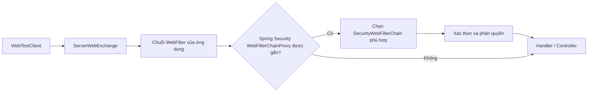

# Kiểm tra WebFilter bảo mật thật sự nằm trong đường xử lý

Trong chương **Thiết lập WebTestClient** của module **SPRING_SECURITY_TESTING**, một yêu cầu căn bản là chứng minh mỗi request kiểm thử thực sự đi qua **Spring Security WebFilter chain**. Nếu dùng `WebTestClient` nhưng không đưa security filters vào đường xử lý, controller vẫn có thể trả `200 OK` dù endpoint lẽ ra chỉ cho phép người dùng có quyền. Khi đó test xanh nhưng **không kiểm chứng xác thực, phân quyền hoặc bảo vệ HTTP**.

Module này tập trung dùng `spring-security-test` để kiểm chứng ứng dụng **Servlet với MockMvc** và **Reactive với WebTestClient**, từ `@WithMockUser`, `SecurityContext` đến JWT/OAuth2/OIDC giả lập, bao gồm cả trường hợp được phép và bị từ chối. Bài này đi sâu vào cách thiết lập WebTestClient trên **WebFlux**, lựa chọn cách bind phù hợp, dùng `springSecurity()`, và thiết kế các ca âm tính để phát hiện khi security filter không chạy. Nội dung giả định ứng dụng sử dụng Spring Security 6 và Spring Boot 3 ở mức minh họa; kiểm tra API phiên bản thực tế trước khi áp dụng vào dự án.

## 1. Vì sao có `SecurityWebFilterChain` vẫn chưa đủ?

Trong ứng dụng WebFlux, `SecurityWebFilterChain` mô tả các quy tắc bảo mật của request, còn Spring Security sử dụng **`WebFilterChainProxy`** để chọn chain phù hợp và đưa các security `WebFilter` vào chuỗi xử lý. Filter có thể xác thực HTTP Basic, Bearer JWT, OAuth2/OIDC Login; nạp/ghi security context; kiểm tra CSRF; hoặc quyết định một request có quyền truy cập tài nguyên hay không.



Trên môi trường HTTP thật, Spring WebFlux tích hợp các `WebFilter` được đăng ký vào web handler. Trong test có nhiều cách tạo `WebTestClient`; mỗi cách có phạm vi khác nhau. **Sự hiện diện của bean `SecurityWebFilterChain` trong context không tự chứng minh client đang kiểm thử request qua chain ấy.** Một client bind trực tiếp vào controller, một slice test không nạp cấu hình bảo mật, hay một `WebTestClient` tự dựng sai đều có thể bỏ qua bộ lọc thực tế.

Ví dụ rất dễ đánh lừa:

```java
webTestClient.get()
    .uri("/api/admin/report")
    .exchange()
    .expectStatus().isOk();
```

Test trên chỉ cho biết HTTP handler trả về 200 trong cấu hình client đang chạy. Nếu route đáng lẽ đòi `ROLE_ADMIN`, **200 với người dùng anonymous lại là dấu hiệu bảo mật đã bị bỏ qua hoặc cấu hình sai**. Cần kết hợp ca anonymous bị từ chối, user thiếu quyền bị từ chối và user đúng quyền được phép.

## 2. Ba cách tạo `WebTestClient` và phạm vi bảo mật

| Cách thiết lập | Phần được kiểm thử | Cách tích hợp Spring Security | Phù hợp nhất |
| --- | --- | --- | --- |
| `WebTestClient.bindToController(controller)` | Controller, handler và những thành phần được gắn thủ công | Không mặc nhiên dựng toàn bộ security filters của application context | Test logic HTTP đơn giản, chưa đủ cho security integration |
| `WebTestClient.bindToApplicationContext(context)` | WebFlux handler từ Spring application context | Dùng `.apply(springSecurity())` để tích hợp Spring Security Test khi tự tạo client | Kiểm tra filter chain trong bộ test không mở cổng HTTP |
| `WebTestClient.bindToServer().baseUrl(...)` | Server thật nhận request qua TCP/HTTP | Server phải chạy với security configuration thực; client chỉ gửi HTTP | Kiểm tra tích hợp qua mạng, session, cookie, redirect, header |

`bindToController` có thể được mở rộng với filter cấu hình thủ công, nhưng nếu mục tiêu là **xác minh `SecurityWebFilterChain` thật của ứng dụng**, hãy ưu tiên bind vào context đã nạp cấu hình bảo mật hoặc bind vào server thật. Tránh kiểm thử một controller thuần rồi ngầm coi kết quả là bằng chứng các WebFilter đã chạy.

**Đặc biệt khi bind đến server thật:** `mockUser()` hoặc `@WithMockUser` trong tiến trình test không tự đăng nhập request HTTP của server ở tiến trình xử lý riêng. Muốn test một principal đã xác thực qua mạng, dùng tài khoản/credential riêng cho môi trường test hoặc token được tạo bằng khóa test và gửi qua header/cookie thật.

## 3. Ví dụ tối thiểu với `SecurityWebFilterChain` cần được bảo vệ

Giả sử ứng dụng có ba endpoint: `/api/public` cho tất cả, `/api/account` cho người đã xác thực và `/api/admin/report` cho `ROLE_ADMIN`. Một controller WebFlux đơn giản:

```java
@RestController
class SampleController {

    @GetMapping("/api/public")
    Mono<String> publicMessage() {
        return Mono.just("public-data");
    }

    @GetMapping("/api/account")
    Mono<String> account(Mono<Principal> principal) {
        return principal.map(Principal::getName);
    }

    @GetMapping("/api/admin/report")
    Mono<String> report() {
        return Mono.just("admin-report");
    }

    @GetMapping("/api/internal")
    Mono<String> internal() {
        return Mono.just("must-be-blocked");
    }
}
```

Sau đó định nghĩa chính sách bằng WebFlux security DSL:

```java
@Configuration
@EnableWebFluxSecurity
class SampleSecurityConfig {

    @Bean
    SecurityWebFilterChain springSecurityFilterChain(ServerHttpSecurity http) {
        return http
            .authorizeExchange(exchange -> exchange
                .pathMatchers(HttpMethod.GET, "/api/public").permitAll()
                .pathMatchers(HttpMethod.GET, "/api/account").authenticated()
                .pathMatchers(HttpMethod.GET, "/api/admin/report")
                    .hasRole("ADMIN")
                .anyExchange().denyAll())
            .httpBasic(Customizer.withDefaults())
            .build();
    }
}
```

`hasRole("ADMIN")` yêu cầu authority `ROLE_ADMIN`. Trong ví dụ này, `httpBasic()` xác định cơ chế challenge cho anonymous request, vì vậy anonymous vào endpoint được bảo vệ thường nhận **401 Unauthorized**; principal đã xác thực nhưng thiếu quyền thường nhận **403 Forbidden**. Trường hợp dùng form login có thể trả `302` về trang đăng nhập; không áp đặt ma trận HTTP Basic lên mọi ứng dụng.

`anyExchange().denyAll()` giúp đóng những đường chưa được khai báo. Nó cũng tạo một ca phát hiện filter thiếu rất rõ: dù `/api/internal` tồn tại và trả dữ liệu nếu gọi controller trực tiếp, qua chain đúng thì request phải bị chặn.

### Cách đọc sự khác nhau giữa ba kết quả

| Request | Khi chain có hiệu lực | Nếu chỉ gọi controller trực tiếp |
| --- | --- | --- |
| Anonymous `GET /api/public` | 200 | 200 |
| Anonymous `GET /api/admin/report` | 401 với HTTP Basic | Có thể 200 — lỗi không phát hiện nếu thiếu negative test |
| `ROLE_USER` truy cập `/api/admin/report` | 403 | Có thể 200 |
| `ROLE_ADMIN` truy cập `/api/admin/report` | 200 | 200 — riêng ca này không chứng minh filter chạy |
| User bất kỳ `GET /api/internal` | Bị từ chối bởi `denyAll()` | Có thể 200 |

Điểm mấu chốt: **một ca 200 với người dùng có quyền không đủ làm bằng chứng bảo mật**, vì controller vẫn có thể trả 200 khi mọi security filter biến mất. Cần dùng cả những request mà chain phải chặn.

## 4. Dùng `bindToApplicationContext(...).apply(springSecurity())`

Khi tự tạo `WebTestClient` cho kiểm thử WebFlux không chạy server HTTP, hãy lấy **đúng application context có cấu hình bảo mật** và áp dụng `springSecurity()`:

```java
import static org.springframework.security.test.web.reactive.server.SecurityMockServerConfigurers.springSecurity;

@Autowired
ApplicationContext applicationContext;

WebTestClient webTestClient;

@BeforeEach
void setup() {
    webTestClient = WebTestClient
        .bindToApplicationContext(applicationContext)
        .apply(springSecurity())
        .configureClient()
        .build();
}
```

`springSecurity()` là configurer của `spring-security-test`, giúp tích hợp security filters và các tiện ích giả lập user/JWT/OAuth2 vào đường xử lý test. Điều kiện để bài test có ý nghĩa là `applicationContext` phải chứa `SecurityWebFilterChain` đúng phạm vi. Ví dụ, một context chỉ có controller nhưng không nạp bảo mật sẽ không kiểm tra được chính sách của ứng dụng.

**Không dùng `.apply(springSecurity())` như bằng chứng duy nhất.** Cần xác minh hành vi trên HTTP bằng các ca từ chối; nếu nạp nhầm context, cấu hình `securityMatcher` không khớp URL, hoặc các rule quá rộng, test vẫn có thể không kiểm chứng đúng chính sách.

### Khi dùng `@WebFluxTest`

`@WebFluxTest` là slice test tập trung vào controller/WebFlux. Để kiểm tra chính sách cụ thể, nên import cấu hình `SecurityWebFilterChain` cần test và đảm bảo các dependency tương ứng được cung cấp:

```java
@WebFluxTest(controllers = SampleController.class)
@Import(SampleSecurityConfig.class)
class SampleSecurityWebFluxTest {

    @Autowired
    WebTestClient client;

    @Test
    void anonymousCannotViewAdminReport() {
        client.get()
            .uri("/api/admin/report")
            .exchange()
            .expectStatus().isUnauthorized();
    }
}
```

Với Spring Boot, `@WebFluxTest` thường cấu hình `WebTestClient` từ slice test; hãy kiểm tra filter chain được nạp bằng negative test như trên. Nếu bạn **tự dựng** client từ context thay vì dùng client đã inject, áp dụng `springSecurity()` theo mẫu. Tùy security config, slice có thể cần bean bổ sung như `ReactiveUserDetailsService`, `ReactiveJwtDecoder`, `ReactiveOpaqueTokenIntrospector`, `ReactiveClientRegistrationRepository` hoặc các dependency security service; cung cấp fixture/test bean tương ứng, không bỏ hẳn rule để khiến context khởi động.

## 5. Ma trận kiểm thử chứng minh WebFilter thực sự có hiệu lực

Với cấu hình mẫu sử dụng HTTP Basic và các endpoint bên trên, có thể dùng `SecurityMockServerConfigurers.mockUser()` để tạo principal thử nghiệm **cho một request**:

```java
import static org.springframework.security.test.web.reactive.server.SecurityMockServerConfigurers.mockUser;

@Test
void publicRouteAllowsAnonymous() {
    client.get().uri("/api/public")
        .exchange()
        .expectStatus().isOk()
        .expectBody(String.class).isEqualTo("public-data");
}

@Test
void anonymousMustBeRejectedBySecurityFilter() {
    client.get().uri("/api/admin/report")
        .exchange()
        .expectStatus().isUnauthorized();
}

@Test
void authenticatedUserWithWrongRoleMustBeRejected() {
    client.mutateWith(mockUser("fixture-reader").roles("USER"))
        .get().uri("/api/admin/report")
        .exchange()
        .expectStatus().isForbidden();
}

@Test
void authenticatedAdminCanAccess() {
    client.mutateWith(mockUser("fixture-admin").roles("ADMIN"))
        .get().uri("/api/admin/report")
        .exchange()
        .expectStatus().isOk()
        .expectBody(String.class).isEqualTo("admin-report");
}

@Test
void unmatchedRouteIsDeniedEvenForAdmin() {
    client.mutateWith(mockUser("fixture-admin").roles("ADMIN"))
        .get().uri("/api/internal")
        .exchange()
        .expectStatus().isForbidden();
}
```

Các method ở trên đặt trong lớp test có `WebTestClient client` cấu hình đúng, và cần import static chuẩn cho `mockUser`. `mockUser(...)` tạo principal cùng authorities trong security context của request được kiểm thử; không kiểm tra mật khẩu thật. Về mặt chứng cứ, **anonymous 401 + thiếu role 403 + đúng role 200 + route denyAll bị chặn** mạnh hơn rất nhiều một test 200 đơn lẻ.

Nếu request trả 404 thay vì 401/403, hãy kiểm tra router/handler mapping, matcher và filter chain được chọn. Nếu luôn trả 200 dù thiếu quyền, kiểm tra client có đang bind trực tiếp vào controller, nạp sai `ApplicationContext`, hay bypass authentication/authorization filters hay không.

### Test `SecurityContext` trong pipeline reactive

Mã ứng dụng có thể cần đọc danh tính từ `ReactiveSecurityContextHolder`:

```java
@GetMapping("/api/security-name")
Mono<String> currentName() {
    return ReactiveSecurityContextHolder.getContext()
        .map(context -> context.getAuthentication().getName());
}
```

Nếu đã khai báo route `/api/security-name` trong config là `.authenticated()`, test có thể gọi qua `mockUser("fixture-reader")` và xác minh body `fixture-reader`. Điều này giúp chứng minh context đến được handler. Tuy nhiên, **chỉ thấy principal chưa đủ** để chứng minh rule bảo vệ đã chạy: vẫn cần test âm tính mà security filter buộc phải chặn. Trên WebFlux, không đọc `SecurityContextHolder` dạng thread-local từ bên ngoài request rồi suy luận về trạng thái bảo mật của reactive pipeline.

## 6. Phân biệt thử nghiệm `mockUser`, `@WithMockUser` và thông tin xác thực HTTP thật

`@WithMockUser` là annotation của Spring Security Test có thể đặt trên method/lớp test để cung cấp security context giả; `mockUser()` gắn danh tính cho `WebTestClient` tại từng request. Hai cách phù hợp khi muốn kiểm tra phân quyền với user đã xác thực.

Ví dụ dùng annotation trong test WebFlux có Spring Security Test và listener/test context được thiết lập:

```java
@Test
@WithMockUser(username = "fixture-admin", roles = "ADMIN")
void annotatedAdminCanReadReport() {
    client.get().uri("/api/admin/report")
        .exchange()
        .expectStatus().isOk();
}
```

`@WithMockUser` không gửi `Authorization: Basic ...` và không kiểm tra `PasswordEncoder`, user store hay thông tin đăng nhập HTTP. Với bài test xác thực Basic thật, cần tạo `ReactiveUserDetailsService` chứa **tài khoản chỉ dùng trong test**, rồi gửi header Basic và kiểm tra tên/mật khẩu sai được từ chối. Với JWT/OAuth2 resource server, cần token hoặc decoder fixture phù hợp mục tiêu kiểm tra.

Đối với `WebTestClient.bindToServer()` kết nối một server thật, annotation `@WithMockUser` đặt ở luồng test không tự lan qua socket tới server. Khi đó:

```java
WebTestClient httpClient = WebTestClient
    .bindToServer()
    .baseUrl("http://127.0.0.1:" + port)
    .build();

httpClient.get()
    .uri("/api/admin/report")
    .exchange()
    .expectStatus().isUnauthorized();

// Chỉ dùng tài khoản riêng của profile test có ROLE_ADMIN:
httpClient.get()
    .uri("/api/admin/report")
    .headers(h -> h.setBasicAuth(
        "fixture-admin", "fixture-password-only"))
    .exchange()
    .expectStatus().isOk();
```

Giả định server đã khởi chạy ở cổng `port`, được cấu hình HTTP Basic, có user thử nghiệm với password encoder nhất quán và role `ADMIN`. Đây là **request HTTP thật**, nên hai ca kiểm thử sẽ đi qua WebFilter thực của server. Không sao chép credential của staging/production vào bài test.

## 7. WebFilter bảo mật và WebFilter tùy chỉnh

Tên **WebFilter** trong đề bài có thể chỉ filter do chính ứng dụng viết hoặc các filter của Spring Security. Cần phân biệt:

- `org.springframework.web.server.WebFilter` là giao diện filter trong WebFlux. Ứng dụng có thể tự khai báo `WebFilter` để thêm correlation ID, logging an toàn, kiểm tra header... Các filter này có thể nằm ngoài các chain nội bộ của Spring Security.
- `SecurityWebFilterChain` là tập quy tắc/filter security được `WebFilterChainProxy` áp dụng khi request khớp chain. Nhiều `SecurityWebFilterChain` có thể tồn tại với matcher và `@Order` khác nhau.
- Có một bean `WebFilter` tùy chỉnh chạy thành công không chứng minh **Spring Security authorization filter** cũng chạy. Ngược lại, việc test security thành công cũng không mặc định chứng minh mọi custom WebFilter được đăng ký.

Nếu ứng dụng có một WebFilter tùy chỉnh bắt buộc, hãy kiểm tra riêng dấu hiệu nó thực thi, chẳng hạn response header/correlation ID do filter tạo, hoặc một service test có thể quan sát được. Nhưng vẫn phải thêm các ca 401/403/2xx để chứng minh chính **security policy** được áp dụng.

Với nhiều chain, thứ tự chọn chain là điều quan trọng. Một chain `permitAll()` tổng quát đặt trước chain `/api/admin/**` có thể khiến policy cụ thể không được áp dụng. Hãy thử request thuộc **từng nhóm path matcher** và xác minh rule mong đợi. Đừng chỉ kiểm tra rằng bean `SecurityWebFilterChain` tồn tại hoặc rằng đã gọi `.apply(springSecurity())`.

## 8. Kiểm thử JWT, OAuth2/OIDC và CSRF đúng ranh giới

Các tiện ích trong `spring-security-test` giúp thiết lập danh tính phù hợp với từng cơ chế, nhưng **đều cần đường xử lý filter hợp lệ** để test permission của HTTP endpoint có ý nghĩa:

| Cơ chế | WebTestClient test helper | Kiểm tra được | Chưa chứng minh |
| --- | --- | --- | --- |
| Username/role | `mockUser()` hoặc `@WithMockUser` | `hasRole`, `hasAuthority`, principal và bảo vệ URL | Password encoder, xác thực HTTP Basic thật |
| Bearer JWT resource server | `mockJwt()` | Quyền từ principal JWT/authorities được gắn trong test | Chữ ký, `iss`, `aud`, `exp`, `nbf` của JWT qua decoder thật |
| Opaque bearer token | `mockOpaqueToken()` | Quyền và principal sau introspection thành công giả lập | HTTP introspection thật, timeout, `active:false` |
| OAuth2 Login | `mockOAuth2Login()` | Trạng thái principal OAuth2 đã đăng nhập | Authorization Code callback và token exchange |
| OIDC Login | `mockOidcLogin()` | Claim `OidcUser`, ID token/UserInfo giả và authorization sau login | `state`, `nonce`, chữ ký và issuer của ID token thật |

Ví dụ, với security config resource server có endpoint yêu cầu `SCOPE_reports.read`, một test quyền phù hợp là:

```java
client.mutateWith(mockJwt().authorities(
        new SimpleGrantedAuthority("SCOPE_reports.read")))
    .get().uri("/api/reports")
    .exchange()
    .expectStatus().isOk();
```

`mockJwt()` đến từ `SecurityMockServerConfigurers` và thường đòi hỏi security chain có resource server phù hợp để assertion phản ánh chính sách API. Muốn kiểm tra JWT hết hạn/invalid signature, thay `mockJwt()` bằng Bearer token được ký bởi khóa test và để `ReactiveJwtDecoder` thực sự chạy. Các bài OAuth2/OIDC Login thật cần provider stub, session, callback và validator thích hợp.

### CSRF là một security filter khác phải được thử nghiệm

Đối với endpoint POST/PUT/PATCH/DELETE chạy trong chế độ CSRF protection, người dùng đã xác thực **vẫn có thể bị 403** nếu thiếu CSRF token. Việc chỉ dùng `mockUser()` không bảo đảm POST được phép:

```java
// Giả sử POST /api/admin/approve có rule ROLE_ADMIN và CSRF bật.
client.mutateWith(mockUser("fixture-admin").roles("ADMIN"))
    .post().uri("/api/admin/approve")
    .exchange()
    .expectStatus().isForbidden();

client.mutateWith(mockUser("fixture-admin").roles("ADMIN"))
    .mutateWith(csrf())
    .post().uri("/api/admin/approve")
    .exchange()
    .expectStatus().isOk();
```

`csrf()` là test configurer cho WebTestClient từ `SecurityMockServerConfigurers`, áp dụng khi endpoint và policy đã được cấu hình phù hợp. Phải có controller POST tương ứng và rule cho phép `ROLE_ADMIN` để ca 200 có ý nghĩa. Nếu API hoàn toàn stateless và có cấu hình CSRF khác, kỳ vọng có thể thay đổi. Không tự disable CSRF chỉ để bài test xanh.

## 9. Những dấu hiệu WebFilter security bị bỏ qua hoặc bị cấu hình sai

| Triệu chứng trong test | Nguyên nhân có thể | Cách xác minh/khắc phục |
| --- | --- | --- |
| Anonymous vào endpoint admin trả 200 | Client bind controller trực tiếp hoặc không có security filters | Bind vào application context có chain, áp dụng `springSecurity()`, chạy lại negative test |
| User chỉ có `ROLE_USER` vẫn xem được admin | Matcher khác đường dẫn thực hoặc rule `permitAll()` che phủ | Kiểm tra `pathMatchers`, thứ tự chain và test 403 |
| Mọi request trả 401, kể cả khi `mockUser()` | Mock principal không đi vào reactive context, hoặc chain/cấu hình sai | Kiểm tra test configurer, security context và role đúng trong request |
| Mọi request trả 403, kể cả admin | `denyAll`, thiếu CSRF, role/authority sai hoặc matcher sai | Thử GET trước, phân biệt CSRF với authorization, kiểm tra `ROLE_ADMIN` |
| Request trả 404 | Không có handler, sai URI hoặc slice thiếu controller | Xác minh handler mapping và URL; sau đó mới đánh giá security |
| `@WebFluxTest` không tạo được context | Thiếu bean dependency cho security config, JWT decoder, OAuth2 client | Cấp test bean đúng contract thay vì bỏ security config |
| Test với `bindToServer` không nhận `@WithMockUser` | Annotation chỉ ảnh hưởng context phía test | Gửi HTTP Basic/Bearer fixture hoặc test trong application context |
| Mock JWT thành công với token đã hết hạn | `mockJwt()` bỏ qua decoder/validator thời gian | Dùng bearer JWT ký test và decoder thật cho ca validate thời gian |
| Endpoint trả 200 khi không áp dụng đúng chain | Nhiều `SecurityWebFilterChain` và `@Order`/matcher chọn nhầm | Thử từng path và hành vi 401/403/2xx với filter thực |

Trong Reactive, context đi theo **Reactor subscription**, không đơn thuần phụ thuộc thread. Nếu service dựa vào `ReactiveSecurityContextHolder`, cần bảo đảm code không tự tách pipeline làm mất context; nếu có scheduling hoặc asynchronous processing, viết test qua request thực để kiểm tra principal còn tồn tại tại vị trí sử dụng. Không chỉ đọc một `SecurityContextHolder` từ test thread để kết luận WebFlux security hoạt động.

## 10. Thiết kế phép kiểm chứng đủ mạnh cho CI

Để xác nhận WebFilter thật sự tham gia đường xử lý, kiểm thử cần có cả **hành vi cho phép** và **hành vi từ chối**. Một quy trình tối thiểu:

1. Nạp đúng `SecurityWebFilterChain` trong context test; khi tự bind bằng `bindToApplicationContext`, gọi `.apply(springSecurity())`.
2. Dùng anonymous request tới endpoint cần đăng nhập; khẳng định nhận challenge/từ chối đúng hợp đồng (401 khi dùng HTTP Basic/Bearer, hoặc redirect theo login flow).
3. Dùng principal đã xác thực nhưng thiếu quyền; khẳng định 403 hoặc mã từ chối theo cấu hình.
4. Dùng principal đủ quyền; khẳng định 2xx **và body nghiệp vụ** đúng, tránh test chỉ nhìn status.
5. Thêm route nằm dưới `denyAll()` hoặc một matcher đặc thù; xác nhận ngay cả user có quyền cũng bị chặn nếu rule định nghĩa như vậy.
6. Nếu có CSRF, thêm cặp test POST thiếu và có CSRF token.
7. Nếu có nhiều chain hoặc một custom WebFilter, viết ca riêng cho mỗi matcher và dấu hiệu filter đó thật sự chạy.
8. Chạy lại trong CI với dữ liệu bảo mật giả lập, không dựa trên credential/tokens môi trường triển khai. Xem xét log khi thất bại nhưng không in access token, password hoặc cookie.

### Bài thực hành: phát hiện test xanh giả

Tạo `SampleController` và `SampleSecurityConfig` như mục 3. Cố tình viết test đầu tiên bằng:

```java
WebTestClient unsafeClient = WebTestClient
    .bindToController(new SampleController())
    .build();

unsafeClient.get().uri("/api/admin/report")
    .exchange()
    .expectStatus().isOk();
```

Kết quả 200 trong trường hợp này **chỉ chứng minh controller hoạt động**; không chứng minh policy yêu cầu `ADMIN`. Sau đó đổi sang client bind vào application context đúng cấu hình, áp dụng Spring Security Test và chạy anonymous GET `/api/admin/report` phải 401, `ROLE_USER` phải 403, `ROLE_ADMIN` phải 200. Thêm `/api/internal` bị `denyAll()` chặn để bảo đảm không phải chỉ một rule tình cờ đúng.

Người học đạt mục tiêu khi giải thích được vì sao hai client có thể cho kết quả khác nhau trên **cùng URI**, và chứng minh được kết quả từ client đã tích hợp security phản ánh chính xác chính sách HTTP của ứng dụng.

## Ghi nhớ

**`WebTestClient` chỉ là công cụ gửi request; việc có security `WebFilter` hay không phụ thuộc cách dựng client và ứng dụng mà nó đang kiểm thử.** Với WebFlux test dựa trên application context, dùng `springSecurity()` và nạp đúng `SecurityWebFilterChain`; với HTTP server thật, bảo đảm server đang chạy security configuration cần test. Một request 200 không đủ: **anonymous bị từ chối, user thiếu quyền bị từ chối, user đủ quyền được phép** mới là bằng chứng thực tế rằng bảo vệ HTTP đã tham gia đường xử lý. Các tiện ích `mockUser()`, `mockJwt()`, `mockOpaqueToken()` và `mockOidcLogin()` giúp kiểm tra trạng thái sau xác thực; khi muốn kiểm tra chính quy trình xác thực, phải gửi request/token thực sự đi qua các thành phần tương ứng trong môi trường test cô lập.
